# XCOS

## 8.1 简介

历史上，MATLAB 有一个特性使其在教学计算便利性方面脱颖而出——Simulink。Simulink 并非基础 MATLAB 的一部分，因此需要单独购买。借助 Simulink，你可以通过可视化的方式连接代码块来编写程序。Scilab 则提供了一个与之对应的工具 XCOS。XCOS 是一个用于对动态（连续和离散）系统进行建模和仿真的工具箱。尽管其主要用途是仿真动态系统，但 XCOS 也可用于信号生成、数据可视化以及简单的代数运算。当仿真涉及互联的连续时间和离散时间组件的系统时，XCOS 将完美适用于建模和仿真工作。

对于新用户而言，XCOS 是 Scilab 中最强大的工具之一。由于它是一个基于图形用户界面的编程环境，用户只需连接各个模块即可编写代码。这些代码块可以按用户意愿进行拖拽和连接。代码内部的信息流由代码块之间连接器的方向和使用方式定义。这些模块实际上是通用化代码的图形化表示，其输入和输出可根据使用情况进行更改。

XCOS 提供了一种使用模块图可视编辑器的模块化方法来对复杂系统进行建模。模块化方法使得开发仿真的过程变得非常简单，因为用户只需将一个模块替换为另一个模块，即可在不同场景下测试系统。XCOS 模型在单次运行中完成编译和仿真。生成的数学方程由具有可配置参数的数值求解器进行积分求解。

## 8.2 安装 XCOS

最新版本的 Scilab 预装了 XCOS，但如果你使用的是旧版本，可以像安装其他软件包一样，使用 `Atoms` 包管理器轻松安装它。图形化安装方式是：点击菜单栏中的 `Applications`，然后点击 `module manager Atoms`。接着，找到 XCOS 并点击 `Install`。此操作需要有效的互联网连接，安装时间取决于下载软件包所需的时间以及计算资源的速度。

离线安装则需要你先将 XCOS 软件包作为 `.zip` 文件下载到指定位置，然后在 Scilab 命令终端中执行以下命令：

```
1  −−>atomsInstall("download_path\file_name_zip_")
```

在此，你需要替换为已下载的 `.zip` 文件的实际下载路径。

## 8.3 启动 XCOS

XCOS 可以通过命令行启动，也可以通过点击工具栏中的图标启动。需要注意的是，执行此操作需要图形终端。大多数运行最新操作系统的现代计算机都具备图形处理能力。XCOS 的图形化显示依赖于本地操作系统的图形配置。通常，新用户无需调整图形配置即可使用 XCOS，但如果问题持续存在，咨询系统管理员是一个不错的选择。

### 8.3.1 使用命令行

在 Scilab 命令行中，你只需输入命令 `xcos` 即可启动 XCOS 环境。此时会打开一个模块浏览器和一个仿真编辑器供用户编辑。计算机屏幕的示例截图如图 8-1 所示。

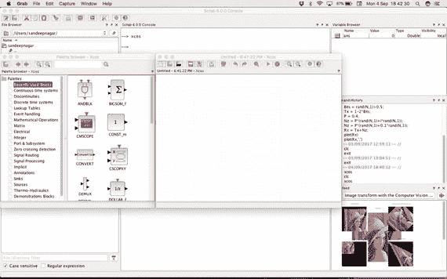

**图 8-1** XCOS 窗口截图

### 8.3.2 使用图形符号

你也可以通过点击 Scilab 主工具栏中的符号来打开 XCOS，正如图 8-2 中箭头所示。工具栏中的符号看起来像图 8-3。


**图 8-3** XCOS 窗口截图

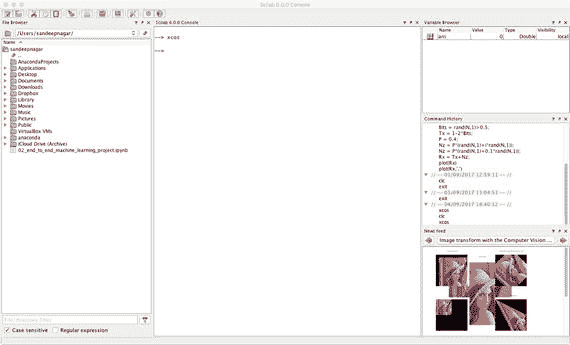

**图 8-2** XCOS 窗口截图

### 8.3.3 通过菜单栏

在 Scilab 菜单栏中，你可以点击 `Applications`，然后点击 `XCOS` 来打开一个 XCOS 会话。

## 8.4 XCOS 模块库

XCOS 模块库窗口（如图 8-4 所示）允许你选择按各种应用场景分类的模块。

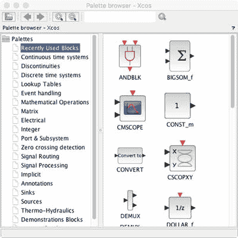

**图 8-4** XCOS 模块库窗口截图

XCOS 模块库窗口显示了所有可供使用的模块库。它们可以被拖拽到 XCOS 编辑器窗口（8.5）中并放置，以便相互连接。模块浏览器有两个窗格。左侧窗格根据不同的功能列出了可用的预定义模块库（库）的分区列表。（参见图 8-2。）

- 最近使用的模块
    - 随着你使用 XCOS，某些模块的使用频率会高于其他模块。它们会保存在此处，这样你就不必每次都去寻找了。
- 连续时间系统
- 非连续性
- 离散时间系统
- 查找表
- 事件处理
- 数学运算
- 矩阵
- 电气
- 整数
- 端口与子系统
- 过零检测
- 信号路由
- 信号处理
- 隐式
- 注解
- 数据接收器
- 信号源
- 热工水力学
- 演示模块
- 用户自定义函数

右侧窗格包含每个模块库中可用的模块。通过点击左侧窗格中的另一个模块库，右侧窗格中将会显示一组新的模块。

## 8.5 XCOS 编辑器

编辑窗口是 Xcos 用于开发新模型（图示）的工作区。XCOS 编辑器窗口（如图 8-5 所示）允许你通过从调色板窗口选择调色板，用鼠标拖拽并释放到编辑器中来设计模型。你也可以通过在库中右键点击模块并选择 `Add to ->` “图示名称”来将模块添加到图示中。

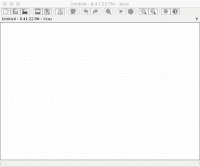

**图 8-5** XCOS 编辑器窗口截图

编辑器窗口上会出现多个模块，它们带有输入和输出端口。这些端口可以被连接起来构成一个模型。多个模块可以按所需方式连接，以定义特定的仿真。然后可以通过点击编辑器窗口工具栏上的箭头图标来运行仿真。如果仿真未设置停止时间，它将持续运行。你可以通过点击 `Stop` 按钮来停止它，该按钮位于 `Start` 按钮旁边。编辑器中还按从左到右的顺序排列着以下按钮：

- `New`：新建一个图示
- `Open`：打开计算机上任意位置保存的现有图示
- `Open file in Scilab Current Directory`：打开当前工作目录中保存的现有图示
- `Save`：将图示保存到计算机中
- `Save as`：将图示保存为其他格式，例如 `zcos`（压缩的 XCOS 文件）、`xcos`（XCOS 文件）、`xmi`（Eclipse EMF 文件）
- `Print`：将图示打印到打印机或保存为 PDF 文件
- `Delete`：删除一个模块
- `Undo`：撤销上一步执行的操作。此操作可以连续进行。
- `Redo`：在执行 `Undo` 操作后恢复之前的状态。此操作也可以连续进行。
- `Fit diagram or blocks to view`：有时制作图示所需的区域会超出屏幕范围，此窗口会出现滚动条。使用此按钮，可使整个图示适配窗口大小。
- `Start`：启动一个仿真
- `Stop`：停止一个仿真
- `Zoom in`：放大图示视图
- `Zoom out`：缩小图示视图
- `Xcos Demonstrations`：运行一些基本演示
- `Help`：寻求关于 XCOS 命令的帮助，你可以在此输入查询内容，然后被引导至有用且相关的文档

让我们点击 `Xcos Demonstrations` 按钮来启动一个简单的演示图示。我们会看到一个类似于图 8-6 所示的窗口。

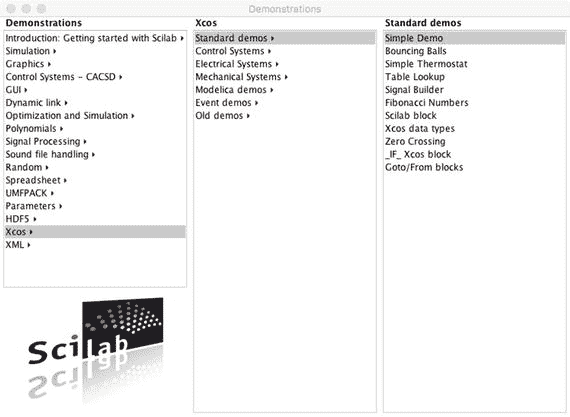

**图 8-6** 显示 XCOS 演示选项的窗口

通过点击 `Standard Demos` 然后点击 `Bouncing Balls`，我们会看到一个类似于图 8-7 所示的窗口。

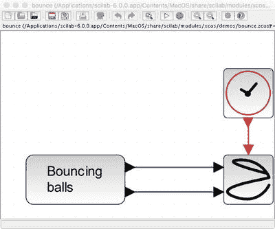

**图 8-7** 显示 XCOS 演示 ⇒ 标准演示 ⇒ 弹球的窗口

当我们运行这个仿真时，会观察到一个仿真模型：四个不同大小和颜色的球以不同速度在窗口壁之间弹跳。此窗口的截图如图 8-8 所示。

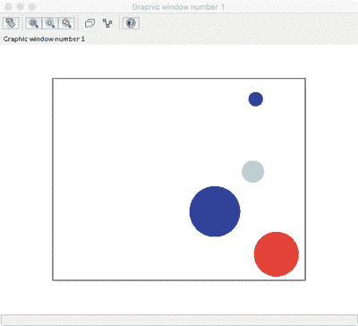

**图 8-8** 显示弹球动画的窗口截图

## 8.6 XCOS 菜单栏

在本节中，我们将介绍 XCOS 的菜单栏，以便初学者能高效地导航他们的工作流程。XCOS 菜单栏位于 XCOS 窗口的顶部。快捷键显示在命令旁边，此处也已提及。大多数情况下，这些键使用键盘上的 `Control` 键，用 `Ctrl` 表示。当需要同时按键时，组合键会用加号显示在中间。例如 `Ctrl+N` 表示同时按下 `Control` 键和 `N` 键。

- **文件**

## 文件

*   `新建` (`Ctrl+N`): 该菜单项会在新窗口中打开一个新的空白 Xcos 图表。
*   `打开` (`Ctrl+O`): 该菜单项用于加载包含已保存框图或模块库的 XML 文件 (`.zcos`) 或二进制文件 (`.cos`)。此命令会打开一个对话框，允许您选择文件夹和文件。
*   `保存` (`Ctrl+S`): 选择 `保存` 菜单项可将图表保存为 XML 文件。首次执行此操作或未使用过`另存为`菜单项时，对话框会允许您选择目录并指定不带扩展名的文件名。默认扩展名为 `.zcos`。图表将采用文件名（不带扩展名）作为其名称。
*   `另存为` (`Ctrl+Shift+S`): 该菜单项用于将框图或模块库以新名称保存到文件中。对话框允许指定不带扩展名的文件名和保存文件夹。默认扩展名为 `.zcos`。图表将采用文件名（不带扩展名）作为其名称。
*   `导出` (`Ctrl+E`): 该菜单项用于导出当前 XCOS 图表图形。可导出为 `wbmp`、`gif`、`html`、`JPEG`、`JPG`、`png`、`svg` 和 `vml` 格式。
*   `最近文件`: 该菜单项允许快速访问最近打开过的文件。
*   `打印` (`Ctrl+P`): 该菜单项将当前图表打印到打印机上。
*   `关闭` (`Ctrl+W`): 当打开多个图表时，该菜单项关闭当前图表。
*   `退出` (`Ctrl+Q`): 该菜单项将关闭 XCOS。

## 编辑

*   `撤销` (`Ctrl+Z`): 选择 `撤销` 菜单项可撤销上一步的编辑操作，以纠正错误。
*   `重做` (`Ctrl+Y`): 选择 `重做` 菜单项可重做上一步被撤销的编辑操作。
*   `剪切` (`Ctrl+X`): 该菜单项用于从图表中移除选中的对象，并将其复制到剪贴板。剪切一个模块时，与其连接的所有连线也将被删除。
*   `复制` (`Ctrl+C`): `复制` 用于将选中项的副本放入剪贴板。
*   `粘贴` (`Ctrl+V`): `粘贴` 将剪贴板中的内容放入当前图表。
*   `删除` (`Delete`): 要删除模块或连线，先选中要删除的对象，然后选择 `删除` 菜单项。删除一个模块时，与其连接的所有连线也将被删除。
*   `全选` (`Ctrl+A`): 该菜单项选中当前图表中的所有模块。
*   `反选`: 该菜单项反转当前的选择状态。
*   `模块参数` (`Ctrl+B`): 该菜单项为当前选中的模块打开模块配置对话框。配置取决于所使用的模块（请参阅 `模块帮助` 菜单项以获取关于其配置的更多信息）。
*   `选中项转为超模块`: 该菜单项将选中的一组模块转换为一个超模块。

## 视图

*   `放大` (`Ctrl+加号`): 选择此菜单项时，图表将放大 10%。
*   `缩小` (`Ctrl+减号`): 选择此菜单项时，图表将缩小 10%。
*   `适合窗口`: 选择此菜单项时，图表将适应当前窗口的大小。
*   `正常 100%`: 该菜单项将图表组件调整为其正常显示尺寸。
*   `模块库浏览器`: 该菜单项打开模块库浏览器。
*   `图表浏览器`: 该菜单项显示一个窗口，其中列出了图表的全局属性及其所有对象（模块和连线）。
*   `视口`: 该菜单项显示视口窗口。使用视口，您可以将工作区移动到图表的某一部分。您可以放大或缩小图表的各个部分。
*   `详情`: 选中一个模块后，该菜单项会显示一个窗口，列出该模块的属性。

## 仿真

*   `设置`: 在主 XCOS 窗口中，点击 `设置` 菜单项会调用对话框，允许更改控制参数。
*   `执行跟踪与调试`: 该菜单项将 XCOS 设置为调试模式。它会打开一个对话框，您可以在其中选择调试模式。
*   `设置上下文`: 通过此菜单项，您可以打开一个对话框，在其中输入 Scilab 指令以定义模块定义中使用的符号化 XCOS 参数。每次加载图表时都将评估这些指令。如果您在上下文中更改了某个符号化 XCOS 参数的值，点击 `确定` 后，所有包含此符号化参数的模块都将更新。
*   `编译`: 该菜单项编译框图。通常无需使用此功能，因为编译是自动完成的。通常，如果只修改了系统参数和内部状态，则无需新编译。
*   `Modelica 初始化`: 该菜单项为 Modelica 编译器打开一个特定对话框，您可以在其中查看绘制模型的组件，并选择求解器。
*   `启动`: 该菜单项启动仿真。如果系统已经仿真过，会弹出一个对话框，您可以在其中选择继续、重新启动或结束仿真。
*   `停止`: 您可以通过点击 `停止` 菜单项来中断仿真。可以更改模块参数，然后再次继续仿真。

## 格式

*   `旋转` (`Ctrl+R`): `旋转` 允许您将模块向左旋转 90°。旋转会影响所有选中的模块。
*   `翻转` (`Ctrl+F`): 要反转模块顶部和底部的使能输入输出位置，请选中一个模块并选择 `翻转` 菜单项。这不会影响输入和输出事件端口的顺序和位置，其编号从左到右。翻转会影响所有选中的模块。
*   `镜像` (`Ctrl+M`): 要反转模块左侧和右侧的（常规）输入输出位置，请选中一个模块并选择 `镜像` 菜单项。这不会影响输入和输出端口的顺序和位置，其编号从上到下。镜像会影响所有选中的模块。
*   `显示/隐藏阴影`: 该菜单项允许您为选中的模块和相关参数选择 3D 形状。
*   `对齐模块`: 当您选择多个模块时，可以将其在水平轴（顶部、底部和中间）或垂直轴（左侧、右侧、中心）上对齐。
*   `边框颜色`: 该菜单项允许您更改选中模块的边框颜色。
*   `填充颜色`: 该菜单项允许您更改选中模块的填充颜色。
*   `自动定位`: 该菜单项允许您更改模块的位置。首先选中一个或多个模块，然后选择相应的菜单项或使用快捷键 (`P`)。
*   `连线样式`: 该菜单项允许您更改连线的样式。首先选中连线，然后选择相应的菜单项或使用快捷键 (`H`)、(`S`)、(`V`) 和 (`O`)。
*   `图表背景`: 该菜单项允许您更改背景颜色。
*   `网格`: 该菜单项允许您激活/停用网格。使用网格，模块和连线在工作区上的放置更容易，并且可以获得更易读的图表。

## 帮助

*   `Xcos 帮助` (`F1`): 该菜单项在 XCOS 帮助章节打开主帮助浏览器（如果尚未打开）。
*   `模块帮助`: 要获取 XCOS 模块的帮助，请选中该模块，然后点击此菜单项。
*   `XCOS 演示`: 该菜单项允许您打开一些 XCOS 图表示例。
*   `关于 XCOS`: `关于 XCOS` 项在一个对话框中显示 XCOS 的当前版本。

## 8.7 从零复现弹球示例

作为示例，我们尝试从零复现前面讨论过的弹球示例。首先，在 XCOS 调色板窗口的左侧窗格中选择 `演示模块` 选项。点击该选项后，会显示三个模块，如图 8-9 所示。本示例展示了一个 XCOS 仿真，用于可视化三个彩色球体在其环境墙壁上的弹跳过程。其中一个模块 `Bounce` 生成输入，另一个模块 `BounceXY` 生成输出。因此，前者在其右侧有两个输出端口，而后者在其左侧有两个输入端口。

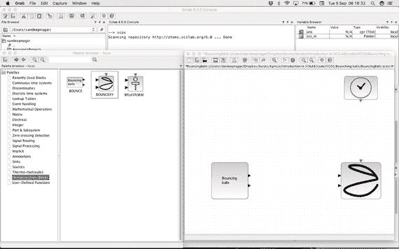

**图 8-9** 弹球示例的 XCOS 屏幕截图

现在，我们将标题为 `Bounce` 和 `BounceXY` 的模块拖放到 XCOS 编辑器窗口中。模块 `Bounce` 有两个输出选项，而 `BouncyXY` 有两个输入选项。`BounceXY` 模块实际上还有第三个用于定时器的端口。定时器模块可以从 `事件处理` 部分获取。当这三个模块都被拖放到编辑器窗口后，你会看到与图 8-9 类似的界面。

一旦你点击了 `Bounce` 模块的某个输出，其周围会高亮显示一个小绿色方块。可以点击并拖动连接线，直到到达 `BouncyXY` 模块的输出端，从而建立连接。你还需要一个定时模块，它控制此仿真的定时参数。这可以在调色板窗口左侧窗格的 `事件处理` 部分找到。

现在，这三个模块可以连接起来，形成一个连接的示意图，如图 8-10 所示。

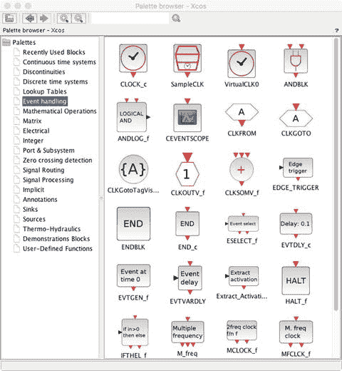

**图 8-10** 名为“事件处理”的 XCOS 调色板窗口部分

你可以将此仿真保存为一个名称，例如`BouncingBalls.zcos`文件。然后可以通过点击`启动`按钮来运行此仿真。与8.8节中的仿真模型不同，此处你只会观察到两个球体快速弹跳。

可以通过右键点击模块并选择`模块参数`来更改模块的属性。例如，对于当前仿真中的所有三个模块，你可以看到一系列参数（如图8-12、8-13和8-14所示）可以被更改以运行仿真。

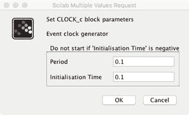

图 8-14  
更改“`CLOCKc`”模块的参数

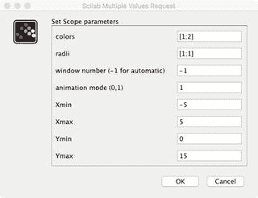

图 8-13  
更改“`BOUNCEXY`”模块的参数

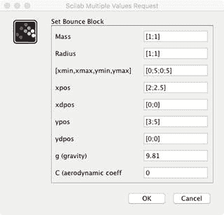

图 8-12  
更改“弹球”模块的参数

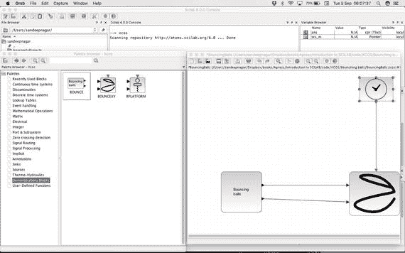

图 8-11  
从零搭建的弹球示意图的 XCOS 屏幕截图

## 8.8 使用 XCOS 进行仿真

仿真可以证明是教学和快速制作科学模拟的一个非常强大工具。由于它们本质上是图形化的，问题设计起来非常直观。在教学时，你可以先避免涉及定义代码的技术部分。此外，动画在视觉上也很有吸引力。

由于本章的主要任务是演示 XCOS 最基本的用法，因此省略了所有模块用法的介绍。鼓励用户根据需要探索其他模块。每个仿真模型都有不同的需求，但可以遵循如下类似模式：

- 将物理问题分解为更小的模块
  - 每个模块必须根据明确定义的输入 + 操作 + 输出来定义要执行的特定任务。
- 定义每个模块的输入和输出
  - 根据通道数量、每个通道的数据类型、数据频率等定义每个模块的性质。
- 选择符合这些要求的 XCOS 模块，并根据模型要求连接它们。
- 根据需要更改模块的属性来调整模型。

非常复杂的模型需要定义超级模块。超级模块是一个功能完整的 XCOS 图，可以进一步作为一个单一的模块，并用于其他的仿真图中。通过这种方式，你可以将更大的问题分解为模块及其子模块。这种模块化方法便于调试，前提是所有模块都标记良好，并且开发者充分了解特定模块的能力。

## 8.9 总结

在本章中，我们讨论了使用 Scilab 附带的 XCOS 模块。它提供了以图形方式编程物理问题的能力。物理问题必须分解成代码片段。这些模块必须明确定义输入和输出端口，并且其用途应作为代码开发过程的一部分，前提是开发者知道要查找哪个模块、在哪里查找以及如何使用它。每个模块的文档都非常详尽，可以通过`帮助`窗口找到。通过这最后关于 XCOS 的一章，我们对 Scilab 的介绍就结束了。

## 索引

A  
二维动画  
`comet()` 函数  
`paramfplot2d()` 函数  
数组  
逻辑运算  
矩阵运算  
拼接  
删除矩阵  
`det()`  
逐元素索引  
求逆  
数学向量  
矩阵乘法  
`pinv()` 函数  
随机矩阵  
`rank()` 函数  
行与列  
切片  
`trace()` 函数  
单位向量  
向量  
B  
`bitxor()` 函数  
布尔数据  
C  
注释  
复数  
`abs()` 函数  
算术运算  
复数分量  
共轭  
图形描述  
`imult` 方法  
实部和虚部  
D  
数据类型  
浮点数对象  
数字  
数值数据  
离散数学  
`factor` 推导  
阶乘  
输出  
排列  
质数  
输出  
`rat()` 推导  
E  
指数  
欧拉数  
F, G  
浮点表示  
H, I, J, K  
直方图  
L  
线性方程  
M  
数学计算  
`addsub.sce`  
计算器命令提示符  
演示程序  
变量  
矩阵操作  
对角矩阵  
数学运算  
`cross()` 函数  
点积  
全一矩阵和全零矩阵  
重塑  
标量乘法  
特殊矩阵  
上三角矩阵和下三角矩阵  
N  
数值计算  
O  
运算符优先级  
P, Q  
绘图  
3D 绘图：`multi.sce`、`paramfplot2d` 函数、`subplot(行, 列, 索引)` 命令  
2D 绘图：`champ`、`contour2d()` 函数、等高线图、`grayplot`、直方图、`matplot` 命令、`plot2d()`、`plot2d2()`、`plot2d3()` 和 `plot2d4()`、`plot(x, y)`、极坐标图、`polarplot()`  
3D 绘图：直方图、网格图、`plot3d`、`plot3d1()` 函数、`plot3d2()`、`plot3d3()`、曲面图  
预定义常量  
`complexCal.sce`  
`constants.sce`  
数学函数  
输出  
R  
读取-求值-打印循环 (REPL)  
S  
Scilab 应用程序  
分析函数  
命令提示符文件  
格式化命令提示符  
默认模式  
`format()` 函数  
源代码  
Hello World  
帮助浏览器窗口  
历史  
安装  
MATLAB 包  
数值计算  
SciNotes 窗口  
变量浏览器  
变量浏览器窗口  
工作空间  
字符串  
T, U  
`testmatrix()` 函数  
V, W, X, Y, Z  
变量浏览器窗口  
变量  
赋值运算符 (`=`)  
全局变量和局部变量  
列表  
命名约定  
字符串  
向量  
自动生成命令  
线性间隔向量  
对数性质  
`meshgrid`  
`ndgrid`  
索引