# 2. 使用 Scilab

## 2.1 使用 Scilab

如第 1 章所述，在 Scilab 中有两种工作方式。第一种方式是逐条在命令行键入命令。标题为“Scilab 6.0.0 Console”（如图 1-1 中间部分所示）的区域提供了命令行，其光标形状为 `-->`。你可以在此处编写命令以立即执行。例如，让我们从编写任何编程语言的第一个程序开始——在命令提示符下打印单词 `Hello World`。

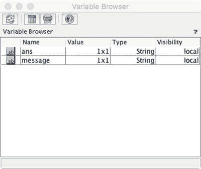
图 2-1 显示两个变量的变量浏览器窗口。

这可以通过简单地在命令提示符下编写以下内容来完成：

```
1  −−>message = "Hello World!"
2  message =
3  Hello World!
4  −−>disp(message)
5  Hello World!
```

当输入第一个命令 `message = "Hello World!"` 时，你可以看到标题为 `变量浏览器` 的窗口中填充了两个变量：`ans` 和 `message`。

该窗口还说明了存储在这些变量中的值的属性。两者存储相同的值，即一个字符串。`ans` 变量将根据接下来在命令提示符下键入的内容被追加新值，但变量 `message` 将保持不变，直到它被赋予另一个值为止。

## 2.2 处理 Scilab 文件

第二种方法是编写一个脚本（即一组多条命令）并保存为文件。Scilab 提供两种脚本文件。`.sci` 和 `.sce` 两种格式明确区分了它们：

- `.sci` 文件包含 Scilab 和/或用户定义的函数。执行此类文件只是将它们加载到 Scilab 环境中，但并不会执行它们。
- `.sce` 文件同时包含 Scilab 函数和可执行命令。当调用这些文件时，它们会被执行。

拥有两种文件类型是 Scilab 与 MATLAB 的区别之一。在 MATLAB 中，并不区分函数文件和用于执行的文件，所有文件都简单地以 `.m` 扩展名表示。

在代码清单 2-1 中，我们将编写一个名为 `hello.sce` 的 Scilab 文件并运行它。该文件使用了与我们在第 2.1 节中看到的类似代码，当时我们在命令提示符下打印了 `Hello World!`。

```
1  message = "Hello World"
2  disp(message)
代码清单 2-1 hello.sce
```

要运行此文件，您可以简单地点击 `SciNotes` 窗口菜单栏上的“播放”图标。或者，您可以指定文件的完整路径来运行它。如果您正在与文件相同的目录下工作，您只需在命令 `exec()` 中打印文件名，无需提及扩展名。

文件命名遵循常规惯例。首字母不应是特殊字符或数字，并且文件名区分大小写。命名文件时应避免使用关键字。也建议用户在特定项目中，将工作文件保存在单个文件夹中。这样做的优点是，为了运行程序，用户只需编写程序名称，而不需要文件的完整路径。此外，也更容易共享代码供执行，因为不同计算机的路径会不同。

## 2.3 第二个示例：一个数学计算

您可以通过在命令提示符下键入以下内容来编写第一个程序，打印字符串 “Hello World!”：

```
1  −−>a = 2
2  a =
3  2.
4  −−>b = 3
5  b =
6  3.
7  −−>a+b
8  ans =
9  5.
10  −−>a−b
11  ans =
12  −1.
```

首先，变量 `a` 被赋值为数值 `2`。尽管它被定义为整数，但它被视作浮点数 `2`，表示数值 2.0。同样地，名为 `b` 的变量被存储为数值 3.0。然后，可以使用这些变量执行计算。“变量”一词意味着它们可以存储各种值。在任何时刻，它们存储的值都将用于计算。因此，`a+b` 计算为 2.0 + 3.0 = 5.0，`a-b` 计算为 2.0 - 3.0 = -1.0。名为 `ans` 的变量存储最后求值的 Scilab 表达式的结果。这些概念在代码清单 2-2 中进行了演示。

```
1  a = 2
2  b = 3
3  summing = a+b
4  subtracting = a−b
5  disp(summing)
6  disp(subtracting)
代码清单 2-2 addsub.sce
```

或者，您可以通过赋值、计算，然后将这些命令存储在一个文件中，比如 `addsub.sce`。您可以通过键入 `exec(addsub.sce)` 来运行此文件。您也可以通过简单地点击菜单栏上的“播放”按钮来运行该程序。结果可以在 Scilab 的命令提示符中看到，并且会符合预期。

若要编辑文件内容，您需要打开编辑器（`SciNotes`）。您可以使用菜单卡片左上角提供的图标打开它，也可以在命令提示符下输入 `edit addsub.sce`。会弹出一个新窗口，您可以在其中编写代码，并将其保存为 `addsub.sce` 或所需的其它名称。如果您没有将文件格式定义为 `.sce`，Scilab 会默认使用 `.sci` 格式，因为它将该文件视为 Scilab 函数。

Scilab 命令提示符默认用符号 `-->` 表示。Scilab 是一种具有动态类型对象的解释型语言。这意味着在命令提示符下输入命令后，如果按下键盘上的回车键，命令就会执行。您可以一次编写一行代码并执行它。代码会一直执行，直到出现错误为止。

学习 Scilab 的一种方法是运行演示程序。点击主窗口顶部菜单列表中的 `?` 符号。选择“演示”，然后点击“介绍：Scilab 入门”。选择相应的主题进行学习。这种方法要求用户自己安排学习体验；因此，不建议首次使用用户采用。本书将在这方面提供帮助，因为学习结构是为首次使用用户设计的。

### 2.3.1 计算器

因为 Scilab 命令提示符会`执行`命令提示符下的任何表达式，所以 Scilab 可以有效地充当计算器，其数学运算符包括乘法（符号为 `*`）、除法（符号为 `/`）、加法（符号为 `+`）、减法（符号为 `-`）和乘方（符号为 `^`）：

```
1  −−>2+4.2
2  ans =
3  6.2
4  −−>2+4
5  ans =
6  6.
7  −−>2−4.2
8  ans =
9  − 2.2
10  −−>2∗4.2
11  ans =
12  8.4
13  −−>2/4.2
14  ans =
15  0.4761905
16  −−>2ˆ4
17  ans =
18  16.
```

此示例显示，当在命令提示符 `-->` 下输入命令时，它会被执行，并在下一行显示结果，格式为 `ans =`。

## 2.4 格式化命令提示符显示

命令提示符下的数字显示可以通过两种方式进行格式化：科学记数法（也称为指数记数法）或普通记数法。这通过发出 `format e` 命令来实现，该命令会以科学记数法打印所有答案。任何时候，如果发出 `format v` 命令，则会选择变量自适应格式化。这里，Scilab 会选择直接表示法或指数/工程/科学记数法，以适应每个处理后的值以及所需的宽度，并保持最大的输出位数。此行为在以下代码中展示：

```
1  −−>format e
2  −−>2/4.2
3  ans =
4  4.762D−01
5  −−>format v
6  −−>2/4.2
7  ans =
8  0.4761905
```

当使用 `format()` 函数时，它可以接受两个输入参数——模式和字符宽度——以进行显示。数字的宽度表示使用的输出字符数。这包括以下内容：

- 尾数的符号
- 其数字
- 小数点分隔符
- 指数符号
- 指数符号
- 指数的数字

默认宽度为 10，`'e'` 模式下的最小宽度为 8。以下示例代码解释了此行为：

```
1  −−>format('e',10)
2  −−>2/4.2
3  ans =
4  4.762D−01
5  −−>format('e',20)
6  −−>2/4.2
7  ans =
8  4.7619047619048D−01
9  −−>format('v',20)
10  −−>2/4.2
11  ans =
12  0.4761904761904762
```

当发出 `--> format('e',20)` 命令时，可以使用 20 位数字来显示结果，因此屏幕上会显示更多数字。显示更多位数的结果并不会改变结果的存储方式。结果是以固定位数的精度存储的，我们将在第 2.11.1 节中讨论。只有其显示方式受到了影响。

## 2.5 运算符优先级

当需要执行多个运算时，遵循 BODMAS 规则。数学运算的优先级顺序如下：

- 括号内的任何表达式最先求解。如果括号内还有括号，则先求解最内层的括号，然后依次求解外层的括号。
- 除法
- 乘法
- 加法
- 减法

如下面代码所示，放置括号会立即对计算产生影响，因为括号内的内容会先被求解。因此，我们建议将较长的数学语句适当地用括号括起来：

```
1  −−>(2ˆ2)/3
2  ans =
3  1.3333333
4  −−>2ˆ(2/3)
5  ans =
6  1.5874011
```

## 2.6 变量浏览器窗口

一旦显示答案，变量浏览器窗口就会显示已创建一个名为 `ans` 的新变量，并且计算结果存储在此变量名下。`ans` 是 Scilab 的默认变量名。在编程过程中，所有变量及其值和类型都会显示在变量浏览器窗口中。

双击变量名或其任何属性，会以图形界面打开相同的内容，界面类似于 Excel 表格。这是因为 Scilab 执行矩阵计算，因此将值存储为矩阵。单个值就是一个 1 × 1 的矩阵（具有一行一列的矩阵）。当用户学习定义数组时，他们可以关联这样一个事实：变量会将值存储为一个 n × m 维矩阵，其中数据存储在 n 行和 m 列中。除了这些二维数组，用户还可以定义多维数组。

## 2.7 清除变量

变量值存储在特定的内存位置。命令 `clear` 会清除这些变量，除非它们受到保护。受保护的变量是标准库和带有百分号前缀的变量。一旦你在命令提示符下输入 `clear`，你就能看到变量浏览器中所有值和信息都被清除了。

如果已经定义了三个变量 `a`、`b` 和 `c`，可以通过发出命令 `clear a` 来选择性地清除它们，这样只有名为 `a` 的变量被清除，另外两个则保持不变。函数 `isdef()` 用于检查变量是否存在。清单 2-3 说明了这一点。

```
1  disp("定义三个变量 a、b、c")
2  a = 10;
3  b = 12.2;
4  c = a∗b;
5  disp("检查变量是否已被定义为 a、b、c")
6  disp(isdef("a"))
7  disp(isdef("b"))
8  disp(isdef("b"))
9  disp("清除变量 a 之后")
10  clear a
11  disp(isdef("a"))
12  disp(isdef("b"))
13  disp(isdef("b"))
清单 2-3
clear.sce
```

执行时（通过输入 `exec(clear.sce)`），会产生以下输出：

```
1  −−>exec('clear.sce')
2  −−>disp("定义三个变量 a、b、c")
3  定义三个变量 a、b、c
4  −−>a = 10;
5  −−>b = 12.2;
6  −−>c = a∗b;
7  −−>disp("检查变量是否已被定义为 a、b、c")
8  检查变量是否已被定义为 a、b、c
9  −−>disp(isdef("a"))
10  T
11  −−>disp(isdef("b"))
12  T
13  −−>disp(isdef("b"))
14  T
15  −−>disp("清除变量 a 之后")
16  清除变量 a 之后
17  −−>clear a
18  −−>disp(isdef("a"))
19  F
20  −−>disp(isdef("b"))
21  T
22  −−>disp(isdef("b"))
23  T
```

## 2.8 注释

所有编程语言都旨在鼓励程序员在程序的期望位置添加注释，以便程序能够被人类理解。Scilab 使用双斜杠（`//`）来实现此目的。注释前面的任何内容都不会被解释器执行。注释用作解释信息流向的文本，并用于在程序的特定位置标记信息。

为了更好的理解，为每一行相关代码编写注释是一种良好的实践。如果代码由多人共享，这一点尤其重要。最终用户可以通过阅读注释来理解变量的用法以及计算背后的逻辑。

## 2.9 预定义常量

科学计算需要一些经常使用的预定义常量。它们前面带有 `%` 符号，如清单 2-4 所示。

```
1  disp("pi 的值：")
2  disp(%pi)
3  disp("eps 的值：")
4  disp(%eps)
5  disp("无穷大的值：")
6  disp(%inf)
7  disp("e 的值：")
8  disp(%e)
9  disp("虚数 i 的值：")
10  disp(%i)
11  disp("布尔值 True 的值：")
12  disp(%t)
13  disp("布尔值 False 的值：")
14  disp(%f)
15  disp("非数字变量即 nan 的值：")
16  disp(%nan)
清单 2-4
constants.sce
```

执行时（通过输入 `exec(constants.sce)`），会产生以下输出：

```
1  pi 的值：
2  3.1415927
3  eps 的值：
4  2.220D−16
5  无穷大的值：
6  Inf
7  e 的值：
8  2.7182818
9  虚数 i 的值：
10  i
11  布尔值 True 的值：
12  T
13  布尔值 False 的值：
14  F
15  非数字变量即 nan 的值：
16  Nan
```

许多物理常量是预定义的：

- `%pi`

- `%e`（欧拉数）

- `%i` 是虚数 `$$ =\sqrt{-1} $$`

- `%inf`（无穷大 = ∞）

- `%NaN`（非数字——由未定义操作产生，例如 `Inf/Inf`）和 `%eps`，其定义为 2^(−52)

### 2.9.1 常用数学函数

Scilab 中存在许多预定义的数学函数。以下是一些示例：

- 绝对值：`abs()` 返回参数的正值

- 对数：自然对数 `log()`，以 10 为底的对数 `log10()`

- 三角函数：`sin()`、`cos()`、`tan()`（参数以弧度为单位。）

- 反三角函数：`asin()`、`acos()`、`atan()`

```
1  −−>abs(%i) // sqrt(−1) 的绝对值
2  ans =
3  1.
4  −−>abs(%pi) // pi 的绝对值
5  ans =
6  3.1415927
7  −−>abs(−%pi)
8  ans =
9  3.1415927
10  −−>log(10) // 以 e 为底的对数值
11  ans =
12  2.3025851
13  −−>log(−10)
14  ans =
15  2.3025851 + 3.1415927i
16  −−>log(%e)
17  ans =
18  1.
19  −−>log(−%e)
20  ans =
21  1\. + 3.1415927i
22  −−>log10(10) // 以 10 为底的对数值
23  ans =
24  1.
25  −−>log10(−10)
26  ans =
27  1\. + 1.3643764i
28  −−>sin(45) // 正弦值
29  ans =
30  0.8509035
31  −−>sin((45∗%pi)/180) // 参数转换为度
32  ans =
33  0.7071068
34  −−>sqrt(2) // 平方根
35  ans =
36  1.4142136
37  −−>acos(1) // 反余弦
38  ans =
39  0.
```

使用这些函数和运算符可以轻松执行复数计算，如清单 2-5 所示。

`$$ \sqrt{\mathit{\sin}{(10)}²+\mathit{\cos}{(10)}²} $$`

```
1  theta = 10; // 此处 Theta 取值为 10
2  s = sin(theta);
3  s_sq = sˆ2;
4  c = cos(theta);
5  c_sq = cˆ2;
6  result = sqrt(s_sq + c_sq); // 名为 "result" 的变量存储计算结果
7  disp(result)
清单 2-5
complexCal.sce
```

结果显示为 1，这符合三角恒等式：

`$$ \sqrt{\mathit{\sin}{\left(\theta \right)}²+\mathit{\cos}{\left(\theta \right)}²}=1 $$`

## 2.10 变量

变量用于在计算机内存位置临时存储值。它们实际上是对存储数据的内存位置的引用。它们使用字母数字符号或一组称为字符串的符号来寻址。Scilab 代码 `complexCalc.sce`（见第 2.9.1 节）中给出了这种方法的一个示例，其中数值 10 存储在名为 `theta` 的变量中。然后计算 sin(`theta`) 并将其存储在名为 `s` 的变量中。类似地，cos(`theta`) 存储为 `c`。它们各自的平方存储在名为 `s_sq` 和 `c_sq` 的变量中。最后，一个名为 `result` 的变量存储了计算 `$$ \sqrt{\mathit{\sin}{\left(\theta \right)}²+\mathit{\cos}{\left(\theta \right)}²} $$` 的结果，并且使用这个变量名来打印计算的最终答案。使用这种方法的主要优点是，变量值的分配是一个动态过程。如果用户将变量 `theta` 的值从 10 改为 5，该值在调用此变量的所有位置都会发生变化。

### 2.10.1 赋值运算符 =

符号 `=` 用作赋值运算符，它将右侧的值赋给左侧的变量名。在数学中，该符号用于表示等式两边的相等关系，但在 Scilab 中，该符号用于赋值。数学中表示相等的符号等价于 `==`，它用于检查两侧数据值是否相等：

```
1  −−>1==2
2  ans =
3  F
4  −−>1==1.0
5  ans =
6  T
7  −−>a=1
8  a =
9  1.
10  −−>b=2
11  b =
12  2.
13  −−>a==b
14  ans =
15  F
```

在这个例子中，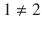。因此，结果是布尔值 `F`，表示`假`。1 和 1.0 的数值相同，所以当检查它们的相等性时，你会得到 `T`，表示该表达式被求值为`真`。变量也可用于求值。在这种情况下，变量中存储的最新值会被用于求值，结果被声明为布尔值。

通过使用逗号（`,`）运算符可以执行多重赋值。此外，如果我们不希望结果在屏幕上显示，可以使用 `;` 运算符来抑制输出：

```
1  −−>a1=10, a2=20, a3=30
2  a1 =
3  10.
4  a2 =
5  20.
6  a3 =
7  30.
```

使用命令前的 `;` 运算符可以抑制打印输出。在下面的例子中，`a3` 的赋值没有在终端显示，因为它被 `;` 运算符抑制了。在第二个例子中，所有输出都被抑制：

```
1  −−>a1=10, a2=20, a3=30;
2  a1 =
3  10.
4  a2 =
5  20.
6  −−>a3
7  a3 =
8  30.
9  −−>a1=10; a2=20; a3=30;
10  −−>
```

请注意，只有终端输出的打印被抑制了，但赋值操作不受 `;` 运算符的影响。它仍然可以被访问，如第二个终端命令所示。

### 2.10.2 变量命名规范

为避免错误，变量名必须遵守以下命名规范：

* 名称不能以数字开头；但数字可以在名称的其他任何位置使用。

* 变量名区分大小写。

* 关键字不能用作变量名。

* 名称可以包含下划线（`_`），但不能包含空格。

### 2.10.3 全局变量与局部变量

在主程序中全局声明的变量称为全局变量，而在函数内部局部声明的变量称为局部变量。全局变量对所有函数可用，而局部变量仅对特定函数可用。它们通过 `global` 声明语句来定义。一旦定义，无论是否有新的定义，它们都保持不变，除非使用 `clear` 命令从内存中清除变量名和值。另一个命令 `clearglobal` 用于有选择地清除全局变量。用户可以使用 `isglobal()` 函数来检查一个变量是否为全局变量。

全局变量用于在数值计算中定义常量。假设我们希望除少数选定的变量外，其他所有变量都改变值。那么我们将那些不变的值命名为全局变量，并赋予我们自己选择的名称。预定义的变量如 `%pi` 和 `%e` 就是以类似方式定义的。

### 2.10.4 变量列表

所有变量的列表可以通过 `who` 和 `whos` 命令获取，其中 `who` 仅显示工作区中的变量列表，而 `whos` 则显示更详细的信息，如变量大小、存储变量所用的字节数以及变量类型。`who('local')` 或 `who('get')` 返回当前变量名以及以双精度字为单位的内存使用量。`who('global')` 返回全局变量名以及以双精度字为单位的内存使用量。`who('sorted')` 按字母顺序显示所有变量。通过使用 `who` 和 `whos`，你可以合理地跟踪内存需求。这在像 Raspberry Pi 这样内存和速度受限的系统中至关重要。

## 2.11 数据类型

在为变量赋值时，理解数据可以定义为由其数据类型决定的各种对象是重要的。命令 `help(type)` 提供关于各种数据类型的详细文档。

### 2.11.1 数值数据

数字是数值分析的基本构建块。将数字表示为计算机可计算的量，需要将其作为数据存储在计算机内存中，并通过预定义系统在各种输出终端上显示。由于内存本质上是有限的，因此会为整数、实数、复数等不同数字类型分配固定的内存空间。同样，各种输出终端也有固定的数字显示能力。例如，如果要显示分数 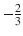，那么 Scilab 必须能够打印分子和分母，并用一条与两者大小匹配的水平线分隔，负号应放置在与水平线相同的高度，但要有一定间距以清晰区分。类似地，显示数字 `2 ×10^(−3)` 需要分别存储关于数字 `2`、`10` 和 `−3` 的信息，并相应地进行显示，其中 `−3` 必须是 `10` 的上标，以此类推。Scilab 的图形能力相当有限，且该主题超出了本书的范围。因此，我们将专注于与数字存储相关的主题。

在计算机内存廉价的今天，我们为何还要费心为数据寻求更少的内存？如果我们有一台 64 位架构的机器，它可以为每个实体分配 64 位。但使用 64 位来存储小值（例如 `0`）是否明智？自动分配会面临这种低效的计算方式。因此，是严格声明数据类型，还是让 Scilab 自行处理，仍是开发者的选择。合理使用这一特性可以加速计算并减少内存空间需求。

表 2-1 显示了有符号和无符号整数的存储方式。

**表 2-1** 不同精度的整数数值数据类型

| 数据类型 | 含义 | 范围 |
| --- | --- | --- |
| `int8` | 8 位有符号整数 | `±2⁸ − 1` |
| `uint8` | 8 位无符号整数 | `[0, 2⁸]` |
| `int16` | 16 位有符号整数 | `±2¹⁵ − 1` |
| `uint16` | 16 位无符号整数 | `[0, 2¹⁶]` |
| `int32` | 32 位有符号整数 | `±2³¹ − 1` |
| `uint32` | 32 位无符号整数 | `[0, 2³²]` |
| `int64` | 64 位有符号整数 | `±2⁶³ − 1` |
| `uint64` | 64 位无符号整数 | `[0, 2⁶⁴]` |

让我们从 `int8` 和 `uint8` 数据类型开始测试这些极限。它们可以分别通过使用函数 `int8()` 和 `uint8()` 将输入数字转换为其类型的对象：

```
1  −−>2ˆ8
2  ans =
3  256.
4  −−>int8(2ˆ8)
5  ans =
6  0
7  −−>uint8(2ˆ8)
8  ans =
9  0
10  −−>uint8(2ˆ8−1)
11  ans =
12  255
13  −−>int8(2ˆ8−1)
14  ans =
15  −1
16  −−>uint8(2ˆ8+1)
17  ans =
18  1
19  −−>int8(2ˆ8+1)
20  ans =
21  1
```

`2⁸ = 256`，因此对于 8 位而言，这是可以存储的最大数字。然而，由于数字还包括 `0`，一个 8 位存储系统最多可以存储从 `0` 到 `255` 的数值。当你使用 `int8` 表示时，其中一个位被用于表示符号位。这使得范围为 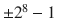。因此，`int8(2ˆ8)` 不等于 `256`。但即使是 `uint8(2ˆ8)` 也不等于 `256`，因为可以存储的最大数字是 `255`。那么，为什么显示答案 `0`？

存储系统遵循一种循环性质，其中最大数字 `255` 之后的下一个数字是 `0`。这可以通过 `uint8(2ˆ8-1)` 等于 `255` 这一事实来验证。另一方面，`int8(2ˆ8-1)` 是 `−1`，因为 `int8` 数据类型也可以存储负数，因此是 `−1`。`uint8(2ˆ8+1)` 和 `int8(2ˆ8+1)` 的结果都是 `1`，因为 `0` 之后是 `1`。

对于存储超出特定精度允许范围的数字，必须使用更高精度的数据类型（用于存储数字的位数更多）。例如：

```
1  −−>a = int8(2ˆ10)
2  a =
3  0
4  −−>a = int16(2ˆ10)
5  a =
6  1024
7  −−>a = int32(2ˆ10)
8  a =
9  1024
```

由于 `2¹⁰ = 1024`，超出了 `int8` 数据类型的范围，因此其值存储为 `0`，而它可以存储在 `int16`、`int32` 数据类型中。

其他数值数据类型是 `double` 和 `float`，它们用于存储实数。实数在计算机中表示为浮点数。实数到计算机存储系统的映射是一种公式化表示（称为浮点表示）。例如， 的值是 `0.3333333…`。假设对于特定计算，我们只有四位有效数字。如果是这样，该值可以重写为 `3.3333 × 10^(−1)`，其中 `3.3333` 称为尾数，`10` 称为基数，`−1` 称为指数。这将在第 2.11.2 节中进一步解释。

在给尾数赋值时，会用到有效数字位数的信息。一个数字的有效数字是指那些对其测量分辨率有有意义贡献的数字。在前面的例子中，根据计算/测量的需求，我们假设只有四位有效数字。术语“浮点”指的是数字的小数点可以“浮动”；也就是说，它可以相对于数字的有效数字放置在任何位置。这个位置由指数分量指示。因此，浮点表示可以被看作是一种科学记数法。

### 2.11.2 如何存储浮点数

计算机可以将数字存储为浮点数对象。一个浮点数对象按如下方式存储数字：

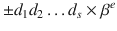

(2.1) 其中 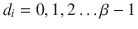 但 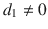 且 m ≤ e ≤ M，其中 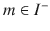 且 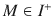。

浮点数由以下三部分组成：

- 符号（±）
- 尾数（`d[1]d[2]…d[s]`）
- 指数（`β`）

浮点数的每个部分都存储在不同的内存位置，并占用指定位数的比特。哪些部分各占多少比特？这些问题已由名为 `IEEE754` 的 IEEE 标准解答。首先，我们来看一下数字表示精度的概念：

1. 单精度：
   - 占用 4 字节 = 32 比特

2. 双精度：
   - 占用 8 字节 = 64 比特

3. 扩展双精度：
   - 占用 80 比特

4. 四精度：
   - 占用 16 字节 = 128 比特

在安装了 Scilab 软件的 64 位操作系统上，实型变量存储为 64 位浮点数（双精度，因此该数据类型名称为 `double`）。该格式包含以下部分：

- 1 比特用于存储数字的符号
  - 2¹ = 2 种可能值（0 和 1，用于表示符号）
- 52 个有效位
  - 2⁵² 种可能值
- 11 个指数位
  - 2¹¹ 种可能值

这符合 IEEE 754 标准。

将高精度数据类型转换为低精度数据类型，可以节省计算机内存并加快计算速度，但会牺牲精度。这些决策必须由开发人员预先做出。你并不总是需要更高精度。例如，如果你在处理桥梁的尺寸，并且数字以米为单位表示，那么在土木工程涉及的大多数测量中，通常使用 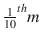 的精度即可。然而，如果你在处理纳米材料，或者谈论原子，且计算精度需要达到 Å = 10^(−9) m 量级，那么显然需要更好的精度。针对特定问题进行粗略估算，以了解程序运行期间预期的最大和最小值，这非常重要。然后，你可以据此分配数据类型。但是，如果你不设置数据类型呢？在这种情况下，会使用默认数据类型，例如 64 位机器上的浮点数默认以双精度浮点数存储。

Scilab 中存在专门的软件包，可以使用任意精度进行更准确的数学计算。尽管对此主题的详细讨论超出了本书的范围，但建议用户查看 `Xnum` 软件包（最高精度为 200 位数字）[1] 和 `Mupat` 软件包 [2]。对于关键应用而言，精度在生成有意义的可靠数值方面起着重要作用，因此在这些情况下，必须明智地使用数据类型。

### 2.11.3 数字的格式化显示

控制数值显示位数的格式是高级编程环境最重要的能力之一。Scilab 提供了 `format` 命令。其描述可通过 `help format` 命令获取。`format()` 命令接受整数值作为参数，用于设置数值显示的数字位数。该输入参数的取值范围是 [2, 25]：

```
1  −−>exp(1)
2  ans =
3  2.7182818
4  −−>format(5)
5  −−>exp(1)
6  ans =
7  2.72
8  −−>format(25)
9  −−>exp(1)
10  ans =
11  2.7182818284590450907956
```

`exp(1)` 表示 e¹ = 2.7182818，也称为欧拉数。当执行命令 `format(5)` 时，e¹ 的答案显示为 2.72，而 `format(25)` 则显示为 2.7182818284590450907956。

需要注意的是，存储的值不会因其在图形终端上以较少位数显示而受到影响。数字在计算机终端上的符号表示与其存储方式（完全由其数据类型决定）无关。

## 2.12 布尔数据

`help(boolean)` 提供了关于布尔变量的详细描述，即用 `\%T` 表示 `true`，用 `\%F` 表示 `false`。必须使用布尔运算符来操作布尔变量，例如：

- 非 (NOT)
  - 由符号运算符 `~` 表示
  - 对输入取反（`~%T=%F` 且 `~%F=%T`）

- 与 (AND)
  - 由符号运算符 `&` 或函数 `or()` 表示
  - 其行为如表 2-2 所示
  - 按位运算由 `bitand()` 函数执行

- 或 (OR)
  - 由符号运算符 `|` 或函数 `or()` 表示
  - 其行为如表 2-3 所示
  - 按位运算由 `bitor()` 函数执行

- 异或 (XOR)
  - 由函数 `bitxor()` 表示
  - 其行为如表 2-4 所示

表 2-4: 异或运算符真值表

| XOR | T | F |
| --- | --- | --- |
| T | F | T |
| F | T | F |

表 2-3: 或运算符真值表

| OR | T | F |
| --- | --- | --- |
| T | T | T |
| F | T | F |

表 2-2: 与运算符真值表

| AND | T | F |
| --- | --- | --- |
| T | T | F |
| F | F | F |

```
1  −−>a = %T // 给 a 赋值为 True
2  a =
3  T
4  −−>b = ˜a // b 是 a 取反
5  b =
6  F
7  −−>a&b // a AND b
8  ans =
9  F
10  −−>a|b // a OR b
11  ans =
12  T
```

`bitxor()` 运算符是按位工作的，因此它会把输入转换为二进制表示再执行计算。让我们通过一个例子来理解这个概念。`bitxor(1000, 1001)` 的结果是 1，因为二进制表示（通过函数 `dec2bin()` 获得）表明只有最后一位不同，因此结果是二进制数，其十进制等效值为 1：

```
1  −−>bitxor(1000, 1001)
2  ans =
3  1.
4  −−>dec2bin([1000; 1001; 1])
5  ans =

7  !1111101000   !
8  !             !
9  !1111101001   !
10  !             !
11  !0000000001   !
12  −−>bin2dec("0000000001")
13  ans =
14  1.
```

需要注意的是，在二进制逻辑中，值 `True` 和 `False` 分别与 `1` 和 `0` 等效使用。因此，表 2-2、2-3 和 2-4 只需将值 `T` 替换为 `1`，`F` 替换为 `0`。

类似地，`bitand()` 和 `bitor()` 运算符可以通过以下示例来理解：

```
1  −−>bitor(100, 99)
2  ans =
3  103.
4  −−>bitand(100, 99)
5  ans =
6  96.
7  −−>dec2bin([100; 99; 103; 96])
8  ans =

10  !1100100  !
11  !         !
12  !1100011  !
13  !         !
14  !1100111  !
15  !         !
16  !1100000  !
```

## 2.13 字符串

字母以及特殊字符均被视为字符串数据类型。内置函数 `string()` 可将给定值转换为字符串数据类型。如下例所示，当数值 2 应用 `string()` 函数时，会被转换为字符串数据类型，否则其类型保持为整数：

```
1  −−>a = string(2)
2  a =
3  2
4  −−>b = string(3)
5  b =
6  3
7  −−>a+b
8  ans =
9  23
```

值得注意的是，数字 `2` 作为字符串（存储在变量 `a` 中）和作为数字时的二进制数据差异很大，因此数值计算会以不同方式处理它们，即使显示结果始终为 `2`。当它表示为字符串时，运算符会首先识别数据类型，然后执行操作。对于字符串，加法运算符仅仅是连接运算符。因此，`a+b` 等于 `23`。而数值计算 `2 + 3` 的结果是 `5`。

如果不使用 `string()` 函数，可以通过将字符串括在单引号（`"`）或双引号（`""`）中来定义。字符串同样区分大小写。这一点可通过以下代码验证：

```
1  −−>a = "hello world"
2  a =
3  hello world
4  −−>b = 'Hello World'
5  b =
6  Hello World
7  −−>a==b
8  ans =
9  F
```

`a` 包含字符 `h` 和 `w`（小写），而 `b` 包含字符 `H` 和 `W`。因此，由于它们的值不同，`a==b` 的结果为 `F`（`false`）。

## 2.14 复数

在计算机上进行数学计算的一个最重要方面是处理复数及其代数运算的能力。涉及复数的计算几乎存在于所有科学和数学分支中。找到定义复数及其数学运算的灵活方法，是所有开发者进行高效计算必须掌握的艺术。

复数的图形描述如图 2-2 所示。在基于实轴和虚轴的复平面上，一个特定点由复数 `a + ib` 定义，其中 `a` 是该点在实轴上投影的大小，`b` 是该点在虚轴上投影的大小。

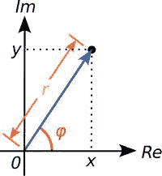

图 2-2

在复平面上描绘的复数 [3]

图 2-2 展示了一个表示复数 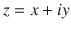 的点。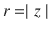（绝对值）和 ϕ（幅角）的值由以下公式给出：

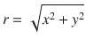

(2.2)

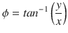

(2.3)

复数的绝对值就是它到原点的距离。复数的幅角就是它与水平轴逆时针方向所成的角度。可以使用 `abs()` 函数计算复数的绝对值：

```
1  −−>complex(2,3)
2  ans =
3  2\. + 3.i
4  −−>abs(complex(2,3))
5  ans =
6  3.61
```

该角度可以通过使用复数的实部和虚部计算，如下所示：

```
1  −−>a = complex(2,3)
2  a
3  2\. + 3.i
4  −−>type(a)
5  ans =
6  1.
7  −−>real(a)
8  ans =
9  2.
10  −−>imag(a)
11  ans =
12  3.
13  −−>atan(imag(a)/real(a))
14  ans =
15  0.98
```

### 2.14.1 实部和虚部

实数的实部和虚部由内置函数 `real()` 和 `imag()` 提供，如下所示：

```
1  −−>r = real(complex(2,3))
2  r =
3  2.
4  −−>i = imag(complex(2,3))
5  i =
6  3.
7  −−>r = real(complex([2,3],[−3,−4]))
8  r =
9  2\. 3.
10  −−>i = imag(complex([2,3],[−3,−4]))
11  i =
12  −3\. −4.
```

### 2.14.2 复共轭

复数 `x + iy` 的复共轭是 `x − iy`，而 `x − iy` 的复共轭是 `x + iy`。内置函数 `conj()` 生成给定复数的复共轭：

```
1  −−>a = complex(2,3)
2  a =
3  2\. + 3.i
4  −−>b = conj(a)
5  b =
6  2\. − 3.i
7  −−>a∗b
8  ans =
9  13.
```

复数与其共轭的乘积可以理解为：

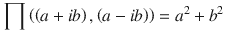

(2.4) 其中 `a` 和 `b` 分别为实部和虚部。

对于多个条目（复数）作为数组元素的情况：

```
1  −−>a = complex([1 2 3],[4 5 6])
2  a =
3  1\. + 4.i     2\. + 5.i     3\. + 6.i
4  −−>b = conj(a)
5  b =
6  1\. − 4.i     2\. − 5.i     3\. − 6.i
7  −−>a.∗b
8  ans =
9  17\.   29\.   45.
```

### 2.14.3 `imult`

内置函数 `imult()` 是将实数乘以 `i`（虚数单位）的一种高效方式，尤其是在计算涉及 `%inf` 和 `%nan` 时：

```
1  −−>imult(%nan)
2  ans =
3  Nani
4  −−>imult(%inf)
5  ans =
6  Inf i
7  −−>%i∗%nan
8  ans =
9  Nan + Nani
10  −−>%i∗%inf
11  ans =
12  Nan + Inf i
13  −−>imult(4)
14  ans =
15  4.i
16  −−>imult(complex(4,4))
17  ans =
18  −4\. + 4.i
```

如以下公式所示：

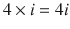

和

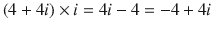

### 2.14.4 检查变量是否包含复数分量

内置函数 `isreal()` 用于检查变量是否包含复数分量。如果输入变量不包含复数，则输出布尔值 `T`，否则输出 `F`：

```
1  −−>a = [1 2 3]
2  a =
3  1\.     2\.     3.
4  −−>a1 = complex(a,a)
5  a1 =
6  1\. + i      2\. + 2.i       3\. + 3.i
7  −−>isreal(a)
8  ans =
9  T
10  −−>isreal(a1)
11  ans =
12  F
```

### 2.14.5 复数运算

复数运算涉及与实数类似的运算，例如加法、减法、乘法、除法、乘幂等。这些运算对于复数的规则略有不同。

两个复数相加涉及将它们的实部和虚部分别相加，减法也是如此。假设我们定义两个复数如下：

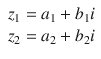

那么你可以定义它们的加法和减法：

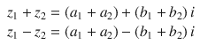

复数的乘法和除法运算则不是那么直接：

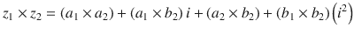

通过合并实部项和虚部项可以简化：

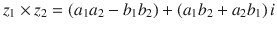

# 复数

因为`i² = -1`。将复数乘以或除以一个实数可以通过分别对实部和虚部进行乘法或除法来更简单地完成。

## 共轭复数

一个复数`z₁ = a₁ + b₁i`的共轭复数定义为`z₁* = a₁ - b₁i`。从几何上看，`z₁*`是`z₁`关于实轴的“反射”。因此，如果我们计算共轭两次，就会得到原来的数：`(z₁*)* = z₁`。

## 复数运算

复数的除法可以如下使用其共轭来进行：

`(a₁ + b₁i) / (a₂ + b₂i) = [(a₁ + b₁i) * (a₂ - b₂i)] / [(a₂ + b₂i) * (a₂ - b₂i)] = (a₁a₂ + b₁b₂) / (a₂² + b₂²) + (b₁a₂ - a₁b₂) / (a₂² + b₂²)i`

因此，将分母的共轭复数与分子和分母相乘，得到一个新的复数，这就是两个复数相除的结果。这可以用两个复数来检验：`z₁ = 2 + 3i`和`z₂ = -3 + 4i`，如下所示：

```
1  −−>z1 = complex(2,3)
2  z1 =
3  2\. + 3.i
4  −−>z2 = complex(−3,4)
5  z2 =
6  −3\. + 4.i
7  −−>z1+z2 // 两个复数相加
8  ans =
9  −1\. + 7.i
10  −−>z1−z2 // 两个复数相减
11  ans =
12  5\. − i
13  −−>z1∗z2 // 两个复数相乘
14  ans =
15  −18\. − i
16  −−>z1/z2 // 两个复数相除
17  ans =
18  0.24−0.68i
19  −−>z1ˆ2 // 复数求 2 次幂
20  ans =
21  −5\. + 12.i
22  −−>z1ˆz2 // 复数求另一个复数的幂
23  ans =
24  −2.0D−04 + 3.0D−04i
25  −−>2∗z1 // 复数乘以实数
26  ans =
27  4\. + 6.i
28  −−>z1/2 // 复数除以实数
29  ans =
30  1\. + 1.5i
31  −−>z1+2 // 复数与实数相加
32  ans =
33  4\. + 3.i
34  −−>z1−2 // 复数与实数相减
35  ans =
36  3.i
```

一个实数可以理解为虚部为零的复数。当复数进行加法和减法时，只对实部进行操作。当复数与实数相乘和/或相除时，实部和虚部都会相应地进行操作。

## 本章小结

在本章中，我们讨论了不同类型数字和字符串的用法。我们演示了如何对数字和字符串进行操作。需要注意的是，所有数值计算都是近似值，因为由于计算设备上数字的有限精度，计算中会引入误差。用户可以在计算前选择数字的精度，但应谨慎操作。使用低精度数字占用的存储空间更小，计算速度也更快；但结果更不准确。Scilab 能够定义复数，并且这些定义的复数可以使用与实数相同的算术运算符进行操作，无需任何修改，即使它们的算术规则不同。

