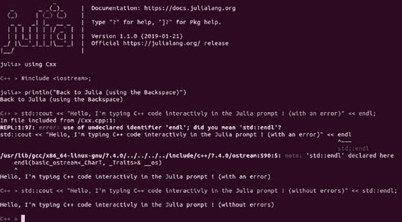

# Julia 与其他语言交互

本章将讨论以下第三方包：

| 包名 | URL | 版本 |
|---|---|---|
| `Cxx.jl` | [`github.com/JuliaInterop/Cxx.jl`](https://github.com/JuliaInterop/Cxx.jl) | v0.3.2 |
| `PyCall.jl` | [`github.com/JuliaPy/PyCall.jl`](https://github.com/JuliaPy/PyCall.jl) | v1.91.2 |
| `PyJulia` | [`github.com/JuliaPy/pyjulia`](https://github.com/JuliaPy/pyjulia) | v0.4.1 |
| `RCall.jl` | [`github.com/JuliaInterop/RCall.jl`](https://github.com/JuliaInterop/RCall.jl) | v0.13.3 |
| `JuliaCall` | [`github.com/Non-Contradiction/JuliaCall`](https://github.com/Non-Contradiction/JuliaCall) | v0.16.5 |

Julia 是一门相对较新的语言（首个公开发布版本可追溯到 2012 年 2 月），这意味着关于实现其功能的包的可用性存在明显的担忧。为了应对这一担忧，Julia 开发的一个特定领域...

好的，作为高级文档工程师和翻译员，我将严格按照您提供的注意事项和示例格式，将以下英文文本翻译成中文。

## 第 7 章：Julia 与其他语言的交互

本章阐述了 Julia 与其他语言编写的代码进行交互的能力，特别是如何使用这些语言中数量庞大的库。

其核心在于，Julia 语言具备了原生调用 C 和 FORTRAN 库的能力。这反过来又使得 Julia 开发者能够编写包来与最常用的编程语言进行交互。

© Antonello Lobianco 2019

A. Lobianco， *Julia 快速语法参考*， `doi.org/10.1007/978-1-4842-5190-4_7`

本章将讨论其中一些接口包。最终，这使得更高级别的包能够利用这些“语言接口”包，轻松地封装用其他语言编写的现有库，并为 Julia 程序员提供友好的接口。

总而言之，如果你需要一个通用功能，你极有可能找到一个包，它要么 (a) 直接用 Julia 实现了该功能（例如，[`github.com/JuliaData/DataFrames.jl`](https://github.com/JuliaData/DataFrames.jl) 上的 `DataFrames`），要么 (b) 封装了其他语言的现有库（对于相同的功能，例如，[`github.com/JuliaPy/Pandas.jl`](https://github.com/JuliaPy/Pandas.jl) 上的 `Pandas`）。

我将在本书的第二部分讨论其中一些包。

本章的其余部分将展示如何显式地将 Julia 与其他语言链接起来，要么通过调用用其他语言实现的函数，要么通过从其他语言调用 Julia 函数。

当可能出现歧义时（例如，当使用不同语言的提示符时），我会在代码片段中包含提示符号。

### 7.1 Julia ⇄ C

如前所述，调用 C 代码是 Julia 语言的原生功能，无需任何第三方代码。

让我们先构建一个 C 库。我将在 Linux 系统中使用 GCC 编译器进行演示。在其他环境中的过程类似，但可能不完全相同。

`myclib.h`：

```c
extern int get2();
extern double sumMyArgs(float i, float j);
```

`myclib.c`：

```c
int get2() {
    return 2;
}

double sumMyArgs(float i, float j) {
    return i + j;
}
```

请注意，你需要在 C 头文件中将要在 Julia 中使用的函数定义为 `extern`。

然后，你可以使用 C 编译器 `gcc` 编译共享库：

```bash
gcc -o myclib.o -c myclib.c
gcc -shared -o libmyclib.so myclib.o -lm -fPIC
```

现在，你可以在 Julia 中使用这个 C 库了：

```julia
const myclib = joinpath(@__DIR__, "libmyclib.so")

a = ccall((:get2, myclib), Int32, ())
b = ccall((:sumMyArgs, myclib), Float64, (Float32, Float32), 2.5, 1.5)
```

`ccall` 函数将*第一个*参数设为一个元组 `(函数名, 库路径)`，除非该库位于操作系统的搜索路径中，否则库路径必须使用完整路径。如果不在，而你仍然想相对于正在使用的文件来表达它，你可以使用 `@__DIR__` 宏，它会展开为该文件所在目录的绝对路径。用于存放库的完整路径的变量必须设为常量，并且作为 `ccall` 第一个参数的元组必须是*字面量*。

`ccall` 的*第二个*参数是函数的返回类型。

请注意，虽然 C 语言的 `int` 映射到 Julia 的 `Int32` 或 `Int64`，但 C 语言的 `float` 映射到 Julia 的 `Float32`，C 语言的 `double` 映射到 Julia 的 `Float64`。在这个例子中，你可以改用相应的 Julia 类型别名 `Cint`、`Cfloat` 和 `Cdouble`（以及其他别名），以避免记住映射关系。

*第三个*参数是一个元组，包含 C 函数所期望的参数的类型。如果只有一个参数，它仍然必须表示为一个元组，例如 `(Float64,)`。

最后，剩下的参数会传递给 C 函数。

在现实世界中，链接 C（或 FORTRAN）代码可能会变得相当复杂，查阅 [`docs.julialang.org/en/v1/manual/calling-c-and-fortran-code/`](https://docs.julialang.org/en/v1/manual/calling-c-and-fortran-code/) 上的官方文档是不可或缺的。

### 7.2 Julia ⇄ C++

与 C 类似，C++ 的工作流程部分依赖于环境。本节在 Linux 下使用 `Cxx.jl`，尽管 `Cxx.jl` 也对 Windows 提供了实验性支持 1.

与其他 C++ 封装模块（特别是 [`github.com/JuliaInterop/CxxWrap.jl`](https://github.com/JuliaInterop/CxxWrap.jl) 上的 `CxxWrap.jl`）相比，其主要优势在于，它允许你根据所需的工作流程，以多种方式处理 C++ 代码。

#### 7.2.1 交互式 C++ 提示符

如果你在 Julia REPL 中键入 `<`（在键入 `using Cxx` 之后），你将获得一个交互式 C++ 提示符，如图 7-1 所示。



**图 7-1.** Julia REPL 中的 C++ 交互式提示符

请注意在图 7-1 中，你输入的代码编译是如何像 Julia 本身一样即时完成的，因此任何编译错误都会立即报告。

#### 7.2.2 在 Julia 程序中嵌入 C++ 代码

除了 REPL 提示符，您还可以在 Julia 程序中使用 C++ 代码，而无需离开主要的 Julia 环境。让我们从一个简单的例子开始：

```julia
using Cxx

# 定义 C++ 函数并编译它
cxx"""
#include<iostream>

void myCppFunction() {
    int a = 10;
    std::cout << "Printing " << a << std::endl;
}
"""

# 执行它
icxx"myCppFunction();"  # 返回 "Printing 10"

# 或者
# 将 C++ 函数转换为 Julia 函数
myJuliaFunction() = @cxx myCppFunction()

# 运行该函数
myJuliaFunction()  # 返回 "Printing 10"
```

这个工作流程很直接：首先使用 `cxx"..."` 字符串宏嵌入 C++ 代码。然后，你就可以通过 `icxx"..."` 中嵌入的 C++ 代码直接调用，或者通过 `@cxx` 宏将其转换为 Julia 函数并使用 Julia 代码来调用该（Julia）函数，从而“使用”在 `cxx"..."` 中定义的函数。

这个例子不涉及 `Julia` 和 `C++` 之间的任何数据传输。如果你想嵌入 `C++`，很可能是为了向 `C++` 传递一些数据，并检索输出以在 `Julia` 程序中使用。

下面的例子展示了对于基本类型，`Julia` 和 `C++` 之间的数据传输是如何自动处理的：

```julia
using Cxx

cxx"""
#include<iostream>

int myCppFunction2(int arg1) {
    return arg1 + 1;
}
"""

juliaValue = icxx"myCppFunction2(9);"  # 10

# 或者
myJuliaFunction2(arg1) = @cxx myCppFunction2(arg1)
juliaValue = myJuliaFunction2(99)  # 100
```

然而，当数据传输涉及复杂的数据结构（如数组，或者像下面例子中的数组的数组）时，事情就变得复杂了。`Julia` 类型必须转换为 `C++` 类型，反之亦然：

```julia
using Cxx

cxx"""
#include <vector>
using namespace std;

vector<double> rowAverages (vector< vector<double> > rows) {
    // 计算每一行的平均值..
    vector <double> averages;
    for (int r = 0; r < rows.size(); r++) {
        double rsum = 0.0;
        double ncols = rows[r].size();
        for (int c = 0; c < rows[r].size(); c++) {
            rsum += rows[r][c];
        }
        averages.push_back(rsum / ncols);
    }
    return averages;
}
"""

rows_julia = [[1.5, 2.0, 2.5], [4, 5.5, 6, 6.5, 8]]
rows_cpp = convert(cxxt"vector< vector< double > >", rows_julia)
rows_avgs = collect(icxx"rowAverages($rows_cpp);")
```

---

1. `Cxx` 仅兼容 `Julia 1.1` 或 `1.2`（不过预计很快将兼容 `Julia 1.3`）。