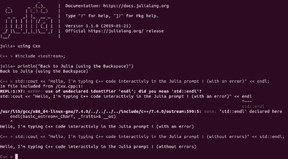

## 第 7 章：Julia 与其他语言的交互

本章阐述了 Julia 与其他语言编写的代码进行交互的能力，特别是如何使用这些语言中数量庞大的库。

其核心在于，Julia 语言具备了原生调用 C 和 FORTRAN 库的能力。这反过来又使得 Julia 开发者能够编写包来与最常用的编程语言进行交互。

© Antonello Lobianco 2019

A. Lobianco， *Julia 快速语法参考*， `doi.org/10.1007/978-1-4842-5190-4_7`

本章将讨论其中一些接口包。最终，这使得更高级别的包能够利用这些“语言接口”包，轻松地封装用其他语言编写的现有库，并为 Julia 程序员提供友好的接口。

总而言之，如果你需要一个通用功能，你极有可能找到一个包，它要么 (a) 直接用 Julia 实现了该功能（例如，[`github.com/JuliaData/DataFrames.jl`](https://github.com/JuliaData/DataFrames.jl) 上的 `DataFrames`），要么 (b) 封装了其他语言的现有库（对于相同的功能，例如，[`github.com/JuliaPy/Pandas.jl`](https://github.com/JuliaPy/Pandas.jl) 上的 `Pandas`）。

我将在本书的第二部分讨论其中一些包。

本章的其余部分将展示如何显式地将 Julia 与其他语言链接起来，要么通过调用用其他语言实现的函数，要么通过从其他语言调用 Julia 函数。

当可能出现歧义时（例如，当使用不同语言的提示符时），我会在代码片段中包含提示符号。

### 7.1 Julia ⇄ C

如前所述，调用 C 代码是 Julia 语言的原生功能，无需任何第三方代码。

让我们先构建一个 C 库。我将在 Linux 系统中使用 GCC 编译器进行演示。在其他环境中的过程类似，但可能不完全相同。

`myclib.h`：

```c
extern int get2();
extern double sumMyArgs(float i, float j);
```

`myclib.c`：

```c
int get2() {
    return 2;
}

double sumMyArgs(float i, float j) {
    return i + j;
}
```

请注意，你需要在 C 头文件中将要在 Julia 中使用的函数定义为 `extern`。

然后，你可以使用 C 编译器 `gcc` 编译共享库：

```bash
gcc -o myclib.o -c myclib.c
gcc -shared -o libmyclib.so myclib.o -lm -fPIC
```

现在，你可以在 Julia 中使用这个 C 库了：

```julia
const myclib = joinpath(@__DIR__, "libmyclib.so")

a = ccall((:get2, myclib), Int32, ())
b = ccall((:sumMyArgs, myclib), Float64, (Float32, Float32), 2.5, 1.5)
```

`ccall` 函数将*第一个*参数设为一个元组 `(函数名, 库路径)`，除非该库位于操作系统的搜索路径中，否则库路径必须使用完整路径。如果不在，而你仍然想相对于正在使用的文件来表达它，你可以使用 `@__DIR__` 宏，它会展开为该文件所在目录的绝对路径。用于存放库的完整路径的变量必须设为常量，并且作为 `ccall` 第一个参数的元组必须是*字面量*。

`ccall` 的*第二个*参数是函数的返回类型。

请注意，虽然 C 语言的 `int` 映射到 Julia 的 `Int32` 或 `Int64`，但 C 语言的 `float` 映射到 Julia 的 `Float32`，C 语言的 `double` 映射到 Julia 的 `Float64`。在这个例子中，你可以改用相应的 Julia 类型别名 `Cint`、`Cfloat` 和 `Cdouble`（以及其他别名），以避免记住映射关系。

*第三个*参数是一个元组，包含 C 函数所期望的参数的类型。如果只有一个参数，它仍然必须表示为一个元组，例如 `(Float64,)`。

最后，剩下的参数会传递给 C 函数。

在现实世界中，链接 C（或 FORTRAN）代码可能会变得相当复杂，查阅 [`docs.julialang.org/en/v1/manual/calling-c-and-fortran-code/`](https://docs.julialang.org/en/v1/manual/calling-c-and-fortran-code/) 上的官方文档是不可或缺的。

### 7.2 Julia ⇄ C++

与 C 类似，C++ 的工作流程部分依赖于环境。本节在 Linux 下使用 `Cxx.jl`，尽管 `Cxx.jl` 也对 Windows 提供了实验性支持 1.

与其他 C++ 封装模块（特别是 [`github.com/JuliaInterop/CxxWrap.jl`](https://github.com/JuliaInterop/CxxWrap.jl) 上的 `CxxWrap.jl`）相比，其主要优势在于，它允许你根据所需的工作流程，以多种方式处理 C++ 代码。

#### 7.2.1 交互式 C++ 提示符

如果你在 Julia REPL 中键入 `<`（在键入 `using Cxx` 之后），你将获得一个交互式 C++ 提示符，如图 7-1 所示。



**图 7-1.** Julia REPL 中的 C++ 交互式提示符

请注意在图 7-1 中，你输入的代码编译是如何像 Julia 本身一样即时完成的，因此任何编译错误都会立即报告。

#### 7.2.2 在 Julia 程序中嵌入 C++ 代码

除了 REPL 提示符，您还可以在 Julia 程序中使用 C++ 代码，而无需离开主要的 Julia 环境。让我们从一个简单的例子开始：

```julia
using Cxx

# 定义 C++ 函数并编译它
cxx"""
#include<iostream>

void myCppFunction() {
    int a = 10;
    std::cout << "Printing " << a << std::endl;
}
"""

# 执行它
icxx"myCppFunction();"  # 返回 "Printing 10"

# 或者
# 将 C++ 函数转换为 Julia 函数
myJuliaFunction() = @cxx myCppFunction()

# 运行该函数
myJuliaFunction()  # 返回 "Printing 10"
```

这个工作流程很直接：首先使用 `cxx"..."` 字符串宏嵌入 C++ 代码。然后，你就可以通过 `icxx"..."` 中嵌入的 C++ 代码直接调用，或者通过 `@cxx` 宏将其转换为 Julia 函数并使用 Julia 代码来调用该（Julia）函数，从而“使用”在 `cxx"..."` 中定义的函数。

这个例子不涉及 `Julia` 和 `C++` 之间的任何数据传输。如果你想嵌入 `C++`，很可能是为了向 `C++` 传递一些数据，并检索输出以在 `Julia` 程序中使用。

下面的例子展示了对于基本类型，`Julia` 和 `C++` 之间的数据传输是如何自动处理的：

```julia
using Cxx

cxx"""
#include<iostream>

int myCppFunction2(int arg1) {
    return arg1 + 1;
}
"""

juliaValue = icxx"myCppFunction2(9);"  # 10

# 或者
myJuliaFunction2(arg1) = @cxx myCppFunction2(arg1)
juliaValue = myJuliaFunction2(99)  # 100
```

然而，当数据传输涉及复杂的数据结构（如数组，或者像下面例子中的数组的数组）时，事情就变得复杂了。`Julia` 类型必须转换为 `C++` 类型，反之亦然：

```julia
using Cxx

cxx"""
#include <vector>
using namespace std;

vector<double> rowAverages (vector< vector<double> > rows) {
    // 计算每一行的平均值..
    vector <double> averages;
    for (int r = 0; r < rows.size(); r++) {
        double rsum = 0.0;
        double ncols = rows[r].size();
        for (int c = 0; c < rows[r].size(); c++) {
            rsum += rows[r][c];
        }
        averages.push_back(rsum / ncols);
    }
    return averages;
}
"""

rows_julia = [[1.5, 2.0, 2.5], [4, 5.5, 6, 6.5, 8]]
rows_cpp = convert(cxxt"vector< vector< double > >", rows_julia)
rows_avgs = collect(icxx"rowAverages($rows_cpp);")
```

---

1. `Cxx` 仅兼容 `Julia 1.1` 或 `1.2`（不过预计很快将兼容 `Julia 1.3`）。

# 或者

```julia
rowAverages(rows) = @cxx rowAverages(rows)
```

```julia
rows_avgs = collect(rowAverages(rows_cpp))
```

## 第七章 让 Julia 与其他语言交互

从 Julia 数据到 C++ 数据的转换（以供 C++ 函数作为参数使用）是通过熟悉的`convert(T, source)`函数完成的，但这里的`T`是由`cxxt"[Cpp type]"`返回的表达式所指定的类型。

转换后的数据即可用于 C++ 函数调用。需要注意的是，如果使用了`icxx"`的直接调用形式，则必须通过美元符号`$`运算符进行插值。

最后，使用`collect`将 C++ 函数返回的 C++ 结构体中的数据复制到 Julia 结构体中（你也可以通过使用指针来避免复制）。

### 7.2.3 加载 C++ 库

使用 C++ 代码的第三种方法是加载一个 C++ 库，然后直接调用该库中定义的函数。这种方法的优势在于，库本身无需知晓它将被用于 Julia 环境（即编译 C++ 库时不需要包含特殊的 Julia 头文件或库），因为封装工作完全在 Julia 端完成。这意味着可以复用已有的库。

我们复用上一个示例，但这次将其编译成一个共享库。

`mycpplib.cpp`：

```cpp
#include <vector>
#include "mycpplib.h"
using namespace std;

vector<double> rowAverages (vector< vector<double> > rows) {
    // 计算每一行的平均值。
    vector<double> averages;
    for (int r = 0; r < rows.size(); r++) {
        double rsum = 0.0;
        double ncols = rows[r].size();
        for (int c = 0; c < rows[r].size(); c++) {
            rsum += rows[r][c];
        }
        averages.push_back(rsum/ncols);
    }
    return averages;
}
```

`mycpplib.h`：

```cpp
#include <vector>
std::vector<double> rowAverages (std::vector< std::vector<double> > rows);
```

然后，你可以使用 C++ 编译器`g++`编译这个共享库：

```bash
g++ -shared -fPIC -o libmycpplib.so mycpplib.cpp
```

现在你可以像下面这样在 Julia 中使用它：

```julia
using Cxx
using Libdl

const path_to_lib = pwd()
addHeaderDir(path_to_lib, kind=C_System)
cxxinclude("mycpplib.h")
Libdl.dlopen(joinpath(path_to_lib, "libmycpplib.so"), Libdl.RTLD_GLOBAL)

rows_julia = [[1.5,2.0,2.5],[4,5.5,6,6.5,8]]
rows_cpp = convert(cxxt"std::vector< std::vector< double > >", rows_julia)
rows_avgs = collect(icxx"rowAverages($rows_cpp);")
```

这里唯一新增的步骤如下：

- 你需要显式加载标准库`Libdl`

- 你需要添加 C++ 头文件

- 你需要打开共享库

现在，你就能像将 C++ 代码嵌入到 Julia 脚本中一样，使用库中定义的函数了。

### 7.3 Julia ⇄ Python

在 Julia 中调用 Python 代码的“标准”方式是使用`PyCall` (https://github.com/JuliaPy/PyCall.jl) 包。它的一些出色特性包括：

- 它可以自动下载并安装一个 Julia 私有的 Python 本地副本，以避免与“主” Python 安装的版本依赖产生冲突，并在 Linux、Windows 和 MacOS 上提供一致的环境。

- 它提供了 Julia 与 Python 类型之间的自动转换。

- 它使用起来非常简单。

关于第一点，`PyCall`在 Windows 和 MacOS 上默认安装“私有”Python 环境，而在 Linux 上则会使用系统默认的 Python 环境。

你可以通过以下方式（在 Julia 提示符下）覆盖此行为：

```julia
ENV["PYTHON"]="空白或 /path/to/python"; using Pkg; Pkg.build("PyCall");
```

其中，如果环境变量为空，`PyCall`将安装“私有”版本的 Python。

鉴于 Python 库的数量极其庞大，`PyCall`成为最常见的 Julia 包之一也就不足为奇了。

#### 7.3.1 在 Julia 程序中嵌入 Python 代码

# 在 Julia 中嵌入 Python 以及在 Python 中嵌入 Julia

## 在 Julia 中嵌入 Python 代码

在 Julia 程序中嵌入 Python 代码与我们之前看到的 C++ 类似，只不过你（大多数情况下）无需担心数据转换的问题。你可以使用 `py"..."` 来定义和调用 Python 函数，并且在函数调用中可以直接使用你的 Julia 数据：

```julia
using PyCall

py"""
def sumMyArgs (i, j):
    return i+j

def getNElement (n):
    a = [0,1,2,3,4,5,6,7,8,9]
    return a[n]
"""

a = py"sumMyArgs"(3,4) # 7
b = py"sumMyArgs"([3,4],[5,6]) # [8,10]
typeof(b) # Array{Int64,1}
c = py"sumMyArgs"([3,4],5) # [8,9]
d = py"getNElement"(1) # 1
```

请注意，你无需转换像数组这样的复杂数据，并且结果会被自动转换为 Julia 类型。对于数值、布尔值、字符串、IO 流、日期/周期和函数类型，以及这些类型的元组、数组/列表和字典，类型转换都是自动进行的。其他类型会被转换为通用的 `PyObject` 类型。

注意上一个示例的最后一行，`PyCall` 不会尝试进行索引转换（Python 数组是从 0 开始索引的，而 Julia 数组是从 1 开始索引的）。用 `1` 作为参数调用 Python 的 `getNElement()` 函数，会返回*在 Python 中*被认为是数组的第一个元素。

### 使用 Python 库

使用 Python 库也同样简单，如下例所示，它使用了 `ezodf` 模块 (https://github.com/T0ha/ezodf) 来创建一个 OpenDocument 电子表格。目前已存在一个针对 ODS 文档的 `ezodf` 封装（内部使用了 `PyCall`），详见 `OdsIO` (https://github.com/sylvaticus/OdsIO.jl)。

在尝试复现以下代码之前，请确保 `ezodf` 模块在你用于 Julia 的 Python 环境中是可用的。如果是一个独立的环境，只需按照 Python 的方式安装包即可（例如使用 `pip`）。如果你使用的是“私有”的 Conda 环境，可以使用 `Conda.jl` 包 (https://github.com/JuliaPy/Conda.jl)，然后输入 `using Conda; Conda.add_channel("conda-forge"); Conda.add("ezodf")`。

```julia
const ez = pyimport("ezodf") # 相当于 Python 的 import ezodf as ez

destDoc = ez.newdoc(doctype="ods", filename="anOdsSheet.ods")
sheet = ez.Sheet("Sheet1", size=(10, 10))
destDoc.sheets.append(sheet)
dcell1 = get(sheet,(2,3)) # 相当于 Python 的 sheet[(2,3)]。这里是单元格 "D3"！
dcell1.set_value("Hello")
get(sheet,"A9").set_value(10.5) # 相当于 Python 的 sheet['A9'].set_value(10.5)
destDoc.backup = false
destDoc.save()
```

在 Julia 中使用该模块遵循 Python API，仅有少量语法差异。模块被导入并赋予一个较短的别名 `ez`。然后你可以直接使用通常的 Python 语法 `module.function()` 来调用其函数。

由 `newdoc` 返回的文档对象是一个通用的 `PyObject` 类型。你可以分别使用 `myPyObject.attribute` 和 `myPyObject.method()` 来访问其属性和方法。当无法直接访问某些带索引的值时（例如 `sheet[(2,3)]`，此处索引是一个元组），可以改用 `get(object,key)` 函数。最后，再次注意索引转换*不会*自动实现：当请求 `get(sheet,(2,3))` 时，这些索引被解释为*基于 Python* 的索引，因此返回的是电子表格中的单元格 D3，而不是 B2。

### PyJulia：在 Python 中使用 Julia

反过来，在 Python 脚本或终端中嵌入 Julia 代码也同样有意义，因为在许多情况下，这为 Python 程序员带来了显著的性能提升，并且可能比嵌入 C 或 C++ 代码更容易。

本节展示如何使用 `PyJulia` Python 包 (https://github.com/JuliaPy/pyjulia) 来实现这一点，这是一个面向 Julia 的 Python 接口。需要提醒的是，在撰写本文时，它的完善度、简便性和稳定性都不及面向 Python 的 Julia 接口 `PyCall`。

### 安装

在安装`PyJulia`之前，请确保`Julia`中已安装`PyCall`模块，并且它使用的是与您要嵌入`Julia`代码的`Python`相同的版本（最终，在`Julia`中运行`ENV["PYTHON"]="/path/to/python"; using Pkg; Pkg.build("PyCall");`来更改其底层`Python`解释器）。

目前，`Python`中仅支持`pip`包管理器来安装`PyJulia`包（`conda`支持即将推出）。

请注意，`pip`中的包名是`julia`，而不是`PyJulia`：

```bash
$ python3 -m pip install --user julia
```

```python
>>> import julia
>>> julia.install()
```

如果您有多个`Julia`版本，可以通过向`install()`函数传递`julia="/path/to/julia/binary/executable"`（例如`julia = "/home/myUser/lib/julia-1.1.0/bin/julia"`）来指定在`Python`中使用的版本。

### 使用

要获取`Julia`接口，只需运行：

```python
>>> import julia
>>> jl = julia.Julia(compiled_modules=False)
```

`Julia`构造函数中的`compiled_modules=False`行是解决常见情况（即`Python`解释器与`libpython`静态链接）的变通方法，但这会减慢交互式体验，因为它将禁用`Julia`包的预编译。每次您首次使用模块时，都需要先编译它。其他更高效但也更复杂的变通方法，请参见包文档中的“故障排除”部分（参阅 [`pyjulia.readthedocs.io/en/stable/troubleshooting.html`](https://pyjulia.readthedocs.io/en/stable/troubleshooting.html)）。

您现在可以通过多种方式访问`Julia`。

您可能希望将所有函数定义在一个`Julia`脚本中，然后“包含”它。假设`juliaScript.jl`由以下`Julia`代码构成：

```julia
function helloWorld()
    println("Hello World!")
end

function sumMyArgs(i, j)
    return i+j
end

function getNElement(n)
    a = [0,1,2,3,4,5,6,7,8,9]
    return a[n]
end
```

您可以在`Python`中访问其函数，方式如下：

```python
>>> jl.include("juliaScript.jl")
>>> jl.helloWorld()  # 打印 `Hello World!`
>>> a = jl.sumMyArgs([1,2,3],[4,5,6])  # 返回 array([5, 7, 9], dtype=int64)
>>> b = jl.getNElement(1)  # 返回 `0`，对于 Julia 来说是“第一个”元素
```

与从`Julia`调用`Python`类似，您可以向函数传递并检索复杂数据类型，而无需过多担心转换问题。请注意，您现在使用的是`Julia`的索引方式（从 1 开始）。

您也可以使用`Julia`的`eval()`函数直接将`Julia`代码嵌入到`Python`中：

```python
>>> jl.eval("""
... function funnyProd(is, js)
...     prod = 0
...     for i in 1:is
...         for j in 1:js
...             prod += 1
...         end
...     end
...     return prod
... end
... """)
```

然后您可以在`Python`中调用此函数：`jl.funnyProd(2,3)`。

如果您想要以广播模式运行该函数，即对给定数组的每个元素应用该函数，该怎么办？在`Julia`中，您可以使用点号表示法，例如`funnyProd.([2,3],[4,5])`（这将首先对参数`(2,4)`应用`funnyProd()`函数，然后对`(3,5)`应用，然后将两个结果收集到数组`[8,15]`中）。问题在于，这在`Python`语法中是无效的。

在这种情况下，当您无法使用`Python`语法直接调用`Julia`函数时，您仍然可以依赖您曾经用来定义该`Python`函数的同一个`Julia` `eval()`函数来调用它：`jl.eval("funnyProd.([2,3],[4,5])")`。

最后，您可以使用`from julia import ModuleName`访问`Julia`中的任何模块，并且特别地，您可以使用`Main`模块设置和访问全局`Julia`变量。

#### 7.4 Julia ⇄ R

与处理`Python`类似，对于`R`，您既可以在`Julia`中运行`R`代码（并访问其庞大的专业数据科学库集合，使用`RCall`，参阅 [`github.com/JuliaInterop/RCall.jl`](https://github.com/JuliaInterop/RCall.jl)），或者相反，从`R`中执行高效的`Julia`代码（使用`JuliaCall`，参阅 [`github.com/Non-Contradiction/JuliaCall`](https://github.com/Non-Contradiction/JuliaCall)）。

当您添加`RCall.jl`包时，如果它未检测到本地`R`安装（要求`R >= 3.4.0`），它应自动下载并安装`R`。如果由于任何原因导致此操作失败，您始终可以在安装`RCall`之前先安装`R`。

您可以通过设置环境变量`R_HOME`为`R`安装的基础目录，来选择`RCall.jl`将使用的`R`版本（使用`ENV["R_HOME"]="*"`可以强制`RCall.jl`下载一个“私有”的`Julia`版本`R`，即使本地版本可用也是如此）。

```julia
ENV["R_HOME"]="/path/to/the/R/base/directory"
```

# 第 7 章 将 Julia 与其他语言交互

## 例如：`/usr/lib/R/`

```julia
using Pkg
Pkg.build("RCall")
```

## 7.4.1 交互式 R 命令提示符

你可以通过美元符号 `$` 从 Julia 中访问嵌入的 R 命令提示符（然后按 Backspace 键返回 Julia REPL）。你还可以在这个嵌入的 R 命令提示符中再次使用美元符号或 `@rput` 宏来访问 Julia 符号或表达式。反之，你也可以使用 `@rget` 宏将 R 变量取回 Julia：

```julia
julia> a = [1,2]; b = 3
```

```julia
julia> @rput a # 将 `a` 变量及其绑定的对象显式传输到 R
```

```
R> c = a + $b # 在 R 中访问 `a`，并通过美元符号访问 `b`
```

```julia
julia> @rget c # 将 `c` 变量及其绑定的对象显式传输到 Julia
julia> c # [4,5]
```

你无需转换数据，因为 `RCall` 支持与基本 Julia 类型（包括数组和字典）以及流行的表格数据格式（如 `DataFrames`）之间的自动转换。

## 7.4.2 在 Julia 程序中嵌入 R 代码

在 Julia 程序中嵌入 R 代码与你之前看到的 Python 类似。你可以使用 `R"..."` 字符串宏来定义和调用 R 函数，并且在函数调用中可以直接使用你的 Julia 数据：

```julia
using RCall
```

```julia
R"""
sumMyArgs <- function(i,j) i+j
getNElement <- function(n) {
    a <- c(0,1,2,3,4,5,6,7,8,9)
    return(a[n])
}
"""
```

```julia
i = [3,4]
a = rcopy(R"sumMyArgs"(3,4)) # 7
b = rcopy(R"sumMyArgs"(i,[5,6])) # [8,10]
b = rcopy(R"sumMyArgs($i,c(5,6))") # [8.0,10.0]（另一种写法）
c = rcopy(R"sumMyArgs"([3,4],5)) # [8,9]
d = rcopy(R"getNElement"(1)) # 0
```

与 `PyCall` 的一个显著区别是，通过 `R"..."` 定义的 R 函数调用结果尚未转换为可用的 Julia 对象，而是保持为 `RObjects` 类型。为了将 `RObjects` 转换为标准的 Julia 对象，你可以使用 `rcopy` 函数；如果你想强制进行特定类型的转换，还可以依赖 `convert`：

```julia
convert(Array{Float64}, R"sumMyArgs"(i,[5,6])) # [8.0,9.0]
```

```julia
convert(Array{Int64}, R"sumMyArgs($i,c(5,6))") # [8,9]
```

最后，在使用 R 时，你无需担心索引约定，因为 R 和 Julia 都采用基于 1 的数组索引。

## 7.4.3 使用 R 库

虽然 `RCall` 提供了两个专门的宏（`@rlibrary` 和 `@rimport`）来处理 R 库，但它们的效率不高，因为数据会在 R 和 Julia 之间被多次复制。

请直接使用 `R"..."` 字符串宏：

```julia
mydf = DataFrame(deposit = ["London","Paris","New-York","Hong-Kong"]; q = [3,2,5,3]) # 在 Julia 中创建一个 DataFrame（一种具有命名列的表结构）
```

```julia
R"""
install.packages('ggplot2', repos='http://cran.us.r-project.org')
library(ggplot2)
ggplot($mydf, aes(x = q)) +
    geom_histogram(binwidth=1)
"""
```

**注意：** 在 MacOS 系统中，你可能需要 *Xquartz 窗口服务器*（请参阅 [`www.xquartz.org`](https://www.xquartz.org)）来显示图表。

## 7.4.4 JuliaCall：在 R 中使用 Julia

反过来，若要在 R 工作流中嵌入 Julia 代码，你可以使用名为 `JuliaCall` 的 R 包（请参阅 [`github.com/Non-Contradiction/JuliaCall`](https://github.com/Non-Contradiction/JuliaCall)）。

**安装**

```r
> install.packages("JuliaCall")
```

就是这样。

**用法**

```r
> library(JuliaCall)
> julia_setup()
```

请注意，与 `PyJulia` 不同，“设置”函数需要在每次启动新的 R 会话时调用，而不仅仅是在安装 `JuliaCall` 包时调用。如果你的系统路径中没有包含 `julia`，或者你有多个版本并希望指定要使用的版本，可以将 `JULIA_HOME = "/path/to/julia/binary/executable/directory"` 参数（例如，`JULIA_HOME = "/home/myUser/lib/julia-1.1.0/bin"`）传递给 `julia_setup` 调用。

`JuliaCall` 依赖于一些内容（比如对象之间的转换）。

