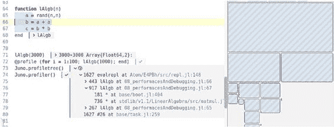

# 第 8 章：高效编写高效代码

## 让 Julia 与其他语言交互

### Julia 与 R：来自 Julia RCall 包

如果你尚未在 Julia 中安装它，它会尝试自动安装。

正如预期的那样，`JuliaCall` 也提供了多种在 `R` 中访问 `Julia` 的方式。

假设你已将所有的 Julia 函数保存在一个文件中。你将复用之前在 `PyJulia` 中使用过的 `juliaScript.jl` 脚本：

```julia
function helloWorld()
    println("Hello World!")
end

function sumMyArgs(i, j)
    return i+j
end

function getNElement(n)
    a = [0,1,2,3,4,5,6,7,8,9]
    return a[n]
end
```

你可以通过以下方式在 `R` 中访问其函数：

```r
> julia_source("juliaScript.jl") # 包含该文件
> julia_eval("helloWorld()") # 输出 `Hello World!` 并返回 NULL
> a <- julia_call("sumMyArgs",c(1,2,3),c(4,5,6)) # 返回
`[1] 5 7 9`
> as.integer(1) %>% getNElement -> b # 返回 `0`，即
Julia 和 R 的“第一个”元素
```

关于最后一个示例，它突出了管道操作符，这在 `R` 中非常常见（你将在第 11 章“工具”中看到 `Julia` 中的等效操作符）。`%>%` 语法是由 `JuliaCall` 提供的特殊版本，允许你在从左到右的数据转换工作流中混合使用 Julia 函数。

### 直接在 R 中嵌入 Julia 代码

你也可以使用 `julia_eval()` 函数直接在 `R` 中嵌入 Julia 代码：

```r
> funnyProdR <- julia_eval('
+ function funnyProd(is, js)
+   prod = 0
+   for i in 1:is
+     for j in 1:js
+       prod += 1
+     end
+   end
+   return prod
+ end
+ ')
```

然后你可以在 `R` 中调用这个函数，方式包括 `funnyProdR(2,3)`、`julia_eval("funnyProd(2,3)")` 或 `julia_call("funnyProd",2,3)`。

虽然该包还提供了其他“便捷”函数，但使用 `julia_eval` 和 `julia_call` 应足以完成你在 `Julia` 中需要的任何任务。

---

## 本章概览

本章讨论了以下第三方包：

| 包名 | URL | 版本 |
|---|---|---|
| `BenchmarkTools.jl` | [`github.com/JuliaCI/BenchmarkTools.jl`](https://github.com/JuliaCI/BenchmarkTools.jl) | v0.4.2 |
| `ProfileView.jl` | [`github.com/timholy/ProfileView.jl`](https://github.com/timholy/ProfileView.jl) | v0.4.1 |
| `JuliaInterpreter.jl` | [`github.com/JuliaDebug/JuliaInterpreter.jl`](https://github.com/JuliaDebug/JuliaInterpreter.jl) | v0.6.1 |
| `Juno` | [`junolab.org`](https://junolab.org) / [`github.com/JunoLab/Atom.jl`](https://github.com/JunoLab/Atom.jl) | v0.9.1 |
| `atom-julia-client` | [`github.com/JunoLab/atom-julia-client`](https://github.com/JunoLab/atom-julia-client) | v0.9.4 |

本章旨在介绍一些主题，这些主题虽然可能并非严格必要，但对于以高效方式编写高效代码（即运行速度快且易于（并有趣地）编写的代码）却非常重要。

我首先讨论代码性能，然后转向并行化以进一步加速执行。接着，我继续讨论允许开发者检查程序是否遵循预期行为并便于早期错误定位的工具。最后，我将介绍可用于隔离并可能纠正运行时出现问题的构造。

© Antonello Lobianco 2019

A. Lobianco, *Julia 快速语法参考*, [`doi.org/10.1007/978-1-4842-5190-4_8`](https://doi.org/10.1007/978-1-4842-5190-4_8)

---

### 性能

当处理类型为 `Any` 的数据对象时，即对象的类型在运行时之前未指定的情况下，Julia 已经相对较快。但是，当编译器能够推断出特定类型（或少数类型的联合）时，Julia 程序的运行速度可以达到与 C 程序相同的量级。

好消息是，程序员通常不需要指定变量类型。编译器实际上会直接推断它们，以生成高效、专门的代码。只有在极少数情况下，编译器才无法推断出特定类型。

### 如何编写高性能代码

在本节中，你将学习如何测量（或基准测试）`Julia` 代码、如何避免相关问题，并了解一些 `Julia` 特有的性能优化技巧。

#### 基准测试

当你在编辑器中高亮代码并运行以评估相应指令时，`Julia` 会执行两个独立的任务：编译代码（包括其依赖项）和运行编译后的代码。

除非你对 `Julia` 交互式开发的效率特别感兴趣，否则应该只对第二个操作（即代码执行）进行基准测试和/或性能分析，而不应包括代码编译时间。

因此，如果你想使用最简单的基准测试宏`@time` `[Julia 表达式]`，应该运行两次并丢弃第一次的结果（因为第一次包含编译时间）。

以计算斐波那契数列的函数为例，该数列中每个数字是前两个斐波那契函数值的和（即`Fn = Fn-1 + Fn-2`），其中`F0`和`F1`分别定义为`0`和`1`。

一个简单的递归实现如下（请注意，存在更快的斐波那契数计算算法）：

```
julia> function fib(n)
           if n == 0 return 0 end
           if n == 1 return 1 end
           return fib(n-1) + fib(n-2)
       end
fib (generic function with 1 method)
```

如果启动新的 `Julia` 会话，运行此代码并使用`@time`宏计时，你将得到类似以下的结果：

```
julia> @time fib(10)
  0.004276 seconds (4.63 k allocations: 254.928 KiB)

julia> @time fib(10)
  0.000006 seconds (4 allocations: 160 bytes)
```

虽然`@time`宏可以接受任何有效的 `Julia` 表达式，但它最常用于函数调用。

你可以看到，第一次报告的时间和内存使用信息包括了函数的编译时间（由此可以推断，函数的编译是在首次调用时“即时”（JIT）完成的，而非定义时）。

此外，函数的执行时间真的是`0.000006`秒吗？这只是包含机器状态随机因素的单个测量值。更好的方法是获取*平均*时间，通过多次采样使平均值具有统计显著性。

`BenchmarkTools`包（参见 [BenchmarkTools.jl](https://github.com/JuliaCI/BenchmarkTools.jl)）正是为此而生：它提供了`@benchmark`宏，能自动跳过编译时间并多次运行代码，从而报告精确的计时结果。

应用于此函数，你将得到以下结果：

```
julia> @benchmark fib(10)
BenchmarkTools.Trial:
  memory estimate:  0 bytes
  allocs estimate:  0
  --------------
  minimum time:     292.131 ns (0.00% GC)
  median time:      292.401 ns (0.00% GC)
  mean time:        299.772 ns (0.00% GC)
  maximum time:     492.895 ns (0.00% GC)
  --------------
  samples:          10000
  evals/sample:     267
```

这将提供更精确的基准测试结果。

## 8.1.2 性能分析

基准测试提供了所给定指令的*总*运行时间信息，但通常你还想知道时间在函数调用中是如何分配的，以便找出性能瓶颈。

这就是*性能分析器*的任务。Julia 自带一个集成的统计性能分析器（位于标准库的`Profile`包中）。当使用表达式调用时，分析器会运行该表达式，并每隔 x 毫秒记录程序当前执行到的代码行。

某行代码被命中的次数越多，其计算成本就越高。

使用这种采样方法，虽然会牺牲一些精度，但性能分析可以非常高效。与不进行性能分析的代码运行相比，其开销非常小。而且使用起来也非常简单：

- `@profile myfunct()`：对函数进行性能分析（请记得先运行一次函数，否则也会测量到 JIT 编译时间）。
- `Profile.print()`：打印性能分析结果。
- `Profile.clear()`：清除性能分析数据。

性能分析数据会累积，直到你清除它。这使得开发者可以对非常小（快速）的函数进行性能分析，单次分析可能不准确，只需多次分析即可，例如：`@profile (for i = 1:100; foo(); end)`

例如，假设你要对名为`myCode.jl`的文件中的以下函数进行性能分析，左侧数字为行号：

```
64  function lAlgb(n)
65      a = rand(n,n) # 用随机数初始化矩阵
66      b = a + a     # 矩阵加法
67      c = b * b     # 矩阵乘法
68  end
```

如果你运行`@profile (for i = 1:100; lAlgb(1000); end)`（同样，请先运行一次函数完成 JIT 编译），然后运行`Profile.print()`，可能会得到类似以下的输出（为节省篇幅进行了部分截断）：

```
julia> Profile.print()
1627 ./task.jl:259; (::getfield(REPL, Symbol("##26#27")){REPL.REPLBackend})()
1627 ...ld/usr/share/julia/stdlib/v1.1/REPL/src/REPL.jl:117; macro expansion
1627 ...obianco/.julia/packages/Atom/E4PBh/src/repl.jl:135; repleval(::Module, ::Expr)
1627 ./boot.jl:328; eval
1627 ...share/julia/stdlib/v1.1/Profile/src/Profile.jl:25; top-level scope
1627 ./none:1; macro expansion
 267 /full/path/to/myCode.jl:65; lAlgb(::Int64)
 267 .../share/julia/stdlib/v1.1/Random/src/Random.jl:243; rand
 443 /full/path/to/myCode.jl:66; lAlgb(::Int64)
 443 ./arraymath.jl:47; +(::Array{Float64,2}, ::Array{Float64,2})
 440 ./broadcast.jl:707; broadcast(::typeof(+), ::Array{Float64,2}, ::Array{Float64,2})
   1 ./int.jl:0; broadcast(::typeof(+), ::Array{Float64,2}, ::Array{Float64,2})
   2 ./simdloop.jl:71; broadcast(::typeof(+), ::Array{Float64,2}, ::Array{Float64,2})
 917 /full/path/to/myCode.jl:67; lAlgb(::Int64)
 181 ./boot.jl:404; *
 736 ...julia/stdlib/v1.1/LinearAlgebra/src/matmul.jl:142; *
```

输出中每行的格式为：对应行及其下游所有代码的采样计数、文件名、行号和函数名。

需要关注的是与各个函数操作相关的行。从性能分析日志中，你可以看到用随机数初始化矩阵（第 65 行）被命中了 267 次，矩阵加法（第 66 行）被命中了 443 次，矩阵乘法（第 67 行）被命中了 917 次。

这有助于你确定`lAlgb`函数内部各操作的*相对*时间开销，其中矩阵乘法的计算量最大。



在实际使用中，情况会很快变得复杂，你可能希望以图形化的方式展示带有性能分析数据的调用栈。此时可以使用`ProfileView`包。通过`ProfileView.view()`，它可以提供一个清晰的调用栈图表，宽度与命中次数成比例。1

如果你使用较新版本的 Juno 作为 Julia IDE，还可以享受一些便捷的用户界面，如图 8-1 所示（你仍需使用`@profile`宏来收集感兴趣的数据）：

- `Juno.profiletree()`提供了`Profile.print()`的绝佳替代，树中的项可以点击折叠/展开，并链接到相应的源代码。
- 类似地，`Juno.profiler()`改进了`ProfileView.view()`，在面板中显示调用图，并移除因使用 Atom 产生的噪声，聚焦于用户代码的调用栈。

***图 8-1.** Atom IDE 中的性能分析工具*

> 1 在撰写本文时，`ProfileView`在 MacOS 上似乎存在安装问题。

## 8.1.3 类型稳定性

# Julia 中的类型稳定性

当函数的返回类型仅取决于输入参数的类型，而非它们的值时，该函数称为类型稳定的。类型不稳定的函数其返回类型会被编译为 `Any`，仅在运行时才会转换为特定类型；而类型稳定的函数则能被编译器优化，因为它可以为该函数可能被调用的所有类型编译专门的版本。此外，类型稳定性对于保持编译器推断各种链式调用中各个对象类型的能力至关重要。

需要注意的是，类型稳定性并非指参数未使用特定类型进行标注的问题。通常，即使没有显式的类型标注，编译器仍然能够在编译时列出该函数参数所有可能的类型，并生成高性能的代码。

## 类型不稳定函数的示例

让我们看一个类型不稳定函数的例子：

```julia
function fUnstable(s::AbstractString, n)
    # 返回参数 `s` 中作为文本字符串给出的类型：
    T = getfield(Base, Symbol(s))
    x = one(T)
    for i in 1:n
        x = x + x
    end
    return x
end
```

这里的问题在于，返回的值取决于输入的具体文本，即 `s` 参数的值。虽然这看起来像是一个极端情况，但在处理用户数据或从某些输入读取时，经常会出现类型不稳定的函数。

## 使用 `@code_warntype` 检查类型稳定性

可以使用 `@code_warntype` 宏来检查函数的类型稳定性。

如果在终端中运行 `@code_warntype fUnstable("Float64", 100000)`，你会得到一个冗长的输出，但关键部分是第一行，它将显示为 `Body::Any`（在 Julia REPL 中显示为红色）。正是这条信息告诉你该函数是类型不稳定的。

## 类型稳定函数的示例

在这个例子中，消除类型不稳定性的一种方法是将 `x` 变量固定为 `Float64`：

```julia
function fStable(s::AbstractString, n)
    T = getfield(Base, Symbol(s))
    x = one(Float64)
    for i in 1:n
        x = x + x
    end
    return x
end
```

如果运行 `@code_warntype fStable("Float64", 100000)`，你会在输出的第一行看到 `Body::Float64`（以令人安心的蓝色显示），这确认了该函数的类型稳定性。

## 基准测试：类型稳定性带来的性能提升

你可以对这两个函数进行基准测试。类型稳定性带来的改进是非常巨大的：

```julia
@benchmark fUnstable("Float64", 100000)  # 中位时间：1.299 毫秒
@benchmark fStable("Float64", 100000)    # 中位时间：111.461 微秒
```

## 针对无法实现类型稳定的函数的策略

如果存在确实无法实现类型稳定的函数，一种策略是将该函数拆分成多个定义，希望其中计算密集的部分能够实现类型稳定。

## 其他性能提升技巧

### 避免使用全局变量，并在函数内运行性能关键代码

全局变量（在任何函数外部定义的变量）可以随时改变其类型。与其在函数内部使用全局变量，不如将变量作为函数参数传递。如果这不可行或不实际，请至少尝试将全局变量声明为 `const`（以固定其类型），或者在函数中使用时标注其类型。

### 标注数据结构的类型

与通常认为在 Julia 中标注类型对性能无益的规则相反，用具体类型标注数据容器内部元素的类型有助于提升性能。由于原始类型具有固定的内存大小，它们的数组（例如 `Array{Float64}`）可以连续地存储在内存中，效率极高。相反，包含 `Any` 元素或甚至任何抽象类型的容器，则存储为指向实际内存的指针，导致内存分布稀疏，访问速度相对较慢。

### 标注复合类型的字段

作为“不需要标注类型”这一规则的另一个例外，如果结构体的字段未标注类型（或使用抽象类型标注），则所有使用该结构体的函数都将变成类型不稳定。如果你想保持灵活性，请改用参数化结构体。

例如：

```julia
struct MyType2
    a::Float64
end

# 或者……
struct MyType3{T}
    a::T
end
```

# `..rather than..`（意为“...而不是...”）

```
struct MyType

end
```

## 按列优先再按行循环遍历矩阵元素

矩阵数据在内存中是以各列数组首尾相连的方式存储的（`列优先`顺序），即先存储第一列，接着是第二列，以此类推。

因此，先按列再按行循环遍历矩阵（以便连续读取值）的速度更快：

```
M = rand(2000,2000)
```

```
function sumRowCol(M) # 较慢
    s = 0.0
    for r in 1:size(M)[1]
        for c in 1:size(M)[2]
            s += M[r,c]
        end
    end
    return s
end

function sumColRow(M) # 较快
    s = 0.0
    for c in 1:size(M)[2]
        for r in 1:size(M)[1]
            s += M[r,c]
        end
    end
    return s
end
```

```
@benchmark sumRowCol(M) # 中位时间: 21.684 ms
@benchmark sumColRow(M) # 中位时间: 4.787 ms
```

## 8.2 代码并行化

Julia 提供了核心功能来促进代码并行化，既可以使用多线程，也可以使用多进程。线程共享同一内存（因此无需在多个线程之间复制数据），但受限于在同一 CPU 上运行。此外，很难“保证”安全的多线程操作。Julia 中的线程支持仍处于实验阶段，尽管其开发进展迅速 2。

进程各自拥有独立的内存（因此数据需要在进程之间复制，这代表了需要与并行执行带来的优势相平衡的计算成本），并且可以分布在多个 CPU 甚至多台机器上（例如，通过 SSH 连接）。由于 Julia 中的多进程并行化已经成熟且稳定，在本节的剩余部分，我将讨论它。你看到的所有函数都是 `Distributed` 标准库包的一部分。

### 8.2.1 添加和移除进程

进程可以随时添加和移除：

```
wksIDs = addprocs(3) # 2,3,4
```

```
println("工作进程 pid: ")
for pid in workers()
    println(pid) # 2,3,4
end

rmprocs(wksIDs[2]) # 或 rmprocs(workers()[2]) 移除进程 pid 3

println("工作进程 pid: ")
for pid in workers()
    println(pid) # 2,4 剩余
end

@everywhere println(myid()) # 2,4
```

第一行添加了三个进程。在此例中，它们被添加到运行主 Julia 进程的同一台机器上，但可以在 `addprocs()` 中直接指定 SSH 连接详情，以便将进程添加到其他机器（这些机器也必须安装 Julia）。

通常，让 `n` 等于机器上可用的核心数是合理的。

也可以使用命令行标志 `-p`（例如，`./julia -p 2`）直接启动带有多个进程的 Julia。`-p` 参数会隐式加载 `Distributed` 模块。

在此示例中，新进程的“内部 ID”（不同于操作系统分配的 pid）被保存在数组 `wksIDs` 中，尽管你并不一定需要它，因为调用 `workers()` 也会返回该数组。

主 Julia 进程（例如，提供交互式提示符的进程）的 pid 始终为 1，并且除非它是唯一进程，否则它不被视为工作进程。

然后，你可以检查活动的工作进程，并通过 `rmprocs(pid)` 移除不再需要的进程。

最后，你可以使用函数 `myid()` 返回进程的 PID，并使用 `@everywhere` 宏将该函数传播到所有工作进程并打印。

### 8.2.2 在项目列表上运行繁重计算

本节考虑两种常见的并行化模式。

第一种模式涉及对一个项目列表执行计算开销很大的操作，并且你对每个项目的结果都感兴趣。关键在于，每个项目的计算是独立于其他项目的。

例如，你将重用之前见过的 `fib` 函数。首先需要确保所有进程（假设你已使用 `addprocs(3)` 添加了三个工作进程）都知道你希望它们使用的函数。你可以在函数定义前使用 `@everywhere` 宏，以便将该函数传输给所有工作进程（如果你在后续阶段添加更多进程，它们将无法访问该函数）。如果你需要在工作线程中调用多个函数（或者需要调用多个子函数），一个方便的选择是将它们及其所需的全局变量定义在一个以 `@everywhere` 宏为前缀的 `begin` 块中（即 `@everywhere begin [共享函数定义] end`），或者将它们放入一个文件并运行 `@everywhere include("computationalcode.jl")`。

然后，你可以创建输入数据数组，并使用 `pmap(op, inputData)` 对每个元素运行繁重操作：

```
a = rand(1:35,100)
```

```
@everywhere function fib(n)
    if n == 0 return 0 end
    if n == 1 return 1 end
    return fib(n-1) + fib(n-2)
end

@benchmark results = map(fib, a)      # 串行: 中位时间: 490.473 ms
@benchmark results = pmap(fib, a)     # 并行: 中位时间: 249.295 ms
```

`pmap` 函数会自动动态地选取“空闲”进程，为其分配任务，并将结果合并到返回的数组中。只有函数的计算部分在工作进程中执行。当函数的计算成本很高时（例如本例），`pmap` 非常方便。但请注意，即使你使用了三个工作线程，计算时间的缩减系数也远低于三 3。

### 8.2.3 聚合结果

第二种情况是，你想要对每个项目执行一个小型操作，但同时希望最后执行一个“聚合函数”来获取一个标量值（如果输入是矩阵，则获取一个数组）。

在这些情况下，你可以使用 `@distributed (aggregationFunction) for` 结构。例如，你并行执行除以 2 的操作，然后使用 `sum` 作为聚合函数（假设有三个可用的工作进程）：

```
function f(n)
    s = 0.0
    for i = 1:n
        s += i/2
    end
    return s
end
```

```
function pf(n)
    s = @distributed (+) for i = 1:n    # 使用变量 s 上的 sum 进行聚合
        i/2                             # for 循环的最后一个元素被聚合器使用
    end
    return s
end

@benchmark f(10000000)      # 中位时间: 11.478 ms
@benchmark pf(10000000)     # 中位时间: 4.458 ms
```

所展示的两种案例是代码并行化中最常见的几种情况。Julia 提供了相当完整的高层和底层并行化函数列表，一些外部包，如 `DistributedArrays`（参见 [`github.com/JuliaParallel/DistributedArrays.jl`](https://github.com/JuliaParallel/DistributedArrays.jl)），有助于以相对简单的方式在许多情况下实现高效的并行化代码。

值得注意的是，Julia 中的并行计算可以扩展到在 GPU（图形处理单元）而非 CPU 上运行。这个主题超出了本书的范围，但你可以查阅官方文档（参见 [`docs.julialang.org/en/v1/manual/parallel-computing/index.html`](https://docs.julialang.org/en/v1/manual/parallel-computing/index.html)），其中提供了几个提供底层和高级接口的包。

## 8.3 调试

`调试`，通常是指“消除计算机程序中错误或故障的过程”（来自 Merriam-Webster 词典）。

在编译型语言中调试要困难得多，这促使了许多复杂、专用工具的开发以帮助调试程序。

Julia 的交互式和内省特性使得调试相对简单，因为程序员可以轻松地分析并在任何步骤更改代码。尽管如此，专门的调试工具已经被开发出来，用于帮助调试函数内部的代码，否则这些代码的各个组成部分将难以分析。

### 8.3.1 内省工具

`内省`是程序检查自身的能力，特别是`类型内省`是程序在运行时检查对象类型或属性的能力。

广义上讲，第一个“内省”工具是工作区（Workspace）面板，它在多个 Julia 开发环境中都有提供（图 8-2 显示了 Juno 中可用的面板）。它显示了当前作用域内所有标识符（变量、函数等）以及绑定到它们的对象。

*图 8-2. Juno IDE 中的工作区面板*

此外，Julia 提供了以下内省函数：

- `methods(myfunction)`：检索所有函数签名，即函数在被调用时接受的所有不同类型的参数。

- `@which myfunction(myargs)`：发现特定调用中会使用哪个方法（在可用的多个方法中，因为 Julia 支持多重分派）。

- `typeof(a)`：发现给定对象的类型。

- `eltype(a)`：发现给定对象内部元素的类型，例如 `typeof(ones(Int64,10))` 返回 `Array{Int64,1}`，而 `eltype(ones(Int64,10))` 返回 `Int64`。

- `fieldnames(aType)`：发现给定类型包含哪些字段。

- `dump(myobj)`：获取关于给定对象的详细信息。

## 8.3.2 调试工具

Julia 提供了一个功能完备的调试器栈。基础功能由 `JuliaInterpreter.jl` 包（参见 [`github.com/JuliaDebug/JuliaInterpreter.jl`](https://github.com/JuliaDebug/JuliaInterpreter.jl)）提供，而用户界面则由命令行包 `Debugger.jl`（[`github.com/JuliaDebug/Debugger.jl`](https://github.com/JuliaDebug/Debugger.jl)）和 `Rebugger.jl`（[`github.com/timholy/Rebugger.jl`](https://github.com/timholy/Rebugger.jl)）或 Juno IDE（[`junolab.org/`](https://junolab.org/)）提供。

由于这些功能类似，并且使用图形用户界面可能更方便，我们只讨论 Juno 中调试器的集成。Juno 集成的调试器允许开发者在任意点检查源代码并设置断点，断点是执行暂停的点，以便程序员检查状态、更改代码或继续执行。

让我们重用 `fib` 函数并为其打开一个调试会话（见图 8-3）。

*图 8-3. Juno IDE 中的调试会话*

你可以通过在 Juno REPL 中输入 `Juno.@enter function(args)` 来启动调试会话。在这种情况下，你可以使用 `Juno.@enter fib(10)`。如果尚未可见，启动调试会话将打开特定的调试器面板（如图 8-3 右侧所示）。REPL 提示符也会变为 `debug>`。

从图 8-3 中，你可以看到你使用了调试提示符来打印变量 `n` 的值（但你从左侧的工作区面板已经知道），并且最有趣的是，动态地更改了它的值。你用它来运行一个奇怪的斐波那契数列，跳过了从 8 到 6 的递归。

点击主编辑器面板中行号的左侧将切换该行的断点（一个红点）。断点列在调试器面板的底部。它们可以被禁用（这样就不再活动），或者可以被编辑，使其仅在满足特定条件时适用（此处是当 `n` 小于或等于 4 时）。红点将变为蓝色，表示这是一个条件断点。

在调试器面板的顶部是调试会话的图形控制。从左到右，这些控制是：

- *继续（Continue）：* 继续执行，直到调试的函数终止或遇到有效的断点。`Juno.@run function(args)` 是 `Juno.@enter function(args)` 后接按下 Continue 的快捷方式。

- *完成函数（Finish Function）：* 继续执行，直到当前函数退出或遇到有效的断点。

- *下一行（Next Line）：* 评估当前行，并在评估下一行之前停止。

- *执行到选中行（Step to Selected Line）：* 继续执行，直到选中的行或遇到有效的断点。

- *下一个表达式（Next Expression）：* 评估下一个表达式。仅当同一行定义了多个表达式时，才与 Next Line 有所不同。

- *步入函数（Step Into Function）：* 执行下一个函数调用，并在子函数的开头停止（例如，在图 8-3 中，它将调用 `fib(2)` 并在其起始处暂停）。即将被调用的函数显示在控件下方。

- *停止调试（Stop Debugging）：* 终止调试会话并将控制权交给正常的 REPL。

最后，请注意调试器面板中间的调用堆栈（Callstack）会话：它提供了导致当前状态的调用链的可点击历史记录。

## 8.4 管理运行时错误（异常）

与其他许多语言一样，运行时错误可以通过 `try/catch` 块来处理：

```
try

end
```

# ..一些危险代码..

`catch`

# ..如果发生错误该怎么做，例如使用以下方式发送错误消息：

`error("我的详细消息")`

`end`

你也可以捕获*特定*类型的异常。在下面的代码片段中，如果表示数据的字典中未找到特定的键，你可以使用异常返回 `missing`：

```
function volume(region, year)
    try
        return data["volume", region, year]
    catch e
        if isa(e, KeyError)
            return missing
        end
        rethrow(e)
    end
end
```

