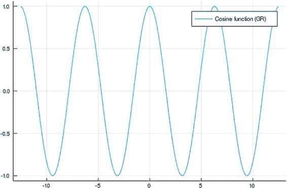
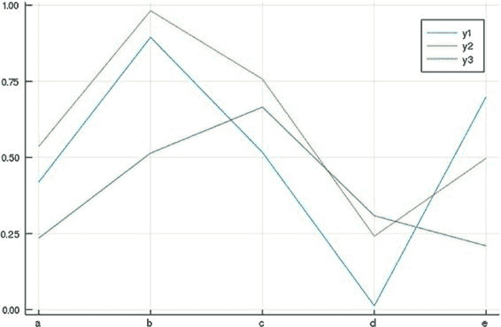
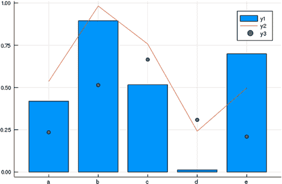
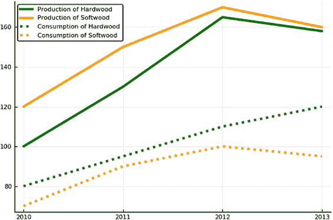

## 第 9 章 处理数据

本章讨论了以下第三方包：

- `DataFrames.jl` ([`github.com/JuliaData/`](https://github.com/JuliaData/DataFrames.jl) v0.19.2)
- `DataFramesMeta.jl` ([`github.com/JuliaStats/`](https://github.com/JuliaStats/DataFramesMeta.jl) v0.5.0)
- `Query.jl` ([`github.com/JuliaDebug/`](https://github.com/JuliaDebug/JuliaInterpreter.jl) v0.12.1)
- `IndexedTables.jl` ([`github.com/JuliaComputing/`](https://github.com/JuliaComputing/IndexedTables.jl) v0.12.2)
- `LAJuliaUtils.jl` ([`github.com/sylvaticus/`](https://github.com/sylvaticus/LAJuliaUtils.jl) v0.2.0)
- `Pipe.jl` ([`github.com/oxinabox/Pipe.jl`](https://github.com/oxinabox/Pipe.jl) v1.1.0)
- `Plots.jl` ([`github.com/JuliaPlots/Plots.jl`](https://github.com/JuliaPlots/Plots.jl) v0.26.1)
- `StatsPlots.jl` ([`github.com/JuliaPlots/`](https://github.com/JuliaPlots/StatsPlots.jl) v0.10.2)

尽管 Julia 本身已经为处理表格（和多维）数据提供了快速的原生结构 `Array{T,n}` 参数化类型，但为了专门处理数值数据，人们还是创建了非常庞大的第三方包集合。

总的来说，这是因为两个需求。

© Antonello Lobianco 2019

A. Lobianco，`Julia 快速语法参考`，[`doi.org/10.1007/978-1-4842-5190-4_9`](https://doi.org/10.1007/978-1-4842-5190-4_9)

第一个需求是更好的便利性。像 `DataFrames` 或 `IndexedTables` 这样的包添加了元数据（如列名），允许开发者通过名称而不是位置来检索数据，使用 `Query.jl` 或 `DataFramesMeta.jl` 进行查询，然后通过 `Pipe.jl` 进行连接、分组、链式操作等。

第二个需求是高效处理异构数据。在 Julia 基础的 `Array{T,2}` 中，为了效率，矩阵的所有数据必须是同一类型。另一种方法是使用 `Array{Any,2}`，但这样性能较低。

使用前述包，不同的列可以有不同的类型，这在处理数据集中相当常见，并且涉及这些数据结构的计算仍能保持高性能。

本章介绍了 Julia 中用于数据处理的主要第三方包，包括数据结构、各种查询和操作工具，以及绘图和可视化工具。

### 9.1 使用 DataFrames 包

`DataFrames` 是你首先会看到的数据结构，也许也是用得最多的一个。它们与 R 语言的 dataframes 和 Python 的 `Pandas` 非常相似。其方法和函数名也非常相似，尽管访问 API 的方式可能略有不同。与 `Pandas` 不同，`DataFrames` 包只处理二维（表格）数据。

在内部，`DataFrame` 是标准数组的集合，每个数组有其类型 `T`，如果存在缺失数据，则最终类型为 `Union{T,Missing}`。

#### 9.1.1 安装和导入库

你可以通过通常的方式安装该库：

- 安装库：`] add DataFrames`
- 加载库：`using DataFrames`

本节介绍的一些函数使用了 `LAJuliaUtils`（参见 [`github.com/sylvaticus/LAJuliaUtils.jl`](https://github.com/sylvaticus/LAJuliaUtils.jl)，这是我个人的工具函数库。

由于这不是一个已注册的 Julia 包，请使用以下命令安装：

```
] add https://github.com/sylvaticus/LAJuliaUtils.jl.git
```

#### 9.1.2 创建 DataFrame 或加载数据

以下是创建或加载 DataFrame（简写为 `df`）的几种方法。

在第 5 章“解析 CSV 文件”一节中，我们讨论了从逗号分隔文件或 Excel 文件加载 `df` 的方法，因为 `DataFrame` 是默认的输出格式。

要从头创建 `df`，请注意以下（虚构的）木材市场数据库，本章将通篇引用此数据。

```
df = DataFrame(region = ["US","US","US","US","EU",
                         "EU","EU","EU"],
               product = ["Hardwood","Hardwood","Softwood",
                          "Softwood","Hardwood","Hardwood",
                          "Softwood","Softwood"],
               year = [2010,2011,2010,2011,2010,2011,
                       2010,2011],
               production = [3.3,3.2,2.3,2.1,2.7,2.8,1.5,1.3],
               consumption = [4.3,7.4,2.5,9.8,3.2,4.3,6.5,3.0])
```

要创建一个空的 `df`：

```
df = DataFrame(A = Int64[], B = Float64[])
```

要从一个数据矩阵和一个（单独的）列名向量转换出 `df`：

```
mat = [1 2 3; 4 5 6]
headerstrs = ["c1", "c2", "c3"]
df = DataFrame([[mat[:,i]...] for i in 1:size(mat,2)], Symbol.(headerstrs))
```

要从一个矩阵转换出 `df`，其中标题定义在矩阵的第一行：

```
mat = ["c1" "c2" "c3"; 1 2 3; 4 5 6]
df = DataFrame([[mat[2:end,i]...] for i in 1:size(mat,2)],
               Symbol.(mat[1,:]))
```

要从代码中定义的表格创建 `df`：

```
using CSV
df = CSV.read(IOBuffer("""
region product year production consumption
US Hardwood 2010 3.3 4.3
US Hardwood 2011 3.2 7.4
US Softwood 2010 2.3 2.5
US Softwood 2011 2.1 9.8
EU Hardwood 2010 2.7 3.2
EU Hardwood 2011 2.8 4.3
EU Softwood 2010 1.5 6.5
EU Softwood 2011 1.3 3.0
"""), delim=" ", ignorerepeated=true, copycols=true)
```

如果没有 `copycols=true` 参数，生成的 `DataFrame` 将处于只读模式。

要从 OpenDocument 电子表格文件（OpenOffice、LibreOffice、MS Excel 等使用的格式）导入 `df`，请使用 `OdsIO` 包中的 `ods_read()` 函数，并配合 `retType="DataFrame"` 参数以及左上/右下范围：

```
df = ods_read("spreadsheet.ods"; sheetName="Sheet2", retType="DataFrame",
              range=((tl_row,tl_col),(br_row,br_col)))
```

#### 9.1.3 了解数据概况

一旦你拥有了一个 `DataFrame`，你可能想分析它的数据或结构：

- `show(df)`：显示 `df` 的一个子集（取决于可用空间）。使用 `allrows=true` 和 `allcols=true` 可检索完整的 `df`，无论其大小。

- `first(df, n)`：显示 `df` 的前 *n* 行。

- `last(df, 6)`：显示 `df` 的后 *n* 行。

- `describe(df)`：检索 `df` 每一列的类型和基本描述性统计信息。

- `names(df)`：返回列名数组（以符号形式，而非字符串）。

- `for r in eachrow(df)`：遍历每一行。

- `for c in eachcol(df)`：遍历每一列。

- `unique(df.fieldName)` 或 `[unique(c) for c in eachcol(df)]`：返回各列的唯一元素。

- `[eltype(c) for c in eachcol(df)]`：返回列类型数组。

- `size(df)`（行数，列数），`size(df)[1]`（行数），`size(df)[2]`（列数）：返回 `df` 的大小。

# 第 9 章 数据处理

请注意，列名是 Julia 符号，而不是字符串。要以编程方式组合列名，需要使用 `Symbol(aString)` 构造函数。例如，`Symbol("value_",0)`。

## 9.1.4 过滤数据（选择或查询数据）

要选择（过滤）数据，可以使用 `DataFrame` 包提供的方法，或其他包（如 `DataFrameMeta.jl` 或 `Query.jl`）提供的专用方法。

特别地，`Query.jl` 包旨在提供一个通用的 API，该 API 无论数据后端如何都有效。

- 选择整列：

  - `df[:,:cNames]`：通过复制数据选择多列（例如，`df[:,[:product,:year] ]`）。

  - `df[!,:cNames]`：通过引用数据选择多列（例如，`df[!,[:product,:year] ]`）。

  - `df.cName`：选择单列（例如，`df.product`）（引用方式，即等同于 `df[!,:cName]`）。

  - `df[cPos]`：通过复制数据选择一列或多列（例如，`df[2]`）。

- 选择整行：

  - `df[rPos,:]`：选择一行或多行（例如，`df[2,:]`）。与列不同，行没有标题名称。

- 选择单元格：

  - `df.cName[rPos]`：选择 `cName` 列中的特定单元格（例如，`df.product.[1:2:6]`）。

  - `df[rPos, :cName(s)]` 或 `df[rPos,cPos]`：通过行位置和列名或位置选择特定单元格（例如，`df[2,:product]`）。

# 第 9 章 数据处理

其中：

- `cName` 是单个列名（符号）。

- `cNames` 是一个列名（符号）数组。

- `rPos` 是行位置（标量、数组或范围）。

- `cPos` 是列位置（标量、数组或范围）。

返回的选择结果是：

- 如果是单列，则为 `Array{T,1}`

- 如果是单行，则为 `DataFrameRow`（类似于 `DataFrame`）

- 如果是单个单元格，则为 `T`

- 否则为另一个 `DataFrame`

过滤：

- `df[arrayOfBooleans,:]`：选择 `arrayOfBooleans`（大小必须一致）为 `true` 的行。这被称为“布尔选择”。

这同样适用于使用列位置同时选择行和列（但不能用于作为掩码的布尔值矩阵）。以下是一些示例：

- `df[ [true,true,false,false,false,false,false,false], [true,true,true,false,true] ]` 选择前两行，以及除第四列外的所有列。

- `df[ [i in ["US","China"] for i in df.region], :]` 通过列表推导式进行布尔选择，根据值是否在列表中过滤。列表推导部分根据条件返回一个布尔值数组，然后在此之上进行布尔选择。

# 第 9 章 数据处理

- `df[([i in ["US","China"] for i in df.region] .> 0) .& (df.year .== 2010), :]` 通过布尔选择中的多个条件进行过滤。需要点号来向量化操作。注意位运算与单个 & 符号的使用。

- `df[startswith.(df.region,"E"),:]` 基于所需值的起始模式进行过滤。

- `@where(df, condition(s))`：使用 `@where` 过滤（来自 `DataFrameMeta` 包）。如果是多个条件，则所有条件都必须满足。如果列名存储在一个变量中，则需要使用 `cols()` 函数将其包裹。例如，`colToFilter = :region; @where(df, :production .> 3, cols(colToFilter) .== "US")`。

另一种（也许更优雅，虽然更长）查询 `DataFrame` 的方法是使用 `Query` 包（参见 [`github.com/queryverse/Query.jl`](https://github.com/queryverse/Query.jl)）。第一个示例选择一个行和列的子集；第二个示例展示了如何混合多个选择标准：

```
dfOut = @from i in df begin
@where i.region == "US"
```

# 第 9 章 数据处理

## 9.1.5 编辑数据

有多种方式可以编辑数据：

- `df[rowIdx,:col1] .= aValue`：通过指定行和列来编辑值（例如，`df[[1,2],:production] .= 4.2`）。
- `df[(df.col1 .== "foo"), :col2] .= aValue`：通过布尔选择过滤来更改值（例如，`df[(df.region .== "US") .& (df.product .== "Hardwood"), :production] .= 5.2`）。
- `df.col1 = map(akey->myDict[akey], df.col1)`：基于字典替换值（或添加列）（原始数据——`df.col1`——可能位于不同的列或不同的 DataFrame 中，例如，`rFullName = Dict("US" => "United States", "EU" => "European Union"); df.regFullName = map(rShortName->rFullName[rShortName], df.region)`）。
- `df.newCol = df.col1 .* " " .* df.col2`：拼接多个列的（字符串）值，以创建新列的值（例如，`df.regAndProduct = df.region .* " " .* df.product`）。
- `df.a = df.b .* df.c`：基于其他列的值计算现有列或新列的值。注意，你需要进行逐元素操作。有时（例如加法和减法）不需要，但通常情况下列之间的操作应该使用点运算符（等号实际赋值时除外）。或者，你也可以使用 `map`。例如，`df.netExport = map((p,c) -> p - c, df.production, df.consumption)`。
- `push!(df, [aRowVector])`：向 `df` 追加一行，例如，`push!(df,["EU" "Softwood" 2012 5.2 6.2])`。
- `deleterows!(df,rowIdx)`：删除指定的行。`rowIdx` 可以是标量、向量或范围。你也可以通过拷贝不包含不需要的行的 `df` 来实现，例如，`i=3; df2 = df[[1:(i-1);(i+1):end],:]`。
- `df = similar(df,0)`：清空一个 `df`。`df2 = similar(df,n)` 会通过向新 DataFrame 添加 `n` 行（包含垃圾数据）来复制 `df` 的结构（`n` 默认为 `size(df)[1]`）。你可以使用 `n=0` 来清空给定的 `df`。

## 9.1.6 编辑结构

同样有多种方式可以编辑数据的结构：

- `select!(df,Not([:col1,:col2]))`：按名称删除列。
- `names!(df, [:newCName1,:newCName2,:newCName3])`：重命名所有列。使用 `rename!(df, Dict(:oldCName1=> :newCName1))` 仅重命名部分列。
- `df = df[:,[:b, :a] ]`：更改列的顺序。
- `df.id = 1:size(df, 1)`：添加一个“id”列（对于取消堆叠操作很有用；我们将在本章后面进一步探讨）。
- `addCols!(df, [:colNames], [colTypes])`：向 DataFrame 添加名为 `colNames`、类型为 `colTypes` 的空列（来自 `LAJuliaUtils` 包）。例如，`addCols!(df, [:import, :export], [Float64, Float64])`。
- `df.a = Array{Union{Missing,Float64},1}(missing,size(df,1))`：添加一个 `Float64` 列（默认填充缺失值）。
- `insert!(df, i, [colContent], :colName)`：在位置 `i` 处插入一列。
- `df.a = convert(Array{T,1},df.a)`：将列类型转换为 `T`。
- `df.a = map(string, df.a)`：从 `Int64`（或 `Float64`）转换为 `String`（例如，`df.namedYear = map(string,df.year)`）。
- `stringToFloat(str) = try parse(Float64, str) catch; return(missing) end; df.a = map(stringToFloat, df.a)`：从 `String` 转换为 `Float`（转换为整数类似）。
- `categorical!(df, [:a, :b])`：“池化”特定列，以便高效存储重复的分类变量。注意：虽然内存占用减少，但使用分类值进行过滤并不一定更快（实际上可能稍慢）。
- `collect(df.a)`：将分类数组转换为普通数组。

## 合并/连接/复制数据集

你可以使用以下方法连接数据集：

- `df = vcat(df1,df2,df3)`：垂直连接具有相同结构的不同 DataFrame（或 `df = vcat([df1,df2,df3]...)`，注意末尾的三个点）。

# Markdown 排版输出

- `end`，即 `splat` 运算符。

- `df = hcat(df1, df2, makeunique=true)`：横向拼接具有相同行数的数据框。如果待合并的数据框包含同名列，则需要设置 `makeunique=true`。

- `fullDf = join(df1, df2, on = :commonCol)`：横向连接数据框。`on` 参数也可以是一个由共同列组成的数组。连接方式有多种，最常见的有 `:inner`（默认值；仅返回两侧键值都存在的行）、`:left`（左侧数据框中键值在右侧不存在的行也会返回）、`:right`（与 `:left` 相反）以及 `:outer`（两个数据框中任何一侧缺少元素的行都会返回）。

- `df2 = similar(df1, 0)`：复制数据框的结构（到一个空数据框）。

## 9.1.7 处理缺失值

回顾一下，缺失值（即 `missing`，它是单例类型 `Missing` 的唯一实例）如果未得到处理，会在操作中静默传播。`DataFrames` 包提供了一系列方法，允许程序员根据对缺失性的解释来决定如何处理这些数据：

- `dropmissing(df)` 和 `dropmissing!(df)`：返回只包含完整行的数据框，即任何字段都不含缺失值（也可使用 `dropmissing(df[[:col1,:col2]])`）。在操作内部（例如求和），你可以使用 `dropmissing()` 来在执行操作前跳过缺失值。

- `completecases(df)` 或 `completecases(df[[:col1,:col2]])`：返回一个布尔数组，指示整行或指定字段中是否无缺失。

- `[df[ismissing.(df[!,i]), i] .= 0 for i in names(df) if Base.nonmissingtype(eltype(df[!,i])) <: Number]`：将所有数值列（如 `Float64` 和 `Int64`）中的缺失值替换为 0。

- `[df[ismissing.(df[!,i]), i] .= "" for i in names(df) if Base.nonmissingtype(eltype(df[!,i])) <: String]`：将所有字符串列中的缺失值替换为 `""`。

- `isequal.(a,b)`：进行比较时不传播缺失值（例如，`isequal("US", missing)` 返回 `false`，而 `"US" == missing` 既不是 `true` 也不是 `false`，而是返回 `missing`）。

- `nMissings = length(findall(x -> ismissing(x), df.col))`：统计某列中缺失值的数量。

## 9.1.8 分裂-应用-合并策略

`DataFrames` 包通过 `by` 函数支持常见的*分裂-应用-合并*策略，该函数接受三个参数：(1) 一个数据框，(2) 用于分裂数据框的一列或多列，(3) 要应用到每个数据框子集上的函数或表达式。

使用 `by` 函数时，“内部”函数会被应用到每个子组上，它返回的任何内容（标量、数组、命名元组或数据框）会先与定义子组的值进行横向合并，然后再纵向合并（“组合”），最终组成由 `by` 函数返回的数据框。返回命名元组或数据框允许对新列进行标记，出于性能考虑，推荐优先使用命名元组。

`by` 函数的另一种形式是将函数作为第一个参数，因此通常使用 `do` 代码块来应用。

在内部，`by` 函数使用了 `groupby()` 函数，正如在代码中，它被定义为：

```julia
by(d::AbstractDataFrame, cols, f::Function) =
combine(map(f, groupby(d, cols)))

by(f::Function, d::AbstractDataFrame, cols) = by(d, cols, f)
```

让我们看看如何将 `by` 函数应用于一些常见的数据转换模式。

### 聚合

在聚合的情况下，你需要降低每个子组的维度，定义一个或多个操作，每个操作用一个标量值代替子组中可能存在的多个值（例如，求和或平均值）。

内部函数必须返回一个*行*——例如命名元组、`DataFrameRow` 或单行数据框。

以下示例展示了按区域和产品进行聚合的不同方式。这些示例使用了先前木材市场数据的例子（`mean` 函数需要标准库包 `Statistics`）：

```julia
# 内部函数返回一个水平数组（一行）
# （新列会被自动命名）
by(df, [:region, :product]) do subgroup
    [mean(subgroup.production) sum(subgroup.consumption)]
end
```

```julia
# 内部函数返回一个命名元组（返回的列有名称）
by(df, [:region, :product]) do subgroup
    (avgProduction=mean(subgroup.production),
     totalConsumption=sum(subgroup.consumption))
end
```

## 返回每个子组中单行数据框的内部函数

`by(df, [:region, :product]) do subgroup`
`    DataFrame(avgProduction=mean(subgroup.production), totalConsumption=sum(subgroup.consumption))`
`end`

由于聚合是一个非常常见的操作，`DataFrames` 包提供了一个专门的 `aggregate(df, aggregationColumn(s), operation(s))` 函数，该函数直接按指定字段对 `df` 进行聚合，并对每个组应用指定操作，以便为每个组获得单个值。例如，`aggregate(df, [:region, :product], [sum, mean])`（使用前面的示例）将返回每组对应值集（生产量和消费量）的总和与平均值。

请注意，`aggregate` 函数的便利性是以牺牲通用性为代价的。你不能指定对不同值执行哪种聚合操作（例如，在前面的示例中，仅对生产量计算平均值，仅对消费量计算总和）。

此外，所有分类列都必须包含在参数 `aggregationColumns` 中；否则，Julia 会尝试对它们应用这些操作，在大多数情况下，会引发错误（因为该操作期望数值，而分类列通常是字符串），而不是直接忽略它们。

解决方法是，在执行聚合之前移除不需要的字段（在此示例中，移除年份：`select!(df, Not(:year)); aggregate(df, [:region, :product], [sum, mean])`）。

## 按类别计算累积和

让我们再次考虑原始的（虚构的）木材市场数据库，并试图获取每年的累积产量。

这项任务的难点在于，某行的值取决于同一子组中前几行的值，这意味着顺序很重要。

你可以再次使用 `by` 函数采用分割-应用-合并策略：

```
dfCum = by(df,[:region,:product]) do subdf
    JULIA
    return (year = subdf[:year], cumProd = cumsum(subdf[:production]))
end
```

与聚合情况不同，这里的每个子组需要多行，每个原始记录对应一行。在定义子组的列（`region` 和 `product`）中，你使用同源函数重新添加了 `year` 和 `cumsum` 列。请注意，`DataFrames` 包足够“智能”，可以将 `year` 标量扩展为 `cumProd` 长度的数组。

或者，你也可以使用 `@linq` 宏（来自 `DataFramesMeta`）采用分割-应用-合并策略：

`DataFramesMeta` 包提供了 `@linq` 宏，它支持在链式数据转换操作上采用*语言集成查询*风格，方式类似于 R 的 `dplyr` 包（<https://cran.r-project.org/web/packages/dplyr/>）：

```
dfCum = @linq df |>
    JULIA
    groupby([:region,:product]) |>
    transform(cumValue = cumsum(:production))
```

这里，`|>` 代表*管道*操作符（我们将在后面的章节中详细讨论），它将左侧操作返回的对象作为第一个参数传递给右侧操作。数据 (`df`) 首先被传递给 `groupby` 函数以进行分割，然后分割后的子组最终被传递给 `transform(df, operation)` 函数进行修改。

### 数据透视

表格化数据可以使用两种布局等效表示：*长格式*和*宽格式*。

*长格式*布局是指你在单独的列中指定每个维度，然后有一个单独的列存放你认为的“值”。如果数据库中有多个变量，那么“变量”也会成为一个维度列。

例如，使用木材市场示例，表 9-1 显示了一个长格式的表格。

*表 9-1. 长格式表格*

| 地区 | 产品 | 年份 | 变量 | 值 |
|------|------|------|------|----|
| 美国 | 硬木 |      | 产量 | 3.3|
| 美国 | 硬木 |      | 产量 | 3.3|
| 美国 | 硬木 |      | 产量 | 3.2|
| 美国 | 软木 |      | 产量 | 2.3|
| ...等.. | | | | |

长格式可读性较差，但非常易于操作和进行数据分析。

另一方面，在*宽格式*中，值在多个列上表示，其中一个或多个维度沿水平轴表示。参见表 9-2。

*表 9-2. 宽格式表格*

| 地区 | 产品 | 年份 | 产量 | 消费量 |
|------|------|------|------|--------|
| 美国 | 硬木 |      | 3.3  | 4.3    |
| 美国 | 硬木 |      | 3.2  | 7.4    |
| 美国 | 软木 |      | 2.3  | 2.5    |
| 美国 | 软木 |      | 2.1  | 9.8    |
| ...等.. | | | | |

木材示例的原始格式是一个宽表，但你也可以使用多个水平轴创建更宽的表格（`DataFrames` 包不支持）。参见表 9-3。

*表 9-3. 更宽的格式表格（带有多个水平轴）*

|          | 产量 |          | 消费量 |          |
|----------|------|----------|--------|----------|
|          | 硬木 | 软木     | 硬木   | 软木     |
| 美国     | 3.3  | 2.3      | 4.3    | 2.5      |
| 美国     | 3.2  | 2.1      | 7.4    | 9.8      |
| 欧盟     | 2.7  | 1.5      | 3.2    | 6.5      |
| 欧盟     | 2.8  | 1.3      | 4.3    |          |

在水平和垂直维度之间移动轴的操作称为*透视*。具体来说，*堆叠*将列移动并扩展为新的行，因此从宽格式转换为长格式。*取消堆叠*则相反，它将行提取出来并将其值放置为新的列，从而创建一个更“宽”的表格。

#### 堆叠列

`DataFrames` 包提供了 `stack(df, [cols])` 函数，你需要指定要堆叠的列，以及 `melt(df, [cols])` 函数，你需要指定其他列，即已经处于堆叠形式的分类列。

最后，`stack(df)`——不带列名——会自动堆叠所有浮点型列。

请注意，堆叠列的标题将作为数据插入到 `variable` 列（变量名是符号，而非字符串）中，相应的值则插入到 `value` 列中。

# DataFrames 操作

## 长格式转换与堆叠

```
longDf = stack(df,[:production,:consumption])
```

```julia
longDf1 = melt(df,[:region,:product,:year])
longDf2 = stack(df)
longDf == longDf1 == longDf2 # true
```

转换结果示例如下：
| 行  | 变量  | 值 | 地区 | 产品 | 年份 |
|     | Symbol | Float64 | String | String | Int64 |
├─────┼──────────┼────────┼────────┼─────────┼───────┤
│ 1   │ 产量 │ 3.3   │ 美国     │ 硬木 │ 2010 │
│ 2   │ 产量 │ 3.2   │ 美国     │ 硬木 │ 2011 │
| 3   | 产量 | 2.3   | 美国     | 软木 | 2010 |
| 4   | 产量 | 2.1   | 美国     | 软木 | 2011 |
...等等...

### 取消堆叠

`DataFrames` 包还提供了 `unstack(longDf, [:rowField(s)], :variableCol, :valueCol)`，你需要提供即使在宽格式下也应保持为分类变量的列列表、存储需要在水平轴上展开的类别的列名，以及包含相应值的列名。

你可以使用 `unstack(longDf, :variableCol, :valueCol)` 省略分类变量列表，这样除了定义列名的列和定义列值的列之外的所有现有列都将作为分类列保留：

```julia
wideDf = unstack(longDf,[:region, :product, :year],:variable,:value)
wideDf1 = unstack(longDf,:variable,:value)
wideDf == wideDf1 # true
```

### 多轴表格

`unstack` 的 `:variable` 参数是标量而非向量的原因是 Julia DataFrames 仅支持一个水平轴。

虽然多水平轴 DataFrames 在分析和处理时很混乱，但在某些上下文中作为数据的最终展示形式可能很有用。你可以通过在不同列上取消堆叠然后水平合并子数据框来模拟多水平轴 DataFrames。要获得表 9-3，你可以使用：

```julia
wideDf_p = unstack(wideDf,[:region,:year],:product,:production)
wideDf_c = unstack(wideDf,[:region,:year],:product,:consumption)
rename!(wideDf_p, Dict(:Hardwood => :prod_Hardwood, :Softwood => :prod_Softwood))
rename!(wideDf_c, Dict(:Hardwood => :cons_Hardwood, :Softwood => :cons_Softwood))
wideWideDf = join(wideDf_p,wideDf_c, on=[:region,:year])
```

### 透视函数

`LAJuliaUtils.jl` 包（<https://github.com/sylvaticus/LAJuliaUtils.jl>）中的 `pivot(df, [:rowField(s)], :variableCol, :valueCol; <keyword arguments>)` 函数可用于以类似电子表格透视的方式，在单个函数中透视并可选地过滤和排序堆叠（长格式）DataFrame。

`pivot` 与 `unstack` 类似，接受即使在宽格式下也应保持为分类变量的列列表、存储需要在水平轴上展开的类别的列名，以及包含相应值的列名。

可选关键字如下：

- `ops=sum`：对数据执行的操作，默认为求和。`ops` 可以是任何支持的单个数组上的 Julia 操作，例如：`sum`、`mean`、`length`、`countnz`、`maximum`、`minimum`、`var`、`std` 和 `prod`。可以使用数组指定多个操作，在这种情况下，会创建一个额外的 `op` 列来索引它们。

- `filter`：可选的过滤器，形式为 `待过滤列 => [可接受值列表]` 的字典（仅支持 `in` 过滤器）。

- `sort`：可选的行字段进行排序。使用元组而不是简单的 `:colname`，你可以指定反向排序（例如 `(:colname, true)`）甚至自定义排序顺序（例如 `(:colname, [val1,val2,val3])`）。在这种情况下，你未指定的元素将被放在末尾。你可以以数组形式传递多个要排序的列，例如 `[(:col1,true),:col2,(:col3,[val1,val2,val3])]`。

例如，`pivot` 函数可以以以下方式与木材长格式 DataFrame 一起使用：

```julia
pivDf = pivot(longDf, [:region, :product],:variable,:value,
    ops = [mean, var],
    filter = Dict(:variable => [:consumption]),
    sort = [:product, (:region, true)]
)
```

| **地区** | **产品** | **操作** | **消费量** |
|------------|-------------|--------|-----------------|
| 美国       | 硬木    | 平均值   | 5.85            |
| 美国       | 硬木    | 方差    | 4.805           |
| 欧盟       | 硬木    | 平均值   | 3.75            |
| 欧盟       | 硬木    | 方差    | 0.605           |
| 美国       | 软木    | 平均值   | 6.15            |
| 美国       | 软木    | 方差    | 26.645          |
| 欧盟       | 软木    | 平均值   | 4.75            |
| 欧盟       | 软木    | 方差    | 6.125           |

除了关键字参数外，与 `unstack` 的主要区别在于，如果你手动列出分类列但省略了一列或多列（例如，你在 `wideDf = unstack(longDf,[:region, :product],:variable,:value)` 中省略了 `:year`），你最终会在取消堆叠的 DataFrame 中得到重复条目（行），而同一类别下的最后条目会覆盖最早的条目。另一方面，使用 `pivot` 时，所有条目都会被考虑，并使用指定的聚合操作（如果未指定，则为 `sum`）进行处理。

### 排序

DataFrames 可以使用多列进行排序，使用 `sort!(df, (:columnsToSort), rev = (reverseSortingFlags))`（例如，`sort!(df,(:year, :region, :product), rev = (false, true, false))`）。（可选的）反向排序参数 (`rev`) 必须是一个布尔值元组，其大小与 `cols` 参数相同。

如果你需要对行进行自定义排序，你可以再次依赖 `LAJuliaUtils`，它提供了 `customSort!(df, sortops)`，其中 `sortops` 与你之前在 `pivot` 函数中看到的 `sort` 选项相同。

### 数据框导出

#### 导出为 CSV

将 DataFrames 导出为 CSV 格式直接由我们在第 5 章中看到的 `CSV.jl` 包支持：

```julia
CSV.write("file.csv", df)
```

有关导出选项，请参考第 5 章“导出为 CSV”部分。

#### 导出为 OpenDocument 电子表格文件

同样，导出为 OpenDocument 电子表格格式（由 OpenOffice、LibreOffice、MS Excel 等支持）可通过 `OdsIO.jl` 包（<https://github.com/sylvaticus/OdsIO.jl>）实现：

```julia
ods_write("spreadsheet.ods",Dict( ("MyDestSheet",3,2) => df) )
```

其中字典的键是一个三元组，指定工作表名称和左上角单元格的数值坐标，以确定导出 DataFrame 的位置。

#### 导出为矩阵

你可以使用 `convert` 将数据库或其一部分转换为矩阵。

- `convert(Matrix, df)`：转换为 `Array{Any,2}`

### `convert(Matrix{Union{String,Int64,Float64}}, df)`
更好，转换为 `Array{Union{Float64, Int64, String},2}`。

### `convert(Matrix, df[:,[:production, :consumption]])`
选取同类型列，生成一个 `Array{Float64,2}`。

#### 导出为字典
要将 DataFrame 转换为字典，可以使用 `LAJuliaUtils` 包提供的 `toDict(df, [:dimCols], :valueCol)`，它通过指定用作键的列（按给定顺序）和用于存储字典值的列，将 DataFrame 转换为字典。

例如，`toDict(df,[:region,:product,:year],:production)` 将产生以下结果：

```
Dict{Any,Any} with 8 entries:
    ("EU", "Softwood", 2011) => 1.3
    ("US", "Softwood", 2010) => 2.3
    ("US", "Hardwood", 2010) => 3.3
    ("US", "Hardwood", 2011) => 3.2
    ("EU", "Softwood", 2010) => 1.5
    ("US", "Softwood", 2011) => 2.1
    ("EU", "Hardwood", 2010) => 2.7
    ("EU", "Hardwood", 2011) => 2.8
```

#### 导出为 hdf5 格式
要使用 `HDF5` 包（<https://github.com/JuliaIO/HDF5.jl>）处理 hdf5，某些系统可能需要你安装系统级的 hdf5 二进制文件。例如，在基于 Debian 的 Linux 发行版中，你应该运行 `sudo apt-get install hdf5-tools`。

`HDF5` 包不直接支持 DataFrames，因此你需要先将它们导出为矩阵。进一步的限制是它不接受 `Any` 或 `Union{}` 类型的矩阵，因此你可能需要分两部分导出 DataFrame——字符串和数值列分别导出。

```
h5write("out.h5", "mygroup/myDf", convert(Array, df[:,[:cols]]))
```

你可以通过使用 `data = h5read("out.h5", "mygroup/myDf")` 读取数据。

### 9.2 使用 IndexedTables
`IndexedTables`（<https://github.com/JuliaComputing/IndexedTables.jl>）是替代的表状数据结构。它们的 API 在某些方面不如 DataFrames 方便，但它们特别有趣，因为（a）它们内部使用索引命名元组（而不是 DataFrame 中的数组）进行高性能的行选择，以及（b）它们是更大的 `JuliaDB` 生态系统（<https://juliadb.org/>）的一部分，该生态系统由数据管理包组成，能够处理无法在单台机器内存中容纳的非常大的数据集。

它们有两种变体：标准索引表 (`IndexedTable`) 和稀疏索引表 (`NDSparse`)。

在这两者中，我只讨论第二种，因为第一种是按行位置选择的，可能不如 `NDSparse` 有趣，因为后者可以使用键。

#### 9.2.1 创建 IndexedTable (NDSparse)
```
myTable = ndsparse((
    region = ["US","US","US","US","EU","EU","EU","EU"],
    product = ["Hardwood","Hardwood","Softwood","Softwood","Hardwood","Hardwood","Softwood","Softwood"],
    year = [2011,2010,2011,2010,2011,2010,2011,2010]
),(
    production = [3.3,3.2,2.3,2.1,2.7,2.8,1.5,1.3],
    consumption = [4.3,7.4,2.5,9.8,3.2,4.3,6.5,3.0]
))
```

稀疏索引表使用 `ndsparse` 函数创建，该函数接受一个命名元组（两个括号的原因）或一对命名元组。原因是 `IndexedTables` 明确区分了键列和值列（使用单个命名元组的方法假定最后一列是值）。

当索引表可视化时，键列和值列之间的区别很明显：

```
julia> myTable
3-d NDSparse with 8 values (2 field named tuples):
region product year │ production consumption
──────────────────┼──────────────────
"EU" "Hardwood" 2010 │ 2.8 4.3
"EU" "Hardwood" 2011 │ 2.7 3.2
"EU" "Softwood" 2010 │ 1.3 3.0
"EU" "Softwood" 2011 │ 1.5 6.5
"US" "Hardwood" 2010 │ 3.2 7.4
"US" "Hardwood" 2011 │ 3.3 4.3
"US" "Softwood" 2010 │ 2.1 9.8
"US" "Softwood" 2011 │ 2.3 2.5
```

此外，你可能注意到表格已像字典一样自动排序。

索引表也可以使用相同的函数从现有的 DataFrame 获得，例如 `myTable = ndsparse(df)`。

（稀疏）索引表作为一些自解释函数的参数被接受，例如 `show`、`first`、`colnames`、`pkeynames` 和 `keytype`。

索引表不适合“组合”键（跨所有维度的键）重复的数据。构造函数仍然允许你创建索引表，但随后许多方法会产生错误。

#### 9.2.2 行过滤
如前所述，索引表的主要优势在于它们提供非常快速的行选择。

`t[keyForDim1,keyforDim2,:,keyForDim3,...]`

这会选择与给定键集匹配的行，使用冒号 (`:`) 表示该维度的所有值。如果结果是单个值，则返回一个命名元组；否则返回另一个稀疏索引表。

正如所声称的，选择速度非常快：

```
n = 1000
keys = shuffle!(reshape([[a b] for a in 1:n, b in 1:n], n²))
```

# 为二维维度生成随机键

`Shuffle` 定义在 `Random` 标准库包中。

`x = rand(n²)`

# 生成随机值

```
myTable = ndsparse((a=[keys[i][1] for i in 1:n²], b=[keys[i][1] for i in 1:n²]), (x=x,))
```

# 第 9 章 处理数据

`myDf = DataFrame(a = [keys[i][1] for i in 1:n²], b=[keys[i][1] for i in 1:n²], x=x)`

`@benchmark(myTable[100,:])` # 中位数: 20.796 μs

`@benchmark(myDf[myDf.a .==100,:])` # 中位数: 1.297 ms

### 9.2.3 编辑/添加值

要更改或添加值，请使用以下方法：
- 更改值：`myTable["EU","Hardwood",2011] = (2.8, 3.3)`
- 添加值：`myTable["EU","Hardwood",2012] = (2.8, 3.3)`

你无需记住值列的顺序，因为可以按名称指定它们：`myTable["EU","Hardwood",2011] = (consumption=3.4,production=2.9)`

然而，你*确实*需要记住键列的顺序，因为以下写法目前仍无法生效（在撰写本文时）：`myTable[product="Hardwood", region="EU", year=2011] = (production=3.0, consumption=3.5)` # 错误！

## 9.3 使用管道运算符

管道运算符（[`github.com/oxinabox/Pipe.jl`](https://github.com/oxinabox/Pipe.jl)）改进了 Julia Base 中的管道运算符 `|>`。

链式调用（或称“管道”）允许你以紧凑且易读的方式将多个函数调用串联起来。它避免了保存中间结果，也无需将函数调用相互嵌套。

使用链式运算符 `|>`，`|>` 右侧的代码对 `|>` 左侧代码的结果进行操作。实际上，左侧操作的结果会成为右侧函数调用的参数。

链式调用对于数据处理非常有用。假设你想使用以下（简单的）函数依次对某些数据进行操作，并打印最终结果：
```
add6(a) = a+6; div4(a) = a/4;
```
你可以引入临时变量，或者嵌套函数调用：
```
# 方法 #1，使用临时变量：
a = 2;
b = add6(a);
c = div4(b);
println(c) # 输出: 2
```
```
# 方法 2，链式函数调用：
println(div4(add6(a)))
```
使用管道，你可以这样写：
```
a |> add6 |> div4 |> println
```
基本的管道功能非常有限，因为它只支持具有一个参数的函数，并且一次只能“管道”一个函数。

相反，Pipe 包提供了 `@pipe` 宏，它重写了 `|>` 运算符。它允许你使用具有多个参数的函数（你可以使用下划线字符 `_` 作为左侧值的占位符）。你还可以在单个管道步骤中对多个函数进行管道操作，如下所示：
```
addX(a,x) = a+x; divY(a,y) = a/y
a = 2
```
```
# 使用临时变量：
b = addX(a,6)
c = divY(a,4)
d = b + c
println(c)
```
```
# 使用 @pipe：
@pipe a |> addX(_,6) + divY(4,_) |> println # 输出: 10.0
```
你甚至可以将多个值嵌入元组中进行管道操作：
```
data = (2,6,4)
```
```
# 使用临时变量：
b = addX(data[1],data[2]) # 8
c = divY(data[1],data[3]) # 0.5
d = b + c # 8.5
println(c)
```
```
# 使用 @pipe：
@pipe data |> addX(_[1],_[2]) + divY(_[1],_[3]) |> println
```
请注意，与基本管道一样，需要单个参数且该参数由管道数据提供的函数不需要加括号。

## 9.4 绘图

### 9.4.1 安装与后端

在 Julia 中绘图可以使用特定的绘图包（例如，[`github.com/dcjones/Gadfly.jl`](https://github.com/dcjones/Gadfly.jl) 的 `Gadfly`，[`github.com/nolta/Winston.jl`](https://github.com/nolta/Winston.jl) 的 `Winston`），或者像许多人偏爱的，使用 `Plots` 包（[`github.com/JuliaPlots/Plots.jl`](https://github.com/JuliaPlots/Plots.jl)），它提供了一个包装器，带有统一的 API，可支持多个后端。

后端的选取方式是在调用绘图函数之前运行 `chosenbackend()`——即相应后端包的名称，但全部用小写字母书写。`Plots` 包默认使用 `GR` 作为其后端（见图 9-1），并且 `GR.jl` 会与 `Plot.jl` 一同安装。

如果你需要其他后端，只需安装相应的包即可。

两个比较完善的后端是：
- Plotly.JS（[`github.com/sglyon/PlotlyJS.jl`](https://github.com/sglyon/PlotlyJS.jl)）：对 `plotly.js`（[`plot.ly`](https://plot.ly)）可视化库的 Julia 封装
- PyPlot（[`github.com/JuliaPy/PyPlot.jl`](https://github.com/JuliaPy/PyPlot.jl)）：对 Python matplotlib（[`matplotlib.org/api/pyplot_api.html`](http://matplotlib.org/api/pyplot_api.html)）的封装

例如：
```
using Pkg
Pkg.add("Plots")
using Plots
plot(cos,-4pi,4pi, label="余弦函数 (GR)") # 使用默认的 GR 后端绘图
Pkg.add("PyPlot")
Pkg.add("PlotlyJS")
Pkg.add("ORCA") # PlotlyJS 所需
pyplot()
plot(cos,-4pi,4pi, label="余弦函数 (PyPlot)")
plotlyjs()
plot(cos,-4pi,4pi, label="余弦函数 (PlotlyJS)")
```



***图 9-1.** 使用默认后端 GR 绘制的余弦函数*

虽然 `GR` 是默认后端，即除非调用了其他后端，否则每次新会话都会使用它，但你可以在 `~/.julia/config/startup.jl` 文件中设置自己的默认后端 `ENV["PLOTS_DEFAULT_BACKEND"] = "myPreferredBackend"`。

确保不要混用不同的绘图包（例如，`Plots` 和直接使用它的某个后端）。这很可能会引发问题。如果你已经导入了一个绘图包并想使用另一个，你应该始终重启 Julia 内核（在使用 `Plots` 包的不同后端之间切换时，这不是必须的，并且这也是其优势之一）。

你可以通过 `backend()` 检查 `Plots` 当前正在使用哪个后端。

有许多不同的后端。虽然基本绘图几乎可以从任何后端获得，但每个后端在某些特性上都有自己的优势——例如速度、美观性或交互性。某些高级属性可能仅被一部分后端支持。

针对你的特定情况选择正确的后端很重要。以下页面可能对此有所帮助：
- 应该选择哪个后端？（[`docs.juliaplots.org/latest/backends/`](http://docs.juliaplots.org/latest/backends/)）
- 各后端支持的图表和属性（[`docs.juliaplots.org/latest/supported/`](http://docs.juliaplots.org/latest/supported/)）

### 9.4.2 Plot 函数

如果你使用 Juno，图表将渲染在“绘图”面板中；如果你使用 REPL，则会显示在单独的窗口中（除非你使用 `UnicodePlots` 后端，它采用字符在文本终端中渲染图表）。

遗憾的是，第一次绘图时间相对较长是正常现象。

你已经看到过一个 `plot` 函数方法的示例。

`specifically plot(func, lBound, uBound; keywArgs)`。另一种方式是使用 `plot(xData, yData; keywArgs)` 来绘制数据，其中 `xData` 是一个由数字或字符串组成的 `Array{T,1}`，代表横轴坐标；`yData` 可以是另一个 `Array{T,1}`（即列向量），也可以是 `Array{T,2}`（即矩阵）。在第一种情况下，将绘制单个序列；在第二种情况下，矩阵的每一列将被视为独立的数据序列（见图 9-2）：
```
x = ["a","b","c","d","e",]
```

**JULIA**

```
## 第 9 章 数据处理



### 图 9-2. 绘制多个序列

虽然绘图对象可以像其他对象一样保存，通过 `myPlot = plot(...)`，其特殊之处在于最后一次对 `plot` 的调用定义了“当前”绘图，这是可视化和保存的默认绘图。而使用 `plot!` 函数，您可以向现有绘图添加元素，如果没有特别指定（即通过将您操作的绘图对象作为第一个参数），精确地说是向“当前”绘图添加。

因此，绘制多个序列的另一种方法是先绘制一个序列，然后使用 `plot!` 一次添加一个序列。以下代码片段生成的绘图与上一个完全相同：

```julia
plot(x,y[:,1]) # 创建一个新的“当前绘图”
plot!(x,y[:,2]) # 向当前绘图添加一个序列
plot!(x,y[:,3]) # 向当前绘图添加一个序列
```

默认绘制的图表类型是 `:line` 折线图。可以通过 `plot` 函数的 `seriestype` 关键字参数指定不同类型的图表，如下所示：

```julia
plot(x,y[:,1]; seriestype=:scatter)
```

常见的图表类型包括 `:scatter`（散点图）、`:line`（折线图）、`:histogram`（直方图）等。您可以通过 `plotattr("seriestype")` 获取当前版本支持的所有类型列表。

对于许多类型的序列，`plot` 定义了别名函数，例如 `scatter(args)` 对应于 `plot(args, seriestype=:scatter)`。

先使用 `plot` 再使用 `plot!`，您可以将几种图表类型混合在一起（见图 9-3）：

```julia
plot(x,y[:,1], seriestype=:bar)
plot!(x,y[:,2], seriestype=:line)
plot!(x,y[:,3], seriestype=:scatter)
```



### 图 9-3. 绘制多种类型的图表

`seriestype` 和 `label` 只是 `plot` 支持的众多关键字参数中的两个。它们数量太多，无法在本书中详细描述。如果您想了解更多，请参考 `Plots.jl` 文档或使用内联帮助指南 `?plot` 和 `plotattr()`。

#### 9.4.3 从 DataFrames 绘图

您可以直接使用 `StatsPlots` 包（[`github.com/JuliaPlots/StatsPlots.jl`）](https://github.com/JuliaPlots/StatsPlots.jl) 提供的 `@df` 宏，从 DataFrames 而不是数组中绘制数据：

```julia
@df df plot(:year, [:production :consumption],
    colour = [:red :blue])
```

使用 `@df` 宏有三个优点：

- 您不需要在每个序列上重复 `df` 名称
- 序列会自动使用其列标题进行标注
- 您可以在绘图调用中直接对数据进行分组

以下是一个包含分组序列的更详细示例（见图 9-4）：

```julia
using DataFrames, StatsPlots
```
```

# 让我们使用修改后的示例数据，增加更多年份并只保留一个区域：

```julia
df = DataFrame(
  product = ["Softwood","Softwood","Softwood","Softwood",
             "Hardwood","Hardwood","Hardwood","Hardwood"],
  year = [2010,2011,2012,2013,2010,2011,2012,2013],
  production = [120,150,170,160,100,130,165,158],
  consumption = [70,90,100,95, 80,95,110,120]
)
```

```julia
pyplot()
mycolours = [:green :orange]  # 注意这是一个行向量，无论此处如何指定顺序，系列颜色都将按字母顺序排列

@df df plot(:year, :production, group=:product, linestyle = :solid, linewidth=3, label=reshape(("Production of " .* sort(unique(:product))) ,(1,:)), color=mycolours)
@df df plot!(:year, :consumption, group=:product, linestyle = :dot, linewidth=3, label =reshape(("Consumption of " .* sort(unique(:product))) ,(1,:)), color=mycolours)
```



## 第 9 章 数据处理

*图 9-4.* 从 DataFrame 绘制多个系列

上一个代码片段的关键点是使用 `group=:product` 来拆分原始系列。然后使用 `color` 属性在图形上区分这些新系列的可视化效果。为了区分产量和消费量，可以使用 `linestyle` 属性。

图例的构建略显繁琐，因为需要同时考虑两个维度。在此示例中，您硬编码了第一个维度（所考虑的市场变量，即产量或消费量），同时将图例项与另一维度 `unique(:product)` 的排序结果拼接起来。最后，将其重塑为行向量，这是 `label` 属性所期望的格式。

### 9.4.4 保存

要保存当前显示的图形，可调用 `savefig(fileName)`，其中 `fileName` 的扩展名决定了保存图形的格式。支持的格式包括 `.png`（标准光栅图像）、`.pdf` 和 `.svg`（均为矢量格式）：

```julia
savefig("timber_markets.svg")
savefig("timber_market.pdf")
savefig("timber_market.png")
```

