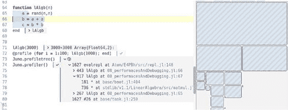

# 第 8 章：高效编写高效代码

## 让 Julia 与其他语言交互

### Julia 与 R：来自 Julia RCall 包

如果你尚未在 Julia 中安装它，它会尝试自动安装。

正如预期的那样，`JuliaCall` 也提供了多种在 `R` 中访问 `Julia` 的方式。

假设你已将所有的 Julia 函数保存在一个文件中。你将复用之前在 `PyJulia` 中使用过的 `juliaScript.jl` 脚本：

```julia
function helloWorld()
    println("Hello World!")
end

function sumMyArgs(i, j)
    return i+j
end

function getNElement(n)
    a = [0,1,2,3,4,5,6,7,8,9]
    return a[n]
end
```

你可以通过以下方式在 `R` 中访问其函数：

```r
> julia_source("juliaScript.jl") # 包含该文件
> julia_eval("helloWorld()") # 输出 `Hello World!` 并返回 NULL
> a <- julia_call("sumMyArgs",c(1,2,3),c(4,5,6)) # 返回
`[1] 5 7 9`
> as.integer(1) %>% getNElement -> b # 返回 `0`，即
Julia 和 R 的“第一个”元素
```

关于最后一个示例，它突出了管道操作符，这在 `R` 中非常常见（你将在第 11 章“工具”中看到 `Julia` 中的等效操作符）。`%>%` 语法是由 `JuliaCall` 提供的特殊版本，允许你在从左到右的数据转换工作流中混合使用 Julia 函数。

### 直接在 R 中嵌入 Julia 代码

你也可以使用 `julia_eval()` 函数直接在 `R` 中嵌入 Julia 代码：

```r
> funnyProdR <- julia_eval('
+ function funnyProd(is, js)
+   prod = 0
+   for i in 1:is
+     for j in 1:js
+       prod += 1
+     end
+   end
+   return prod
+ end
+ ')
```

然后你可以在 `R` 中调用这个函数，方式包括 `funnyProdR(2,3)`、`julia_eval("funnyProd(2,3)")` 或 `julia_call("funnyProd",2,3)`。

虽然该包还提供了其他“便捷”函数，但使用 `julia_eval` 和 `julia_call` 应足以完成你在 `Julia` 中需要的任何任务。

---

## 本章概览

本章讨论了以下第三方包：

| 包名 | URL | 版本 |
|---|---|---|
| `BenchmarkTools.jl` | [`github.com/JuliaCI/BenchmarkTools.jl`](https://github.com/JuliaCI/BenchmarkTools.jl) | v0.4.2 |
| `ProfileView.jl` | [`github.com/timholy/ProfileView.jl`](https://github.com/timholy/ProfileView.jl) | v0.4.1 |
| `JuliaInterpreter.jl` | [`github.com/JuliaDebug/JuliaInterpreter.jl`](https://github.com/JuliaDebug/JuliaInterpreter.jl) | v0.6.1 |
| `Juno` | [`junolab.org`](https://junolab.org) / [`github.com/JunoLab/Atom.jl`](https://github.com/JunoLab/Atom.jl) | v0.9.1 |
| `atom-julia-client` | [`github.com/JunoLab/atom-julia-client`](https://github.com/JunoLab/atom-julia-client) | v0.9.4 |

本章旨在介绍一些主题，这些主题虽然可能并非严格必要，但对于以高效方式编写高效代码（即运行速度快且易于（并有趣地）编写的代码）却非常重要。

我首先讨论代码性能，然后转向并行化以进一步加速执行。接着，我继续讨论允许开发者检查程序是否遵循预期行为并便于早期错误定位的工具。最后，我将介绍可用于隔离并可能纠正运行时出现问题的构造。

© Antonello Lobianco 2019

A. Lobianco, *Julia 快速语法参考*, [`doi.org/10.1007/978-1-4842-5190-4_8`](https://doi.org/10.1007/978-1-4842-5190-4_8)

---

### 性能

当处理类型为 `Any` 的数据对象时，即对象的类型在运行时之前未指定的情况下，Julia 已经相对较快。但是，当编译器能够推断出特定类型（或少数类型的联合）时，Julia 程序的运行速度可以达到与 C 程序相同的量级。

好消息是，程序员通常不需要指定变量类型。编译器实际上会直接推断它们，以生成高效、专门的代码。只有在极少数情况下，编译器才无法推断出特定类型。

### 如何编写高性能代码

在本节中，你将学习如何测量（或基准测试）`Julia` 代码、如何避免相关问题，并了解一些 `Julia` 特有的性能优化技巧。

#### 基准测试

当你在编辑器中高亮代码并运行以评估相应指令时，`Julia` 会执行两个独立的任务：编译代码（包括其依赖项）和运行编译后的代码。

除非你对 `Julia` 交互式开发的效率特别感兴趣，否则应该只对第二个操作（即代码执行）进行基准测试和/或性能分析，而不应包括代码编译时间。

因此，如果你想使用最简单的基准测试宏`@time` `[Julia 表达式]`，应该运行两次并丢弃第一次的结果（因为第一次包含编译时间）。

以计算斐波那契数列的函数为例，该数列中每个数字是前两个斐波那契函数值的和（即`Fn = Fn-1 + Fn-2`），其中`F0`和`F1`分别定义为`0`和`1`。

一个简单的递归实现如下（请注意，存在更快的斐波那契数计算算法）：

```
julia> function fib(n)
           if n == 0 return 0 end
           if n == 1 return 1 end
           return fib(n-1) + fib(n-2)
       end
fib (generic function with 1 method)
```

如果启动新的 `Julia` 会话，运行此代码并使用`@time`宏计时，你将得到类似以下的结果：

```
julia> @time fib(10)
  0.004276 seconds (4.63 k allocations: 254.928 KiB)

julia> @time fib(10)
  0.000006 seconds (4 allocations: 160 bytes)
```

虽然`@time`宏可以接受任何有效的 `Julia` 表达式，但它最常用于函数调用。

你可以看到，第一次报告的时间和内存使用信息包括了函数的编译时间（由此可以推断，函数的编译是在首次调用时“即时”（JIT）完成的，而非定义时）。

此外，函数的执行时间真的是`0.000006`秒吗？这只是包含机器状态随机因素的单个测量值。更好的方法是获取*平均*时间，通过多次采样使平均值具有统计显著性。

`BenchmarkTools`包（参见 [BenchmarkTools.jl](https://github.com/JuliaCI/BenchmarkTools.jl)）正是为此而生：它提供了`@benchmark`宏，能自动跳过编译时间并多次运行代码，从而报告精确的计时结果。

应用于此函数，你将得到以下结果：

```
julia> @benchmark fib(10)
BenchmarkTools.Trial:
  memory estimate:  0 bytes
  allocs estimate:  0
  --------------
  minimum time:     292.131 ns (0.00% GC)
  median time:      292.401 ns (0.00% GC)
  mean time:        299.772 ns (0.00% GC)
  maximum time:     492.895 ns (0.00% GC)
  --------------
  samples:          10000
  evals/sample:     267
```

这将提供更精确的基准测试结果。

## 8.1.2 性能分析

基准测试提供了所给定指令的*总*运行时间信息，但通常你还想知道时间在函数调用中是如何分配的，以便找出性能瓶颈。

这就是*性能分析器*的任务。Julia 自带一个集成的统计性能分析器（位于标准库的`Profile`包中）。当使用表达式调用时，分析器会运行该表达式，并每隔 x 毫秒记录程序当前执行到的代码行。

某行代码被命中的次数越多，其计算成本就越高。

使用这种采样方法，虽然会牺牲一些精度，但性能分析可以非常高效。与不进行性能分析的代码运行相比，其开销非常小。而且使用起来也非常简单：

- `@profile myfunct()`：对函数进行性能分析（请记得先运行一次函数，否则也会测量到 JIT 编译时间）。
- `Profile.print()`：打印性能分析结果。
- `Profile.clear()`：清除性能分析数据。

性能分析数据会累积，直到你清除它。这使得开发者可以对非常小（快速）的函数进行性能分析，单次分析可能不准确，只需多次分析即可，例如：`@profile (for i = 1:100; foo(); end)`

例如，假设你要对名为`myCode.jl`的文件中的以下函数进行性能分析，左侧数字为行号：

```
64  function lAlgb(n)
65      a = rand(n,n) # 用随机数初始化矩阵
66      b = a + a     # 矩阵加法
67      c = b * b     # 矩阵乘法
68  end
```

如果你运行`@profile (for i = 1:100; lAlgb(1000); end)`（同样，请先运行一次函数完成 JIT 编译），然后运行`Profile.print()`，可能会得到类似以下的输出（为节省篇幅进行了部分截断）：

```
julia> Profile.print()
1627 ./task.jl:259; (::getfield(REPL, Symbol("##26#27")){REPL.REPLBackend})()
1627 ...ld/usr/share/julia/stdlib/v1.1/REPL/src/REPL.jl:117; macro expansion
1627 ...obianco/.julia/packages/Atom/E4PBh/src/repl.jl:135; repleval(::Module, ::Expr)
1627 ./boot.jl:328; eval
1627 ...share/julia/stdlib/v1.1/Profile/src/Profile.jl:25; top-level scope
1627 ./none:1; macro expansion
 267 /full/path/to/myCode.jl:65; lAlgb(::Int64)
 267 .../share/julia/stdlib/v1.1/Random/src/Random.jl:243; rand
 443 /full/path/to/myCode.jl:66; lAlgb(::Int64)
 443 ./arraymath.jl:47; +(::Array{Float64,2}, ::Array{Float64,2})
 440 ./broadcast.jl:707; broadcast(::typeof(+), ::Array{Float64,2}, ::Array{Float64,2})
   1 ./int.jl:0; broadcast(::typeof(+), ::Array{Float64,2}, ::Array{Float64,2})
   2 ./simdloop.jl:71; broadcast(::typeof(+), ::Array{Float64,2}, ::Array{Float64,2})
 917 /full/path/to/myCode.jl:67; lAlgb(::Int64)
 181 ./boot.jl:404; *
 736 ...julia/stdlib/v1.1/LinearAlgebra/src/matmul.jl:142; *
```

输出中每行的格式为：对应行及其下游所有代码的采样计数、文件名、行号和函数名。

需要关注的是与各个函数操作相关的行。从性能分析日志中，你可以看到用随机数初始化矩阵（第 65 行）被命中了 267 次，矩阵加法（第 66 行）被命中了 443 次，矩阵乘法（第 67 行）被命中了 917 次。

这有助于你确定`lAlgb`函数内部各操作的*相对*时间开销，其中矩阵乘法的计算量最大。



在实际使用中，情况会很快变得复杂，你可能希望以图形化的方式展示带有性能分析数据的调用栈。此时可以使用`ProfileView`包。通过`ProfileView.view()`，它可以提供一个清晰的调用栈图表，宽度与命中次数成比例。1

如果你使用较新版本的 Juno 作为 Julia IDE，还可以享受一些便捷的用户界面，如图 8-1 所示（你仍需使用`@profile`宏来收集感兴趣的数据）：

- `Juno.profiletree()`提供了`Profile.print()`的绝佳替代，树中的项可以点击折叠/展开，并链接到相应的源代码。
- 类似地，`Juno.profiler()`改进了`ProfileView.view()`，在面板中显示调用图，并移除因使用 Atom 产生的噪声，聚焦于用户代码的调用栈。

***图 8-1.** Atom IDE 中的性能分析工具*

> 1 在撰写本文时，`ProfileView`在 MacOS 上似乎存在安装问题。

## 8.1.3 类型稳定性