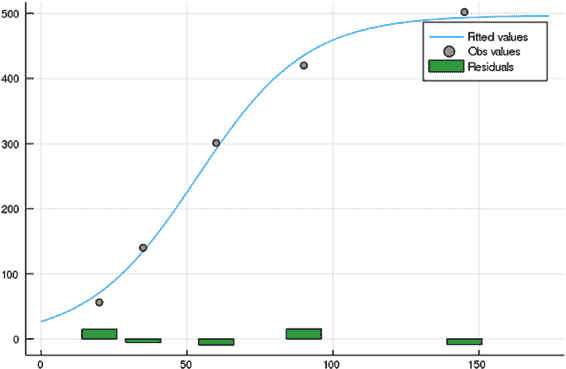

## 第 10 章 数学库

本章讨论以下第三方包：

| 包名 | 网址 | 版本 |
|---|---|---|
| JuMP.jl | <https://github.com/JuliaOpt/JuMP.jl> | v0.19.2 |
| GLPK.jl | <https://github.com/JuliaOpt/GLPK.jl> | v0.10.0 |
| Ipopt.jl | <https://github.com/JuliaOpt/Ipopt.jl> | v0.5.4 |
| SymPy.jl | <https://github.com/JuliaPy/SymPy.jl> | v1.0.5 |
| LsqFit.jl | <https://github.com/JuliaNLSolvers/LsqFit.jl> | v0.8.1 |

虽然 Julia 是一种完善的通用编程语言，但不可否认的是，其社区目前的关注点主要集中在数学和计算问题上。您已经看到了用于处理数值数据的大量库，以及从 Julia 开发之初，计算性能的考量如何塑造了相关决策。

本章列出了部分最成熟的数学分析库。其中一些库，例如用于数值优化的 JuMP，本身就常常成为人们开始使用 Julia 的主要原因。

© Antonello Lobianco 2019
A. Lobianco, *Julia Quick Syntax Reference*, <https://doi.org/10.1007/978-1-4842-5190-4_10>

这个列表并不全面，侧重于相对通用的任务。寻找特定包的好起点是 <https://pkg.julialang.org/docs/> 或 <https://juliaobserver.com/categories/Mathematics>。

### 10.1 JuMP，一个优化框架

JuMP (<https://github.com/JuliaOpt/JuMP.jl>) 是一个用于数学优化问题的“代数建模语言”（AML），类似于 GAMS (<https://www.gams.com/>)、AMPL (<https://ampl.com/>) 或 Pyomo (<http://www.pyomo.org/>)。

优化问题是指在目标函数和变量之间约束的背景下，找到决策变量的“最优”数量的问题。约束在现实世界中无处不在，无论是商业决策（例如，“我们应该生产多少 X？”）、工程设置（例如，“我们应该以多大角度设计襟翼以实现最大效率？”），还是个人选择（例如，“城里的小公寓还是乡下的大房子？”）。

这类问题可以用数学形式表达为一个要最大化（或最小化）的函数，该函数受其他作为约束的函数支配。

人们已经创建了软件“工具”来解决这些问题。这些工具通常要求您将优化问题表述为矩阵格式，对于非线性问题，还需要提供关于问题的一阶和二阶导数等额外信息，以帮助找到数值最优解。`MATLAB` 优化工具箱或 `R` 的 `optim` 函数中基于求解器的方法就是两个众所周知的例子。

AML 采取了一种不同的方法，它们将问题的表述与用于求解的具体算法分离开来。现在，可以使用与描述问题相同的数学符号以代数方式对问题进行编码。

至关重要的是，变量可以使用“集合”的概念跨越任何维度进行索引，从而允许您编写诸如 `Demand[year,time,region,product] = Supply[year,time,region,product]` 这样的方程。其中包含了自动提供导数的工具。

一旦表述完成，这些问题就可以由 AML 软件支持的、适合该特定问题类别的任何“求解器引擎”来求解。

然而，商业 AML 有一个缺点——它们各自使用自己特定的语言。由于语言专有，它们在许多特性（数据处理、开发工具可用性、语言结构等）上落后于“真正的”通用编程语言。将它们与模型中不涉及优化的其他部分进行交互可能会很困难。

相反，JuMP 属于“第三代”优化工具（第一代是求解器引擎本身，第二代是商业的、语言专有的 AML），它是嵌入在通用编程语言中的作为软件库的 AML。

JuMP 提供了与语言专有 AML 相同的建模简便性和求解器独立性，同时提供了更实用的建模环境。如果结合免费的求解器引擎（例如，用于混合整数问题的 GLPK 和用于非线性问题的 IPOPT），它将是一个完整的开源解决方案。

在本节中，您将学习如何通过实现两个问题来使用 JuMP，一个仅涉及线性函数，另一个的目标函数是非线性的。问题的通用设置是相同的：您选择更适合特定问题的求解器，加载用于求解器特定接口的 Julia 包，创建问题“对象”，并向其添加特征元素，如变量、目标函数和约束。这时，您可以“求解”该问题并检索其解。

这些示例也旨在凸显 Julia 宏的强大功能。通过使用宏，JuMP 在保持 Julia 特性的同时，实现了自己的语言。

#### 10.1.1 运输问题：一个线性问题

##### 问题描述

这是 GAMS 教程中使用的经典运输模型在 JuMP 中的转置。

给定单一产品、*p* 个工厂和 *m* 个市场，问题在于确定 *p* 和 *m* 之间的最佳运输路线，以在遵守每个工厂容量限制（*ap*）并满足每个市场需求 *bm* 的前提下，最小化运输成本：

*min* Σ *c* * x*（对所有 p, m）

约束条件：

Σ *x* ≤ *a*（对所有 p, m, p）

Σ *x* ≥ *b*（对所有 p, m, m）

其中 *cp,m* 是 p 和 m 之间的单位运输成本，*xp,m* 是运输量（待选择）。原始公式来自“Dantzig G. B. (1963), *Linear Programming and Extensions, Chapter 3.3*, Princeton University Press”，其 GAMS 实现可以在“Rosenthal, R. E. (1988) *GAMS: A User's Guide, Chapter 2: A GAMS Tutorial*, The Scientific Press”中找到，或访问 <https://www.gams.com/mccarl/trnsport.gms>。

为了便于比较，我将每个操作的等效 GAMS 代码保留在注释中。

## 导入库

首先需要导入 `JuMP` 包。然后需要实现与所需求解器引擎的特定接口的包。在本例中，我们将处理一个线性问题，因此将使用 *GNU Linear Programming Kit*（GLPK）库并安装 `GLPK.jl` Julia 包。

`GLPK.jl` 和 `Ipopt.jl` 包都会自动安装其自身所需的二进制文件（除非您指定它们使用本地安装的二进制文件，方法是在安装或构建包之前设置 `ENV["JULIA_GLPK_LIBRARY_PATH"]`、`ENV["JULIA_IPOPT_LIBRARY_PATH"]` 和 `ENV["JULIA_IPOPT_EXECUTABLE_PATH"]`）。

需要 `CSV` 包来加载数据。

```
using CSV, JuMP, GLPK
```

## 定义集合

`JuMP` 没有独立的集合语法，而是使用核心 Julia 语言中可用的原生容器。可以使用这些容器对变量、参数和约束进行索引。虽然您可以使用基于位置的列表，但最好使用字典（会牺牲一点效率）。因此，这些示例中的“集合”表示为列表，但其他所有内容（变量、约束和参数）都是字典，以列表元素作为键。

# 定义集合

`JULIA`

# 集合

# i 罐头厂 / 西雅图, 圣迭戈 /

# j 市场 / 纽约, 芝加卡, 托皮卡 / ;

## 第 10 章 数学库

```julia
plants = ["seattle","san-diego"] # 罐头厂
markets = ["new-york","chicago","topeka"] # 市场
```

### 定义参数

工厂的产能和市场的需求直接以字典的形式定义，而距离则首先从以空白字符分隔的表格中读取为一个`DataFrame`。然后将其转换为 `"(工厂, 市场) => 值"` 的字典。

# 定义参数
`JULIA`

# 参数

# `a(i)` 工厂 i 的产能, 单位：箱


# `/ 西雅图 350`


#   圣迭戈 600 /

```julia
a = Dict( # 工厂 i 的产能, 单位：箱
    "seattle" => 350,
    "san-diego" => 600,
)

# b(j) 市场 j 的需求, 单位：箱
# / 纽约 325
#   芝加哥 300
#   托皮卡 275 / ;

b = Dict( # 市场 j 的需求, 单位：箱
    "new-york" => 325,
    "chicago" => 300,
    "topeka" => 275,
)

# 表格 d(i,j) 距离, 单位：千英里
#        纽约    芝加哥   托皮卡
# 西雅图   2.5      1.7     1.8
# 圣迭戈  2.5      1.8     1.4 ;
```

## 第 10 章 数学库

```julia
d_table = `CSV.read`(IOBuffer("""
plants new-york chicago topeka
seattle 2.5 1.7 1.8
san-diego 2.5 1.8 1.4
"""), delim=" ", ignorerepeated=true, copycols=true)

# 这里我们将表格转换为 "(工厂, 市场) => 距离" 的字典
# r[:plants]: 第一个键，使用给定行和 `plants` 列中的单元格
# m: 第二个键
# r[Symbol(m)]: 值，使用给定行和 `m` 列中的单元格

d = Dict( (`r[:plants]`, `m`) => `r[Symbol(m)]` for `r` in `eachrow(d_table)`, `m` in `markets`)

# 标量 f 运费, 单位：美元/每箱/每千英里 /90/ ;
f = 90 # 运费, 单位：美元/每箱/每千英里

# 参数 c(i,j) 运输成本, 单位：千美元/每箱 ;
# c(i,j) = f * d(i,j) / 1000 ;

# 我们首先声明一个空字典，然后填充值
c = Dict() # 运输成本, 单位：千美元/每箱 ;
[ `c[p,m]` = `f * d[p,m] / 1000` for p in plants, m in markets]
```

### 声明模型

在这里，您声明一个 JuMP 优化模型并给它一个名称。此名称将作为第一个参数传递给所有后续操作，例如创建变量、约束和目标函数（如果需要，可以同时处理多个模型）。

### 指定求解器

您可以在此时（如此处所示）指定求解器引擎，或者在稍后解决问题时等效地进行指定。您还可以指定求解器引擎特定的选项。

# 模型声明（运输模型）

```julia
trmodel = Model(with_optimizer(GLPK.Optimizer, msg_lev=GLPK.MSG_ON)) # 我们选择 GLPK 并输出详细信息
```

## 声明模型变量

变量在 `@variable` 宏中声明和定义，并且可以具有多个维度——也就是说，它们可以通过多个索引进行索引。

边界在声明时同时给出。与 GAMS 不同，您无需定义位于目标函数左侧的变量。

## 定义变量

# 变量

# `x(i,j)` 运输量, 单位：箱


# `z` 总运输成本, 单位：千美元 ;


# 正变量 `x`

```julia
@variables trmodel begin
    x[p in plants, m in markets] >= 0 # 运输量, 单位：箱
end
```

## 定义约束

### 声明模型约束

与 GAMS 一样，每个约束实际上可以是一个“约束族”，因为它可以在定义的集合上进行索引。


# `供应(i)` 满足工厂 `i` 的供应限制


# 供应
`(i) .. sum (j, x(i,j)) =l= a(i)`


# 需求(`j`) 满足市场 `j` 的需求 ;


# 需求`j` .. `sum(i, x(i,j)) =g= b(j)`;

```julia
@constraints trmodel begin
    supply[p in plants], # 满足工厂 p 的供应限制
        sum(x[p,m] for m in markets) <= a[p]
    demand[m in markets], # 满足市场 m 的需求
        sum(x[p,m] for p in plants) >= b[m]
end
```

## 声明模型目标函数

与约束和变量不同，目标函数是唯一的、单一的函数。请注意，正是在这一点上，您指定了优化的方向。

# 目标函数

```julia
@objective trmodel Min begin
    sum(c[p,m] * x[p,m] for p in plants, m in markets)
end
```

### 模型的可读可视化（可选）

如果需要，您可以以人类可读的方式打印优化模型，以便检查其是否正确。

```julia
print(trmodel) # 以数学形式打印模型
```

### 模型求解

正是在这一点上，调用求解器并将模型传递给求解器引擎以求解。请注意感叹号，它表示`trmodel`对象会因调用而被修改。


您可以使用`termination_status(modelObject)`检查求解器的返回状态（期望得到`MOI.OPTIMAL`），并分别使用`objective_value(modelObject)`和`value(variableName)`检索目标函数和变量的值。对偶值可以通过调用`dual(constraintName)`获得。

然后，您可以按自己喜欢的方式打印/可视化它们，例如：

```julia
status = termination_status(trmodel)
```

```julia
if (status == MOI.OPTIMAL || status == MOI.LOCALLY_SOLVED || 
    status == MOI.TIME_LIMIT) && has_values(trmodel)
    if (status == MOI.OPTIMAL)
        println("** 问题求解正确 **")
    else
        println("** 问题返回了（可能次优的）解 **")
    end
    println("- 目标函数值（总成本）: ", objective_value(trmodel))
    println("- 最优路线:")
    optRoutes = value.(x)
    
    [println("$p --> $m: $(optRoutes[p,m])") for m in markets, p in plants]
    
    println("- 供应的影子价格:")
    [println("$p = $(dual(supply[p]))") for p in plants]
    
    println("- 需求的影子价格:")
    [println("$m = $(dual(demand[m]))") for m in markets]
else
    println("模型求解不正确。")
    println(status)
end
```

输出结果应如下所示：

# 问题求解正确

JULIA


# - 目标函数值（总成本）: 153.675


# 最优路线

# 西雅图 --> 纽约: 50.0

# 西雅图 --> 芝加哥: 300.0

# 西雅图 --> 托皮卡: 0.0


# 圣迭戈 --> 纽约: 275.0


# 圣迭戈 --> 芝加哥: 0.0

# 圣迭戈 --> 托皮卡: 275.0

# 供应的影子价格

# `西雅图 = 0.0`

# 圣迭戈 = 0.0

# 需求的影子价格:

# 纽约 = 0.225

# 芝加哥 = 0.153

# `topeka = 0.12599999999999997`

## 第 10 章 数学库

### 10.1.2 选择披萨还是三明治：一个非线性问题

非线性问题的唯一区别在于，你需要为变量提供良好的初始点（试试在初始点为 0 时运行以下示例！），你需要使用特定的 `@NLconstraints` 宏来定义（非线性）约束，并使用 `@NLobjective` 宏来定义（非线性）目标。

请注意，你无需提供任何额外信息（特别是无需提供导数）。

#### 问题描述

一名学生需要决定如何分配每周 80 美元的食品预算。她只能在披萨（`p`）和三明治（`s`）之间做出选择。披萨每份 10 美元，而三明治每份只需 4 美元。

她的“效用函数”（即她对给定披萨和三明治组合的满意程度）为 `100 * p - 2 * p² + 70 * s - 2 * s² - 3 * p * s`。她喜欢这两种食物，但更偏爱披萨。

你在此使用一个简单的两变量非线性函数最大化的单约束问题。为简化示例，这里不使用集合（即变量和约束均为标量）。

`max 100 * p - 2 * p² + 70 * s - 2 * s² - 3 * p * s`

`p, s`

满足约束：

`10 * p + 4 * s <= 80`

其中第一个方程是效用函数，第二个方程是经济学家所称的“预算约束”，即我们不能花费超出预算的钱 :-)。

#### 导入库并声明模型

由于处理的是非线性模型，你需要选择能够处理此类问题的求解引擎。`IPOPT` 可胜任此任务：

```
using JuMP, Ipopt
m = Model(with_optimizer(Ipopt.Optimizer, print_level=0))
```

#### 声明模型变量、约束和目标函数

由于这些是物理量，除了显式约束外，还需要为变量添加一个下界 0（上下界可以在一个表达式中指定，如 `lB <= var <= uB`）。

```
m = Model(with_optimizer(Ipopt.Optimizer))
@variable(m, 0 <= p, start=1, base_name="披萨数量")
@variable(m, 0 <= s, start=1, base_name="三明治数量")
@constraint(m, budget, 10p + 4s <= 80)
@NLobjective(m, Max, 100*p - 2*p² + 70*s - 2*s² - 3*p*s)
```

你可以将问题理解为最优的“周平均值”，因此最优结果为半份披萨也是可以接受的。否则，你应在变量声明中添加 `integer=true` 选项将其限制为整数。但这样问题的类别将变为混合整数非线性规划（`MINLP`），并且你也需要更换求解引擎（`bonmin` 适用于求解 `MINLP` 问题）。

#### 求解模型并可视化结果

由于问题是非线性的，求解结果报告为“局部最优解”。你需要自行判断问题的性质是否保证局部最优解也是全局最优解（本例中即是如此）。

```
optimize!(m)
status = termination_status(m)
if (status == MOI.OPTIMAL || status == MOI.LOCALLY_SOLVED ||
    status == MOI.TIME_LIMIT) && has_values(m)
    if (status == MOI.OPTIMAL)
        println("** 问题正确求解 **")
    else
        println("** 问题返回了一个（可能非最优的）解 **")
    end
    println("- 目标值 : ", objective_value(m))
    println("- 最优解:")
    println("披萨: $(value.(p))")
    println("三明治: $(value.(s))")
    println("- 对偶变量（预算）: $(dual.(budget))")
else
    println("模型未正确求解。")
    println(status)
end

# 预期输出：
# ** 问题返回了一个（可能非最优的）解 **
# - 目标值 : 750.8928616403513
# - 最优解:
# 披萨: 4.642857242997538
# - 对偶变量（预算）: -5.624999975248088
```

### 10.2 SymPy：计算机代数系统

另一个有用的数学包是 `SymPy.jl`（参见 [`github.com/JuliaPy/SymPy.jl`](https://github.com/JuliaPy/SymPy.jl)），它是 Python `SymPy` 库（参见 [`www.sympy.org/en/index.html`](https://www.sympy.org/en/index.html)）的封装，用于符号计算，即导数、积分、方程（或方程组）等的*解析*求解。

`SymPy` 是一个非常庞大的库，是一个`计算机代数系统`，其功能从基本的符号算术一直涵盖到量子物理学。你将在此看到该库的一般结构，并用来求解上一节中的相同问题，但这次是解析求解。完整的 API 请参考 `SymPy` 文档（[`docs.sympy.org/latest/index.html`](https://docs.sympy.org/latest/index.html)）（其中的大部分功能在 `SymPy.jl` 中都有直接对应）。

#### 10.2.1 加载库并声明符号

变量可以使用 `@var x y z` 语法声明。你还可以声明变量的定义域，例如正数、实数、整数、奇数等。（完整列表参见 [`docs.sympy.org/dev/modules/core.html#module-sympy.core.assumptions`](https://docs.sympy.org/dev/modules/core.html#module-sympy.core.assumptions)）。你可以求解同样的披萨（`qp`）和三明治（`qs`）选择示例，但此处将披萨价格（`pp`）和三明治价格（`ps`）保留为符号形式，以展示所得到的解是解析形式的。稍后才会获得具体的数值结果。我通过强制消耗全部预算来简化示例。这样你就可以使用拉格朗日乘数法来找到解析解（如果你不熟悉此法，不用担心。只需跟随 `SymPy` 的操作，看看如何操作符号方程，并在解析解中用实际数值替换符号后找到数值解即可）。

```
using SymPy
@vars qp qs pp ps positive=true
@vars λ
```

#### 10.2.2 创建并操作表达式

一旦声明了符号，你就可以用它们来创建代数表达式（函数）。请注意，`qp`、`qs` 等现在既是 `Julia` 变量又是 `SymPy.jl` 的“符号”，是对底层 `SymPy` 结构的引用。你所创建的表达式也是如此（不要与 `Julia` 语言的表达式混淆）：

```
julia> typeof(:(qp+qs)) # Julia 语言表达式
Expr

julia> typeof(:(qp))    # Julia 符号
Symbol

julia> typeof(qp+qs)    # SymPy 表达式，即 SymPy 对象
Sym
```

你可以通过将每个约束乘以其相应的“拉格朗日乘数”并添加到目标函数中，来创建所谓的“拉格朗日函数”。然后，你可以使用 `diff(function, variable)` 求出该拉格朗日函数的偏导数：

```
utility = 100*qp - 2*qp² + 70*qs - 2*qs² - 3*qp*qs
budget = pp*qp + ps*qs
lagr = utility + λ*(80 - budget)
dlqp = diff(lagr, qp)
dlqs = diff(lagr, qs)
dlλ  = diff(lagr, λ)
```

如前所述，每个导数都以符号形式表达：

```
julia> dlqp
-pp·λ - 4·qp - 3·qs + 100
```

#### 10.2.3 求解方程组

一阶条件告诉我们，关于 `qp`、`qs` 和 `λ` 的解可以通过将拉格朗日函数的相应导数设为零得到。也就是说，你要求解一个包含三个未知数的三个方程组成的方程组。`solve([equations], [variables])` 正是用于此目的：

```
julia> sol = solve([Eq(dlqp,0), Eq(dlqs,0), Eq(dlλ,0)],
                   [qp, qs, λ]) # 如果其他包中已定义了名为 "solve" 的函数，
                               # 此处即为 SymPy.solve
Dict{Any,Any} with 3 entries:
  λ  => 5*(19*pp - 2*ps - 56)/(2*pp² - 3*pp*ps + 2*ps²)
```

## 第10章 数学库

### 10.2.4 检索数值

`qp => 5*(-7*pp*ps + 32*pp + 10*ps² - 24*ps)/(2*pp² - 3*pp*ps + 2*ps²)` `qs => 5*(7*pp² - 10*pp*ps - 24*pp + 32*ps)/(2*pp² - 3*pp*ps + 2*ps²)` 函数 `solve` 也直接接受表达式，并将它们在这种情况下设为零。因此，以下写法同样有效：

```julia
solve([dlqp, dlqs, dlλ], [qp, qs, λ])
```

你可以使用 `myExpression.evalf(subs=Dict(symbol=>value))` 将给定的符号数值“注入”到表达式中，并检索表达式对应的数值。

你可以通过指定披萨的价格为`10`美元、三明治的价格为`4`美元来检索解的数值：

```julia
qp_num = sol[qp].evalf(subs=Dict(pp=>10,ps=>4)) # 4.64285714285714
qs_num = sol[qs].evalf(subs=Dict(pp=>10,ps=>4)) # 8.39285714285714
λ_num = sol[λ].evalf(subs=Dict(pp=>10,ps=>4))  # 5.625
```

即使它们以数字形式呈现，`qp_num`、`qs_num`和`λ_num`仍然是`SymPy`对象。要将它们转换为 Julia 数字，可以使用`N(SymPySymbol)`。例如：`N(qp_num)`。

最后，要检索目标函数的数值，我们使用这些数值替换效用函数中的符号：

```julia
z = utility.evalf(subs=Dict(qp=>qp_num, qs=>qs_num)) #750.892857142857
```

你已得到了与使用 `JuMP` 进行数值求解时相同的“最优”值（意料之中）。

### 10.3 LsqFit，一个数据拟合库

作为第三个示例，我选择了一个数据拟合模型。统计学（以及相关的机器学习领域）可能是 Julia 社区中最活跃的开发领域之一。`LsqFit` 包在保持用户友好性的同时提供了极大的灵活性。

你将使用它来估算一片山毛榉（一种阔叶树种）林分的逻辑斯谛增长曲线（Verhulst 模型），数据来自法国西北部一个林分的木材体积样本[¹]。

[¹]: 数据来源：ENGREF, (1984) *Tables de production pour les forets francaises*, 2e édition, p. 80. 林龄以年为单位，体积以每公顷立方米为单位。

#### 10.3.1 加载库并定义模型

你首先指定要拟合模型的函数形式以及待估计参数的位置。`@.` 宏是一个有用的工具，可以避免在每个操作上指定点运算符（用于广播）。

你要估计的模型是著名的逻辑函数：`vol = pars[1] / (1 + exp(-pars[2] * (age - pars[3])))`

```julia
using LsqFit, CSV, Plots

# 将体积拟合为逻辑斯谛模型
@. model(age, pars) = pars[1] / (1 + exp(-pars[2] * (age - pars[3])))

obsVols = CSV.read(IOBuffer("""
age vol
20 56
35 140
60 301
90 420
145 502
"""), delim=" ", ignorerepeated=true, copycols=true)
```

#### 10.3.2 参数

由于寻找拟合的算法是非线性的，你必须提供一些“合理”的初始点。对于逻辑斯谛函数，第一个参数是函数达到的最大水平（“环境容纳量”），第二个参数是增长率，第三个参数是 x 轴上的中点。以下可以是合理的初始点：

```julia
par0 = [600, 0.02, 60]
```

#### 10.3.3 拟合模型

一旦定义了模型，你就可以使用数据和参数的初始猜测值进行拟合（你也可以指定参数的上下界，然后将其作为`lower=lb, upper=ub`传入）。这是执行最小二乘拟合的阶段。

```julia
fit = curve_fit(model, obsVols.age, obsVols.vol, par0)
```

#### 10.3.4 检索参数并与观测值比较

拟合后的参数现在可以在`fit.param`数组中获取。此时，你可以直接使用它们来计算每年拟合的体积，并与观测值进行比较（参见图 10-1）：

```julia
fit.param # [497.07, 0.05, 53.5]

fitX = 0:maximum(obsVols.age)*1.2
fitY = [fit.param[1] / (1 + exp(-fit.param[2] * (x - fit.param[3]))) for x in fitX]

plot(fitX, fitY, seriestype=:line, label="拟合值")
plot!(obsVols.age, obsVols.vol, seriestype=:scatter, label="观测值")
plot!(obsVols.age, fit.resid, seriestype=:bar, label="残差")
```



`Figure 10-1. 观测数据与拟合数据对比`

