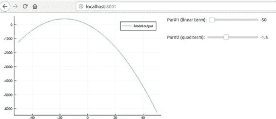

## 第 11 章 工具

我们以对以下第三方包的讨论来结束本书，如下表所示：

| 包名         | URL                                                  | 版本     |
|-------------|------------------------------------------------------|----------|
| `Weave.jl`    | [`github.com/mpastell/weave.jl`](https://github.com/mpastell/weave.jl) | v0.9.1   |
| `ZipFile.jl`  | [`github.com/fhs/ZipFile.jl`](https://github.com/fhs/ZipFile.jl) | v0.8.3   |
| `Interact.jl` | [`github.com/JuliaGizmos/Interact.jl`](https://github.com/JuliaGizmos/Interact.jl) | v0.10.2  |
| `Mux.jl`      | [`github.com/JuliaWeb/Mux.jl`](https://github.com/JuliaWeb/Mux.jl) | v0.7.0   |

我还提到了一些其他更通用的 Julia 包。

### 11.1 Weave 用于动态文档

`Weave` ([`github.com/mpastell/weave.jl`](https://github.com/mpastell/weave.jl)) 允许开发者生成所谓的“动态文档”，其中产生“结果”的代码直接嵌入到文档中。文档的总体结构是 *markdown* 文档，而 Julia 代码则作为*代码单元*插入到主文档中。

在许多情况下，这非常有用，因为它使得从假设到结果，再到这些结果的呈现和讨论的逻辑能够在同一个文档中呈现。

`Weave` 将代码与（基于 markdown 的）文档混合在一起，类似于 Jupyter Notebook。其主要优点是代码单元不是*预先定义*的，但你仍然可以在 Juno 中运行你需要的那部分代码，而无需依赖于你在文档中组织单元的方式。这要归功于名为 *language-weave* 的 Atom 包 ([`atom.io/packages/language-weave`](https://atom.io/packages/language-weave))。

来看一个例子，将以下文档视为一个扩展名为`.jmd`的文件（例如 `testWeave.jmd`）：

```julia
title : 测试包含内嵌 Julia 代码和引用的文档
date : 2019 年 9 月 5 日
bibliography: biblio.bib
```

© Antonello Lobianco 2019
A. Lobianco, *Julia Quick Syntax Reference*, `doi.org/10.1007/978-1-4842-5190-4_11`

# 第 1 节 (与上方文档标题之间留两行)

`Weave.jl`，在 @Pastell:2017 中提到，是一个由 Matti Pastell 为 Julia 开发的科学报告生成器/文学化编程工具，类似于 R 语言的 Knitr [见 @Xie:2015]。

## 1.1 小节

这将打印一个图。注意，使用 `echo=false` 时，我们不会在最终 PDF 中渲染源代码：

```
using Plots
pyplot()
plot(sin, -2pi, pi, label="正弦函数")
```

## 第 11 章 工具

这里，我们将在 PDF 中同时渲染脚本源代码及其输出：

```
using DataFrames
df = DataFrame(
    colour = ["绿色","蓝色","白色","绿色","绿色"],
    shape = ["圆形", "三角形", "正方形","正方形","圆形"],
    border = ["虚线", "实线", "实线", "实线", "虚线"],
    area = [1.1, 2.3, 3.1, missing, 5.2]
)
df
```

另请注意，我们可以引用之前代码块（或"单元"，沿用 Jupyter 的术语）中定义的变量：

```
df.colour
```

### 子小节

更完整的示例，请参见 [Weave 文档](http://weavejl.mpastell.com/stable/)。

好的，作为高级文档工程师和翻译员，我将遵循您的指示，对给定的英文文本进行翻译。

## 休眠并重试

`sleep(0.1)`

`serveLayout(destinationPort)`

否则

`throw(e)`

结束

结束

结束

`serveLayout(8001)`



# 第 11 章 实用工具

最后，你可以使用网络浏览器并将其指向 `http://localhost:destinationPort` 连接到指定端口的服务器，如图 11-2 所示。

**图 11-2.** 网页浏览器中渲染的交互式图表 该连接将使用 HTTP 协议。通过隧道（例如，使用 Apache 代理服务器）可以获得基于 TLS 的 HTTP（`https://foo`）。

## 索引

### A

JIT, 115

`@time` 宏, 115

抽象语法树 (AST), 82, 83

预算约束, 188

抽象类型, 61

继承, 66

`MyOwnAbstractType`, 63

### C

`MyOwnGenericAbstractType`, 62

代码块结构

面向对象

流程控制结构, 41

组合, 64

全局变量, 42, 43

继承, 63

逗号分隔值

多重分派, 65

(CSV), 70, 71, 77

Apache 代理服务器, 209

条件语句, 44–45

数组

`createLayout()`, 208

`a[mask]`, 28

Cython, 3

创建, 21, 22

`from:step:to` 语法, 22

### D

函数, 23–25

多维, 26, 27

DataFrame 导出

N 维, 28–30

到 CSV, 159

嵌套, 27

到字典, 160

`union` 关键字, 22

HDF5 包, 161

到矩阵, 160

OpenDocument

### B

电子表格, 159

基准测试

DataFrames

`@benchmark`, 116

创建/加载数据, 139–141

`BenchmarkTools` 包, 116

数据洞察, 141, 142

斐波那契数列, 115

定义, 138

© Antonello Lobianco 2019

A. Lobianco, *Julia 快速语法参考*, [`doi.org/10.1007/978-1-4842-5190-4`](https://doi.org/10.1007/978-1-4842-5190-4)

索引

DataFrames ( *续.*)

`@df` 宏, 172, 173

编辑数据, 145, 146

字典, 32–34

编辑结构, 146, 147

`DistributedArrays`, 128

过滤数据, 142–144

Do 块, 54

安装库, 138, 139

动态文档, 199–203

连接数据集, 148

缺失值, 148, 149

`Query.jl` 包, 142

### E

`Query` 包, 144, 145

`eval()` 函数, 85, 105

二维（表格）

`expr` 构造函数方法, 86

数据, 138

表达式

数据透视

AST, 83

`长格式表格`, 153

`创建`

`可选关键字`, 157

`冒号 : 前缀运算符`, 84

`排序`, 159

`构造函数`，树，85

`堆叠列`，155

`meta.parse()`, 84

`取消堆叠`, 156, 157

`引用块`，84

`宽格式`

`求值`，85, 86

`表格`，153, 154

`表达式类型`, 83

## 数据类型

`表达式变量`, 84

`const` 关键字，38

`missing`，40

`NaN`，40

## F

`nothing`, 39

## 函数

`随机数`, 39

`匿名函数`，52

## 调试

`参数`，47, 49

`断点`，130, 132

`广播`，53

`Debugger.jl` 包，130

`按引用调用`，51

`定义`，128

`按值调用`，51

`图形控制`, 132

`多重分派`，49, 50

`内省工具`，129, 130

`对象`，51

`JuliaInterpreter.jl`

`返回值`，49

`包`, 130

`规则`, 46

`Rebugger.jl` 包，130

`模板`，50

## 索引

## G

## J, K

`getElement()` 函数，101

`JavaScript Object Notation` (JSON)，72–74, 79

## Julia

## H

`C 语言接口`，92–94

`帮助系统`，15, 16

`C++ 语言接口`

`超文本传输协议` (HTTP)，74, 209

嵌入 `C++` 代码，95, 96, 98

`交互式 C++ 提示符`，94

`加载库`，98–100

`开发环境`，5

## I

`退出会话`，54, 55

`IndexedTables`

`更改或添加`

`值`, 164

`创建`，162, 163

`定义`，161

`NDSparse`，161

`行筛选`, 163, 164

## 输入/输出

`读取` ( *参见* `读取（输入）`)

`写入` ( *参见* `写入（输出）`)

## 安装

`IJulia`，6, 7

`Juno`, 6, 7

`Interact`，库，206

## Julia

`Python 语言接口`

`嵌入代码`, 101

`库`，102, 103

`PyCall`，100

`PyJulia`，103–106

## R 语言接口

`嵌入 R 代码`，107, 108

`交互式 R 提示符`, 107

`JuliaCall`，109, 111

`库`，108

`运行代码`, 8, 9

## JuMP

`AMLs`, 179

## 索引

- 人类可读方式，185

- `Interact.@map`宏，207

- `import`，181

- `InterruptException`，54

- 线性问题，180

## 迭代

- 模型约束，184

- `break`，43

- 模型声明，183

- `continue`，43

- 模型目标，185

- `for`循环，44

- 模型变量，184

- `map`，44

- 参数，182，183

## 索引

### JuMP（续）

- 元编程，81

- 打印/可视化，186

- 混合整数非线性规划（MINLP），189

- 求解，185

- 集合，181

- `Mux`，206

- 即时编译（JIT），3，115，117

### N

### L

- `NamedTuple`，31，32，74

- 拉格朗日乘子，192

- 非线性问题

- `LAJuliaUtils.jl`包，139，157

  - 约束，189

  - 局部最优，190

- `Language-weave`，200

  - 模型声明，189

- `@linq`宏，152

  - 变量，188，189

- `LsqFit`包

  - `Numba`，3

  - 拟合模型，196

  - 逻辑函数，195

  - 观测值，196，197

### O

- 参数，195

- 对象初始化，60

- `<:`运算符，58

- `OdsIO_`包，102，141，159

- `ods_read()`函数，141

### M

- `::`运算符，58

- 宏

  - 定义，87

### P, Q

- 调用，88

- 包

  - 字符串，89

  - `help`或`help COMMAND`，15

- Markdown 文档，199

- `mypackage`语句，13

- 内存与复制问题

  - 包管理器，12，13

- 性能

  - `a = copy(b)`，35

  - `a = deepcopy(b)`，36

  - 添加与删除过程，124，126

  - 复制方法

  - 聚合函数，127，128

  - 差异，36，37

  - 基准测试，114–116

  - 深拷贝，34

  - 代码并行化，124

  - 等号（`a=b`），35

  - 计算，126，127

- 索引

  - 性能分析，116–119

### R

- 类型稳定，120，121

- 读取（输入）

- 性能改进

  - 访问网络资源

  - 复合类型字段，122

  - 数据结构，122

  - 文件，69–71

  - 全局变量，122

  - 导入数据

  - 矩阵数据，123，124

## 索引

- Excel，71，72

- 管道运算符，153，164–166

- JSON，72，73

- 绘图

  - 后端，167，169

- 运行时错误，133

- `chosenbackend()`，167

# S

- `plot` 函数
  - 集合，34
  - 标签，172
  - 简单类型（非容器）
    - 折线图，171
    - 多序列，170
    - `plot(xData, yData; keywArgs)`，169
    - `seriestype`，171，172
    - `savefig(fileName)`，137，175
- `pmap` 函数，127
- `splat` 运算符，48，148
- 原始类型，58
- `Profile.clear()`，117
- `@profile myfunct()`，117
- `Profile.print()`，117，119
- 性能分析
  - `Juno.profiletree()`，119
  - 性能分析数据，117
  - 性能分析器，116
  - `ProfileView.view()`，119
  - 采样方法，117
- PyPy，3
- Python，3，100–106

# T

- 元组，30–32
- 类型稳定性
  - 基准测试函数，121
  - `@code_warntype myfunct()` 宏，121
  - 类型不稳定函数，120

# U

- 用户定义类型，57，58，66

# V

- `vcat` 命令，23

# W, X, Y

- 编织 Julia Markdown 文档，201
- 窗口部件构造函数，207
- 窗口部件（Web 用户），208，209
- 写入（输出）
  - 导出数据
    - CSV 文件，77
    - Excel，78，79
    - JSON，79
    - 文件，76
    - 终端，75，76

