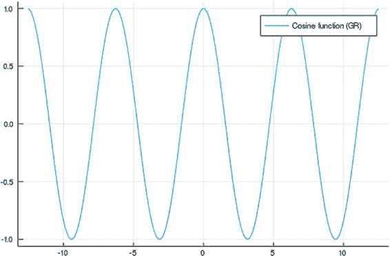
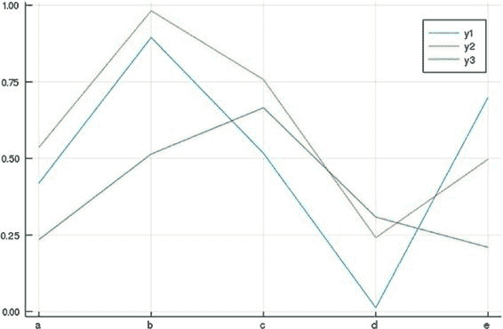
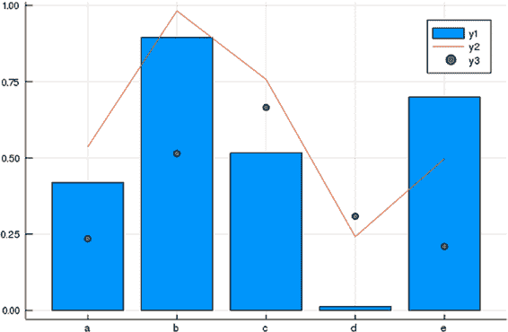

# 第 9 章 处理数据

`myDf = DataFrame(a = [keys[i][1] for i in 1:n²], b=[keys[i][1] for i in 1:n²], x=x)`

`@benchmark(myTable[100,:])` # 中位数: 20.796 μs

`@benchmark(myDf[myDf.a .==100,:])` # 中位数: 1.297 ms

### 9.2.3 编辑/添加值

要更改或添加值，请使用以下方法：
- 更改值：`myTable["EU","Hardwood",2011] = (2.8, 3.3)`
- 添加值：`myTable["EU","Hardwood",2012] = (2.8, 3.3)`

你无需记住值列的顺序，因为可以按名称指定它们：`myTable["EU","Hardwood",2011] = (consumption=3.4,production=2.9)`

然而，你*确实*需要记住键列的顺序，因为以下写法目前仍无法生效（在撰写本文时）：`myTable[product="Hardwood", region="EU", year=2011] = (production=3.0, consumption=3.5)` # 错误！

## 9.3 使用管道运算符

管道运算符（[`github.com/oxinabox/Pipe.jl`](https://github.com/oxinabox/Pipe.jl)）改进了 Julia Base 中的管道运算符 `|>`。

链式调用（或称“管道”）允许你以紧凑且易读的方式将多个函数调用串联起来。它避免了保存中间结果，也无需将函数调用相互嵌套。

使用链式运算符 `|>`，`|>` 右侧的代码对 `|>` 左侧代码的结果进行操作。实际上，左侧操作的结果会成为右侧函数调用的参数。

链式调用对于数据处理非常有用。假设你想使用以下（简单的）函数依次对某些数据进行操作，并打印最终结果：
```
add6(a) = a+6; div4(a) = a/4;
```
你可以引入临时变量，或者嵌套函数调用：
```
# 方法 #1，使用临时变量：
a = 2;
b = add6(a);
c = div4(b);
println(c) # 输出: 2
```
```
# 方法 2，链式函数调用：
println(div4(add6(a)))
```
使用管道，你可以这样写：
```
a |> add6 |> div4 |> println
```
基本的管道功能非常有限，因为它只支持具有一个参数的函数，并且一次只能“管道”一个函数。

相反，Pipe 包提供了 `@pipe` 宏，它重写了 `|>` 运算符。它允许你使用具有多个参数的函数（你可以使用下划线字符 `_` 作为左侧值的占位符）。你还可以在单个管道步骤中对多个函数进行管道操作，如下所示：
```
addX(a,x) = a+x; divY(a,y) = a/y
a = 2
```
```
# 使用临时变量：
b = addX(a,6)
c = divY(a,4)
d = b + c
println(c)
```
```
# 使用 @pipe：
@pipe a |> addX(_,6) + divY(4,_) |> println # 输出: 10.0
```
你甚至可以将多个值嵌入元组中进行管道操作：
```
data = (2,6,4)
```
```
# 使用临时变量：
b = addX(data[1],data[2]) # 8
c = divY(data[1],data[3]) # 0.5
d = b + c # 8.5
println(c)
```
```
# 使用 @pipe：
@pipe data |> addX(_[1],_[2]) + divY(_[1],_[3]) |> println
```
请注意，与基本管道一样，需要单个参数且该参数由管道数据提供的函数不需要加括号。

## 9.4 绘图

### 9.4.1 安装与后端

在 Julia 中绘图可以使用特定的绘图包（例如，[`github.com/dcjones/Gadfly.jl`](https://github.com/dcjones/Gadfly.jl) 的 `Gadfly`，[`github.com/nolta/Winston.jl`](https://github.com/nolta/Winston.jl) 的 `Winston`），或者像许多人偏爱的，使用 `Plots` 包（[`github.com/JuliaPlots/Plots.jl`](https://github.com/JuliaPlots/Plots.jl)），它提供了一个包装器，带有统一的 API，可支持多个后端。

后端的选取方式是在调用绘图函数之前运行 `chosenbackend()`——即相应后端包的名称，但全部用小写字母书写。`Plots` 包默认使用 `GR` 作为其后端（见图 9-1），并且 `GR.jl` 会与 `Plot.jl` 一同安装。

如果你需要其他后端，只需安装相应的包即可。

两个比较完善的后端是：
- Plotly.JS（[`github.com/sglyon/PlotlyJS.jl`](https://github.com/sglyon/PlotlyJS.jl)）：对 `plotly.js`（[`plot.ly`](https://plot.ly)）可视化库的 Julia 封装
- PyPlot（[`github.com/JuliaPy/PyPlot.jl`](https://github.com/JuliaPy/PyPlot.jl)）：对 Python matplotlib（[`matplotlib.org/api/pyplot_api.html`](http://matplotlib.org/api/pyplot_api.html)）的封装

例如：
```
using Pkg
Pkg.add("Plots")
using Plots
plot(cos,-4pi,4pi, label="余弦函数 (GR)") # 使用默认的 GR 后端绘图
Pkg.add("PyPlot")
Pkg.add("PlotlyJS")
Pkg.add("ORCA") # PlotlyJS 所需
pyplot()
plot(cos,-4pi,4pi, label="余弦函数 (PyPlot)")
plotlyjs()
plot(cos,-4pi,4pi, label="余弦函数 (PlotlyJS)")
```



***图 9-1.** 使用默认后端 GR 绘制的余弦函数*

虽然 `GR` 是默认后端，即除非调用了其他后端，否则每次新会话都会使用它，但你可以在 `~/.julia/config/startup.jl` 文件中设置自己的默认后端 `ENV["PLOTS_DEFAULT_BACKEND"] = "myPreferredBackend"`。

确保不要混用不同的绘图包（例如，`Plots` 和直接使用它的某个后端）。这很可能会引发问题。如果你已经导入了一个绘图包并想使用另一个，你应该始终重启 Julia 内核（在使用 `Plots` 包的不同后端之间切换时，这不是必须的，并且这也是其优势之一）。

你可以通过 `backend()` 检查 `Plots` 当前正在使用哪个后端。

有许多不同的后端。虽然基本绘图几乎可以从任何后端获得，但每个后端在某些特性上都有自己的优势——例如速度、美观性或交互性。某些高级属性可能仅被一部分后端支持。

针对你的特定情况选择正确的后端很重要。以下页面可能对此有所帮助：
- 应该选择哪个后端？（[`docs.juliaplots.org/latest/backends/`](http://docs.juliaplots.org/latest/backends/)）
- 各后端支持的图表和属性（[`docs.juliaplots.org/latest/supported/`](http://docs.juliaplots.org/latest/supported/)）

### 9.4.2 Plot 函数

如果你使用 Juno，图表将渲染在“绘图”面板中；如果你使用 REPL，则会显示在单独的窗口中（除非你使用 `UnicodePlots` 后端，它采用字符在文本终端中渲染图表）。

遗憾的是，第一次绘图时间相对较长是正常现象。

你已经看到过一个 `plot` 函数方法的示例。

`specifically plot(func, lBound, uBound; keywArgs)`。另一种方式是使用 `plot(xData, yData; keywArgs)` 来绘制数据，其中 `xData` 是一个由数字或字符串组成的 `Array{T,1}`，代表横轴坐标；`yData` 可以是另一个 `Array{T,1}`（即列向量），也可以是 `Array{T,2}`（即矩阵）。在第一种情况下，将绘制单个序列；在第二种情况下，矩阵的每一列将被视为独立的数据序列（见图 9-2）：
```
x = ["a","b","c","d","e",]
```

**JULIA**

```
## 第 9 章 数据处理



### 图 9-2. 绘制多个序列

虽然绘图对象可以像其他对象一样保存，通过 `myPlot = plot(...)`，其特殊之处在于最后一次对 `plot` 的调用定义了“当前”绘图，这是可视化和保存的默认绘图。而使用 `plot!` 函数，您可以向现有绘图添加元素，如果没有特别指定（即通过将您操作的绘图对象作为第一个参数），精确地说是向“当前”绘图添加。

因此，绘制多个序列的另一种方法是先绘制一个序列，然后使用 `plot!` 一次添加一个序列。以下代码片段生成的绘图与上一个完全相同：

```julia
plot(x,y[:,1]) # 创建一个新的“当前绘图”
plot!(x,y[:,2]) # 向当前绘图添加一个序列
plot!(x,y[:,3]) # 向当前绘图添加一个序列
```

默认绘制的图表类型是 `:line` 折线图。可以通过 `plot` 函数的 `seriestype` 关键字参数指定不同类型的图表，如下所示：

```julia
plot(x,y[:,1]; seriestype=:scatter)
```

常见的图表类型包括 `:scatter`（散点图）、`:line`（折线图）、`:histogram`（直方图）等。您可以通过 `plotattr("seriestype")` 获取当前版本支持的所有类型列表。

对于许多类型的序列，`plot` 定义了别名函数，例如 `scatter(args)` 对应于 `plot(args, seriestype=:scatter)`。

先使用 `plot` 再使用 `plot!`，您可以将几种图表类型混合在一起（见图 9-3）：

```julia
plot(x,y[:,1], seriestype=:bar)
plot!(x,y[:,2], seriestype=:line)
plot!(x,y[:,3], seriestype=:scatter)
```



### 图 9-3. 绘制多种类型的图表

`seriestype` 和 `label` 只是 `plot` 支持的众多关键字参数中的两个。它们数量太多，无法在本书中详细描述。如果您想了解更多，请参考 `Plots.jl` 文档或使用内联帮助指南 `?plot` 和 `plotattr()`。

#### 9.4.3 从 DataFrames 绘图

您可以直接使用 `StatsPlots` 包（[`github.com/JuliaPlots/StatsPlots.jl`）](https://github.com/JuliaPlots/StatsPlots.jl) 提供的 `@df` 宏，从 DataFrames 而不是数组中绘制数据：

```julia
@df df plot(:year, [:production :consumption],
    colour = [:red :blue])
```

使用 `@df` 宏有三个优点：

- 您不需要在每个序列上重复 `df` 名称
- 序列会自动使用其列标题进行标注
- 您可以在绘图调用中直接对数据进行分组

以下是一个包含分组序列的更详细示例（见图 9-4）：

```julia
using DataFrames, StatsPlots
```
```