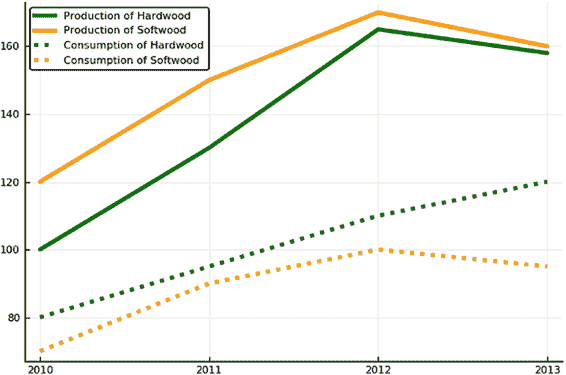

# 让我们使用修改后的示例数据，增加更多年份并只保留一个区域：

```julia
df = DataFrame(
  product = ["Softwood","Softwood","Softwood","Softwood",
             "Hardwood","Hardwood","Hardwood","Hardwood"],
  year = [2010,2011,2012,2013,2010,2011,2012,2013],
  production = [120,150,170,160,100,130,165,158],
  consumption = [70,90,100,95, 80,95,110,120]
)
```

```julia
pyplot()
mycolours = [:green :orange]  # 注意这是一个行向量，无论此处如何指定顺序，系列颜色都将按字母顺序排列

@df df plot(:year, :production, group=:product, linestyle = :solid, linewidth=3, label=reshape(("Production of " .* sort(unique(:product))) ,(1,:)), color=mycolours)
@df df plot!(:year, :consumption, group=:product, linestyle = :dot, linewidth=3, label =reshape(("Consumption of " .* sort(unique(:product))) ,(1,:)), color=mycolours)
```



## 第 9 章 数据处理

*图 9-4.* 从 DataFrame 绘制多个系列

上一个代码片段的关键点是使用 `group=:product` 来拆分原始系列。然后使用 `color` 属性在图形上区分这些新系列的可视化效果。为了区分产量和消费量，可以使用 `linestyle` 属性。

图例的构建略显繁琐，因为需要同时考虑两个维度。在此示例中，您硬编码了第一个维度（所考虑的市场变量，即产量或消费量），同时将图例项与另一维度 `unique(:product)` 的排序结果拼接起来。最后，将其重塑为行向量，这是 `label` 属性所期望的格式。

### 9.4.4 保存

要保存当前显示的图形，可调用 `savefig(fileName)`，其中 `fileName` 的扩展名决定了保存图形的格式。支持的格式包括 `.png`（标准光栅图像）、`.pdf` 和 `.svg`（均为矢量格式）：

```julia
savefig("timber_markets.svg")
savefig("timber_market.pdf")
savefig("timber_market.png")
```

## 第 10 章 数学库

本章讨论以下第三方包：

| 包名 | 网址 | 版本 |
|---|---|---|
| JuMP.jl | <https://github.com/JuliaOpt/JuMP.jl> | v0.19.2 |
| GLPK.jl | <https://github.com/JuliaOpt/GLPK.jl> | v0.10.0 |
| Ipopt.jl | <https://github.com/JuliaOpt/Ipopt.jl> | v0.5.4 |
| SymPy.jl | <https://github.com/JuliaPy/SymPy.jl> | v1.0.5 |
| LsqFit.jl | <https://github.com/JuliaNLSolvers/LsqFit.jl> | v0.8.1 |

虽然 Julia 是一种完善的通用编程语言，但不可否认的是，其社区目前的关注点主要集中在数学和计算问题上。您已经看到了用于处理数值数据的大量库，以及从 Julia 开发之初，计算性能的考量如何塑造了相关决策。

本章列出了部分最成熟的数学分析库。其中一些库，例如用于数值优化的 JuMP，本身就常常成为人们开始使用 Julia 的主要原因。

© Antonello Lobianco 2019
A. Lobianco, *Julia Quick Syntax Reference*, <https://doi.org/10.1007/978-1-4842-5190-4_10>

这个列表并不全面，侧重于相对通用的任务。寻找特定包的好起点是 <https://pkg.julialang.org/docs/> 或 <https://juliaobserver.com/categories/Mathematics>。

### 10.1 JuMP，一个优化框架

JuMP (<https://github.com/JuliaOpt/JuMP.jl>) 是一个用于数学优化问题的“代数建模语言”（AML），类似于 GAMS (<https://www.gams.com/>)、AMPL (<https://ampl.com/>) 或 Pyomo (<http://www.pyomo.org/>)。

优化问题是指在目标函数和变量之间约束的背景下，找到决策变量的“最优”数量的问题。约束在现实世界中无处不在，无论是商业决策（例如，“我们应该生产多少 X？”）、工程设置（例如，“我们应该以多大角度设计襟翼以实现最大效率？”），还是个人选择（例如，“城里的小公寓还是乡下的大房子？”）。

这类问题可以用数学形式表达为一个要最大化（或最小化）的函数，该函数受其他作为约束的函数支配。

人们已经创建了软件“工具”来解决这些问题。这些工具通常要求您将优化问题表述为矩阵格式，对于非线性问题，还需要提供关于问题的一阶和二阶导数等额外信息，以帮助找到数值最优解。`MATLAB` 优化工具箱或 `R` 的 `optim` 函数中基于求解器的方法就是两个众所周知的例子。

AML 采取了一种不同的方法，它们将问题的表述与用于求解的具体算法分离开来。现在，可以使用与描述问题相同的数学符号以代数方式对问题进行编码。

至关重要的是，变量可以使用“集合”的概念跨越任何维度进行索引，从而允许您编写诸如 `Demand[year,time,region,product] = Supply[year,time,region,product]` 这样的方程。其中包含了自动提供导数的工具。

一旦表述完成，这些问题就可以由 AML 软件支持的、适合该特定问题类别的任何“求解器引擎”来求解。

然而，商业 AML 有一个缺点——它们各自使用自己特定的语言。由于语言专有，它们在许多特性（数据处理、开发工具可用性、语言结构等）上落后于“真正的”通用编程语言。将它们与模型中不涉及优化的其他部分进行交互可能会很困难。

相反，JuMP 属于“第三代”优化工具（第一代是求解器引擎本身，第二代是商业的、语言专有的 AML），它是嵌入在通用编程语言中的作为软件库的 AML。

JuMP 提供了与语言专有 AML 相同的建模简便性和求解器独立性，同时提供了更实用的建模环境。如果结合免费的求解器引擎（例如，用于混合整数问题的 GLPK 和用于非线性问题的 IPOPT），它将是一个完整的开源解决方案。

在本节中，您将学习如何通过实现两个问题来使用 JuMP，一个仅涉及线性函数，另一个的目标函数是非线性的。问题的通用设置是相同的：您选择更适合特定问题的求解器，加载用于求解器特定接口的 Julia 包，创建问题“对象”，并向其添加特征元素，如变量、目标函数和约束。这时，您可以“求解”该问题并检索其解。

这些示例也旨在凸显 Julia 宏的强大功能。通过使用宏，JuMP 在保持 Julia 特性的同时，实现了自己的语言。

#### 10.1.1 运输问题：一个线性问题

##### 问题描述

这是 GAMS 教程中使用的经典运输模型在 JuMP 中的转置。

给定单一产品、*p* 个工厂和 *m* 个市场，问题在于确定 *p* 和 *m* 之间的最佳运输路线，以在遵守每个工厂容量限制（*ap*）并满足每个市场需求 *bm* 的前提下，最小化运输成本：

*min* Σ *c* * x*（对所有 p, m）

约束条件：

Σ *x* ≤ *a*（对所有 p, m, p）

Σ *x* ≥ *b*（对所有 p, m, m）

其中 *cp,m* 是 p 和 m 之间的单位运输成本，*xp,m* 是运输量（待选择）。原始公式来自“Dantzig G. B. (1963), *Linear Programming and Extensions, Chapter 3.3*, Princeton University Press”，其 GAMS 实现可以在“Rosenthal, R. E. (1988) *GAMS: A User's Guide, Chapter 2: A GAMS Tutorial*, The Scientific Press”中找到，或访问 <https://www.gams.com/mccarl/trnsport.gms>。

为了便于比较，我将每个操作的等效 GAMS 代码保留在注释中。

## 导入库

首先需要导入 `JuMP` 包。然后需要实现与所需求解器引擎的特定接口的包。在本例中，我们将处理一个线性问题，因此将使用 *GNU Linear Programming Kit*（GLPK）库并安装 `GLPK.jl` Julia 包。

`GLPK.jl` 和 `Ipopt.jl` 包都会自动安装其自身所需的二进制文件（除非您指定它们使用本地安装的二进制文件，方法是在安装或构建包之前设置 `ENV["JULIA_GLPK_LIBRARY_PATH"]`、`ENV["JULIA_IPOPT_LIBRARY_PATH"]` 和 `ENV["JULIA_IPOPT_EXECUTABLE_PATH"]`）。

需要 `CSV` 包来加载数据。

```
using CSV, JuMP, GLPK
```

## 定义集合

`JuMP` 没有独立的集合语法，而是使用核心 Julia 语言中可用的原生容器。可以使用这些容器对变量、参数和约束进行索引。虽然您可以使用基于位置的列表，但最好使用字典（会牺牲一点效率）。因此，这些示例中的“集合”表示为列表，但其他所有内容（变量、约束和参数）都是字典，以列表元素作为键。