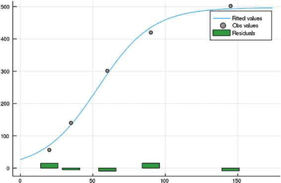

# 排版后的文档

`qp => 5*(-7*pp*ps + 32*pp + 10*ps² - 24*ps)/(2*pp² - 3*pp*ps + 2*ps²)` `qs => 5*(7*pp² - 10*pp*ps - 24*pp + 32*ps)/(2*pp² - 3*pp*ps + 2*ps²)` 函数 `solve` 也直接接受表达式，并将它们在这种情况下设为零。因此，以下写法同样有效：

```
solve([dlqp, dlqs, dlλ], [qp, qs, λ])
```

##### 10.2.4 检索数值

你可以使用 `myExpression.evalf(subs=Dict(symbol=>value))` 将给定的符号数值"注入"到表达式中，并检索表达式对应的数值。

第 10 章 数学库

你可以通过指定披萨的价格为`10`美元、三明治的价格为`4`美元来检索解的数数值：

```julia
qp_num = sol[qp].evalf(subs=Dict(pp=>10,ps=>4)) # 4.64285714285714
qs_num = sol[qs].evalf(subs=Dict(pp=>10,ps=>4)) # 8.39285714285714
λ_num = sol[λ].evalf(subs=Dict(pp=>10,ps=>4))  # 5.625
```

即使它们以数字形式呈现，`qp_num`、`qs_num`和`λ_num`仍然是`SymPy`对象。要将它们转换为 Julia 数字，可以使用`N(SymPySymbol)`。例如：`N(qp_num)`。

最后，要检索目标函数的数值，我们使用这些数值替换效用函数中的符号：

```julia
z = utility.evalf(subs=Dict(qp=>qp_num, qs=>qs_num)) #750.892857142857
```

你已得到了与使用 `JuMP` 进行数值求解时相同的"最优"值（意料之中）。

#### 10.3 LsqFit，一个数据拟合库

作为第三个示例，我选择了一个数据拟合模型。统计学（以及相关的机器学习领域）可能是 Julia 社区中最活跃的开发领域之一。`LsqFit` 包在保持用户友好性的同时提供了极大的灵活性。

你将使用它来估算一片山毛榉（一种阔叶树种）林分的逻辑斯谛增长曲线（Verhulst 模型），数据来自法国西北部一个林分的木材体积样本[¹]。

[¹]: 数据来源：ENGREF, (1984) *Tables de production pour les forets francaises*, 2e édition, p. 80. 林龄以年为单位，体积以每公顷立方米为单位。

第 10 章 数学库

##### 10.3.1 加载库并定义模型

你首先指定要拟合模型的函数形式以及待估计参数的位置。`@.` 宏是一个有用的工具，可以避免在每个操作上指定点运算符（用于广播）。

你要估计的模型是著名的逻辑函数：`vol = pars[1] / (1 + exp(-pars[2] * (age - pars[3])))`

```julia
using LsqFit, CSV, Plots

# 将体积拟合为逻辑斯谛模型
@. model(age, pars) = pars[1] / (1 + exp(-pars[2] * (age - pars[3])))

obsVols = CSV.read(IOBuffer("""
age vol
20 56
35 140
60 301
90 420
145 502
"""), delim=" ", ignorerepeated=true, copycols=true)
```

##### 10.3.2 参数

由于寻找拟合的算法是非线性的，你必须提供一些"合理"的初始点。对于逻辑斯谛函数，第一个参数是函数达到的最大水平（"环境容纳量"），第二个参数是增长率，第三个参数是 x 轴上的中点。以下可以是合理的初始点：

```julia
par0 = [600, 0.02, 60]
```

第 10 章 数学库

##### 10.3.3 拟合模型

一旦定义了模型，你就可以使用数据和参数的初始猜测值进行拟合（你也可以指定参数的上下界，然后将其作为`lower=lb, upper=ub`传入）。这是执行最小二乘拟合的阶段。

```julia
fit = curve_fit(model, obsVols.age, obsVols.vol, par0)
```

##### 10.3.4 检索参数并与观测值比较

拟合后的参数现在可以在`fit.param`数组中获取。此时，你可以直接使用它们来计算每年拟合的体积，并与观测值进行比较（参见图 10-1）：

```julia
fit.param # [497.07, 0.05, 53.5]

fitX = 0:maximum(obsVols.age)*1.2
fitY = [fit.param[1] / (1 + exp(-fit.param[2] * (x - fit.param[3]))) for x in fitX]

plot(fitX, fitY, seriestype=:line, label="拟合值")
plot!(obsVols.age, obsVols.vol, seriestype=:scatter, label="观测值")
plot!(obsVols.age, fit.resid, seriestype=:bar, label="残差")
```



第 10 章 数学库

***Figure 10-1**. 观测数据与拟合数据对比*

## 第 11 章

## 工具

我们以对以下第三方包的讨论来结束本书，如下表所示：

| 包名        | URL                                                  | 版本     |
|-------------|------------------------------------------------------|----------|
| Weave.jl    | [`github.com/mpastell/weave.jl`](https://github.com/mpastell/weave.jl) | v0.9.1   |
| ZipFile.jl  | [`github.com/fhs/ZipFile.jl`](https://github.com/fhs/ZipFile.jl) | v0.8.3   |
| Interact.jl | [`github.com/JuliaGizmos/Interact.jl`](https://github.com/JuliaGizmos/Interact.jl) | v0.10.2  |
| Mux.jl      | [`github.com/JuliaWeb/Mux.jl`](https://github.com/JuliaWeb/Mux.jl) | v0.7.0   |

我还提到了一些其他更通用的 Julia 包。

#### 11.1 Weave 用于动态文档

`Weave` ([`github.com/mpastell/weave.jl`](https://github.com/mpastell/weave.jl)) 允许开发者生成所谓的"动态文档"，其中产生"结果"的代码直接嵌入到文档中。文档的总体结构是 *markdown* 文档，而 Julia 代码则作为*代码单元*插入到主文档中。

在许多情况下，这非常有用，因为它使得从假设到结果，再到这些结果的呈现和讨论的逻辑能够在同一个文档中呈现。

© Antonello Lobianco 2019
A. Lobianco, *Julia Quick Syntax Reference*, `doi.org/10.1007/978-1-4842-5190-4_11`

第 11 章 工具

`Weave` 将代码与（基于 markdown 的）文档混合在一起，类似于 Jupyter Notebook。其主要优点是代码单元不是*预先定义*的，但你仍然可以在 Juno 中运行你需要的那部分代码，而无需依赖于你在文档中组织单元的方式。这要归功于名为 *language-weave* 的 Atom 包 ([`atom.io/packages/language-weave`](https://atom.io/packages/language-weave))。

来看一个例子，将以下文档视为一个扩展名为`.jmd`的文件（例如 `testWeave.jmd`）：

```julia
title : 测试包含内嵌 Julia 代码和引用的文档
date : 2019 年 9 月 5 日
bibliography: biblio.bib
```

