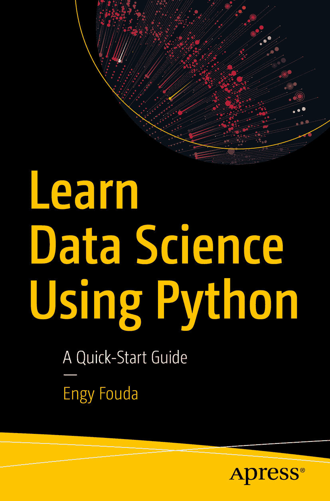

ISBN 979-8-8688-0934-7 电子书 ISBN 979-8-8688-0935-4 [`doi.org/10.1007/979-8-8688-0935-4`](https://doi.org/10.1007/979-8-8688-0935-4) © Engy Fouda 2024 本作品受版权保护。所有权利均由出版商独家许可，无论涉及材料的全部或部分，具体包括翻译、重印、重用插图、朗诵、广播、以缩微胶卷或任何其他物理方式复制、传输或信息存储与检索、电子改编、计算机软件，或通过目前已知或未来开发的任何类似或不同方法。本出版物中使用的一般描述性名称、注册商标名称、商标、服务标记等，即使未作明确声明，也不意味着这些名称不受相关保护性法律和法规的约束，因此可自由用于一般用途。出版商、作者和编辑假定本书中的建议和信息在出版之日是真实准确的。出版商、作者或编辑均不对本书所含材料或可能存在的任何错误或遗漏提供明示或暗示的保证。出版商对已出版地图和机构归属中的管辖权主张保持中立。

本 Apress 印记由注册公司 APress Media, LLC（Springer Nature 的一部分）出版。

注册公司地址为：美国纽约州纽约市纽约广场 1 号，邮编 10004。

*献给我聪慧的天才 Areej，请保持微笑，继续像你本来的星星一样闪耀。*

*献给 Hesham，尽管我有时让你抓狂，但你从未放弃过我。*

*献给我的父母，希望你们现在为我感到骄傲。*

*献给我的兄弟、家人和朋友，你们总是耐心倾听我的倾诉。*

