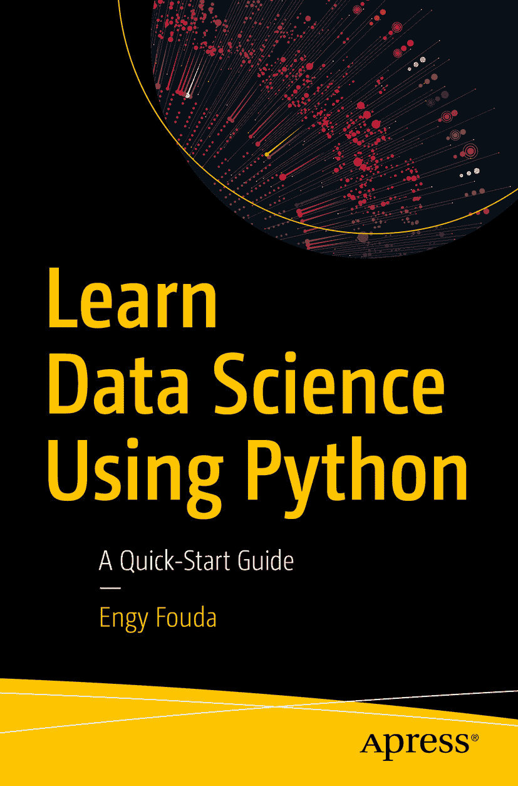

ISBN 979-8-8688-0934-7 电子书 ISBN 979-8-8688-0935-4 [`doi.org/10.1007/979-8-8688-0935-4`](https://doi.org/10.1007/979-8-8688-0935-4) © Engy Fouda 2024 本作品受版权保护。所有权利均由出版商独家许可，无论涉及材料的全部或部分，具体包括翻译、重印、重用插图、朗诵、广播、以缩微胶卷或任何其他物理方式复制、传输或信息存储与检索、电子改编、计算机软件，或通过目前已知或未来开发的任何类似或不同方法。本出版物中使用的一般描述性名称、注册商标名称、商标、服务标记等，即使未作明确声明，也不意味着这些名称不受相关保护性法律和法规的约束，因此可自由用于一般用途。出版商、作者和编辑假定本书中的建议和信息在出版之日是真实准确的。出版商、作者或编辑均不对本书所含材料或可能存在的任何错误或遗漏提供明示或暗示的保证。出版商对已出版地图和机构归属中的管辖权主张保持中立。

本 Apress 印记由注册公司 APress Media, LLC（Springer Nature 的一部分）出版。

注册公司地址为：美国纽约州纽约市纽约广场 1 号，邮编 10004。

*献给我聪慧的天才 Areej，请保持微笑，继续像你本来的星星一样闪耀。*

*献给 Hesham，尽管我有时让你抓狂，但你从未放弃过我。*

*献给我的父母，希望你们现在为我感到骄傲。*

*献给我的兄弟、家人和朋友，你们总是耐心倾听我的倾诉。*

## 引言

本书以逐步序列的方式向您展示如何使用 Python 完成数据清洗、统计和可视化任务，即使您没有任何编程或统计学背景。

本书的案例研究预测了缅因州的总统选举，这是我在哈佛大学完成的一个项目。第 1 章更详细地解释了该案例研究。除了总统选举，本书还提供了现实生活中的例子，包括分析股票、石油和黄金价格、犯罪、市场营销和医疗保健。您将看到数据科学在行动中的实际应用，以及如何在 Python 中完成复杂任务和可视化。

您将逐步学习如何进行可视化。本书包含代码解释以及每一步的截图。全书遵循数据科学在行动中的范式，以易于理解的方式演示如何使用 Python 执行复杂任务和可视化，并使用真实的大数据进行有趣的动手实验。

它将为读者提供使用 Python 进行数据科学和分析所需的专业知识：

- 导入和导出原始数据文件
- 操作和转换数据
- 合并数据集
- 创建汇总统计和报告
- 识别并纠正数据、语法和编程逻辑错误
- T 检验
- 线性回归
- 可视化

### 谁应该阅读本书？

本书的主要读者是数据科学领域的新手学生，他们可能没有深厚的编程经验。因此，大学教授可以将其用作课程的讲义。此外，像我这样的技术讲师，在认证培训中心教授来自不同行业领域的专业人士，也可以用它来教学，并将其作为课程的教科书。

此外，经验丰富但刚接触 Python 的系统分析师和科学家将找到更快速、更高效的工具来完成日常任务。同时，数据记者和调查记者会发现本书易于理解，并能快速生成必要的可视化内容。

### 本书是如何组织的？

本书分为三个部分。第一部分，即第 1、2 和 3 章，让您熟悉 SAS 界面和基本核心任务。第 1 章重点介绍缅因州总统选举项目案例研究的总体思路及其输出。在整本书中，您将逐步学习如何获得这些输出图表和分析。

然后，第二部分，即第 4、5 和 6 章，侧重于更高级的编程方面。第三部分，即第 7 章，将带您从分析历史数据走向预测未来。

所有示例代码都在`Example Code`文件夹中，本书所需的数据集在`Datasets`文件夹中。

## 关于作者

## 关于技术审稿人