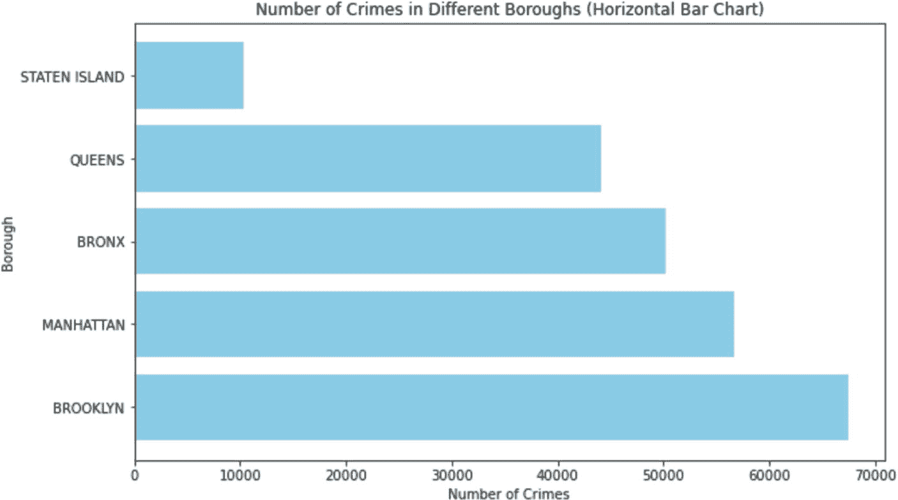
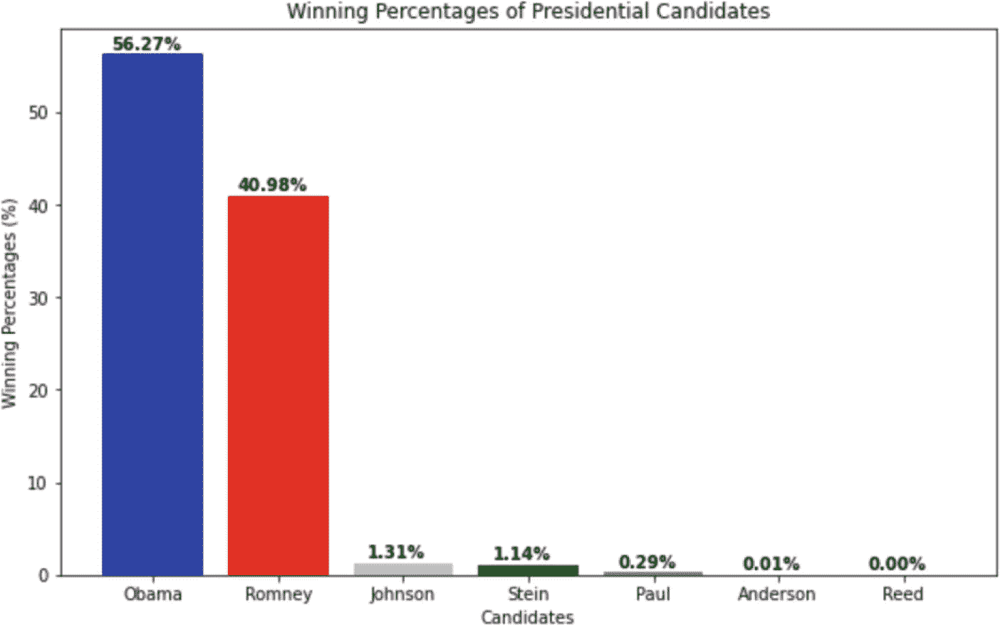
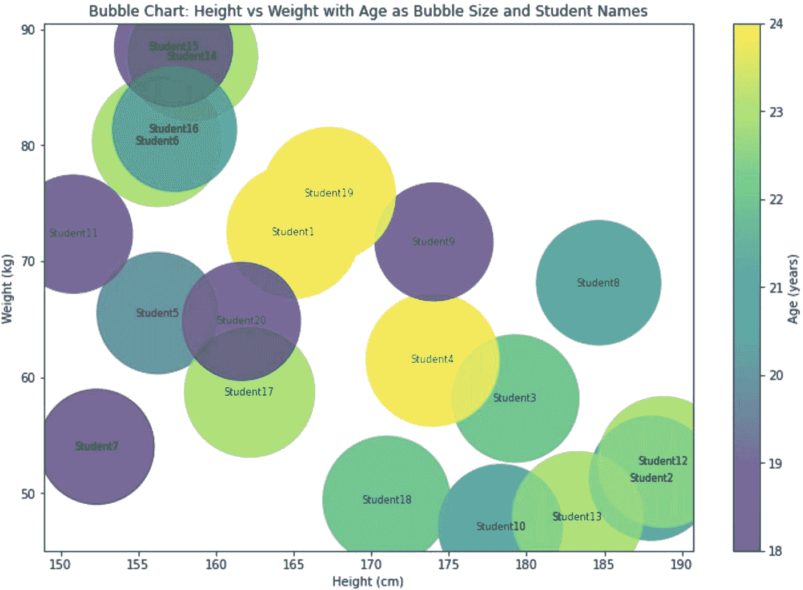
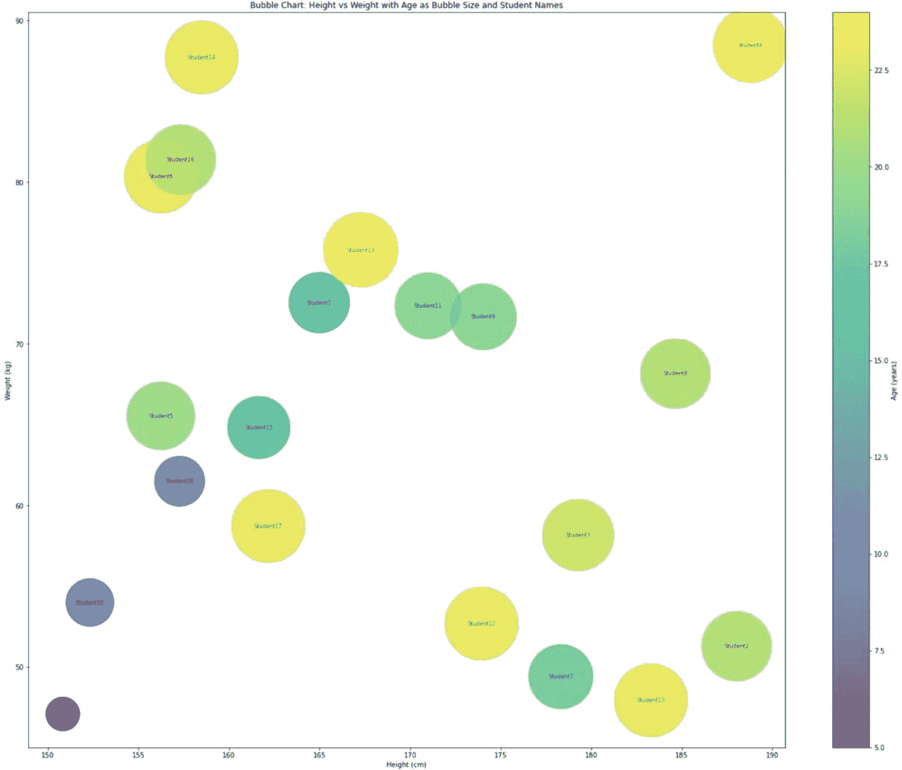

# 数据

```python
Borough = ['BRONX', 'BROOKLYN', 'MANHATTAN', 'QUEENS', 'STATEN ISLAND']
crimes = [50153, 67489, 56691, 44137, 10285]
# 按犯罪数量降序排序数据
sorted_data = sorted(zip(Borough, crimes), key=lambda x: x[1], reverse=True)
# 提取排序后的行政区划和犯罪数量
sorted_Borough, sorted_crimes = zip(*sorted_data)
# 创建水平条形图
plt.figure(figsize=(10, 6))
plt.barh(sorted_Borough, sorted_crimes, color='skyblue')
# 添加标签和标题
plt.xlabel('犯罪数量')
plt.ylabel('行政区划')
plt.title('不同行政区划的犯罪数量（降序排列）')
# 显示水平条形图
plt.show()
```

代码清单 3-5-4：使用水平条形图替代垂直条形图

代码清单 3-5-4 的输出结果为图 3-17。



### 使用条形图创建直方图

条形图也可用于创建直方图。在许多其他统计编程语言（如 SAS）中，直方图只能针对字符串数据类型绘制，且数据必须为数值型。在 Python 中则没有此限制。在本例中，你将学习如何绘制 2012 年缅因州总统候选人及其得票率的图表，该内容在第 1 章中曾提及。缅因州的结果如表 3-3 所示。

表 3-3 2012 年总统候选人及其在缅因州的得票率

| 候选人 | 得票率 |
| --- | --- |
| Obama | 56.27 |
| Romney | 40.98 |
| Johnson | 1.31 |
| Stein | 1.14 |
| Paul | 0.29 |
| Anderson | 0.01 |
| Reed | 0 |

同样，我们不会从外部文件加载数据，而是像代码清单 3-6 那样将值直接插入代码中。

```python
# 数据
candidates = ['Obama', 'Romney', 'Johnson', 'Stein', 'Paul', 'Anderson', 'Reed']
winning_percentages = [56.27, 40.98, 1.31, 1.14, 0.29, 0.01, 0]
# 为每位候选人定义颜色
colors = ['blue', 'red', 'silver', 'green', 'grey', 'grey', 'grey']
# 创建条形图
plt.figure(figsize=(10, 6))
bars = plt.bar(candidates, winning_percentages, color=colors)
# 在每个条形上方添加标签
for bar, label in zip(bars, winning_percentages):
    plt.text(bar.get_x() + bar.get_width() / 2 - 0.05, bar.get_height() + 0.2, f'{label:.2f}%', ha='center', va='bottom', color='black', fontweight='bold')
# 添加标签和标题
plt.xlabel('候选人')
plt.ylabel('得票率 (%)')
plt.title('总统候选人得票率')
# 显示条形图
plt.show()
```

代码清单 3-6：2012 年缅因州总统候选人得票率

代码清单 3-6 中条形图的附加价值在于使用相应的政党颜色为条形着色。同样，我们从两个列表 `candidates` 和 `winning_percentages` 中读取数据。然后，我们定义要在图表中使用的颜色列表。`plt.figure(figsize=(10, 6))` 设置图形大小。接着使用 `plt.bar` 函数创建垂直条形图，其中 `candidates` 列位于 x 轴，`winning_percentages` 变量位于 y 轴，条形根据我们预先指定的颜色列表着色。然后，我们循环遍历每个条形及其对应的得票率。

接着使用 `plt.text` 函数在每个条形上方添加文本标签，显示保留两位小数的得票率。标签使用 `ha='center'` 水平居中，并使用 `va='bottom'` 底部对齐。标签为黑色粗体。最后，一如既往地设置 x 轴和 y 轴的标签以及图表标题。输出结果为图 3-18。



## 气泡图

气泡图有助于同时展示三个数据变量。在本例中，我们将创建一个气泡图来展示一个班级的身高、体重和年龄。

对于本例，我生成了班级的随机数据，如代码清单 3-7-1 所示，作为本章的第三个数据源。

```python
import pandas as pd
import numpy as np
import matplotlib.pyplot as plt
# 生成 20 名学生的数据集
np.random.seed(42)  # 设置随机种子以确保可重复性
students_data = {
    'Name': [f'Student{i}' for i in range(1, 21)],
    'Height': np.random.uniform(150, 190, 20),  # 身高，单位：厘米
    'Weight': np.random.uniform(45, 90, 20),   # 体重，单位：千克
    'Age': np.random.randint(18, 25, 20)        # 年龄，单位：岁
}
students_df = pd.DataFrame(students_data)
# 创建气泡图
plt.figure(figsize=(12, 8))
# 调整气泡大小的缩放因子
scaling_factor = 500
scatter = plt.scatter(students_df['Height'], students_df['Weight'], s=students_df['Age'] * scaling_factor, c=students_df['Age'], cmap='viridis', alpha=0.7)
# 用学生姓名标注每个点
for i, name in enumerate(students_df['Name']):
    plt.text(students_df['Height'][i], students_df['Weight'][i], name, ha='center', va='center', fontsize=8, color='black', alpha=0.7)
# 添加标签和标题
plt.xlabel('身高 (cm)')
plt.ylabel('体重 (kg)')
plt.title('气泡图：身高 vs 体重，气泡大小表示年龄，并显示学生姓名')
# 添加颜色条
cbar = plt.colorbar(scatter)
cbar.set_label('年龄 (岁)')
# 显示气泡图
plt.show()
```

代码清单 3-7-1：随机生成班级数据并绘制气泡图

代码清单 3-7-1 首先使用 `np.random.seed(42)` 设置随机种子以确保可重复性。固定随机化中的种子意味着每次重新编译和运行代码时，都会生成相同的随机值。但如果我们不指定种子，每次重新运行单元格时，都会生成新的随机值。然后，使用 `np.random.uniform` 函数为 20 名学生生成随机数据。数据集包含学生姓名、身高、体重和年龄列。接着，使用 Matplotlib 创建气泡图。一如既往，`plt.figure(figsize)` 设置图形大小。

现在，惊喜之处在于再次使用了 `plt.scatter` 函数。是的，我们用它来绘制散点图和气泡图。在散点图中，x 轴表示身高，y 轴表示体重，气泡大小与年龄成正比（缩放因子为 500），颜色表示年龄。`cmap='viridis'` 指定颜色映射，`alpha=0.7` 设置气泡的透明度。

然后使用 `plt.text` 函数为图表上的每个点添加注释，在相应位置显示学生姓名。代码为 x 轴、y 轴添加标签，并为图表添加标题。

为图表添加了一个颜色条图例来表示学生的年龄。`cbar.set_label` 函数设置颜色条的标签。最后，使用 `plt.show()` 显示创建的气泡图。输出结果为图 3-19。



如图 3-19 所示，气泡直径并无显著差异。年龄范围在 18 至 24 岁之间。因此，我决定将生成的随机数据集之一保存为 Excel 文件，并手动修改部分年龄、体重和身高值，以制造显著差异。年龄范围变为 5 至 24 岁，与数据集文件夹中的`class.xlsx`数据集一致，如代码清单 3-7-2 所示。代码清单 3-7-1 与 3-7-2 的唯一区别在于，后者将随机生成部分替换为通过`pd.read_excel`函数读取文件来创建 DataFrame `students_df`。

```python
import pandas as pd
import numpy as np
import matplotlib.pyplot as plt
# 为 20 名学生生成数据集
np.random.seed(42)  # 设置随机种子以确保可重复性
students_df = pd.read_excel('../Datasets/Chapter 3/class.xlsx')
print(df.head())')
# 创建气泡图
plt.figure(figsize=(12, 8))
# 调整气泡大小的缩放因子
scaling_factor = 500
scatter = plt.scatter(students_df['Height'], students_df['Weight'], s=students_df['Age'] * scaling_factor, c=students_df['Age'], cmap='viridis', alpha=0.7)
# 为每个数据点标注学生姓名
for i, name in enumerate(students_df['Name']):
plt.text(students_df['Height'][i], students_df['Weight'][i], name, ha='center', va='center', fontsize=8, color='black', alpha=0.7)
# 添加坐标轴标签和标题
plt.xlabel('Height (cm)')
plt.ylabel('Weight (kg)')
plt.title('Bubble Chart: Height vs Weight with Age as Bubble Size and Student Names')
# 添加颜色条
cbar = plt.colorbar(scatter)
cbar.set_label('Age (years)')
# 显示气泡图
plt.show()
```

代码清单 3-7-2：读取班级数据集而非随机生成

代码清单 3-7-2 的输出结果为图 3-20。现在，图表清晰地展示了班级中的离群值。例如，紫色气泡中的学生 5 是班级中最矮的学生，而黄色气泡中的学生 4 则是班级中最高的学生。



## 总结

本章深入探讨了数据可视化。首先介绍了最基本的图表类型，如散点图和直方图。此外，还展示了如何通过改变颜色和图案来叠加图表，以便于比较分析结果。Python 中的数据可视化是最强大的功能之一，提供了丰富的自定义图表选项。