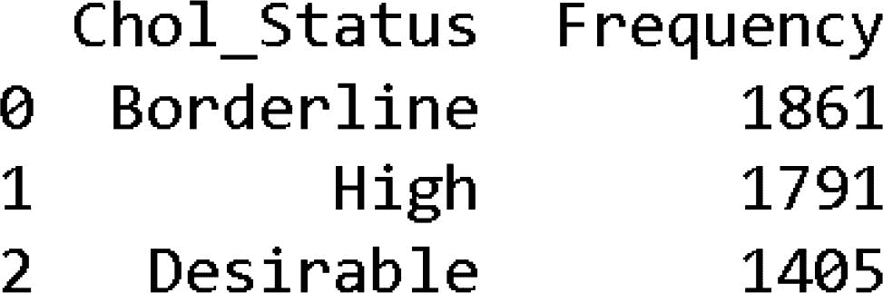
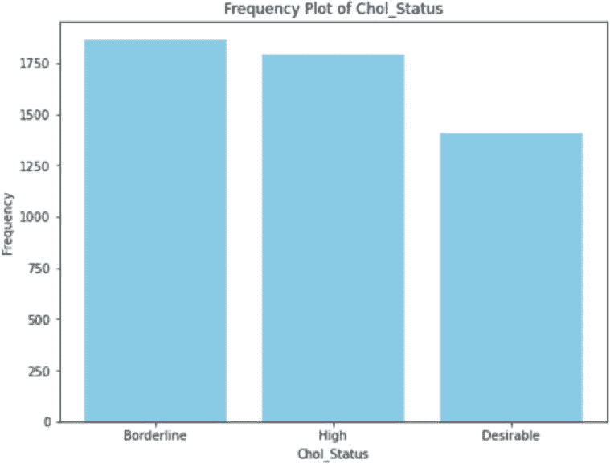
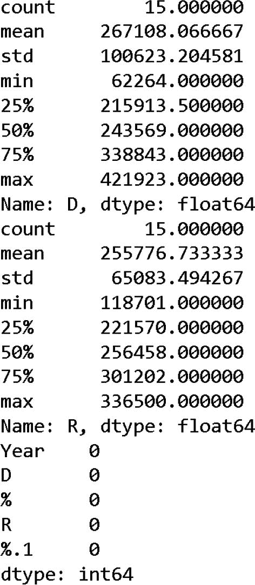
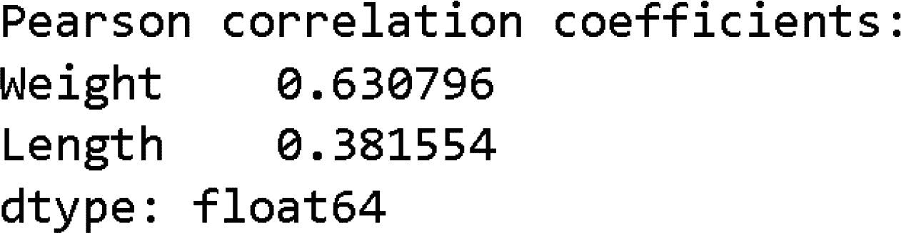
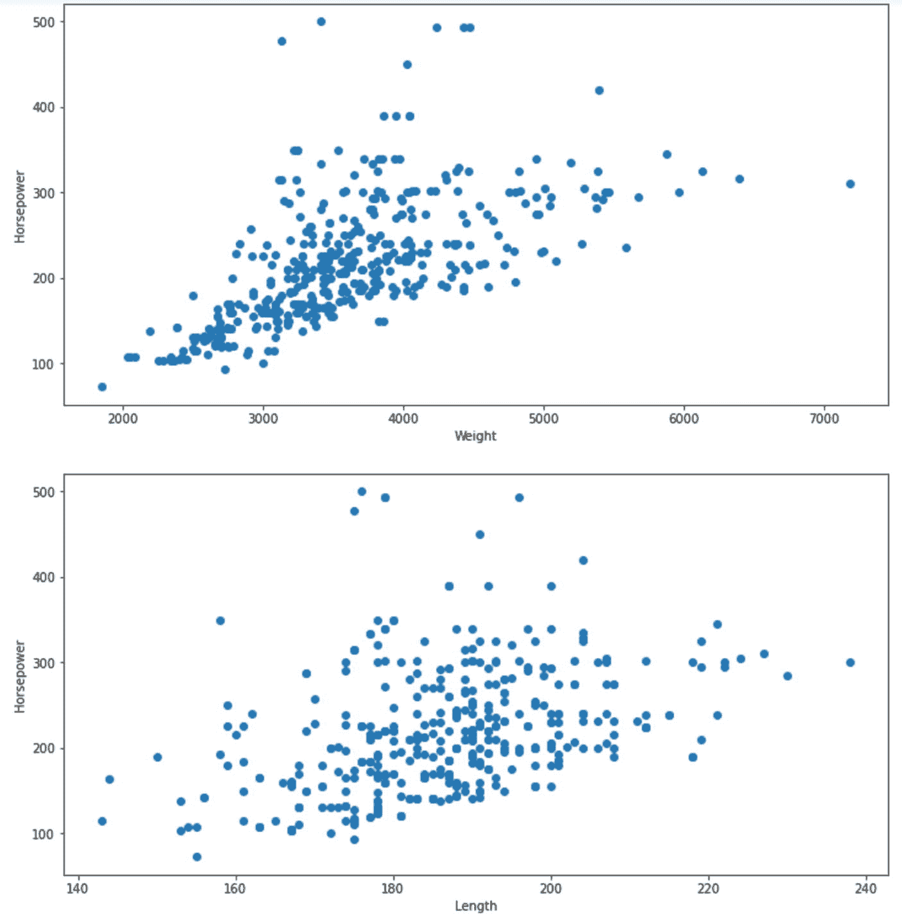
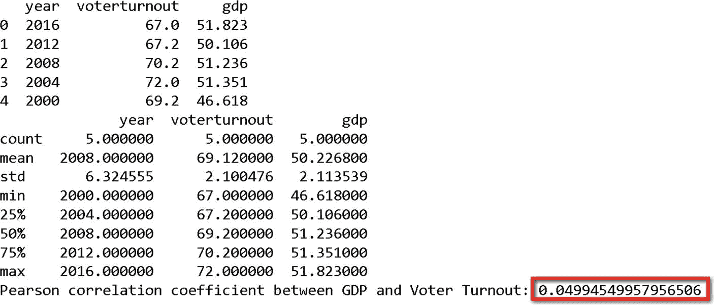
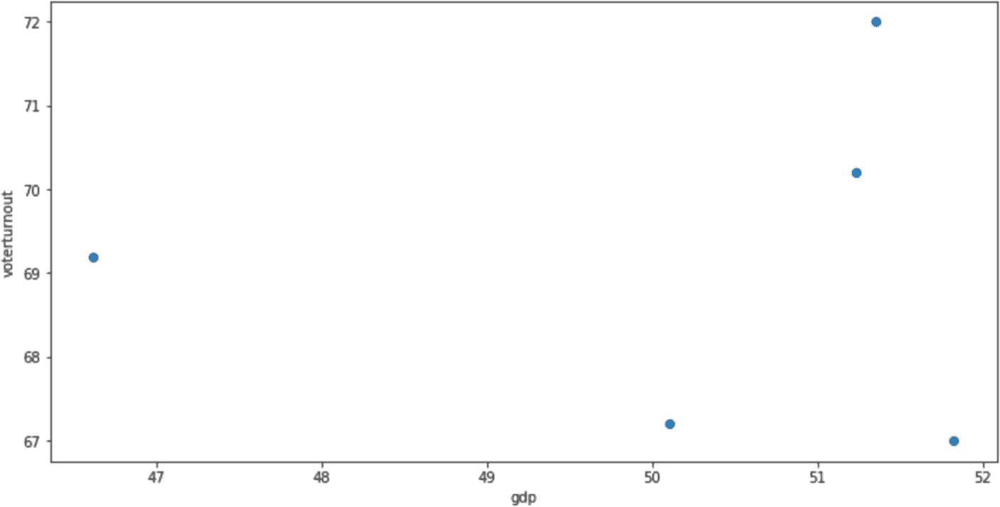
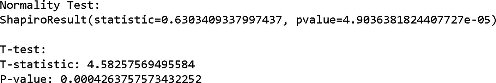
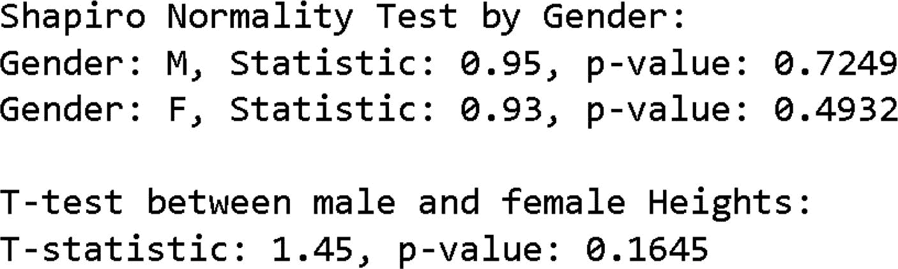
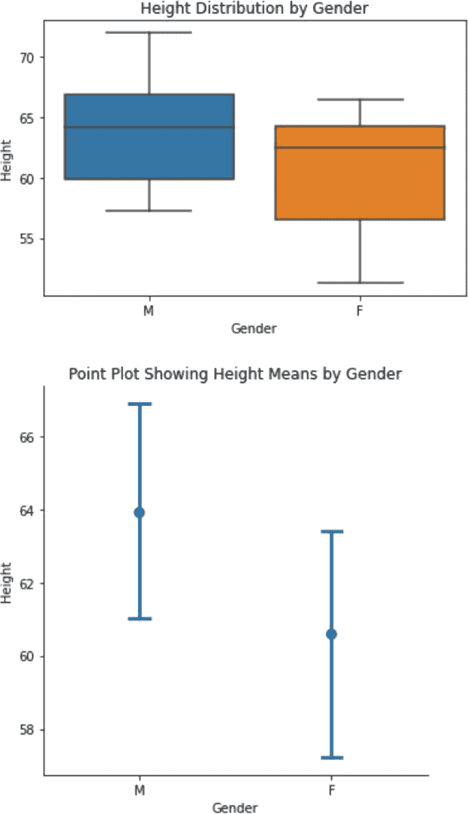

# 4. 统计分析及线性模型

在第 3 章中，我们探讨了图形与数据可视化。在第 4 章中，我们将研究统计学与线性模型。

## 统计分析

读取数据集后，通常需要执行一些统计分析任务，以理解数据并将其纳入报告中。本章将讨论频数表、汇总统计、相关性分析以及 T 检验。

### 频数表

频数表任务通常是探索任何数据集时的首要步骤之一。它根据数据生成频数表，显示每个变量的唯一水平。此外，该表还有助于识别离群值。

在此示例中，我们探索数据集文件夹中的`HEART.csv`文件，以查看有多少人患有高胆固醇。为此，我们重点关注字符串变量`CHOL_STATUS`。相关代码位于示例代码文件夹中第 4 章的代码清单 4-1 中。

在代码清单 4-1 中，我们将学习如何生成频数表，并以条形图的形式绘制频数分布。

```
import pandas as pd
import matplotlib.pyplot as plt
heart_df = pd.read_csv('../Datasets/Chapter 4/HEART.csv')
frequency_table = heart_df['Chol_Status'].value_counts().reset_index().rename(columns={'index': 'Chol_Status', 'Chol_Status': 'Frequency'})
# 按频数排序
frequency_table = frequency_table.sort_values(by='Frequency', ascending=False)
# 打印频数表
print(frequency_table)
# 绘制频数图
plt.figure(figsize=(8, 6))
plt.bar(frequency_table['Chol_Status'], frequency_table['Frequency'], color='skyblue')
plt.xlabel('Chol_Status')
plt.ylabel('Frequency')
plt.title('Frequency Plot of Chol_Status')
plt.show()
代码清单 4-1
频数表
```

在导入所需库并将 csv 文件读取到 Pandas DataFrame `heart_df`后，我们计算频数表。以下代码行：`frequency_table = heart_df['Chol_Status'].value_counts().reset_index().rename(columns={'index': 'Chol_Status', 'Chol_Status': 'Frequency'})`，执行了以下操作：

*   `heart_df['Chol_Status'].value_counts()`：计算 DataFrame `heart_df`中`'Chol_Status'`列唯一值的频数。

*   `.reset_index():`：重置结果序列的索引，将其转换为 DataFrame。

*   `.rename(columns={'index': 'Chol_Status', 'Chol_Status': 'Frequency'}):`：将 DataFrame 的列重命名为`'Chol_Status'`和`'Frequency'`，以提高清晰度。

然后，我们按`Frequency`列对频数表 DataFrame 进行降序排序，确保频数最高的类别显示在最前面。这是通过以下指令完成的：`frequency_table = frequency_table.sort_values(by='Frequency', ascending=False)`。

接着，我们将频数表 DataFrame 打印到控制台，显示`Chol_Status`列中每个唯一值的频数。此代码的输出结果如图 4-1 中的表格所示。



图 4-1

频数表

至于绘制频数图，如前所述，我们使用`plt.figure()`方法创建一个新图形，避免图表相互叠加。同时，我们用它来设置图形尺寸。然后，以`Chol_Status`序列为 x 轴，频数为 y 轴创建条形图，并添加相应的标签。最后两步是设置图形标题并显示图形。此部分的输出结果如图 4-2 所示。



图 4-2

频数条形图

图 4-2 展示了`Chol_Status`的降序分布情况，其中`Borderline`在该数据集中占比最高，其次是`High`，频数最低的是`Desirable`。


### 汇总统计

汇总统计任务提供所有观测值以及分组观测值内各变量的描述性统计。您还可以通过图形化展示（如直方图或箱线图）来汇总数据。

在本例中，我们回顾缅因州过去的选举情况，以观察是否存在任何可预测的结果（模式）。数据集位于 `Datasets` 文件夹中，文件名为 `Maine_Past_Elections.xlsx`。该 Excel 文件的内容如表 4-1 所示。

**表 4-1** `Maine_Past_Elections.xlsx`

| 年份 | 民主党票数 | 民主党得票率 | 共和党票数 | 共和党得票率 |
| --- | --- | --- | --- | --- |
| 2016 | **357,735** | **47.80%** | 335,593 | 44.90% |
| 2012 | **401,306** | **56.27%** | 292,276 | 40.98% |
| 2008 | **421,923** | **57.71%** | 295,273 | 40.38% |
| 2004 | **396,842** | **53.57%** | 330,201 | 44.58% |
| 2000 | **319,951** | **49.10%** | 286,616 | 44.00% |
| 1996 | **312,788** | **51.60%** | 186,378 | 30.80% |
| 1992 | **263,420** | **38.80%** | 206,820 | 30.40% |
| 1988 | 243,569 | 43.90% | **307,131** | **55.30%** |
| 1984 | 214,515 | 38.80% | **336,500** | **60.80%** |
| 1980 | 220,974 | 42.30% | **238,522** | **45.60%** |
| 1976 | 232,279 | 48.07% | **236,320** | **48.91%** |
| 1972 | 160,584 | 38.50% | **256,458** | **61.50%** |
| 1968 | **217,312** | **55.30%** | 169,254 | 43.10% |
| 1964 | **62,264** | **68.84%** | 118,701 | 31.16% |
| 1960 | **181,159** | **42.95%** | 240,608 | 57.05% |

让我们读取数据，并计算数据集中民主党与共和党两列（即变量 `D` 和 `R`）的汇总统计，如代码清单 4-2 所示。

```
import pandas as pd
import numpy as np
import matplotlib.pyplot as plt
past_elections_df = pd.read_excel('../Datasets/Chapter 4/Maine_Past_Elections.xlsx')
print(past_elections_df['D'].describe())
print(past_elections_df['R'].describe())
print(past_elections_df.isnull().sum())
Listing 4-2
Summary statistics
```

导入库并加载数据集后，我们计算并打印 DataFrame `past_elections_df` 中列 `D` 和 `R` 的描述性统计。`.describe()` 方法会为指定列生成计数、均值、标准差、最小值和最大值等汇总统计信息。

`.isnull()` 方法用于检查 DataFrame `past_elections_df` 中的缺失值，该方法返回一个由布尔值组成的 DataFrame，指示是否存在缺失值。接着，`.sum()` 方法计算每列缺失值的总数并打印结果。输出结果如图 4-3 所示。如图所示，数据集中不存在空值。



**图 4-3** 缅因州民主党与共和党的汇总统计

民主党与共和党的平均值差异并不显著。因此，缅因州属于“倾向民主党”的州，因为民主党在 15 次选举中赢得了 7 次（从 1960 年到 2016 年）。自 1992 年以来，民主党在缅因州的选举中一直获胜。

### 相关性分析

在解释相关性概念之前，我们想先明确因果关系与相关性的区别。因果关系是指一件事导致另一件事发生，而相关性是指两件或更多事情看起来有关联。相关性并不总是意味着因果关系。

例如，旅行会导致购买行李箱和机票，但行李箱的销售与机票是相关的，如图 4-4 所示。


**图 4-4** 因果关系与相关性

相关性是一种用于描述数值变量之间联系的统计方法。这种联系通过计算相关系数来表达，其取值范围从 -1 到 1。相关性分析任务提供图表和统计数据，以探索变量之间的关联。

让我们看几个例子。第一个例子是探究汽车的长度、重量与其马力之间是否存在相关性。汽车数据集位于 `Datasets` 文件夹中。

代码位于示例代码文件夹中第 4 章的 `Chapter 4.ipynb` 文件中的代码清单 4-3。在 Python 中有多种计算相关性的方法。在本例中，我们使用 Pandas 中的 `corr()` 方法来计算指定变量之间的相关矩阵。

在代码清单 4-3 中，我们导入所需的库，加载数据集，并对其进行探索。为了更深入地探索数据，我们绘制了变量之间的多对双变量分布图。

```
import pandas as pd
import numpy as np
import matplotlib.pyplot as plt
cars_df = pd.read_excel('../Datasets/Chapter 4/CARS.xlsx')
print(cars_df.head())
print(cars_df.describe())
# Selecting variables
variables = cars_df[['Weight', 'Length', 'Horsepower']]
# Calculate the correlation matrix
correlation_matrix = variables[['Weight', 'Length']].corrwith(variables['Horsepower'])
print("Pearson correlation coefficients:")
print(correlation_matrix)
plt.figure(figsize=(12, 6))
plt.scatter(cars_df['Weight'], cars_df['Horsepower'])
plt.xlabel('Weight')
plt.ylabel('Horsepower')
plt.figure(figsize=(12, 6))
plt.scatter(cars_df['Length'], cars_df['Horsepower'])
plt.xlabel('Length')
plt.ylabel('Horsepower')
Listing 4-3
Import the required libraries, load the dataset, and explore it
```

在代码清单 4-3 中，我们首先导入用于数据操作的 Pandas 库。我们使用 `pd.read_excel()` 函数将数据集 `CARS.xlsx` 加载到一个 Pandas DataFrame 中。然后，我们从数据集中提取 `Weight`、`Length` 和 `Horsepower` 列，并将它们存储在一个名为 `variables` 的新 DataFrame 中。

我们使用 `corrwith()` 方法计算变量对 `Weight` 与 `Horsepower` 以及 `Length` 与 `Horsepower` 之间的皮尔逊相关系数。该方法计算两个 DataFrame 或两个 Series 之间的相关性。在本例中，我们将 `variables` DataFrame 中的 `Weight` 和 `Length` 列与 `Horsepower` 列进行相关性计算。图 4-5 中的输出显示，马力与重量的相关性高于与长度的相关性。



**图 4-5** 皮尔逊相关系数

为了确认这些相关性，让我们绘制散点图，如图 4-6 所示。



**图 4-6** 马力与重量和长度之间的相关性

现在，让我们探讨如何将相关性应用于缅因州的总统选举。当前的问题是：国内生产总值（GDP）是否对缅因州的选民投票率产生影响？


数据集`correlation.xlsx`位于`Datasets`目录中。然而，构建此数据集颇具挑战。不同的媒体机构和政府来源对缅因州选民投票率的统计数字各不相同。在本分析中，我选择使用 2016 年最常被引用的数字。需要注意的是，如果这些数据要用于本练习之外的范围，则有必要进行进一步的验证。以下是我参考的部分来源示例：

*   [`https://en.wikipedia.org/wiki/United_States_presidential_election_in_Maine,_2000`](https://en.wikipedia.org/wiki/United_States_presidential_election_in_Maine,_2000)
*   [`http://www.270towin.com/states/Maine`](http://www.270towin.com/states/Maine)
*   [`https://www.pressherald.com/2016/11/08/mainers-head-to-polls-in-historic-election/`](https://www.pressherald.com/2016/11/08/mainers-head-to-polls-in-historic-election/)
*   [`https://www.mainepublic.org/politics/2016-11-08/maine-voter-turnout-extremely-heavy`](https://www.mainepublic.org/politics/2016-11-08/maine-voter-turnout-extremely-heavy)
*   [`https://www.csmonitor.com/USA/Elections/2012/1106/Voter-turnout-the-6-states-that-rank-highest-and-why/Maine`](https://www.csmonitor.com/USA/Elections/2012/1106/Voter-turnout-the-6-states-that-rank-highest-and-why/Maine)
*   [`https://www.census.gov/history/pdf/2008presidential_election-32018.pdf`](https://www.census.gov/history/pdf/2008presidential_election-32018.pdf)
*   [`https://bipartisanpolicy.org/report/2012-voter-turnout/`](https://bipartisanpolicy.org/report/2012-voter-turnout/)
*   [`https://www.census.gov/content/dam/Census/library/publications/2008/demo/p20-557.pdf`](https://www.census.gov/content/dam/Census/library/publications/2008/demo/p20-557.pdf)
*   [`https://www.census.gov/content/dam/Census/library/publications/2006/demo/p20-556.pdf`](https://www.census.gov/content/dam/Census/library/publications/2006/demo/p20-556.pdf)
*   [`https://www.census.gov/content/dam/Census/library/publications/2002/demo/p20-542.pdf`](https://www.census.gov/content/dam/Census/library/publications/2002/demo/p20-542.pdf)
*   [`https://www.deptofnumbers.com/gdp/maine/`](https://www.deptofnumbers.com/gdp/maine/)

```
import pandas as pd
import numpy as np
import matplotlib.pyplot as plt
correlation = pd.read_excel('../Datasets/Chapter 4/correlation.xlsx')
print(correlation.head())
print(correlation.describe())
# Calculate the correlation matrix
correlation_coefficient = correlation['gdp'].corr(correlation['voterturnout'])
#print("Pearson correlation coefficients:")
print("Pearson correlation coefficient between GDP and Voter Turnout:", correlation_coefficient)
plt.figure(figsize=(12, 6))
plt.scatter(correlation['gdp'], correlation['voterturnout'])
plt.xlabel('gdp')
plt.ylabel('voterturnout')
Listing 4-4
Is the GDP correlated with Maine voter turnout?
```

清单 4-4 首先导入必要的库。然后，它使用`pd.read_excel()`函数将数据集`correlation.xlsx`读入一个名为`correlation`的 Pandas DataFrame。像往常一样，我们通过`print(correlation.head())`语句显示数据集的前几行，以验证数据集是否被正确读取，从而了解其结构和内容的概览。这有助于理解数据的格式并识别任何潜在问题。

同样，`print(correlation.describe())`语句会打印数据集的汇总统计信息，包括每个数值列的计数、均值、标准差、最小值和最大值。这有助于深入了解数据集中值的分布和范围。

该代码使用`.corr()`方法计算`gdp`（国内生产总值）和`voterturnout`列之间的皮尔逊相关系数。该系数衡量两个变量之间线性关系的强度和方向。结果存储在变量`correlation_coefficient`中。上述语句的输出如图 4-7 所示。



图 4-7

`.head()`、`.describe()`和`.corr()`方法的输出

如图 4-7 所示，相关系数略低于 0.05，这表明缅因州的 GDP 与选民投票率之间几乎不存在关系。

在清单 4-4 中，我们通过可视化方式探索 GDP 与选民投票率之间的关系；使用 Matplotlib 创建了一个散点图。`.scatter()`方法将`gdp`绘制在 x 轴上，将`voterturnout`绘制在 y 轴上。`plt.xlabel()`和`plt.ylabel()`函数分别为 x 轴和 y 轴设置标签，为图表提供上下文。`.title()`方法为图表设置标题。最后，`plt.show()`显示图表。在图表上，你会发现数据点分布散乱，表明缅因州选民投票率与 GDP 之间没有关系，如图 4-8 所示。



图 4-8

缅因州选民投票率与 GDP 之间的相关性

## 假设检验

假设检验是一种统计方法，用于基于样本数据对总体参数进行推断。它涉及将观测数据与预期假设或零假设进行比较，以确定任何观测到的差异或关系是否具有统计显著性，或者仅仅是随机因素造成的。

用于连续数据分析的假设检验示例包括 T 检验和方差分析，而卡方检验则用于分类数据分析。

### T 检验

我们经常需要确定两个不同组别之间的均值是否存在真实差异，或者所感知到的差异是否仅仅是随机变异的结果。T 检验通过衡量两个数据集之间差异的可能性来服务于这一目的。换句话说，它评估两个样本的均值。值得注意的是，T 检验适用于小样本量，因为小样本量可能不服从正态分布。


#### 单样本 T 检验

在此示例中，我收集了缅因州过去总统选举中代表两大主要政党的候选人在不同年份的所有投票数据。该数据集作为预测缅因州 2016 年和 2020 年选举结果的基础。

数据集 `MaineVotesDR.xlsx` 包含四列：`Election Year`（选举年份）、`Democratic Votes`（民主党得票数）、`Republican Votes`（共和党得票数）和 `Result`（结果）。`Result` 列记录了一个二元结果：`0` 表示共和党候选人获胜，而 `1` 表示民主党候选人获胜。

我们的假设是共和党候选人将在 2020 年缅因州总统选举中获胜，而备择假设则表明民主党候选人获胜。

零假设 (H0)：`result = 0`  
备择假设 (Ha)：`result = 1`

现在，让我们加载数据集，并探索 T 检验如何揭示 2020 年选举的结果，如代码清单 4-5 所示。

```
import pandas as pd
from scipy import stats
maine_votes_df = pd.read_excel('../Datasets/Chapter 4/MaineVotesDR.xlsx')
# 正态性检验
normality_test = stats.shapiro(maine_votes_df['Result'])
print("正态性检验:")
print(normality_test)
# t 检验
t_stat, p_value = stats.ttest_1samp(maine_votes_df['Result'], 0)
print("\nT 检验:")
print("T 统计量:", t_stat)
print("P 值:", p_value)
代码清单 4-5
单样本 T 检验
```

在代码清单 4-5 中，我们使用 `stats.shapiro()` 对 DataFrame 的 `Result` 列执行正态性检验。它适用于较小的样本量。结果将给出一个检验统计量和一个 p 值，以确定数据是否显著偏离正态分布。如果数据集大于 20 行，则可以使用 `stats.normaltest()` 函数。然后，我们使用 `stats.ttest_1samp()` 对 `Result` 列执行单样本 t 检验，零假设 (h0) 为 0。我们打印两个检验的结果。输出如图 4-9 所示。



图 4-9  
T 检验结果：对 2020 年缅因州总统选举的预测

p 值 = 0.0004。由于 p 值小于 0.05，我们可以拒绝零假设。因此，我们可以得出结论，共和党候选人将在 2020 年缅因州选举中失利。他确实输掉了缅因州。

#### 双样本 T 检验

在此示例中，问题是：两个性别之间的身高是否存在显著差异？

零假设是身高没有差异。备择假设是身高因性别而异。

在此示例中，加载 CLASS 数据集，如代码清单 4-6-1 所示。

```
import pandas as pd
import numpy as np
from scipy import stats
import seaborn as sns
import matplotlib.pyplot as plt
#https://www.kaggle.com/datasets/megasatish/class-data
class_df = pd.read_csv('../Datasets/Chapter 4/Class.csv')
# 按性别进行正态性检验
print("按性别进行正态性检验:")
for Gender in class_df['Gender'].unique():
    stat, p_value = stats.shapiro(class_df[class_df['Gender'] == Gender]['Height'])
    print(f"性别: {Gender}, 统计量: {stat:.2f}, p 值: {p_value:.4f}")
# 按性别进行 t 检验
# 比较男性和女性
male_heights = class_df[class_df['Gender'] == 'M']['Height']
female_heights = class_df[class_df['Gender'] == 'F']['Height']
t_stat, p_value = stats.ttest_ind(male_heights, female_heights)
print(f"\n 男性和女性身高之间的 T 检验:")
print(f"T 统计量: {t_stat:.2f}, p 值: {p_value:.4f}")
代码清单 4-6-1
双样本 T 检验
```

在代码清单 4-6-1 中，导入所需库并加载数据集后，我们使用 `scipy.stats` 中的 `.shapiro()` 方法（与上一个代码清单相同）检验每个性别组内身高的正态性。然后，我们遍历唯一的性别值（`M` 和 `F`），对每个性别的身高执行正态性检验。并打印每个性别的检验统计量和 p 值，如图 4-10 所示。



图 4-10  
按性别进行正态性检验

从图 4-10 中，我们不能拒绝零假设，因为没有足够的证据支持拒绝；p 值为 0.1645，大于 0.05。我们可以得出结论，两个性别之间的身高没有差异。但是，我们必须注意样本量很小。CLASS 数据集仅包含 19 行。

为了进一步理解数据分布，让我们使用箱线图和折线图来可视化每个性别的身高。如代码清单 4-6-2 所示。

```
# 按性别可视化身高分布
sns.boxplot(x='Gender', y='Height', data=class_df)
plt.title('按性别划分的身高分布')
plt.show()
# 对于 t 检验图，让我们使用 seaborn 按性别显示身高分布，
# 突出显示均值和置信区间
sns.catplot(x='Gender', y='Height', kind="point", data=class_df, join=False, capsize=.1)
plt.title('显示按性别划分的身高均值的点图')
plt.show()
代码清单 4-6-2
可视化每个性别的身高
```

在代码清单 4-6-2 中，我们使用 `sns.boxplot()` 方法绘制每个性别的身高分布。如图 4-11 所示，箱线图显示两组的中位数差异很小，几乎可以忽略不计。此外，如折线图所示，两组的均值之间也存在微小差异。



图 4-11  
按性别划分的身高分布箱线图和折线图

## 总结

本章解释了几乎所有分析和数据科学报告所需的最关键的统计概念。它们是频数表、汇总统计、相关分析和 T 检验。在下一章中，我们将学习运算符和循环。

