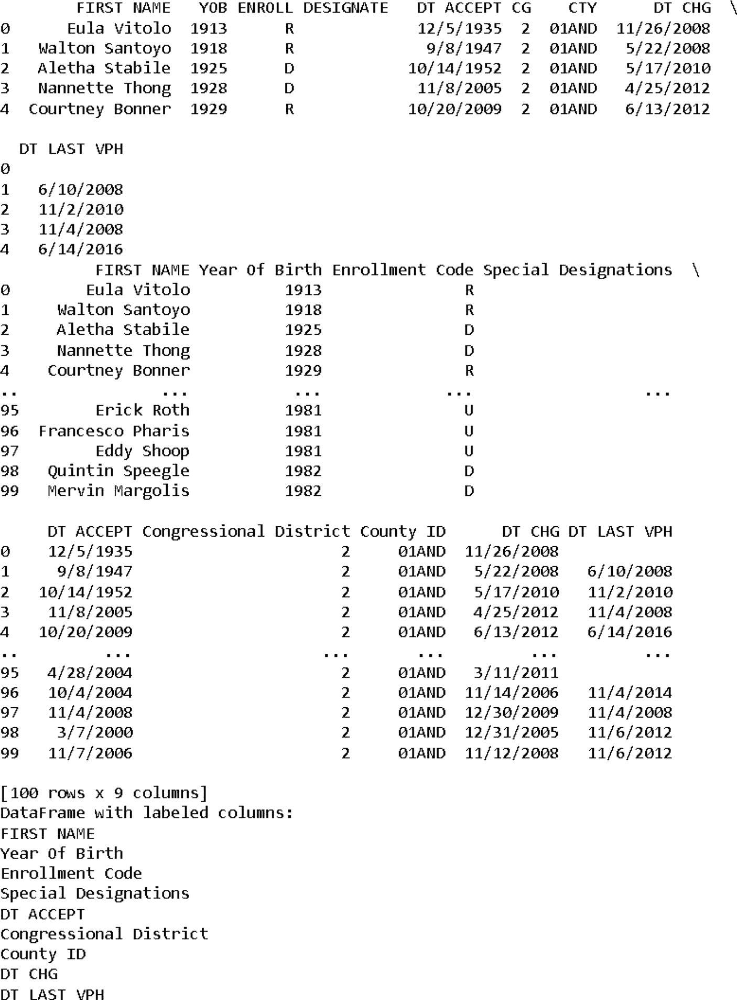

# 6. 为分析准备数据

如前所述，在任何编程语言中，你都会学习数据类型、运算符、IF 条件和循环。除了 IF 条件语句外，我们在第 2 章和第 5 章中已经涵盖了所有这些主题。在本章中，我们将学习 IF 条件语句以及更高级的数据准备和处理技术。

## 重命名

在数据分析中，一个关键的第一步是理解数据集中的变量。你需要识别哪些变量是因变量和自变量，并区分数值/连续变量和字符变量。通常，你的客户会在随数据集提供的文本文件中提供这些信息。这个文本文件被称为数据字典，它解释了变量名称及其类型。例如，如果没有数据字典，像 `YOB`、`ENROLL` 和 `DT_ACCEPT` 这样的变量名称可能含义不清。数据字典会阐明 `YOB` 代表出生年份（Year Of Birth）。

为了将这些描述性标签添加到数据集中，我们使用重命名列的过程。数据集位于 `Datasets` 文件夹中，文件名为 `Voter_A.CSV`。上传并导入文件后，我们将数据集重命名为 `Voters`。请注意，该数据集是合成的，使用了缅因州州务卿提供的变量名称，但不包含任何真实选民的信息。我为这些练习随机生成了 100 行选民信息。

导入后，我们看到数据集包含 100 行和 9 列。然后我们重命名列以包含描述性标签，使数据集更易读。然而，数据显然需要清洗。例如，`Special Designations` 列为空，其他列也存在缺失值。验证数据的有效性并确保其无错误至关重要。我们将在剩余部分学习如何清洗此类杂乱数据。

```python
import pandas as pd
df = pd.read_csv('../Datasets/Chapter 6/Voters_A.csv')
print(df.head())
# 重命名列以添加标签
df = df.rename(columns={
    'FIRST_NAME': 'Name',
    'YOB': 'Year Of Birth',
    'ENROLL': 'Enrollment Code',
    'DESIGNATE': 'Special Designations',
    'DT_ACCEPT': 'Date Accepted (Date of Registration)',
    'CG': 'Congressional District',
    'CTY': 'County ID',
    'DT_CHG': 'Date Changed',
    'DT_LAST_VPH': 'Date Of Last Statewide Election with VPH'
})
# 显示 DataFrame
print(df)
# 或者，如果需要清晰显示列名
print("带有标签列的 DataFrame:")
for column in df.columns:
    print(column)
# 如果需要，保存修改后的 DataFrame
# df.to_csv('voters_labeled.csv', index=False)
```
代码清单 6-1 `rename` 方法

在代码清单 6-1 中，`pd.read_csv('Voter_A.csv')` 函数将数据集加载到 Pandas `DataFrame` 中。`.rename()` 方法为列分配描述性标签。为了显示带有新标签的 `DataFrame`，我们使用 `print(df)` 方法。数据清洗的第一步是通过将缺失值填充为 `"Unknown"` 或 `"Missing"` 来处理它们。输出如图 6-1 所示。

可选地，我们可以将清洗后的 `DataFrame` 保存到一个新的 CSV 文件中。这段 Python 代码实现了理解并重命名变量以提高可读性，以及执行基本数据清洗的目标。



**图 6-1** 带有新变量名称的输出