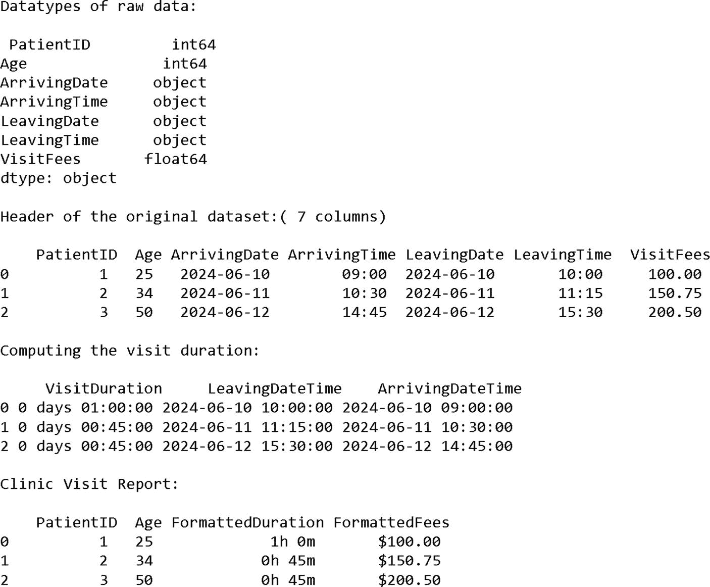
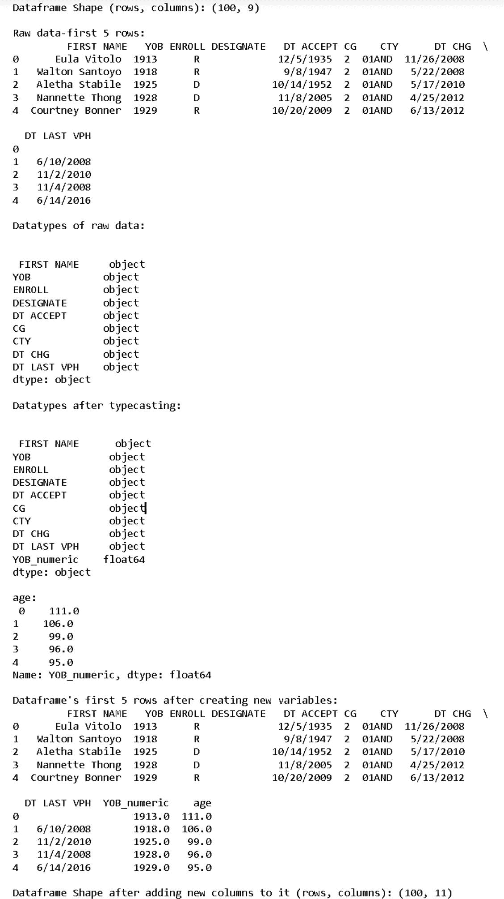

# 格式

医疗领域最常见的数据处理练习之一是计算患者在诊所或医院停留的时间，并根据历史数据预测患者的到达时间以减少等待时间。在本例中，即代码清单 6-2，我们创建了一个包含患者 ID、年龄、到达日期、到达时间、离开日期、离开时间和就诊费用的数据集。然后，我们计算患者在诊所内停留的时间，并打印一份报告，其中包含时长以及带有美元符号和千位分隔符的金额。此示例旨在学习 Python 如何处理日期时间处理和货币格式化。

```
import pandas as pd
import pandas as pd
from datetime import datetime
# 示例 DataFrame
data = {
'PatientID': [1, 2, 3],
'Age': [25, 34, 50],
'ArrivingDate': ['2024-06-10', '2024-06-11', '2024-06-12'],
'ArrivingTime': ['09:00', '10:30', '14:45'],
'LeavingDate': ['2024-06-10', '2024-06-11', '2024-06-12'],
'LeavingTime': ['10:00', '11:15', '15:30'],
'VisitFees': [100.0, 150.75, 200.5]
}
df = pd.DataFrame(data)
print("原始数据的数据类型：")
print("\n",df.dtypes)
print("\n 原始数据集的前几行（",len(df.columns),"列）：")
print("\n",df.head())
# 将日期和时间列转换为 datetime 类型
df['ArrivingDateTime'] = pd.to_datetime(df['ArrivingDate'] + ' ' + df['ArrivingTime'])
df['LeavingDateTime'] = pd.to_datetime(df['LeavingDate'] + ' ' + df['LeavingTime'])
# 计算就诊时长
df['VisitDuration'] = df['LeavingDateTime'] - df['ArrivingDateTime']
dummy=df[['VisitDuration', 'LeavingDateTime', 'ArrivingDateTime']]
print("\n 计算就诊时长：")
print("\n",dummy.head())
# 格式化时长的函数
def format_duration(duration):
seconds = duration.total_seconds()
hours = int(seconds // 3600)
minutes = int((seconds % 3600) // 60)
return f"{hours}h {minutes}m"
# 格式化费用的函数
def format_fees(fees):
return '${:,.2f}'.format(fees)
# 打印报告
print("\n 诊所就诊报告：")
# 显示带有格式化列的 DataFrame 以供参考
df['FormattedDuration'] = df['VisitDuration'].apply(format_duration)
df['FormattedFees'] = df['VisitFees'].apply(format_fees)
print("\n", df[['PatientID', 'Age', 'FormattedDuration', 'FormattedFees']])
代码清单 6-2
日期与货币格式化
```

让我们解释一下代码清单 6-2 中的代码。首先，我们创建一个包含以下列的 DataFrame：`PatientID`、`Age`、`ArrivingDate`、`ArrivingTime`、`LeavingDate`、`LeavingTime` 和 `VisitFees`，并用虚拟值对其进行初始化。

然后，我们使用 `pd.to_datetime()` 方法将 `ArrivingDate` 和 `ArrivingTime` 合并为一个 `ArrivingDateTime` 列。类似地，将 `LeavingDate` 和 `LeavingTime` 合并为 `LeavingDateTime` 列。为了计算就诊时长，从 `LeavingDateTime` 中减去 `ArrivingDateTime` 来计算 `VisitDuration`。接下来，我们将编写一个函数来格式化这个 `VisitDuration` 变量。

为了格式化时长，我们使用 `def` 关键字定义了一个函数，该函数将时长作为参数并返回格式化后的结果。`format_duration(duration)` 将时长转换为小时和分钟的字符串格式，如图 6-2 中的输出所示。

请查看以下链接以了解更多关于日期格式化的信息：[`https://www.w3schools.com/python/python_datetime.asp`](https://www.w3schools.com/python/python_datetime.asp)。

关于货币格式化，我们定义了另一个函数 `format_fees(fees)`，使用 `'${:,.2f}'.format(fees)` 来格式化费用，其中包含美元符号和逗号。其中 `$` 用于设置货币符号，`:,` 用于千位分隔符，`.2f` 用于浮点数精度，设置为两位小数。以下是一个了解更多关于货币格式化的链接：[`https://www.geeksforgeeks.org/how-to-format-numbers-as-currency-strings-in-python/`](https://www.geeksforgeeks.org/how-to-format-numbers-as-currency-strings-in-python/)。

最后，我们指定要打印报告的列，如图 6-2 所示。



**图 6-2** 患者在场馆停留时长的报告

## 创建新变量

在 Python 中，你不需要预先定义变量。在本例中，我们将继续使用总统选举项目和 `Voters_A.csv` 数据集。该数据集有一个名为 `YOB` 的变量，代表出生年份。根据选民分组可以计算出年龄。在代码清单 6-3 中，我们将通过从当前年份减去 `YOB` 来计算选民的年龄。

```
import pandas as pd
df = pd.read_csv('../Datasets/Chapter 6/Voters_A.csv')
print("DataFrame 形状（行，列）：",df.shape)
print("\n 原始数据-前 5 行：\n",df.head())
print("\n 原始数据的数据类型：\n")
print("\n",df.dtypes)
# 类型转换 - 转换为数值型
df['YOB_numeric'] = pd.to_numeric(df['YOB'], errors='coerce')
print("\n 类型转换后的数据类型：\n")
print("\n",df.dtypes)
# 使用 'YOB_numeric' 计算年龄
age = 2024 - df['YOB_numeric']
print("\nage:\n",age.head())
df['age']=age
print("\n 创建新变量后 DataFrame 的前 5 行：\n",df.head())
print("\n 添加新列后 DataFrame 的形状（行，列）：",df.shape)
代码清单 6-3
创建新变量
```

和往常一样，在加载库和数据集之后，你需要通过打印数据集维度（使用 `df.shape()`）、前五行（使用 `df.head()` 方法）以及变量的数据类型（使用 `df.types` 属性）来验证数据是否已正确加载，以检查在执行数学运算之前是否需要进行任何类型转换。

如图 6-3 所示，数据集的维度是 100 行 9 列。然而，所有列的数据类型都是 `object`。这个输出表明 `YOB` 列中存在空字符串或非数值，无法直接转换为整数。因此，我们需要将 `YOB` 的数据类型更改为数值型，以便对其执行算术运算。如代码清单 6-3 所示，我们使用 `pd.to_numeric()` 方法进行类型转换，并设置 `errors='coerce'` 参数，该参数会将无效的解析结果转换为 `NaN`。这种识别允许我们在计算年龄之前用默认值填充这些 `NaN` 值。不过，在本练习中，我们将保留其为 `NaN`。

如果你想用默认值（例如，2006 年，以获得最低投票年龄 18 岁，或任何合适的值）填充 `YOB` 中的 `NaN` 值，可以使用 `df['YOB'].fillna(2006, inplace=True)`。它会就地替换 `NaN`。

之后，我们再次打印数据类型以检查新变量 `YOB_numeric` 的数据类型。如图 6-3 所示，它是 `float64`。现在，它是一个数值数据类型，我们可以执行减法来计算 `age`。然后，我们使用 `age.head()` 方法打印年龄的前五行。要将这个 Series 作为新列添加到 DataFrame `df` 中，我们使用 `df['age']=age`。为了最终验证，我们打印了 DataFrame 的前几行和维度，发现列数从 9 增加到了 11。



**图 6-3** 计算选民的年龄


