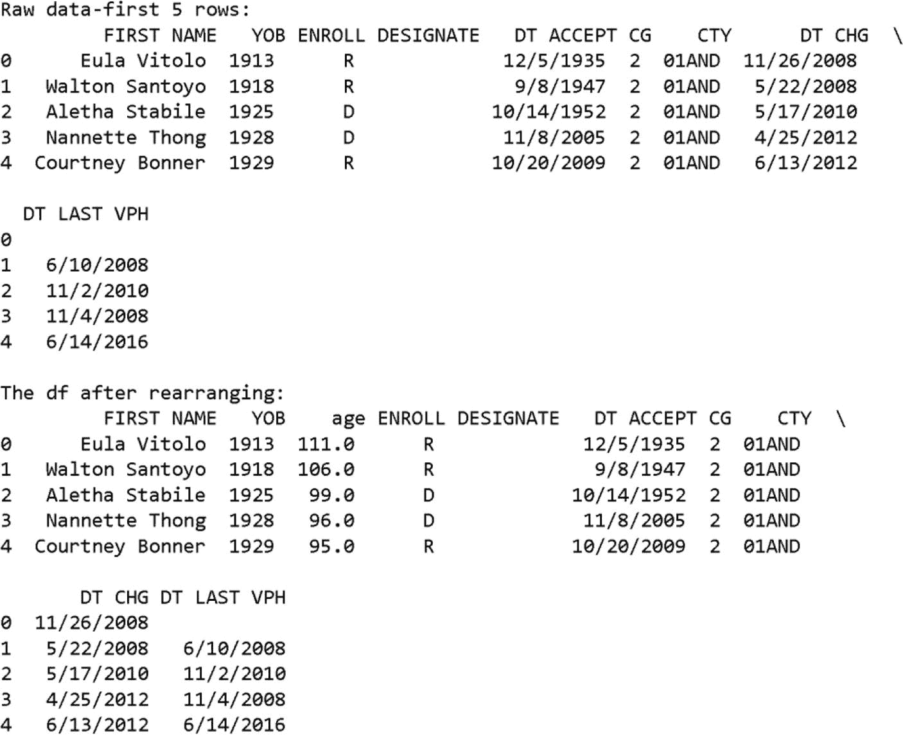
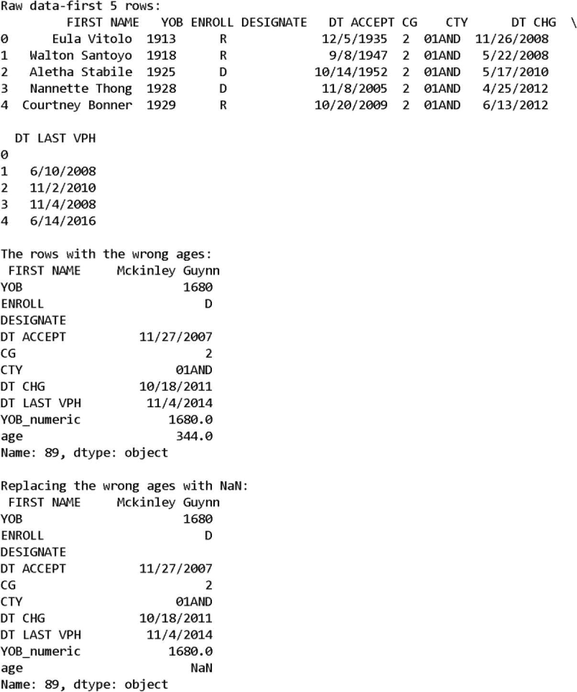
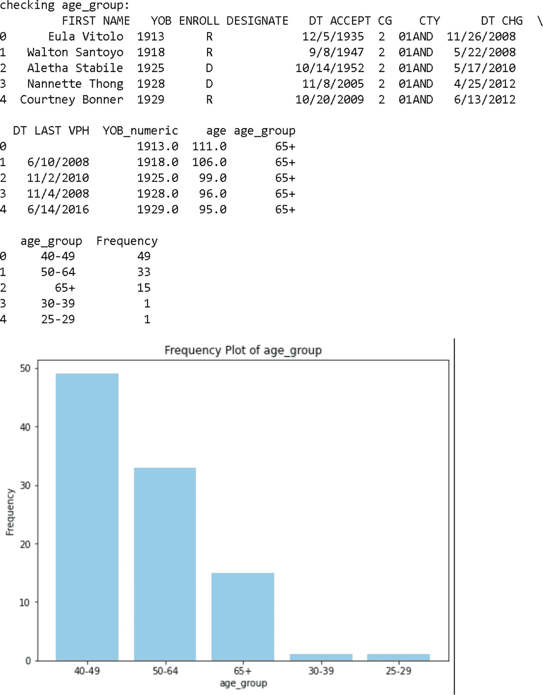
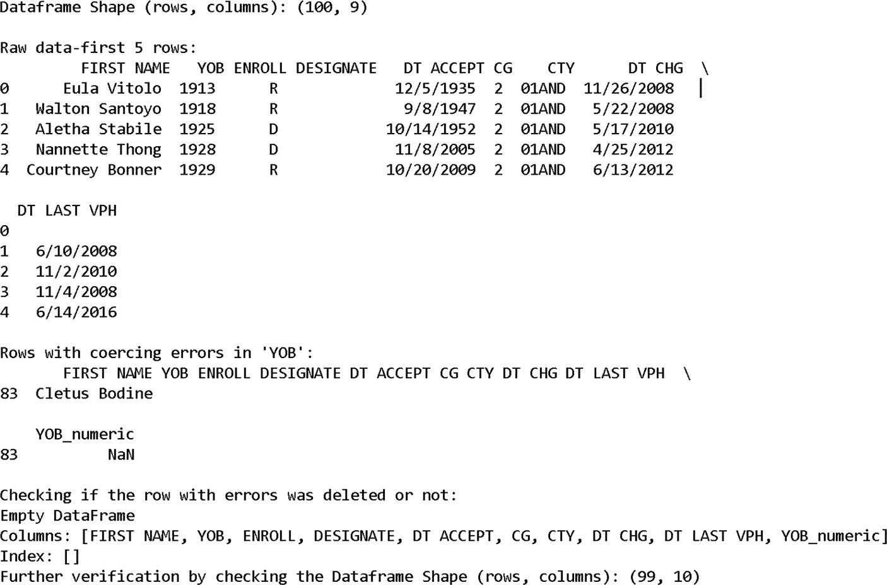
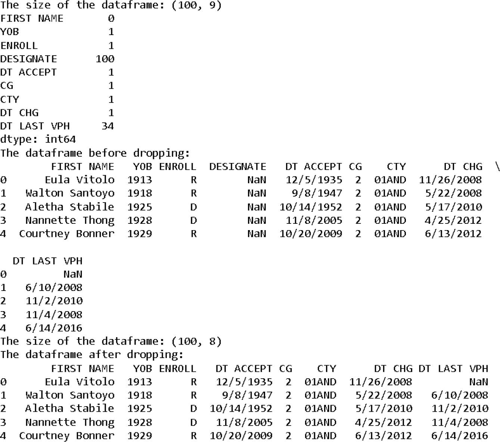
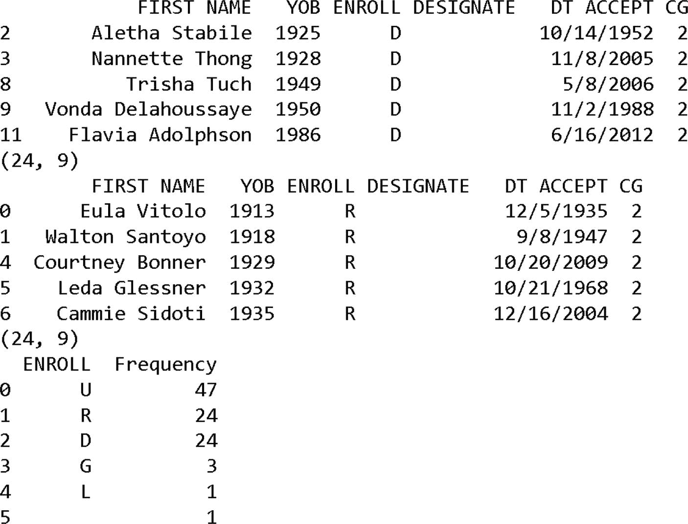
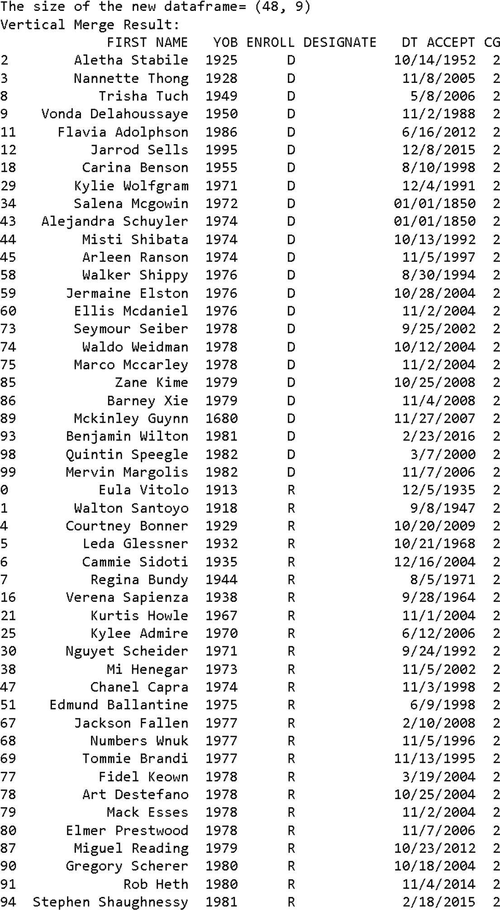
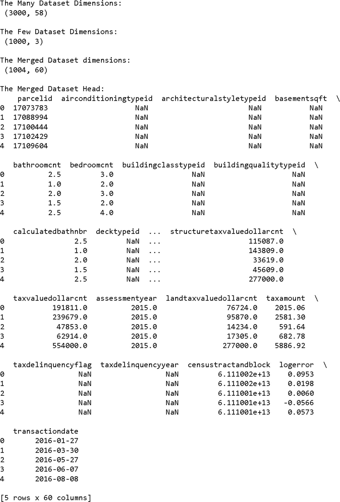

# 重新排列数据集变量

为了重新排列变量，使 `age` 变量直接位于 `YOB` 列旁边以便于检查，我们使用源 DataFrame 的名称，后跟两个方括号，然后按指定顺序列出要保留的列，各列之间用逗号分隔，每个变量名用引号括起来。

在代码清单 6-4 中，按照上一节的说明导入数据集并计算年龄列后，我们通过将 `age` 列在 `YOB` 之后列出，对 DataFrame 进行了原地重排。我们使用 `df.head()` 方法打印前五行以验证更改。

```
import pandas as pd
df = pd.read_csv('../Datasets/Chapter 6/Voters_A.csv')
print("\nRaw data-first 5 rows:\n",df.head())
df['YOB_numeric'] = pd.to_numeric(df['YOB'], errors='coerce')
# 使用 'YOB_numeric' 计算年龄
df['age'] = 2024 - df['YOB_numeric']
df=df[['FIRST NAME', 'YOB', 'age', 'ENROLL', 'DESIGNATE','DT ACCEPT', 'CG', 'CTY','DT CHG', 'DT LAST VPH']]
print("\nThe df after rearranging:\n",df.head())
代码清单 6-4
重新排列数据集变量
```

输出结果如图 6-4 所示。



图 6-4

重新排序变量（使年龄列位于 YOB 之后）后的选民数据集

## IF 语句

`age` 列中有一位选民的年龄值有误，显示为 344 岁。要纠正此问题，如果该数据集是真实数据，我们会有以下几种选择：

1.  通过联系缅因州州务卿办公室或选民本人来获取正确的年龄。
2.  删除该值，并用 `NaN` 替换，以表示数据缺失，如第 5 章所述。
3.  删除包含错误值的整行。
4.  保留原值，尽管它会是异常值，并可能影响年龄、党派归属和投票预测之间关系的分析。

在本例中，我们将把它设为缺失值 `NaN`。在本章后面，我们将学习如何删除整行。

在代码清单 6-5 中，我们像上一节一样，首先加载库和数据集，验证加载情况，并计算年龄列。然后，我们使用 `for` 循环遍历行，并使用 `df.index` 属性返回最大行数减 1，因为 Python 从零开始计数。

我们使用 `if df.loc[x, "age"] > 150` 来检查索引 `x` 处 `age` 列的值是否大于 `150`。我们打印出年龄值错误的行，然后用 `NaN` 替换它，并使用 `df.loc[x]` 通过索引位置 `x` 再次打印。

```
import pandas as pd
df = pd.read_csv('../Datasets/Chapter 6/Voters_A.csv')
print("\nRaw data-first 5 rows:\n",df.head())
df['YOB_numeric'] = pd.to_numeric(df['YOB'], errors='coerce')
df['age'] = 2024 - df['YOB_numeric']
for x in df.index:
if df.loc[x, "age"] > 150:
print("\nThe rows with the wrong ages:\n",df.loc[x])
df.loc[x, "age"] = "NaN"
print("\nReplacing the wrong ages with NaN:\n",df.loc[x])
代码清单 6-5
IF 语句
```

输出结果如图 6-5 所示。位置打印为第 89 行，因为 Python 从零开始计数。



图 6-5

IF 语句输出

## IF-ELIF 语句

现在，我们将分析以下年龄段的选民人数：18–24、25–29、30–39、40–49、50–64 和 65+。

```
import pandas as pd
import matplotlib.pyplot as plt
df = pd.read_csv('../Datasets/Chapter 6/Voters_A.csv')
print("\nRaw data-first 5 rows:\n",df.head())
df['YOB_numeric'] = pd.to_numeric(df['YOB'], errors='coerce')
df['age'] = 2024 - df['YOB_numeric']
for x in df.index:
#if (df.loc[x,'age']>=18 and df.loc[x,'age']=65) :
df.loc[x,'age_group']='65+';
print("\nchecking age_group:\n",df.head())
# 直接从 value_counts 创建频率表
frequency_table = df['age_group'].value_counts().to_frame('Frequency').reset_index()
# 重命名列以保持一致性
frequency_table.columns = ['age_group', 'Frequency']
# 按频率排序表格
frequency_table = frequency_table.sort_values(by='Frequency', ascending=False)
# 打印频率表
print("\n",frequency_table)
# 绘制频率图
plt.figure(figsize=(8, 6))
plt.bar(frequency_table['age_group'], frequency_table['Frequency'], color='skyblue')
plt.xlabel('age_group')
plt.ylabel('Frequency')
plt.title('Frequency Plot of age_group')
plt.show()
代码清单 6-6
IF-ELIF 语句
```

在代码清单 6-6 中，像往常一样，我们首先加载库和数据集，并通过打印前五行来验证数据集已正确加载。然后，按照本章前几节的说明，我们计算 `age` 列。

为了计算 `age_group` 变量，我们逐行遍历数据集，并使用年龄范围创建嵌套的 `if-elif` 条件，例如 `18<=df.loc[x,'age']<=24`。Python 允许使用范围，也允许像其他编程语言一样使用复合条件语句 `df.loc[x,'age']>=18 and df.loc[x,'age']<=24`。此外，您还可以像其他编程语言一样使用 `else if` 来代替 `elif` 语句。

之后，按照第 4 章的说明，我们计算 `age_group` 的频率表，并使用条形图绘制其分布。

除了使用嵌套的 `if-elif` 语句之外，我们还可以使用许多其他方法来计算 `age_group`。其中一种方法是使用 `pd.cut()` 方法，这会更符合 Python 风格。然而，本节旨在展示如何使用 IF-ELIF 语句。我们可以用以下三行代码替换整个 IF-ELIF 语句部分：

```
# 定义年龄分组
age_bins = [18, 25, 30, 40, 50, 65, float('inf')]
# 定义对应的标签
age_labels = ['18-24', '25-29', '30-39', '40-49', '50-64', '65+']
# 使用 pd.cut 分配年龄组
df['age_group'] = pd.cut(df['age'], bins=age_bins, labels=age_labels, right=False)
```

为了创建 `age_group` 的频率表并为其绘制条形图，我们使用 `to_frame()` 方法将 `value_counts()` 返回的 Series 直接转换为 DataFrame，然后一致地重命名列。接着，我们使用 `.columns` 属性重命名 `frequency_table` 的列名，如语句 `frequency_table.columns = ['age_group', 'Frequency']` 所示。

在这段代码的末尾，我们打印 `frequency_table` 并使用 `plt.bar(frequency_table['age_group'], frequency_table['Frequency'], color="skyblue")` 将其绘制为条形图。之后，我们设置 x 轴和 y 轴的标签以及标题。最后，我们使用这些设置显示图表。图 6-6 显示了代码清单 6-6 的输出。



图 6-6

计算选民的 age_group、其频率表及直方图


## 删除行

正如“IF 语句”部分所述，处理错误数据有多种方法。在上一节中，我们了解了如何用缺失值替换它们。在本节中，我们将学习如何删除整行。

```
import pandas as pd
df = pd.read_csv('../Datasets/Chapter 6/Voters_A.csv')
print("Dataframe Shape (rows, columns):",df.shape)
print("\nRaw data-first 5 rows:\n",df.head())
df['YOB_numeric'] = pd.to_numeric(df['YOB'], errors='coerce')
rows_with_errors = df[df['YOB_numeric'].isna()]
print("\nRows with coercing errors in 'YOB':")
print(rows_with_errors)
df.drop([83],axis=0,inplace=True)
rows_with_errors = df[df['YOB_numeric'].isna()]
print("\nChecking if the row with errors was deleted or not:")
print(rows_with_errors)
print("Further verification by checking the Dataframe Shape (rows, columns):",df.shape)
Listing 6-7
Drop a row
```

清单 6-7 一如既往地先加载库和数据集。然后，我们打印数据集维度，如图 6-7 所示，为 100 行 9 列。接着，我们使用 `df.head()` 方法打印前五行。

之后，我们使用 `pd.to_numeric()` 方法将 `YOB` 转换为新的数值列。我们使用 `.isna()` 方法筛选出包含错误的行。如图 6-7 的输出所示，第 83 行几乎为空。它只有选民姓名，其他列均为空。

因此，我们使用 `df.drop()` 方法并指定行号来删除整行。然后，我们再次使用 `.isna()` 方法进行验证，现在列表为空，如图 6-7 所示。最后，我们重新打印 DataFrame 的维度，发现行数减少了 1 行，变为 99 行。



图 6-7

删除行

## 删除列

`DROP` 方法用于从数据集中排除某些变量。在 `Voters_A.csv` 数据集中，`Designate` 列为空。在数据清洗过程中，我们应删除此列；换句话说，就是将其丢弃，如清单 6-8 所示。

```
import pandas as pd
import numpy as np
df = pd.read_csv('../Datasets/Chapter 6/Voters_A.csv')
print("The size of the dataframe:",df.shape)
df.replace(to_replace=[r'^\s*$', '', None], value=np.nan, regex=True, inplace=True)
print(df.isnull().sum())
print("The dataframe before dropping:")
print(df.head())
df.drop("DESIGNATE",axis = 1, inplace = True)
print("The size of the dataframe:",df.shape)
print("The dataframe after dropping:")
print(df.head())
Listing 6-8
Drop method
```

使用 `pd.csv()` 方法正确加载文件后，我们验证了 DataFrame 的大小，如图 6-8 所示，为 `(100,9)`。

有时，空单元格可能不会被读取为空字符串（`' '`），而是被读取为 `None`、空白字符或其他表示形式。为了处理各种类型的空值并将其替换为 `NaN`，我们可以使用 `df.replace(to_replace=[r'^\s*$', '', None], value=np.nan, regex=True, inplace=True)`。此方法将所有空值表示形式替换为 `NaN`，其中包括一个正则表达式模式，用于匹配仅由空白字符组成的任何字符串：`r'^\s*$'`。同时，它还会替换空字符串和 `None`。

`df.isnull().sum()` 用于统计每列中 `NaN` 值的数量。输出结果如图 6-8 所示，显示 `Designate` 列中的所有行均为 `NaN`。我们使用 `.head()` 方法对此进行了验证。

`df.drop("DESIGNATE", axis=1, inplace=True)` 从 DataFrame 中删除名为 `DESIGNATE` 的列。选项 `axis=1` 表示要删除的是列（而非行）。在 Pandas 中，`axis=0` 指行，`axis=1` 指列。选项 `inplace=True` 会直接修改原始 DataFrame `df`，而不会创建包含新值的新 DataFrame。

我们打印删除列前后的 DataFrame 头部和大小，以验证列数已从 9 列减少到 8 列，如图 6-8 所示。



图 6-8

删除一列后剩余八列

## 子集

在 Python 中，有多种方法可以对 Pandas DataFrame 进行子集划分。其中一种是布尔索引。在本例中，我们继续使用前几节的数据集 `Voters_A.CSV`。我们希望创建两个新数据集作为原始数据集的子集，第一个数据集仅包含登记为民主党人的选民，另一个数据集包含登记为共和党人的选民。

```
import pandas as pd
import numpy as np
df = pd.read_csv('../Datasets/Chapter 6/Voters_A.csv')
democrats=df[df['ENROLL']=="D"]
print(democrats.iloc[:,:6].head())
print(democrats.shape)
republicans=df[df['ENROLL']=="R"]
print(republicans.iloc[:,:6].head())
print(republicans.shape)
frequency_table = df['ENROLL'].value_counts().reset_index().rename(columns={'index': 'ENROLL', 'ENROLL': 'Frequency'})
frequency_table = frequency_table.sort_values(by='Frequency', ascending=False)
print(frequency_table)
Listing 6-9
Subset the dataset
```

在清单 6-9 中，导入库并加载数据集后，我们使用 `df[df['ENROLL'] == "D"]` 来过滤 DataFrame，仅保留 `ENROLL` 列等于 `"D"` 的行。此子集存储在 `democrats` DataFrame 中。

为了打印 `democrats` DataFrame 的前六列，我们使用 `democrats.iloc[:, :6].head()`。`iloc` 属性用于索引行和列。我们在此处使用它来选择前六列。要获取此数据集中民主党选民的数量，我们使用 `democrats.shape`。

我们对共和党重复相同的步骤。最后，我们打印频率表，以计算 `ENROLL` 列的所有唯一级别以及每个级别在此数据集中的出现频率。我们使用 `df['ENROLL'].value_counts()` 来计算 `ENROLL` 列中每个唯一值的频率。`reset_index()` 方法将生成的 Series 转换为 DataFrame 并重置索引。`rename(columns={'index': 'ENROLL', 'ENROLL': 'Frequency'})` 方法用于将列重命名为 `ENROLL` 和 `Frequency`，以提高清晰度。最后，`sort_values(by='Frequency', ascending=False)` 方法按 `Frequency` 列对 DataFrame 进行降序排序。

图 6-9 显示了两个较小数据集的前五行，频率表则显示了每种登记类型在数据集中出现的次数。



图 6-9

子集输出及频率表


## 追加

追加数据集等同于垂直合并，即增加行。在 Python 中，你可以使用 `pandas` 库对 DataFrame 进行垂直和水平合并。在本节中，我们将追加两个数据集：`democrats` 和 `republicans`，这两个数据集是在上一节中创建的。下一节将给出一个水平合并的示例。

在通过清单 6-10 追加数据集之前，必须先运行清单 6-9 来加载民主党和共和党的数据集。

```
import pandas as pd
### 垂直连接 DataFrame
vertical_merged_df = pd.concat([democrats,republicans ], axis=0)
print("新数据框的大小=",vertical_merged_df.shape)
print("垂直合并结果:")
print(vertical_merged_df.iloc[:,:6])
清单 6-10
追加两个数据集
```

在清单 6-10 中，我们使用 `pd.concat()` 方法垂直合并 DataFrame；换句话说，就是将它们堆叠在一起。`axis=0` 选项指定了连接应沿着行方向进行。这意味着 `republicans` DataFrame 的行会被添加到 `democrats` DataFrame 的行中，从而生成一个包含两个 DataFrame 所有行的新 DataFrame。这个包含两个数据集所有行的最新数据集被称为 `vertical_merged_df`。

为了验证两个数据集的行是否都在新数据集中，我们使用 `vertical_merged_df.shape` 属性检查其维度。它会返回一个表示 DataFrame 维度的元组，显示数据集的大小、行数和列数。图 6-10 显示大小为 `(48,9)`，表明追加操作正确，因为每个数据集都有 24 行，如上一节的频率表所示。

为了使输出看起来更美观，我们只显示前六列，以便标题保持在一行，避免某些列延续到下一行造成混淆。因此，我们使用 `vertical_merged_df.iloc[:, :6]` 通过 `iloc` 方法选择连接后 DataFrame 的前六列。它使用基于整数的索引，其中 `:` 表示所有行，`:6` 表示前六列。这样，我们打印出 DataFrame 的选定子集，仅显示新 DataFrame 中所有行的前六列。



图 6-10

将两个数据集追加为一个

你也可以通过设置 `axis=1`，使用 `pd.concat()` 水平合并 DataFrame（并排放置）。

## 合并

在上一节中，我们学习了如何追加两个数据集以增加行数。在本节中，我们将学习如何基于一个公共变量合并两个数据集，其中一个数据集包含许多变量，另一个只包含少数几个变量。

在本例中，我们将使用 Zillow 发布的一个 Kaggle 竞赛数据集来进行房价预测。该竞赛包含两个数据集。“多变量”数据集从一个名为 `properties_2016.csv` 的 CSV 文件中加载，包含 58 列和约三百万行。“少变量”数据集从另一个名为 `train_2016_v2.csv` 的 CSV 文件中加载，包含三列和超过 9 万行。两个文件之间的公共变量是 `parcelid`。你可以通过以下链接下载原始数据集：[`https://www.kaggle.com/competitions/zillow-prize-1/data`](https://www.kaggle.com/competitions/zillow-prize-1/data)。

由于这些文件体积巨大，我只从第一个文件中选取了 3000 行，从第二个文件中选取了 1000 行，并将它们命名为 `many.csv` 和 `few.csv`。你可以在数据集文件夹中找到它们。

```
import pandas as pd
file1 = pd.read_csv('../Datasets/Chapter 6/many.csv', low_memory=False)
file2 = pd.read_csv('../Datasets/Chapter 6/few.csv', low_memory=False)
print("\n 多变量数据集维度:\n",file1.shape)
print("\n 少变量数据集维度:\n",file2.shape)
zillow_merged = pd.merge(file1, file2, on='parcelid')
print("\n 合并后数据集维度:\n",zillow_merged.shape)
print("\n 合并后数据集头部:\n",zillow_merged.head())
清单 6-11
合并少变量到多变量数据集
```

在清单 6-11 中，我们在加载数据集时使用了 `low_memory=False` 选项以避免分块读取。将此参数设置为 `False` 会使 Pandas 在解析之前将整个文件读入内存。当列包含混合类型时，这可以通过允许 Pandas 更准确地推断正确的数据类型来发挥作用。你也可以在加载数据后，通过循环并修复导致错误的列的混合数据类型来手动检查和转换列。但这超出了本练习的范围，因此我们直接使用该参数即可。

为了基于一个关键变量水平连接 DataFrame，我们使用 `pd.merge()` 方法，并在 `on` 参数中指定 `parcelid` 作为关键变量。默认情况下，merge 方法使用内连接。因此，它只保留 `parcelid` 同时存在于 `file1` 和 `file2` 中的行。这就是为什么生成的 DataFrame 的行数接近 `file2` 的 1004 行。多出的四行是由于 `parcelid` 存在重复值。

你可以使用以下语句删除重复值：

```
file1 = file1.drop_duplicates(subset='parcelid')
file2 = file2.drop_duplicates(subset='parcelid')
```

如果你想包含 `file1` 中的所有行，无论 `file2` 中是否有匹配的 `parcelid`，你可以使用多种类型的连接，例如左连接。语句将是 `zillow_merged = pd.merge(file1, file2, on="parcelid", how="left")`。不匹配的列将显示为 `NaN`。在这种情况下，合并后的 DataFrame 的行数将接近“多变量”文件的行数，即 3000 行。

Python 中的合并操作很简单，不需要像其他语言那样按关键标识符进行排序。

输出结果如图 6-11 所示。



图 6-11

合并少变量到多变量数据集

## 总结

本章解释了为分析而清理和准备数据的步骤。它讨论了如何重命名变量以及调整报告的格式。还解释了如何创建新变量以及如何在数据集中重新排列它们。它解释了 IF 和 IF-ELIF 语句。此外，还描述了如何删除行和列、子集化数据集，以及追加和合并多个数据集。至此，我们已经完成了最常见的数据分析任务，下一章将介绍如何使用回归进行预测。

