# 7. 回归

线性回归任务拟合一个线性模型，用于根据一个或多个连续或分类预测变量来预测单个连续的因变量。该任务会生成用于解释结果的统计数据和图表。


## 简单线性回归

在简单线性回归中，模型中只有一个自变量。其直线方程如下：

`Y = a + b X`

其中，`Y` 是我们想要预测其值的因变量，`a` 是截距，`b` 是系数，`X` 是自变量。误差项被忽略。

原假设是变量之间不存在线性关系。换句话说，`b` 的值为零。备择假设是存在线性关系，且 `b` 不等于零。

`H[0]: b = 0`

`H[a]: b ^= 0`

让我们看看每桶石油价格与黄金价格之间是否存在线性关系。数据集位于 Datasets 文件夹中，文件名为：`sp_oil_gold.xlsx`。

在 Python 中，有多个库可用于执行线性回归。两个常用的库是 `statsmodels` 和 `scikit-learn`。选择使用 `statsmodels` 库中的 `Ordinary Least Squares (OLS)` 还是 `scikit-learn (sklearn)` 中的 `linear regression`，取决于你的具体需求和分析背景。这两个库都提供线性回归功能，但它们的用途和特性有所不同。

如果你主要关注统计分析、假设检验和详细的诊断信息，并且不需要将模型用于更广泛的机器学习任务，那么 `statsmodels` 可能更适合你。

如果你更侧重于预测建模、与其他机器学习工具的集成以及简洁性，那么 `scikit-learn` 是一个可靠的选择。

在某些情况下，分析人员会同时使用这两个库：先用 `statsmodels` 进行初步探索和假设检验，再用 `scikit-learn` 构建预测模型，以便轻松集成到更广泛的机器学习工作流中。在我们的代码中，我们将同时包含 `scikit-learn` 和 `statsmodels`，并使用 `seaborn` 绘制诊断图，以充分利用每个库的优势。

在下面的示例中，我们将使用 `scikit-learn` 库进行模型拟合和拟合诊断图。

执行简单线性回归及其拟合诊断的步骤如下：

1. 导入所需的库，加载数据集并进行探索。
2. 创建模型。
3. 测试模型并计算预测值和准确率分数。
4. 绘制总统选举年份每桶石油价格的五个拟合诊断图：
   - 预测值与实际值对比图
   - 残差与拟合值对比图
   - R-Student 与预测值对比图
   - R-Student 与杠杆值对比图
   - Cook's D 与观测值对比图

完整代码位于示例代码文件夹中第 7 章的 Listing 7-1.ipynb 文件中。不过，在 Jupyter Notebook 中，代码将按照上述步骤划分到不同的单元格中。现在，我们将解释每个单元格，以编写上述每个步骤的代码，并解释拟合诊断图。

### 1. 导入库，加载数据集并进行探索

在这一步中，我们导入所需的库，加载数据集并进行探索。为了更深入地探索数据，我们绘制了变量之间的多对双变量分布图。

```
import numpy as np
import pandas as pd
from sklearn.linear_model import LinearRegression
import matplotlib.pyplot as plt
import seaborn as sns
# 导入 r2_score 模块
from sklearn.metrics import r2_score
from sklearn.metrics import mean_squared_error
from sklearn.preprocessing import StandardScaler
import statsmodels.api as sm
df = pd.read_excel('../Datasets/sp_oil_gold.xlsx')
print(df.head())
df=df[['oil price','gold_prices']]
print(df.head())
# 将数值数据绘制成配对图
plt.figure(0)
sns.pairplot(df);
Listing 7-1-1
导入所需的库，加载数据集并进行探索
```

在 Listing 7-1-1 中，我们首先导入了九个库。`Pandas`、`Numpy` 和 `sklearn.preprocessing` 用于处理数字和矩阵。`Matplotlib` 和 `Seaborn` 用于可视化。`LinearRegression` 是一个机器学习模型。`sklearn.metrics` 库用于模型评估。`statsmodels.api` 用于执行 OLS 并访问影响统计量。

在 Python 中，你可以通过多种方式完成同一任务。这里，我们使用 `pd.read_excel()` 函数将数据加载为 DataFrame，因为数据集是一个 Excel 文件。不过，你也可以将数据加载为两个 `Numpy` 数组，如下所示，因为数据集很小。

```
oil_prices = np.array([1.63, 1.45, 1.32, 1.82, 11.6, 35.52, 28.2, 14.24, 18.44, 20.29, 27.6, 36.05, 94.1, 109.45, 40.76])
gold_prices = np.array([35.27, 35.1, 39.31, 58.42, 124.74, 615, 361, 437, 343.82, 387.81, 279.11, 409.72, 871.96, 1668.98, 1250.74])
```

为了验证数据已正确加载，我们使用 `df.head()` 函数打印数据集的标题和前五行。我们只保留 `oil price` 和 `gold_prices` 变量，因为这是一个简单线性回归，只需要一个自变量，我们将删除其余列。我们通过以下语句实现：

```
df=df[['oil price','gold_prices']]
```

为了探索数据，我们使用 `sns.pairplot(df)` 函数打印变量之间的多对双变量分布图。为了避免图形相互重叠，我们使用 `plt.figure()` 函数对它们进行编号。

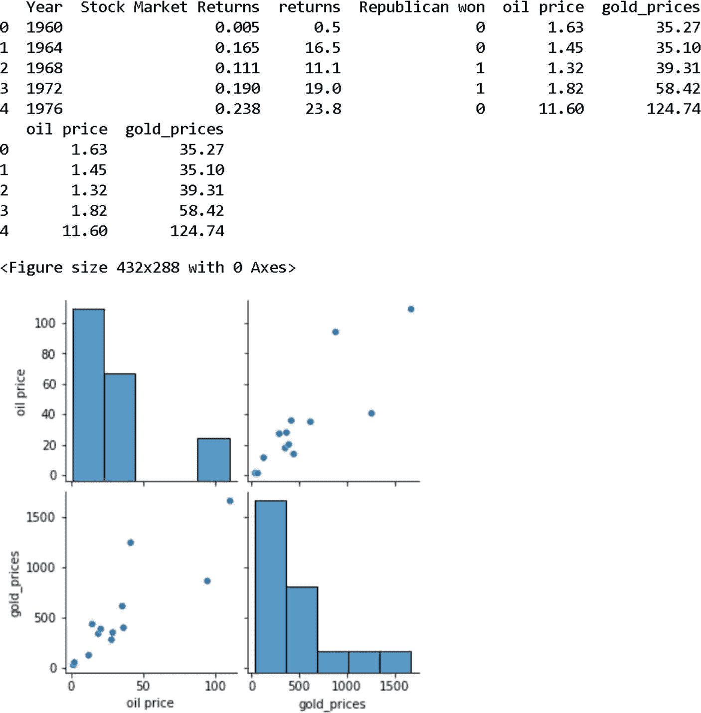

图 7-1

Listing 7-1-1 的输出

图 7-1 显示了 Listing 7-1-1 的输出。该图首先显示了数据集中所有列的前五行。然后，它显示了 `oil price` 的直方图，以及以 `oil price` 为 y 轴、`gold_price` 为 x 轴的散点图。在图形分布的第二行，散点图再次出现，但这次是以 `gold_price` 为 y 轴、`oil price` 为 x 轴，而第二行第二列是 `gold_price` 的直方图。在两个散点图中，都有三个明显的异常值，我们将讨论导致这一现象的原因。

### 2. 创建模型

在这一步中，我们指定自变量和目标变量。由于数据集很小，我们将跳过训练和测试集的划分步骤。我们将使用整个数据集进行训练和测试。然后，我们创建模型并将数据拟合到模型中。根据参数估计值，我们将写出直线方程。将拟合的直线直观地叠加在变量的散点图上。

```
x=df['gold_prices'].values.reshape(-1, 1)
y=df['oil price'].values
# 创建 LinearRegression 类的对象
LR = LinearRegression()
# 拟合数据
LR.fit(x,y)
# 参数估计
print('intercept:', LR.intercept_)
print('slope:', LR.coef_)
print('equation of oil prices in the presidential election years=',LR.intercept_,"+",LR.coef_[0],"*gold_prices")
# 绘制拟合直线
plt.figure(2)
plt.scatter(x, y)
plt.xlabel('Gold Prices')
plt.ylabel('Oil Price Per Barrel')
plt.plot(x,LR.intercept_+LR.coef_*x)
Listing 7-1-2
指定自变量和目标变量
```

在 Listing 7-1-2 中，我们首先通过使用 `.values` 属性将自变量 `x` 从 DataFrame 转换为 `Numpy` 数组。正如我们之前提到的，在 Python 中可以通过多种方式完成同一任务。我们可以改用 `DataFrame.to_numpy()` 方法。该属性的输出是一个一维数组。


然而，模型拟合函数需要一个二维数组。因此，我们使用 `reshape(-1,1)` 方法来实现。`reshape` 函数的语法是 `reshape(行数, 列数)`。为了包含所有行而不指定具体数值，我们使用 `-1`。由于这是一个简单的线性回归，意味着我们只有一个自变量，因此我们将列数设为 `1`。

对于目标变量 `y`，我们再次使用 `.values` 属性将其类型从 `DataFrame` 转换为 `Numpy`。

现在，我们的变量已经准备好可以拟合到模型中了。我们首先使用 `LR = LinearRegression()` 创建一个 `LinearRegression` 类的对象；然后，使用 `LR.fit(x, y)` 拟合变量。

通过我们的模型属性，我们可以获取参数估计值并写出方程。我们利用这些参数在两个变量的散点图上绘制回归线。

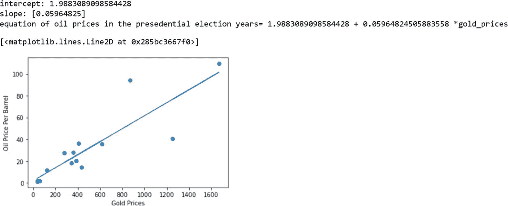

图 7-2

清单 7-1-2 的输出

图 7-2 显示石油和黄金价格之间存在线性关系。`直线的斜率 = 0.05965`。根据参数估计，直线方程为：

```
oil_price = 1.98831 + 0.05965 gold_prices
```

该图由数据的散点图以及叠加在散点图上的回归线组成。

#### 3. 测试模型并计算预测值与准确率分数

最后，我们使用 R 平方、均方误差和均方根误差来评估模型。

```
#清单 7-1-3
#测试模型：
y_prediction =  LR.predict(x)
print('y_prediction=',y_prediction)
# 预测准确率分数
score=r2_score(y,y_prediction)
print('r2 socre = ',score)
print('mean_sqrd_error =',mean_squared_error(y,y_prediction))
print('root_mean_squared error =',np.sqrt(mean_squared_error(y,y_prediction)))
清单 7-1-3
测试模型，并计算预测值与准确率分数。
```

在清单 7-1-3 中，我们计算了 `y_prediction` 值，以评估我们模型的准确率，这是通过 `r2_score` 实现的。它是 `sklearn.metrics` 模块中的一个函数，`r2_score` 的值在 0 到 100% 之间变化。

同时，我们还计算了均方误差（MSE），这是一种衡量误差平方平均值的估计量。

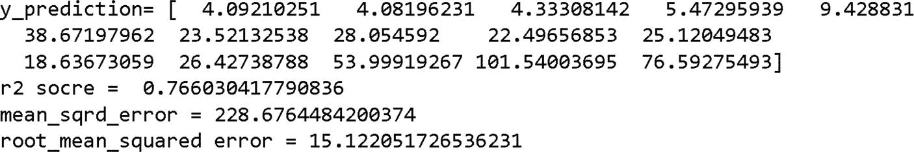

图 7-3

清单 7-1-3 的输出

图 7-3 显示了清单 7-1-3 的输出。

#### 4. 拟合诊断

在清单 7-1-4 中，我们创建诊断图来评估模型的性能。在这段代码中：

*   R-Student 与预测值图：此图有助于识别可能驱动残差的有影响力的观测值。
*   R-Student 与杠杆值图：此图有助于识别具有高杠杆值的观测值，这些观测值可能对模型产生不成比例的影响。
*   Cook's D 与观测值图：此图有助于识别可能对模型参数产生较大影响的有影响力的观测值。

代码的这一部分使用 `statsmodels` 来拟合一个 OLS 模型，然后提取诸如 R-Student、杠杆值和 Cook's D 等影响统计量。代码的最后一部分使用 `seaborn` 创建了 R-Student 与预测值、R-Student 与杠杆值以及 Cook's D 与观测值的诊断图。

```
#清单 7-1-4
plt.figure(3)
# 绘制诊断图
plt.figure(figsize=(12, 5))
residuals = y - y_prediction
# 预测值与实际值的散点图
plt.subplot(1, 2, 1)
sns.scatterplot(x=y, y=y_prediction)
plt.title('预测值与实际值')
# 残差与拟合值图
plt.subplot(1, 2, 2)
sns.scatterplot(x=LR.predict(x), y=residuals)
plt.axhline(y=0, color='r', linestyle='--')
plt.title('残差与拟合值')
plt.tight_layout()
plt.show()                # 完成并渲染图形
# 使用 statsmodels 执行 OLS 并访问影响统计量
X_ols = sm.add_constant(x)
ols_model = sm.OLS(y, X_ols).fit()
# 访问影响统计量
influence = ols_model.get_influence()
r_student = influence.resid_studentized_internal
leverage = influence.hat_matrix_diag
cook_d = influence.cooks_distance
# 移除缺失值
mask = ~np.isnan(r_student) & ~np.isnan(leverage)
r_student = r_student[mask]
leverage = leverage[mask]
# 绘制 R-Student 与预测值图
plt.figure(figsize=(12, 4))
plt.subplot(1, 3, 1)
sns.scatterplot(x=LR.predict(x), y=r_student)
plt.axhline(y=0, color='r', linestyle='--')
plt.title('R-Student 与预测值')
# 绘制 R-Student 与杠杆值图
plt.subplot(1, 3, 2)
sns.scatterplot(x=leverage, y=r_student)
plt.axhline(y=0, color='r', linestyle='--')
plt.title('R-Student 与杠杆值')
# 绘制 Cook's D 与观测值图
plt.subplot(1, 3, 3)
#print(len(df.index),len(cook_d))
sns.scatterplot(x=df.index, y=cook_d[0])
plt.xlim(0, 16)  # 设置 y 轴范围，使其包含零上下的值
# 设置 x 轴刻度，步长为 1
plt.xticks(np.arange(min(df.index), 15, 1))
plt.axhline(y=0, color='r', linestyle='--')
plt.title("Cook's D 与观测值")
plt.tight_layout()
plt.show()
清单 7-1-4
拟合诊断图
```

这些图基于统计诊断，可以提供关于单个观测值对模型影响的见解。请根据您的具体分析和需求调整代码。让我们查看输出并对其进行解释。

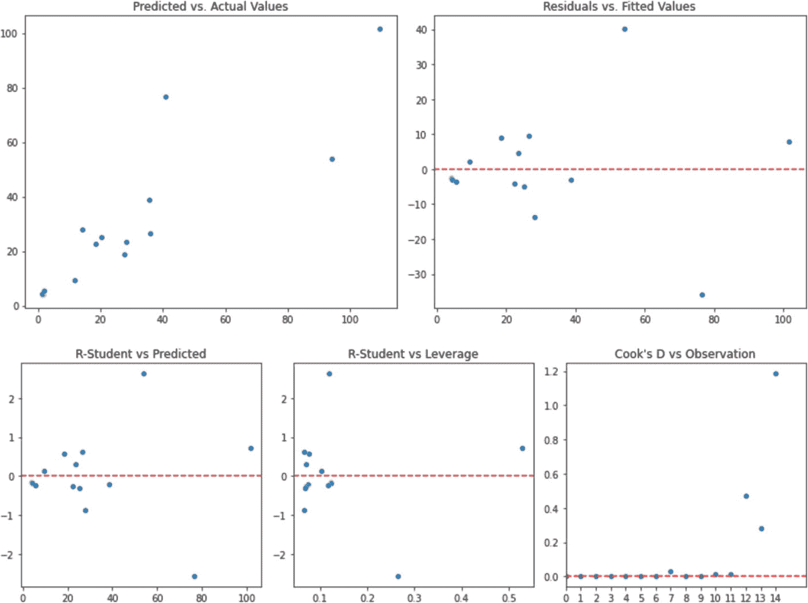

图 7-4

拟合诊断图的输出

图 7-4 显示了 `oil_price` 的拟合诊断。因变量（任务）与预测值图可视化了预测中的变异性。在此图中，点分布随机，没有指示误差方差恒定的模式。离群值在此图中清晰可见。

残差与拟合值图显示了点在 0 线上方和下方随机分布的模式，这表明模型是合适的。同样，三个离群值在此处也很明显。

R-Student 与预测值图显示有几个点超出了 ±2 的界限。第三个点位于它们之间，但远离其余的点。

R-Student 与杠杆值图显示了那些对回归系数计算具有杠杆作用的离群值。

Cook's D 图旨在识别离群值。此处，三个点的值非常明显。它们位于第 12、13 和 14 行。我们将在下一节探讨这些离群值及其背后的原因。

这些诊断图有助于评估线性回归模型的假设和性能。它们包括检查线性、同方差性（残差方差恒定）以及有影响力的观测值。这些图可以提供对模型行为的见解，并识别可能需要进一步调查或模型改进的潜在问题。


## 多元线性回归

在多元线性回归中，模型包含多个自变量。其直线方程如下：

`Y = a + b[1] X[1] + b[2] X[2] + … + b[i] X[i]`

其中，`Y` 是我们想要预测其值的因变量，`a` 是截距，`b[i]` 是系数，`X[i]` 是自变量。此处忽略了误差项。

原假设是因变量与任何自变量之间不存在线性关系。换句话说，`b[i]` 的值均为零。备择假设是存在线性关系，且至少有一个 `b[i]` 不等于零。

`H[0]: b[i] = 0`

`H[a]: b[i] ^= 0`

让我们来看一下，在总统选举年份，股票市场表现指数（标普指数）与每桶石油价格和黄金价格之间是否存在线性关系。数据集位于数据集文件夹中，文件名为：`sp_oil_gold.xlsx`。相关代码见示例代码文件夹中第 7 章的 7-2 号清单（`.ipynb` 文件）。

清单 7-2 展示了三个垂直条形图，分别显示了历年（从 1960 年到 2016 年）的石油价格、黄金价格和股票价格，每个变量对应一个独立的图表。这些年份均为总统选举年份。

```
import numpy as np
import pandas as pd
from sklearn.linear_model import LinearRegression
from matplotlib import pyplot as plt
df = pd.read_excel('../Datasets/sp_oil_gold.xlsx')
oil_price = df['oil price']
gold_prices = df['gold_prices']
Stock_Market_Returns=df['Stock Market Returns']
years=df['Year']
# Figure Size
plt.figure(0)
# set width of bar
barWidth = 0.25
fig = plt.subplots(figsize =(20, 8))
plt.xticks(years)
plt.yticks(Stock_Market_Returns)
plt.axhline(y=0, color='b', linestyle='-')
plt.title('Stock_Market_Returns')
# Bar Plot
plt.bar(years,Stock_Market_Returns)
# Show Plot
plt.show()
plt.figure(1)
# set width of bar
barWidth = 0.25
fig = plt.subplots(figsize =(20, 8))
plt.xticks(years)
plt.yticks(oil_price)
plt.title('oil_price')
plt.axhline(y=0, color='b', linestyle='-')
# Bar Plot
plt.bar(years,oil_price)
# Show Plot
plt.show()
plt.figure(2)
# set width of bar
barWidth = 0.25
fig = plt.subplots(figsize =(20, 8))
plt.xticks(years)
plt.yticks(gold_prices)
plt.title('gold_prices')
plt.axhline(y=0, color='b', linestyle='-')
# Bar Plot
plt.bar(years,gold_prices)
# Show Plot
plt.show()
x=df[['oil price','gold_prices']].values
y=df['Stock Market Returns'].values
# creating an object of LinearRegression class
LR = LinearRegression()
# fitting the training data
LR.fit(x,y)
print('intercept:', LR.intercept_)
print('slope:', LR.coef_)
print('equation of Stock market returns=',LR.intercept_,"+",LR.coef_[0],'* oil price +',LR.coef_[1],"*gold_prices")
清单 7-2
探索股票、石油和黄金价格
```

输出结果如图 7-5、7-6、7-7 和 7-8 所示。2008 年的金融危机在所有图表中都清晰可见。这场危机是美国自 1929 年大萧条以来最严重的经济灾难。石油和黄金价格在 2012 年飙升。

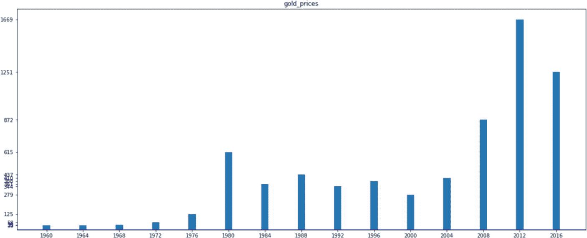

图 7-7
探索黄金价格

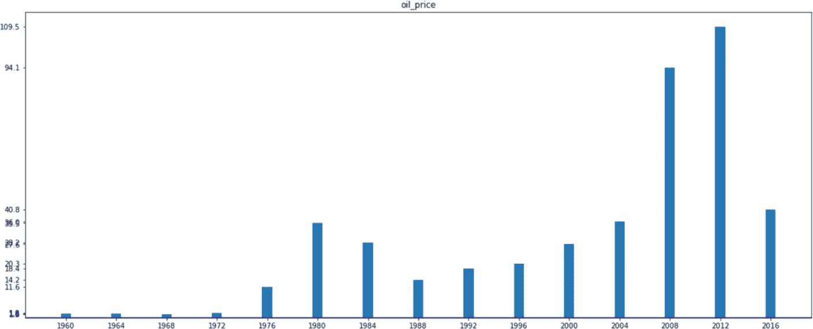

图 7-6
探索石油价格

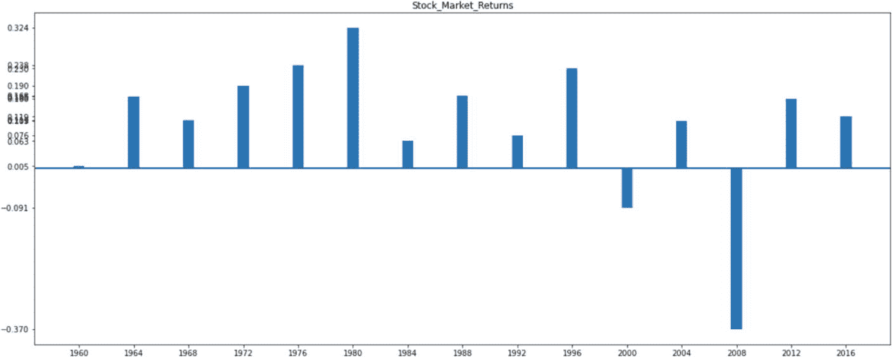

图 7-5
探索标普指数

尽管这三个值表现为异常值，但我们不能将其排除，因为它们对公众的投票倾向有直接影响。接下来，如同我们在上一节中所做的那样，我们创建模型并将数据拟合到模型中。最后，我们计算了参数估计值、斜率和截距。

根据参数估计，直线方程为：

`stock_market_returns = 0.13010 - 0.00671 oil_price + 0.00036367 gold_prices`

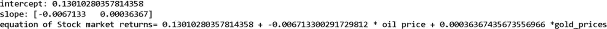

图 7-8
输出结果

图 7-8 展示了参数估计值和方程的输出结果。

您可以重复上一节的相同步骤来绘制拟合诊断图。不过，我们认为这足以演示多元线性回归的概念。


## 逻辑回归

逻辑回归与线性回归类似，区别在于因变量是二值变量，而非连续变量。该模型方程用于检验因变量中某个离散二值出现的概率。

二元逻辑回归模型方程如下：

*   `p = e^(b0 + b1*X1 + b2*X2 + ...) / (1 + e^(b0 + b1*X1 + b2*X2 + ...))`

同样，零假设认为变量之间不存在关系，因此所有系数均为零。备择假设则认为因变量与自变量之间存在关系。

在本例中，我们使用泰坦尼克号数据集，以乘客的生存情况为因变量，年龄和乘客等级为自变量，探究它们之间是否存在关系。该数据集位于“Dataset”文件夹中，文件名为 `titanic.csv`，你也可以通过以下网址从 OpenDataSoft.com 下载 CSV 文件：[`https://www.kaggle.com/datasets/vinicius150987/titanic3/data`](https://www.kaggle.com/datasets/vinicius150987/titanic3/data)。

代码位于示例代码文件夹中 Chapter 7.ipynb 文件的清单 7-3。

```
#清单 7-3-1
import pandas as pd
from sklearn.linear_model import LogisticRegression
df = pd.read_csv('../Datasets/titanic.csv')
print(df.head())
df['male'] = df['Gender'] == 'male'
x = df[['Pclass', 'male', 'Age', 'Siblings/Spouses', 'Parents/Children', 'Fare']].values
y = df['Survived'].values
print('x[0:5]=',x[0:5])
print('y[0:5]=',y[0:5])
清单 7-3-1
逻辑回归
```

在清单 7-3-1 中，我们首先导入所需的库。然后，加载数据；由于数据集是 CSV 格式，我们使用 `pd.read_csv()` 函数。与前面几节一样，我们通过打印前五行来检查数据集是否已正确加载到 `DataFrame`（即 `df`）中。输出结果如图 7-9 所示。

在继续解释代码之前，我们先看一下这段代码的输出。

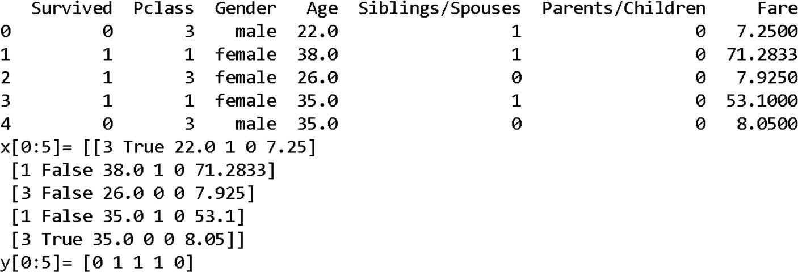

图 7-9

清单 7-3-1 的输出

该数据集的所有列都是数值型的，除了 `Gender` 列是 `string`（字符串）类型。我们不能在回归中使用字符串变量。有多种方法可以将字符串变量编码为数值型，例如，序数编码和独热编码。但是，在我们的例子中，我们不需要这些编码，因为性别只有两个值：`male` 和 `female`。因此，更简单的方法是对其中一个值添加掩码，这意味着如果 `mask` 为 `true`，则该值为 `1`；否则，该值为 `0`。

我们创建一个 `Pandas Series`，它将是一个由 True 和 False 值组成的序列（如果乘客是 `male`，则为 `True`；如果乘客是 `female`，则为 `False`）。

```
df['Gender']=='male'
```

现在，我们想创建一个包含此结果的列。要创建新列，我们使用相同的方括号语法 `df['male']`，然后将这个新值赋给它。

```
df['male'] = df['Gender'] == 'male'
print(df.head())
```

接下来，我们在 `DataFrame x` 中设置自变量，在 `Series y` 中设置泰坦尼克号幸存乘客的目标变量。在代码中，我们打印了 `x` 和 `y` 的前五行。

```
#清单 7-3-2
model = LogisticRegression()
model.fit(x, y)
print('model.coef_=',model.coef_)
print('model.intercept_=',model.intercept_)
清单 7-3-2
模型
```

在清单 7-3-2 中，我们创建了一个 `LogisticRegression` 实例，并将 `x` 和 `y` 拟合到该模型。然后，我们打印模型的参数估计值，如图 7-10 所示。

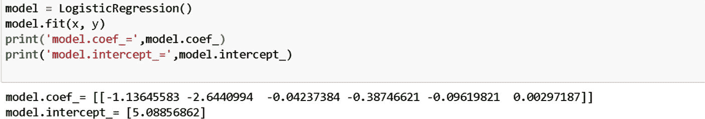

图 7-10

清单 7-3-2 的输出

图 7-10 显示了参数估计值，你可以将这些值代入逻辑回归方程中。

```
#清单 7-3-3
print('前 5 行的预测值=',model.predict(x[:5]))
# [0 1 1 1 0]
print('前 5 行的实际 y 值=',y[:5])
# [0 1 1 1 0]
y_pred = model.predict(x)
print('准确率=',(y == y_pred).sum()/y.shape[0])
print('模型评分=',model.score(x,y))
清单 7-3-3
测试模型并计算准确率
```

在清单 7-3-3 中，我们简单地计算了预测值以及模型预测值与实际值之间的差异。这个计算结果就是模型的准确率。逻辑回归有一个名为 `model.score()` 的函数，它可以自动计算这个差异，无需手动计算预测值。

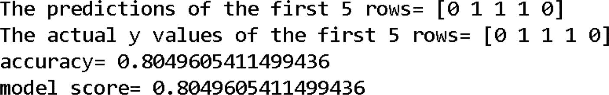

图 7-11

清单 7-3-3 的输出

图 7-11 显示了清单 7-3-3 的输出。在图中，我们比较了手动计算的准确率和 `model.score()` 函数的输出。如图所示，两者之间没有差异，该模型的准确率约为 81%。


## 总结

本章讲解了简单线性回归、多元线性回归以及逻辑回归。它详细阐述了诊断矩阵图及其各自含义。此外，还展示了如何通过诊断图中的多个图表轻松识别异常值。

## 索引

A, B  
Anaconda 安装  
算术与赋值运算符  

C  
注释语句  

D, E, F, G  
数据分析  
- 年龄分类  
- 经济  
- 出口民调  
- 历史数据  
- 收入来源  
- 收入中位数数据  
- 政治轨迹  
- 失业率  
- 性别  
- 历史选民投票率  
- 议题  
- 人口分布  
- 总统选举流程  
- 流程建模  
- 民主党 2016 年预测结果  
- 2020 年预测结果  
- 统计检验  
- 问题/假设  
- 种族人口统计  
- 原始数据  
- 统计检验  
- 趋势测量/模式分析  
- 胜率  

数据清洗  
数据准备/处理技术  
- 追加数据集  
- 日期/货币格式设置  
- 字典  
- `DROP` 方法  
- 删除行  
- `IF-ELIF` 语句  
- `IF` 语句  
- 合并操作  
- 重新排列变量  
- `rename` 方法  
- 子集输出/频率表  
- 变量创建  

H, I, J, K  
假设检验  
- 箱线图/折线图  
- `CLASS` 数据集  
- 正态性检验  
- 单样本 T 检验  
- T 检验  
- 双样本 T 检验  

L, M  
线性模型（参见统计分析）  
线性回归  
逻辑回归  
多元线性回归  
- 条形图  
- 线性方程  
- 参数估计  
- 垂直条形图  
- 简单线性回归  
- 诊断图  
- 诊断  
- 自变量/因变量  
- 库/加载数据集/探索  
- 线性方程  
- 模型创建  
- `scikit-learn` 库  
- 测试模型  

逻辑回归  
- CSV 文件  
- 模型方程  
- 建模过程  
- 输出过程  
- 源代码  
- 测试  

循环  
- `for` 循环  
- `DataFrame.fillna()` 方法  
- 列表  
- 缺失值  
- 逆序  
- 序号  
- 字符串  
- 类型  
- `while` 循环  

N  
数值 Python (Numpy)  
- 数组  
- 索引/切片  
- 数学函数  
- 矩阵  
- 数值计算  
- 运算  
- `reshap()` 方法  
- 平方根/均值  
- `to_numpy()`  

O  
普通最小二乘法 (OLS)  

P, Q  
Pandas  
- `DataFrame`  
- 数据处理/分析  
- 数据结构/函数  
- 筛选/修改  
- 索引  
- 检查数据  
- 加载数据  
- 缺失值  
- `pd.DataFrame()`  
- 序列  
- 多功能性  

Python 编程语言  
- 算术/赋值运算符  
- 单元格/标记  
- 注释语句  
- 比较运算符  
- 数据类型分类  
- `Numpy` 数组  
- `Pandas` `DataFrame`  
- 删除单元格  
- 插入菜单  
- 逻辑/成员/身份运算符  
- 循环  
- 缺失值/原始数据  
- `Numpy`  
- `Pandas`  
- PEMDAS  
- 类型转换  
- `dict()`  
- `list()`  
- `pd.DataFrame()`  
- 标量  
- `set()`  
- `to_numpy()`  
- `tuple()`  
- 运行图标  

R  
回归（参见线性回归）  

S, T, U  
统计分析  
- 相关分析  
- 因果关系  
- 数据集目录  
- 国内生产总值 (GDP)  
- `.head()`/`.describe()`/`.corr()` 方法  
- 库  
- 线性关系  
- 皮尔逊相关系数  
- 散点图  
- `title()` 方法  
- 频率表  
- 假设（参见假设检验）  
- 总结任务  

V, W, X, Y, Z  
可视化  
- 条形图  
- 数据集  
- 降序  
- 直方图  
- 水平条形图  
- NYC OpenData  
- 排序图表  
- 垂直条形图  
- 气泡图  
- 班级数据集  
- 初始表示  
- 输出版本  
- 随机数据直方图任务  
- CSV 文件  
- `figure()` 方法  
- `head()` 方法  
- 直方图绘制  
- 源代码  
- 散点图代码  
- 绘图数据文件  
- 数据集文件夹  
- `describe()` 方法  
- `df.head()` 方法  
- `head()` 方法  
- 库  
- 线性关系/曲线关系  
- Matplotlib  
- 关系  
- 散点图  
- 统计定义  
- 变量序列图  

选民人口统计
