# 1. 数据科学在行动

本章介绍了一个案例研究，该研究分析了缅因州的选民数据。该项目源于我 2016 年秋季在哈佛大学攻读硕士期间，在 Larry Adams 教授的指导下进行的一个项目，旨在预测全国总统选举结果。我的任务是预测缅因州 2016 年和 2020 年的选举结果。

该项目分两个阶段进行，首先侧重于预测 2016 年选举结果，并根据实际结果验证发现，然后再进入第二阶段。第二阶段纳入了 2016 年产生的新数据，以预测 2020 年的结果：因此，本书的某些部分使用了 2016 年的数据。在可行的情况下，我收集了与分析相关的历史数据，包括可追溯到 1960 年的选举数据。

选民的人口统计特征按年龄、性别、教育程度、人口统计和种族进行了划分。通过全面研究，确定了与该州相关的议题类别，包括经济、教育、环境、医疗保健和枪支管制。此外，我还审查了县的选票议题，以评估它们对总统选举的潜在影响。

探索了各种预测方法和算法，包括蒙特卡洛和贝叶斯，以及统计检验（如 T 检验和卡方检验），并利用了自 1960 年以来的政党投票模式、民调准确性和选举人票数。过去，与 FiveThirtyEight 和其他预测平台进行了比较，发现 2016 年的预测是准确的。该项目为将认知特征转化为用于分析的数值数据提供了宝贵的见解，最终基于趋势测量和模式分析做出明智的决策——这是通过后续数据科学工作磨练出来的技能。

对于这个项目，我同时使用了 SAS 和 R 编程语言。2020 年，我与 Apress 合作出版了一本书《使用 SAS Studio 学习数据科学》。这本书大获成功，反响热烈；因此，Apress 和我决定用 Python 重写它。

## 数据科学流程

数据科学流程始于提出一个问题或假设；接着收集相关的原始数据；随后进行数据清洗与探索；建模与评估；最后是部署、可视化以及沟通研究发现，如图 1-1 所示。

图 1-1 数据科学流程

不同领域的问题各不相同，例如在政治领域，问题围绕预测选举结果展开，比如特朗普是否会在 2016 年和 2020 年赢得缅因州；或者在 Facebook 的背景下，探索提高用户参与度的策略。

第二阶段涉及收集原始数据，具体表现为获取全面的选民信息，包括年龄、种族、教育程度、收入、性别、行业、历史投票数据以及投票结果。历史数据越多，预测的准确性就越高。此外，收集多年的人口分布信息也至关重要。

随后，第三阶段需要对原始数据进行清洗；处理缺失值、异常值和重复行等问题；纠正拼写错误，同时标准化各列的数据类型和格式。

第四阶段涉及尝试多种模型，并比较它们针对特定问题的定制化表现。例如，在总统选举场景中，我使用了蒙特卡洛和贝叶斯算法。

最后一个阶段是在报告中以通俗易懂的语言将结果进行可视化和阐述。这一步至关重要，因为它最终回答了启动整个流程的初始问题，从而实现了这项工作的首要目标。

### 案例研究：缅因州总统选举

如前所述，数据科学之旅始于一个疑问。在本项目的范围内，我的疑问聚焦于确定唐纳德·特朗普是否会在 2016 年和 2020 年的总统选举中赢得缅因州。

### 人口

下一步是广泛收集相关数据。首先，我利用美国人口普查局的信息，重点了解了缅因州各县的人口分布情况。这一探索揭示出人口分布非常独特，大片区域要么人口稀少，要么只有零星的居民。虽然南部地区的小点看似微不足道，但每个点都代表着超过 5000 人。因此，要警惕总统竞选团队或主流媒体发布的地图可能带来的误解。

接下来，合乎逻辑的步骤是获取选民信息。虽然有些州免费提供选民数据库，但缅因州的做法不同，它只向政党出售此类数据库。因此，我联系了州务卿办公室寻求帮助。

作为回应，我被告知要访问缅因州的中央选民登记系统，必须隶属于以下五个特定类别之一：候选人或竞选代表、政党成员、公投竞选参与者、动员投票活动的组织者，或为授权目的服务的民选官员。费用根据请求的记录数量确定，详见第 21-A 章第 196-A 节。值得注意的是，包含一百万条记录的州级选民档案费用为 2,200 美元。

在通过几封电子邮件阐明我请求的研究性质并提供必要的验证后，该办公室慷慨地提供了一张免费的 DVD，其中包含必要的信息，包括与我研究相关的部分数据，而选民的个人数据，如姓氏和地址，已从数据集中移除。

该 DVD 的主表列出了选民的详细信息，如图 1-2 所示，列包括名字、出生年份、注册代码、特殊指定、注册日期、国会选区、县 ID、修改日期以及最近一次有 VPH 的州级选举。

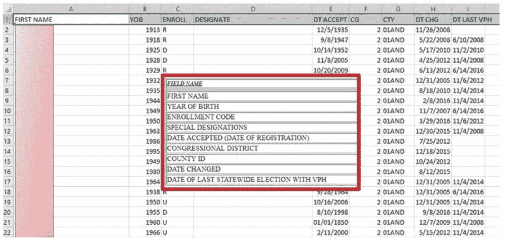
图 1-2 选民信息

接下来的表格汇总了已注册和已登记的选民，如图 1-3 所示。其列包括县名、市镇名、选区、国会选区、州参议院选区、县专员选区、党派归属以及总人数。文件中记录的党派归属包括民主党、绿党独立派、自由意志党、共和党以及无党派。

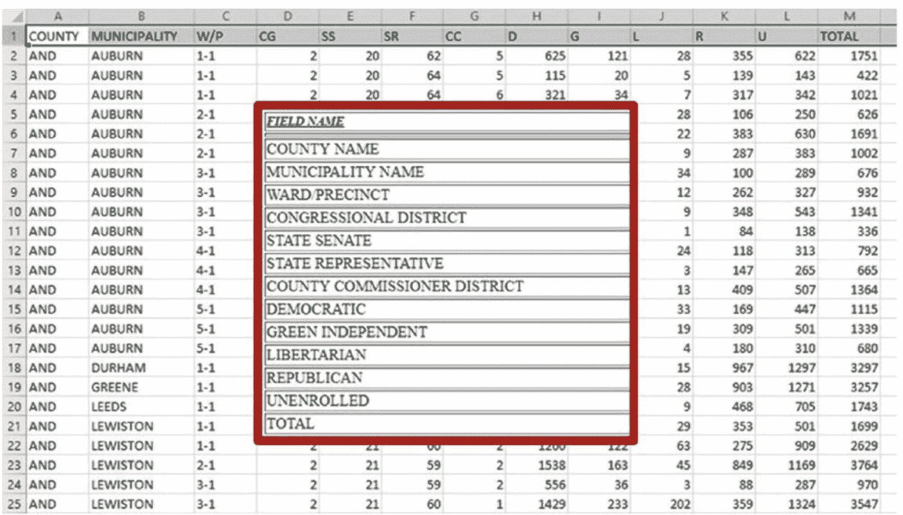
图 1-3 已注册和已登记选民表

最初的数据集充满了错误值和异常值。例如，一位选民的年龄被列为 220 岁，尽管其出生日期显示年龄大约为 67 岁。此外，一些选民信息完全是空白的。正如之前强调的，必须通过处理异常值和缺失值、格式不一致问题，并进行彻底的数据探索来仔细清洗数据。在第 6 章中，我们将通过逐步实验一起进行数据清洗。

此外，我彻底搜索并从各种来源收集数据，以确保拥有足够的历史数据。我还从美国人口普查局网站获取了额外的表格：

[`https://www.census.gov/data/tables/time-series/demo/voting-and-registration/p20-585.html`](https://www.census.gov/data/tables/time-series/demo/voting-and-registration/p20-585.html)

随后，我根据性别、年龄和种族对选民进行分类，以便进一步分析。

### 性别

如图 1-4 所示，我的分析显示，在缅因州，注册的女性选民数量超过了注册的男性选民。然而，两性之间的百分比差异在 ±2% 之间。就政治竞选活动的战略意义而言，代表们可以考虑利用这一信息，例如，佩戴癌症意识粉红丝带以引起女性选民的共鸣，因为历史上她们的投票率高于男性。这一建议凸显了数据和统计的巨大影响力，它们能够塑造演讲主题并影响政治代表的着装。

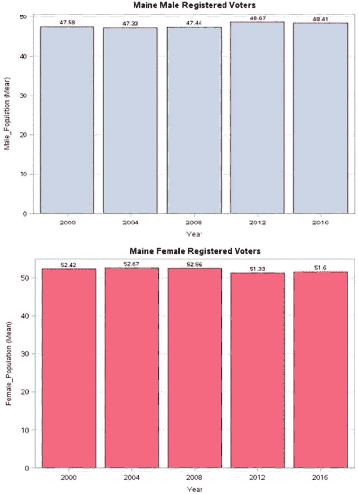
图 1-4 按性别分组的缅因州注册选民

### 种族

关于缅因州的种族人口统计数据，超过 96% 的人口被认定为白人，如图 1-5 所示。因此，我将黑人、亚裔和西班牙裔选民归类为非白人注册选民。

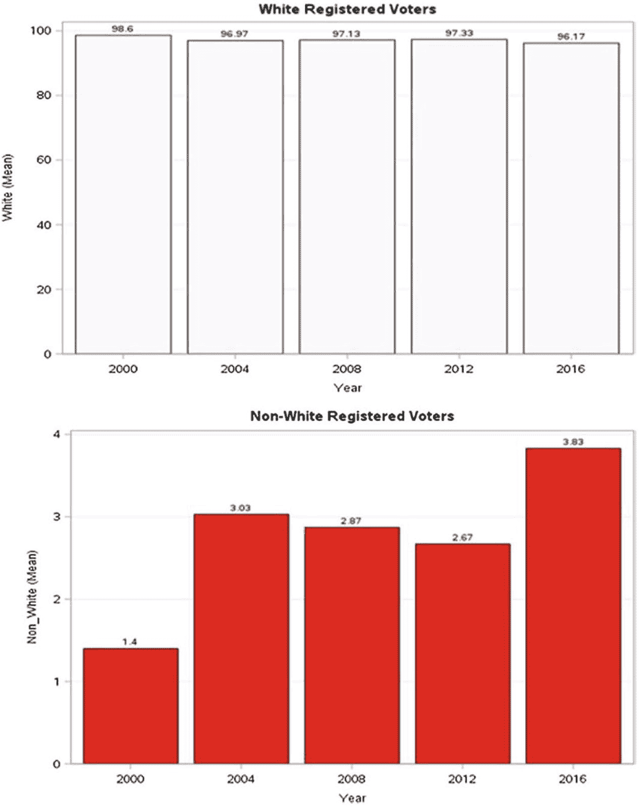
图 1-5 按种族分组的缅因州注册选民

### 年龄

2016 年，65 岁以上的注册选民数量显著下降，如图 1-6 所示（注意纵坐标刻度不同）。相反，18-24 岁和 25-44 岁年龄段的选民数量有所增加。这一观察结果表明，需要调整演讲主题以引起更广泛选民基础的共鸣。例如，竞选代表应优先关注学生贷款和住房抵押贷款等问题，而不是优先讨论医疗保险和退休金。

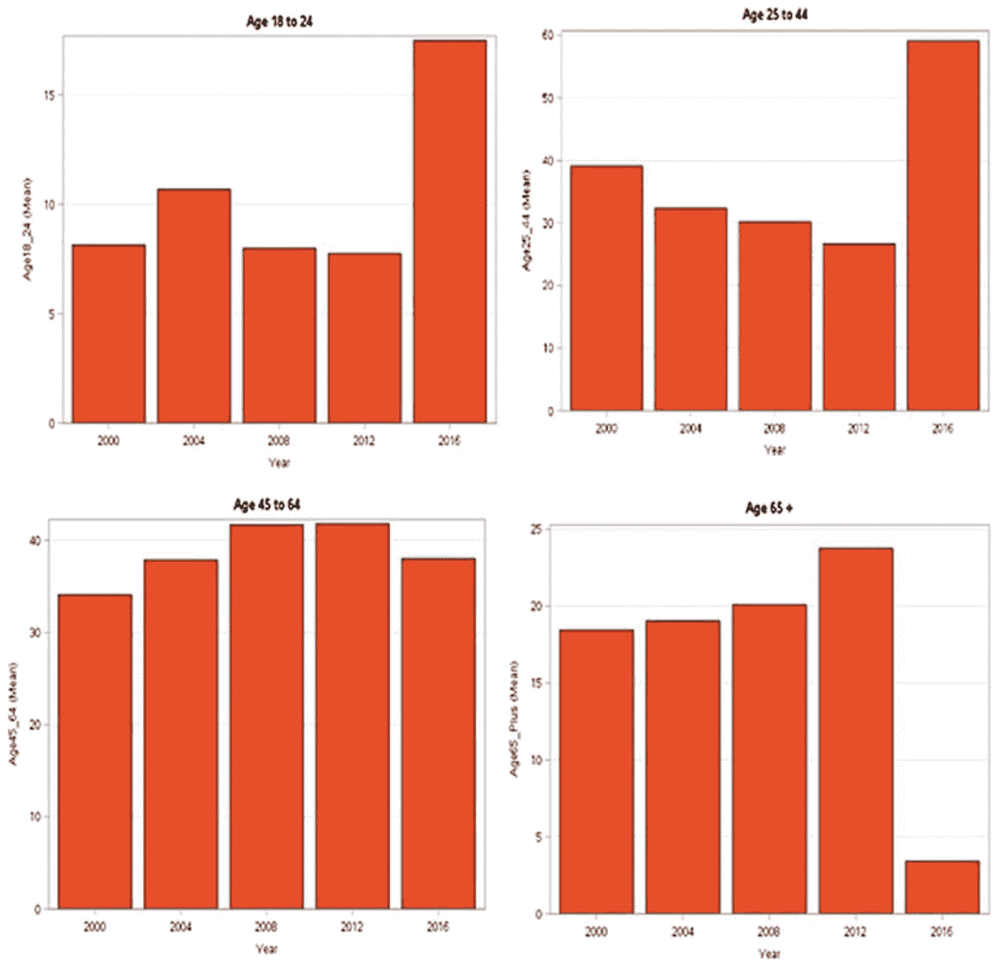
图 1-6 按年龄分组的缅因州注册选民

### 选民投票率

我研究了历史选民投票率，以评估有多少人冒着缅因州风雪交加的街道前去投票。图 1-7 展示了 2000 年至 2016 年的选民投票率百分比，其中民主党胜出。

如果你用摇摆党来尝试这个练习，柱状图的颜色会随之改变，以反映获胜的政党。

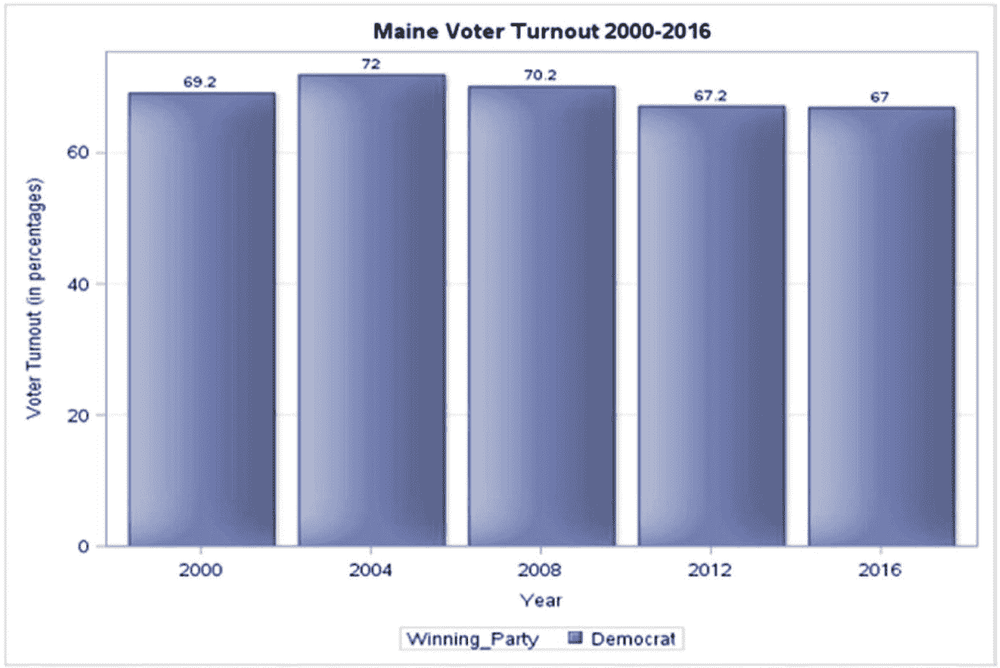
图 1-7 2000–2016 年缅因州选民投票率

我再次按获胜政党以及年龄、种族和性别群体对选民投票率模式进行了分类研究。在图 1-8 中，字母 D 代表民主党，R 代表共和党，O 代表所有其他政党的总和。

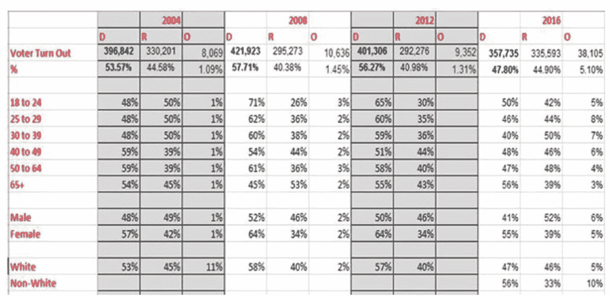
图 1-8 按政党、年龄、种族和性别群体划分的缅因州选民投票率

### 2012 年获胜候选人

我开始深入分析数据，构建了一个直方图，展示了 2012 年缅因州选举中各位候选人及其各自的获胜百分比。分析结果显示，巴拉克·奥巴马以压倒性优势战胜了米特·罗姆尼，其他候选人获得的选票极少，如图 1-9 所示。第 3 章提供了关于如何复现图 1-9 的详细分步指南。

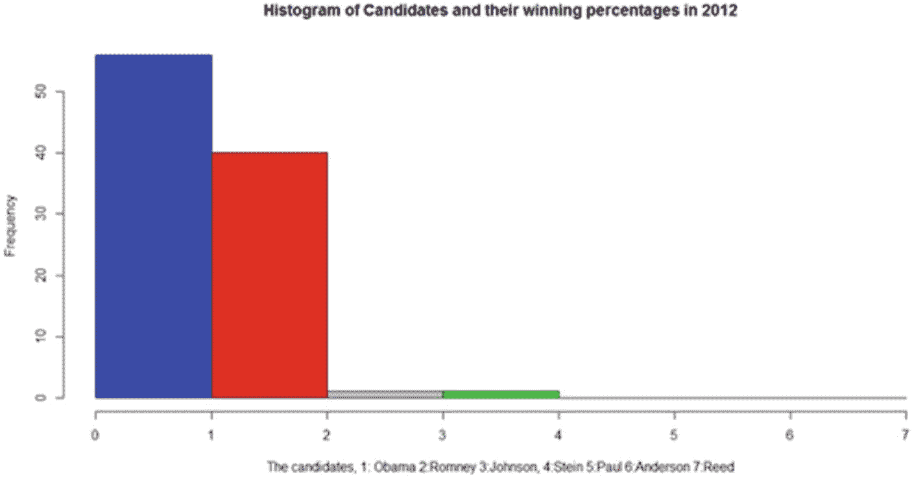
图 1-9 2012 年候选人及其获胜百分比直方图

随后，我尝试按县划分，以地理方式呈现这些数据。图 1-10 用最深色表示倾向民主党的县，而 2000 年至 2016 年间共和党控制的地区则用较浅的色调表示。然而，务必记住，缅因州的地理区域并不一定与人口密度相关。

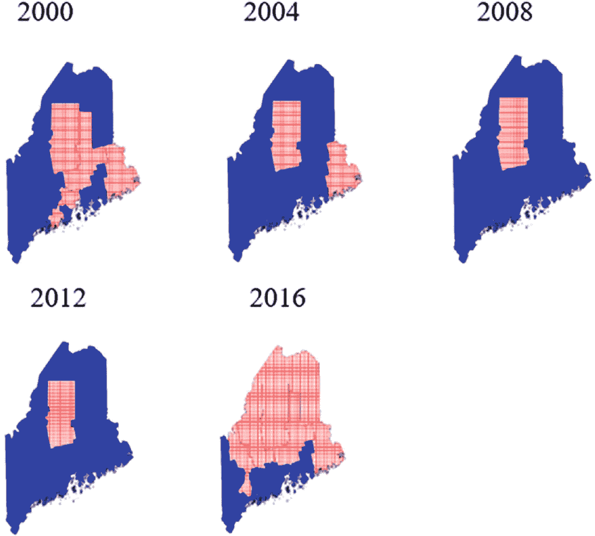
图 1-10 2000–2016 年缅因州各县在总统选举中投票情况地图

### 类别/议题

# 缅因州选举议题与投票意向分析

每次总统选举辩论都会涉及相关议题，并阐明每位候选人提出的应对方法。这些策略可以左右选民的意见，并影响他们基于议题的决策。因此，深入研究这些议题至关重要。

## 国家面临的议题

根据`CNN` 2016 年的报道，缅因州选民认为外交政策、移民、经济和恐怖主义是最紧迫的国家问题。然而，值得注意的是，这些议题可能并未直接反映缅因州的挑战。如图所示，缅因州的本地情况并未受到外交政策问题的显著影响。

根据种族统计数据，很明显缅因州的移民人口极少。截至 2016 年该项目进行时，对缅因州任何恐怖事件的简短调查均未发现结果。然而，经济问题始终是全球性的关注点。因此，我开始探索选票中记录的缅因州特定议题。

## 类别：缅因州面临的议题

我在 `Ballotpedia` 网站上获取了表 1-1 中列出的选票清单。

### 表 1-1 缅因州居民面临的议题^(¹,²)

| 2000 | 2004 | 2008 | 2012 | 2016 |
| --- | --- | --- | --- | --- |
| 辅助死亡 | 教育 | 债券 | 婚姻 | 大麻 |
| 商业 | 税收 | 税收 | 教育 | 教育 |
| 彩票 | 狩猎与垂钓 | 赌博 | 水资源 | 枪支 |
| 税收 | | 水资源 | 交通 | 经济 |
| 选举权 | | 交通 | 债券发行 | 选举 |
| LGBT | | | | 债券 |
| 渔业 | | | | |

显而易见，某些议题，如渔业、债券、水资源、教育和税收，长期以来一直悬而未决。这一发现让我推断，缅因州正面临水资源和税收方面的挑战。我再次强调了总统竞选演讲的重要性，这些演讲应通过提出可行的解决方案或计划来针对这些具体议题。在演讲中直接解决这些关切点，可能会影响缅因州选民的投票意向。

根据收集到的信息、对当地报纸的回顾，以及缅因州选票上反复讨论且未解决的最常见议题，我预测 2020 年缅因州的五大议题将是：
1. 教育
2. 经济
3. 债券
4. 医疗保健
5. 税收

## 影响缅因州经济的因素

在讨论经济时，必须确定收入来源。根据《波特兰新闻先驱报》的信息以及`Maine.gov` 网站上提供的收入数据集^(³)，收入来源包括：
1. 农业
2. 林业
3. 渔业
4. 狩猎
5. 税收
6. 公司和企业管理
7. 金融与保险业

### 缅因州失业率与其他州的比较

唐纳德·特朗普承诺创造更多就业机会，并将制造业公司带回美国，而不是将其外包。众多新闻来源指出，他对创造就业的强调影响了“锈带”州的投票决定，使他们支持他而非希拉里·克林顿。我试图研究缅因州的失业率，并将其与全国数据进行比较，以评估特朗普的承诺对缅因州选民的潜在共鸣程度。结果显示，缅因州在 2016 年并未经历严重的失业问题。因此，特朗普的承诺对缅因州选民的吸引力可能不如对其他某些州的选民。

### 缅因州收入中位数

为了更高的精确度和研究目标，我参考了缅因州的收入中位数数据。我将其与整个美国的收入中位数进行了对比。如表 1-2 所示，从 2005 年到 2015 年，缅因州的收入中位数一直略低于全国平均水平。尽管如此，在选举前的三年里，收入中位数出现了显著增长。

#### 表 1-2 缅因州历史实际家庭收入中位数^(⁴)

| 日期 | 美国 | 缅因州 |
| --- | --- | --- |
| 2018 | $61,937 | $55,602 |
| 2017 | $61,807 | $57,649 |
| 2016 | $60,291 | $55,542 |
| 2015 | $59,116 | $54,578 |
| 2014 | $56,969 | $52,515 |
| 2013 | $56,415 | $50,718 |
| 2012 | $56,288 | $51,180 |
| 2011 | $56,507 | $51,507 |
| 2010 | $57,762 | $52,878 |
| 2009 | $58,921 | $53,657 |
| 2008 | $60,829 | $54,459 |
| 2007 | $61,601 | $55,710 |
| 2006 | $60,490 | $54,233 |
| 2005 | $59,604 | $55,168 |

### 出口民调如何显示 2016 年缅因州选举中的收入因素？

从另一个角度来看，`CNN` 报道称，出口民调显示，除年薪在 30,000 美元至 50,000 美元之间的选民外，缅因州选民普遍强烈倾向于克林顿。有趣的是，这一收入群体更青睐特朗普。然而，他们仅占调查样本的 19%。因此，缅因州的主流情绪是倾向于支持克林顿。

### 回顾过往选举，探寻是否存在可预测的结果（模式）

最后，项目的最终阶段涉及收集历次选举的历史数据，以便为后续的建模和预测步骤提供信息。如前所述，我仅专注于民主党和共和党，因为其他党派在 2012 年选举中获得的选票比例微乎其微。

#### 表 1-3 缅因州历届总统选举历史结果^(⁵,⁶)

| 年份 | 民主党 | 民主党得票率 | 共和党 | 共和党得票率 |
| --- | --- | --- | --- | --- |
| 2016 | **357,735** | **47.80%** | 335,593 | 44.90% |
| 2012 | **401,306** | **56.27%** | 292,276 | 40.98% |
| 2008 | **421,923** | **57.71%** | 295,273 | 40.38% |
| 2004 | **396,842** | **53.57%** | 330,201 | 44.58% |
| 2000 | **319,951** | **49.10%** | 286,616 | 44.00% |
| 1996 | **312,788** | **51.60%** | 186,378 | 30.80% |
| 1992 | **263,420** | **38.80%** | 206,820 | 30.40% |
| 1988 | 243,569 | 43.90% | **307,131** | **55.30%** |
| 1984 | 214,515 | 38.80% | **336,500** | **60.80%** |
| 1980 | 220,974 | 42.30% | **238,522** | **45.60%** |
| 1976 | 232,279 | 48.07% | **236,320** | **48.91%** |
| 1972 | 160,584 | 38.50% | **256,458** | **61.50%** |
| 1968 | **217,312** | **55.30%** | 169,254 | 43.10% |
| 1964 | **62,264** | **68.84%** | 118,701 | 31.16% |
| 1960 | **181,159** | **42.95%** | 240,608 | 57.05% |

在审阅表 1-3 中呈现的数据后，我惊讶地发现了缅因州的历史政治轨迹：从一个以共和党为主的州转变为一个坚定的民主党州。因此，我选择将缅因州定性为“倾向民主党”的州，因为从 1960 年到 2016 年的 15 次选举中，民主党赢得了 7 次。我对 2020 年的预测倾向于民主党以微弱优势获胜。值得注意的是，自 1992 年以来，缅因州一直支持民主党。然而，忽视缅因州可能会导致其转向支持共和党。据《班戈每日新闻》报道，克林顿在 2015 年 9 月之后没有访问过缅因州，而是选择派遣代理人。因此，多年来民主党首次将一张选举人票输给了共和党。

## 建模

在建模过程中，建议尝试多种算法进行预测并评估其结果，而不是仅仅依赖单一模型。在本项目中，我使用了蒙特卡洛和贝叶斯算法。关于统计检验，所使用的方法包括：
- 直方图
- 箱线图
- 比例检验
- T 检验
- 决策树
- 卡方检验
- 散点图和线性回归

### 我的 2016 年预测

在`SAS University Edition` 中使用过往选举结果执行蒙特卡洛算法后，得到的输出如图 1-11 所示。

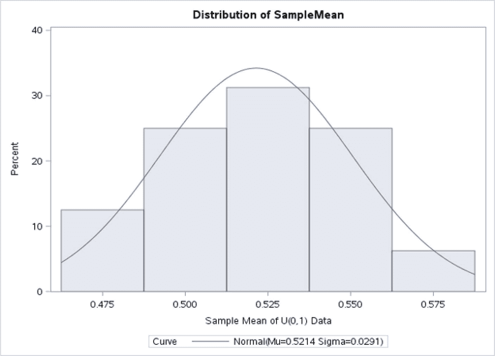

**图 1-11** 蒙特卡洛算法的 2016 年预测结果

图 1-11 显示，根据模拟结果，希拉里·克林顿预计将以平均 52.14%的得票率赢得缅因州。她的获胜优势^(⁷)仅为 48%。尽管如此，模拟准确预测了她在缅因州的胜利，这为该项目带来了成功的结果，并让我在该课程中获得了 A。太好了！

### 我的 2020 年预测

根据我的预测，民主党预计将以 50.8%的多数票赢得缅因州四张选举人票中的三张，如图 1-12 所示。

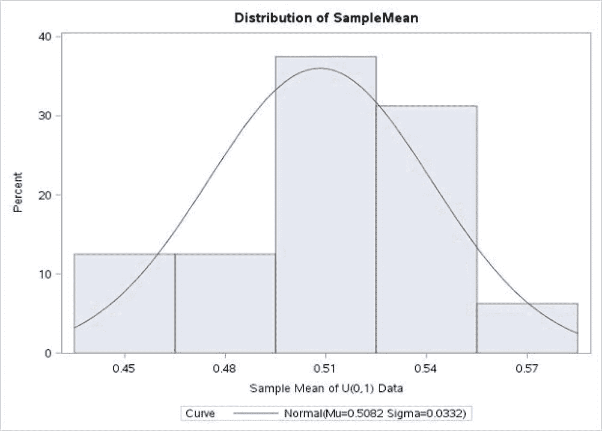

**图 1-12** 蒙特卡洛算法的 2020 年预测结果

概率表明，2020 年，民主党预计将以约 51%的得票率，以大约+3%的微弱优势在缅因州击败共和党。在 2020 年^(⁸)，拜登以 53.1%的得票率获胜，而特朗普仅获得 44%的选票。1960 年至 2016 年的历史数据显示，缅因州民主党的平均支持率约为 43%，而共和党的平均支持率约为 40%。这一差距与 2016 年大选中缅因州民主党和共和党之间的差距相似。尽管如此，如果民主党不谨慎行事，缅因州仍有可能倒向共和党。

## 总结

在本章中，我们重点关注从`缅因州总统选举项目`案例研究及其附带的图表中提取关键概念。在下一章中，我们将深入探讨编写第一个 `Python` 程序以及数据类型的过程。

**脚注** 1 2 3 4 5 6 7 8
