# 2. 开始入门

我们将从安装 `Jupyter Notebook` 并浏览其界面以熟悉它开始本章的学习。在学习任何编程语言时，我们都会涵盖以下主题：数据类型（本章讨论）、比较和逻辑运算符（第 5 章）、条件语句（第 6 章）以及循环（第 5 章）。

### 安装

您可以免费安装 `Anaconda` 用于个人和教育目的。`Anaconda` 是一个易于安装的环境管理器、`Python` 发行版以及包含超过 720 个开源包的集合。其主要优势在于它捆绑了 `Python`、`Jupyter Notebook`、`Spyder IDE` 以及数据分析和机器学习库与包，如图 2-1 所示。您可以从以下网站免费安装：

[https://www.anaconda.com/download/](https://www.anaconda.com/download/)

本书的示例代码使用了 `Jupyter Notebook`。但是，您可以将代码复制并粘贴到您喜欢的 `Python` IDE（集成开发环境）中。您必须确保从数据集文件夹上传本书的数据集，并相应调整代码中的文件路径。此外，您也可以只安装 `Python` 和 `Jupyter Notebook`，而无需安装整个 `Anaconda`。您可以从以下链接免费安装 `Jupyter Notebook`：

[https://jupyter.org/install](https://jupyter.org/install)


**图 2-1** `Anaconda`

### 云端 Python

如果您没有安装 `Conda` 或 `Anaconda`，您可以使用以下在线平台之一在云端访问 `Python`：

- Kaggle：[https://www.kaggle.com/code](https://www.kaggle.com/code)
- Anaconda Cloud：[https://anaconda.cloud/](https://anaconda.cloud/)
- Online Python：[www.online-python.com](http://www.online-python.com)
- Sololearn：[https://code.sololearn.com/python](https://code.sololearn.com/python)
- Replit：[https://replit.com/languages/python3](https://replit.com/languages/python3)
- Trinket：[https://trinket.io/library/trinkets/create?lang=python3](https://trinket.io/library/trinkets/create?lang=python3)
- Google Colab：[https://colab.research.google.com](https://colab.research.google.com/)

> **注意**
>
> 除 `Anaconda Cloud` 外，所有这些在线平台都是免费的；`Anaconda Cloud` 仅在一段时间内免费。由于条款、条件及定价计划频繁变更，请务必在注册前仔细阅读。

## 什么是 Python？

`Python` 是一种编程和脚本语言。它流行、快速，并且比其他编程语言更灵活。其主要优势在于有一个庞大的社区为其贡献力量。因此，你可以轻松找到项目所需的各类工具包/库和代码示例。

## 导览

每个用于输入文本的地方都称为一个单元格，如图 2-2 所示。你可以输入 `Python` 代码或任何文本。如果你想插入纯英文文本，请从下拉菜单中选择标记语言，并选择 `Markdown`。

要在标记单元格中创建标题，请在标题前输入 `#` 和一个空格。当你运行此单元格时，`Python` 解释器会将其加粗并放大字体，如图 2-3 所示。

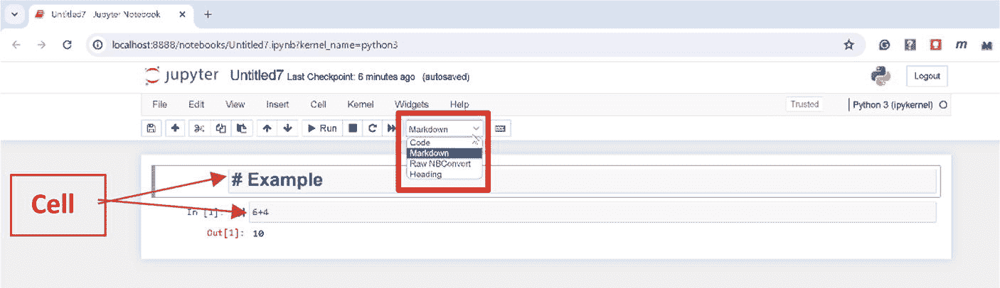

图 2-2

单元格与 `Markdown`

要运行一个单元格，请点击 `运行` 图标，如图 2-3 所示，或者按住 `Shift` 键并点击 `Shift-Return`；然后，点击 `Return` 键。如果你想运行所有 `Jupyter Notebook` 单元格，请点击 `双箭头图标`，如图 2-3 中高亮所示。

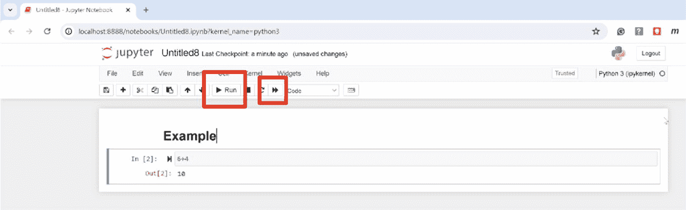

图 2-3

运行与全部运行

要删除任何单元格，你可以点击 `ESC`，然后双击键盘上的 `D` 键，或者从“编辑”菜单中选择“删除单元格”选项，如图 2-4 所示。

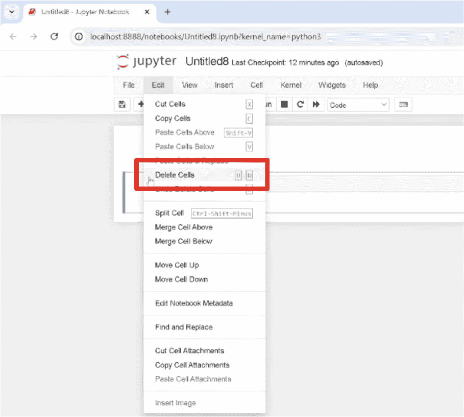

图 2-4

删除单元格

要添加任何单元格，请点击 `加号`。如图 2-5 所示，你可以通过点击工具栏中的图标来上下移动它。你也可以从 `插入` 菜单中移动它。

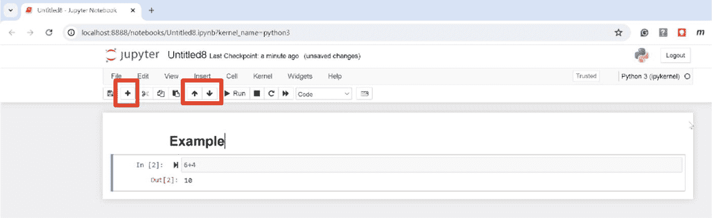

图 2-5

添加单元格

再次说明，这取决于你安装的版本；界面可能会有所不同。在本书中，版本是 `Jupyter Notebook 服务器 6.4.5`。运行在此版本 `Python` 上的服务器是 `Python 3.9.7`（默认，2021 年 9 月 16 日，16:59:28）`[MSC v.1916 64 位 (AMD64)]`。内核信息是 `Python 3.9.7`（默认，2021 年 9 月 16 日，16:59:28）`[MSC v.1916 64 位 (AMD64)]`。

## 数据类型

在 `Python` 中，有多种对数据类型进行分类的方法。通常，它们可以分为以下六类：

1. 数值类型
    1. `int`：用于整数，例如 `42`
    2. `float`：用于小数，例如 `3.14`
    3. `complex`：用于复数，例如 `3+4j`
2. 序列类型
    1. `str`：用于文本，例如 `"hello"`
    2. `list`：用于有序的项目集合，例如 `[1, 2, 3]`
    3. `tuple`：用于有序的、不可变的项目集合，例如 `(1, 2, 3)`
3. 映射类型
    1. `dict`：字典类型，用于键/值对，例如 `{'name': 'Alice', 'age': 25}`
4. 集合类型
    1. `set`：用于无序的唯一项目集合，例如 `{1, 2, 3}`
    2. `frozenset`：不可变的集合类型，例如 `frozenset([1, 2, 3])`
5. 布尔类型
    1. `bool`：布尔类型，用于真/假值，例如 `True, False`
6. 二进制类型
    1. `bytes`：不可变的字节序列，例如 `b'hello'`
    2. `bytearray`：可变的字节序列，例如 `bytearray(b'hello')`
    3. `memoryview`：内存视图对象，例如 `memoryview(b'hello')`

尽管这种分类是标准的，但我更倾向于将其分为标量/基本类型、容器类型和高级类型。因此，接下来的类型转换部分将遵循这种分类。

1. 标量类型是保存单个值的简单数据类型。它包括 `int`、`float`、`bool`、`complex` 和 `str`。
2. 容器类型是包含多个值的数据结构，这些值可以是不同的数据类型。此类包括 `list`、`tuple`、`dict`、`set` 和 `frozenset`。
3. 高级类型通常来自外部库，用于更复杂的数据结构和操作。
    1. `Pandas DataFrame`：二维标签化数据结构，其列可能包含多种类型，用于数据分析，如代码清单 2-1 所示。完整代码位于示例代码文件夹中的 `Chapter 2.ipynb` 文件中。

```python
import pandas as pd
df = pd.DataFrame({'A': [1, 2, 3], 'B': [4, 5, 6]})
print(df)
```

代码清单 2-1 `Pandas DataFrame`

输出如图 2-6 所示。左侧的第一列不是 `DataFrame` 的组成部分；它是一个索引，用作行的标识符。

# Pandas DataFrame 就像一个由列和行组成的数据表

## Numpy 数组

Numpy 数组是用于数值运算的 N 维数组对象，如代码清单 2-2 所示。

```
import numpy as np
arr = np.array([1, 2, 3])
print(arr)
代码清单 2-2
Numpy
```

输出如图 2-7 所示。


## Pandas Series

Pandas Series 是能够保存任何数据类型的一维标签化数组，如代码清单 2-3 所示。

```
import pandas as pd
s = pd.Series([1, 2, 3])
print(s)
代码清单 2-3
Pandas Series
```

输出如图 2-8 所示。我们使用 Pandas Series 来存储 Pandas DataFrame 中的一列，正如我们将在本书的许多示例中看到的那样。

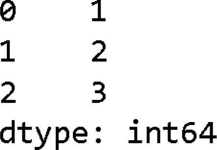

我们将在本章后面详细讨论 Pandas 和 Numpy，并学习如何在整本书中有效地使用它们。

## 类型转换

类型转换是将一种数据类型转换为另一种数据类型。以下是这些类别中的示例：

### 标量类型转换

1. `int()`：转换为整数，如代码清单 2-4 所示。

2. `float()`：转换为浮点数，如代码清单 2-5 所示。

```
x = int(3.14)  # x 现在是 3
print(x)
代码清单 2-4
转换为整数
```

```
x = float(3) # x 现在是 3.0
print(x)
代码清单 2-5
转换为浮点数
```

3. `str()`：转换为字符串，如代码清单 2-6 所示。

```
x = str(3.14) # x 现在是 '3.14'
print(x)
代码清单 2-6
转换为字符串
```

### 容器类型转换

1. `list()`：转换为列表，如代码清单 2-7 所示。

2. `tuple()`：转换为元组，如代码清单 2-8 所示。

```
x = list((1, 2, 3))  # x 现在是 [1, 2, 3]
print(x)
代码清单 2-7
转换为列表
```

```
x = tuple([1, 2, 3])  # x 现在是 (1, 2, 3)
print(x)
代码清单 2-8
转换为元组
```

3. `set()`：转换为集合，如代码清单 2-9 所示。

4. `dict()`：转换为字典（通常来自键/值对列表），如代码清单 2-10 所示。

```
x = set([1, 2, 2, 3])  # x 现在是 {1, 2, 3}
print(x)
代码清单 2-9
转换为集合
```

```
x = dict([('a', 1), ('b', 2)])  # x 现在是 {'a': 1, 'b': 2}
print(x)
代码清单 2-10
转换为字典
```

### 高级类型转换

1. `to_numpy()`：使用 `arr = df.to_numpy()` 将 Pandas DataFrame 或 Series 转换为 Numpy 数组，如代码清单 2-11 所示。

```
import pandas as pd
import numpy as np
## 步骤 1：创建一个 pandas DataFrame
data = {
'A': [1, 2, 3, 4],
'B': [5, 6, 7, 8],
'C': [9, 10, 11, 12]
}
df = pd.DataFrame(data)
print("原始 DataFrame:\n", df)
## 步骤 2：将 DataFrame 转换为 numpy 数组
numpy_array = df.to_numpy()
print("\n 转换为 numpy 数组:\n", numpy_array)
代码清单 2-11
转换为 Numpy 数组
```

输出结果如图 2-9 所示。

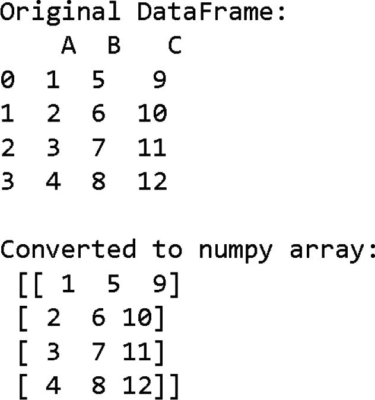

2. `pd.DataFrame()`：使用 `df = pd.DataFrame(np_array)` 从 Numpy 数组创建 Pandas DataFrame，如代码清单 2-12 所示。

```
import numpy as np
import pandas as pd
## 步骤 1：创建一个 numpy 数组
numpy_array = np.array([[1, 2, 3], [4, 5, 6], [7, 8, 9]])
print("原始 numpy 数组:\n", numpy_array)
## 步骤 2：将 numpy 数组转换为 pandas DataFrame
df = pd.DataFrame(numpy_array, columns=['列 1', '列 2', '列 3'])
print("\n 转换为 DataFrame:\n", df)
代码清单 2-12
转换为 Pandas DataFrame
```

输出结果如图 2-10 所示。

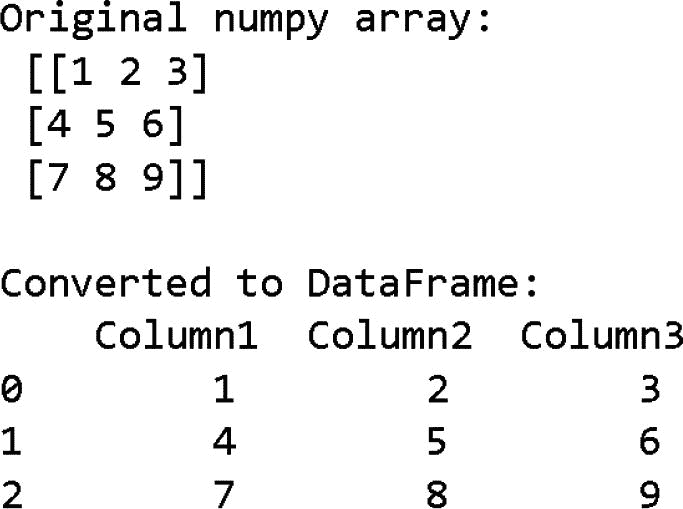

## Pandas

在本书中，我们将广泛使用 Pandas 和 Numpy。Pandas 是一个强大且流行的 Python 库，用于数据处理和分析。它提供了易于使用的数据结构和函数，旨在无缝处理结构化数据。其显著特性之一是能够以人类可读的表格格式呈现数据，同时允许进行数值解释以进行大规模计算。可以将 Pandas 视为 Python 中 Excel 的增强版，使您能够更高效、更程序化地处理和分析数据。

### 为什么使用 Pandas？

- **轻松处理数据**：Pandas 简化了诸如从文件加载数据、清理杂乱数据以及执行计算等任务。
- **数据分析**：使用 Pandas，您可以快速探索大型数据集，筛选出所需信息，并获得洞察。
- **多功能性**：Pandas 可以处理不同的数据类型，包括数字、文本和时间序列数据。

### 关键概念

- **Series**：Series 是一种一维的类数组对象，可以容纳各种数据类型，包括数字、字符串和日期。可以将其视为电子表格中的单列，如代码清单 2-13 所示。

```
import pandas as pd
df = pd.DataFrame({'A': [1, 2, 3], 'B': [4, 5, 6]})
series=df['A']
print(series)
代码清单 2-13
Pandas Series
```

输出结果如图 2-11 所示。

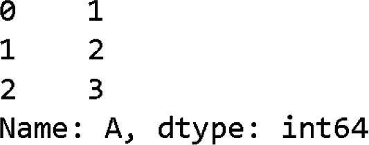

- **DataFrame**：DataFrame 是一个二维表格，类似于电子表格或 SQL 表。它由行和列组成，每列可以有不同的数据类型，如代码清单 2-14 所示。

```
data = {
'姓名': ['Alice', 'Bob', 'Charlie'],
'年龄': [25, 30, 35],
'城市': ['纽约', '洛杉矶', '芝加哥']
}
df = pd.DataFrame(data)
print(df)
代码清单 2-14
Pandas DataFrame
```

输出结果如图 2-12 所示。

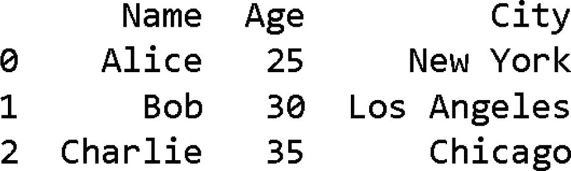

### Pandas 的基本操作

- **加载数据**：您可以从各种来源加载数据，例如 CSV 文件、Excel 文件和数据库。在接下来的章节中，我们将看到如何加载多种文件类型。
- **检查数据**：检查数据的结构和摘要。要汇总 DataFrame，请使用 `df.info()` 方法。要进行统计摘要，请使用 `df.describe()` 方法，我们将在第 3 章中看到。
- **筛选数据**：在下一章，即第 3 章中，我们将看到如何根据我们想要操作和分析数据以生成所需可视化图表的方式，选择特定的行和列。在本书的其余部分，我们将继续使用相同的技术来完成进一步的数据科学任务。
- **修改数据**：添加、删除或更新列。在第 6 章中，我们将详细讨论如何执行这些任务。
- **处理缺失数据**：识别并处理缺失值。同样，在第 6 章中，我们将看到如何使用 `df.dropna()` 删除包含缺失值的行，使用 `df.fillna(0)` 将缺失值替换为 0，以及其他方法。

- **Pandas DataFrame 中的索引**：按名称访问列，按索引访问行，使用 `df.at[行号, '列名']` 属性按行和列访问特定元素，并使用 `df.loc[行起始:行结束, '列起始':'列结束']` 对行和列进行切片。我们将在第 6 章中提供更多示例来演示此主题。

## Numpy

Numpy 是“数值 Python”的缩写，是一个用于数值计算的基础 Python 库。它支持数组、矩阵以及对这些数据结构进行操作的高级数学函数。Numpy 是许多其他数据科学库（包括 Pandas）的支柱。

我们经常将数据从 Pandas DataFrame 传输到 Numpy 数组。Pandas DataFrame 很有用，因为它们包含列名和其他文本数据，便于人类阅读。然而，对于计算机执行计算而言，Numpy 数组是最有效的。

### 为什么使用 Numpy？

- **性能**：Numpy 操作是用 C 语言实现的，这使得它们对于大规模计算来说极其快速和高效。
- **易用性**：Numpy 使得使用简单的语法对数组和矩阵执行复杂的数学运算变得容易。
- **灵活性**：Numpy 数组可以处理各种数据类型，并且在数值计算方面比 Python 列表更通用。

### 关键概念

- **数组**：Numpy 数组是一个值的网格，所有值类型相同，如代码清单 2-15 所示。数组由非负整数元组索引。

```python
import numpy as np
array = np.array([1, 2, 3, 4, 5])
print(array)
# 代码清单 2-15
# Numpy 数组
```

输出结果如图 2-13 所示。

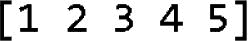

图 2-13

创建 Numpy 数组

- **矩阵**：矩阵是一个二维数组。Numpy 可以轻松处理一维和二维数组，如代码清单 2-16 所示。

```python
matrix = np.array([[1, 2, 3], [4, 5, 6], [7, 8, 9]])
print(matrix)
# 代码清单 2-16
# Numpy 矩阵
```

输出结果如图 2-14 所示。

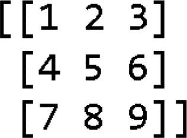

图 2-14

创建 Numpy 矩阵

### Numpy 基本操作

- **创建数组**：Numpy 提供了多种快速创建数组的函数，如代码清单 2-17 所示。

```python
zeros = np.zeros((3, 3))  # 创建一个 3x3 的零矩阵
ones = np.ones((2, 2))  # 创建一个 2x2 的全 1 矩阵
print(zeros)
print(ones)
# 代码清单 2-17
# 创建 Numpy 数组
```

输出结果如图 2-15 所示。

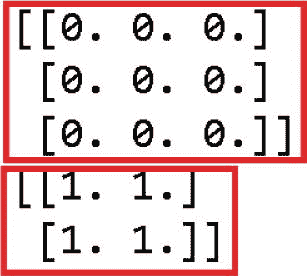

图 2-15

创建两个 Numpy 矩阵，一个为 3×3 的零矩阵，另一个为较小的 2×2 全 1 矩阵

- **数组运算**：对数组执行逐元素运算，如代码清单 2-18 所示。

```python
array1 = np.array([1, 2, 3])
array2 = np.array([4, 5, 6])
sum_array = array1 + array2  # 逐元素相加
print("array1=",array1)
print("array2=",array2)
print("sum_array=",sum_array)
# 代码清单 2-18
# 数组运算
```

输出结果如图 2-16 所示。使用 Numpy 进行算术运算非常简便。

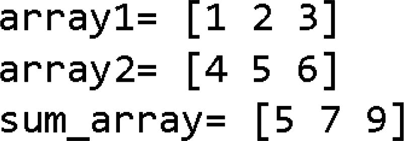

图 2-16

两个 Numpy 数组的求和

- **数学函数**：Numpy 提供了多种可应用于数组的数学函数，如代码清单 2-19 所示。

```python
array = np.array([1, 2, 3, 4, 5])
print("array=",array)
print("square root=",np.sqrt(array))  # 每个元素的平方根
print("mean=",np.mean(array)) # 数组的均值
# 代码清单 2-19
# 数学函数
```

输出结果如图 2-17 所示。使用 Numpy 进行数学运算非常简便。

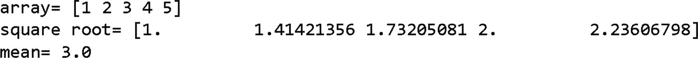

图 2-17

Numpy 数组的平方根与均值

- **索引与切片**：访问和修改特定元素或子数组，如代码清单 2-20 所示。

```python
array = np.array([1, 2, 3, 4, 5])
print("array=",array)
print("second element=array[1]=",array[1]) # 访问第二个元素
## 访问索引从 1 到 3 的元素
print("From second to fourth elements=",  array[1:4])
array[2] = 10  # 修改第三个元素
print("new array after changing third element value=",array)
# 代码清单 2-20
# 索引与切片
```

输出结果如图 2-18 所示。在本书后续内容中，尤其是在第 6 章，我们将通过大量实际动手实验来演示数据科学流程中实用的索引与切片操作。

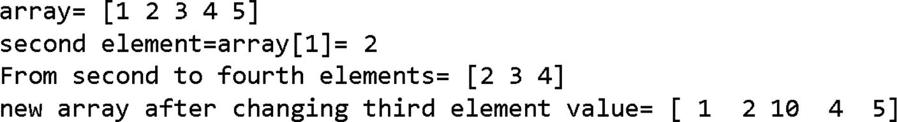

图 2-18

Numpy 数组的索引与切片

- **重塑数组**：在不改变数据的情况下更改数组的形状，如代码清单 2-21 所示。

```python
array = np.array([[1, 2, 3], [4, 5, 6]]) # 3x3 数组
reshaped = array.reshape((3, 2))  # 重塑为 3x2 数组
print(reshaped)
# 代码清单 2-21
# 重塑数组
```

输出结果如图 2-19 所示。我们首先创建一个 3×3 的 Numpy 矩阵；然后使用 `.reshape()` 方法将其重塑为 3×2 的矩阵。Python 中许多数据科学和机器学习函数都需要重塑矩阵，以便为数据处理做好准备。

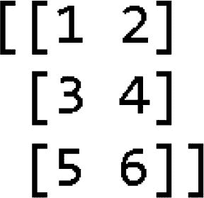

图 2-19

将矩阵从 3×3 重塑为 3×2，且不丢失或改变数据

## 本章小结

本章是我们学习 Python 之旅的基础。它从安装和 Python 云端游乐场开始，然后解释了 Jupyter Notebook 的界面和基本组件。同时，还介绍了数据类型和类型转换。

此外，本章还讲解了 Pandas 和 Numpy，它们是 Python 中用于数据处理和数值计算的关键工具。Pandas 提供了用于处理结构化数据的高级数据结构和函数，使得数据分析和可视化变得简单。

另一方面，Numpy 为数组和矩阵的数值运算提供了强大的功能，为高效的科学计算奠定了基础。这两个库共同构成了深入探索数据的强大基础。在下一章中，我们将深入探讨数据可视化。

