# 3. 数据可视化

有句谚语说：“一图胜千言。”可视化是一项繁琐而艰巨的任务。幸运的是，`Python` 拥有丰富的内置库，其中包含各种函数和选项，可以制作出表现力丰富的图表。本章将使用公共领域中的大型数据集。我们将遵循第 1 章中提到的数据科学流程，即每个小节都从一个问题开始，并通过图表来寻找答案。

本章涵盖了各种基本图表，例如散点图、直方图、序列图、条形图、排序条形图以及气泡图。

## 散点图

散点图用于通过描述散点的方向、强度和线性关系来展示变量之间的相互依赖性。此外，它们还能轻松显示异常值。

在本例中，我们的问题是：西雅图市的薪资是否与员工的年龄范围有关，还是两者之间没有关系？

你可以在数据集文件夹中找到数据文件，或者通过以下链接从 `Data.Gov` 项目下载 CSV 文件：[`https://web.archive.org/web/20170116035611/http://catalog.data.gov/dataset/city-of-seattle-wages-comparison-by-gender-average-hourly-wage-by-age-353b2`](https://web.archive.org/web/20170116035611/http://catalog.data.gov/dataset/city-of-seattle-wages-comparison-by-gender-average-hourly-wage-by-age-353b2)。

数据集位于数据集文件夹中，文件名为：`City_of_Seattle_Wages__Comparison_by_Gender_-_Average_Hourly_Wage_by_Age.csv`。完整代码位于示例代码文件夹中的 `Chapter 3.ipynb` 的清单 3-1 中。不过，在 `Jupyter Notebook` 中，代码将按照以下步骤划分到不同的单元格中。

有多种库可用于可视化。在本例中，我们使用 `Matplotlib`。步骤如下：

1. 加载库。
2. 加载数据并探索数据。
3. 创建散点图。
4. 通过以下方式增强图表：
    1. 移除一些不需要的值
    2. 添加标题
    3. 调整图表大小
    4. 为 x 轴和 y 轴添加标签

```
import pandas as pd
import matplotlib.pyplot as plt
import numpy as np
清单 3-1-1
导入所需的库
```

在清单 3-1-1 中，我们导入了所需的库。我们从将 `Pandas` 模块导入为 `pd` 开始。`Pandas` 是 `Python` 如此流行的原因之一。它通过加载数据、以人类可读的表格形式查看数据以及进行大量计算，帮助读取和操作数据。数据表被称为 `DataFrame`，其简写约定为 `df`。`Pandas` `DataFrame` 具有列名和其他文本数据，使其对用户友好。

然后，我们加载 `matplotlib.pyplot` 库，其中包含所有可视化函数。通常将其简称为 `plt`。

最后加载的库是 `numpy`，这是一个用于操作数值数据列表和表格的 `Python` 包。计算机发现以 `numpy` 数组形式进行统计计算更容易且更快。然而，它们对人类不太友好。因此，我们经常将数据从 `Pandas` `DataFrame` 转换为 `Numpy` 数组。

注意：在本书的示例中，我们将频繁使用这三个库：`Pandas`、`Matplotlib` 和 `Numpy`。

```
df=pd.read_csv('../Datasets/Chapter 3/City_of_Seattle_Wages__Comparison_by_Gender_-_Average_Hourly_Wage_by_Age.csv')
print(df.head())
清单 3-1-2
加载数据集并探索数据
```

在清单 3-1-2 中，我们将数据导入 `Pandas`，以便将其视为 `DataFrame`。`read_csv()` 函数接受一个 `csv` 格式的文件，并将其转换为一个名为 `df` 的 `Pandas` `DataFrame`。然后，`head` 方法返回 `DataFrame` 的前五行。

`head` 方法的输出如图 3-1 所示。

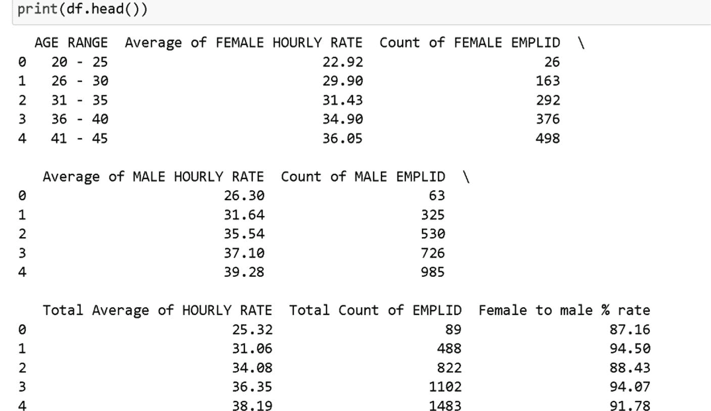

图 3-1 `df.head()` 方法的输出

从图 3-1 中，我们发现除了 `AGE RANGE` 列之外，所有八列都是数值型的。`AGE RANGE` 列是 `string` 数据类型。

让我们通过使用 `describe()` 方法进一步探索数据集。它会返回数据集的汇总统计报告，如清单 3-1-3 所示。

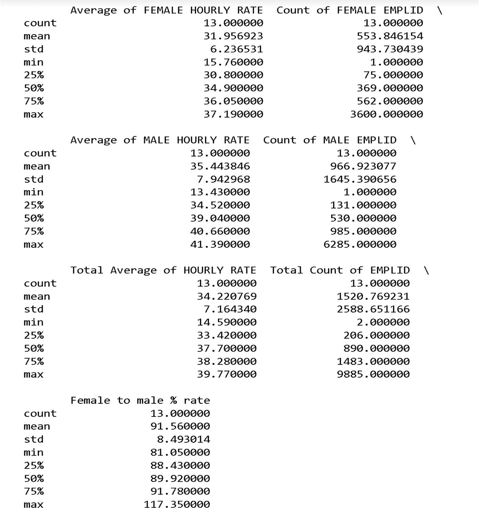

图 3-2 `describe()` 方法的输出

```
print(df.describe())
清单 3-1-3
describe 方法计算汇总统计量
```

图 3-2 显示了每列的一些统计量。请注意，它只给出数值列的统计量。以下是统计量的定义：

- `Count`：非缺失行的数量。
- `Mean`：平均值。
- `Std`：标准差的缩写。这是衡量数据离散程度的指标。
- `Min`：最小值。
- `25%`：第 25 百分位数。
- `50%`：第 50 百分位数，也称为中位数。
- `75%`：第 75 百分位数。
- `Max`：最大值。

我们使用 `Pandas` 的 `describe()` 方法来开始建立对数据的一些直觉。

```
plt.figure(figsize=(12, 6))
plt.scatter(df['AGE RANGE'], df['Total Average of HOURLY RATE'])
plt.xlabel('AGE RANGE')
plt.ylabel('Total Average of HOURLY RATE')
清单 3-1-4
初始散点图
```

为了避免图表相互重叠，我们使用 `figure` 方法，并在其中设置图表的尺寸，如清单 3-1-4 所示。然后，我们使用 `scatter` 方法，并将要绘制的两个变量传递给它。为了增强图表效果，我们使用 `xlabel` 和 `ylabel` 方法设置 x 轴和 y 轴的标签。

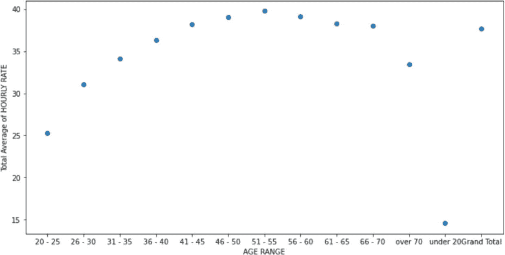

图 3-3 散点图的输出

在图 3-3 中，最后两个 `AGE RANGE` 值是不需要的，并且会给出关于两个变量之间关系的错误印象。因此，我们应该将它们从数据中过滤掉，如清单 3-1-5 所示。

```
plt.figure(figsize=(12, 6))
df1=df['AGE RANGE']
df2=df['Total Average of HOURLY RATE']
plt.scatter(df1[:-2],df2[:-2] )
plt.xlabel('AGE RANGE')
plt.ylabel('Total Average of HOURLY RATE')
plt.title('年龄范围与总平均小时工资之间的相互依赖性')
清单 3-1-5
过滤 AGE RANGE 中的最后两个值
```

从图 3-4 的最终散点图中，我们可以确定西雅图的 `AGE RANGE` 与 `Total Average of HOURLY RATE` 之间存在相互依赖性。这种关系不是线性的，而是曲线性的。

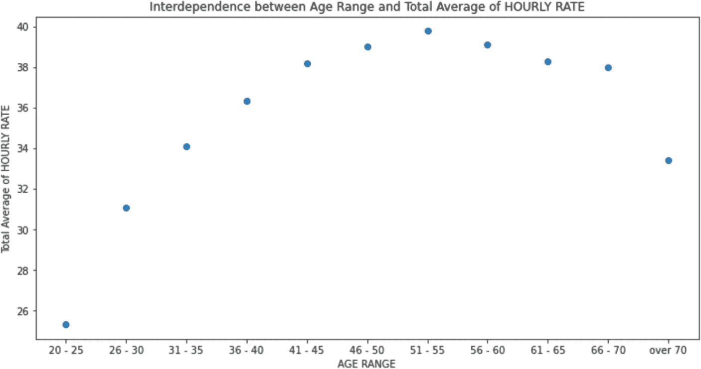

图 3-4 最终的散点图

### 散点图关系

图 3-5 展示了散点图关系的不同示例。要描述散点图，你应该说明它是线性关系还是曲线关系，正如我们在上一个示例中看到的那样。

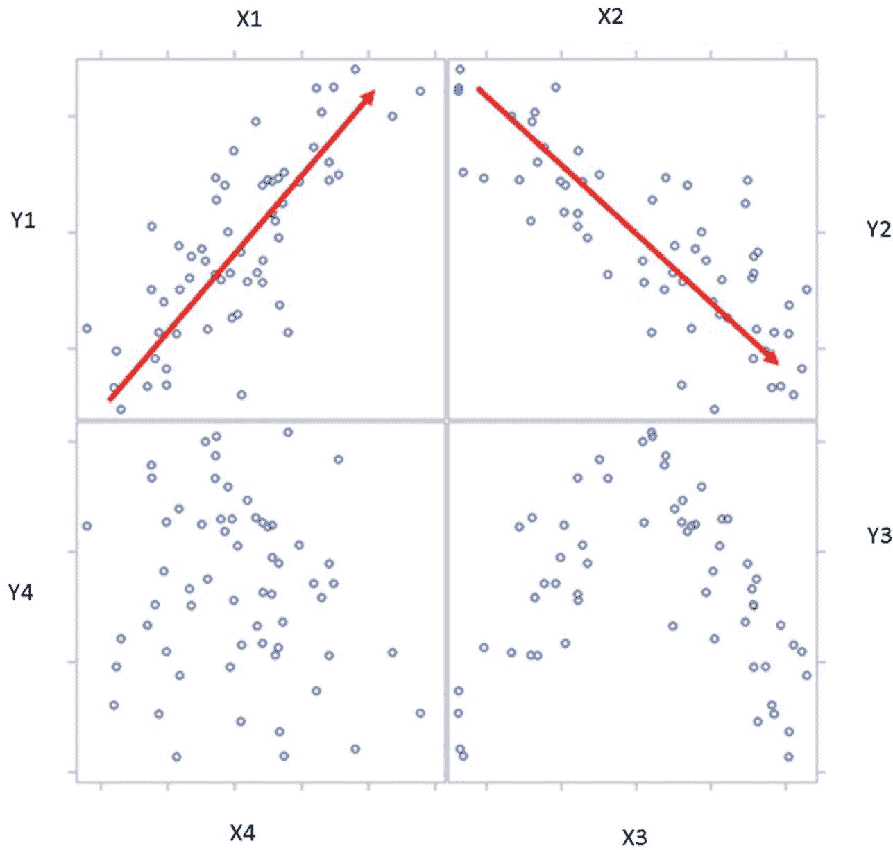

图 3-5 散点图的方向、强度和线性度

如果相互依赖性是线性的，则观察其方向以判断是正相关还是负相关。在图 3-5 中，左上角 `X1-Y1` 的关系是正相关，而右上角 `X2-Y2` 的图是负相关。在图 3-8 中，右下角 `X3-Y3` 没有方向，因为关系不是线性的，而是曲线性的。在图 3-5 中，左下角 `X4-Y4` 没有关系，因为点不规则地分散。

最后，描述关系的强度。如果点非常接近线/形状，则存在高度相互依赖性，关系很强。否则，关系很弱。

#### 在同一图像中绘制多个散点图

我们在同一图像中绘制多个散点图以比较数值。在本例中，我们拥有每个政党的登记选民人数，并将绘制这些数据，以比较缅因州各县中哪个政党的登记选民更多。

数据集文件夹中的 `MAINECOUNTIESPARTIES.xlsx` 数据集包含三列：县名和每个政党的登记选民人数，如表 3-1 所示。

**表 3-1** 缅因州各县政党登记选民人数

| 县 | 共和党 | 民主党 |
| --- | --- | --- |
| 安德罗斯科金 | 28189 | 22975 |
| 阿鲁斯图克 | 19419 | 13377 |
| 坎伯兰 | 57697 | 102935 |
| 富兰克林 | 7900 | 7001 |

| 汉考克 | 13682 | 16107 |
| 肯纳贝克 | 29296 | 31753 |
| 诺克斯 | 9148 | 12440 |
| 林肯 | 9727 | 10241 |
| 牛津 | 12172 | 16214 |
| 佩诺布斯科特 | 41601 | 32832 |
| 皮斯卡塔奎斯 | 5403 | 3098 |
| 萨加达霍克 | 9304 | 10679 |
| 萨默塞特 | 14998 | 9092 |
| 沃尔多 | 10378 | 10442 |
| 华盛顿 | 9037 | 6358 |
| 约克 | 50388 | 55828 |

和往常一样，我们读取数据集并使用`head()`方法进行探索，以验证其是否被正确读取，如代码清单 3-2-1 所示。

```
df=pd.read_excel('../Datasets/Chapter 3/MAINECOUNTIESPARTIES.xlsx')
print(df.head())
代码清单 3-2-1
读取并探索数据集
```

输出结果如图 3-6 所示，显示了数据集的前五行。

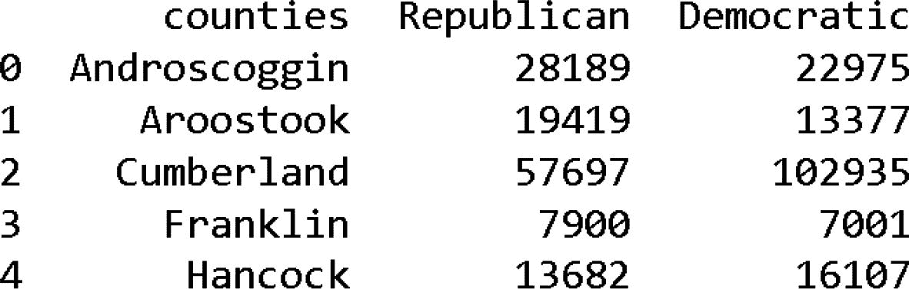

`图 3-6` `head()` 方法的输出

该代码绘制了两个重叠的散点图，它们的 x 轴都是`counties`，而第一个散点图的 y 轴是民主党人数，第二个散点图的 y 轴是共和党人数。为了改变颜色以区分它们，我们使用`c=['r']`设置了颜色选项，如代码清单 3-2-2 所示。此外，我们仅更改了共和党数据点的标记，以便即使在灰度下也能区分这些点，方法是在散点函数中使用`marker='^'`选项将其设置为三角形。我们将 y 轴标签更改为“共和党：红色三角形 民主党：蓝色圆圈”。最后，我们设置了图的标题。

```
plt.figure(figsize=(18, 6))
plt.scatter(df['counties'],df['Democratic'], c=['b'])
plt.scatter(df['counties'],df['Republican'] , marker='^',c=['r'])
plt.xlabel('counties')
plt.ylabel('Republican:Red Triangles Democrat:Blue Circles')
plt.title('Maine Counties and Parties')
代码清单 3-2-2
比较缅因州各县共和党与民主党的登记选民人数
```

上述代码的输出如图 3-7 所示。

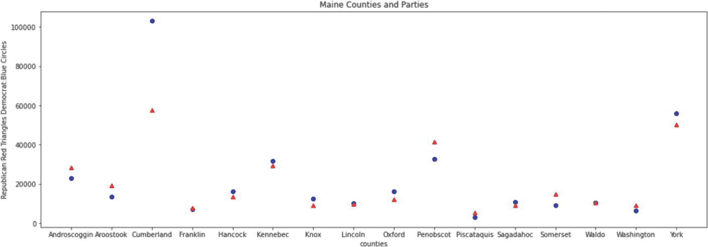

`图 3-7` 缅因州各县及政党的散点图

从图 3-7 中，我们可以看出坎伯兰县的民主党选民最多，总体登记选民也最多。这可能意味着它的人口也最多，但我们无法确定这一点，需要进一步验证。然而，我们可以确定的是，该县民主党与共和党之间的差距巨大。除该县外，在其余 15 个县中，有 8 个县的民主党人数多于共和党，但差异不大。因此，民主党必须更加关注缅因州，以免其变回红色州。

此外，如果民主党计划在缅因州举行集会，应该选在坎伯兰县。另一方面，共和党则应该选在佩诺布斯科特县。

类似地，你也可以对你的州进行同样的练习，并通过你的分析和预测为 2024 年总统大选做好准备。

## 直方图

直方图任务用于创建显示数值变量频率分布的图表。在本例中，我们将查看 2018 年 3 月北卡罗来纳州夏洛特市雇员的年薪分布情况。

你可以在数据集文件夹中找到数据文件，或者通过以下链接下载 CSV 文件：[`data.amerigeoss.org/dataset/city-employee-salaries-march-2018/resource/264fa25e-93cb-46b8-8edd-24ad224f3b74?view_id=4c9ee967-a039-4d72-ad78-2f556909b207`](https://data.amerigeoss.org/dataset/city-employee-salaries-march-2018/resource/264fa25e-93cb-46b8-8edd-24ad224f3b74%253Fview_id%253D4c9ee967-%2560a039-4d72-ad78-2f556909b207)。

和往常一样，使用 Pandas 的`read_csv()`方法将 CSV 文件加载到 DataFrame 中。然后，使用`head()`方法进行探索，以验证其是否被正确读取，如代码清单 3-3-1 所示。

```
df=pd.read_csv('../Datasets/Chapter 3/City_Employee_Salaries_March_2018.csv')
print(df.head())
代码清单 3-3-1
读取并探索数据集
```

输出结果如图 3-8 所示，显示了数据集的前五行。我们有九列数据。然而，我们只对其中一列`Annual_Rt`感兴趣，用于绘制直方图。

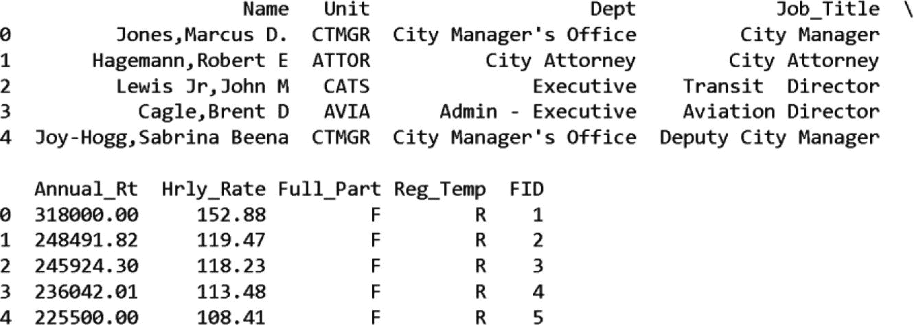

`图 3-8` `head()` 方法的输出

在代码清单 3-3-2 中，我们再次首先使用`.figure()`方法在新的绘图中绘制直方图，避免覆盖上一节的散点图。同时，我们在`.figure()`方法中使用`figsize`设置了绘图尺寸。然后，我们在`.hist()`方法中选择`Annual_RT`作为变量。最后，我们标记 x 轴并设置绘图标题。

```
plt.figure(figsize=(18, 10))
plt.hist(df['Annual_Rt'])
plt.xlabel('Annual_Rt')
plt.title('The Distribution of The Annual Rate of Charlotte City Employees')
代码清单 3-3-2
选择分析变量以绘制其直方图
```

图 3-9 显示了直方图。然而，我们需要改善该图的外观。它是一个右偏曲线，并且存在一些明显的异常值。此外，我们可以调整组距（bins）以获得更接近正态分布的曲线。最后一步是在直方图上叠加一条正态分布曲线。我们将在代码清单 3-3-3 中完成所有这些步骤。

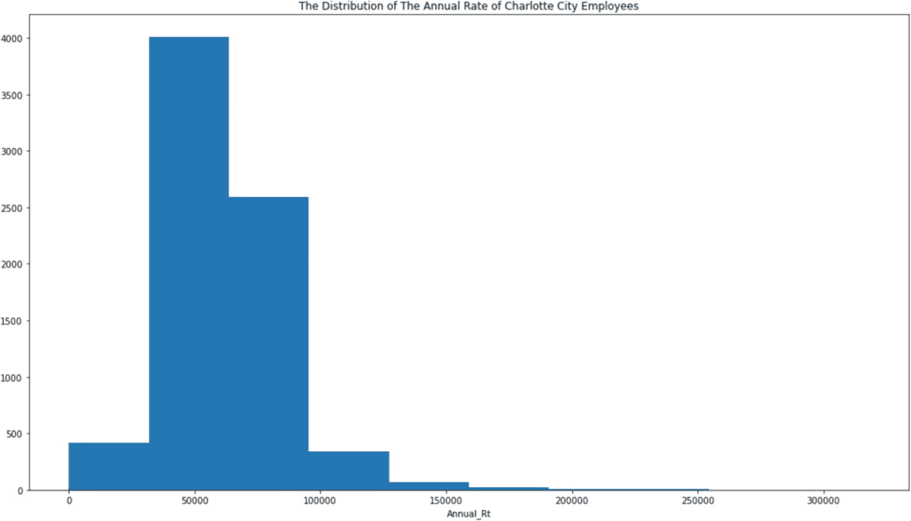

`图 3-9` 夏洛特市雇员的直方图

代码清单 3-3-3 首先从`scipy.stats`中导入`norm`。该库用于绘制正态分布曲线；它包含用于处理正态（高斯）分布的函数。

然后，我们生成一个 x 轴的值数组，范围从`0`到`14000`，步长为`1`。我们将最高年薪率设置为`140000`，并通过在`Annual_RT`序列上设置掩码来忽略任何大于该值的数值。

之后，我们使用新的掩码序列绘制直方图，将组距（bins）更改为`10`，并对直方图进行归一化以绘制密度并返回概率密度。接下来是绘制正态分布，其均值和标准差根据数据计算得出。最后的修改包括为 x 轴添加标签、设置标题、设置图例并显示所有内容。

```python
from scipy.stats import norm
plt.figure(figsize=(15, 10))
# Generate data for x-axis ranging from 0 to 14000 with 1 step
x = np.arange(0, 140000, 1)
# Set the maximum salary to 140000
# Creates a new series for the 'Annual_Rt' from the DataFrame df
ar = df['Annual_Rt']
# Creates a boolean mask where values in 'Annual_Rt' are less than 140000
mask = ar < 140000
# Applies the mask to filter the data
df1 = ar[mask]
# Plot the histogram
# plt.hist: Plots a histogram of the filtered data (df1)
# bins=10: Specifies the number of bins for the histogram
# density=True: Normalizes the histogram to represent a probability density
# alpha=0.6: Sets the transparency of the bars
# color=b: Sets the color of the bars to blue
plt.hist(df1, bins=10, density=True, alpha=0.6, color='b')
# Plot the normal distribution with mean and standard deviation calculated from the data
# Calculates the mean (mu) and standard deviation (std) of the filtered data # using a normal distribution fit
mu, std = norm.fit(df1)
# Plots the normal distribution curve using the calculated mean and standard # deviation. The curve is in red and labeled as Normal Distribution
plt.plot(x, norm.pdf(x, mu, std), 'r-', label='Normal Distribution')
# Sets the label for the x-axis
plt.xlabel('Annual_Rt')
# Sets the title of the plot
plt.title('The Distribution of The Annual Rate of Charlotte City Employees')
# Displays a legend to identify the histogram and the normal distribution curve
plt.legend()
# Displays the plot
plt.show()
```

清单 3-3-3 的输出是图 3-10，该图展示了在屏蔽薪资并设置其最大值后，直方图上叠加的正态分布曲线。

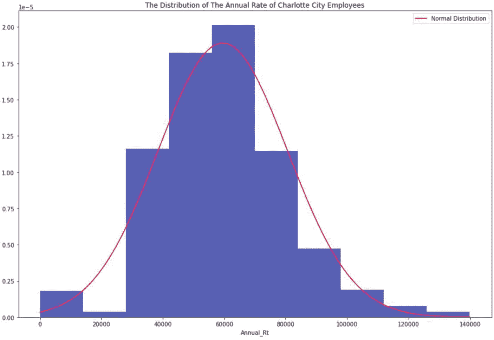

现在，我们得到的正态分布曲线比之前右偏的曲线更接近正态分布。

## 序列图

序列图显示数值随时间的变化。在本例中，让我们绘制股票价格随时间变化的趋势。

在本练习中，我们没有要加载的数据集。相反，我们将使用雅虎财经库`yfinance`来加载任何公司的股票数据。首先，如清单 3-4-1 所示，我们将加载苹果公司股票的历史数据。然后，在清单 3-4-2 中，我们将加载多家公司并将它们相互绘制以比较数值。这些公司包括苹果 (`AAPL`)、英特尔 (`INTC`)、微软 (`MSFT`) 和 ASML 控股 (`ASML`)。

```python
# This library is used to fetch financial data, including historical stock # prices
import yfinance as yf
# matplotlib is used for creating plots and visualizations
import matplotlib.pyplot as plt
# Define the stock symbol and time range
stock_symbol = "AAPL"  # Example: Apple Inc.
start_date = "2022-01-01"
end_date = "2023-01-01"
# Download historical stock data
stock_data = yf.download(stock_symbol, start=start_date, end=end_date)
# Plot the closing prices over time
plt.figure(figsize=(15, 8))
plt.plot(stock_data['Close'], label=f"{stock_symbol} Closing Prices", color='blue')
plt.title(f"{stock_symbol} Closing Prices Over Time")
plt.xlabel("Date")
plt.ylabel("Closing Price")
plt.legend()
plt.grid(True)
plt.show()
```

清单 3-4-1
Series plot to show Apple Inc. closing prices over time

现在，让我们逐行解释清单 3-4-1 的代码。如前所述，首先加载所需的库。然后，我们设置公司的股票代码以及开始和结束日期。我们将这些信息传递给`yf.download()`方法，以下载指定股票代码的历史数据。接着，我们使用`plt.plot()`方法，通过设置颜色来绘制序列图。最后，像往常一样，我们设置图表标题、x 轴和 y 轴的标签、显示网格，并在应用所有这些设置后显示图表。输出结果如图 3-11 所示。

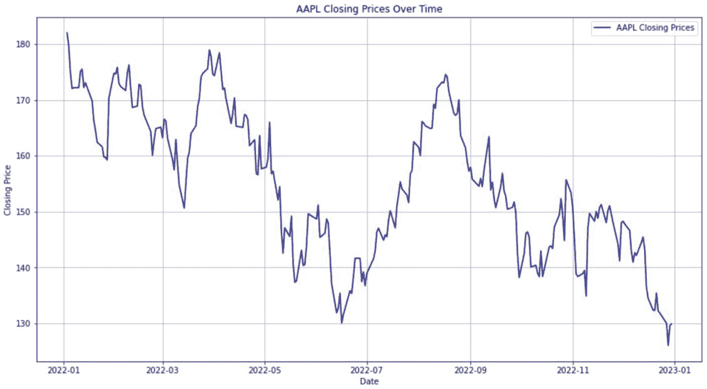

我们可以通过将股票代码以列表形式添加到`stock_symbol`中来添加更多公司的股票，如下所示：`stock_symbols = ["AAPL", "INTC", "MSFT", "ASML"]`，如清单 3-4-2 所示。

此外，在清单 3-4-2 中，我们遍历公司列表`stock_symbols`，以在一张图中绘制它们的序列图。

```markdown
# 多公司收盘价的系列图

```python
# yfinance is used to fetch financial data, including historical stock #prices
import yfinance as yf
#matplotlib.pyplot used for creating plots and visualizations
import matplotlib.pyplot as plt
#stock_symbols are a list containing the stock symbols for Apple (AAPL), #Intel (INTC), Microsoft (MSFT), and ASML Holding (ASML)
stock_symbols = ["AAPL", "INTC", "MSFT", "ASML"]
#The date range to fetch historical stock data
start_date = "2021-01-01"
end_date = "2023-01-01"
#Download historical stock data for each stock
stock_data = yf.download(stock_symbols, start=start_date, end=end_date)['Close']
#A loop is used to iterate over each stock symbol, and the closing prices #for each stock are plotted. All in the same figure
plt.figure(figsize=(15, 8))
for symbol in stock_symbols:
plt.plot(stock_data[symbol], label=f"{symbol} Closing Prices")
plt.title("Closing Prices Over Time for Selected Stocks")
plt.xlabel("Date")
plt.ylabel("Closing Price")
# Displays a legend to identify each stock
plt.legend()
# Adds a grid to the plot for better readability
plt.grid(True)
#Show the plot using the above settings
plt.show()
```

清单 3-4-2 的输出是图 3-12。这段代码获取指定股票的历史收盘价，并在给定日期范围内将它们绘制在同一张图上。您可以根据自己的偏好自定义股票代码和日期范围。

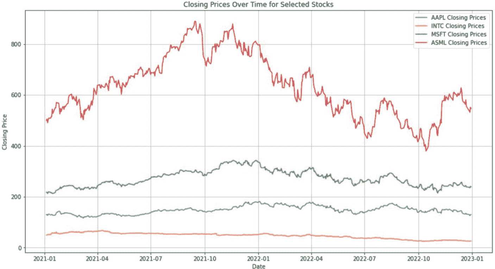

图 3-12：选定股票随时间变化的收盘价

从图 3-12 可以清楚地看出，ASML 的收盘价最高，即使在其最低点（大约在 2022 年 10 月）也是如此，而英特尔 (`INTC`) 从 2021 年 1 月到 2023 年 1 月的收盘价最低。

## 条形图

条形图用于并排比较数值，无论是垂直方向还是水平方向。在本示例中，我们将使用纽约市的犯罪数据来比较 2018 年纽约市不同行政区的犯罪率。你可以通过此链接下载 2018 年纽约警察局投诉数据：[`https://www.kaggle.com/datasets/mihalw28/nypd-complaint-data-current-ytd-july-2018/data?select=NYPD_Complaint_Data_Current_YTD.csv`](https://www.kaggle.com/datasets/mihalw28/nypd-complaint-data-current-ytd-july-2018/data%253Fselect%253DNYPD_Complaint_Data_Current_YTD.csv)。

如需下载最新数据，可通过纽约市开放数据项目网站获取。你可以在数据集文件夹中找到该数据文件，或通过此链接下载数据集：[`https://data.cityofnewyork.us/Public-Safety/NYPD-Complaint-Data-Current-Year-To-Date-/5uac-w243/data`](https://data.cityofnewyork.us/Public-Safety/NYPD-Complaint-Data-Current-Year-To-Date-/5uac-w243/data)。

从上述链接下载当前年份的数据集，步骤与图 3-13 类似，点击“导出”然后选择“CSV”即可。

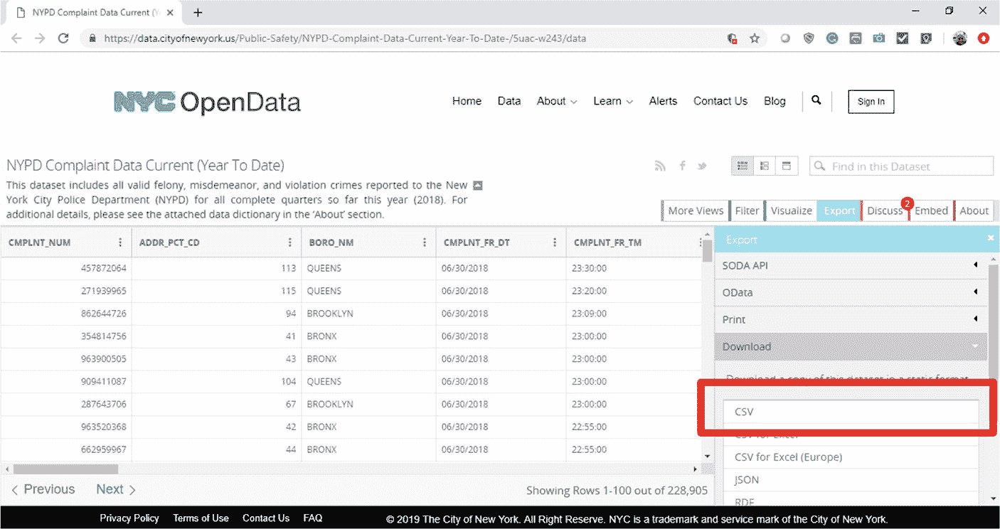

图 3-13：纽约警察局投诉数据——纽约市开放数据

该数据集包含海量信息。可以对这些数据进行大量的调查和分析。例如：每个行政区最常见的犯罪类型是什么？犯罪最可能发生在什么时间？一周中哪一天犯罪数量最多？

在本示例中，我们只关心回答一个问题：哪个行政区的犯罪率最高，哪个最低？

要回答这个问题，我们需要以下三列：`Borough`（行政区）、`Longitude`（经度）和`Latitude`（纬度）。因此，我们将删除所有其他列。然后，我们将统计每个行政区的犯罪数量，并用条形图表示。

在清理和准备数据之后，我们得到如下数据集，如表 3-2 所示。

表 3-2：各行政区犯罪数量

| 行政区 | 犯罪数量 | 纬度 | 经度 |
| --- | --- | --- | --- |
| 布朗克斯 | 50153 | 40.82452 | -73.8978 |
| 布鲁克林 | 67489 | 40.82166 | -73.9189 |
| 曼哈顿 | 56691 | 40.71332 | -73.9829 |
| 皇后区 | 44137 | 40.74701 | -73.7936 |
| 史坦顿岛 | 10285 | 40.63204 | -74.1222 |

为了加载数据，我们编写代码清单 3-5-1。在本示例中，我们将值直接插入代码中，而不是读取外部数据，以练习在 Python 中读取数据的其他方式。

```
# 数据
Borough = ['BRONX', 'BROOKLYN', 'MANHATTAN', 'QUEENS', 'STATEN ISLAND']
crimes = [50153, 67489, 56691, 44137, 10285]
# 创建条形图
plt.figure(figsize=(10, 6))
plt.bar(Borough, crimes, color='skyblue')
# 添加标签和标题
plt.xlabel('Borough')
plt.ylabel('Number of Crimes')
plt.title('Number of Crimes in Different Boroughs')
# 显示条形图
plt.show()
```

代码清单 3-5-1：创建各行政区犯罪数量的数据集

在代码清单 3-5-1 中，我们将行政区的名称和每个行政区的犯罪总数分别插入到两个列表 `Borough` 和 `crimes` 中。然后，我们使用 `plt.bar()` 方法创建条形图，并设置两个变量和颜色。最后，像往常一样，我们设置 x 轴和 y 轴的标签以及图表标题，然后显示图表。

代码清单 3-5-1 的输出是图 3-14。

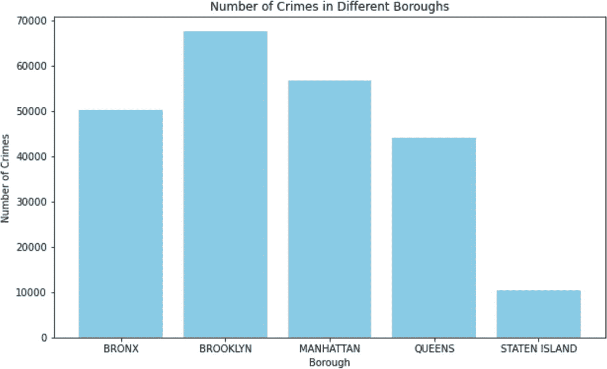

图 3-14：显示纽约市不同行政区犯罪数量的条形图

### 如何对条形图进行排序？

为避免混淆，最好将图表按升序或降序排序。在本示例中，我们将学习一种对之前纽约市行政区犯罪条形图进行排序的方法。排序条形图的方法有很多种。在代码清单 3-5-2 中，我们展示了其中一种方法。
```

# 数据

```python
Borough = ['BRONX', 'BROOKLYN', 'MANHATTAN', 'QUEENS', 'STATEN ISLAND']
crimes = [50153, 67489, 56691, 44137, 10285]
# 按犯罪数量对数据进行排序
sorted_data = sorted(zip(Borough, crimes), key=lambda x: x[1])
# 排序后提取排序后的行政区与犯罪数量
sorted_Borough, sorted_crimes = zip(*sorted_data)
# 创建条形图
plt.figure(figsize=(10, 6))
plt.bar(sorted_Borough, sorted_crimes, color='skyblue')
# 添加标签和标题
plt.xlabel('Borough')
plt.ylabel('Number of Crimes')
plt.title('Number of Crimes in Different Boroughs (Sorted)')
# 显示条形图
plt.show()
```

代码清单 3-5-2：对垂直条形图进行升序排序

在代码清单 3-5-2 中，我们使用`zip(Borough, crimes)`函数将两个列表组合成行政区与犯罪数量的配对。`sorted()`函数根据每个配对的第二个元素（即犯罪数量），使用`lambda`函数作为排序键对这些配对进行排序。

排序后，使用`zip(*sorted_data)`函数将排序后的数据解压缩为两个独立的列表`sorted_Borough`和`sorted_crimes`。然后，像往常一样，我们使用`Matplotlib`创建条形图。`plt.figure(figsize=(10, 6))`设置图形大小。接着使用`plt.bar()`函数创建条形图，其中`sorted_Borough`位于 x 轴，`sorted_crimes`变量位于 y 轴，条形颜色为天蓝色。`plt.xlabel`、`plt.ylabel`和`plt.title`函数分别用于添加 x 轴、y 轴的标签和图表标题。最后，使用`plt.show()`显示创建的条形图。代码清单 3-5-2 的输出是图 3-15 中的升序排序图表。

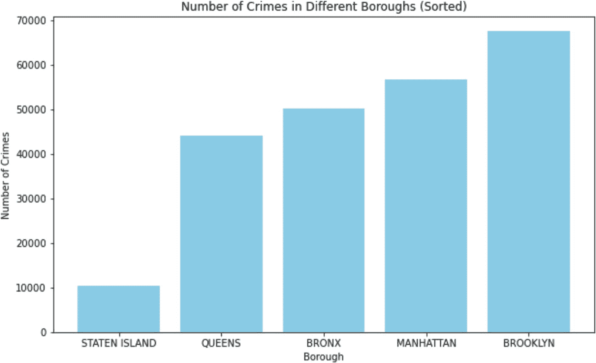

图 3-15：升序排序的条形图

要反转输出以获得降序的垂直条形图，请在`sorted_data = sorted(zip(Borough, crimes), key=lambda x: x[1], reverse=True)`中将`reverse`选项设置为`True`，如代码清单 3-5-3 所示。

```python
# 数据
Borough = ['BRONX', 'BROOKLYN', 'MANHATTAN', 'QUEENS', 'STATEN ISLAND']
crimes = [50153, 67489, 56691, 44137, 10285]
# 按犯罪数量对数据进行降序排序
sorted_data = sorted(zip(Borough, crimes), key=lambda x: x[1], reverse=True)
# 排序后提取排序后的行政区与犯罪数量
sorted_Borough, sorted_crimes = zip(*sorted_data)
# 创建条形图
plt.figure(figsize=(10, 6))
plt.bar(sorted_Borough, sorted_crimes, color='skyblue')
# 添加标签和标题
plt.xlabel('Borough')
plt.ylabel('Number of Crimes')
plt.title('Number of Crimes in Different Boroughs (Sorted Descending)')
# 显示条形图
plt.show()
```

代码清单 3-5-3：对条形图进行降序排序

代码清单 3-5-3 的输出如图 3-16 所示。

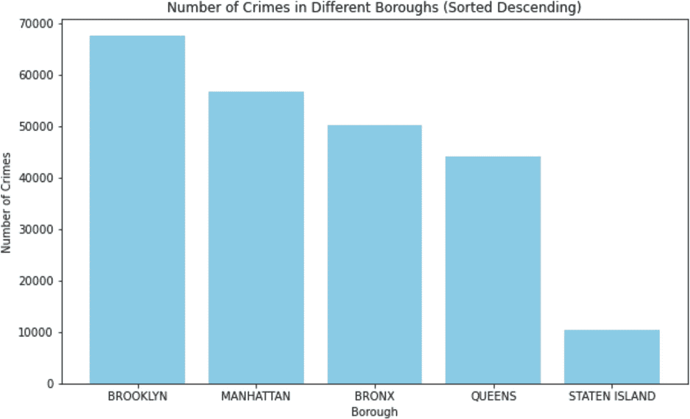

图 3-16：将 reverse 设置为 true 以反转条形图，实现降序排列

要将条形图的方向从垂直改为水平，我们使用`plt.barh()`函数来绘制条形图，如代码清单 3-5-4 所示。

# 数据

```python
Borough = ['BRONX', 'BROOKLYN', 'MANHATTAN', 'QUEENS', 'STATEN ISLAND']
crimes = [50153, 67489, 56691, 44137, 10285]
# 按犯罪数量降序排序数据
sorted_data = sorted(zip(Borough, crimes), key=lambda x: x[1], reverse=True)
# 提取排序后的行政区划和犯罪数量
sorted_Borough, sorted_crimes = zip(*sorted_data)
# 创建水平条形图
plt.figure(figsize=(10, 6))
plt.barh(sorted_Borough, sorted_crimes, color='skyblue')
# 添加标签和标题
plt.xlabel('犯罪数量')
plt.ylabel('行政区划')
plt.title('不同行政区划的犯罪数量（降序排列）')
# 显示水平条形图
plt.show()
```

代码清单 3-5-4：使用水平条形图替代垂直条形图

代码清单 3-5-4 的输出结果为图 3-17。

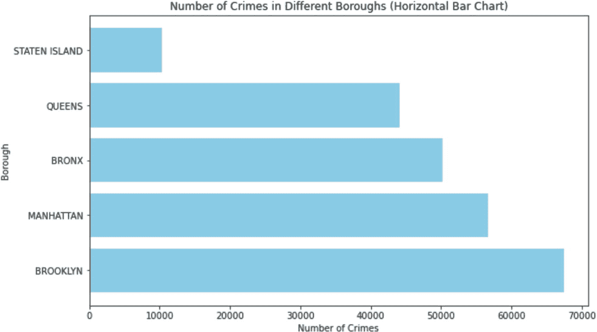

### 使用条形图创建直方图

条形图也可用于创建直方图。在许多其他统计编程语言（如 SAS）中，直方图只能针对字符串数据类型绘制，且数据必须为数值型。在 Python 中则没有此限制。在本例中，你将学习如何绘制 2012 年缅因州总统候选人及其得票率的图表，该内容在第 1 章中曾提及。缅因州的结果如表 3-3 所示。

表 3-3 2012 年总统候选人及其在缅因州的得票率

| 候选人 | 得票率 |
| --- | --- |
| Obama | 56.27 |
| Romney | 40.98 |
| Johnson | 1.31 |
| Stein | 1.14 |
| Paul | 0.29 |
| Anderson | 0.01 |
| Reed | 0 |

同样，我们不会从外部文件加载数据，而是像代码清单 3-6 那样将值直接插入代码中。

```python
# 数据
candidates = ['Obama', 'Romney', 'Johnson', 'Stein', 'Paul', 'Anderson', 'Reed']
winning_percentages = [56.27, 40.98, 1.31, 1.14, 0.29, 0.01, 0]
# 为每位候选人定义颜色
colors = ['blue', 'red', 'silver', 'green', 'grey', 'grey', 'grey']
# 创建条形图
plt.figure(figsize=(10, 6))
bars = plt.bar(candidates, winning_percentages, color=colors)
# 在每个条形上方添加标签
for bar, label in zip(bars, winning_percentages):
    plt.text(bar.get_x() + bar.get_width() / 2 - 0.05, bar.get_height() + 0.2, f'{label:.2f}%', ha='center', va='bottom', color='black', fontweight='bold')
# 添加标签和标题
plt.xlabel('候选人')
plt.ylabel('得票率 (%)')
plt.title('总统候选人得票率')
# 显示条形图
plt.show()
```

代码清单 3-6：2012 年缅因州总统候选人得票率

代码清单 3-6 中条形图的附加价值在于使用相应的政党颜色为条形着色。同样，我们从两个列表 `candidates` 和 `winning_percentages` 中读取数据。然后，我们定义要在图表中使用的颜色列表。`plt.figure(figsize=(10, 6))` 设置图形大小。接着使用 `plt.bar` 函数创建垂直条形图，其中 `candidates` 列位于 x 轴，`winning_percentages` 变量位于 y 轴，条形根据我们预先指定的颜色列表着色。然后，我们循环遍历每个条形及其对应的得票率。

接着使用 `plt.text` 函数在每个条形上方添加文本标签，显示保留两位小数的得票率。标签使用 `ha='center'` 水平居中，并使用 `va='bottom'` 底部对齐。标签为黑色粗体。最后，一如既往地设置 x 轴和 y 轴的标签以及图表标题。输出结果为图 3-18。

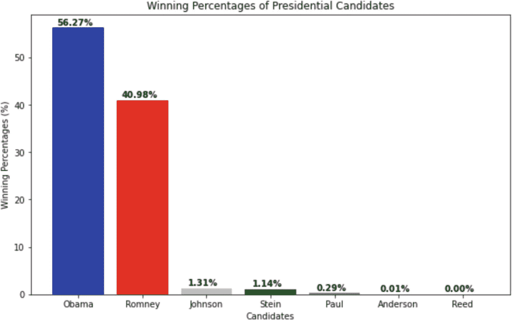

## 气泡图

气泡图有助于同时展示三个数据变量。在本例中，我们将创建一个气泡图来展示一个班级的身高、体重和年龄。

对于本例，我生成了班级的随机数据，如代码清单 3-7-1 所示，作为本章的第三个数据源。

```python
import pandas as pd
import numpy as np
import matplotlib.pyplot as plt
# 生成 20 名学生的数据集
np.random.seed(42)  # 设置随机种子以确保可重复性
students_data = {
    'Name': [f'Student{i}' for i in range(1, 21)],
    'Height': np.random.uniform(150, 190, 20),  # 身高，单位：厘米
    'Weight': np.random.uniform(45, 90, 20),   # 体重，单位：千克
    'Age': np.random.randint(18, 25, 20)        # 年龄，单位：岁
}
students_df = pd.DataFrame(students_data)
# 创建气泡图
plt.figure(figsize=(12, 8))
# 调整气泡大小的缩放因子
scaling_factor = 500
scatter = plt.scatter(students_df['Height'], students_df['Weight'], s=students_df['Age'] * scaling_factor, c=students_df['Age'], cmap='viridis', alpha=0.7)
# 用学生姓名标注每个点
for i, name in enumerate(students_df['Name']):
    plt.text(students_df['Height'][i], students_df['Weight'][i], name, ha='center', va='center', fontsize=8, color='black', alpha=0.7)
# 添加标签和标题
plt.xlabel('身高 (cm)')
plt.ylabel('体重 (kg)')
plt.title('气泡图：身高 vs 体重，气泡大小表示年龄，并显示学生姓名')
# 添加颜色条
cbar = plt.colorbar(scatter)
cbar.set_label('年龄 (岁)')
# 显示气泡图
plt.show()
```

代码清单 3-7-1：随机生成班级数据并绘制气泡图

代码清单 3-7-1 首先使用 `np.random.seed(42)` 设置随机种子以确保可重复性。固定随机化中的种子意味着每次重新编译和运行代码时，都会生成相同的随机值。但如果我们不指定种子，每次重新运行单元格时，都会生成新的随机值。然后，使用 `np.random.uniform` 函数为 20 名学生生成随机数据。数据集包含学生姓名、身高、体重和年龄列。接着，使用 Matplotlib 创建气泡图。一如既往，`plt.figure(figsize)` 设置图形大小。

现在，惊喜之处在于再次使用了 `plt.scatter` 函数。是的，我们用它来绘制散点图和气泡图。在散点图中，x 轴表示身高，y 轴表示体重，气泡大小与年龄成正比（缩放因子为 500），颜色表示年龄。`cmap='viridis'` 指定颜色映射，`alpha=0.7` 设置气泡的透明度。

然后使用 `plt.text` 函数为图表上的每个点添加注释，在相应位置显示学生姓名。代码为 x 轴、y 轴添加标签，并为图表添加标题。

为图表添加了一个颜色条图例来表示学生的年龄。`cbar.set_label` 函数设置颜色条的标签。最后，使用 `plt.show()` 显示创建的气泡图。输出结果为图 3-19。

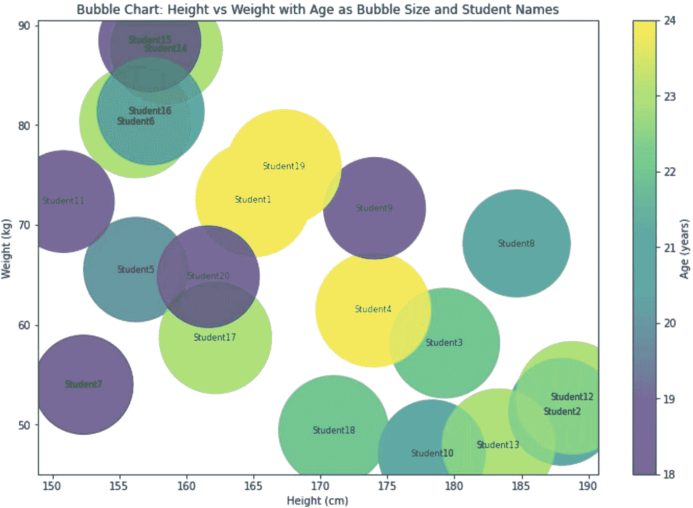

如图 3-19 所示，气泡直径并无显著差异。年龄范围在 18 至 24 岁之间。因此，我决定将生成的随机数据集之一保存为 Excel 文件，并手动修改部分年龄、体重和身高值，以制造显著差异。年龄范围变为 5 至 24 岁，与数据集文件夹中的`class.xlsx`数据集一致，如代码清单 3-7-2 所示。代码清单 3-7-1 与 3-7-2 的唯一区别在于，后者将随机生成部分替换为通过`pd.read_excel`函数读取文件来创建 DataFrame `students_df`。

```python
import pandas as pd
import numpy as np
import matplotlib.pyplot as plt
# 为 20 名学生生成数据集
np.random.seed(42)  # 设置随机种子以确保可重复性
students_df = pd.read_excel('../Datasets/Chapter 3/class.xlsx')
print(df.head())')
# 创建气泡图
plt.figure(figsize=(12, 8))
# 调整气泡大小的缩放因子
scaling_factor = 500
scatter = plt.scatter(students_df['Height'], students_df['Weight'], s=students_df['Age'] * scaling_factor, c=students_df['Age'], cmap='viridis', alpha=0.7)
# 为每个数据点标注学生姓名
for i, name in enumerate(students_df['Name']):
plt.text(students_df['Height'][i], students_df['Weight'][i], name, ha='center', va='center', fontsize=8, color='black', alpha=0.7)
# 添加坐标轴标签和标题
plt.xlabel('Height (cm)')
plt.ylabel('Weight (kg)')
plt.title('Bubble Chart: Height vs Weight with Age as Bubble Size and Student Names')
# 添加颜色条
cbar = plt.colorbar(scatter)
cbar.set_label('Age (years)')
# 显示气泡图
plt.show()
```

代码清单 3-7-2：读取班级数据集而非随机生成

代码清单 3-7-2 的输出结果为图 3-20。现在，图表清晰地展示了班级中的离群值。例如，紫色气泡中的学生 5 是班级中最矮的学生，而黄色气泡中的学生 4 则是班级中最高的学生。

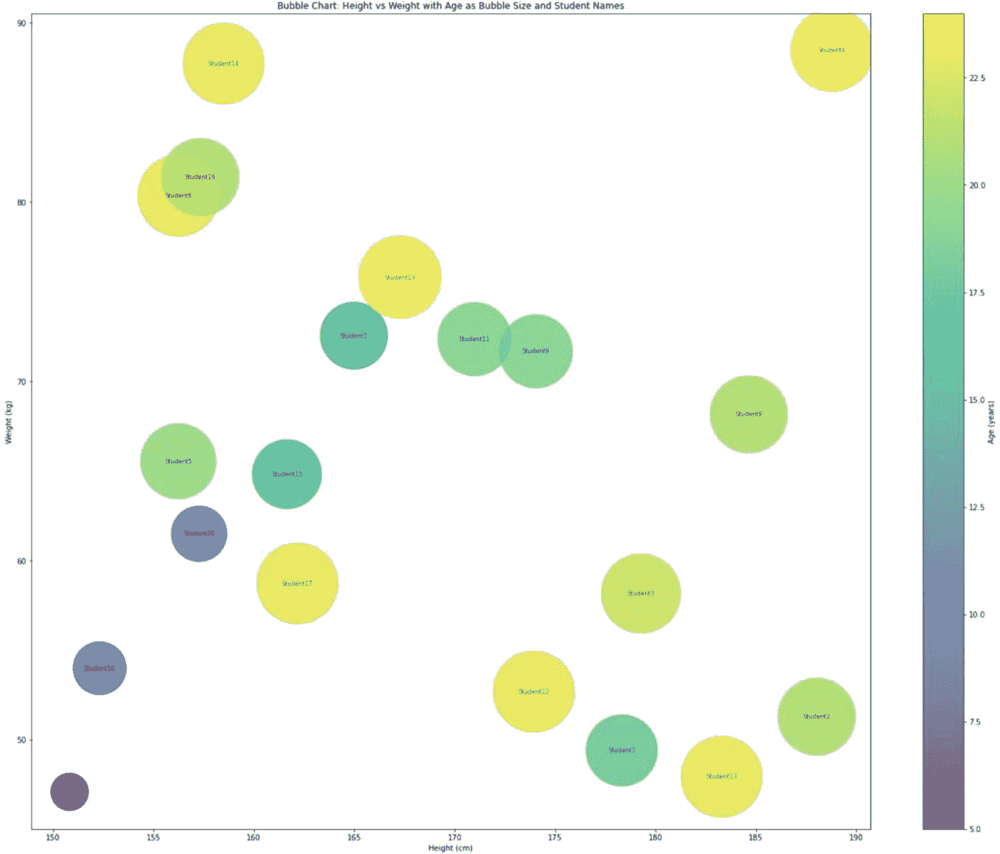

## 总结

本章深入探讨了数据可视化。首先介绍了最基本的图表类型，如散点图和直方图。此外，还展示了如何通过改变颜色和图案来叠加图表，以便于比较分析结果。Python 中的数据可视化是最强大的功能之一，提供了丰富的自定义图表选项。

