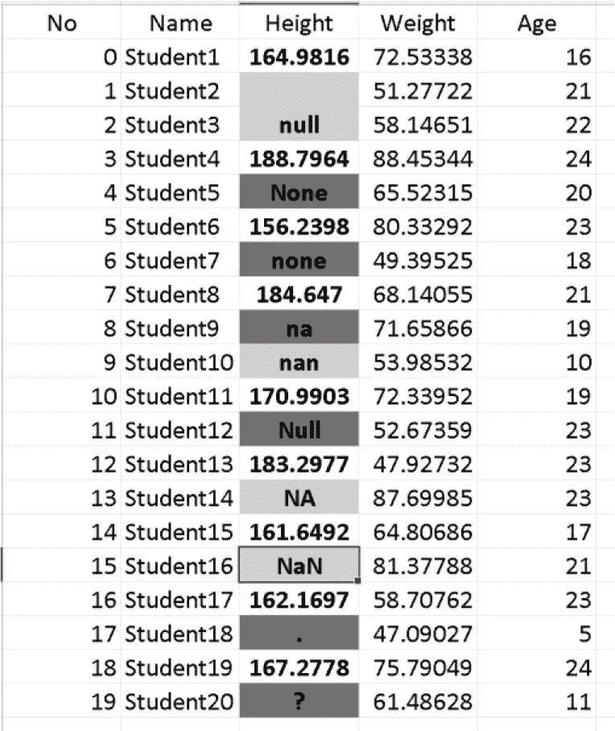
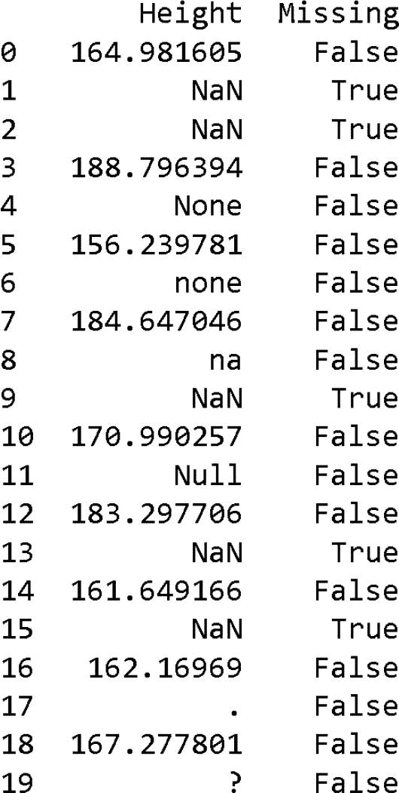
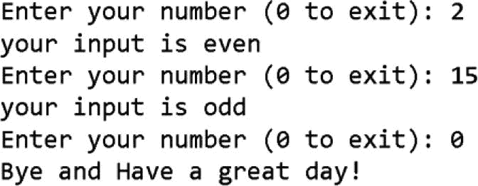
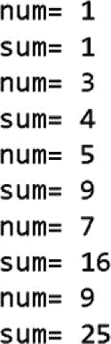
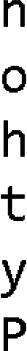
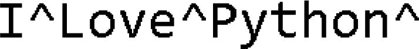
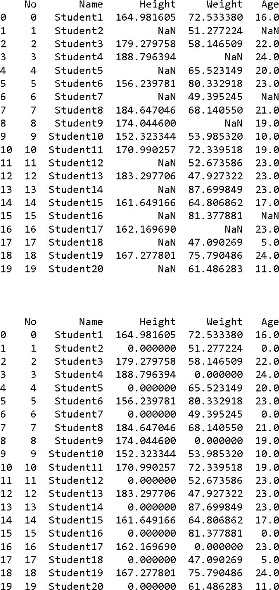

# 5. 数据预处理与特征工程

本章介绍一些基本的数据清理和查询方法，例如注释语句、算术和比较运算符，以及如何表示缺失值和循环。

## 注释语句

记录你的代码至关重要，这样你和你的同事才能理解分析构建背后的逻辑。通常，如果你不记录代码，几个月后你再看它时，可能不记得为什么使用某个函数或为什么进行某项检查。因此，代码文档对于遵循逻辑流程至关重要。

Python 中注释语句的语法可以通过以下两种方式实现：

```python
#消息
"""消息"""
```

你可以在程序中的任何位置使用注释语句来解释你的代码。Python 解释器在处理过程中会忽略注释语句中的文本。始终建议你在程序开头编写一条注释，说明你的程序将做什么，然后根据需要添加尽可能多的注释。为了描述逻辑流程，最好在每个数据或过程步骤处编写一条注释，描述其作用。

## 算术运算符与赋值运算符

算术运算符表示执行算术计算，如表 5-1 所示。

**表 5-1** 算术运算符与赋值运算符

| 运算符 | 含义 | 示例 | 结果 |
| --- | --- | --- | --- |
| `+` | 加法 | `2 + 3` | `5` |
| `+=` |   | `X = 5` `X += 15` | `X=20` |
| `-` | 减法 | `5 – 3` | `2` |
| `-=` |   | `X = 5` `X -= 15` | `X=-10` |
| `/` | 除法 | `5 / 2` | `2.5` |
| `/=` |   | `X = 15` `X /= 5` | `X=3.0` |
| `//` | 商 | `5 // 2` | `2` |
| `%` | 余数 | `5 % 2` | `1` |
| `*` | 乘法 | `2 * 3` | `6` |
| `*=` |   | `X = 15` `X *= 5` | `X=75` |
| `**` | 幂运算 | `2 ** 3` | `8` |

如果缺失值是算术运算符的操作数，则结果也为缺失值。为避免缺失值的传播，我们将在本章及下一章中讨论一些在数据集中表示和处理缺失值的方法。

## Python 运算符优先级规则：PEMDAS

- `P`：括号（Parentheses）
- `E`：幂运算（Exponentiation）
- `M`：乘法（Multiplication）
- `D`：除法（Division）
- `A`：加法（Addition）
- `S`：减法（Subtraction）

你可以通过流行的运算符顺序口诀来记忆：“Please Excuse My Dear Aunt Sally.”

## 比较运算符

比较运算符用于对两个变量、常量或表达式进行比较、运算或计算。如果比较结果为真，则返回 `True`；如果比较结果为假，则返回 `False`。比较运算符如表 5-2 所示。

**表 5-2** 比较运算符

| 运算符 | 含义 | 示例 | 结果 |
| --- | --- | --- | --- |
| `==` | 等于 | `print(2 == 3)` | `False` |
| `!=` | 不等于 | `print(2 != 3)` | `True` |
| `<` | 小于 | `print(2 < 3)` | `True` |
| `<=` | 小于或等于 | `print(2 <= 3)` | `True` |
| `>` | 大于 | `print(2 > 3)` | `False` |
| `>=` | 大于或等于 | `print(2>=3)` | `False` |
| `in` | 成员资格 | `x=2` `print(x in (2,3,5))` | `True` |

## 逻辑运算符、成员运算符和身份运算符

逻辑运算符用于表示两个条件或表达式之间的关系，判断它们是否同时为真、至少一个为真，或者条件是否应被反转。表 5-3 展示了三种类型的运算符：逻辑运算符、成员运算符和身份运算符。

成员运算符用于检查某个值是否是集合或序列（如列表或字符串）的一部分。

身份运算符用于判断两个变量在内存中是否为同一个对象，而不仅仅是值相等。

**表 5-3** 逻辑运算符、成员运算符和身份运算符

| 运算符 | 含义 | 示例 | 结果 |
| --- | --- | --- | --- |
| `and` | 如果两个语句都为真，则返回 `True` | `x=5` `x < 5 and x < 10` | `False` |
| `or` | 如果其中一个语句为真，则返回 `True` | `x=5` `x < 5 or x < 4` | `False` |
| `not` | 反转结果，如果结果为真则返回 `False` | `x=5` `not(x < 5 and x < 10)` | `True` |
| `in` | 如果对象中存在包含指定值的序列，则返回 `True` | `y=['bus','car','walk']` `x='car'` `x in y` | `True` |
| `not in` | 如果对象中不存在包含指定值的序列，则返回 `True` | `y=['bus','car','walk']` `x='car'` `x not in y` | `False` |
| `is` | 如果两个变量是同一个对象，则返回 `True` | `x=['bus','car','walk']` `y=['bus','car','walk']` `print(x is y)` `print(x==y)` | `False` `True` |
| `is not` | 如果两个变量不是同一个对象，则返回 `True` | `x=['bus','car','walk']` `y=['bus','car','walk']` `x is not y` | `True` |

Python 中的运算顺序如下：括号、幂运算、一元正号、一元负号、乘法、除法、整除和取模、加法和减法、比较运算、身份和成员运算符、逻辑 `NOT`、`AND`、`OR`。

## 如何在原始数据中表示缺失值

以下是原始数据中表示缺失值的值，以便 Python 解释器正确读取和存储这些值：

```python
null,  , NA, nan, NaN
```

Python 解释器会将上述值转换为 `NaN` 并将其作为缺失值处理。请注意大小写，因为以下值不会被解释为缺失值：`None`、`none`、`na`、`Null`。

让我们测试这些值，并通过一个示例了解 Python 解释器如何计算它们。在代码清单 5-1 中，我们测试了上述所有值以及其他一些统计编程语言中缺失值的表示形式。例如，“.” 在 SAS 中表示缺失值。

```python
#import the libraries
import pandas as pd
import numpy as np
import matplotlib.pyplot as plt
#import the dataset
students_df = pd.read_excel('../Datasets/Chapter 5/missing.xlsx')
#verify that the dataset has been read correctly
print(students_df)
#generate the summary statistics
students_df['Height'].describe()
#create a new empty dataframe that has the Height and Missing variables
new=pd.DataFrame(columns = ['Height', 'Missing'])
#Height is equal the Haight column of the dataset
new['Height'] = students_df['Height']
#Missing equals the Boolean output of checking of each value is missing or #not
new['Missing']=students_df['Height'].isnull()
#print the new dataframe after filling it in
print(new)
```

**代码清单 5-1** 尝试不同的值来表示缺失值，并查看 Python 解释器能够正确读取哪些值

在代码清单 5-1 中，我们首先导入必要的库。然后，导入数据集 `missing.xlsx`。你可以在数据集文件夹中找到它。完整代码位于示例代码文件夹中第 5 章的 `5.ipynb` 文件中的代码清单 5-1。图 5-1 显示了数据集的值，其中浅灰色背景表示正确的缺失值表示，深色阴影表示不正确的表示。



**图 5-1** 缺失值数据集

# Python循环

继续代码清单 5-1，导入上述数据集后，我们将其打印出来以查看值的导入情况。你会发现所有正确的表示都会被读取为`NaN`。我们使用`describe()`方法计算该变量的汇总统计信息。在这种情况下，由于存在许多不正确的值，Python解释器无法计算统计报告。

为了将每个值与`isnull()`方法的输出进行并排检查，我们创建了一个名为`new`的新DataFrame。它包含两个变量：`Height`和`Missing`。该序列等于`students_df` DataFrame中的`Height`列。`Missing`等于`isnull()`方法的输出。最后，我们打印DataFrame `new`以并排查看这些值。输出如图5-2所示。



图5-2 并排检查值

从图5-2中，我们验证了Python只接受`null`、` `、`NA`、`nan`、`NaN`来表示原始数据中的缺失值。

## 循环

Python中有两种用于迭代的循环类型：`while`循环和`for`循环。

- **While循环**：当你不知道迭代次数，并依赖某个条件为假来退出循环时使用。
- **For循环**：当你已知迭代次数，或需要遍历某个特定的容器变量，或在特定的数字范围内循环时使用。

让我们探索一些这两种循环的示例。

### While循环

在这个`while`循环的示例中，我们持续循环要求用户输入数字，程序将输出该数字是偶数还是奇数。再次强调，使用`while`循环时最重要的事情是考虑退出或中断条件，换句话说，就是循环何时结束；否则，它将是一个无限循环并产生错误。在这个示例中，退出条件是当用户输入零时。程序将显示一条退出消息并结束分支。

Python中的循环有一个其他语言没有的独特特性，即可以在`while`和`for`循环中使用`else`。在这个示例中，我们使用`while-else`来显示退出消息，如代码清单5-2所示。

```python
#在循环前输入用户的第一个数字
input_no = int(input('请输入您的数字（输入 0 退出）：'))
#检查输入值是否等于零；如果不等于，则进入 while 循环
while input_no != 0:
    #检查除以 2 后的余数是否为零
    if input_no%2==0:
        #如果余数为零，则输入的数字是偶数
        print("您输入的是偶数")
    else:
        print("您输入的是奇数")
    #要求用户输入一个新数字
    input_no = int(input('请输入您的数字（输入 0 退出）：'))
else:
    #它会持续循环直到用户输入零。打印此消息并退出
    print("再见，祝您愉快！")
```
代码清单 5-2 While循环示例

在代码清单5-2中，我们首先要求用户输入第一个值。程序在`while`条件中检查它是否等于零。如果输入不等于零，则进入循环并使用`if`条件检查数字的模数。如果模数的余数为零，则为偶数；否则为奇数。

如果输入的数字等于零，则进入`while`循环的`else`部分。程序打印消息并退出。图5-3显示了该代码清单的示例输出。



图5-3 While循环示例输出

### For循环

`for`循环比`while`循环更常见，用于遍历容器、DataFrame、文件中的行等。在本节中，我们有一些示例来展示`for`循环的用法。第一个示例是最标准的循环示例，用于打印数字序列并计算它们的和。第二个示例是遍历一个单词的字母。第三个示例是遍历一个列表，作为容器数据类型示例之一。最后一个示例是遍历一个数据集，将空值替换为零。

#### 遍历数字序列

代码清单5-3用于仅将从1到10的奇数相加，并在每一步打印总和和数字。

```python
#将 sum 初始化为零
sum=0
#从 1 到 10 的 for 循环
for num in range(1, 10):
    #检查是否为奇数
    if num%2!=0:
        #将数字加到 sum 上
        sum=sum+num
        #打印数字和新的总和
        print('num=',num)
        print('sum=',sum)
```
代码清单 5-3 将从0到10的奇数相加

Python中的`for`循环语法与其他编程语言不同。语法如下：

```
for <变量> in <可迭代对象>:
```

Python中的可迭代对象可以是元组、列表、字符串、序列等。

如代码清单5-3所示，我们首先将变量`sum`初始化为零。然后，我们使用带有`range()`函数的`for`循环来生成从1到10的数字序列。在循环中，我们检查数字是否为奇数。如果为真，我们将该数字加到sum上，并在每一步打印数字和总和以便追踪。请注意，`range()`函数在结束的`number - 1`处停止。因此，它从1开始，到9结束，如图5-4所示。它不考虑10。



图5-4 将从1到10的奇数相加

#### 遍历字符串

在接下来的两个示例中，我们遍历字符串中的字母，并以相反的顺序打印字符串的字母。完成此任务的方法有很多种；在本节中，我们介绍其中两种。与前面的示例一样，我们遵循使用`in`运算符的`for`循环语法。在代码清单5-4中，字符串是“Python”。我们对字符串进行切片，并使用`-1`作为步长来反转它。切片方括号的语法如下：`[start :end :step]`。

```python
for letter in 'Python'[::-1]:
    print(letter)
```
代码清单 5-4 以相反顺序打印字符串的字母

输出如图5-5所示。



图5-5 代码清单5-4的输出

图5-5显示，当我们使用step=`-1`时，它从最后一个字母开始，并反转了单词的字母。另外值得一提的是，Python中的`print()`函数默认在每次迭代后换行打印。它相当于C/C++编程语言中的`println()`函数。稍后在代码清单5-6中，我们将看到如何在同一行上打印所有迭代的输出。

在下面的示例中，我们重新使用`range()`函数以相反的顺序打印字符串。在代码清单5-5中，我们将变量`p`初始化为该字符串。然后，我们在从字符串长度到零的范围内循环，步长为-1以反转顺序。请记住，`range()`从起始数字循环到结束数字-1；因此，如果您将1而不是0放入，循环将不会打印字符串的第一个字母。不过，请随意尝试这些值以了解其工作原理。输出如图5-5所示。

```python
p='Python'
for i in range(len(p),0,-1):
    print(p[i-1])
```
代码清单 5-5 以相反顺序打印字符串的字母

代码清单5-5的输出与上一个代码清单5-4相同。两者都将得到图5-5中的输出。

#### 遍历列表

在这个示例中，我们创建一个单词列表并打印它们。如前所述，Python中的`print()`函数默认在每个值后换行打印。为了改变这种样式，让我们在同一行上打印单词，单词之间用“`^`”作为分隔符，如代码清单5-6所示。

```python
my_list=['I','Love',"Python"]
for c in my_list:
    print(c,end="^")
```
代码清单 5-6 遍历列表的For循环

我们首先用单词初始化列表，如代码清单5-6所示。在Python中，字符串可以使用单引号或双引号。然后，我们遍历字符串列表并逐个打印单词。为了在同一行上打印，我们使用`end=`选项并将其设置为分隔符“`^`”，如图5-6中的输出所示。



图5-6 遍历字符串列表的输出

### 遍历DataFrame

在本章上一节中，我们学习了如何在数据集中表示`NULL`值，以便Python解释器能正确读取。然而，我们尚未讨论如何处理这些值。Python提供了多种方法来帮助你替换缺失值，以避免其传播并防止生成错误的分析报告。

在下面的示例（代码清单5-7）中，我们使用`fillna()`方法来填充数据集中的缺失值。首先，我们导入所需的库并加载Excel文件。为了验证数据集已被正确读取，我们将其打印出来，并在DataFrame之后添加三个空行（使用`"\n\n\n"`），以便轻松区分处理前后的数据。

然后，我们使用`DataFrame`的`columns`属性遍历其所有列。在循环内部，我们使用`DataFrame`的`fillna()`方法将`NaN`值替换为零。如何替换空值完全由数据科学家决定。你可以用平均值、最大值、最小值等进行替换。最重要的注意事项是记录新值，并在分析报告中写明你选择该值的理由和依据。在下一章中，我们将更详细地讨论该过程和各种选项。

代码清单 5-7 遍历 DataFrame 的 for 循环

```
import pandas as pd
import numpy as np
import matplotlib.pyplot as plt
students_df = pd.read_excel('../Datasets/Chapter 5/missing_null.xlsx')
print(students_df,'\n\n\n')
for i in students_df.columns:
students_df[i]=students_df[i].fillna(0)
print(students_df)
```

该代码清单的输出如图 5-7 所示。



**图 5-7** 处理缺失值前后的数据集

## 本章小结

本章首先介绍了如何在 Python 程序中编写注释，以及如何使用算术、比较、逻辑、成员和身份运算符。此外，我们还讨论了可用于表示数据集中缺失值的不同值，以便 Python 解释器能正确读取它们。同时，我们通过大量示例详细讨论了循环，包括 `while` 和 `for` 循环。在本章末尾，我们学习了如何在 Python 中处理缺失值的一种方法。在下一章中，我们将学习如何为分析做准备，并学习重要的条件语句。

