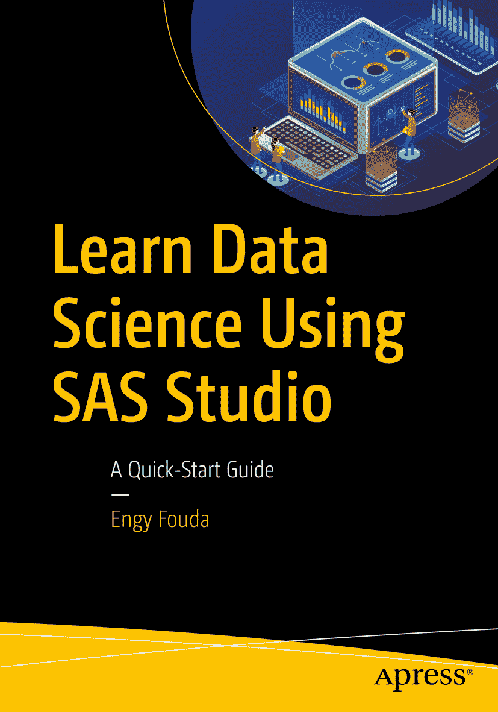

ISBN 978-1-4842-6236-8 e-ISBN 978-1-4842-6237-5 [`doi.org/10.1007/978-1-4842-6237-5`](https://doi.org/10.1007/978-1-4842-6237-5) © Engy Fouda 2020

本作品受版权保护。出版商保留所有权利，无论是涉及材料的全部或部分，特别是翻译、重印、重新使用插图、朗诵、广播、以缩微胶卷或任何其他物理方式复制，以及电子改编、计算机软件或现在已知或以后开发的同类或异类方法进行传输或信息存储和检索。在本出版物中使用通用描述性名称、注册商标、商标、服务标志等，即使没有具体声明，也不意味着这些名称免于相关保护法律和法规的约束，因此可自由使用。出版商、作者和编辑可安全地假设，本书中的建议和信息在出版之日被认为是真实和准确的。出版商、作者或编辑均不对本材料中包含的内容或可能存在的任何错误或遗漏提供明示或暗示的保证。出版商在已出版地图和机构隶属关系方面的司法主张中保持中立。

全球图书贸易由 Springer Science+Business Media New York 发行，地址：1 New York Plaza, New York, NY 10004。电话：1-800-SPRINGER，传真：(201) 348-4505，电子邮件：`orders-ny@springer-sbm.com`，或访问 `www.springeronline.com`。Apress Media, LLC 是加利福尼亚州的有限责任公司，其唯一成员（所有者）是 Springer Science+Business Media Finance Inc (SSBM Finance Inc)。SSBM Finance Inc 是特拉华州的一家公司。

*献给我的女儿 Areej 和我的丈夫 Hesham，我发自内心深处地感谢你们俩。没有你们的支持和鼓励，我永远无法完成这本书。当外面的世界疯狂且失去理智时，你们为我创造了一个幸福而安全的生活。有你们在我生命中，我是一个幸运的人。非常感谢！爱你们俩！*

*献给我的母亲 Suzan 和父亲 Samir，我非常想念你们，真希望你们能和我一起庆祝这本书。我确信你们在天堂一起庆祝并且很开心。我欠你们一切，希望你们像从前一样为我感到骄傲。在我们重逢之前，我爱你们。*

*最后，献给我的兄弟 Haitham 和 Khaled，你们从未放弃过我，始终相信我。我一直需要你们的信任，相信我能成就任何事。我感激这一点，并因此获得了前进的动力。希望你们喜欢这本书。*

# 引言

本书的主要范围是介绍 `SAS Studio`，这是一个免费的、基于 Web 浏览器的数据科学产品，用于非商业和学术用途。`SAS Studio` 也被称为 `SAS 大学版`。`SAS Studio` 的强大之处在于其可视化的点击式用户界面，可以生成 SAS 代码。与 R 和 Python 不同，用户无需编写一行代码即可创建数据分析报告。因此，数据清洗、统计和可视化变得简单易行。

本书的案例研究分析了缅因州的总统选举数据，这是我在哈佛大学所做项目的一部分。第 1 章会更详细地解释这个案例研究。

除了总统选举，本书还使用了现实生活中的例子，如分析股票、石油和黄金价格、犯罪、市场营销和医疗保健。整本书遵循数据科学在行动中的范式，以演示在 `SAS Studio` 中执行复杂任务和可视化是多么容易。

本书从零开始，通过逐步的动手实验，并包含每个步骤的截图。

它将为读者提供使用 `SAS Studio` 所需的数据科学和分析专业知识，例如如何执行以下操作：

-   导入和导出原始数据文件

-   操作和转换数据

-   组合 SAS 数据集

-   使用 SAS 过程创建汇总统计和报告

-   识别并纠正数据、语法和编程逻辑错误

-   使用 T 检验和方差分析比较样本

-   使用线性回归预测新值

-   创建可视化

此外，它还将逐步展示如何进行可视化，包括地图。在许多情况下，读者无需编写一行代码，因为 SAS 拥有强大的图形用户界面。与 R 和 Python 相比，学习起来要容易得多。然而，每个示例都会解释自动生成的代码以及如何编辑它来执行更复杂的进阶任务。本书将向您介绍多个 SAS 产品，例如 `SAS Studio`、`SAS Viya`、`SAS Analytics` 和 `SAS Visual Statistics`。

我在微软合作伙伴中心之一将大部分内容作为课程讲授。学生们总是对他们仅在短短几天内学到如此多的东西感到惊讶。

## 谁应该阅读本书？

本书的主要读者是数据科学领域的新手学生，他们可能没有深入的编程经验。因此，大学教授可以将其用作课程的讲义。此外，像我这样在认证培训中心教授来自各行各业专业人士的技术讲师，也可以用它来教学。

同时，经验丰富但刚接触 SAS 的系统分析师和科学家将发现更快、更高效的工具来完成日常任务。根据我的经验，我从课程参与者那里了解到，许多政府机构已经迁移到 SAS。此外，数据记者和调查记者会发现这本书易于理解，并能快速生成漂亮的可视化图表。

## 本书是如何组织的？

总的来说，本书试图在使用 SAS 的点击操作和代码之间取得平衡。用户可能会倾向于依赖集成开发环境（IDE）。然而，本书仅仅使用 IDE 来向用户介绍各种任务，同时解释代码，以便能够执行高级任务。

本书分为三个部分。第 I 部分“基础”（第 1、2 和 3 章）让您熟悉 SAS 界面和基本关键任务。第 1 章侧重于概述缅因州总统选举项目案例研究的总体思路及其输出。通读全书，您将逐步学习如何获得这些输出图表和分析结果。

然后，第 II 部分“更多编程”（第 4、5 和 6 章）侧重于更高级的编程方面。第 III 部分“高级主题”（第 7、8 和 9 章）将带您从分析历史数据走向预测未来，并向您介绍更高级的 SAS 平台。

最后，在第 9 章中，我尝试根据我的个人经验，就如何获得认证以及如何通过在线教学、写作和竞赛赚钱提供一些见解。此外，我还将向您提供更多关于哈佛大学继续教育学院的“数据科学研究生专业证书”的详细信息。

所有 SAS 示例代码都在 `“示例代码”` 文件夹中，本书所需的数据集在本书源代码的 `“数据集”` 文件夹中。请访问 [http://www.apress.com/9781484262368](http://www.apress.com/9781484262368) 并单击“下载源代码”按钮获取。

# 关于作者

# 关于技术审校者

