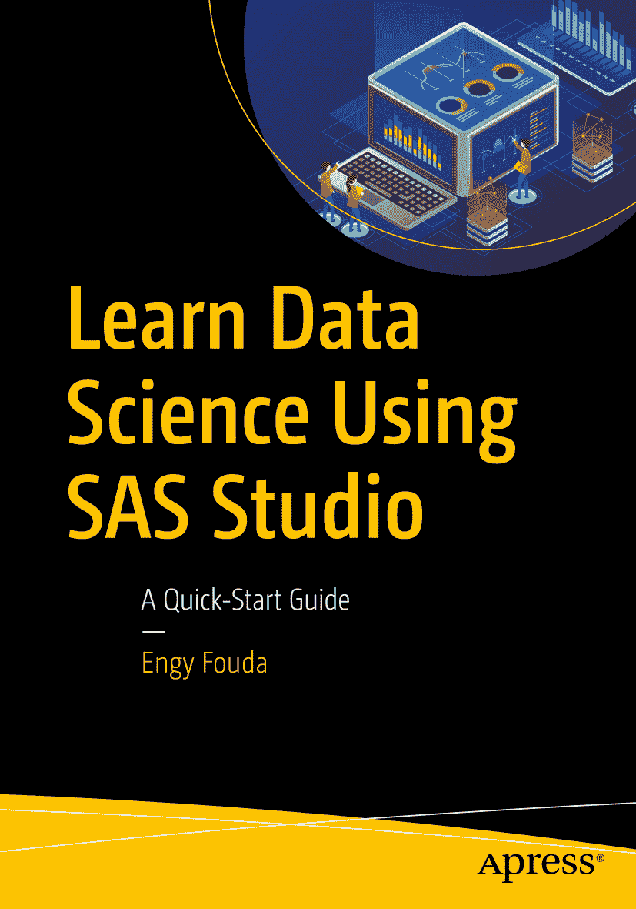

ISBN 978-1-4842-6236-8 e-ISBN 978-1-4842-6237-5 [`doi.org/10.1007/978-1-4842-6237-5`](https://doi.org/10.1007/978-1-4842-6237-5) © Engy Fouda 2020

本作品受版权保护。出版商保留所有权利，无论是涉及材料的全部或部分，特别是翻译、重印、重新使用插图、朗诵、广播、以缩微胶卷或任何其他物理方式复制，以及电子改编、计算机软件或现在已知或以后开发的同类或异类方法进行传输或信息存储和检索。在本出版物中使用通用描述性名称、注册商标、商标、服务标志等，即使没有具体声明，也不意味着这些名称免于相关保护法律和法规的约束，因此可自由使用。出版商、作者和编辑可安全地假设，本书中的建议和信息在出版之日被认为是真实和准确的。出版商、作者或编辑均不对本材料中包含的内容或可能存在的任何错误或遗漏提供明示或暗示的保证。出版商在已出版地图和机构隶属关系方面的司法主张中保持中立。

全球图书贸易由 Springer Science+Business Media New York 发行，地址：1 New York Plaza, New York, NY 10004。电话：1-800-SPRINGER，传真：(201) 348-4505，电子邮件：`orders-ny@springer-sbm.com`，或访问 `www.springeronline.com`。Apress Media, LLC 是加利福尼亚州的有限责任公司，其唯一成员（所有者）是 Springer Science+Business Media Finance Inc (SSBM Finance Inc)。SSBM Finance Inc 是特拉华州的一家公司。

*献给我的女儿 Areej 和我的丈夫 Hesham，我发自内心深处地感谢你们俩。没有你们的支持和鼓励，我永远无法完成这本书。当外面的世界疯狂且失去理智时，你们为我创造了一个幸福而安全的生活。有你们在我生命中，我是一个幸运的人。非常感谢！爱你们俩！*

*献给我的母亲 Suzan 和父亲 Samir，我非常想念你们，真希望你们能和我一起庆祝这本书。我确信你们在天堂一起庆祝并且很开心。我欠你们一切，希望你们像从前一样为我感到骄傲。在我们重逢之前，我爱你们。*

*最后，献给我的兄弟 Haitham 和 Khaled，你们从未放弃过我，始终相信我。我一直需要你们的信任，相信我能成就任何事。我感激这一点，并因此获得了前进的动力。希望你们喜欢这本书。*