# 3. 数据可视化

有句格言说：“一图胜千言。”在其他编程工作中，可视化是一项繁琐而艰巨的任务。幸运的是，SAS Studio 可以通过其集成开发环境轻松制作出漂亮的图形。本章使用公共领域中可用的大型数据集。我们将遵循第 1 章中提到的数据科学流程，即每个部分都从一个问题开始，并通过图表寻求答案。

本章涵盖了各种基本图表，例如散点图、直方图、序列图、条形图和排序条形图、气泡图以及聚类分析和树状图。此外，本章还演示了如何将数据显示在地图上，这在其他编程语言中是一项极具挑战性的任务。

# 散点图

散点图通过描述变量之间的方向、强度和线性关系，来展示变量间的相互依赖程度。此外，它们还能轻松显示异常值。

在本例中，我们提出的问题是：西雅图市的薪资是否与员工的年龄段有关，还是毫无关联？

你可以在本书源码的`Datasets`文件夹中找到名为`City_of_Seattle_Wages__Comparison_by_Gender_-_Average_Hourly_Wage_by_Age.csv`的数据文件。或者，你也可以通过以下网址从`Data.Gov`项目下载该 CSV 文件：[`https://catalog.data.gov/dataset/city-of-seattle-wages-comparison-by-gender-average-hourly-wage-by-age-353b2`](https://catalog.data.gov/dataset/city-of-seattle-wages-comparison-by-gender-average-hourly-wage-by-age-353b2)。

将 CSV 文件复制到`myfolders`文件夹中。在 SAS Studio 中，点击`Refresh`，然后按照我们在第 2 章中介绍的方法导入该文件。将数据集名称从`IMPORT`改为`Seattle_wages`，如图 3-1 所示。然后点击`Run`。

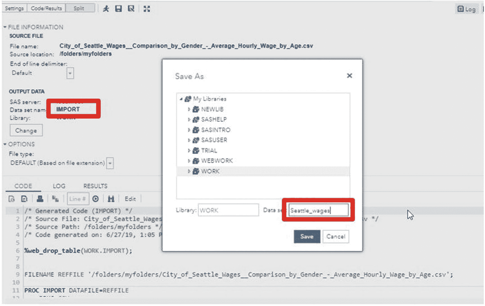

图 3-1 更改数据集名称

若要探索数据，请点击`Results`选项卡，如图 3-2 所示。

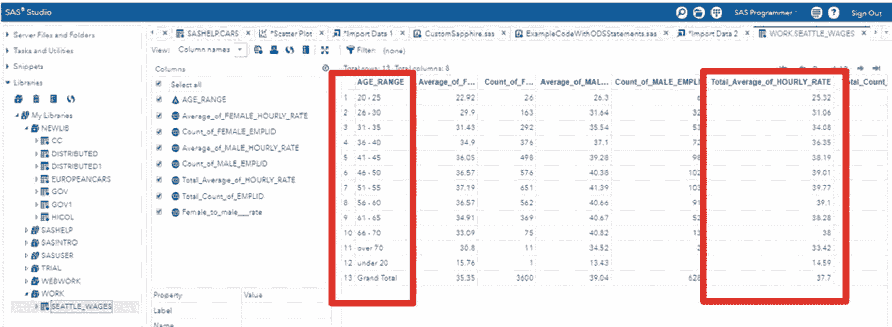

图 3-2 散点图的两个变量

我们想要创建`AGE_RANGE`和`Total_Average_of_HOURLY_RATE`变量的散点图，以查看它们之间是否存在相互依赖关系。图 3-2 显示了这两个变量。

点击`Tasks and Utilities` ➤ `Graph` ➤ `Scatter Plot`。在`Data`中，选择`WORK.SEATTLE_WAGES`数据集。为此，如图 3-3 所示，点击数据集名称旁边的小表格。

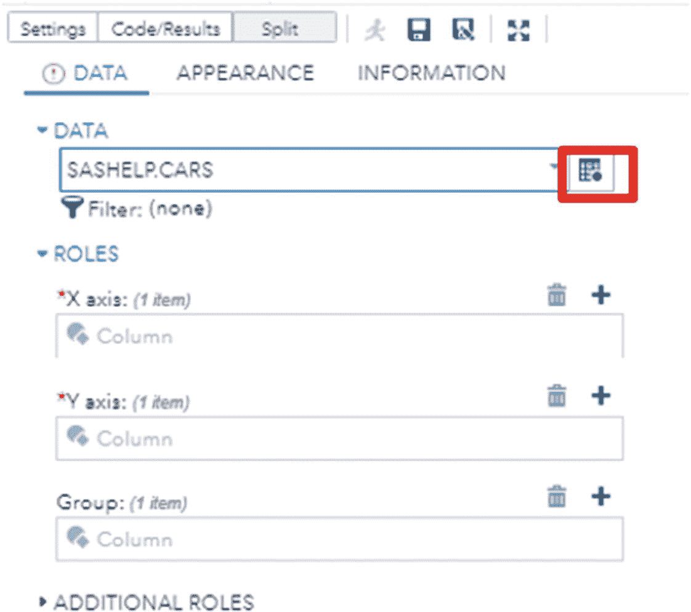

图 3-3 点击此表格以更改数据集

会弹出一个新窗口，如图 3-4 所示。选择数据集并点击`OK`。

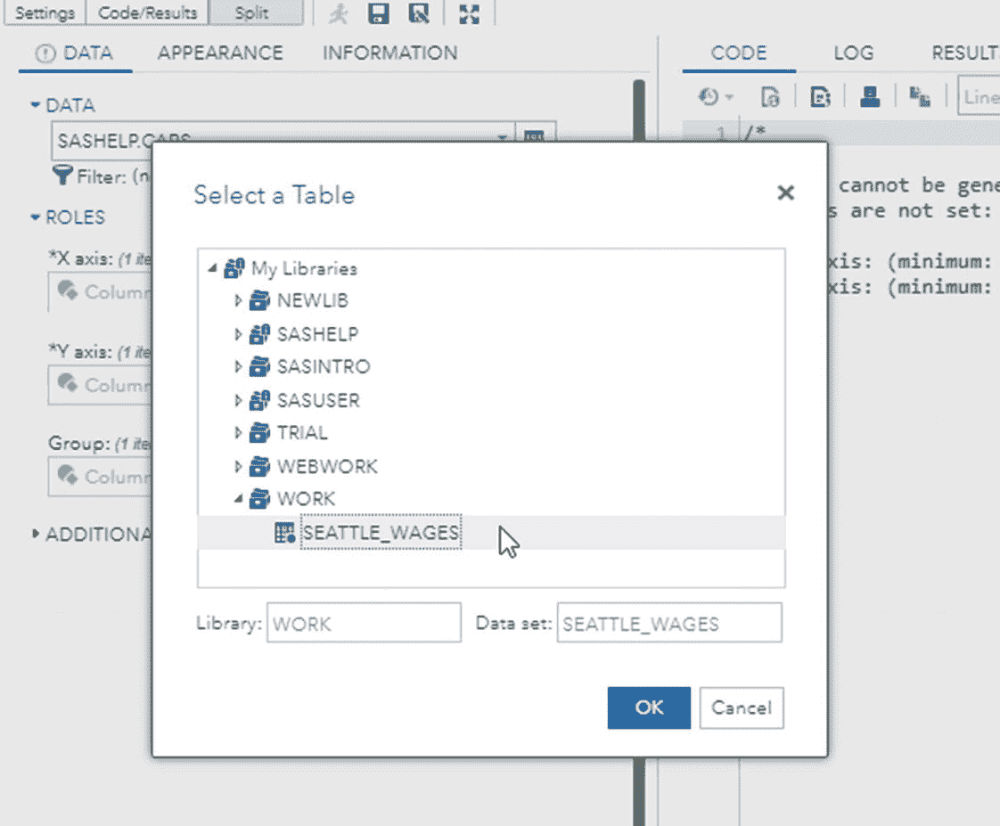

图 3-4 选择数据集

点击 x 轴旁边的`+`并选择`AGE_RANGE`，如图 3-5 所示。类似地，点击 y 轴旁边的`+`并选择`Total_Average_of_HOURLY_RATE`。点击`Run`或按`F3`运行程序。SAS 将在`Code`选项卡中自动为你生成代码，SAS Studio 将在`Results`选项卡中显示散点图，如图 3-5 所示。

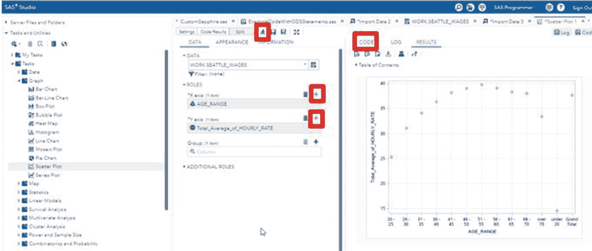

图 3-5 选择变量并运行

在图中，`AGE_RANGE`变量的最后两个值是不需要的，并且会对这两个变量之间的关系给出错误印象。因此，我们应当将其过滤并从数据中移除。如图 3-6 所示，点击数据集下方的`Filter`按钮并输入以下内容：

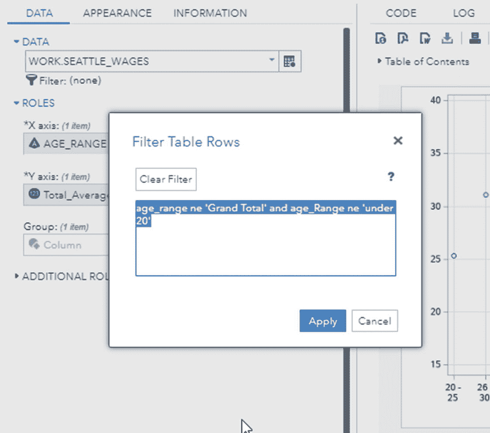

图 3-6 添加过滤代码以剔除`AGE_RANGE`中的最后两个值

```
age_range ne 'Grand Total' and age_Range ne 'under 20'
```

请注意字母大小写，因为虽然 SAS Studio 在变量名中不区分大小写，但在变量的值中是区分大小写的。因此，SAS Studio 会区分`"under 20"`和`"Under 20"`。对于后者，它将找不到任何内容。但是，输入`age_range`时大小写可以任意；SAS Studio 都能正确识别。现在，再次点击`Run`执行过滤代码。

从图 3-7 的最终散点图中，我们可以看到西雅图的年龄与薪资之间存在相互依赖关系。这种关系不是线性的，而是曲线关系。

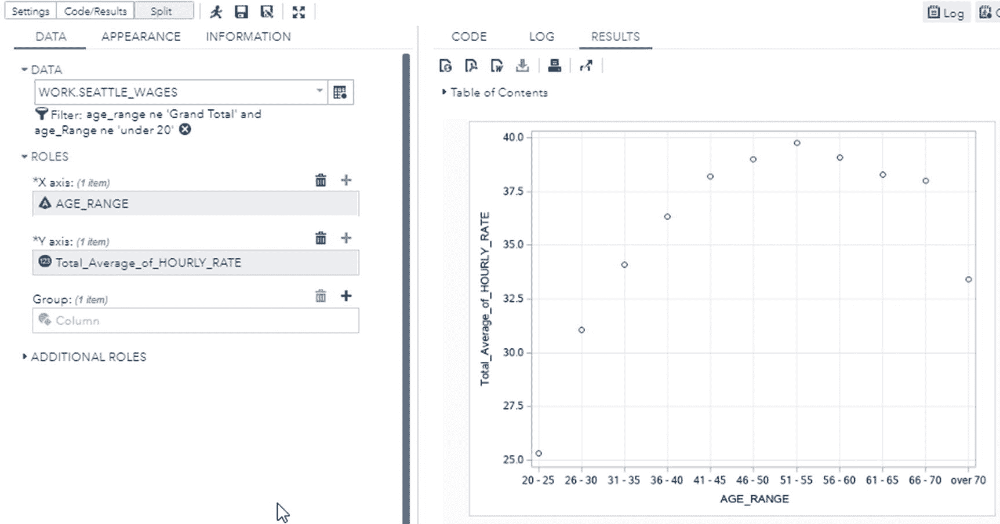

图 3-7 最终散点图

## 散点图代码

正如你刚才所见，只需点击几下鼠标，无需编写一行代码即可完成图表制作。这就是 SAS Studio 成为数据科学初学者最佳选择的原因。友好的图形用户界面（GUI）帮助你专注于概念，而它为你处理语法问题。然而，阅读代码并检查日志是沿途应养成的良好习惯，以便你编写比 GUI 提供的更复杂的代码。本章后续部分及本书其余章节，我们将提供一些高级示例，届时我们将练习编辑代码。

检查`Log`选项卡，确保没有出现任何错误或警告。从日志中验证 SAS Studio 执行无误的行数，并解决 SAS Studio 在处理过程中跳过的行相关问题。

那么，让我们来看看代码。代码应如代码清单 3-1 所示。

```
ods graphics / reset width=6.4in height=4.8in  imagemap;
proc sgplot data= WORK.SEATTLE_WAGES (where=(age_range ne 'Grand Total' and age_Range ne 'under 20')) ;
scatter x=AGE_RANGE y=Total_Average_of_HOURLY_RATE /
;
xaxis   grid;
yaxis   grid;
run;
ods graphics / reset;
```

代码清单 3-1 包含过滤代码以剔除`AGE_RANGE`中最后两个值的散点图代码

在代码的第一行，SAS Studio 使用了`ods graphics`。统计过程使用 ODS Graphics 在其输出中创建图表，并设置图表的宽度和高度。你可以在代码中或在 GUI 的`Appearance`选项卡中更改这些尺寸。第二行使用了`PROC SGPLOT`，它提供了一种制作各种散点图的简便方法。请注意过滤代码被添加到了`Data`语句中。然后，SAS Studio 使用`scatter`关键字来标识`sgplot`类型，并标识 x 轴和 y 轴使用的变量。最后，选择 xy 网格。你可以通过从代码中删除这两行或在`Appearance`选项卡中取消选中它们来移除网格。

## 散点图关系

图 3-8 展示了散点图关系的各种示例。要描述散点图，你应该说明它是线性关系还是曲线关系，正如我们在前面的例子中看到的那样。如果相互依赖关系是线性的，则查看其方向以判断是正相关还是负相关。在图 3-8 中，左上角的关系是正相关，而右上角的图是负相关。在图 3-8 中，左下角没有关系，因为点不规则地分散。在图 3-8 中，右下角没有方向，因为关系不是线性的，而是曲线关系。最后，散点图描述了关系的强度。如果点非常靠近线/形状，则相互依赖程度高，关系强。否则，关系弱。

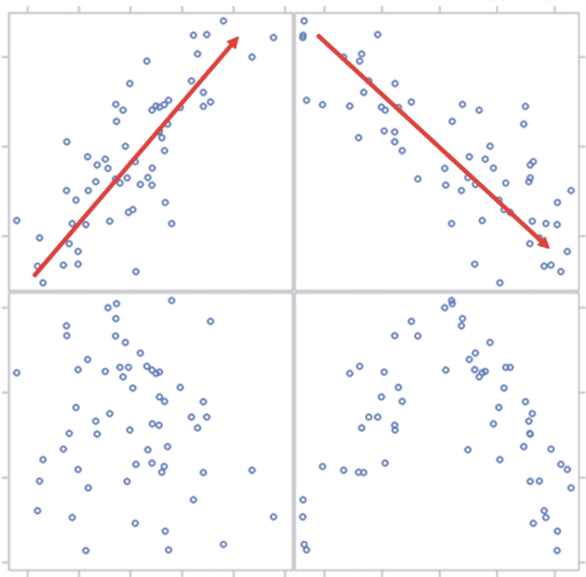

图 3-8 散点图的方向、强度和线性

# 在同一图像中绘制多个散点图

我们可以在同一张图像中绘制多个散点图来比较数值。在本例中，我们使用每个政党的登记选民人数，绘制图表来比较缅因州各县中哪个政党的登记选民更多。此程序无法通过图形用户界面完成，必须使用代码实现。

“Dataset”文件夹中的数据集 `MAINECOUNTIESPARTIES.xlsx` 包含三列：各县名称以及共和党和民主党的登记选民人数（表 3-1）。

**表 3-1** `MAINECOUNTIESPARTIES.xlsx`

| 县 | 共和党 | 民主党 |
| --- | --- | --- |
| Androscoggin | 28189 | 22975 |
| Aroostook | 19419 | 13377 |
| Cumberland | 57697 | 102935 |
| Franklin | 7900 | 7001 |
| Hancock | 13682 | 16107 |
| Kennebec | 29296 | 31753 |
| Knox | 9148 | 12440 |
| Lincoln | 9727 | 10241 |
| Oxford | 12172 | 16214 |
| Penobscot | 41601 | 32832 |
| Piscataquis | 5403 | 3098 |
| Sagadahoc | 9304 | 10679 |
| Somerset | 14998 | 9092 |
| Waldo | 10378 | 10442 |
| Washington | 9037 | 6358 |
| York | 50388 | 55828 |

按照第二章中的方法，将 Excel 文件上传至 SAS Studio 并导入 Work 库后，我们运行清单 3-2 中的代码。

```sas
ods graphics / reset width=6.4in height=4.8in imagemap;
proc sgplot data= WORK.MAINECOUNTIESPARTIES NOAUTOLEGEND;
scatter x=counties y=Republican markerattrs=(color=red);
scatter x=counties y=Democratic markerattrs=(color=Blue symbol=circlefilled);
xaxis grid;
yaxis grid label="Republican:Red Democrat:Blue";
run;
ods graphics / reset;
```

*清单 3-2 比较缅因州各县共和党与民主党登记选民人数*

该代码绘制了两个重叠的散点图，每个图的 `x` 轴均为县名。第一个散点图的 `y` 轴是共和党人数，第二个散点图的 `y` 轴是民主党人数。为了区分它们，我们使用了 `markerattrs` 选项改变颜色。此外，我们仅为民主党数据点添加了 `symbol=circlefilled`，以便即使在灰度显示下也能区分各点。我们为 `x` 轴和 `y` 轴都添加了网格。最后，我们将 `y` 轴的标签改为 `Republican:Red Democrat:Blue` 以替代图例，因为在 `PROC SGPLOT` 选项中添加了 `NOAUTOLEGEND`，移除了自动生成的图例。

上述代码的输出结果如图 3-9 所示。

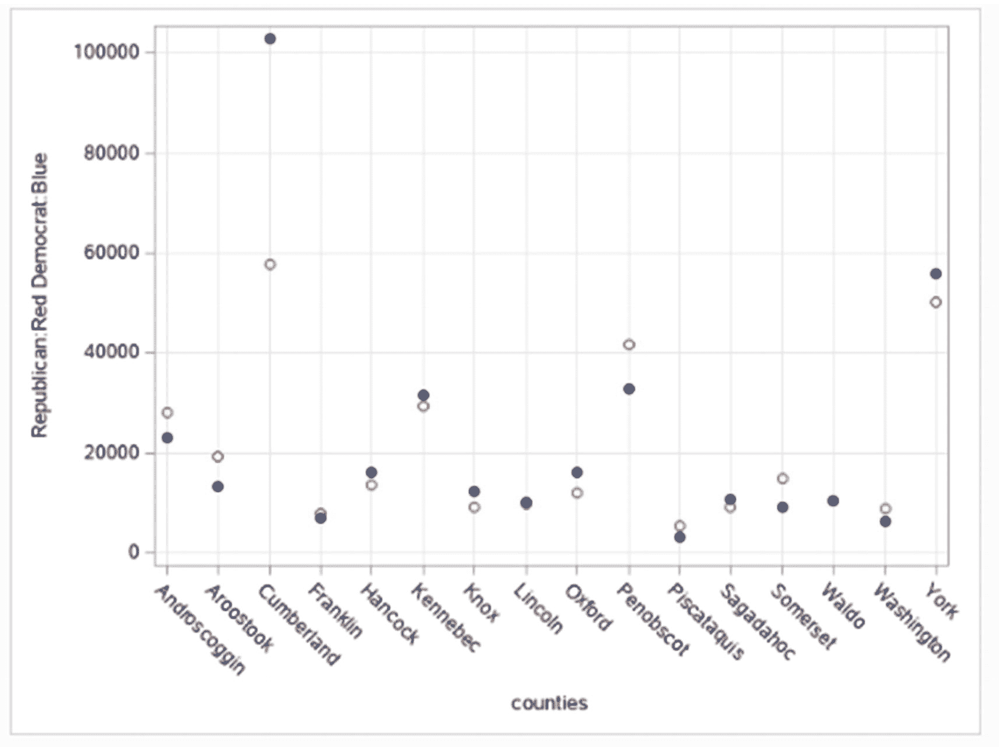

*图 3-9 缅因州各县与政党散点图*

从图 3-9 中我们可以看出，坎伯兰县的民主党选民人数最多，总体登记选民人数也最高。这可能也意味着它的人口最多，但我们无法确定，需要进一步验证。不过，我们可以肯定的是，该县民主党与共和党之间的差距巨大。除该县外，在其余十五个县中，有八个县的民主党人数略多于共和党。因此，民主党需要更加关注缅因州，以免其重新变红。

同样地，你也可以对自己所在的州进行同样的分析，并凭借自己的分析和预测为下一届总统选举做好准备。

## 直方图

直方图任务用于创建显示数值变量频率分布的图表。在本例中，我们将了解 2018 年 3 月北卡罗来纳州夏洛特市雇员的年薪分布情况。

你可以在“Datasets”文件夹中找到名为 `City_Employee_Salaries_March_2018.csv` 的数据文件。或者，你也可以通过以下网址从 Data.Gov 项目下载该 CSV 文件：[`https://catalog.data.gov/dataset/city-employee-salaries-march-2018`](https://catalog.data.gov/dataset/city-employee-salaries-march-2018)

将 CSV 文件复制到“myfolders”文件夹。在 SAS Studio 中，点击刷新，然后按照第二章中的说明导入该文件。将数据集名称从 `IMPORT` 更改为 `Charlotte_wages`。

点击**任务和实用程序** ➤ **图形** ➤ **直方图**。在**数据**中，选择 `WORK.CHARLOTTE_WAGES`。为此，如图 3-3 所示，点击数据集名称旁的小表格。接下来，点击**分析变量**旁的 `+` 号，选择 `Annual_Rt`，如图 3-10 所示；然后点击**确定**。

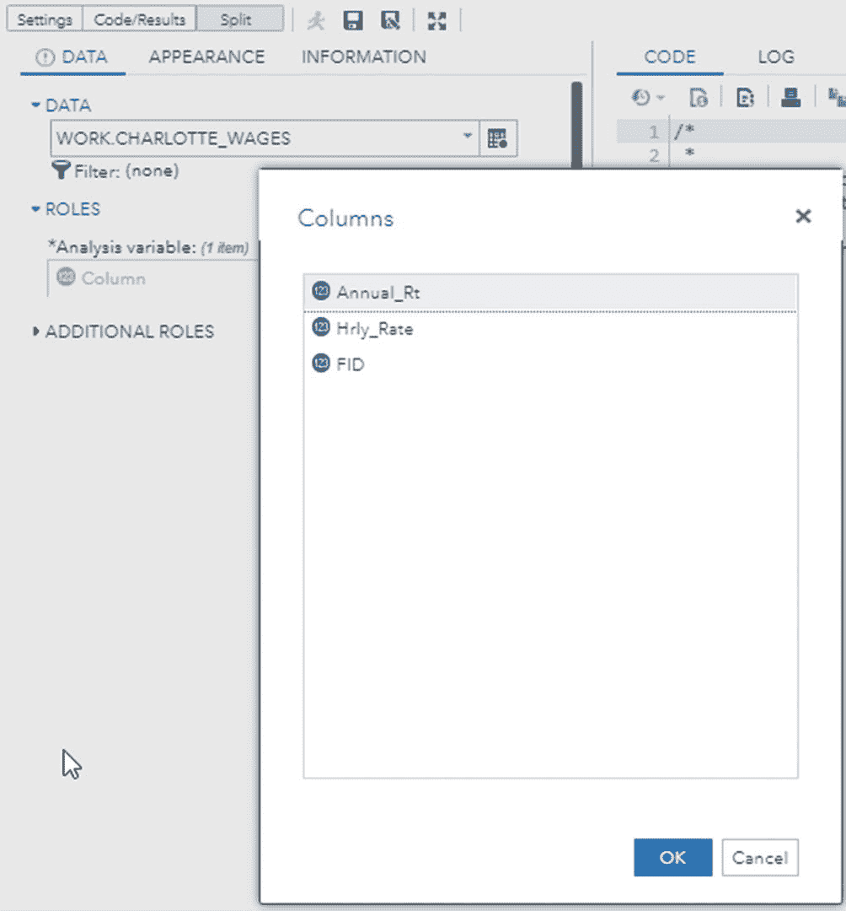

*图 3-10 选择要绘制直方图的分析变量*

请注意，SAS Studio 在右侧窗格的**代码**选项卡中自动生成了代码。它同样使用了 `SG Plot`，但这次使用了 `histogram` 关键字。现在，点击**运行**。SAS Studio 将在**结果**选项卡中绘制直方图，如图 3-11 所示。

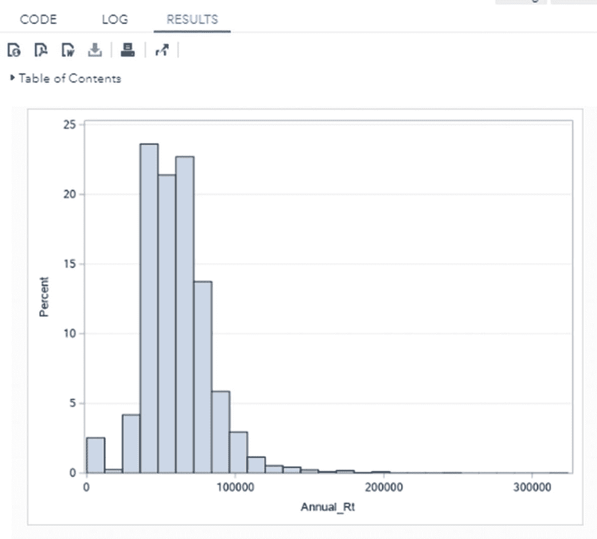

*图 3-11 夏洛特市雇员直方图*

### 外观选项卡

让我们通过将直方图与正态分布和核密度估计进行比较来优化其外观。点击**外观**选项卡。选择**正态**和**核密度**。重新运行代码。输出结果类似于图 3-12。

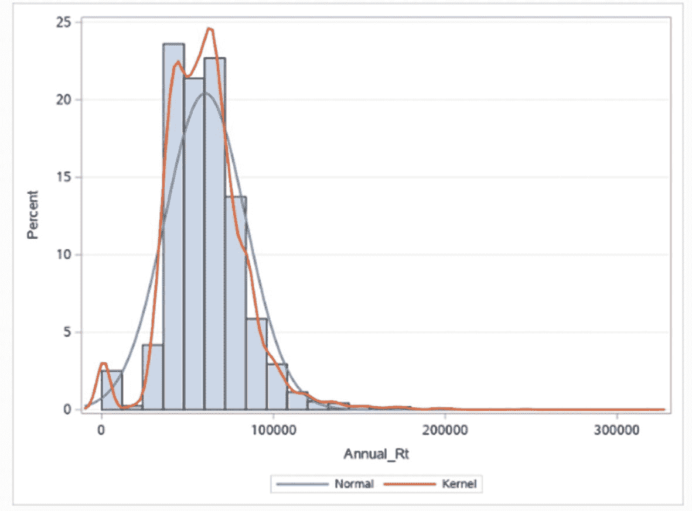

*图 3-12 正态分布与核密度*

如图 3-13 所示，将标题更改为“夏洛特市雇员年薪分布”。然后，点击**X 轴**，并勾选“在区间中点处显示刻度标记”。

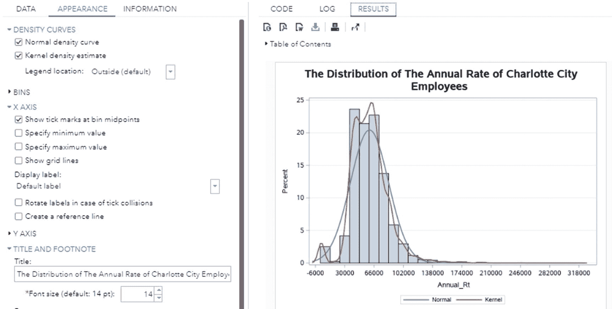

*图 3-13 显示刻度标记*

点击**代码**选项卡。观察 SAS Studio 如何根据你的选择更改代码，如图 3-14 所示。

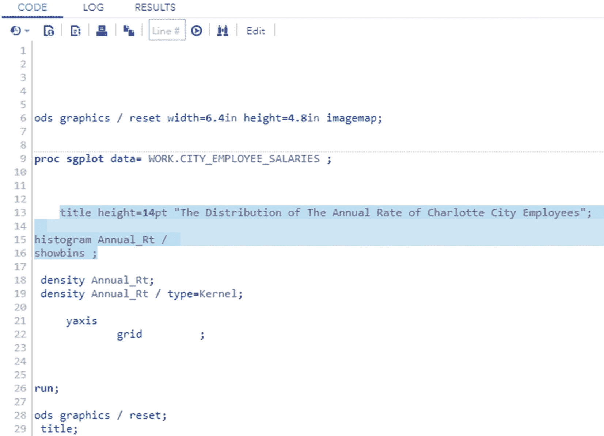

*图 3-14 更改区间中点和标题设置后的直方图代码*

现在，返回**外观**选项卡。将区间数量改为 20，如图 3-15 所示。重新运行代码。

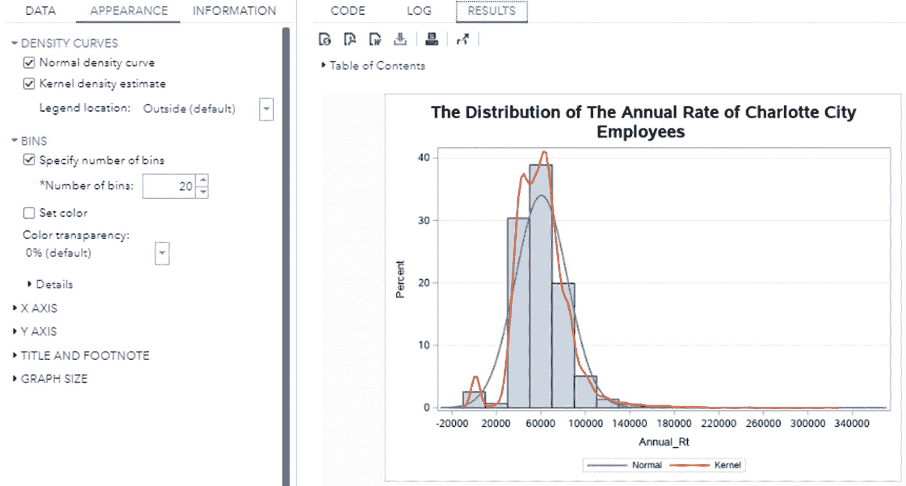

*图 3-15 区间数量*

现在，在**X 轴**部分，将最大值改为 140000，如图 3-16 所示。重新运行。

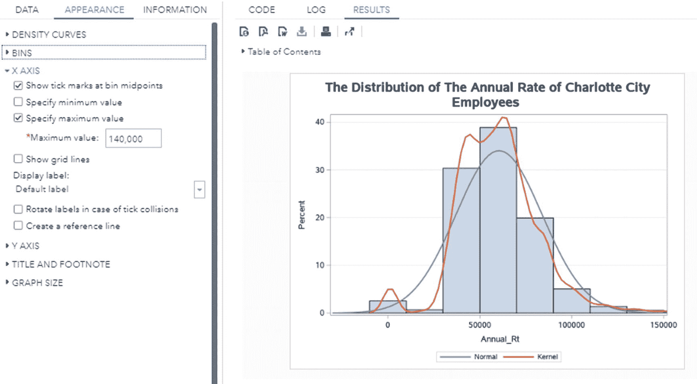

*图 3-16 更改 X 轴最大值*

现在，我们得到了一条比以前更接近正态分布的曲线，之前它是右偏的。

# 序列图

序列图显示数值随时间的变化。在本例中，我们将绘制股票价格随时间变化的趋势。

依次点击 `Tasks and Utilities` ➤ `Tasks` ➤ `Graph` ➤ `Series Plot`。在 `Data` 中选择 `SASHELP.STOCKS`，X 轴选择 `Date`，Y 轴选择 `Close`，如图 3-17 所示。

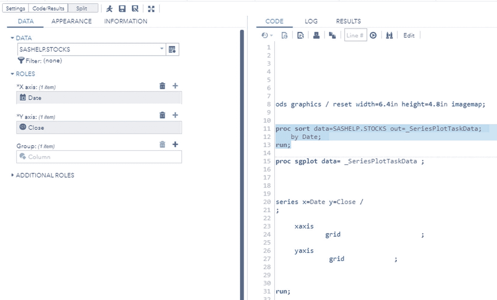

## 序列图代码

运行该图。输出结果类似于图 3-18。

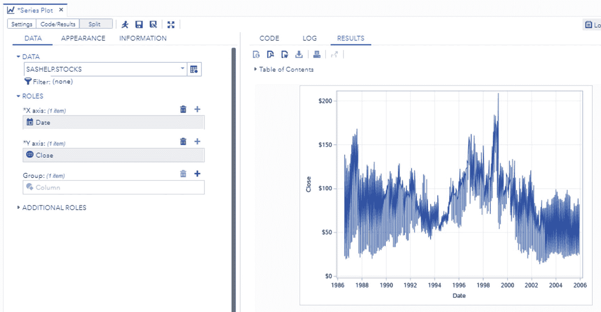

### 序列图输出

让我们探究股票的频率并获取股票的唯一值。依次点击 `Tasks and Utilities` ➤ `Tasks` ➤ `Statistics` ➤ `One-Way Frequency`。在 `Analysis Variable` 中，点击 `+` 号并选择 `Stock`，如图 3-19 所示。

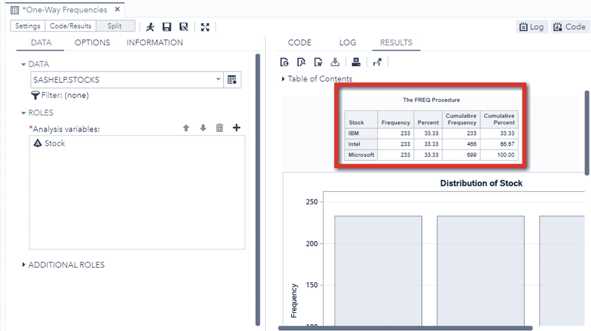

使用单因子频率分析股票。你会发现这些是三家公司的股票：IBM、Intel 和 Microsoft，如图 3-19 所示。

再次回到序列图，让我们基于此信息来增强图形。由于我们只有三只股票，选择 `Group By Stock`，如图 3-20 所示。

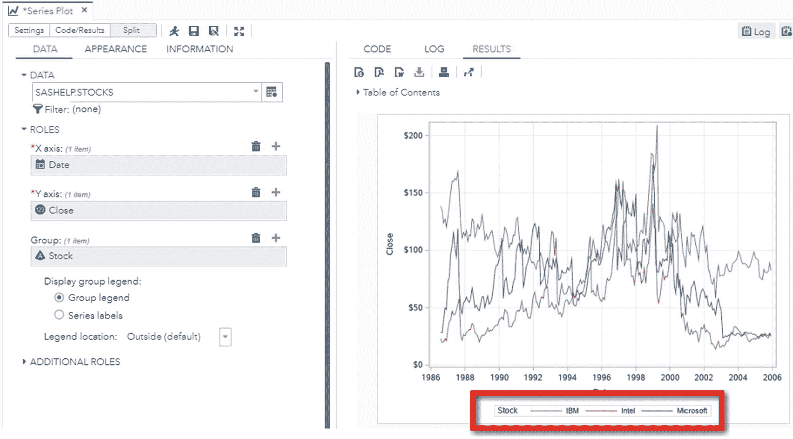

通过按股票分组来增强序列图。Y 轴显示收盘价，X 轴显示年份。图 3-21 显示了 IBM、Intel 和 Microsoft 从 1986 年到 2006 年的收盘价。

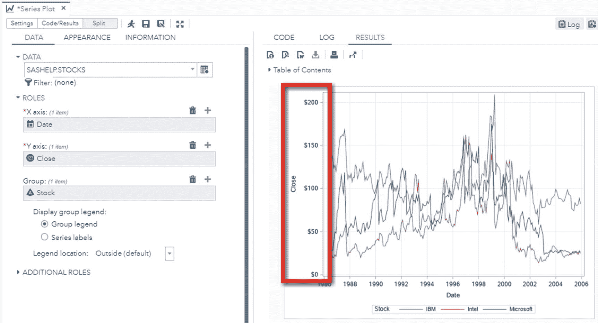

### 二十年的收盘价

从图 3-21 中，我们发现 Intel 多年来大部分时间的收盘价最低，而 IBM 的收盘价最高。有史以来的最高收盘价超过 200 美元，是 IBM 的股票。从 2004 年到 2006 年，IBM 与其他公司之间的差异显著，IBM 的股票价格接近 100 美元，而 Intel 和 Microsoft 大约为 25 美元。那时，这些信息和数据分析本可以帮助股票经纪人决定是卖出还是买入哪只股票。

在 `Appearance` 选项卡中，选择 `Title and Footnote` 并将标题编辑为“按年份的股票收盘价”，如图 3-22 所示。观察 `Code` 选项卡中的代码变化，然后重新运行程序。

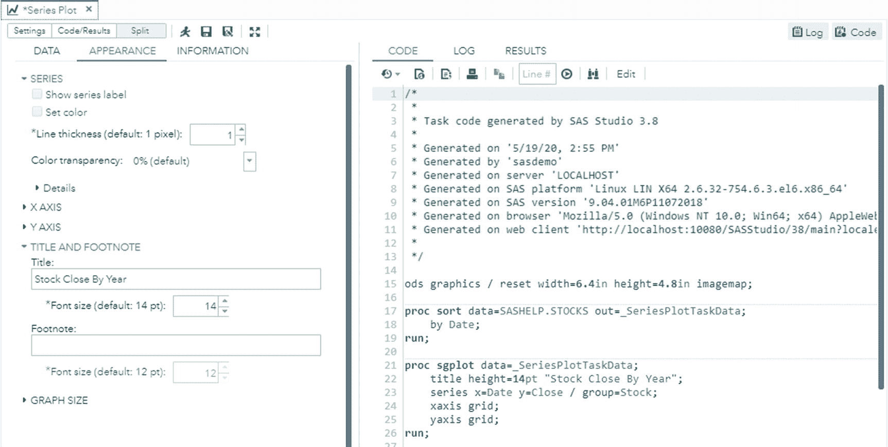

### 序列图代码

## 条形图

您可以使用条形图来比较组别或跟踪变量随时间的变化。在下面的程序中，您将比较棒球队的平均薪资。我们还希望回答哪个球队的平均薪资最高，哪个最低的问题。

让我们创建一个程序，为棒球队的平均薪资制作一个水平条形图 (`HBar`)。

选择 `Tasks` ➤ `Graph` ➤ `Bar Chart`。

如图 3-23 所示，使用库中的 `Baseball` 数据集 (`SASHELP.BASEBALL`)。对于 `Chart Orientation`，选择 `Horizontal`。在 `Roles` 中，为 `Category` 选择 `Team`，为 `Variable` 选择 `Salary`，为 `Statistic` 选择 `Mean`。

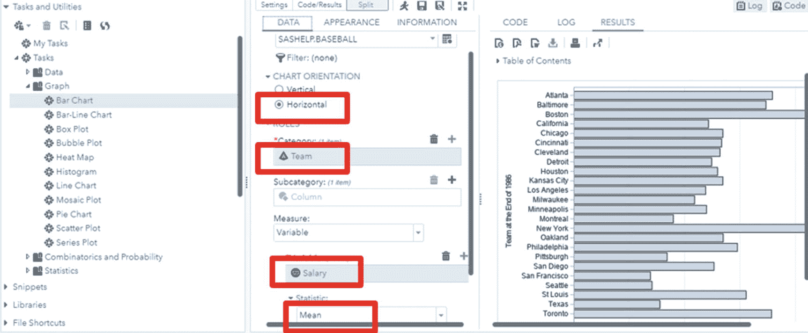

创建条形图。在 `Appearance` 选项卡中，添加报告标题“各队平均薪资”，如图 3-24 所示。然后，点击 `Run`。

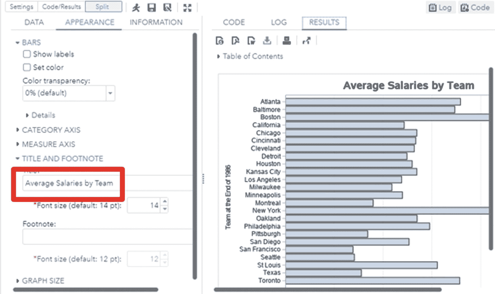

添加标题。

### 如何对条形图排序？

图 3-24 显示了各队的平均薪资。然而，从图中找出薪资第二和第三高的球队可能会令人困惑。为避免混淆，最好对图形进行升序或降序排序。我们将通过四个步骤对条形图进行排序。

**步骤 1：** 创建一个仅包含球队名称和平均薪资的新数据集。依次点击 `Tasks and Utilities` ➤ `Tasks` ➤ `Statistics` ➤ `Summary Statistics`。为 `Data` 选择 `SASHELP.BASEBALL`，为 `Analysis Variables` 选择 `Salary`，为 `Classification Variables` 选择 `Team`，如图 3-25 所示。

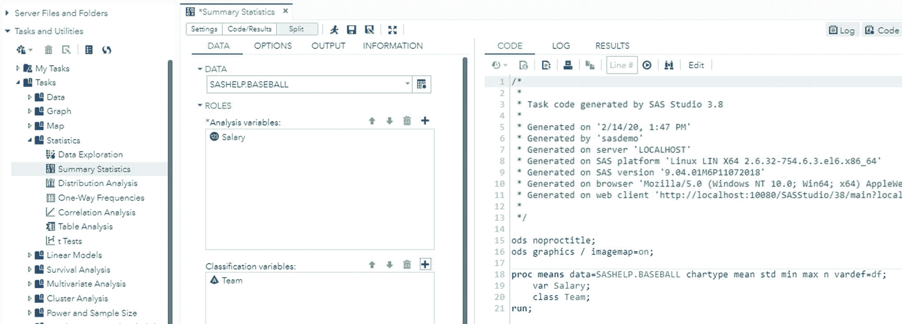

点击 Summary Statistics。

**步骤 2：** 在 `Options` 选项卡中，仅勾选 `Mean`，并取消选择其他默认选项，如图 3-26 所示。

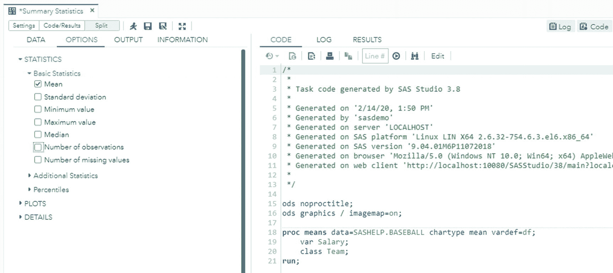

在 Options 选项卡中勾选“Mean”。

**步骤 3：** 在 `Output` 选项卡中，勾选 `Create output data set` 将数据的平均值保存到新数据集，如图 3-27 所示。

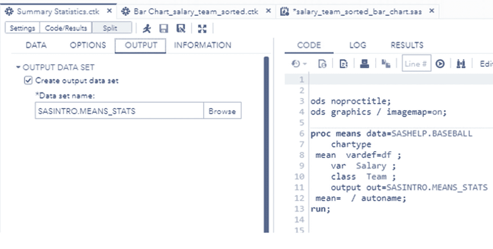

将结果保存到新数据集。

**步骤 4：** 创建一个按平均薪资排序的条形图，而不是按球队排序。选择上一步生成的数据集作为新条形图的输入数据。为 `Category` 选择 `Salary_Mean`，为 `Subcategory` 选择 `Team`，为 `Measure Variable` 选择 `Salary_Mean`，如图 3-28 所示。

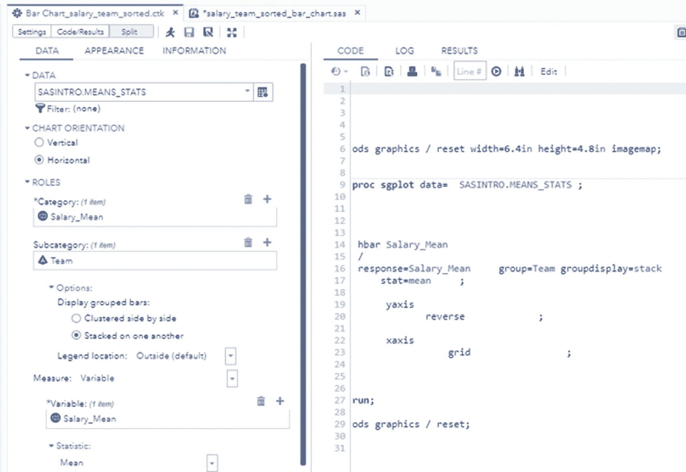

选择您的表格作为数据。运行图表以获得新的排序图形，如图 3-29 所示。

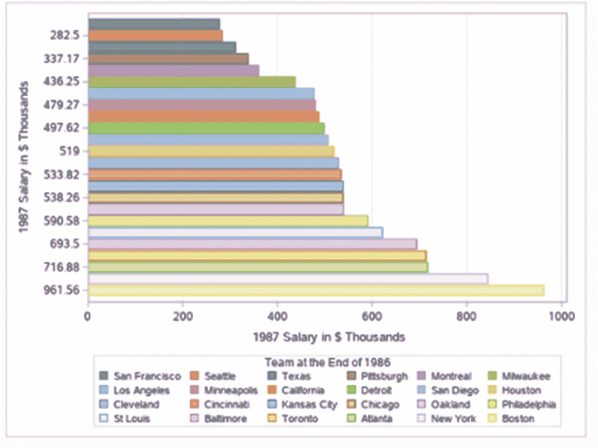

升序排序的条形图。要反转输出，请在 `Appearance` 选项卡中的 `Category Axis` 中勾选 `Reverse tick values`，如图 3-30 所示。

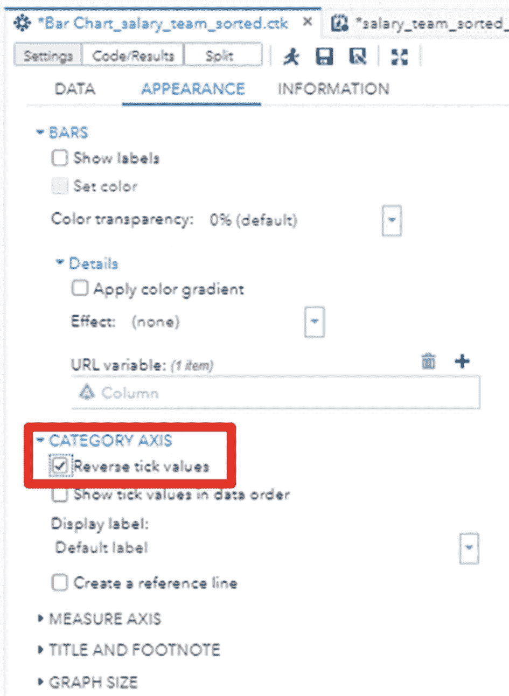

勾选“Reverse Tick Values”。重新运行条形图。输出结果类似于图 3-31。

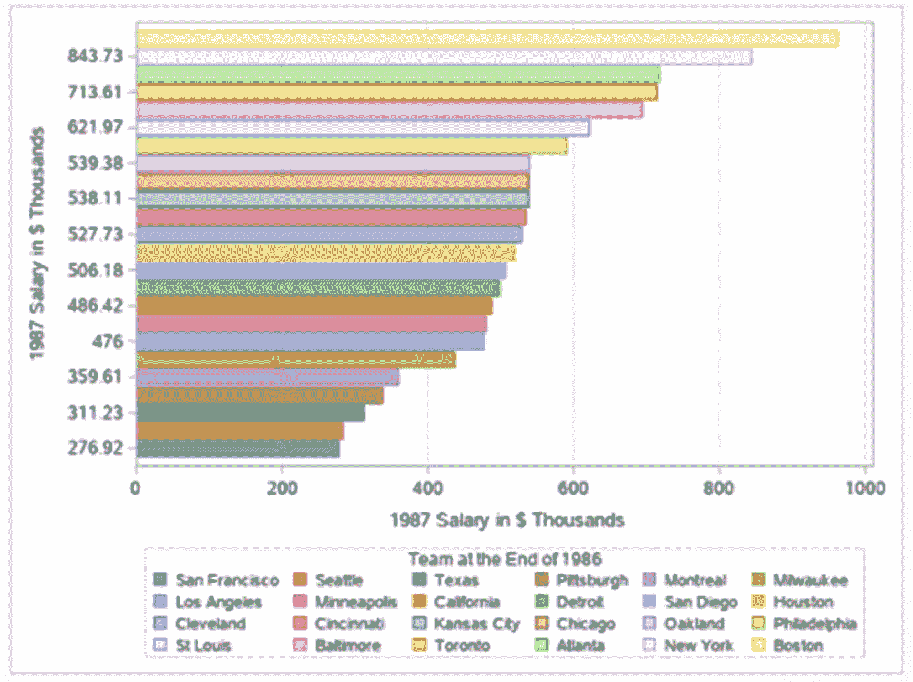

降序条形图。最后，1987 年平均薪资最高的球队是波士顿队，平均薪资最低的是旧金山队。

### 使用条形图创建直方图

条形图也可用于创建直方图。在此示例中，您将学习如何创建一张关于 2012 年缅因州总统候选人及其得票率的图表，该图表先前在第一章的图 1-9 中提及过。缅因州的结果如表 3-2 所示。

**表 3-2** 2012 年缅因州候选人及其得票率结果

```
| 候选人   | 得票率 |
```


### 条形图与直方图

| --- | --- |
| 奥巴马 | 56.27 |
| 罗姆尼 | 40.98 |
| 约翰逊 | 1.31 |
| 斯泰因 | 1.14 |
| 保罗 | 0.29 |
| 安德森 | 0.01 |
| 里德 | 0 |

您将在`Dataset`文件夹中找到为呈现这些百分比而创建的数据集；文件名为`Maine_Candidates and their winning percentages in 2012.csv`。

将 CSV 文件复制到您的`myfolders`文件夹中。从 SAS Studio 中，点击`Refresh`，然后按照第二章中的说明导入它。将数据集的名称从`IMPORT`更改为`CANDIDATES2012`，如图 3-32 所示。点击`Run`。

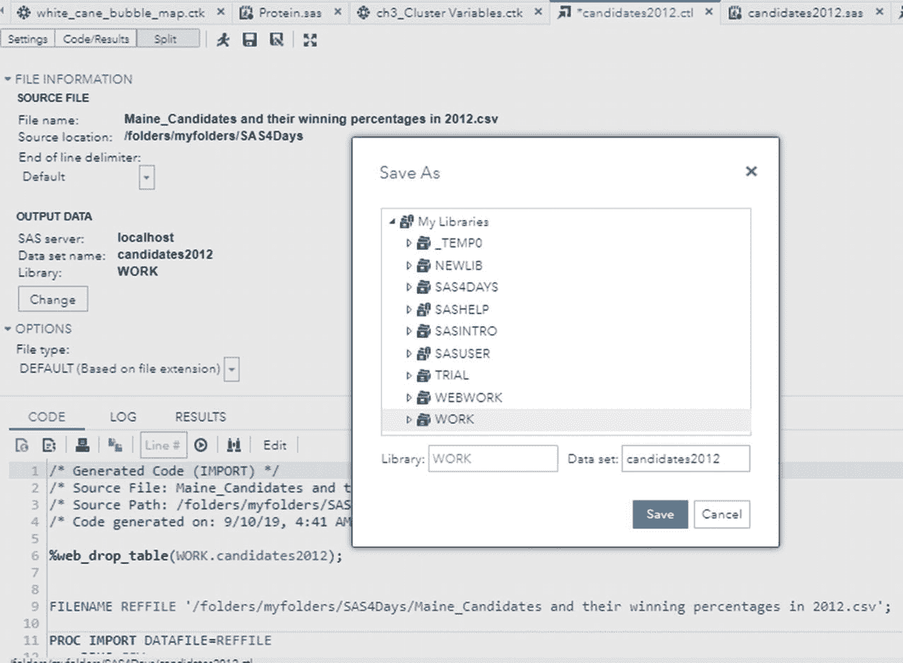

**图 3-32** 导入数据集

要使用条形图创建直方图，请点击 Tasks and Utilities ➤ Tasks ➤ Graph ➤ Bar Chart。如图 3-33 所示，在 Data 部分，选择`WORK`库和`CANDIDATES2012`表。在 Roles ➤ Category 中，选择列`x`。然后运行程序。

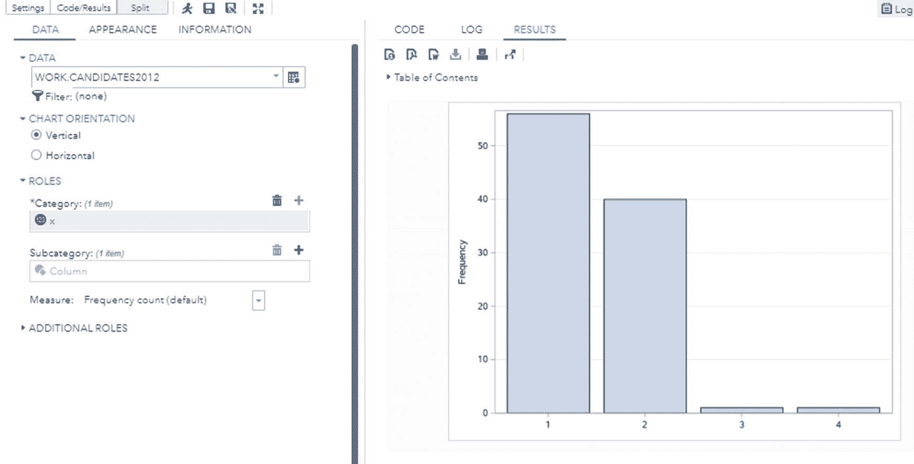

**图 3-33** 使用条形图生成的初始直方图

现在，我们需要执行三项任务来完善图表：
*   用对应的政党颜色为条形着色。
*   修改脚注以附加候选人姓名。
*   移除 x 轴标签。

要完成这三项任务，我们需要编辑代码，而不是通过图形界面进行操作。在 Code 选项卡中，点击`Edit`。代码将在新的程序窗口中打开。按照代码清单 3-2 编辑代码，或者直接复制粘贴本书源代码中的该代码清单。

```
ods graphics / reset width=6.4in height=4.8in imagemap ;
proc sgplot data=  WORK.CANDIDATES2012 noautolegend;
footnote2 "候选人：1:奥巴马 2:罗姆尼 3:约翰逊, 4:斯泰因 5:保罗 6:安德森 7:里德";
vbar x / colorresponse=x colorstat=mean colormodel=(blue red silver green) ;
xaxis display=(nolabel);
yaxis grid;
run;
ods graphics / reset;
footnote2;
```

**代码清单 3-3** 使用政党颜色绘制的直方图

运行代码。输出结果将如图 3-34 所示。

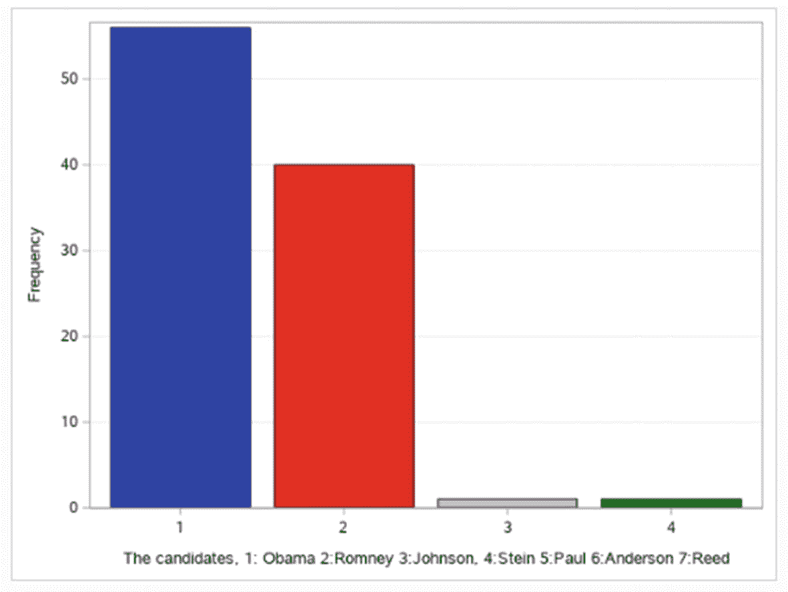

**图 3-34** 具有对应政党颜色的条形图

请随意修改代码进行尝试。例如，删除代码第二行的`noautolegend`，重新运行并观察图表的更改；或者移除 X 轴选项中的`display=(nolabel)`，亦或修改`colormodel`选项中的颜色。

有关条形图选项的更多示例和说明，请查看以下链接：
1.  SAS 文档——在 OVERLAY 布局中管理坐标轴：[`https://documentation.sas.com/?docsetId=grstatug&docsetTarget=p1pqfzgbuzbpkzn1mrbzhgggvhkz.htm&docsetVersion=9.4&locale=en#p18of8gjhjfti1n15y1w0iqtp4nr`](https://documentation.sas.com/%253FdocsetId%253Dgrstatug%2526docsetTarget%253Dp1pqfzgbuzbpkzn1mrbzhgggvhkz.htm%2526docsetVersion%253D9.4%2526locale%253Den%2523p18of8gjhjfti1n15y1w0iqtp4nr)
2. SAS 博客——响应颜色与厚度：[`https://blogs.sas.com/content/graphicallyspeaking/2015/09/21/response-colors-and-thickness/`](https://blogs.sas.com/content/graphicallyspeaking/2015/09/21/response-colors-and-thickness/)
3. Data Flair——SAS 中的条形图类型：[`https://data-flair.training/blogs/sas-bar-chart/`](https://data-flair.training/blogs/sas-bar-chart/)

### 气泡图

散点图适用于展示两个变量之间的关系。若要展示三个变量之间的关系，则需使用气泡图。在本示例中，我们将创建一个气泡图来显示某班级学生的身高、体重和年龄。

点击 `Tasks and Utilities` ➤ `Tasks` ➤ `Graph` ➤ `Bubble Chart`。在`Data`中，选择`SASHELP.CLASS`库。接着在`Roles`中，为图形的 X 轴选择`Height`；为 Y 轴选择`Weight`；为气泡大小选择`Age`，如图 3-35 所示。

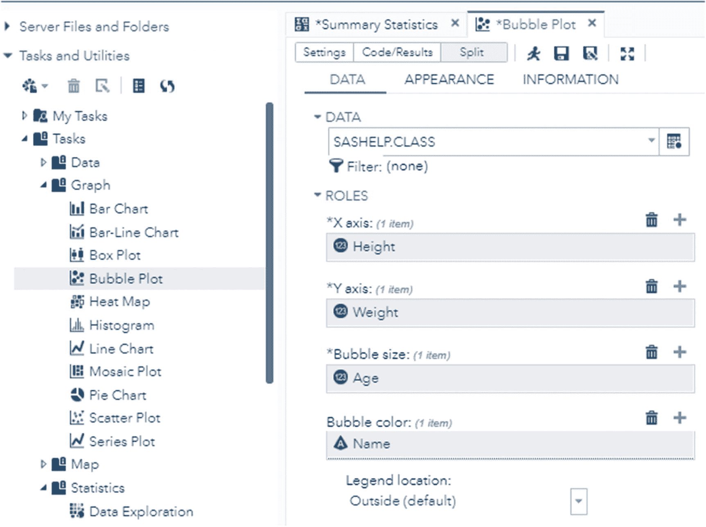

**图 3-35** 气泡图

点击 `Run`。初始输出的图形将如图 3-36 所示。

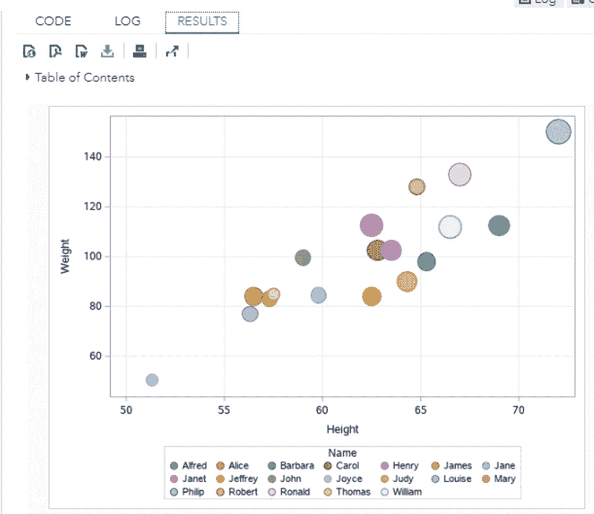

**图 3-36** 初始输出图表

现在，让我们美化一下外观。点击 `Appearance` 选项卡。如图 3-37 所示，在 `Bubble Labels` 中，为 `Bubble Label` 选择 `Name`。同样如图 3-37 所示，点击 `Title and Footnote`，在标题栏输入“Age by Height and Weight”，在脚注栏输入“Bubble size represents age”。

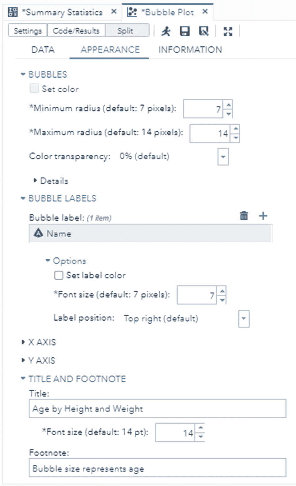

**图 3-37** 添加气泡标签

重新运行程序。输出结果将如图 3-38 所示。

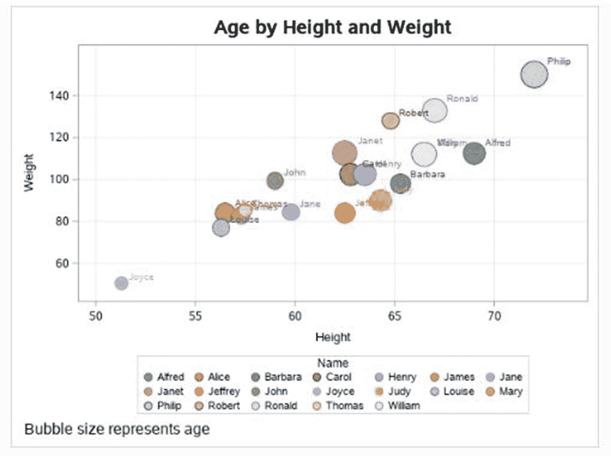

**图 3-38** 带有气泡标签的图表

图表应简洁明了，不应包含任何重复数据。图 3-38 中的图表将学生姓名重复显示了两次：一次作为气泡标签，另一次显示在图表底部的图例中。要修正此问题，我们需要编辑代码。如图 3-39 所示，点击 `Edit`。

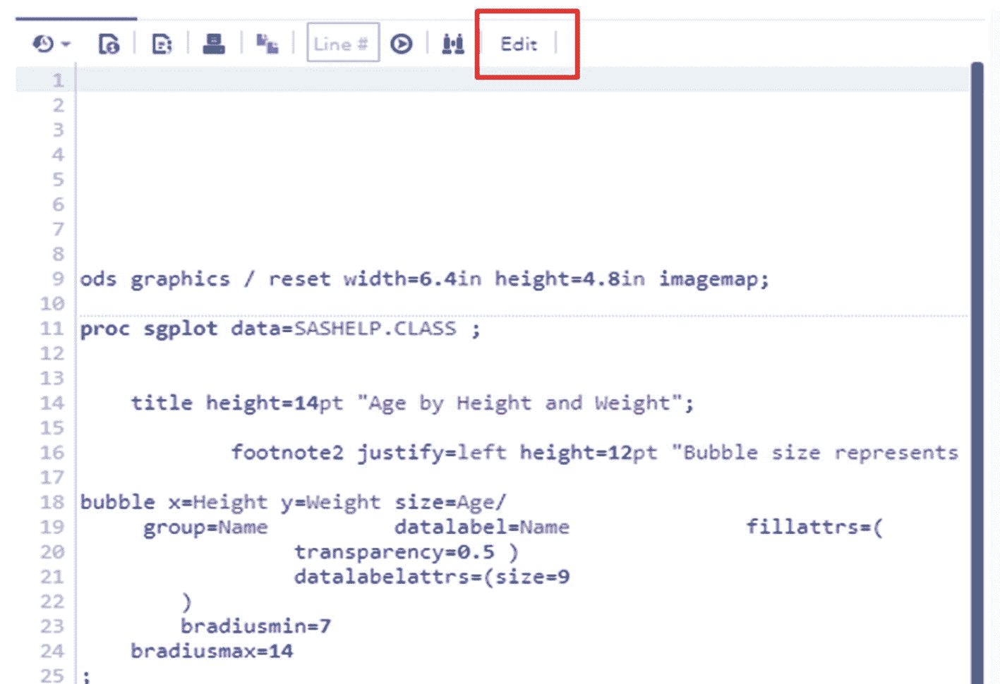

**图 3-39** 点击编辑

如图 3-40 所示，通过向 `sgplot` 函数添加 `noautolegend` 选项来编辑代码，以移除图形下方自动生成的图例。为了美化脚注的外观，我们将其位置调整到图形内部，并缩进到右下角，以避免与任何结果重叠。为此，请添加以下代码行：

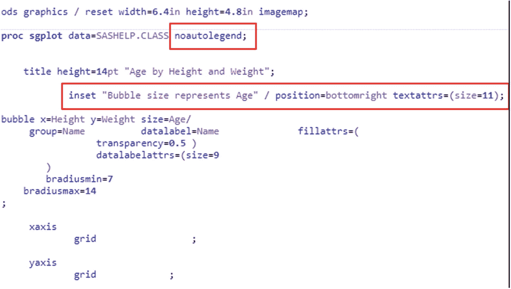

**图 3-40** 编辑代码

```
inset"Bubble size represents Age" / position=bottomright textattrs=(size=11);
```

现在，重新运行代码。输出结果得到优化，如图 3-41 所示。

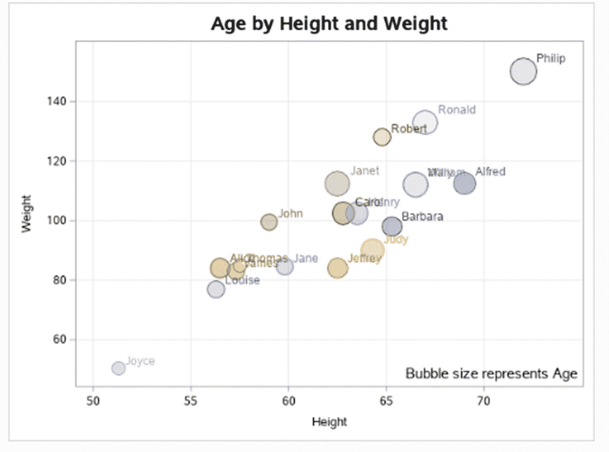

**图 3-41** 气泡图的最终版本

从该图中，我们可以看到 Joyce 是班上最轻、最矮的学生。同时，她也是班上两名最年轻的学生之一。Joyce 和 Thomas 的气泡最小。如果通过点击 `Libraries` ➤ `SASHELP` ➤ `CLASS` 返回表格，并点击 `Age` 列对年龄数据进行排序，你会发现他们俩都是十一岁。另一方面，Philip 是班上最高、最重且年龄最大的学生。他是唯一一个十六岁的学生，班上其他人都比他年轻。这就是为什么他的气泡是最大的。Joyce 和 Philip 可以被视为异常值。然而，这个班只有十九名学生，样本量非常小。样本量越大，分析效果越好。

# 地图

在地图上显示数据能提供新的视角。它本身就能讲述一个完整的故事。SAS Studio 使在地图上显示数据变得容易。此外，使用颜色和气泡自定义地图为你的数据增添了新的维度。本节将使用真实数据引导你完成整个过程。它将逐步向你展示如何下载数据并将其准备好以显示在地图上。

## 气泡图

气泡图任务会创建一张叠加了气泡图的底图。在此示例中，我们将使用纽约市的犯罪数据来创建一张气泡图，展示 2018 年纽约市不同行政区的犯罪率。该数据可通过纽约市开放数据项目网站获取。

你可以在 `Datasets` 文件夹中找到数据文件，文件名为 `NYPD_Complaint_Data_Current__Year_To_Date.csv`。或者，你也可以从这个网址下载数据集：[`https://data.cityofnewyork.us/Public-Safety/NYPD-Complaint-Data-Current-Year-To-Date-/5uac-w243/data`](https://data.cityofnewyork.us/Public-Safety/NYPD-Complaint-Data-Current-Year-To-Date-/5uac-w243/data)

要从该链接下载数据集，如图 3-42 所示，请点击“导出”，然后选择“CSV”。

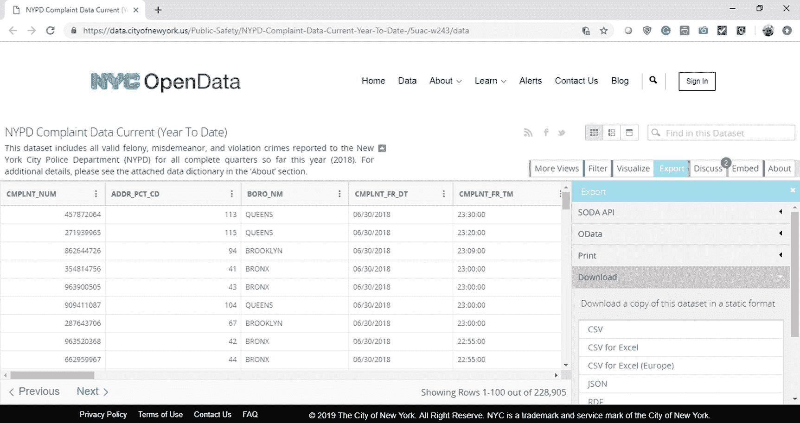

图 3-42 – 纽约警察局投诉数据——纽约市开放数据

该数据集包含海量信息。我们可以利用这些数据进行大量的调查和分析。例如，每个行政区最常见的犯罪类型是什么？犯罪最可能发生在什么时间段？一周中的哪一天犯罪率最高？

对于本例，我们只关心回答一个问题：哪个行政区的犯罪率最高，哪个最低？

要回答这个问题，我们需要以下三列：`Borough`（行政区）、`Longitude`（经度）和 `Latitude`（纬度）。因此，我们删除所有其他列。然后，我们统计每个行政区的犯罪数量，以便在地图上用气泡表示。

在数据清洗和准备完成后，我们得到了表 3-3 所示的数据集。

表 3-3 – 各行政区犯罪数量

| 行政区 | 犯罪数量 | 纬度 | 经度 |
| --- | --- | --- | --- |
| 布朗克斯 | 50153 | 40.82452 | -73.8978 |
| 布鲁克林 | 67489 | 40.82166 | -73.9189 |
| 曼哈顿 | 56691 | 40.71332 | -73.9829 |
| 皇后区 | 44137 | 40.74701 | -73.7936 |
| 史泰登岛 | 10285 | 40.63204 | -74.1222 |

为了加载数据，我们在 SAS Studio 中编写了代码清单 3-4。你可以从 `Example Code` 文件夹加载 `Listing 3-4.sas`。点击运行。

```
data NYC_crime;
input Borough $13.;
datalines;
BRONX
BROOKLYN
MANHATTAN
QUEENS
STATEN ISLAND
;
run;
data NYC_crime_dim;
set nyc_crime;
input count Latitude Longitude;
datalines;
50153 40.82451851 -73.897849
67489 40.82166423 -73.91885603
56691 40.71332365 -73.98288902
44137 40.74701026 -73.79358825
10285 40.63203653 -74.1222402
;
run;
```

代码清单 3-4 – 创建各行政区犯罪数量的数据集

在此程序中，我们并未导入原始数据文件。我们使用数据步中的 `DATALINES` 关键字将表格的值直接插入到代码中。在代码清单 3-4 中，我们有两个数据步。第一个数据步名为 `NYC_crime`。第二行使用 `INPUT` 语句指定列的名称和类型。在此表中，我们只定义了一列作为行政区名称，其类型为字符型，因为我们使用了 `$`。最大字符数为 13。然后，我们使用 `DATALINES` 语句插入实际值，并以分号结束。

第二个数据步创建另一个名为 `NYC_crime_dim` 的表，用于插入行政区的尺寸数据和每个行政区的犯罪数量。该表通过 `SET` 语句从前一个表 `nyc_crime` 初始化。同样，我们使用 `INPUT` 语句来指定我们将为行政区添加三列。我们添加了 `count`、`latitude` 和 `longitude` 列。记住列名之间要留一个空格，不要使用逗号。再次使用 `DATALINES` 插入实际值，并以分号结束。

运行代码清单 3-4 后，将在 `Work` 库中创建两个新表，名为 `NYC_crime` 和 `NYC_crime_dim`。要检查输出表，请点击 `Libraries` ➤ `Work`；在其下，你会找到 `NYC_crime` 和 `NYC_crime_dim`。如果没有，请按照我们在第 2 章中介绍的方法刷新你的库。

现在，点击 `Tasks and Utilities` ➤ `Tasks` ➤ `Map` ➤ `Bubble Map`，如图 3-43 所示。

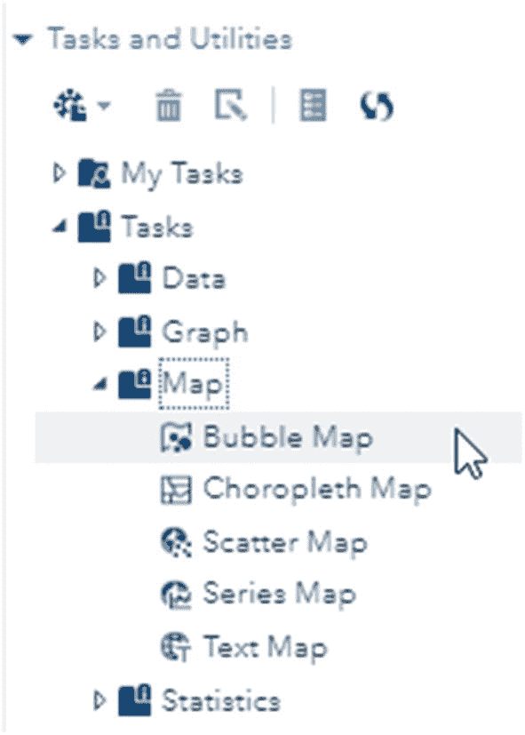

图 3-43 – 创建气泡图

如图 3-44 所示，在数据字段中选择数据集 `WORK.NYC_CRIME_DIM`。在角色中，选择 `Latitude` 和 `Longitude`。在气泡大小中，选择 `count`，即犯罪数量。最后，在分组中，选择 `Borough` 列。

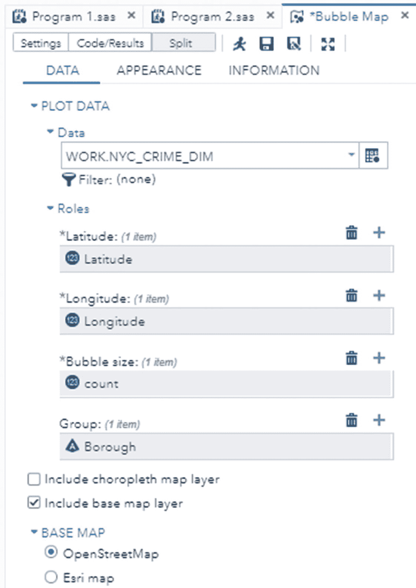

图 3-44 – 各行政区犯罪数量

对于底图，选择 `OpenStreetMap`。在本章后面，我们将尝试 Esri 地图，以查看输出结果的差异。保留其余默认设置，然后点击运行。将显示图 3-45 所示的气泡图。

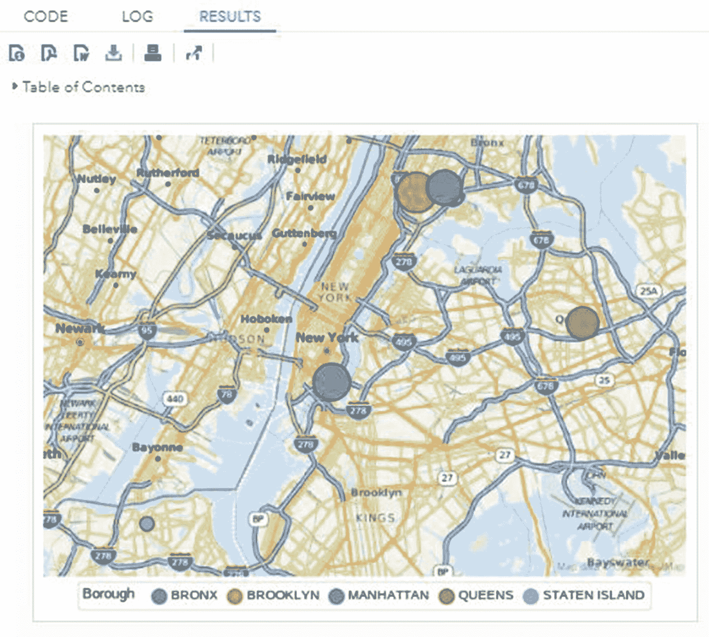

图 3-45 – 各行政区犯罪数量

从气泡大小可以清楚地看出，布鲁克林的犯罪率最高，而史泰登岛的犯罪率最低。SAS Studio 会自动调整气泡的位置、大小和颜色。此外，它还会在地图底部为行政区的颜色代码添加图例。

现在，让我们增强气泡图的外观。我们可以为气泡添加犯罪数量的标签，并为地图添加标题。如图 3-46 所示，在“外观”选项卡的“数据标签”中，对于“气泡标签”，从数据集中选择 `count` 列。然后，在“标签选项”中，对于“字体粗细”，选择“粗体”。在“标签位置”中，选择“居中”。最后，在“标题和脚注”中，为“标题”输入“纽约市行政区的犯罪数量”。

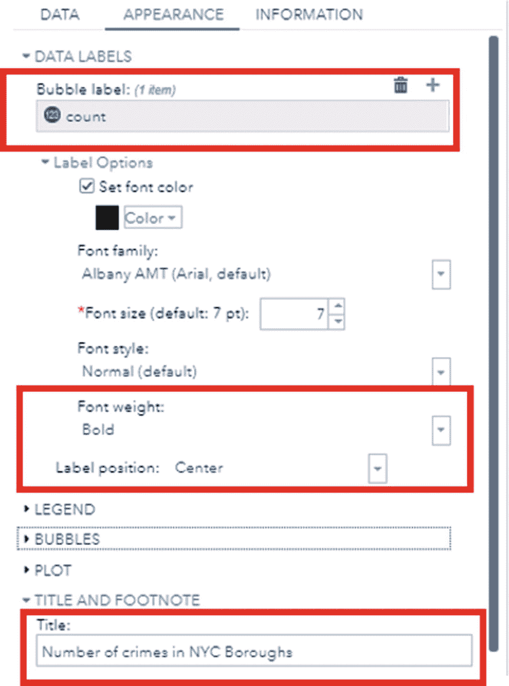

图 3-46 – 增强外观

点击运行以查看新的更改。输出结果将如图 3-47 所示。


图 3-47 – 纽约市行政区的犯罪数量

代码清单 3-5 显示了 SAS Studio 通过用户界面根据我们的选项自动生成的代码。

```
ods graphics / reset width=6.4in height=4.8in;
proc sgmap plotdata=WORK.NYC_CRIME_DIM;
openstreetmap;
title 'Number of crimes in NYC Boroughs';
bubble x=Longitude y=Latitude size=count/    group=Borough datalabel=count
datalabelpos=center
datalabelattrs = (color=CX0f0e0e  size=7pt  weight=bold)
name="bubblePlot";
keylegend "bubblePlot" / title =  'Borough' ;
run;
ods graphics / reset;
title;
```

代码清单 3-5 – 创建各行政区犯罪数量的数据集

SAS Studio 的强大之处在于它提供了两种类型的底图：`OpenStreetMap` 和 `Esri` 地图。现在，让我们尝试另一种底图类型。如图 3-48 所示，返回“`数据`”选项卡，选择 `Esri` 地图，然后点击运行。输出的地图将如图 3-48 所示。

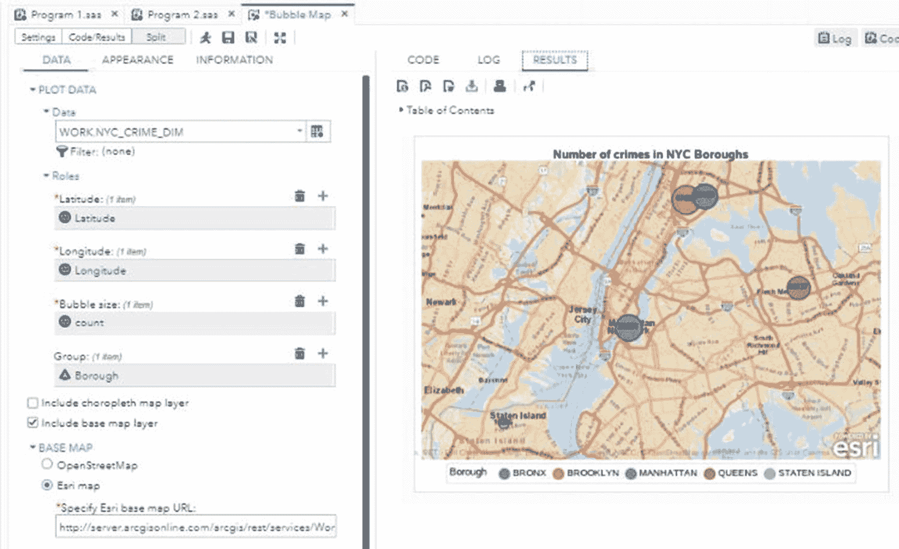

对于此 `Esri` 地图选项，SAS Studio 将生成代码清单 3-6 中的代码。

```
ods graphics / reset width=6.4in height=4.8in;
proc sgmap plotdata=WORK.NYC_CRIME_DIM;
esrimap url= 'http://server.arcgisonline.com/arcgis/rest/services/World_Street_Map/MapServer';
title '纽约市各区犯罪数量';
bubble x=Longitude y=Latitude size=count / group=Borough
datalabel=count datalabelpos=center
datalabelattrs=(color=CX0f0e0e size=7pt weight=bold)
name="bubblePlot";
keylegend "bubblePlot" / title ='行政区';
run;
ods graphics / reset;
title;
```

`清单 3-6` 使用 `Esri` 地图生成地图

## 聚类分析

聚类分析是一种无监督学习算法。监督学习用于预测，具有特定的输出/因变量，而无监督学习则用于数据探索。

聚类在市场细分、基因和癌症研究中很受欢迎。例如，在在线商店中，你通常会发现自己正在查看的产品经常与其他列出的产品一起被购买。另一个例子是它在基因研究中的应用，用于发现基因之间的相似性。

执行聚类分析最流行的方法是主成分分析、`K` 均值和层次分析。

在 SAS Studio 中，你可以轻松完成所有这些操作。在本例中，你将学习如何进行层次分析。这主要包含两个步骤：上传干净的数据集，并将所有变量添加到聚类中，然后 SAS Studio 会为你处理其余部分。

点击 `Tasks and Utilities` ➤ `Tasks` ➤ `Cluster Analysis` ➤ `Cluster Variables`。`Cluster Variables` 任务的用户界面会打开。如图 3-49 所示，在 `Data` 选项卡上，选择 `SASHELP.CARS` 数据集。最后，在 `Variables to cluster` 部分选择你想要的所有变量。然后，点击 `Run`。

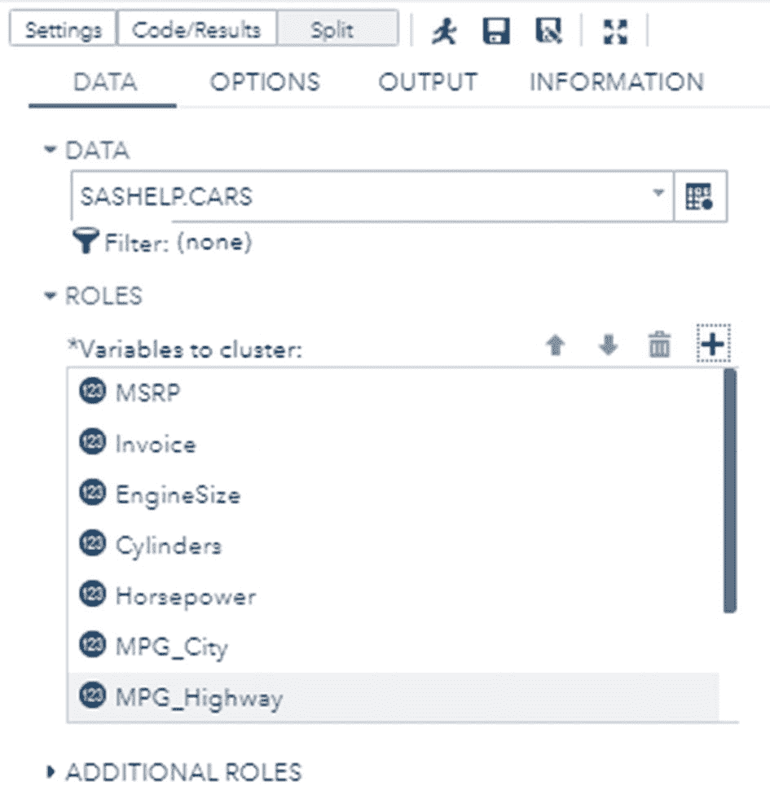

层次聚类有两种类型：凝聚型（自下而上）和分裂型（自上而下）。

凝聚算法将每个点视为一个聚类，然后重复合并两个最近的聚类。分裂型从一个聚类开始，然后递归地将其拆分成更多分支。

SAS Studio 使用分裂方法。输出结果清晰地解释了树的结构，以及每个分支如何被细分为更多分支。在本例中，如图 3-50 所示的输出结果显示，聚类被分成两个分支，在第二层级，每个分支又被分成更多分支。

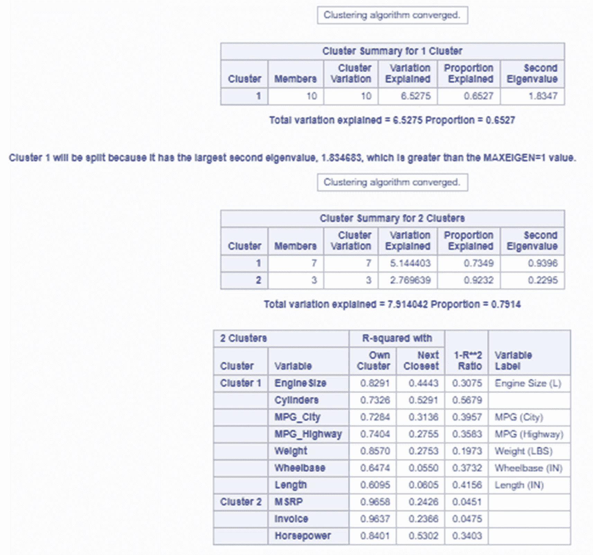

此外，SAS Studio 还会生成树状图，如图 3-51 所示。要按聚类形成的顺序来解读树状图，请从右向左阅读。

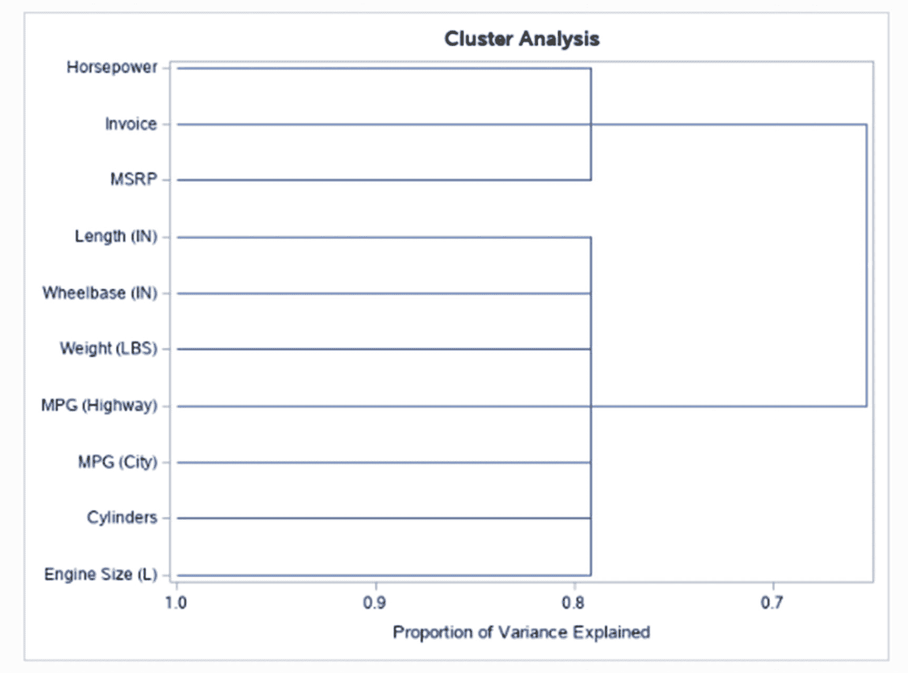

然而，要了解相似性，请从左向右阅读树状图。`马力`、`发票价格`和`厂商建议零售价`的聚类最相似，因为它的分支最短。同样，`长度`、`轴距`、`重量`、`MPG (高速公路)`、`MPG (城市)`、`气缸数`和`发动机排量`的聚类也具有相似性，并且其分支长度与前一聚类相同。第一个聚类具有最长分支。

## 本章小结

本章深入研究了数据可视化。从最基础的图表（如散点图和直方图）开始，然后深入到更高级的图表（如地图）。此外，还展示了如何通过改变颜色和图案来叠加图表，以便于比较分析结果。SAS Studio 中的数据可视化是其最强大的功能之一，因为许多图表都可以通过集成开发环境完成，而无需编写任何代码。

本章最后解释了数据科学中的一些关键概念，即监督学习和无监督学习。同时，也讨论了如何进行聚类分析。在下一章中，我们将阐述最重要的统计任务和线性模型。

# 第二部分 更多编程

