# 数据科学实战

在本章中，我们将介绍本书的案例研究，该研究分析了缅因州选民的数据。它基于我 2016 年在哈佛大学攻读硕士学位期间完成的一个项目。2016 年秋季，我的《数据科学实践方法》课程作业是预测每个州的总统选举结果。该项目在拉里·亚当斯教授的指导和监督下进行，由他设定了项目的里程碑和要求。我负责预测缅因州在 2016 年和 2020 年选举中的结果。

该项目分两个阶段进行。第一阶段是预测 2016 年的选举结果。在将我们的数据和结果与实际选举结果进行验证后，第二阶段便开始了。这一阶段需要纳入 2016 年产生的新数据，并利用这些数据预测 2020 年的结果。因此，本书中的一些图表和练习包含了 2016 年的数据。只要有可能，我就收集了所有相关的历史数据。在预测过程中，我使用了可追溯至 1960 年的历史选举数据。

我按年龄、性别、教育水平、人口统计特征和种族划分了选民群体。在通过可靠的学术资料研究了该州的情况后，我确定了经济、教育、环境、医疗保健和枪支管控等议题类别。

同样，我利用县级选票议题，列出了会影响总统选举的该州议题。根据自 1960 年以来各政党的投票模式、民调准确性和选举人票，我尝试了不同的预测方法和算法，如蒙特卡洛法和贝叶斯法，以及统计检验方法，如 T 检验、卡方检验等。之后，我不得不将自己的结果与其他预测网站（如 Five-Thirty-Eight）进行对比。我的预测在 2016 年是准确的。

这个项目是一次激动人心的经历，我将认知特征转化为数字，并通过对这些数据进行计算得出结果。同样，通过其他数据科学项目，我学会了如何基于测量趋势和研究模式来预测结果，从而推动决策制定。

## 数据科学流程

数据科学流程始于提出一个问题或假设，然后收集相关的原始数据，接着清洗和探索这些数据，再进行建模和评估，最后部署、可视化并在报告中传达结果，如图 1-1 所示。

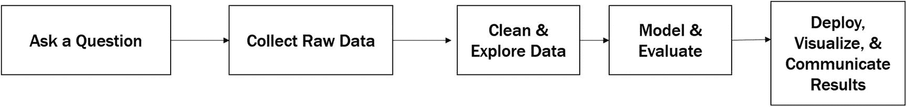

`图 1-1` 数据科学流程

问题因领域而异；例如：

- 政治：特朗普会在 2016 年和 2020 年赢得缅因州吗？
- 脸书：如何让人们更长时间地停留在脸书上？
- 医疗：这个肿瘤是癌症与否？
- 医院管理：如何减少患者等待时间，从而提高患者满意度？

第二步是收集原始数据。例如，在政治问题中：某位特定候选人会赢得某个州吗？收集所有选民的信息——年龄、种族、教育程度、收入、性别和行业——是至关重要的一步，同时收集历年的选票数据和投票结果也同样重要。我们拥有的历史数据越多，预测就越准确。此外，我们还应该收集多年间的人口分布信息。

第三步是清洗这些原始数据，包括处理缺失值、异常值、重复行和拼写错误的信息，调整列的数据类型，统一值的格式等。

第四步是尝试多种模型，并根据问题的性质将它们的相互结果进行比较。在总统选举问题中，我使用了蒙特卡洛和贝叶斯算法。

第五步也是最后一步，是在我们的报告中以平实的语言将结果可视化并进行传达。这一步是整个流程的主要目标，因为它包含了对最初引发整个流程的第一个问题的预测答案。

## 案例研究：缅因州总统选举

正如我在上一节中提到的，数据科学流程始于一个问题。在这个项目中，我的问题是：唐纳德·特朗普会在 2016 年和 2020 年的总统选举中赢得缅因州吗？

### 人口

第二步是尽可能收集相关的数据。因此，我从人口信息入手。

根据美国人口普查局关于缅因州各县人口分布的数据，我发现人口分布并不均匀。有大片区域要么无人居住，要么只有一个人居住。虽然南部的红点看起来很小，但每个红点代表有超过 5000 人居住。因此，我不应该被总统竞选活动或主流媒体发布的地图所迷惑。

接下来的逻辑步骤是获取选民信息。有些州免费公开选民数据库，任何人都可以下载。然而，缅因州并非如此。该州将选民数据库出售给政党。于是，我联系了州务卿办公室。

该办公室回复说，要获取缅因州中央选民登记系统中的选民档案和更新信息，申请方必须属于以下五类之一：

1. 候选人本人，或为候选人竞选活动工作的个人或实体
2. 为某个政党工作的个人
3. 参与下届全州选举中缅因州选票上公投活动的个人或实体
4. 参与缅因州特定“促投票”活动的个人或实体（需指明活动的名称、地点和日期）
5. 经选举或任命，并在市、县、州或联邦政府机构任职的个人，仅用于该官员的授权活动，不得转交其他实体

费用根据获取的记录数量计算；收费标准详见《缅因州法律汇编》第 21-A 篇第 196-A 节。一份包含近一百万条记录的州级选民档案售价为 2200 美元。

经过几封邮件往来，解释了我需要这些数据用于研究项目并发送了一些验证信息后，该办公室善意地免费寄给我一张 DVD，里面包含了所有必要的信息，并隐藏了不需要的数据，如姓氏等。

DVD 上的第一个表格是选民信息，如图 1-2 所示。列包括名字、出生年份、注册代码、特殊标识、注册日期、国会选区、县 ID、变更日期以及带有`VPH`标识的上次全州选举日期。

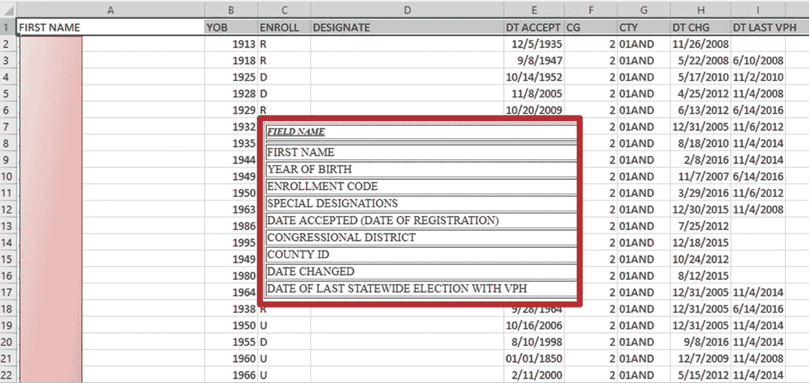

图 1-2 选民信息

第二个表格是注册和登记选民报告，如图 1-3 所示。该表的列包括县名、市镇名、选区、国会选区、州参议院选区、县专员选区、政党及总人数。文件中列出的政党有民主党、绿党独立人士、自由意志党、共和党和无党派。

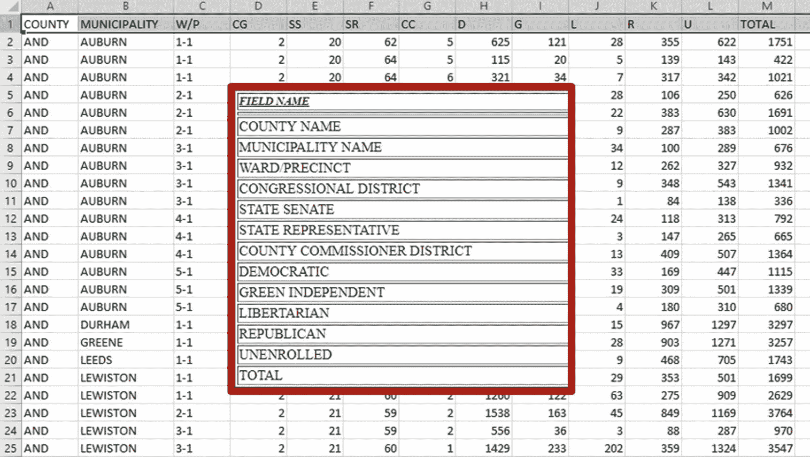

图 1-3 注册和登记选民报告

这些原始数据很混乱，包含许多错误值和异常值。例如，一名选民的年龄是 220 岁，而他的出生日期显示他当时大约是 67 岁。有些选民的信息缺失，等等。再次强调，如前所述，一定要清理你的数据：处理异常值、缺失数据，调整数据格式，并探索你的数据。

不仅如此，你还应该尽可能多地收集历史数据。于是，我开始深入研究，收集了所有能找到的数据。我从美国人口普查局下载了更多表格（`http://www.census.gov/topics/public-sector/voting/data/tables.html`）。

我按性别、年龄和种族对选民进行了分组。

### 性别

如图 1-4 所示，我发现缅因州注册的女性选民人口多于注册的男性选民。然而，两种性别的百分比差异小于±2%。至于候选人应如何利用这一信息，鉴于女性的投票率总是高于男性，竞选活动的代表可以佩戴癌症意识丝带以激发女性的同情心。这一建议展示了数据和数字不仅能够控制演讲话题，甚至能控制代表们的穿着。

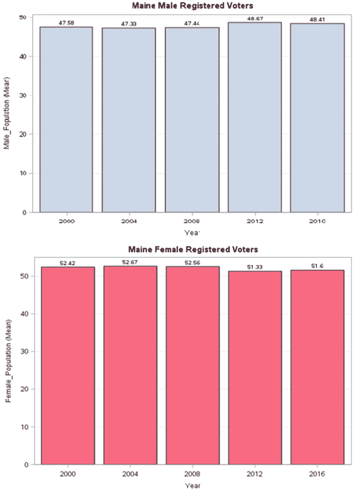

图 1-4 按性别分组的缅因州注册选民

### 种族

关于缅因州的种族构成，超过 96%的人口是白人（如图 1-5 所示）。因此，我将黑人、亚裔和西班牙裔选民归为非白人注册选民。

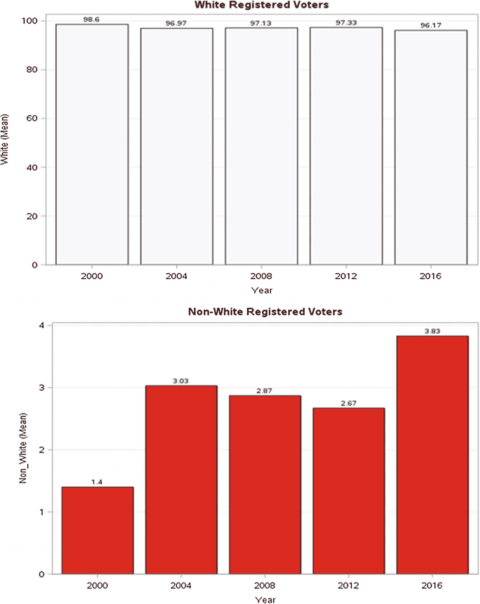

图 1-5 按种族分组的缅因州注册选民

### 年龄

2016 年，年龄在 65 岁以上的注册选民数量显著下降，如图 1-6 所示（请注意纵轴刻度不同）。另一方面，18–24 岁和 25–44 岁年龄段的选民数量有所增加。这一发现表明，为了说服更多选民，演讲话题也应随之改变。例如，竞选代表应侧重讨论学生贷款和住房抵押贷款，而不是聚焦于医疗保险和退休金。

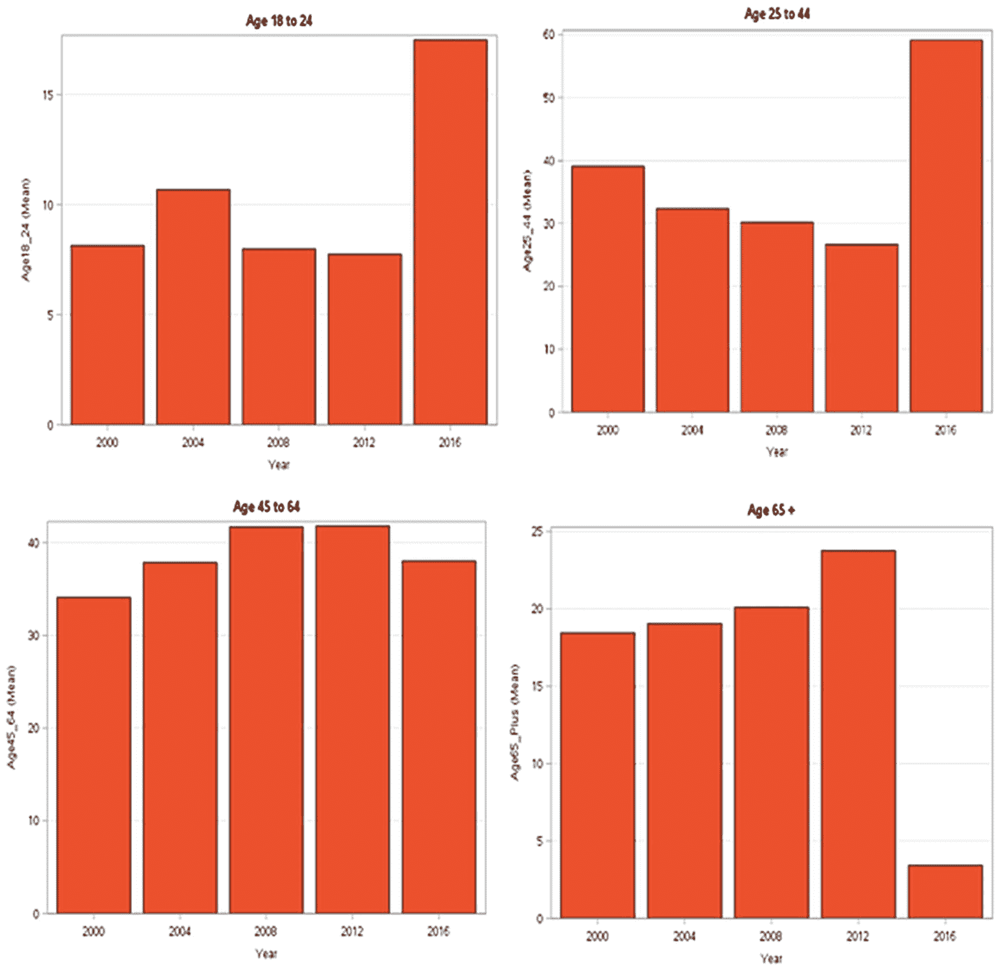

图 1-6 按年龄分组的缅因州注册选民

### 选民投票率

我查阅了过去几年的选民投票率，以了解有多少选民愿意冒着缅因州的风雪走上街头投票。图 1-7 显示了 2000 年至 2016 年的选民投票率百分比，并且在这些年份中，获胜政党均是民主党。如果你用摇摆州尝试这个练习，柱状图的颜色会相应变化以反映获胜政党。

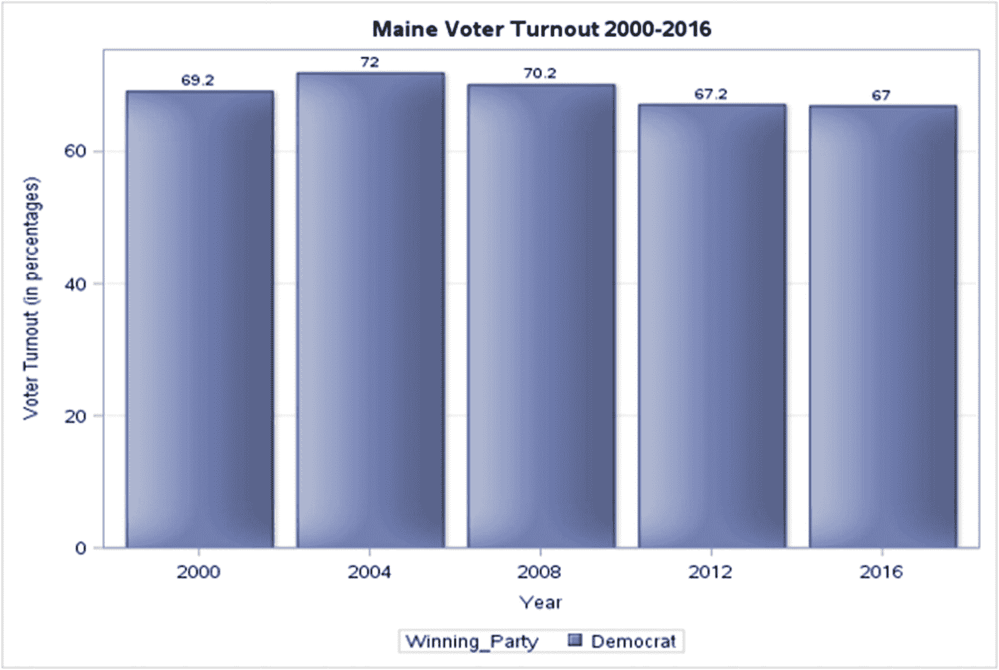

图 1-7 2000–2016 年缅因州选民投票率

我再次根据获胜政党，并按照年龄、种族和性别分组，检查了近年来的选民投票率。在图 1-8 中，`D`代表民主党，`R`代表共和党，`O`代表所有其他政党的总和。

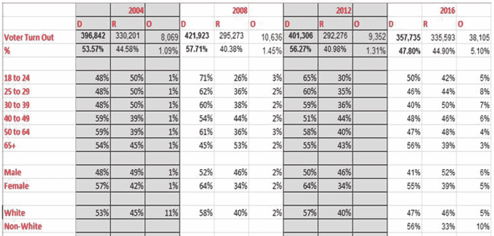

图 1-8 按政党及年龄、种族和性别分组的缅因州选民投票率

## 2012 年获胜候选人

我开始通过生成直方图来探索数据，该直方图展示了 2012 年缅因州候选人及其获胜百分比。我发现巴拉克·奥巴马以大幅优势击败米特·罗姆尼，而其他候选人的得票率几乎为零，如图 1-9 所示。在第 3 章 中，“使用条形图创建直方图”一节逐步展示了如何生成图 1-9。

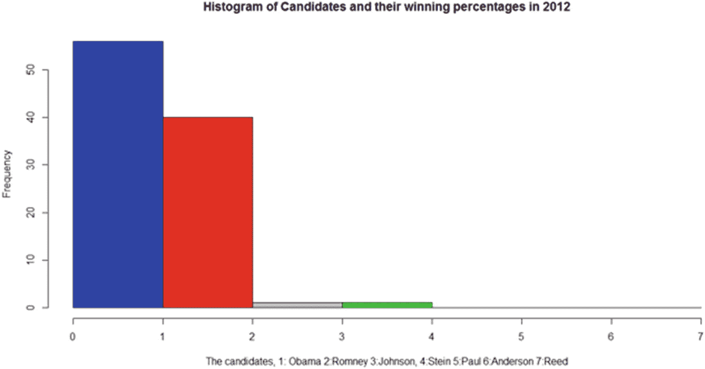

*图 1-9 2012 年候选人及其获胜百分比直方图*

接下来，我尝试在地图上按县可视化这些数据。图 1-10 显示了 2000 年至 2016 年期间，民主党以最深色阴影标识，共和党以较浅色阴影标识。但请记住，在缅因州，面积并不等同于人口。第 8 章 列出了生成图 1-10 中地图所需的步骤和代码。

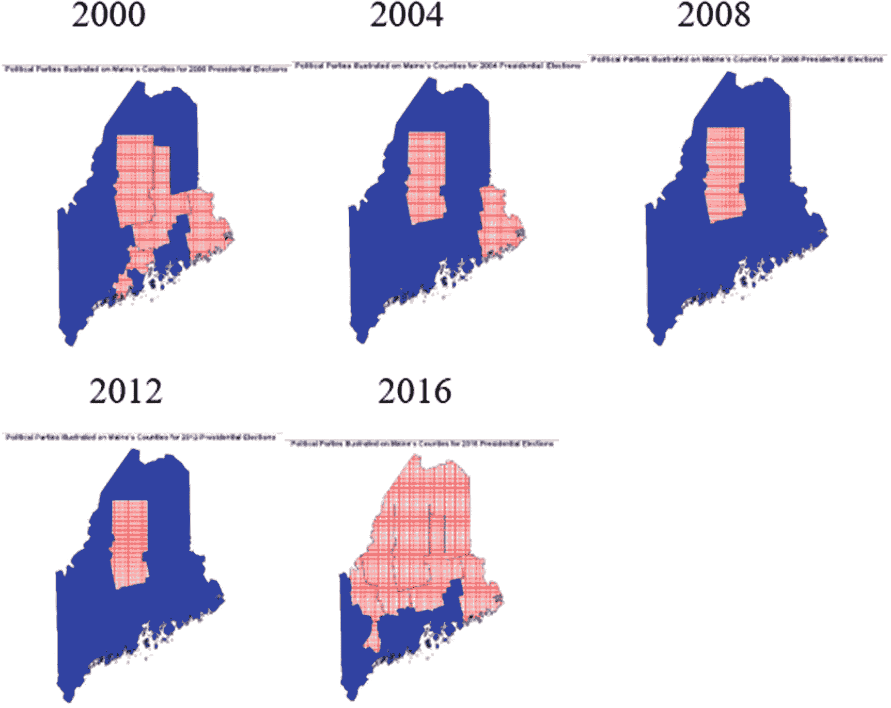

*图 1-10 2000 年至 2016 年总统大选中缅因州各县投票情况地图*

## 类别/议题

所有总统选举辩论都聚焦于各种议题以及每位候选人将如何应对这些议题。基于这些策略，选民可能会改变想法，并根据特定议题投票。因此，研究这些议题至关重要。

### 国家面临的议题

根据 CNN 报道，2016 年，缅因州选民认为国家面临的最关键议题是外交政策、移民、经济和恐怖主义。然而，这些议题并非缅因州自身所面临的问题。(¹) 从地图上看，缅因州不受外交政策影响。从种族统计数据来看，很明显缅因州几乎没有移民。我简要搜索了缅因州是否有过任何恐怖袭击，结果一无所获。全世界唯一持久存在的共同议题是经济。因此，我开始在选票中寻找缅因州的议题。

### 类别：缅因州面临的议题

在 Ballotpedia 网站上，选票情况如表 1-1 所示。

*表 1-1 缅因州居民面临的议题* (²)

| 2000 | 2004 | 2008 | 2012 | 2016 |
| --- | --- | --- | --- | --- |
| 辅助死亡商业彩票税收选举权 LGBT 渔业 | 教育税收狩猎与渔业 | 债券税收博彩水运输 | 婚姻教育水运输债券问题 | 大麻教育火器经济选举债券 |

我发现有一些特定议题多年来一直未得到解决，例如渔业、债券、水利、教育和税收。我推断缅因州存在水利和税收问题。我再次建议，总统竞选的演讲内容应包含针对这些特定议题的解决方案或计划。处理这些议题的演讲可能会赢得缅因州选民的支持。

根据我收集的信息以及对当地报纸的调查，我预测 2020 年缅因州的五大议题如下：

1.  教育

2.  经济

3.  债券

4.  医疗保健

5.  税收

## 影响缅因州经济的因素

当我们谈论经济时，寻找收入来源至关重要。根据《波特兰新闻先驱报》和 Maine.gov 网站上提供的缅因州收入数据集，(³) 其收入来源如下：

1.  农业

2.  林业

3.  渔业

4.  狩猎

5.  税收

6.  公司和企业管理

7.  金融和保险业

### 缅因州失业率与其他各州的比较

唐纳德·特朗普承诺提供更多就业机会，并将制造业企业迁回美国，而不是外包出去。许多新闻媒体声称，正是他的就业承诺使得“铁锈地带”各州倾向于投票给他，而不是希拉里·克林顿。因此，我搜索了缅因州的失业率，并将其与美国其他地区进行比较，以考察特朗普的承诺是否对缅因州选民有效。我发现缅因州在 2016 年并不存在失业问题。因此，我预测特朗普的承诺对缅因州选民的吸引力不会像对其他一些州的选民那样大。

### 缅因州的中位收入

为了更具体一些，并出于研究目的，我查阅了缅因州的中位收入；然后，将其与整个美国的中位收入进行了比较。根据表 1-2，从 2005 年到 2015 年，缅因州的中位收入略低于美国整体水平。然而，在大选前的三年里，这一数字有所增长。

*表 1-2 缅因州历史实际家庭中位收入* (⁴)

| 日期 | 美国 | 缅因州 |
| --- | --- | --- |
| 2018 | $61,937 | $55,602 |
| 2017 | $61,807 | $57,649 |
| 2016 | $60,291 | $55,542 |
| 2015 | $59,116 | $54,578 |
| 2014 | $56,969 | $52,515 |
| 2013 | $56,415 | $50,718 |
| 2012 | $56,288 | $51,180 |
| 2011 | $56,507 | $51,507 |
| 2010 | $57,762 | $52,878 |
| 2009 | $58,921 | $53,657 |
| 2008 | $60,829 | $54,459 |
| 2007 | $61,601 | $55,710 |
| 2006 | $60,490 | $54,233 |
| 2005 | $59,604 | $55,168 |

### 出口民调如何显示收入因素在 2016 年缅因州选举中的影响？

从另一个角度来看，根据 CNN 的报道，出口民调显示，除薪资在 30,000 美元到 50,000 美元之间的选民外，缅因州大多数选民会投票给克林顿。(⁵) 这部分群体会投票给特朗普。然而，他们仅占样本的 19%。因此，缅因州的多数人会投票给克林顿。

### 回顾以往选举，看是否存在可预测的结果（模式）

最后，项目的最后一步是收集以往选举的历史数据，并将其用于下一步的建模和预测。正如我之前提到的，我忽略了任何其他政党，只关注民主党和共和党，因为其他政党在 2012 年选举中的得票率几乎为零。

*表 1-3 缅因州以往总统选举的历史结果* (⁶)

| 年份 | 民主党 | 民主党% | 共和党 | 共和党% |
| --- | --- | --- | --- | --- |
| 2016 | **357,735** | **47.80%** | 335,593 | 44.90% |
| 2012 | **401,306** | **56.27%** | 292,276 | 40.98% |
| 2008 | **421,923** | **57.71%** | 295,273 | 40.38% |
| 2004 | **396,842** | **53.57%** | 330,201 | 44.58% |
| 2000 | **319,951** | **49.10%** | 286,616 | 44.00% |
| 1996 | **312,788** | **51.60%** | 186,378 | 30.80% |
| 1992 | **263,420** | **38.80%** | 206,820 | 30.40% |
| 1988 | 243,569 | 43.90% | **307,131** | **55.30%** |
| 1984 | 214,515 | 38.80% | **336,500** | **60.80%** |
| 1980 | 220,974 | 42.30% | **238,522** | **45.60%** |
| 1976 | 232,279 | 48.07% | **236,320** | **48.91%** |
| 1972 | 160,584 | 38.50% | **256,458** | **61.50%** |
| 1968 | **217,312** | **55.30%** | 169,254 | 43.10% |
| 1964 | **62,264** | **68.84%** | 118,701 | 31.16% |
| 1960 | **181,159** | **42.95%** | 240,608 | 57.05% |

看到表 1-3 中收集的数据，我惊讶地发现，缅因州历史上曾是共和党州，后来才变成了一个强大的民主党州。因此，我决定将缅因州描述为“倾向民主党”州，因为从 1960 年到 2016 年，民主党在十五次选举中赢得了七次。我预测它在 2020 年仍将以微弱优势支持民主党。自 1992 年以来，民主党在缅因州连续获胜。然而，如果民主党不再更多地关注缅因州，它可能会转而支持共和党。据《班戈每日新闻》报道，克林顿在 2015 年 9 月之后再未访问过缅因州，而是派代理人前往。多年来，民主党首次将一张选举人票输给了共和党。（班戈是缅因州的一个城市。）

## 建模

在建模时，最好尝试不同的预测算法并比较其结果，而不是只依赖单一模型。在这个项目中，我使用了 `Monte Carlo` 和 `Bayes` 算法。

对于统计检验，我使用了以下方法：

-   直方图

-   箱线图

-   比例检验

-   T 检验

-   决策树

-   卡方检验

-   散点图和线性回归

## 我的 2016 年预测

在`SAS University Edition`中使用过去的选举结果运行`Monte Carlo`算法后，输出如图 1-11 所示。

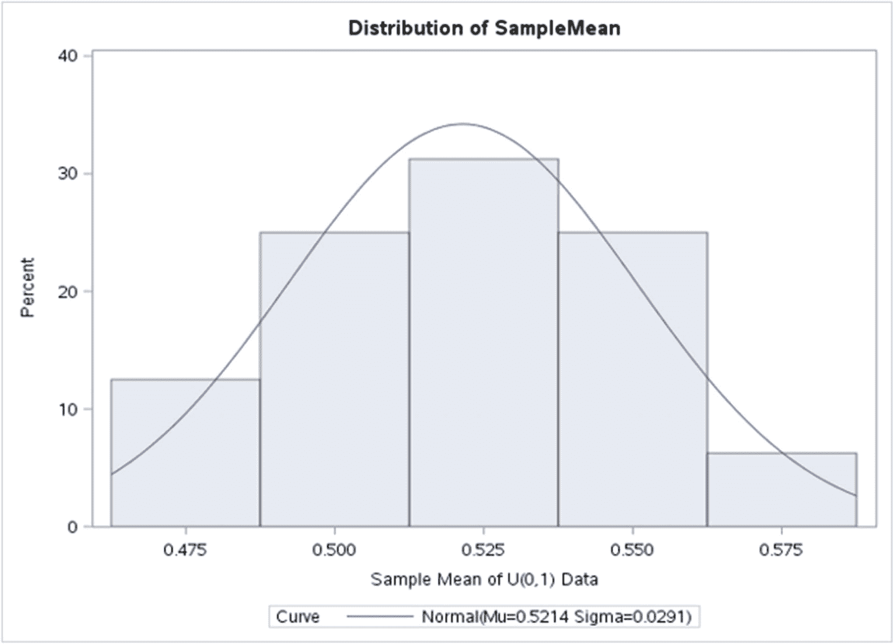

图 1-11 Monte Carlo 算法的 2016 年预测结果

图 1-11 显示，`Hillary Clinton`将以平均 52.14%的得票率赢得缅因州。实际上，她的得票率仅为 48%。因此，模拟检测到了她赢得缅因州，并且她确实赢了。因此，我在这项目中获得了满分，课程也得了 A。太棒了！

### 我的 2020 年预测

我预测民主党将以 50.8%的得票率赢得缅因州四张选举人票中的三张，如图 1-12 所示。

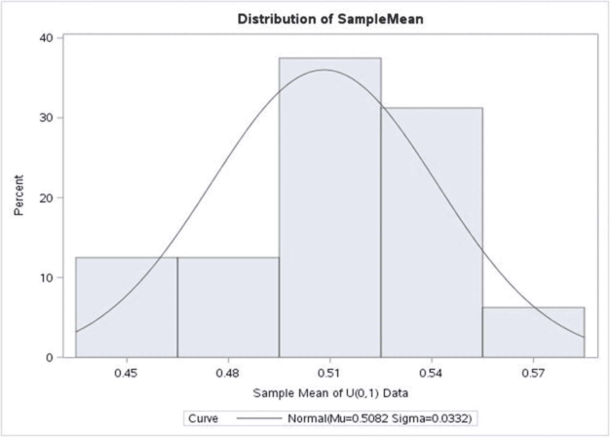

图 1-12 Monte Carlo 算法的 2020 年预测结果

缅因州的概率是，民主党将在 2020 年以大约高出共和党+3%的微弱优势获胜，而 1960 年至 2016 年的历史数据显示，缅因州民主党的平均得票率约为 43%，共和党的平均得票率为 40%。这与 2016 年缅因州民主党与共和党之间的差距相同。

然而，如果民主党不小心，缅因州可能会倒向共和党。

## 总结

本章重点阐述了缅因州总统选举项目案例研究的主要思路及其图表。在下一章中，我们将了解如何安装`SAS Studio`并编写我们的第一个 SAS 程序。