# 6. 准备分析数据

在本章中，我们将继续深入探讨 SAS 编程，仍然重点关注代码而非图形用户界面。正如我们之前提到的，在任何编程语言中，您都会学习数据类型、运算符、`IF` 条件和循环。我们在第 2 章和第 5 章中涵盖了所有这些主题，但 `IF` 条件语句除外。在本章中，我们将学习它们以及更高级的数据准备和处理技术。

## LABEL（标签）

在第 2 章中，我们提到 SAS 程序由两部分组成：数据步和过程步。在前面的章节中，我们尝试了许多过程，例如 `PROC SGPLOT` 和 `PROC MEANS`。`LABEL` 语句位于数据步中，而 `LABEL` 选项位于 `PROC PRINT` 中。

分析数据集的第一步是了解您拥有的变量。识别哪些是因变量，哪些是自变量，哪些是数值/连续变量，哪些是字符变量。通常，您的客户会随着包含数据的文件一起，在文本文件中为您提供这些信息。该文本文件称为字典，因为它包含了变量名称及其类型的解释。让我们回顾一下第 1 章中的图 1-2，即缅因州务卿办公室发送给我的文件。

数据位于 Excel 工作表中，字典用中间的红色框突出显示。如果没有字典，变量名 `YOB`、`ENROLL` 和 `DT Accept` 的含义是模糊的。通过字典，我们理解了每个变量的含义；例如，`YOB` 代表出生年份。

为了将这些解释性名称附加到 SAS 中的数据集，我们使用 `LABEL` 语句。数据集位于“Dataset”文件夹中，名称为 `Voter_A.CSV`。从 SAS Studio 上传它，点击刷新，然后导入它，就像我们在第 2 章中解释的那样。将数据集的名称从 `IMPORT` 更改为 `Voters`。

此数据集并非真实数据集。我是使用缅因州务卿发送给我的相同变量创建的。但是，此文件不包含真实信息。

导入文件后，我们发现它有 100 行和 9 列，如图 6-1 所示。

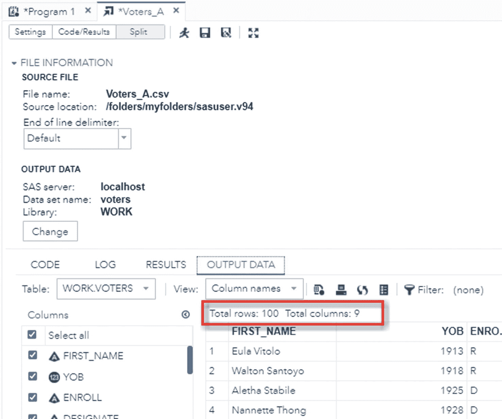

图 6-1 – 导入 Voters_A.CSV

现在，让我们在数据步中编写一个 `LABEL` 语句，并使用 `PROC PRINT` 的 `LABEL` 选项，如代码清单 6-1 所示。

```sas
data voters_label;
set work.voters;
label
FIRST_NAME='姓名'
YOB='出生年份'
ENROLL='注册代码'
DESIGNATE='特殊名称'
DT_ACCEPT='接受日期（注册日期）'
CG='国会选区'
CTY='县 ID'
DT_CHG='更改日期'
DT_LAST_VPH='最近一次有选民登记记录的全州选举日期';
run;
proc print label;
run;
```

代码清单 6-1 – LABEL 语句和 LABEL 选项

当您运行代码清单 6-1 时，输出如图 6-2 所示。

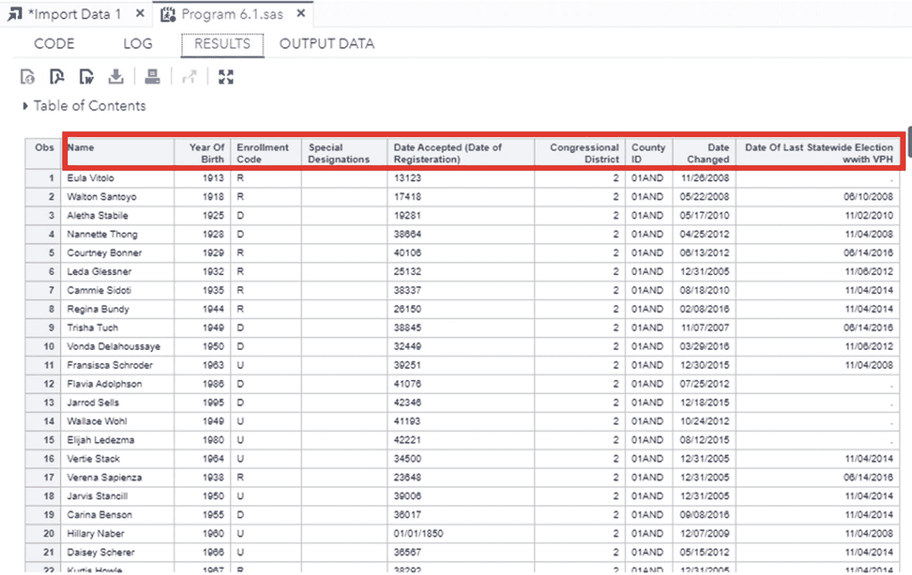

图 6-2 – 使用标签（而非变量名）的输出

图 6-2 显示，报告打印时使用了描述性标签，而不是变量名。因此，它更具可读性。但是，数据明显不整洁。“特殊名称”是一个空白列，其他列中存在缺失值。很可能，数据需要验证其有效性，并确保不包含任何错误信息。在本章后面的章节中，您将学习如何清理此类杂乱数据。

## 格式

在上一节中，我们了解了 `LABEL` 语句如何将输出更改为更易读的格式。另一方面，`FORMAT` 语句更改的是输入，而非输出。我们在第 2 章的“变量类型”一节中提到，默认情况下，字符数据类型的长度为 8 个字符。因此，如果我们使用 `INPUT` 语句而不是导入 Excel 文件，`FORMAT` 语句会覆盖默认的变量格式。此外，`FORMAT` 语句可以一次性为多个变量分配相同的格式。

数据集位于“Dataset”文件夹中，文件名为 `Voters_A.CSV`。从 SAS Studio 上传它并点击“刷新”。不要导入它，因为我们将使用 `INPUT` 语句，正如我们在第 2 章最后一节所解释的那样。

运行代码清单 6-2 并检查输出。在代码清单 6-2 中，我们仍然没有使用 `FORMAT` 语句。

```sas
data voters_format;
infile "/folders/myfolders/SAS4Days/Voters_A.csv" dlm=',' firstobs=2;
input NAME $ YOB $  ENROLL $ DESIGNATE $ DT_ACCEPT $  CG  CTY $ DT_CHG $  DT_LAST_VPH $;
run;
proc print ;
run;
```

代码清单 6-2

使用 INPUT 语句读取 CSV 文件

在代码清单 6-2 中，第一行`DATA VOTERS_FORMAT`在 Work 逻辑库中创建了一个名为`VOTERS_FORMAT`的新数据集。第二行中，`INFILE`语句从指定路径读取 CSV 文件，将分隔符设置为逗号，并告诉 SAS Studio 第一个观测值在 CSV 文件的第二行，因为该文件有标题行。第三行使用`INPUT`语句设置变量的名称及其类型。为了区分字符变量和数值变量，你在字符变量后面放一个美元符号（`$`），这样 SAS Studio 就能正确读取它们。数据步中的最后一行是结束数据步的`RUN`语句。最后，`PROC PRINT`将数据集打印为可打印的报告。

运行该程序并检查“Name”列。SAS Studio 截断了名称，只读取前八个字符。例如，`VOTERS_A.CSV`中的第一个名字是“Eula Vitolo”，而 SAS Studio 将其截断为“Eula Vit”，如图 6-3 所示。正如我们在第 2 章中所说，SAS Studio 默认只给字符字段分配八个字符。

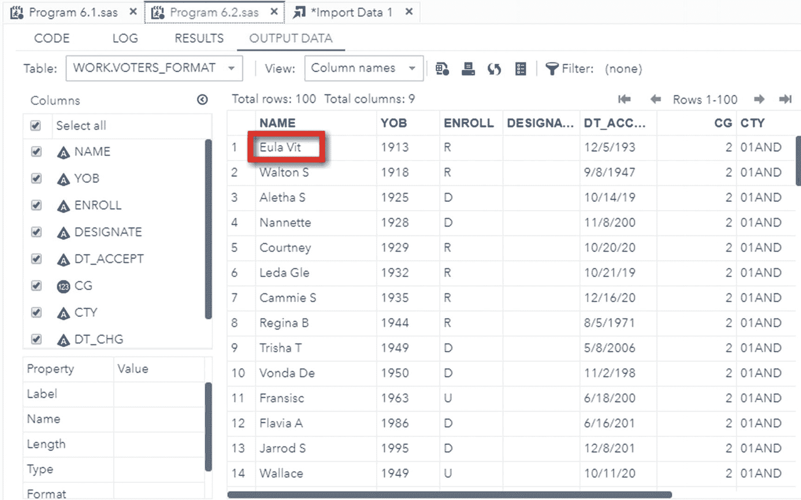

图 6-3：名称值被截断为仅八个字符

为了覆盖此规则并解决此问题，我们使用`FORMAT`语句来读取所有字符，如代码清单 6-3 所示。

```
data voters_format;

Format Name $21\. ;

infile "/folders/myfolders/SAS4Days/Voters_A.csv" dlm=',' firstobs=2;

input NAME $ YOB $  ENROLL $ DESIGNATE $ DT_ACCEPT $  CG  CTY $ DT_CHG $  DT_LAST_VPH $;

run;

proc print ;

run;
```

代码清单 6-3：FORMAT 语句

执行代码清单 6-3 后，名称将完整显示，如图 6-4 所示。`FORMAT`语句通过使用`$`符号指定`NAME`变量为字符类型，字符个数为 21。请记住在末尾加上句点（`$21.`），这样 SAS Studio 才能正确读取这些值。

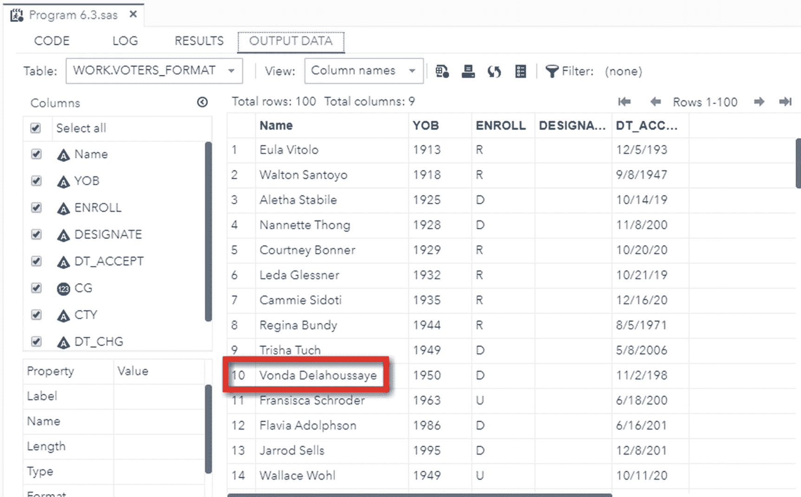

图 6-4：现在名称是完整的

## 创建新变量

在 SAS 中，你不需要像在其他某些语言中那样事先定义新变量或设置其数据类型。你只需放入新变量的名称及其值即可。就是这样。SAS 能够自行识别新变量的数据类型。

在此示例中，让我们继续使用前面章节的数据集 `Voters_A.CSV`。该数据集中有一个名为 `YOB` 的变量，代表出生年份。我们将要创建的新变量是选民的年龄。

如代码清单 6-4 所示，年龄等于当前年份与出生年份之差。年龄定义为 `age=2020-YOB`。我们在数据步中定义它。

```
data voters_format;

Format Name $21\. ;

infile "/folders/myfolders/SAS4Days/Voters_A.csv" dlm=',' firstobs=2;

input NAME $ YOB $  ENROLL $ DESIGNATE $ DT_ACCEPT $  CG  CTY $ DT_CHG $  DT_LAST_VPH $;

*创建年龄作为一个新变量;

age=2020-YOB;

run;

proc print ;

run;
```

代码清单 6-4：创建新变量

执行代码清单 6-4 后，输出中附加了一个新变量，如图 6-5 所示。

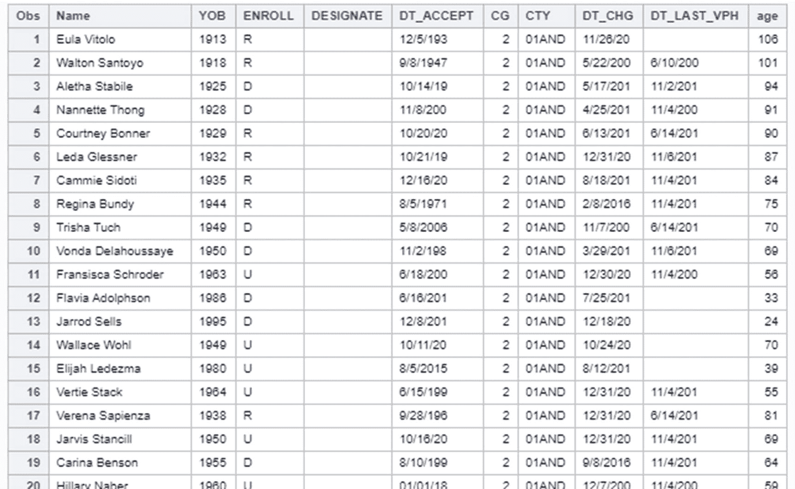

图 6-5：代码清单 6-4 的输出

向下滚动一点并检查年龄。有一位选民显示为 340 岁，如图 6-6 所示。很可能这个值是错误的。我们将在本章后面了解如何使用 `IF` 语句解决这个问题。

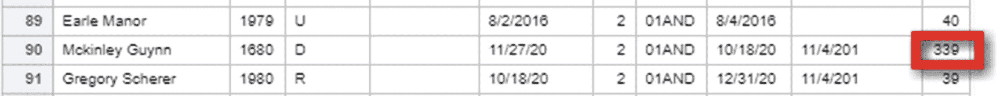

图 6-6：检查年龄值中的错误值

## 重新排列数据集变量

在清理数据之前，你可能希望重新排序数据集中的变量；例如，重新排列变量，使年龄变量直接位于 `YOB` 旁边。我们使用 `RETAIN` 和 `SET` 语句来实现这一点。

但是，这必须在新的数据步中完成，如代码清单 6-5 所示。本章后面，我们将进一步了解 `SET` 语句。

```
data voters_format;

Format Name $21\. ;

infile "/folders/myfolders/SAS4Days/Voters_A.csv" dlm=',' firstobs=2;

input NAME $ YOB $  ENROLL $ DESIGNATE $ DT_ACCEPT $  CG  CTY $ DT_CHG $  DT_LAST_VPH $;

*创建年龄作为一个新变量;

age=2020-YOB;

run;

data voters_retain;

retain NAME YOB age ENROLL DESIGNATE DT_ACCEPT  CG  CTY DT_CHG  DT_LAST_VPH;

set voters_format;

run;

proc print data=voters_retain;

run;
```

代码清单 6-5：RETAIN 语句

执行代码清单 6-5 后，年龄现在位于 `YOB` 之后，如图 6-7 所示。如果出现错误，请检查 `INFILE` 语句中的文件路径。将其更改为文件在您机器上的实际位置。

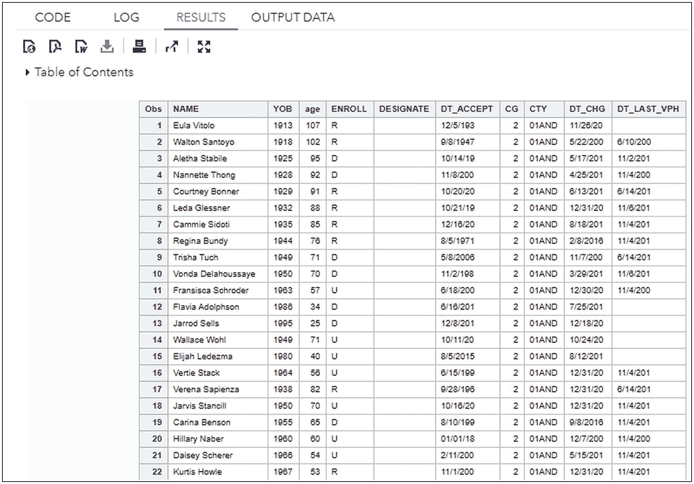

图 6-7：重新排序变量使年龄位于 YOB 之后后的选民数据集

还有其他方法可以重新排序数据集中的变量。您可以通过此链接查看：[`http://support.sas.com/kb/8/395.html`](http://support.sas.com/kb/8/395.html)。

## IF 语句

现在，这是数据清理的关键部分——`IF`语句。使用`IF`语句有三种形式：

1.  `IF`（条件）不带`THEN`语句
2.  `IF-THEN`语句
3.  `IF-THEN-ELSE`语句

### 不带 THEN 语句的 IF（条件）

`IF`语句在没有`THEN`语句的情况下用于对数据集进行子集选择。在此示例中，我们继续使用前几节的数据集 `Voters_A.CSV`。我们希望创建两个新数据集作为原始数据的子集，其中第一个数据集仅包含登记为民主党的选民，另一个数据集包含登记为共和党的选民。我们使用`IF`语句并检查`ENROLL`变量值，如代码清单 6-6 所示。

使用`SET`语句将旧数据集复制到新数据集。通常最好创建数据集的新副本，并在新数据集上执行所有分析，同时保留原始数据不变。这是一个良好的实践，尤其适用于使用政府、联合国或银行提供的数据集的情况。

```
data voters_enroll;

Format Name $21\. ;

infile "/folders/myfolders/sasuser.v94/Voters_A.csv" dlm=',' firstobs=2;

input NAME $ YOB $  ENROLL $ DESIGNATE $ DT_ACCEPT $  CG  CTY $ DT_CHG $  DT_LAST_VPH $;

run;

data voters_democrat;

set voters_enroll;

if enroll="D";

run;

data voters_republican;

set voters_enroll;

if enroll="R";

run;

proc print data=voters_enroll (obs=3);

run;

proc print data=voters_democrat (obs=3);

run;

proc print data=voters_republican (obs=3);

run;
```

代码清单 6-6：IF（条件）语句示例

## 数据处理示例

运行代码清单 6-6 后，我们得到三个数据集。`Voters_Enroll`包含所有政党，`Voters_Democrats`仅包含民主党选民，`Voters_Republicans`仅包含共和党选民。我们需要三个数据步骤，每个数据集对应一个；同样，我们需要三个`PROC PRINT`。如果出现错误，请检查`INFILE`语句中的文件路径。将其更改为文件在您机器上的实际位置。

为了不打印数据集中的所有行，我们在`PROC PRINT`中添加了`(OBS=3)`选项，以仅从每个数据集中打印三行。单击“Results”选项卡查看三个报告，如图 6-8 所示。

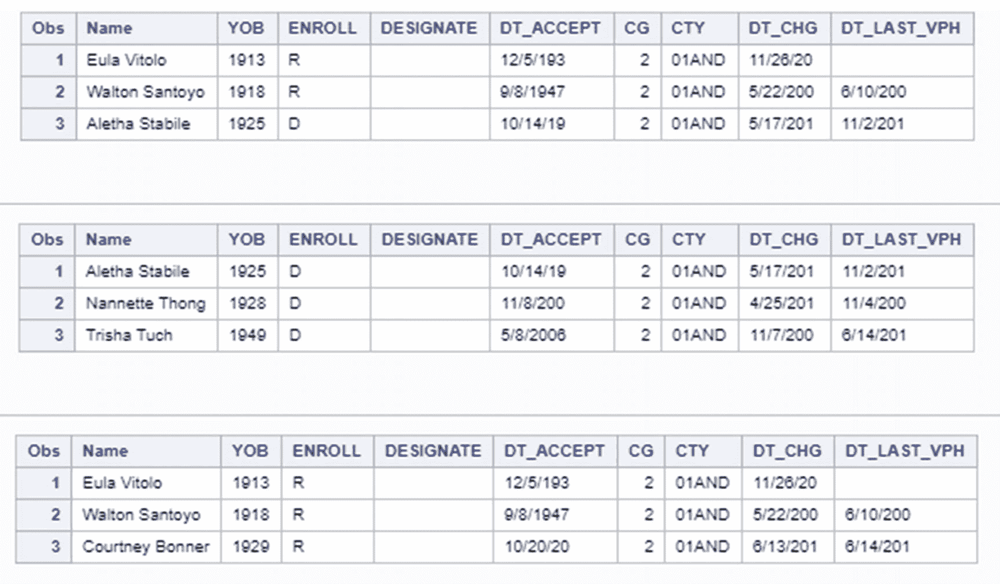

**图 6-8** 子集选择后打印三行

单击“Output Data”选项卡，从下拉菜单中选择表格，如图 6-9 所示。`WORK.VOTERS_ENROLL`包含所有政党，共有 100 行。

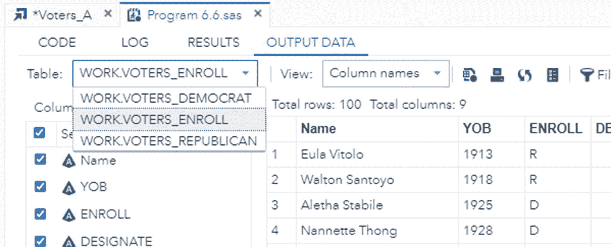

**图 6-9** 从下拉菜单中选择输出表格

选择`WORK.VOTERS_DEMOCRAT`表格，该表格仅有 24 行，如图 6-10 所示。

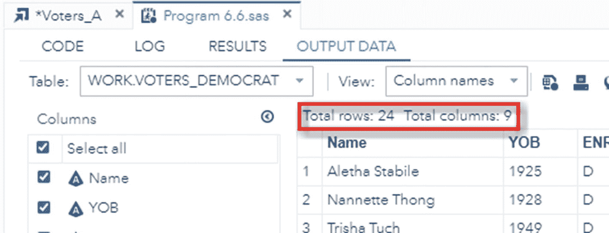

**图 6-10** 民主党表格

选择`WORK.VOTERS_REPUBLICAN`表格，该表格仅有 24 行，如图 6-11 所示。

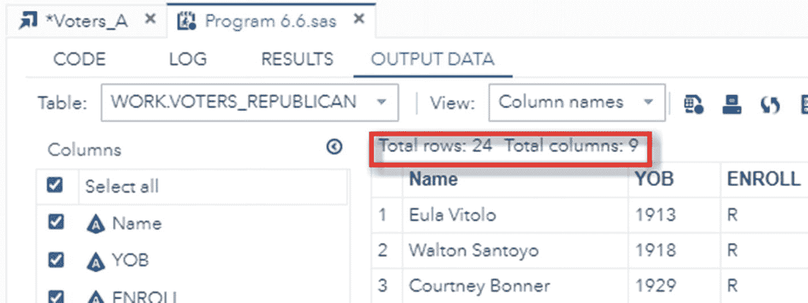

**图 6-11** 共和党表格

要了解表格中剩余的其他政党、每党行数及占比，请运行单向频率分析，如图 6-12 所示。请查阅政党代码字典：

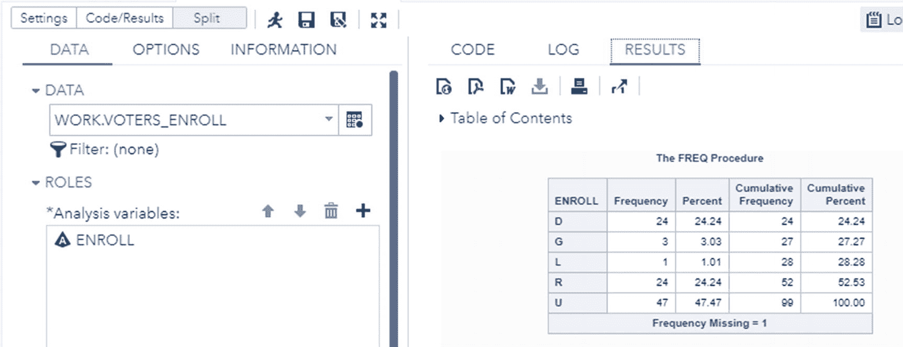

**图 6-12** 单向频率分析输出

```
A      AMERICANS ELECT
D      DEMOCRATIC
G      GREEN INDEPENDENT
L      LIBERTARIAN
O      OTHER QUALIFYING PARTY
R      REPUBLICAN
U      UNENROLLED
X      INELIGIBLE
```

### IF-THEN 语句

如前所述，“Age”列中有一位选民的年龄存在明显错误值（340 岁）。要修正此问题，如果数据集是真实的，我们会有以下几种选择：

1.  通过联系缅因州州务卿办公室或联系该选民来获取正确的年龄。
2.  移除该值，并用点号（`.`）代替以表示缺失数据，如第 5 章所述。SAS 中缺失数据的惯例是：数值型缺失值用点号表示，字符型缺失值用空白表示。
3.  另一种解决方案是删除整行。
4.  保留该值。但是，该值将成为一个异常值，并影响分析（例如分析年龄、政党和预期投票率之间的关系）。

在本例中，我们将该值视为缺失值。为此，我们使用`IF-THEN`语句，如代码清单 6-7 所示。

```sas
data voters_format;
    Format Name $21\. ;
    infile "/folders/myfolders/sasuser.v94/Voters_A.csv" dlm=',' firstobs=2;
    input NAME $ YOB $  ENROLL $ DESIGNATE $ DT_ACCEPT $  CG  CTY $ DT_CHG $  DT_LAST_VPH $;
    *creating age as a new variable;
    age=2020-YOB;
run;

data voters_retain;
    retain NAME YOB age ENROLL DESIGNATE DT_ACCEPT  CG  CTY DT_CHG  DT_LAST_VPH;
    set voters_format;
    *T clean this outlier, we mark it as a missing data;
    if age= 340 then age=.;
run;

proc print data=voters_retain;
run;
```

代码清单 6-7 IF-THEN 语句示例

运行代码清单 6-7 后，该值将变为缺失值，如图 6-13 所示。

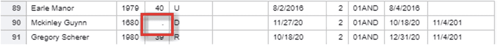

**图 6-13** 将错误值设为缺失值

另一种解决方案是使用`DELETE`语句删除整行，如代码清单 6-8 所示。

```sas
data voters_format;
    Format Name $21\. ;
    infile "/folders/myfolders/sasuser.v94/Voters_A.csv" dlm=',' firstobs=2;
    input NAME $ YOB $  ENROLL $ DESIGNATE $ DT_ACCEPT $  CG  CTY $ DT_CHG $  DT_LAST_VPH $;
    *creating age as a new variable;
    age=2020-YOB;
run;

data voters_retain;
    retain NAME YOB age ENROLL DESIGNATE DT_ACCEPT  CG  CTY DT_CHG  DT_LAST_VPH;
    set voters_format;
    *Delete the whole row;
    if age= 340 then Delete;
run;

proc print data=voters_retain;
run;
```

代码清单 6-8 删除年龄错误值的整行

运行代码清单 6-8 后，整行被删除，如图 6-14 所示。

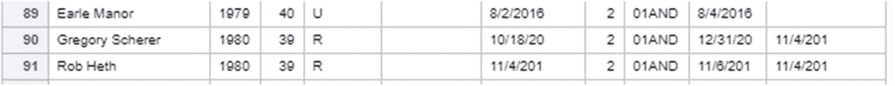

**图 6-14** 该行已被删除

为了进一步验证，比较新数据集`WORK.VOTERS_RETAIN`和原始数据集`WORK.VOTERS_FORMAT`中的行数。在图 6-15 中，行数为 99，而原始数据集的行数为 100，如图 6-16 所示。

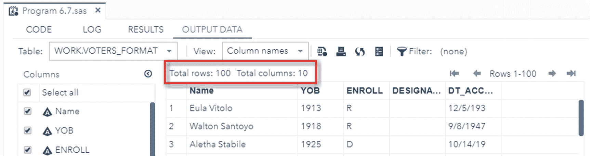

**图 6-16** 包含 100 行的原始数据集

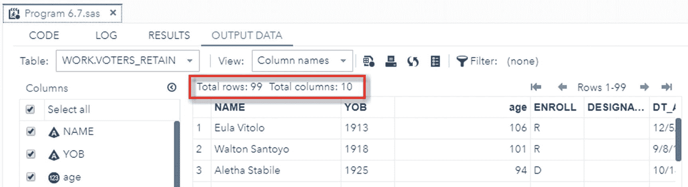

**图 6-15** 删除行后的新数据集

### IF-THEN-ELSE 语句

现在，让我们通过计算以下年龄组中的选民人数来进行分析：18–24 岁、25–29 岁、30–39 岁、40–49 岁、50–64 岁和 65 岁以上，如 6-9 所示。

```sas
data voters_format;
    Format Name $21\. ;
    infile "/folders/myfolders/SAS4Days/Voters_A.csv" dlm=',' firstobs=2;
    input NAME $ YOB $  ENROLL $ DESIGNATE $ DT_ACCEPT $  CG  CTY $ DT_CHG $  DT_LAST_VPH $;
    *creating age as a new variable;
    age=2020-YOB;
run;

data voters_retain;
    retain NAME YOB age ENROLL DESIGNATE DT_ACCEPT  CG  CTY DT_CHG  DT_LAST_VPH;
    set voters_format;
    if age= 340 then Delete;
    if (age>=18 and age=25 and age=30 and age=40 and age=50 and age=65) then age_group='65+';
run;
```

proc print data=`voters_retain` ;
run;

Listing 6-9

IF-THEN-ELSE 语句示例

```
```

运行 6-9 后，输出结果如图 6-17 所示。

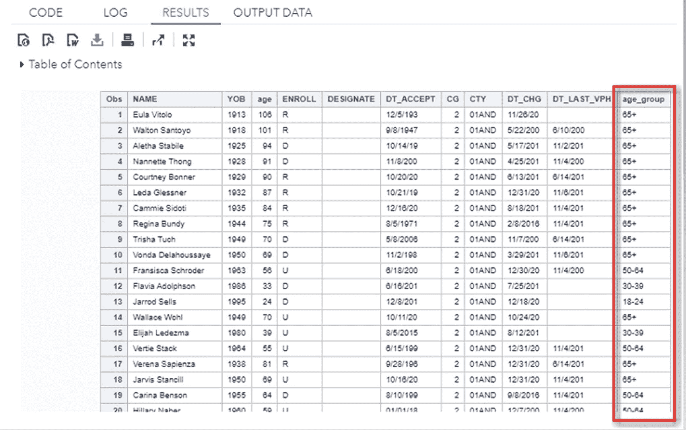

图 6-17

添加 `AGE_GROUP` 变量

要获取每个年龄组的计数及其百分比，请对 `AGE_GROUP` 变量运行单变量频率统计，如图 6-18 所示。

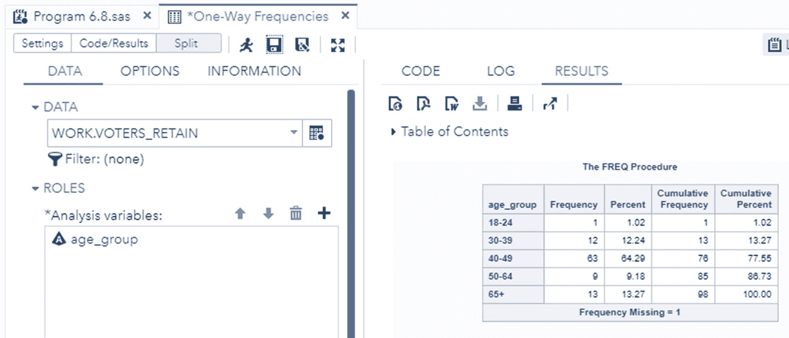

图 6-18

对 `AGE_GROUP` 变量进行单变量频率统计

在 SAS 中还有其他创建 `AGE_GROUP` 的方法。您可以通过以下链接了解更多信息：[`https://stackoverflow.com/questions/53395384/creating-an-agegroup-variable-in-sas`](https://stackoverflow.com/questions/53395384/creating-an-agegroup-variable-in-sas)。

## DROP 语句

`DROP` 语句用于指定从数据集中排除某些变量。在 `Voters_A.csv` 数据集中，我们有一个“Designate”列。该列完全为空。在数据清洗过程中，我们应该删除这一列；换句话说，就是丢弃它，如 6-10 所示。

```
data `voters_format`;
    Format `Name` `$21\.` ;
    infile `"/folders/myfolders/SAS4Days/Voters_A.csv"` dlm=',' firstobs=2;
    input `NAME` $ `YOB` $  `ENROLL` $ `DESIGNATE` $ `DT_ACCEPT` $  `CG`  `CTY` $ `DT_CHG` $  `DT_LAST_VPH` $;
    drop `designate`;
run;

proc print ;
run;
```

Listing 6-10

DROP 语句示例

```
```

运行 6-10 后，输出结果将只剩下八个列，如图 6-19 所示。

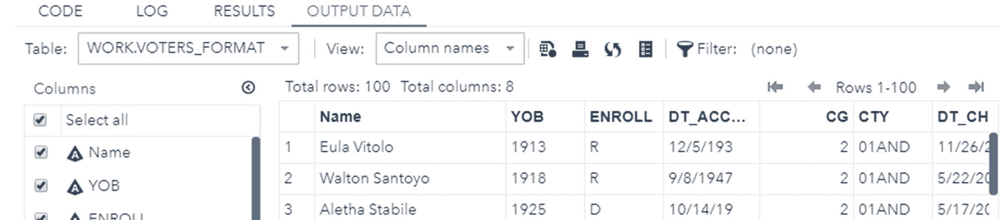

图 6-19

删除一列后剩余八个列

## SET 语句

在前面的示例中，我们一直在使用 `SET` 语句，但没有详细讨论它。到目前为止，我们了解到我们使用 `SET` 语句将一个旧数据集复制到一个新数据集。因此，我们所有的处理都在新数据集上执行，而旧数据集保持不变。`SET` 语句具有多种功能。该网站为每个函数提供了许多示例：

[`https://documentation.sas.com/?docsetId=lestmtsref&docsetTarget=p00hxg3x8lwivcn1f0e9axziw57y.htm&docsetVersion=3.1&locale=en`](https://documentation.sas.com/%253FdocsetId%253Dlestmtsref%2526docsetTarget%253Dp00hxg3x8lwivcn1f0e9axziw57y.htm%2526docsetVersion%253D3.1%2526locale%253Den)

然而，在本节中，我们专注于将两个数据集追加到一个新的更大的数据集中。简单来说，其语法是：`SET <数据集 1> <数据集 2> <数据集 3> ...`。

请注意，所有数据集名称之间用空格分隔。

我们已经在 6-6 中看到了如何将旧数据集复制到新数据集。在这个例子中，让我们执行相反的过程。假设我们有两个数据集，分别是民主党数据集和共和党数据集，并希望将它们合并为一个。

首先重新运行 6-6，以便将两个数据集加载到 `Work` 库中。然后，运行 6-11，该代码将合并这两个数据集。

```
data `all`;
    set `voters_democrats` `voters_republicans`;
run;

proc print data=`all`;
run;
```

Listing 6-11

追加两个数据集

```
```

运行 6-11 后，数据集 `WORK.ALL` 将有 48 行，因为 `WORK.VOTERS_DEMOCRATS` 和 `WORK.VOTERS_REPUBLICANS` 各有 24 行。输出结果如图 6-20 所示。

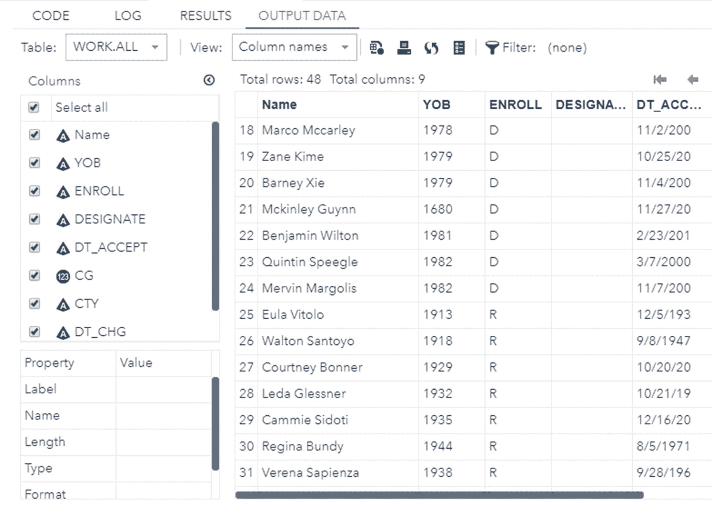

图 6-20

追加民主党与共和党数据集

## 总结

本章解释了为分析而清洗和准备数据的步骤。它讨论了 `LABEL` 和 `FORMAT` 语句。它还解释了如何创建新变量以及如何重新排列数据集中的变量。它解释了 `IF`、`IF-THEN` 和 `IF-THEN-ELSE` 语句。最后，它解释了 `DROP` 和 `SET` 语句。至此，我们完成了最常见的数据分析任务，下一章将介绍如何使用回归预测未来。

