# 导览

SAS Studio 界面基本分为两个垂直窗格。第一个是导航窗格，包含多个选项卡，例如：`Server Files and Folders`（服务器文件和文件夹）、`Tasks and Utilities`（任务与工具）、`Snippets`（代码片段）以及 `Libraries`（库）。第二个是工作区，用于显示程序的编辑器/代码、日志和结果。

`Server Files and Folders` 选项卡包含您在机器上创建的共享文件夹内的所有文件夹和子文件夹。请记住，SAS Studio 运行在虚拟机内部；因此，默认情况下它看不到您操作系统的文件和文件夹。它只能看到该共享文件夹内的内容。在本章稍后的内容中，您将学习如何将文件从您的操作系统导入到 SAS Studio 运行的虚拟机，反之亦然。完成这些操作后，您将能够在 SAS Studio 内部使用这些文件。

`Tasks and Utilities` 选项卡包含您可以在 SAS Studio IDE 内使用的任务图形用户界面（GUI）。在本章及本书的后续内容中，您将了解该选项卡如何简化您的数据科学流程，以及如何通过几次鼠标点击，帮助您完成探索、清理和处理数据的大部分基本步骤，并帮助您进行预测。

`Snippets` 选项卡将一些最常用的任务以现成的代码形式提供给您。您可以针对自己的数据集重用这些代码并进行自定义。您将在本章后文中了解更多相关信息。

`Libraries` 选项卡中存放着 SAS Studio 用于执行任务和工具的数据集。

在虚拟机中成功安装 SAS Studio 后，点击左侧窗格中的 `Libraries`。然后依次点击 `SASHELP` 和 `CARS`。您将看到一个表格查看器，如图 2-1 所示，其中显示了一个包含汽车信息的数据集。中间窗格显示该数据集的列。默认情况下，左侧图 2-1 中以红色高亮的 "Select all"（全选）处于选中状态。现在，取消选中它，并仅勾选 "Make"（制造商）和 "Model"（型号）。右侧窗格将仅显示这两列的数据。尝试调整它们的大小。您可以将任何列向左或向右拖动以重新排列它们。您可以通过点击列名来对任何列进行升序或降序排序。

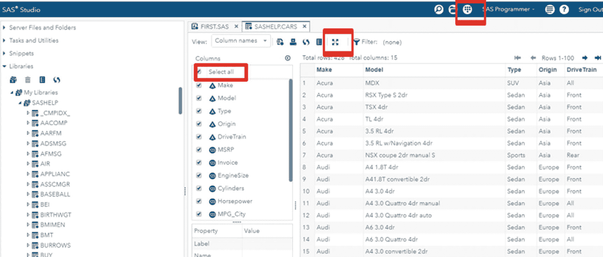

**图 2-1** SAS Studio 界面

现在，点击图 2-1 中间高亮的图标。此图标是展开/折叠按钮。第一次点击时，左侧窗格将折叠，为您正在处理的任务提供展开视图。如果再次点击该按钮，窗格将恢复原状。

查看数据的另一种方法是使用代码。让我们编写第一段 SAS 代码。从左侧开始的第三个图标，点击后会显示一个下拉菜单，如图 2-2 所示。

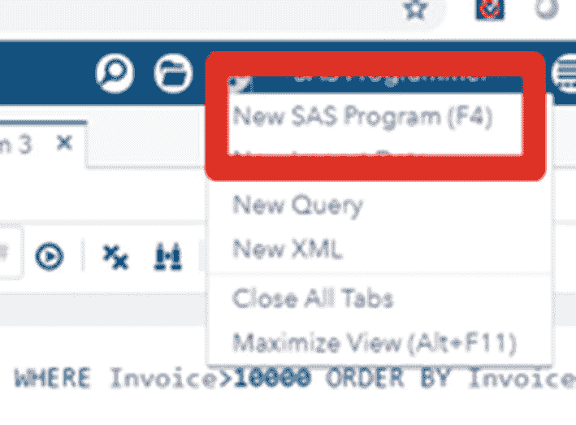

**图 2-2** 打开一个新的 SAS 程序

点击 `New SAS Program`（新建 SAS 程序）并开始输入 `"pr"`，如图 2-3 所示。您将会发现有帮助菜单弹出，显示用于自动补全您输入内容的关键字，并附有说明以及用于示例和文档的附加链接，如图 2-3 所示。此功能对初学者非常有用。

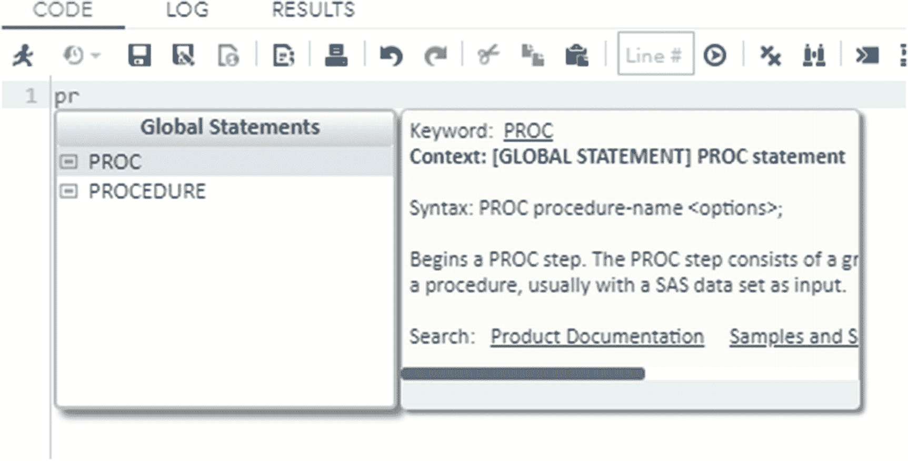

**图 2-3** 自动补全功能和有用的弹出菜单

然而，当您对 SAS Studio 更加熟悉并希望禁用此功能时，您可以通过点击 `Preferences`（首选项）来实现，如图 2-4 所示。

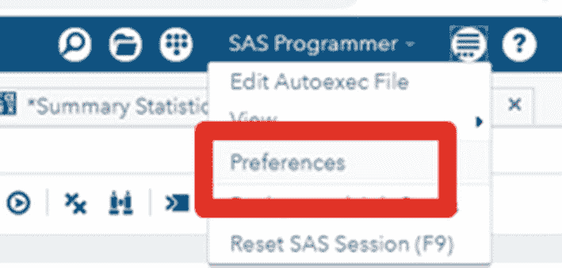

**图 2-4** 首选项

现在，点击 `Code and Log`（代码和日志），并取消选中 `"Enable autocomplete (CTRL + spacebar or Command + spacebar)"`（启用自动补全），如图 2-5 所示。由于本书针对的是初学者，我们将不会更改默认设置。

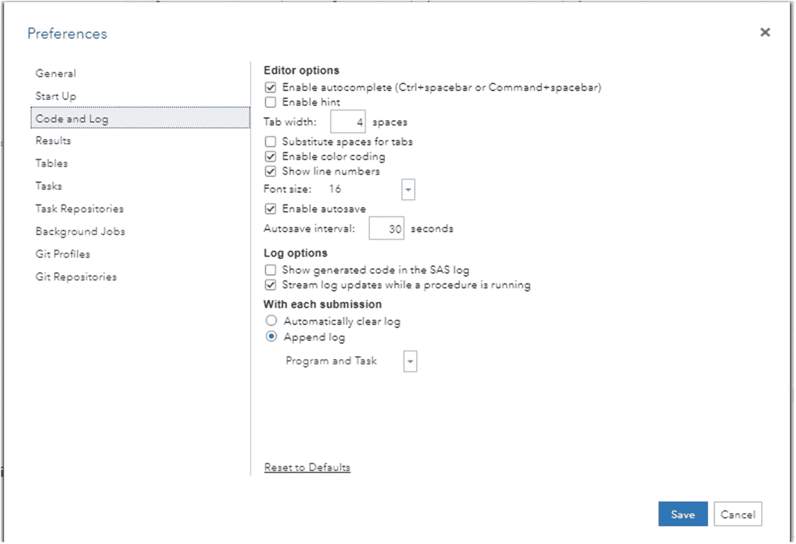

**图 2-5** 用于启用或禁用代码自动补全的代码和日志

现在，输入清单 2-1 中所示的代码。

```
proc print data=SASHELP.CARS;
run;
```

**清单 2-1** Proc Print 过程

点击 `Run`（运行）按钮，如图 2-6 所示。不要忘记分号和 `run;` 来结束过程段。

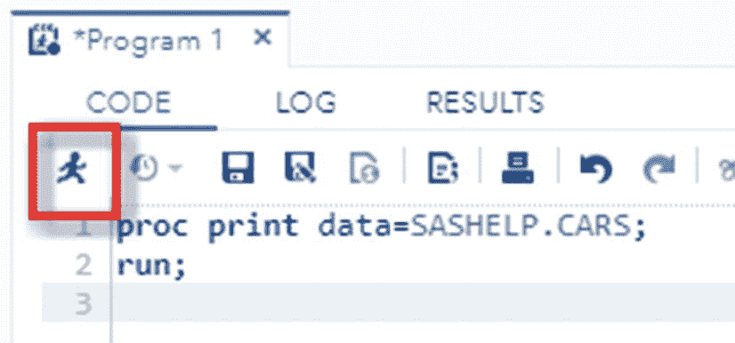

**图 2-6** 运行按钮

结果将准备好进行打印。您可以通过点击图 2-7 中高亮的图标，将结果打印为 HTML、PDF 或 RTF 格式。

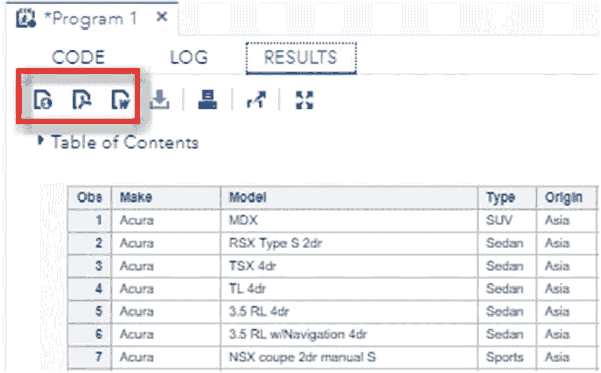

**图 2-7** 将结果打印为 HTML、PDF 或 RTF 格式

您刚刚成功编写、执行并打印了第一个 SAS 程序的报告。太棒了！恭喜！

现在，点击左侧窗格中的 `Libraries`。然后依次点击 `SASHELP` 和 `CARS`。要获取 SAS Studio 自动生成以显示该表格的代码，请点击图 2-8 中高亮的图标。

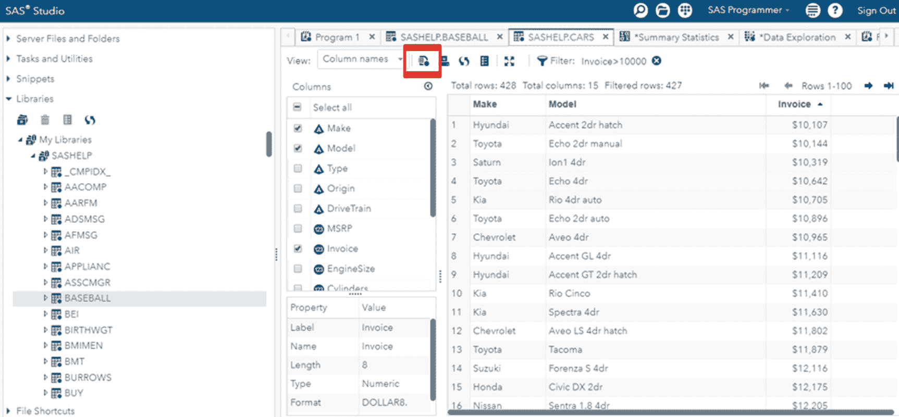

**图 2-8** 显示创建当前表格的代码的图标

在接下来的章节中，我们将使用此功能来修改 SAS Studio 为我们生成的代码，以执行更高级的任务。例如，在第 3 章关于气泡图的章节中，有一个示例，您将编辑生成的代码来对图表外观进行一些自定义设置。

## 任务

让我们完成一个简单的任务。列出数据是在 SAS Studio 界面中查看数据的第三种方式。点击 `Tasks` ➤ `Data` ➤ `List Data`（列出数据）。在 `DATA` 中，选择 `SASHELP.CARS`。在 `List Variables`（列出变量）中，选择以下变量：`Make`、`Model`、`Invoice`。在 `Group Analysis By`（分组依据）中，选择 `Origin`，如图 2-9 所示。

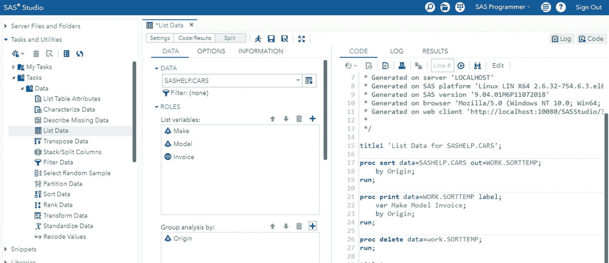

**图 2-9** 列出数据

然后，点击 `Run`。图 2-10 显示了 `List Data` 示例的输出。

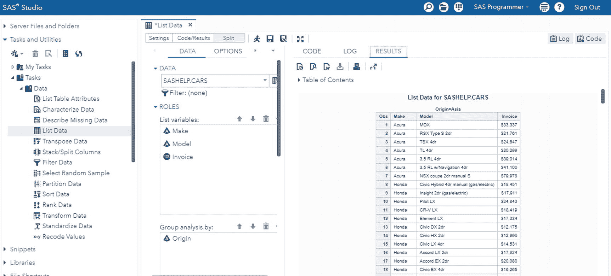

**图 2-10** 列出数据的输出


### 报表

要继续浏览并了解如何在 `SAS Studio` 中轻松生成报表，请点击 `任务和实用工具` 选项卡 ➤ `任务` ➤ `汇总统计`，如图 2-11 所示。

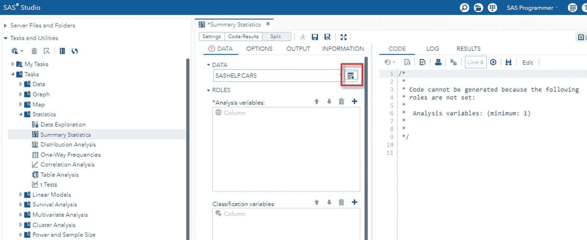

图 2-11 汇总统计

在 `数据` 中，点击表格。选择 `SASHELP.CARS`。在 `分析变量` 中，选择 `Weight`，如图 2-12 所示。选择 `Weight` 后，立即观察到 `SAS Studio` 在最右侧窗格中自动生成了代码，如图 2-12 所示。在代码的第一行，`SAS Studio` 使用 `PROC MEANS` 计算汇总统计量，数据集为 `SASHELP.CARS`，然后是 `PROC MEANS` 的一些选项，如标准差、均值、最小值、最大值和观测数量。在本书后续部分，我们将学习如何更改和自定义这些选项。第二行是分析变量，即 `Weight`。最后，该过程以 `RUN` 和分号结束。

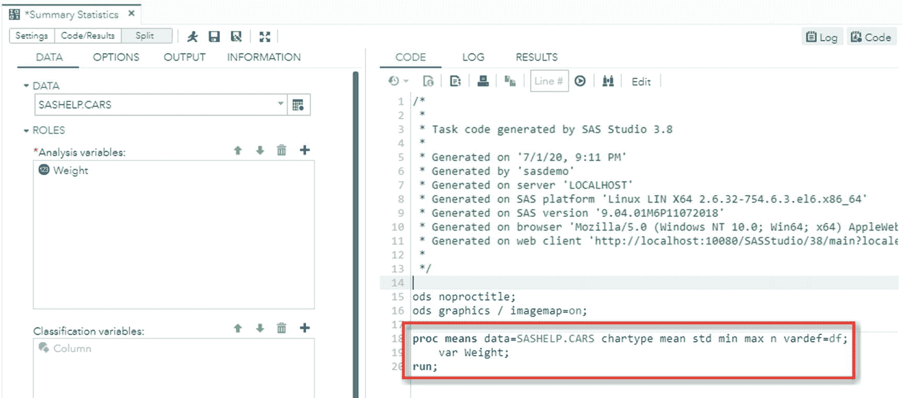

图 2-12 观察代码

现在，点击 `运行` 以获取生成的报表。报表始终显示在 `结果` 选项卡中，如图 2-13 所示。

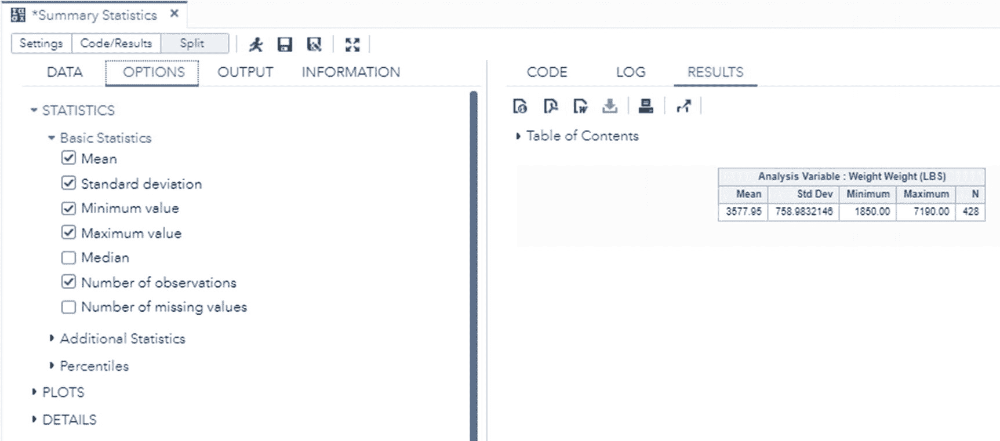

图 2-13 结果选项卡

### 图形

让我们快速制作一个图形。点击 `任务和实用工具` ➤ `任务` ➤ `图形` ➤ `条形图`，如图 2-14 所示。

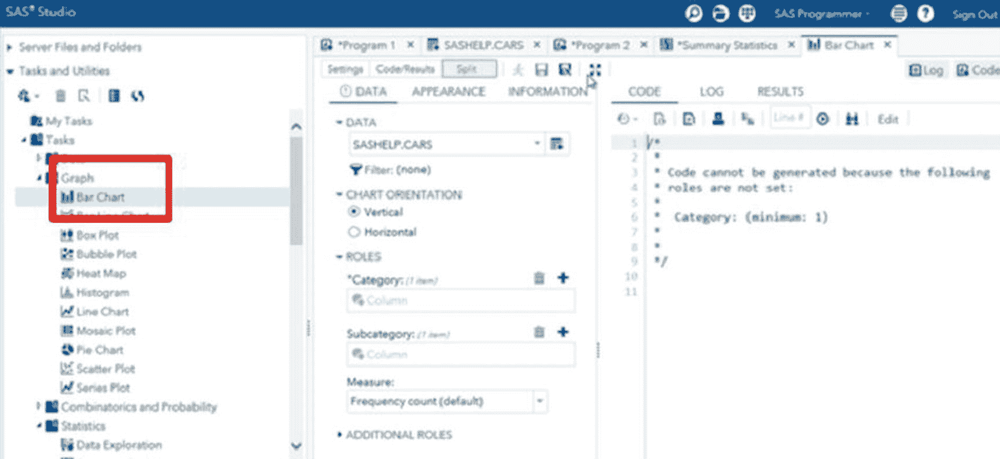

图 2-14 条形图

现在，如图 2-15 所示，将 `数据` 更改为 `SASHELP.FISH`。

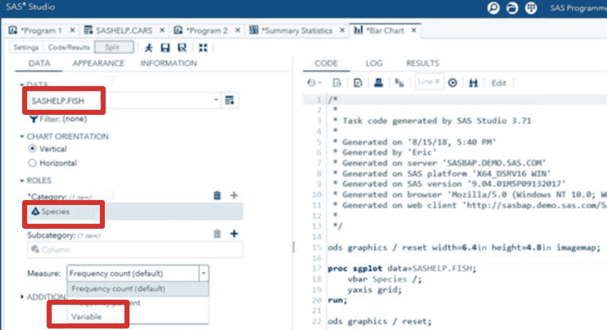

图 2-15 进行以下更改

1.  选择 `Species`。
2.  `度量` 应为 `变量`。
3.  选择 `Weight`。
4.  然后将 `统计量` 更改为 `均值`。

如图 2-16 所示，将标题更改为“不同物种的平均重量”。在 `条形` 中，勾选“设置颜色”并更改颜色。在 `详情` 中，将 `效果` 更改为 `光泽`。然后，点击 `运行`。图 2-16 显示了输出结果。

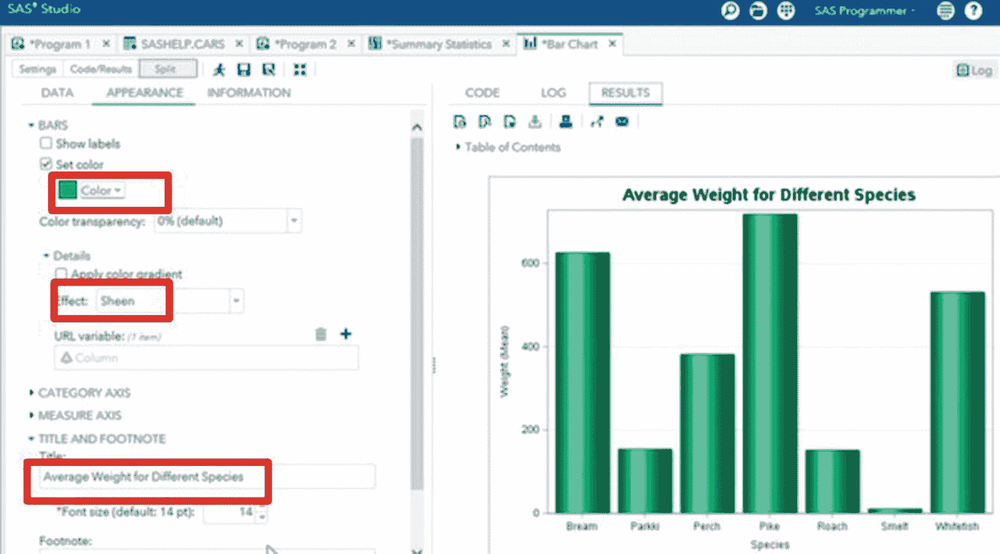

图 2-16 条形图外观选项卡

### 代码片段

当您有需要重复执行的定制化代码时，可以主要使用代码片段。不必每次都重做，只需将其保存为代码片段，每当需要时，只需更改数据集名称、变量和标题即可。因此，您可以将代码片段视为自定义任务的替代方案。

#### 那么，什么是代码片段？

*   它是现成的 `SAS` 代码。
*   您可以自定义它。
*   您可以添加自己的代码片段。

让我们使用两个示例来演示如何使用现成代码片段，以及如何创建您自己的新代码片段。

#### 使用现成代码片段的示例

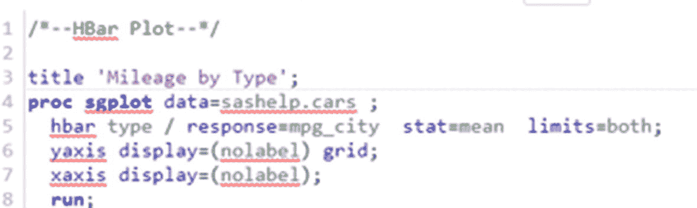

图 2-17 水平条形图代码片段

*   点击 `代码片段` ➤ `图形`。
*   选择 `Hbar`。代码如图 2-17 所示。

清单 2-2 中的代码位于“示例代码”文件夹中，您可以从中复制粘贴。

*   编辑代码，使其如图 2-16 所示，操作如下：
    *   编辑标题。
    *   将数据集从 `cars` 更改为 `baseball`。
    *   将 `hbar` 从“type”更改为“team”。
    *   将 `response` 从“mpg_city”更改为“salary”。
    *   移除限制。

```
/*--HBar 图--*/
title '按类型划分的里程数';
proc sgplot data=sashelp.cars ;
hbar type / response=mpg_city  stat=mean  limits=both;
yaxis display=(nolabel) grid;
xaxis display=(nolabel);
run;
```
清单 2-2 代码片段示例

清单 2-3 的修改后代码位于“示例代码”文件夹中，您可以从中复制粘贴。其屏幕截图如图 2-18 所示。

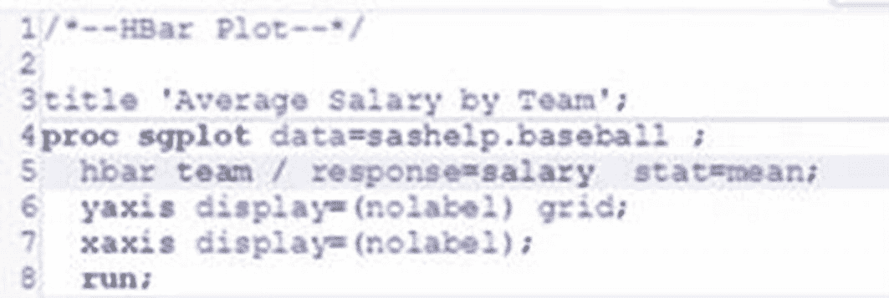

图 2-18 将代码片段自定义为新的数据集和变量

```
/*--HBar 图--*/
title '按团队划分的平均薪资';
proc sgplot data=sashelp.baseball ;
hbar team / response=salary  stat=mean  ;
yaxis display=(nolabel) grid;
xaxis display=(nolabel);
run;
```
清单 2-3 自定义代码片段示例

*   运行代码。

#### 创建您自己的代码片段

如图 2-19 所示，点击 `代码` 选项卡，然后选择（添加到我的代码片段）图标。

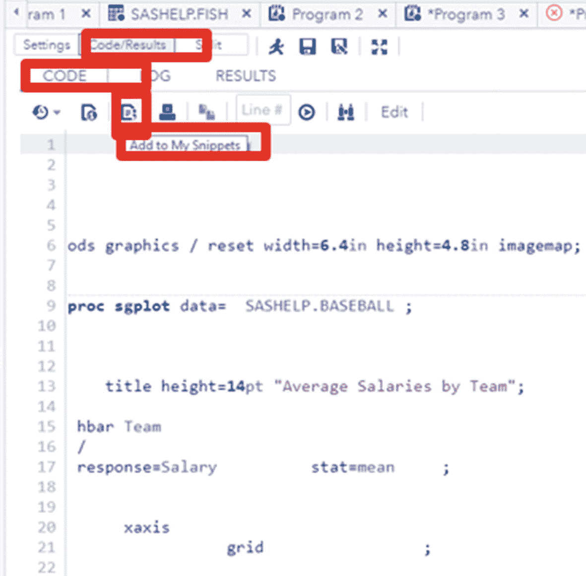

图 2-19 添加到我的代码片段

## SAS 程序的主要组成部分

一个 `SAS` 程序包含两个步骤：数据步和过程步。每个程序可以根据需要包含任意数量的数据步和过程步，如图 2-20 所示。

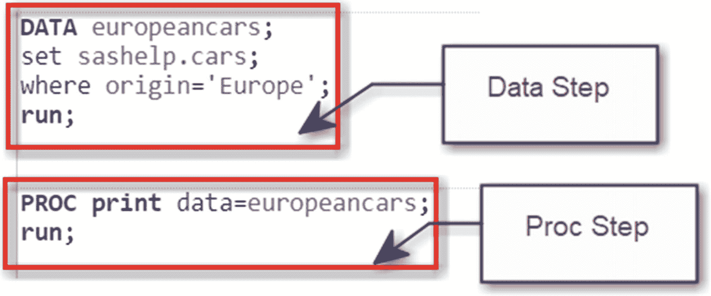

图 2-20 SAS 程序的主要组成部分

### 数据步

数据步用于准备待处理的数据，包括定义数据集、合并数据集、清理数据、创建新变量、检查错误、移除任何变量等操作。

### 变量类型

在 `SAS` 中，有两种变量类型：数值型和字符型。`SAS` 日期和时间既不是标准的数值型变量，也不是字符型变量。它们有专门的函数，但以数字形式存储。在数据科学中，数据科学家使用的术语有所不同。连续变量或定量变量用数值型变量表示，而分类变量或定性变量用字符型变量表示。

### 过程步

过程步用于定义处理干净数据并生成报表的过程。您可以使用过程步从 `任务` 选项卡中进行汇总、排序、列出、过滤或执行任何其他任务。

## 逻辑库

我们浏览的下一站是左侧窗格的第三个选项卡：`逻辑库`。`逻辑库` 是您加载表格的地方，这样 `SAS Studio` 就可以访问表格中的数据。逻辑库有两种类型：永久逻辑库和临时逻辑库。您将学习如何区分它们以及如何创建新的永久逻辑库。不过在此之前，我们需要讨论如何在宿主机器和运行 `SAS Studio` 的虚拟机之间共享文件和文件夹。

### 访问您现有的本地文件

有两种方法可以从 `SAS Studio` 内部访问您机器上的文件。第一种方法是使用 `SAS Studio` 界面上传文件。第二种方法是使用操作系统将文件从本地机器复制粘贴到您在本地机器上创建的 `myfolders` 文件夹中。


### 第一种方法

点击**服务器文件和文件夹** ➤ **上传**。然后，从本地计算机中选择 Excel、CSV 或任何格式的文件，将其上传到 SAS Studio（见图 2-21 和 2-22）。

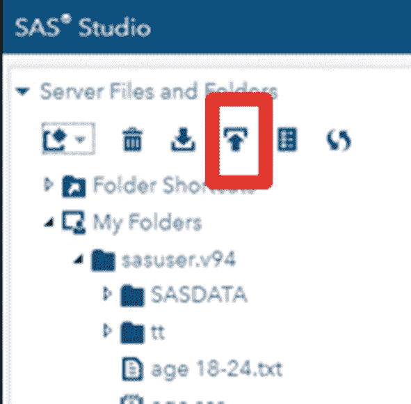

图 2-21 点击**上传**图标

同样，如果您想将文件从 SAS Studio 内部下载到本地计算机，请选择该文件并点击**下载**图标进行下载（见图 2-23）。您将在本地计算机的**下载**文件夹中找到它（见图 2-23）。

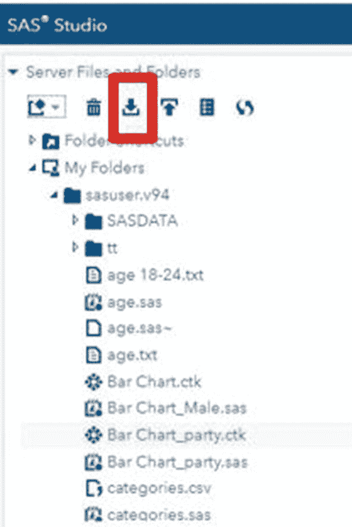

图 2-23 使用**下载**图标将 SAS Studio 中的任何文件下载到您的操作系统

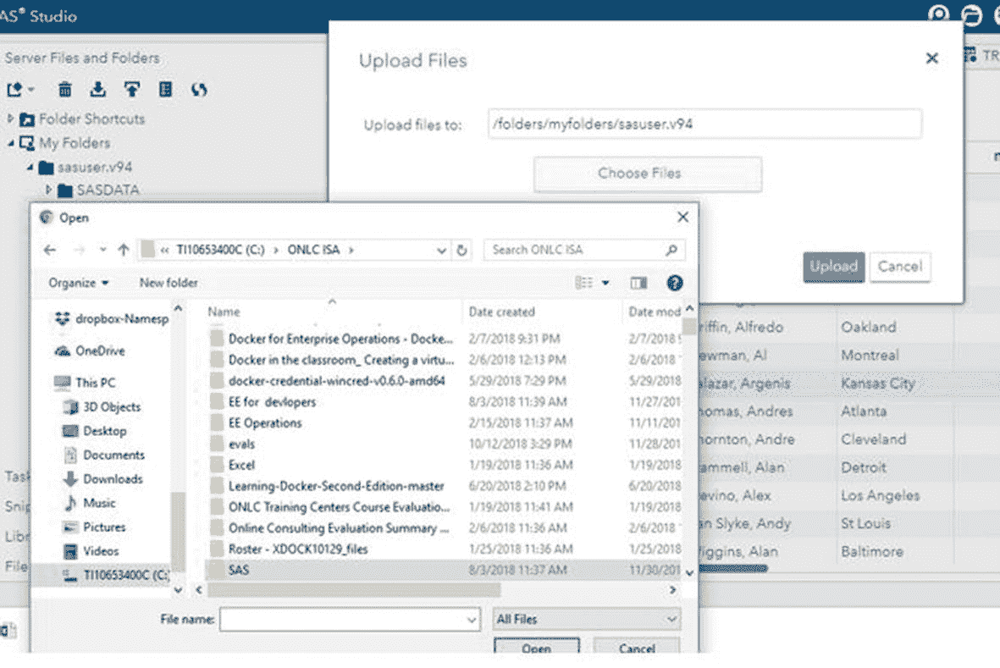

图 2-22 从服务器文件和文件夹中选择文件

### 第二种方法

只需将所需文件（SAS、XLS 或 CSV）复制并粘贴到 **myfolders** 文件夹中。由于 SAS Studio 在虚拟机内运行，除了共享文件夹中的文件外，它无法访问 Windows 文件系统或本地操作系统上的任何文件。

## 访问 SAS 逻辑库中的数据

SAS Studio 将表存储在逻辑库中。通常，这些逻辑库是永久性的。然而，**Work** 逻辑库是一个临时库，仅持续当前会话，并在刷新浏览器或注销时消失。**逻辑库**选项卡中的所有其他逻辑库都是永久性的。例如，**SAS Help** 就是一个永久逻辑库。

### 如何区分永久逻辑库和临时逻辑库？

任何数据集都有一个由点分隔的两级名称，语法如下：`<第一级名称>.<第二级名称>`；例如，`sashelp.cars` 或 `newlib.adults`。这表明您的数据集保存在一个永久逻辑库中。但是，如果您的数据集的第一级是 `work`，则它保存在一个临时逻辑库中；例如，`work.ratedata`。

SAS Studio 默认使用 **Work** 逻辑库。因此，对于任何只有一级名称的数据集，`work` 将是其第一级，并且它是临时的；例如，`income`。您可以在**逻辑库**选项卡的 **Work** 逻辑库下找到它。因此，`work.income` 等同于 `income`；两者相同，都表示一个名为 `income` 的临时逻辑库。

## 创建新逻辑库

有两种创建新逻辑库的方法：通过代码或通过图形用户界面。通过代码创建新逻辑库只需一条命令：`libname <逻辑库名称> <路径>;`

### 逻辑库命名约定

您创建的逻辑库的名称长度必须在 1 到 8 个字符之间，并且以字母或下划线开头。它不能以数字开头或包含任何特殊字符。名称的其余字符可以是字母、数字和下划线。不允许使用特殊字符。

路径可以是保存在**服务器文件和文件夹**选项卡中的任何文件夹。键入如清单 2-4 所示的代码（该代码位于**示例代码**文件夹中），您可以从该处复制代码并将其粘贴到新程序中以创建您的新逻辑库，然后点击**运行**。

```
libname newlib '/folders/myfolders';
清单 2-4
使用 libname 语句创建新逻辑库
```

您将在**逻辑库**选项卡中找到您的逻辑库。如果没有，请点击**刷新**。

第二种方法是使用图形用户界面。点击**逻辑库**选项卡，然后点击**新建逻辑库**图标，如图 2-24 所示。

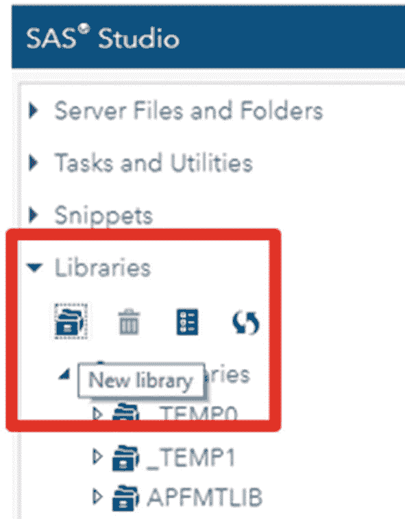

图 2-24 使用图形用户界面创建新逻辑库

选择您的文件夹，如图 2-25 所示。

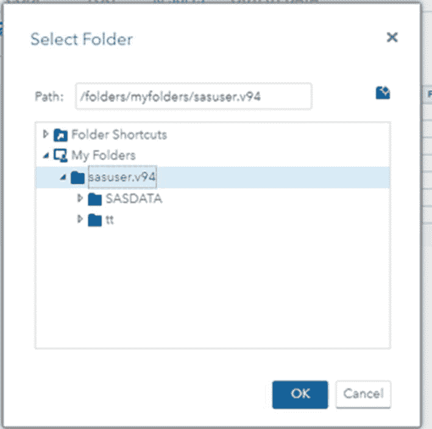

图 2-25 选择逻辑库的位置

输入其名称和路径，如图 2-26 所示。最好勾选**启动时重新创建此逻辑库**，这样您就可以在每次刷新 SAS Studio 或重启虚拟机时找到它。否则，您将无法找到它，需要手动将其重新添加到逻辑库列表中。

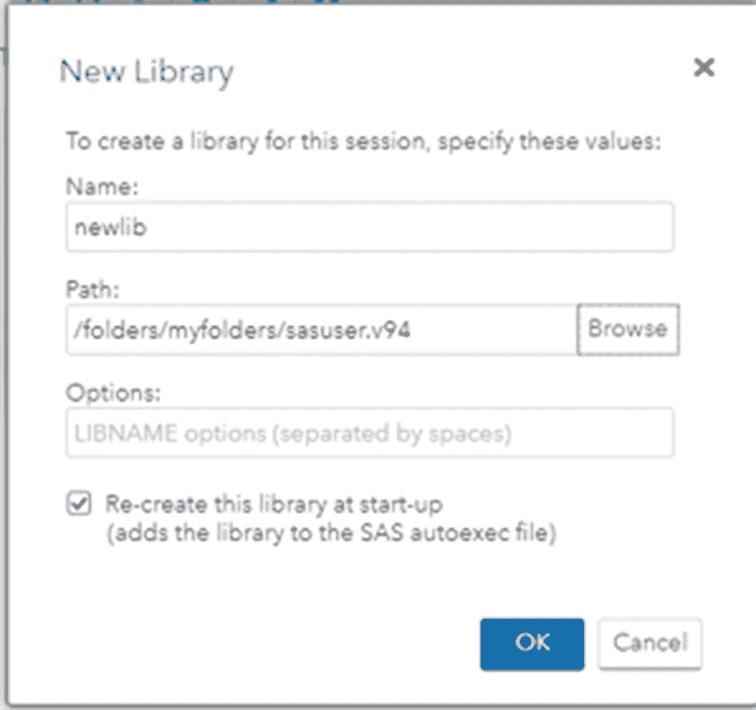

图 2-26 配置新逻辑库的创建选项

点击**确定**。您将在**逻辑库**列表中找到您的新逻辑库，如图 2-27 所示。

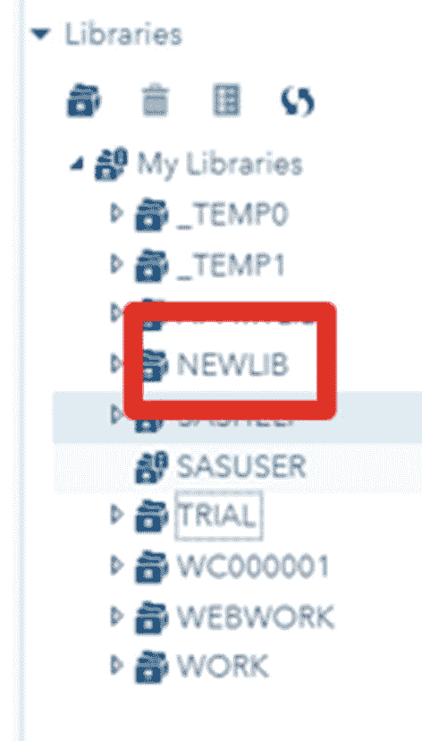

图 2-27 **逻辑库**列表中的新逻辑库


### 向库中添加新表

成功创建新库后，你可以向其中添加新的数据集或表。有两种方法可以实现此任务。第一种方法是通过代码，在数据步骤中为数据集添加两级名称，将你的库名作为第一级，数据集名作为第二级。

在一个新程序中，输入清单 2-5 中的代码。第一行代码向我们在上一步骤中创建的 `newlib` 库中添加了一个名为 `europeancars` 的新表。第二行和第三行使用了 `SET` 和 `WHERE` 语句，我们将在本书后面的第 6 章中详细解释。现在，`SET` 语句会将 `sashelp.cars` 的所有内容复制到 `newlib.europeancars` 表中，但仅限 `Origin` 列等于 `Europe` 的行。

```
data newlib.europeancars;
set sashelp.cars;
where origin="Europe";
run;
清单 2-5
向库中添加新表
```

点击 `Run`。点击 `newlib` 库。你会看到该数据集已列在其中，如图 2-28 所示。如果没找到，请点击 `Refresh`。

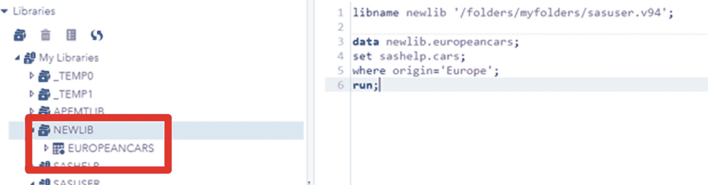

图 2-28 将表保存到你的新库

现在，重新登录 SAS Studio 或刷新 SAS Studio 窗口。登录后，你应该能找到该库和该表。

第二种方法是通过导入数据集。选择 `Files and Folders ➤ Import Data ➤ select the file name`，如图 2-29 所示。然后点击 `Run`。

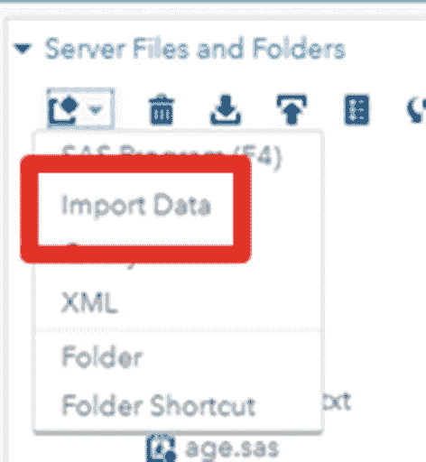

图 2-29 导入数据

点击 `Select Files`，如图 2-30 所示。

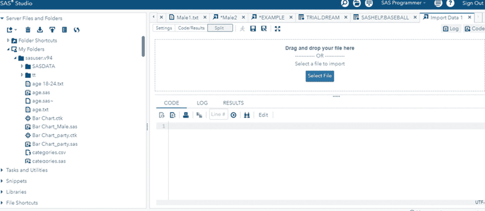

图 2-30 从服务器文件和文件夹选项卡中选择我们的文件

然后，选择你想要导入的文件，如图 2-31 所示。

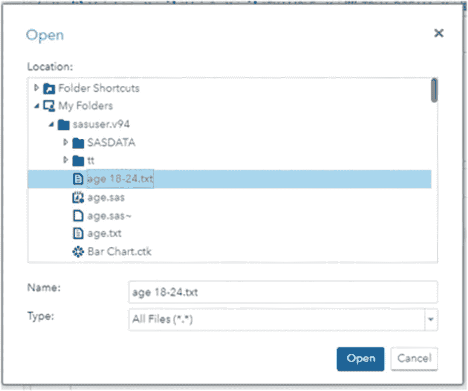

图 2-31 选择文件

SAS Studio 中的默认设置是库为临时库 `Work`，数据集名称则根据当前会话中完成的导入次数命名为 `IMPORT<Number>`。你可以通过点击 `Change` 按钮来更改默认设置，如图 2-32 所示。选择一个永久库，并将数据集重命名为更有意义的名称。

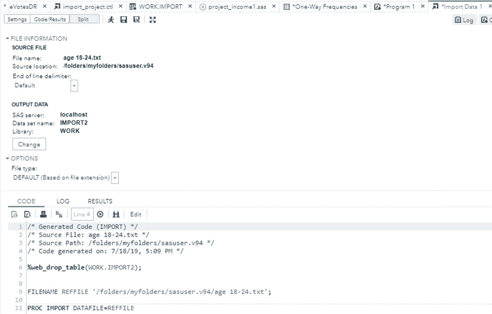

图 2-32 更改表和库名称

此外，如果向下滚动，你会找到更多可以更改的选项，比如分隔符和第一行，如图 2-33 所示。

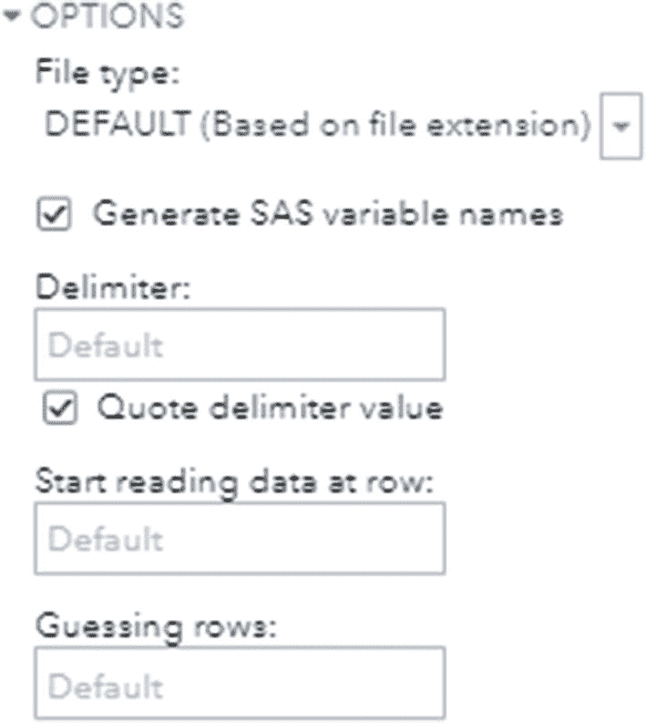

图 2-33 导入数据选项

自动生成的 SAS 变量名将从你的数据文件的第一行中提取。如果你的数据文件的第一行是数据而不是列名，你可以取消勾选该选项。在代码的数据步骤中，你可以使用 `Rename` 关键字重命名变量。

### INFILE 技术

与导入文件等效，你可以使用 `INFILE` 语句。将分隔符和第一个观测值/行设置为 `INFILE` 语句的选项。使用 `INPUT` 语句修改变量名及其数据类型。始终记住，任何 `INFILE` 语句后都必须跟一个 `INPUT` 语句。

让我们逐步尝试一下。在 `Datasets` 文件夹中，你会找到一个名为 `Exam.txt` 的文件。首先上传该文件，就像我们在图 2-21 和图 2-22 中所做的那样。右键单击该文件，然后点击 `Properties` 来获取文件路径，如图 2-34 所示。

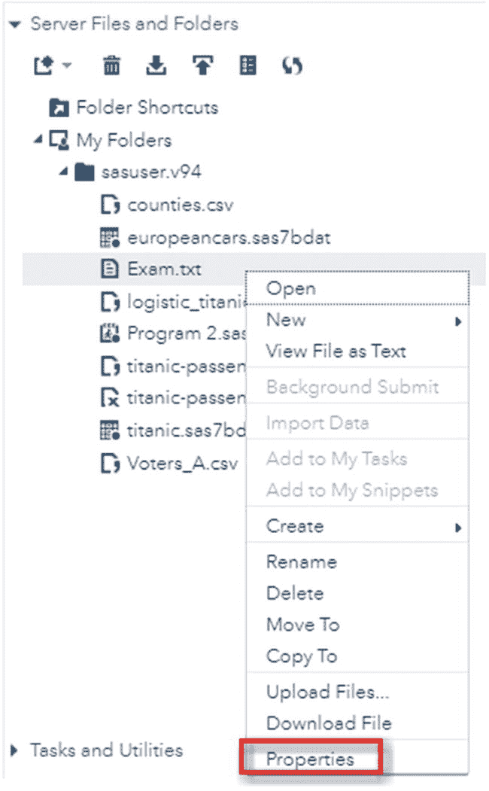

图 2-34 右键单击文件以获取其属性

然后，选择该位置并右键点击 ➤ `Copy`，如图 2-35 所示。

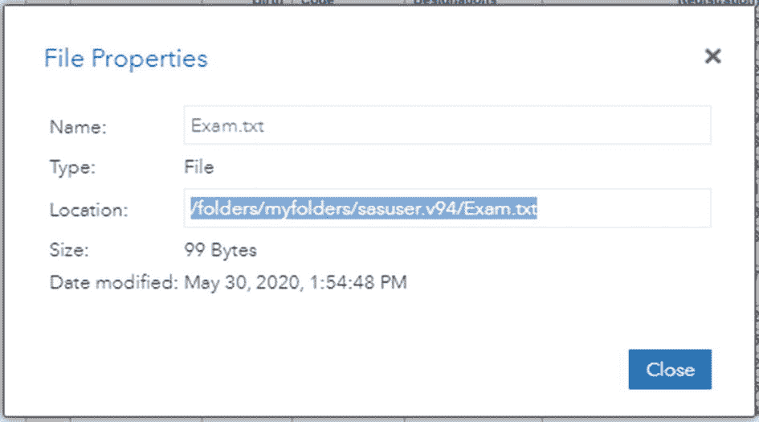

图 2-35 复制文件位置

`INFILE` 语句的语法如下：

```
INFILE  DLM= FIRSTOBS=
```

清单 2-6 展示了一个使用 `INFILE` 语句的示例。第一行代码将创建一个名为 `examdata` 的表，并保存在临时库 `Work` 中。第二行使用 `INFILE` 语句指定原始数据文件的路径，使用 `DLM` 选项指示所使用的分隔符，并使用另一个选项 `FIRSTOBS` 告诉 SAS Studio 从第二行开始导入数据行。该文件的分隔符是逗号。第二行是我们的第一行数据。打开 `examdata.txt` 并检查它。文件中的第一行是标题，不是数据。让我们回到清单 2-6。第三行使用 `INPUT` 语句指定列名。列名之间应使用空格分隔。数据步骤以 `RUN;` 结束，以告诉 SAS Studio 这是该步骤的最后一行。

```
data examdata;
infile '/folders/myfolders/sasuser.v94/Exam.txt' dlm=',' firstobs=2;
input year pass fail;
run;
清单 2-6
INFILE 语句
```

点击 `Run` 执行程序。输出结果如图 2-36 所示。

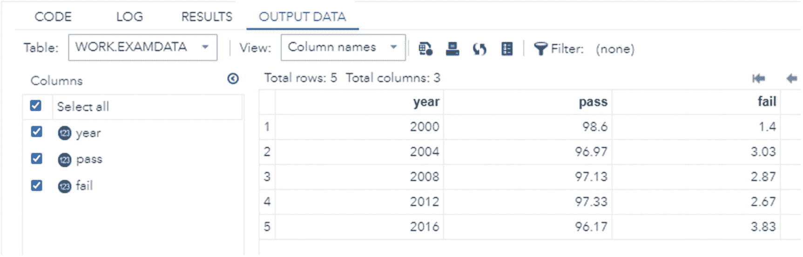

图 2-36 INFILE 语句的输出

请注意，`FIRSTOBS` 可以是任何数字，不限于零或一。假设你有一个包含一百万行的大数据文件，但你只需要在 100 行样本数据上测试你的代码。你可以设置 `FIRSTOBS=1000` 来告诉 SAS Studio 从该文件的第 1000 行开始读取。要指定最后一行，你可以在 `INFILE` 语句中使用另一个选项 `OBS`。`INFILE` 语句将如下所示：

```
INFILE  FIRSTOBS=1000 OBS=1100;
```

## 总结

本章代表了我们在学习 SAS Studio 和 SAS 编程之旅中的基础。它从安装步骤开始，然后解释了界面和 SAS 程序的基本组成部分。此外，还解释了数据类型和库。在下一章中，我们将更深入地研究数据可视化。

