# 7. 回归

线性回归任务拟合一个线性模型，以根据一个或多个连续或分类预测变量来预测单个连续因变量。该任务会生成用于解释结果的统计量和图形。

## 简单线性回归

在简单线性回归中，模型中只有一个自变量。其直线方程如下：

`Y = a + bX`

其中，`Y`是我们想要预测其值的因变量，`a`是截距，`b`是系数，`X`是自变量。此处忽略误差。

原假设是变量之间不存在线性关系。换句话说，`b`的值为零。备择假设是存在线性关系，且`b`不等于零。

```
H0: b = 0
Ha: b ^= 0
```

让我们看看每桶石油价格与黄金价格之间是否存在线性关系。

数据集位于`Dataset`文件夹中，文件名为`sp_oil_gold.xlsx`。从 SAS Studio 中，上传该文件并点击刷新，然后按照第 2 章所述将其导入。将数据集名称从`IMPORT`更改为`sp_oil_gold`。

这些数据的来源如下：

*   [`https://www.thebalance.com/presidential-elections-and-stock-market-returns-2388526`](https://www.thebalance.com/presidential-elections-and-stock-market-returns-2388526)
*   [`https://www.statista.com/statistics/262858/change-in-opec-crude-oil-prices-since-1960/`](https://www.statista.com/statistics/262858/change-in-opec-crude-oil-prices-since-1960/)
*   [`https://www.statista.com/statistics/268027/change-in-gold-price-since-1990/`](https://www.statista.com/statistics/268027/change-in-gold-price-since-1990/)
*   [`https://www.nma.org/pdf/gold/his_gold_prices.pdf`](https://www.nma.org/pdf/gold/his_gold_prices.pdf)
*   [`https://nma.org/wp-content/uploads/2018/02/his_gold_prices_1833_pres_2018.pdf`](https://nma.org/wp-content/uploads/2018/02/his_gold_prices_1833_pres_2018.pdf)

点击 任务和实用程序 ➤ 任务 ➤ 线性模型 ➤ 线性回归。在“数据”中，选择`WORK.SP_OIL_GOLD`。在“因变量”中，选择`oil_price`。在“连续变量”中，选择`gold_prices`，如图 7-1 所示。


**图 7-1 简单线性回归**

点击“模型”选项卡，然后点击“编辑”，如图 7-2 所示。


**图 7-2 “模型”选项卡**

选择`gold_prices`并点击“添加”，然后向下滚动并点击“确定”，如图 7-3 所示。


**图 7-3 “模型效应生成器”**

点击“运行”。输出结果如图 7-4 所示。


**图 7-4 输出结果**

图 7-4 显示 `p` 值为 < 0.0001，这意味着我们有足够的证据拒绝原假设，并且石油与黄金价格之间存在线性关系。`R` 平方值代表这种关系的强度。直线的斜率 = 0.05965。根据参数估计，直线方程为：

```
oil_price = 1.98831 + 0.05965 gold_prices
```

图 7-5 展示了`oil_price`变量的拟合诊断图。残差图显示点在 0 线上方和下方呈现随机分布模式，这表明模型是合适的。


**图 7-5 拟合诊断图**

学生化残差对预测值图显示有几个点位于 ±2 限值之外。第三个点位于两条线之间，但远离其余的点。

学生化残差对杠杆图显示了那些对回归系数计算具有杠杆作用的异常值。

残差对四分位数图再次显示了这三个点。

因变量（`TASK`）对预测值图展示了预测值的变异性。在此图中，点分布是随机的，没有指示误差具有恒定方差的模式。

`Cook's D` 图旨在识别异常值。此处，这三个点及其数值非常清晰。

最后，图 7-6 中的拟合图由数据散点图与回归线以及 95% 置信限和预测限叠加而成。同样，这三个异常值点清晰可见。


**图 7-6 拟合图**

# 多元线性回归

在多元线性回归中，模型包含多个自变量。其线性方程如下：

`Y = a + b[1] X[1] + b[2] X[2] + … + b[i] X[i]`

其中，`Y` 是我们想要预测其值的因变量，`a` 是截距，`b[i]` 是系数，`X[i]` 是自变量。此处忽略误差项。

原假设为因变量与任一自变量之间不存在线性关系。换句话说，`b[i]` 的值均为零。备择假设为存在线性关系，且至少有一个 `b[i]` 不等于零。

*   `H0: b[i] = 0`
*   `Ha: b[i] != 0`

让我们看看在总统选举年，股票市场表现指数（标普指数）与每桶石油价格和黄金价格之间是否存在线性关系。

我们将使用与之前简单线性回归示例相同的数据集。该数据集位于 "Dataset" 文件夹中，文件名为`sp_oil_gold.xlsx`。从 SAS Studio 上传该文件，点击“刷新”，然后按照我们在第 2 章中的说明进行导入。将数据集名称从`IMPORT`更改为`sp_oil_gold`。

首先，让我们探索这三个变量。运行位于 "Example Code" 文件夹中`Listing 7-1.sas`文件内的代码。清单 7-1 显示了三个垂直条形图，分别展示了历年（从 1960 年到 2016 年）石油、黄金和股票的价格，每个图对应一个变量。这些年份均为总统选举年。

## 探索股票、石油和黄金价格

```sas
ods graphics / reset width=6.4in height=4.8in imagemap;

proc sgplot data=  WORK.SP_OIL_GOLD noautolegend ;
/*此垂直条形图将展示历年的股票市场表现*/
vbar Year / response=Stock_Market_Returns  group=Stock_Market_Returns groupdisplay=cluster  datalabel;
yaxis grid;
run;
ods graphics / reset;

ods graphics / reset width=6.4in height=4.8in imagemap;
proc sgplot data=  WORK.SP_OIL_GOLD noautolegend;
/*此垂直条形图将展示历年的石油价格*/
vbar Year / response=oil_price group=oil_price groupdisplay=cluster datalabel;
yaxis grid;
run;
ods graphics / reset;

ods graphics / reset width=6.4in height=4.8in imagemap;
proc sgplot data=  WORK.SP_OIL_GOLD noautolegend ;
/*此垂直条形图将展示历年的黄金价格*/
vbar Year / response=gold_prices group=gold_prices groupdisplay=cluster datalabel;
yaxis grid;
run;
ods graphics / reset;
```

输出结果将如图 7-7、7-8 和 7-9 所示。2008 年的金融危机在所有图表中都很明显。这场危机是自 1929 年大萧条以来美国最严重的经济灾难。石油和黄金价格在 2012 年飙升。

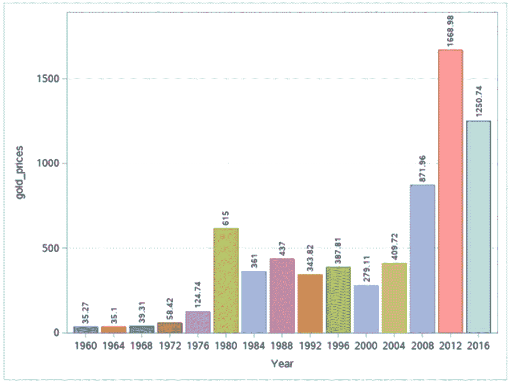
图 7-9 探索黄金价格

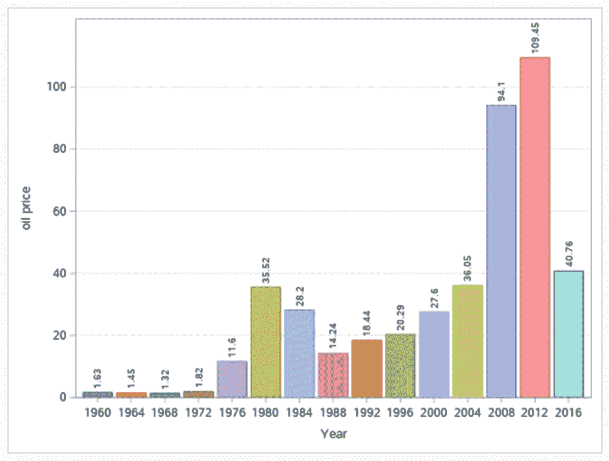
图 7-8 探索石油价格

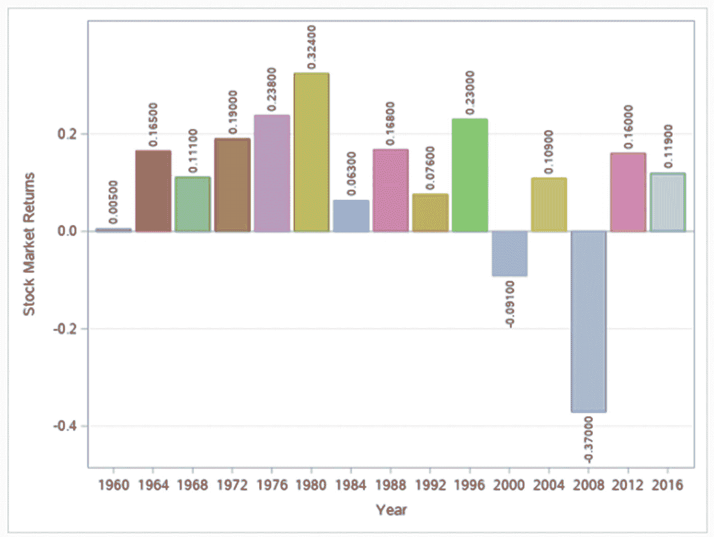
图 7-7 探索标普指数

现在，让我们检查股票收益率与石油和黄金价格之间是否存在线性关系。点击“任务和实用程序” ➤ “任务” ➤ “线性模型” ➤ “线性回归”。在“数据”中，选择 `WORK.SP_OIL_GOLD`。在“因变量”中，选择 `oil_price`。在“连续变量”中，选择 `gold_prices`，如图 7-10 所示。

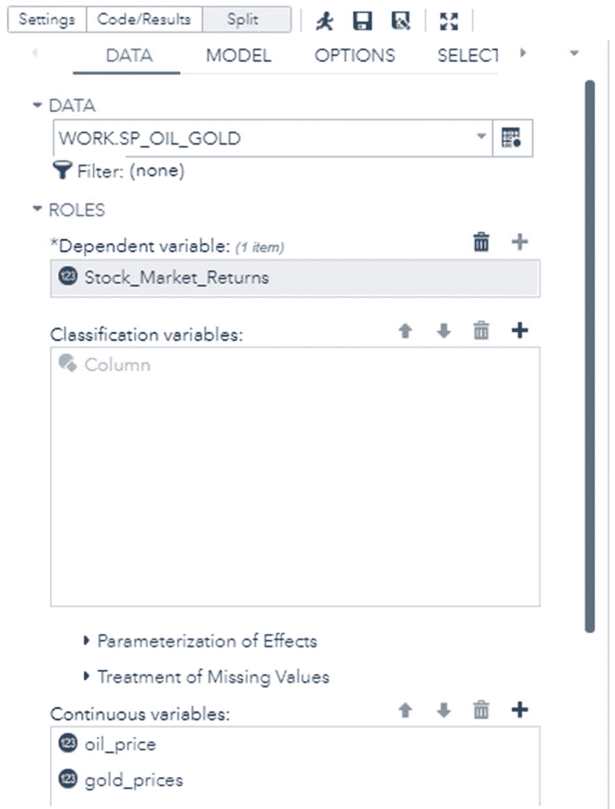
图 7-10 多元线性回归

点击“模型”选项卡，然后点击“编辑”，如图 7-11 所示。

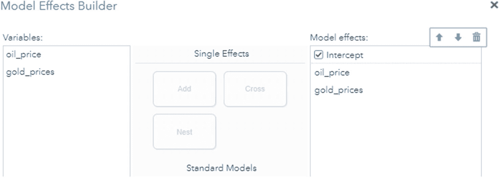
图 7-11 模型选项卡

点击“运行”。输出结果如图 7-12 所示。图 7-12 显示 p 值 < 0.05，这意味着我们有足够的证据拒绝原假设，并且股票收益率与石油和黄金价格之间存在线性关系。R 方值表示这种关系的强度。根据参数估计，线性方程如下：

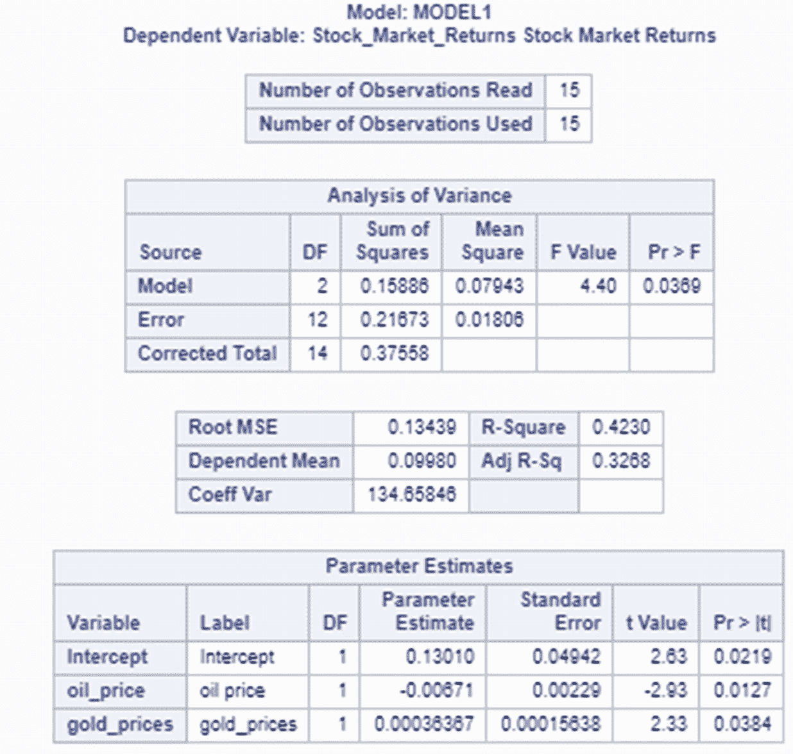
图 7-12 输出结果

```
stock_market_returns  = 0.13010 - 0.00671 oil_price + 0.00036367 gold_prices
```

图 7-13 显示了`oil_price`的拟合诊断图。残差图显示点随机分布在 0 线上方和下方，这表明模型是合适的。

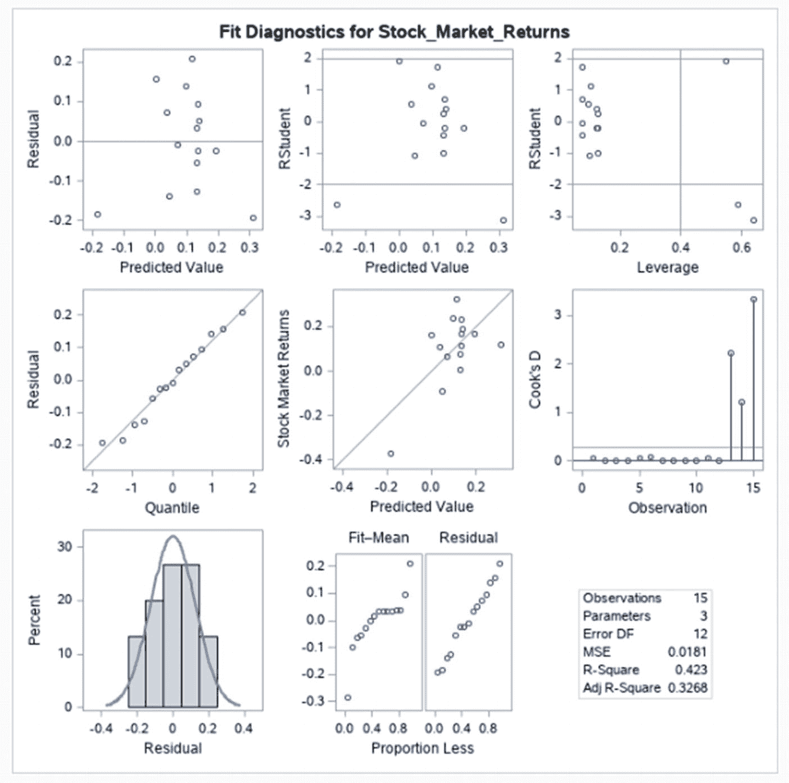

图 7-13 拟合诊断图

RStudent 与预测值关系图显示有几个点落在 ±2 限值之外。

RStudent 与杠杆关系图显示了那些对回归系数计算具有杠杆作用的异常值。

分位数残差图再次显示出那三个点。点几乎都在对角线上。

因变量（任务）与预测值关系图可视化了预测中的变异性。在此图中，点随机分布，没有显示出误差方差恒定模式的迹象。

Cook's D 图旨在识别异常值。此处，这三个点及其数值非常清晰。

百分比残差图显示了一条正态分布曲线。

## 逻辑回归

逻辑回归与线性回归类似，不同之处在于因变量是二元值而非连续值。该模型方程用于检验因变量中某个离散二元值发生的概率。

二元逻辑回归模型方程如下：

*   `p = e^(b[0] + b[1]*X[1] + b[2]*X[2] + ...) / (1 + e^(b[0] + b[1]*X[1] + b[2]*X[2] + ...))`

同样，零假设认为变量之间不存在关系，因此所有系数均为零。备择假设则认为因变量与自变量之间存在关系。

在本例中，我们使用泰坦尼克号数据集，以年龄和乘客等级作为自变量，探究其与乘客幸存情况之间是否存在关系。

该数据集位于`Dataset`文件夹中，文件名为`logistic_titanic_passengers.csv`，你也可以通过以下链接从`OpenDataSoft.com`下载该 CSV 文件：[`https://public.opendatasoft.com/explore/dataset/titanic-passengers/export/`](https://public.opendatasoft.com/explore/dataset/titanic-passengers/export/)。

在`SAS Studio`中，上传文件并点击`Refresh`，然后按照第二章中介绍的方法将其导入。将数据集的名称从`IMPORT`更改为`TITANIC`。

依次点击`Tasks and Utilities ➤ Tasks ➤ Linear Models ➤ Binary Logistic Regression`。在`Data`中，选择`WORK.TITANIC`。在`Response variable`中，选择`Survived`。对于`Event of Interest`，选择`Yes`以查看幸存人员的概率，而非遇难人员的概率。在`Explanatory variables`中，为`Continuous`变量选择`Age`和`Pclass`，如图 7-14 所示。

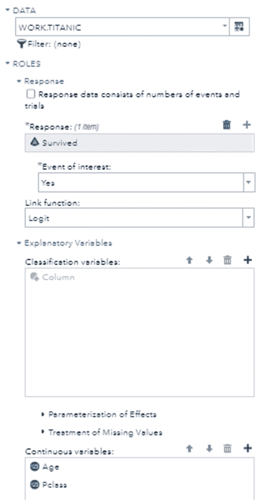

图 7-14 二元逻辑回归

点击`Model`选项卡，选择`Custom Model`，然后点击`Edit`，如图 7-15 所示。

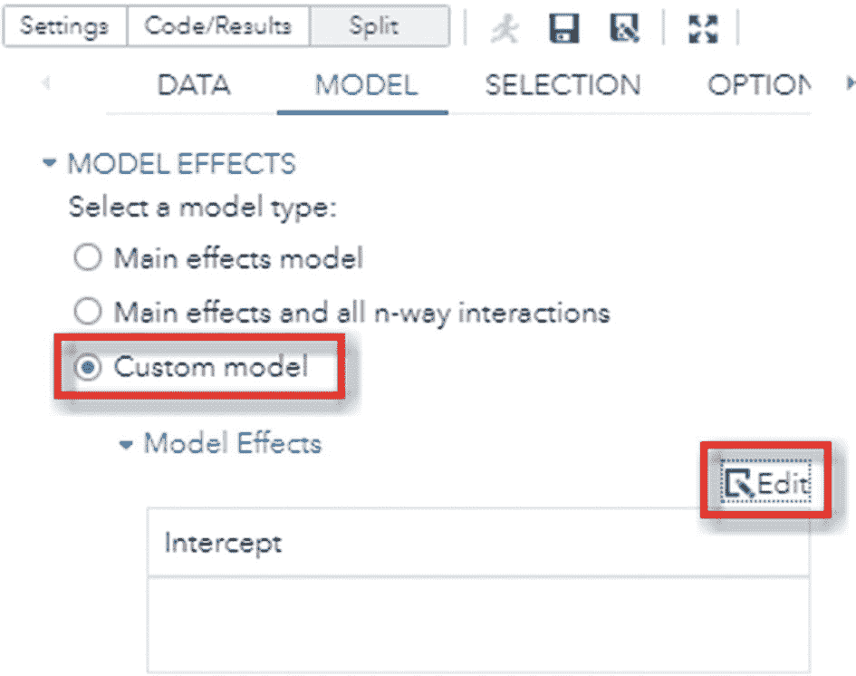

图 7-15 Model 选项卡

选择`Age`和`Pclass`，点击`Add`，然后向下滚动并点击`OK`，如图 7-16 所示。

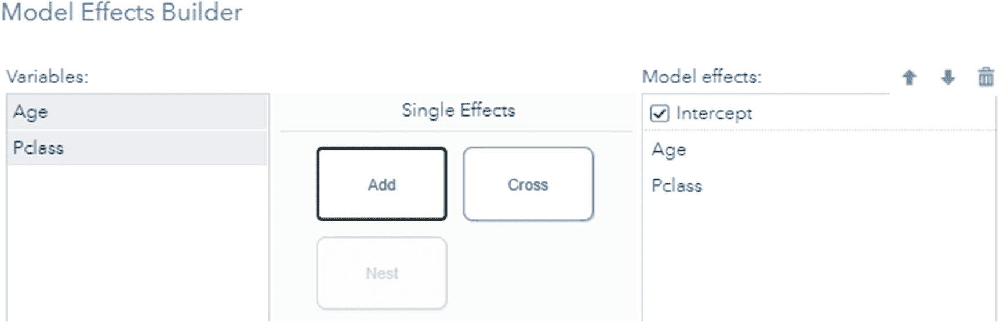

图 7-16 模型效果构建器

点击`Run`。输出结果如图 7-17 所示。

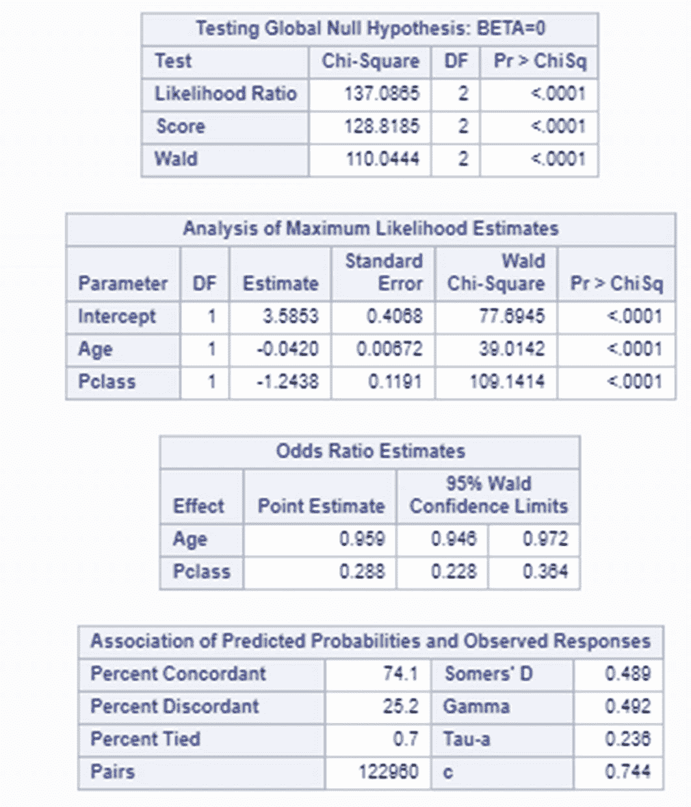

图 7-17 输出结果

图 7-17 显示所有检验的 p 值均 < 0.0001，这意味着我们有足够的证据拒绝零假设，即乘客的幸存情况与其年龄和社会阶层之间存在关系。截距为 3.6，`Age`的系数为 -0.042，`Pclass`的系数为 -1.24。

### 本章小结

本章讲解了简单线性回归、多元线性回归和逻辑回归。详细介绍了诊断矩阵图及其各自含义。此外，还展示了如何轻松识别诊断图中的多个异常点。在下一章中，我们将介绍当前市场上最流行的 SAS 产品——SAS Viya。SAS Viya 是一个一体化产品，因此也包含 SAS Studio。我们将介绍一些 SAS Studio 免费版中不具备、但集成在 SAS Viya 中的 SAS Studio 所独有的增值功能和选项。此外，我们还将使用 SAS Visual Analytics 创建一个报告。

