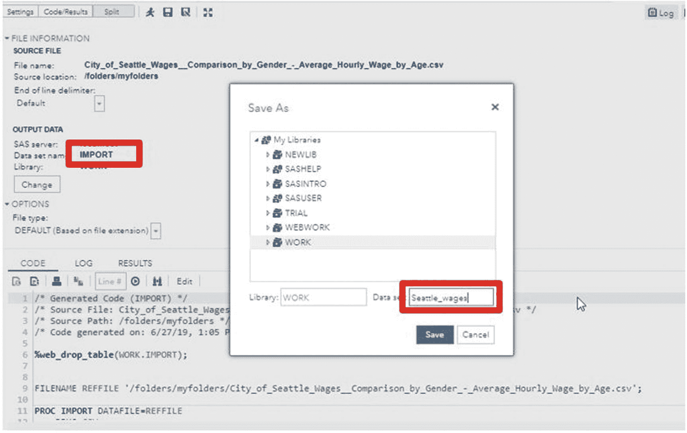
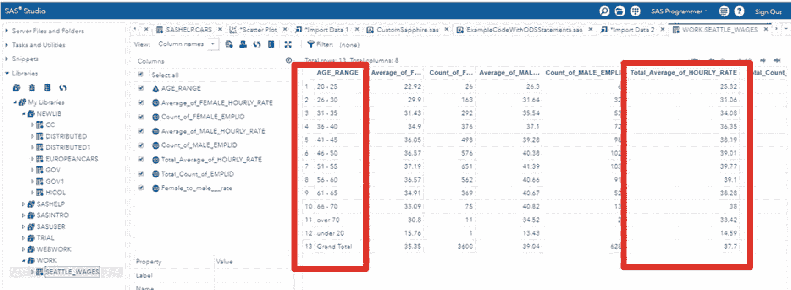
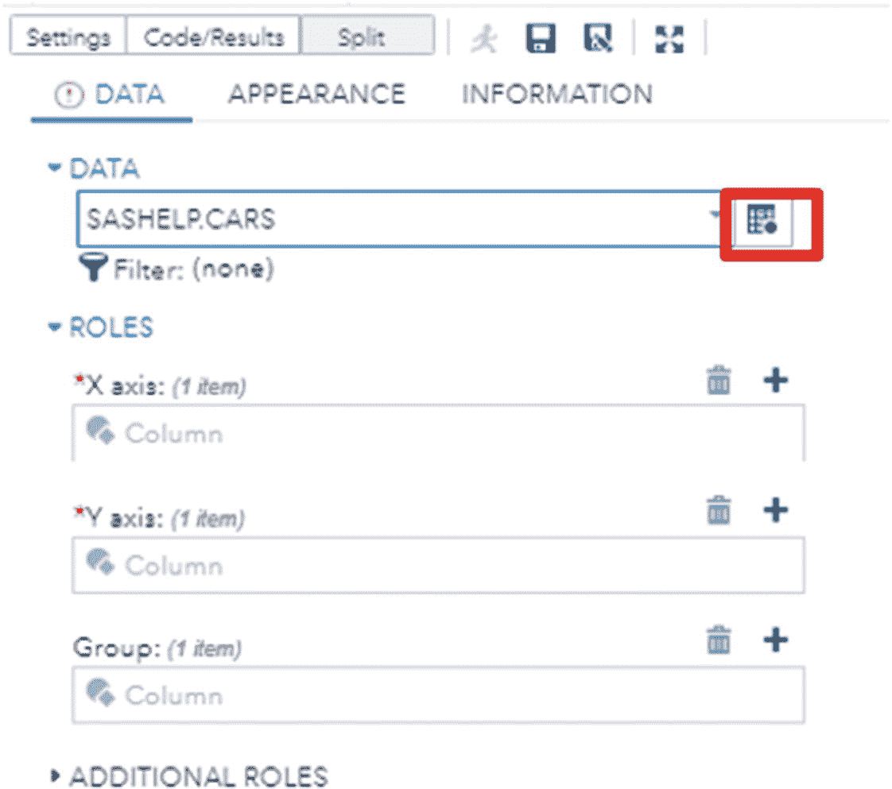
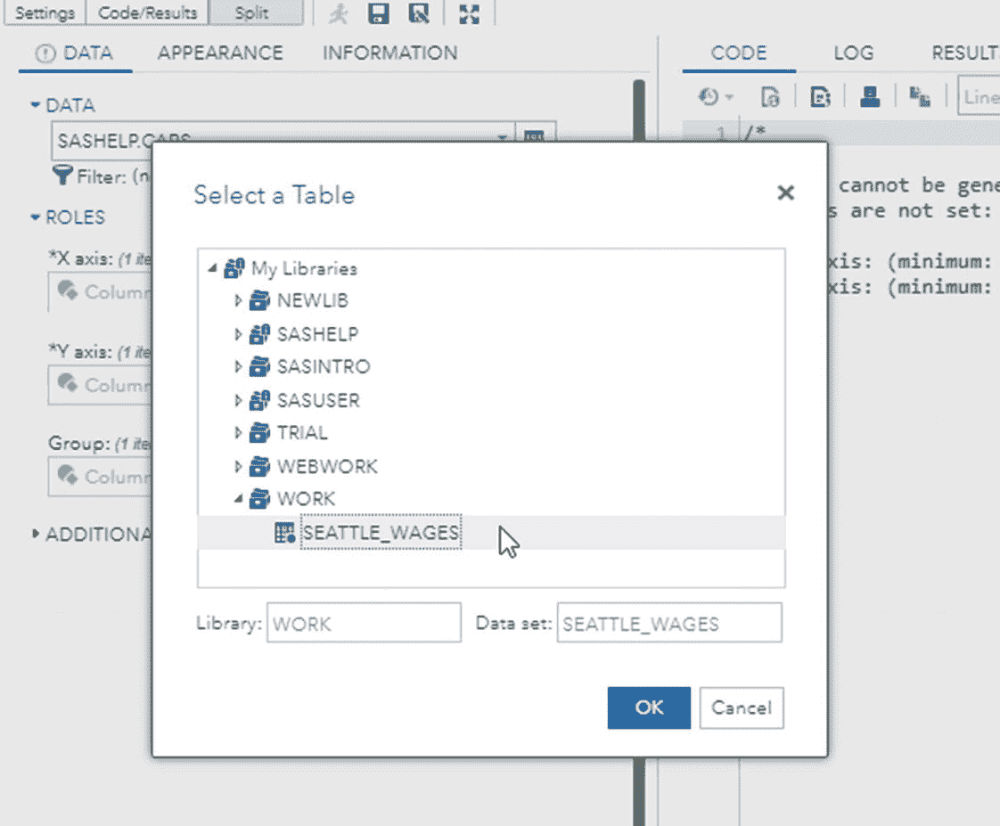
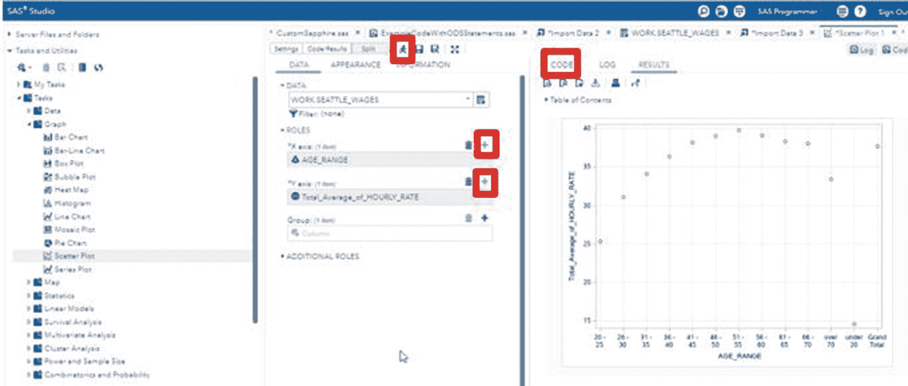
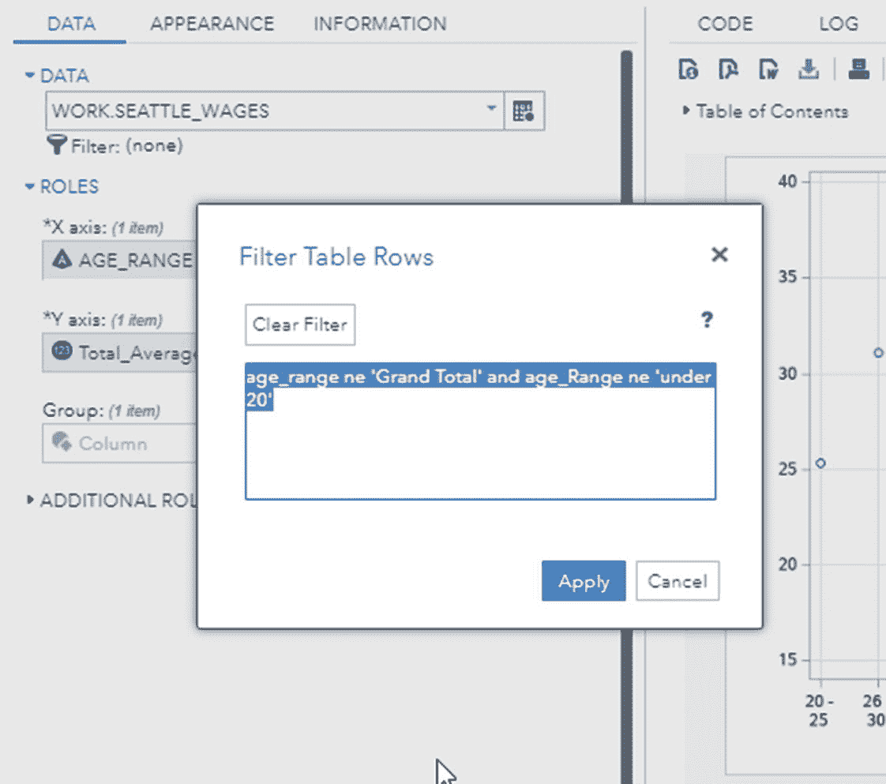
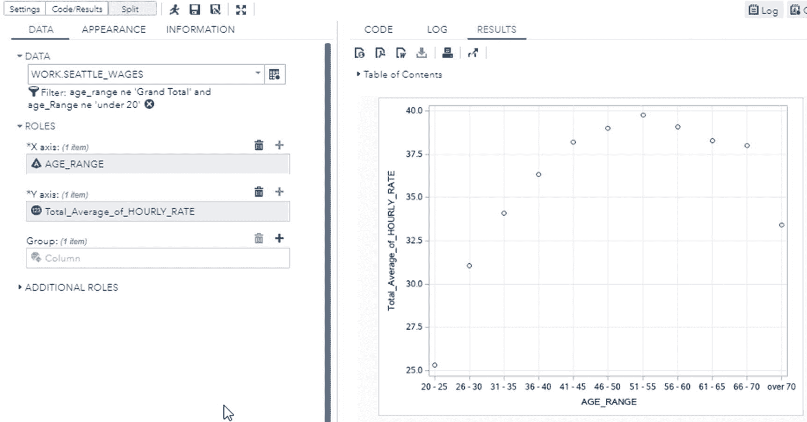
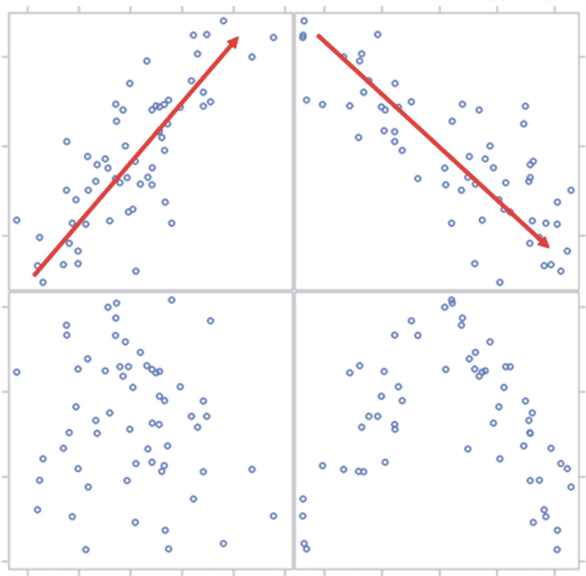

# 散点图

散点图通过描述变量之间的方向、强度和线性关系，来展示变量间的相互依赖程度。此外，它们还能轻松显示异常值。

在本例中，我们提出的问题是：西雅图市的薪资是否与员工的年龄段有关，还是毫无关联？

你可以在本书源码的`Datasets`文件夹中找到名为`City_of_Seattle_Wages__Comparison_by_Gender_-_Average_Hourly_Wage_by_Age.csv`的数据文件。或者，你也可以通过以下网址从`Data.Gov`项目下载该 CSV 文件：[`https://catalog.data.gov/dataset/city-of-seattle-wages-comparison-by-gender-average-hourly-wage-by-age-353b2`](https://catalog.data.gov/dataset/city-of-seattle-wages-comparison-by-gender-average-hourly-wage-by-age-353b2)。

将 CSV 文件复制到`myfolders`文件夹中。在 SAS Studio 中，点击`Refresh`，然后按照我们在第 2 章中介绍的方法导入该文件。将数据集名称从`IMPORT`改为`Seattle_wages`，如图 3-1 所示。然后点击`Run`。



图 3-1 更改数据集名称

若要探索数据，请点击`Results`选项卡，如图 3-2 所示。



图 3-2 散点图的两个变量

我们想要创建`AGE_RANGE`和`Total_Average_of_HOURLY_RATE`变量的散点图，以查看它们之间是否存在相互依赖关系。图 3-2 显示了这两个变量。

点击`Tasks and Utilities` ➤ `Graph` ➤ `Scatter Plot`。在`Data`中，选择`WORK.SEATTLE_WAGES`数据集。为此，如图 3-3 所示，点击数据集名称旁边的小表格。



图 3-3 点击此表格以更改数据集

会弹出一个新窗口，如图 3-4 所示。选择数据集并点击`OK`。



图 3-4 选择数据集

点击 x 轴旁边的`+`并选择`AGE_RANGE`，如图 3-5 所示。类似地，点击 y 轴旁边的`+`并选择`Total_Average_of_HOURLY_RATE`。点击`Run`或按`F3`运行程序。SAS 将在`Code`选项卡中自动为你生成代码，SAS Studio 将在`Results`选项卡中显示散点图，如图 3-5 所示。



图 3-5 选择变量并运行

在图中，`AGE_RANGE`变量的最后两个值是不需要的，并且会对这两个变量之间的关系给出错误印象。因此，我们应当将其过滤并从数据中移除。如图 3-6 所示，点击数据集下方的`Filter`按钮并输入以下内容：



图 3-6 添加过滤代码以剔除`AGE_RANGE`中的最后两个值

```
age_range ne 'Grand Total' and age_Range ne 'under 20'
```

请注意字母大小写，因为虽然 SAS Studio 在变量名中不区分大小写，但在变量的值中是区分大小写的。因此，SAS Studio 会区分`"under 20"`和`"Under 20"`。对于后者，它将找不到任何内容。但是，输入`age_range`时大小写可以任意；SAS Studio 都能正确识别。现在，再次点击`Run`执行过滤代码。

从图 3-7 的最终散点图中，我们可以看到西雅图的年龄与薪资之间存在相互依赖关系。这种关系不是线性的，而是曲线关系。



图 3-7 最终散点图

## 散点图代码

正如你刚才所见，只需点击几下鼠标，无需编写一行代码即可完成图表制作。这就是 SAS Studio 成为数据科学初学者最佳选择的原因。友好的图形用户界面（GUI）帮助你专注于概念，而它为你处理语法问题。然而，阅读代码并检查日志是沿途应养成的良好习惯，以便你编写比 GUI 提供的更复杂的代码。本章后续部分及本书其余章节，我们将提供一些高级示例，届时我们将练习编辑代码。

检查`Log`选项卡，确保没有出现任何错误或警告。从日志中验证 SAS Studio 执行无误的行数，并解决 SAS Studio 在处理过程中跳过的行相关问题。

那么，让我们来看看代码。代码应如代码清单 3-1 所示。

```
ods graphics / reset width=6.4in height=4.8in  imagemap;
proc sgplot data= WORK.SEATTLE_WAGES (where=(age_range ne 'Grand Total' and age_Range ne 'under 20')) ;
scatter x=AGE_RANGE y=Total_Average_of_HOURLY_RATE /
;
xaxis   grid;
yaxis   grid;
run;
ods graphics / reset;
```

代码清单 3-1 包含过滤代码以剔除`AGE_RANGE`中最后两个值的散点图代码

在代码的第一行，SAS Studio 使用了`ods graphics`。统计过程使用 ODS Graphics 在其输出中创建图表，并设置图表的宽度和高度。你可以在代码中或在 GUI 的`Appearance`选项卡中更改这些尺寸。第二行使用了`PROC SGPLOT`，它提供了一种制作各种散点图的简便方法。请注意过滤代码被添加到了`Data`语句中。然后，SAS Studio 使用`scatter`关键字来标识`sgplot`类型，并标识 x 轴和 y 轴使用的变量。最后，选择 xy 网格。你可以通过从代码中删除这两行或在`Appearance`选项卡中取消选中它们来移除网格。

## 散点图关系

图 3-8 展示了散点图关系的各种示例。要描述散点图，你应该说明它是线性关系还是曲线关系，正如我们在前面的例子中看到的那样。如果相互依赖关系是线性的，则查看其方向以判断是正相关还是负相关。在图 3-8 中，左上角的关系是正相关，而右上角的图是负相关。在图 3-8 中，左下角没有关系，因为点不规则地分散。在图 3-8 中，右下角没有方向，因为关系不是线性的，而是曲线关系。最后，散点图描述了关系的强度。如果点非常靠近线/形状，则相互依赖程度高，关系强。否则，关系弱。



图 3-8 散点图的方向、强度和线性