## 8. SAS Visual Statistics: Viya

SAS Studio 的免费版本并未包含所有可用功能。因此，在本章中，我们将了解 SAS Viya 中提供的一些高级功能。SAS Viya 是 SAS 最受欢迎的产品之一，其平台也包含了 SAS Studio。

### 关于 SAS Studio、SAS Visual Statistics、SAS Visual Analytics 和 SAS Viya

名称太多了，你可能会混淆各自的功能，对吧？

`SAS Visual Statistics`是`SAS Visual Analytics`的一个附加组件，而`SAS Visual Analytics`是建立在`Viya`平台之上的产品。因此，它们是一个层层堆叠的技术栈。

`SAS Visual Analytics`使您能够探索数据、应用预测分析并构建交互式报告。`SAS Visual Statistics`则通过基于`SAS Visual Analytics`中发现的模式来创建、测试和比较模型，从而扩展了这些功能。

`SAS Viya`是一款基于云的产品。我认为它秉承了为所有用户提供一站式解决方案的理念。无论是数据科学家、业务分析师、应用程序开发人员还是高管，任何人都可以使用其点击式界面。`SAS Viya`的编程界面是`SAS Studio`。然而，`SAS Viya`也可以运行来自其他编程语言的代码，例如 Python、R 和 Java。

在`Viya`平台上构建了多个产品：`SAS Visual Analytics`、`SAS Visual Statistics`、`SAS Visual Investigator`以及`SAS Visual Data Mining and Machine Learning`。

如果你订阅并尝试使用其中任何一个产品，你都将可以访问其余产品，因为它们都集成在 SAS Viya 平台中。但是，在本章中，我们将只关注 SAS Visual Statistics。

如果你想了解更多关于 SAS Viya 的信息，请观看其全景介绍视频，网址如下：

[`https://video.sas.com/detail/videos/sas-viya_/video/4911667600001/sas%C2%AE-viya%E2%84%A2:-the-big-picture`](https://video.sas.com/detail/videos/sas-viya_/video/4911667600001/sas%C2%AE-viya%E2%84%A2:-the-big-picture)

如果你想观看关于 SAS Visual Statistics 的简短介绍视频，请查看以下网址：

[`https://players.brightcove.net/1872491364001/default_default/index.html?videoId=5772778452001`](https://players.brightcove.net/1872491364001/default_default/index.html?videoId=5772778452001)

要免费试用 SAS Visual Analytics 和 SAS Visual Statistics 十四天（如有需要可延期），请填写此表单：

[`https://www.sas.com/en_us/trials/software/visual-analytics-visual-statistics/form.html`](https://www.sas.com/en_us/trials/software/visual-analytics-visual-statistics/form.html)

你将收到一封包含说明和门户链接的电子邮件。由于 SAS Viya 是基于云计算的平台，因此完全无需安装。在 SAS Viya 上，可以选择延长试用期。

### SAS Viya 导览

登录 Viya 上的 Visual Statistics 账户后，您将看到一个界面，如图 8-1 所示。该界面分为三个窗格。左侧的**内容**窗格允许您处理数据并选择模型对象类型。中间的**画布**是您构建模型的地方。右侧的**属性**窗格允许您设置模型角色、选项和过滤器。

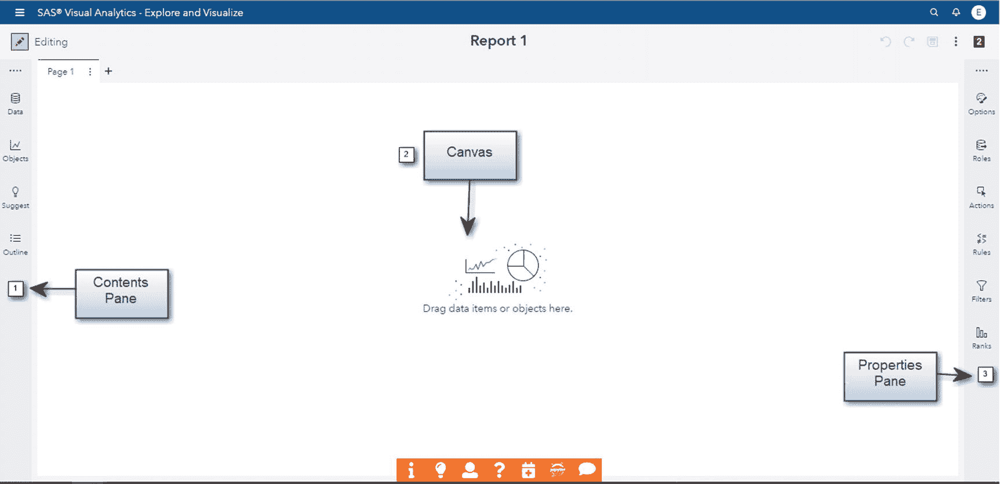

图 8-1 Visual Statistics 界面

在本章稍后部分，我们将更详细地讨论 SAS Visual Statistics。现在，让我们看看 SAS Viya 中与 SAS Visual Statistics 一起提供的其他产品。点击左上角的三条横线以显示应用程序菜单，如图 8-2 所示。

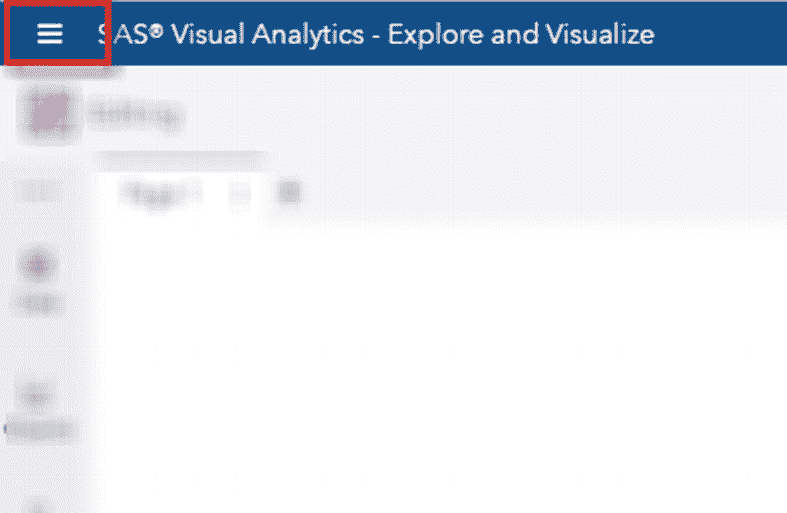

图 8-2 点击三条横线以显示应用程序菜单

点击后，所有可用的应用程序将会显示，如图 8-3 所示。在下一节中，我们将通过点击`Develop SAS Code`在 Viya 平台上使用 SAS Studio。

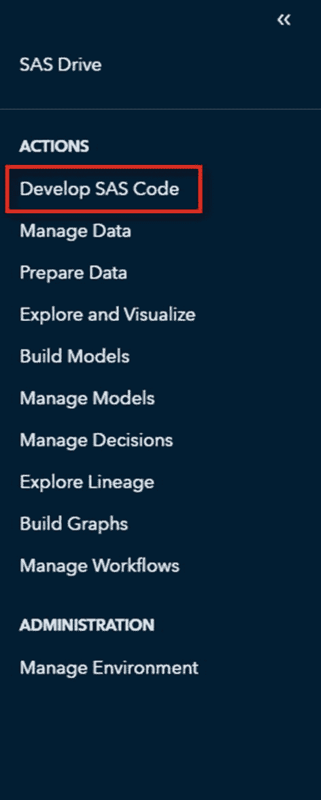

图 8-3 SAS Viya 应用程序

### 县地图

我们将使用 SAS Viya 上的 SAS Studio，通过`PROC GMAP`创建一个州内选定县的地图。

我们修改了以下 URL 中列出的示例代码，以可视化缅因州的民主党和共和党县：

[`http://support.sas.com/kb/24/898.html`](http://support.sas.com/kb/24/898.html)

根据以下 URL，缅因州的 FIPS 代码在 SAS 中为 23：

[`https://documentation.sas.com/?cdcId=sasstudiocdc&cdcVersion=5.1&docsetId=grmapref&docsetVersion=9.4_01&docsetTarget=n1w5dpp87y5qxon1vxqh3bs4m444.htm&locale=en&activeCdc=pgmsascdc`](https://documentation.sas.com/?cdcId=sasstudiocdc&cdcVersion=5.1&docsetId=grmapref&docsetVersion=9.4_01&docsetTarget=n1w5dpp87y5qxon1vxqh3bs4m444.htm&locale=en&activeCdc=pgmsascdc)

FIPS 代表联邦信息处理标准（Federal Information Processing Standards）。以下是缅因州各县的 FIPS 代码：[`https://en.wikipedia.org/wiki/List_of_counties_in_Maine`](https://en.wikipedia.org/wiki/List_of_counties_in_Maine)

```

# Political Parties Illustrated on Maine’s Counties for 2016 Presidential Elections

```sas
/* Set the graphics environment */

goptions reset=all cback=white border htitle=12pt htext=10pt;

/* Create a sample data set */

data voters;

/* input the FIPS values of the state and the counties, then the number of voters who voted for the democratic candidate and the number of voters who voted republican */

input State County Republican Democrat;

/*if the county’s number of democratic voters are higher than the republicans then mark this county’s party as 1 and 2 if republicans are higher*/

if democrat > republican then party=1;

else if democrat< republican then party=2;

/*actual data values*/

datalines;

23 1 28189 22975

23 3 19419 13377

23 5 57697 102935

23 7 7900 7001

23 9 13682 16107

23 11 29296 31753

23 13 9148 12440

23 15 9727 10241

23 17 12172 16214

23 19 41601 32832

23 21 5403 3098

23 23 9304 10679

23 25 14998 9092

23 27 10378 10442

23 29 9037 6358

23 31 50388 55828

;

run;

/* Project the map coordinates and create a new map data set */

proc gproject data=maps.counties out=newmap;

where state=23 ;

id state county;

run;

/*the value pattern is solid and the color is blue or red*/

pattern1 v=s c=blue;

pattern2 v=M3X0 c=red;

/* Generate the map */

proc gmap data=voters map=newmap all;

id state county;

choro party / nolegend ;

title "Political Parties Illustrated on Maine’s Counties for 2016 Presidential Election";

run;

quit;
```

# 程序清单 8-1 2016 年总统选举中缅因州各县的政党分布

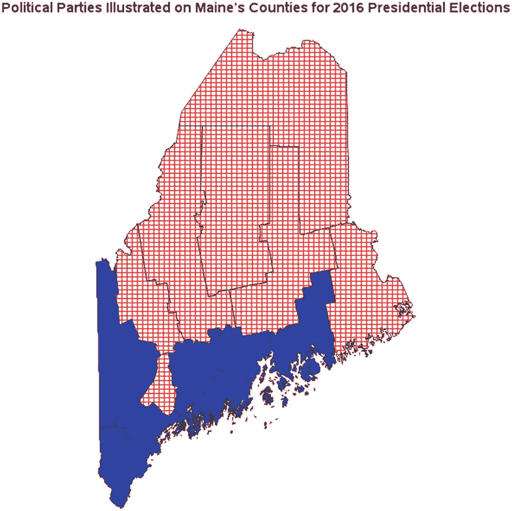

图 8-4 2016 年总统选举中缅因州各县的政党分布

程序清单 8-1 首先创建了一个名为 `voters` 的新数据集，该数据集包含四列：`state`、`county`、`democrat` 和 `republican`。第一列 `state` 是州级 FIPS 代码，值为 23，表示缅因州。第二列 `county` 是县级 FIPS 代码。第三列 `democrat` 是投票给民主党候选人的选民数量，最后一列 `republican` 是投票给共和党候选人的选民数量。

然后，代码比较了民主党与共和党的选民数量。如果民主党数量更多，则该县的政党标记为 1，否则标记为 2。代码使用这些数字为县着色。`datalines` 部分包含填充数据集的实际值。

新的部分使用 `PROC GPROJECT` 通过利用 FIPS 值投影出一个仅包含缅因州及其各县的新地图。

接着，代码设置了两类填充图案（图 8-4）。第一种用于 `party=1`，是代表民主党的纯蓝色；第二种是 `M3X0`，即交叉影线，红色用于表示 `party=2` 的共和党。您可以通过此 URL 查阅 SAS 文档，了解关于 `PATTERN` 关键字的更多详细信息：[`https://documentation.sas.com/?docsetId=graphref&docsetTarget=p02daopdgx5yh4n1vmffk4ud4697.htm&docsetVersion=9.4&locale=en`](https://documentation.sas.com/%253FdocsetId%253Dgraphref%2526docsetTarget%253Dp02daopdgx5yh4n1vmffk4ud4697.htm%2526docsetVersion%253D9.4%2526locale%253Den)。

`PROC GMAP` 使用这两种图案，基于 `voters` 数据集和 `PROC GPROJECT` 生成的地图，生成彩色的统计地图（choro map）。要了解更多关于 `PROC GMAP` 的信息，请查阅以下 SAS 文档的 URL：

[`https://documentation.sas.com/?docsetId=grmapref&docsetTarget=n0ncszzwvnx84bn1ql4487r08jpa.htm&docsetVersion=9.4_01&locale=en`](https://documentation.sas.com/%253FdocsetId%253Dgrmapref%2526docsetTarget%253Dn0ncszzwvnx84bn1ql4487r08jpa.htm%2526docsetVersion%253D9.4_01%2526locale%253Den)

为了验证结果，我查阅了大量网站以比较我的结果。其中几个网站如下：

*   [`https://www.politico.com/2016-election/results/map/president/maine/`](https://www.politico.com/2016-election/results/map/president/maine/)
*   [`https://en.wikipedia.org/wiki/2016_United_States_presidential_election_in_Maine`](https://en.wikipedia.org/wiki/2016_United_States_presidential_election_in_Maine)

类似地，我能够比较过往年份中各县的政党分布情况，这在第 1 章的图 1-12 中已有提及。

我将 2012、2008、2004 和 2000 年的代码添加到了“示例代码”文件夹中。它们分别是 `Listing 8-2.sas`、`Listing 8-3.sas`、`Listing 8-4.sas` 和 `Listing 8-5.sas`。这些列出的程序生成了图 8-5 中的地图。

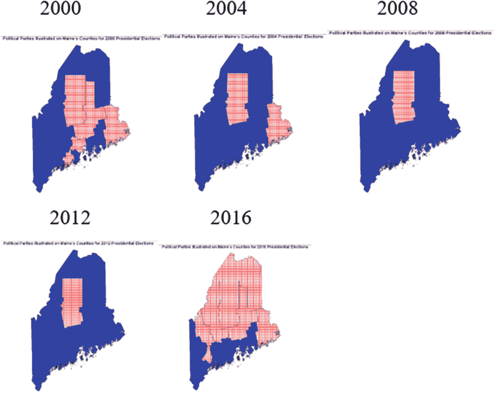

图 8-5 2000-2016 年总统选举中缅因州各县投票情况的地图

如需更多资源，请查阅附录。

# SAS Visual Statistics：首个报告

现在，为了返回 Visual Statistics 来编写我们的第一个交互式报告，我们需要上传数据集。在本节中，我们使用“康涅狄格州意外药物相关死亡”数据集。

你可以从以下链接下载 CSV 文件：

[`https://catalog.data.gov/dataset/accidental-drug-related-deaths-january-2012-sept-2015`](https://catalog.data.gov/dataset/accidental-drug-related-deaths-january-2012-sept-2015)

不过，我们只使用 2016 年至 2018 年的数据。你可以在“Datasets”文件夹中找到名为 `Accidents_Drugs_CT.csv` 的数据集。如上一节所述，点击三条横线；选择“管理数据”，如下图 8-6 所示。

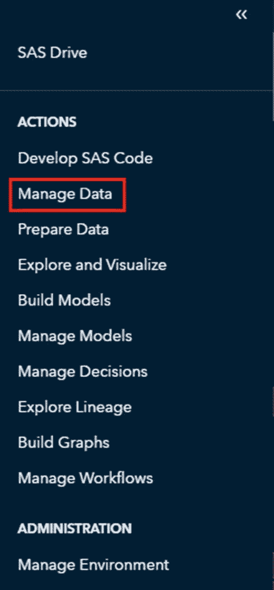

图 8-6：管理数据

点击“导入” ➤ “本地文件”，如下图 8-7 所示。

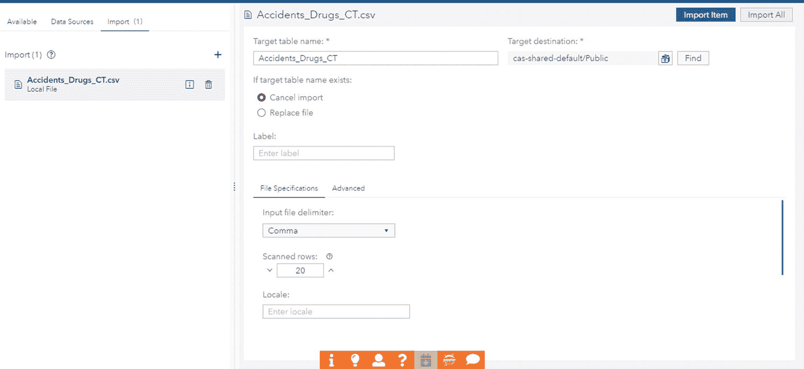

图 8-7：导入 2016-2018 年康涅狄格州药物过量意外死亡数据集

然后，点击“导入项”。接着，点击三条横线，然后点击“探索和可视化”，如下图 8-8 所示。

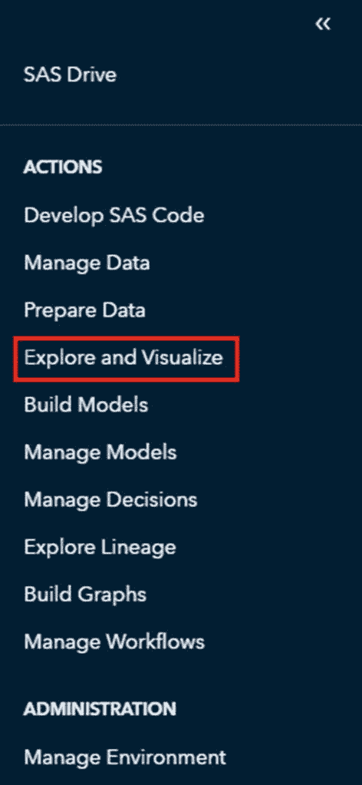

图 8-8：探索和可视化

在右侧窗格中，点击“选项”，如下图 8-9 所示，以更改报告的背景颜色和字体。我们选择深灰色背景和黄色字体，如下图 8-9 所示。

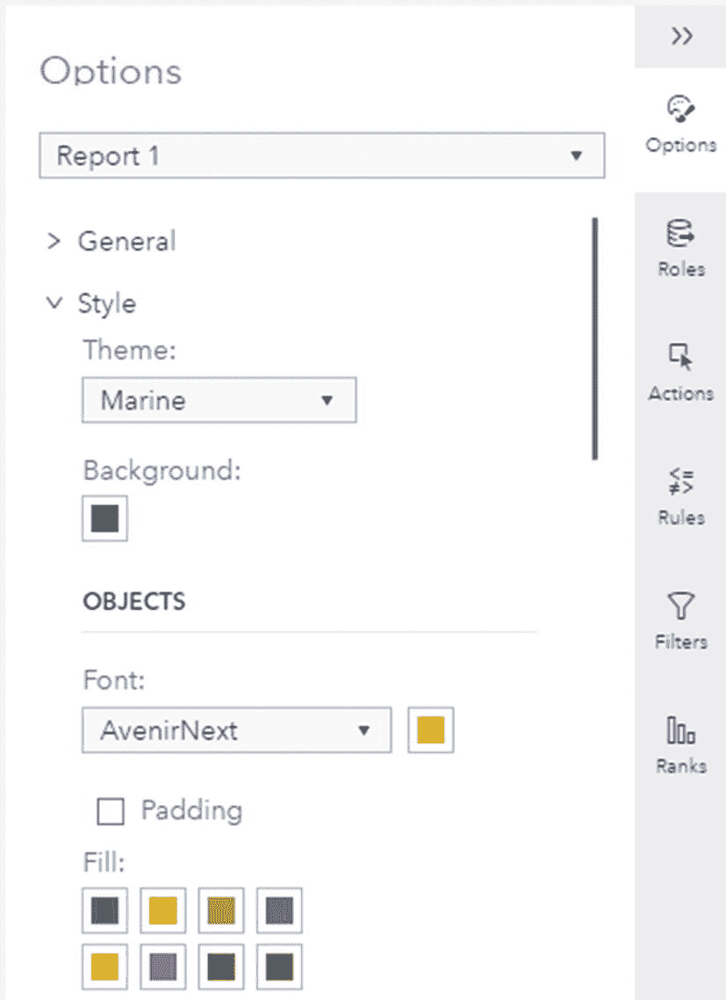

图 8-9：增强报告背景

向下滚动选项至“布局”部分，并取消勾选“避免滚动条”，如下图 8-10 所示。这一点至关重要，因为如果你保留默认选项，图表和报告将无法清晰显示。此外，它还会锁定报告部分的调整大小功能。因此，最好取消勾选此选项，以便能够控制报告的尺寸。

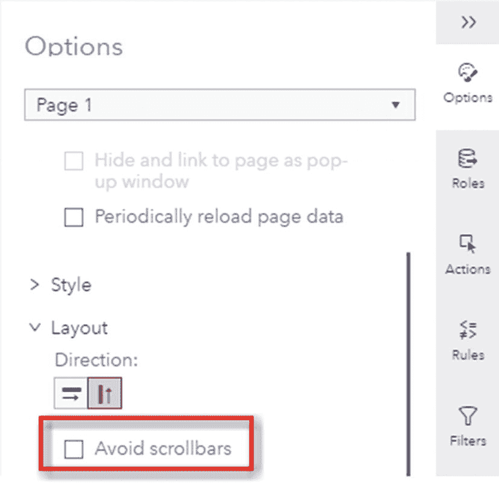

图 8-10：取消勾选“避免滚动条”

请随意查看报告的其他选项，并探索如何增强其外观。

## 直方图

在左侧窗格中，点击“对象” ➤ “直方图”，如下图 8-11 所示。将其拖放到内容窗格的报告中。在为其分配角色之前，它不会显示任何内容，如下一步所示。

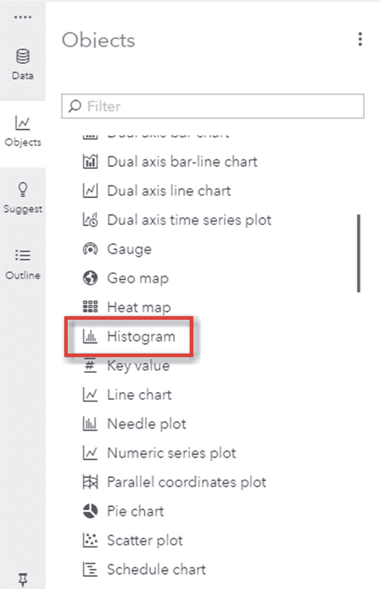

图 8-11：直方图

在右侧窗格中，点击“角色”来分配度量，如下图 8-12 所示。对于直方图，只允许使用数值。因此，`Age` 是该数据集中唯一可行的变量。

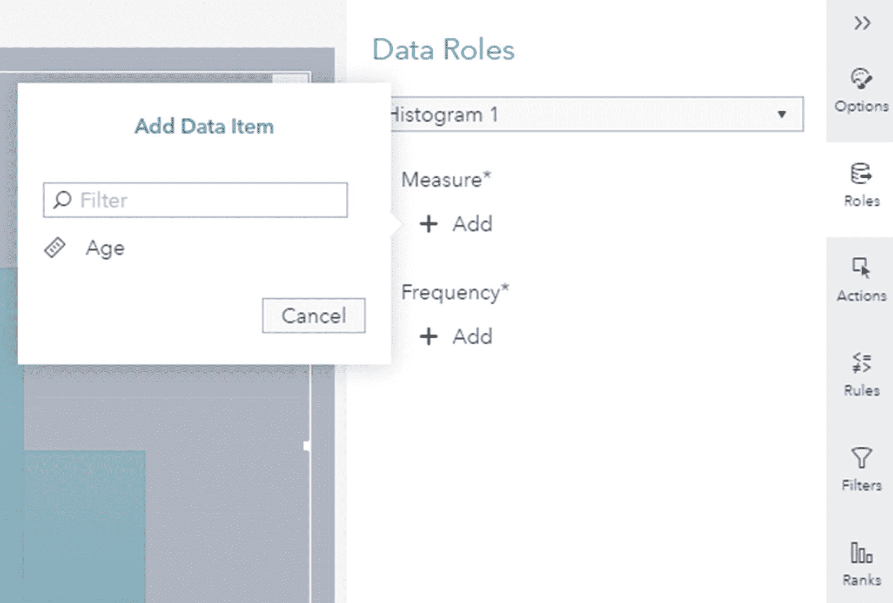

图 8-12：只有数值才能作为直方图的度量

SAS Visual Statistics 生成一个图，如下图 8-13 所示，显示 2016 年至 2018 年间康涅狄格州发生意外药物相关死亡的最高年龄段是 31-34 岁。

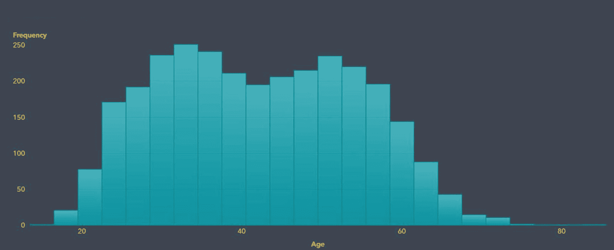

图 8-13：2016-2018 年康涅狄格州药物过量死亡人员的年龄分布

> **注意：** 要查看彩色版图 8-13、8-14 和 8-15，请访问本书的源代码。

为增强标题外观，双击标题，会弹出菜单，如下图 8-14 所示。更改颜色，并设置为粗体且居中。

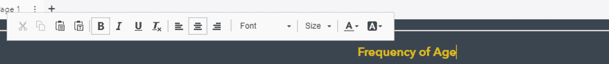

图 8-14：增强标题外观

如图 8-15 所示，标题现在更加清晰。

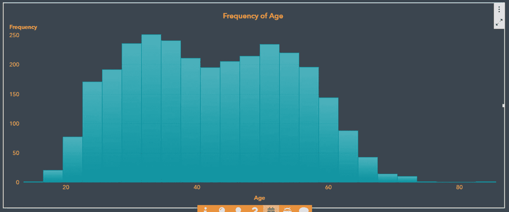

图 8-15：报告此部分的最终效果

## 词云

词云是字符变量自然语言处理的一个激动人心的功能。它显示任何变量中出现频率最高的词，其字号大于其他词。再次从右侧窗格中，点击“对象” ➤ “词云”，如下图 8-16 所示。将其拖到报告中。

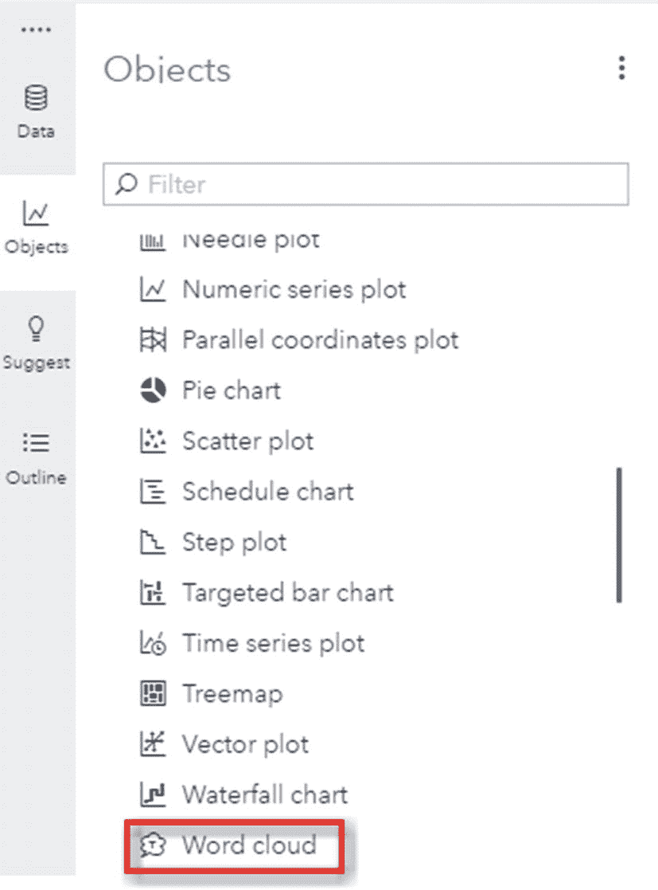

图 8-16：词云

从右侧窗格为其分配角色。选择“角色”，然后在“词”中，选择 `DeathCity`，如下图 8-17 所示。

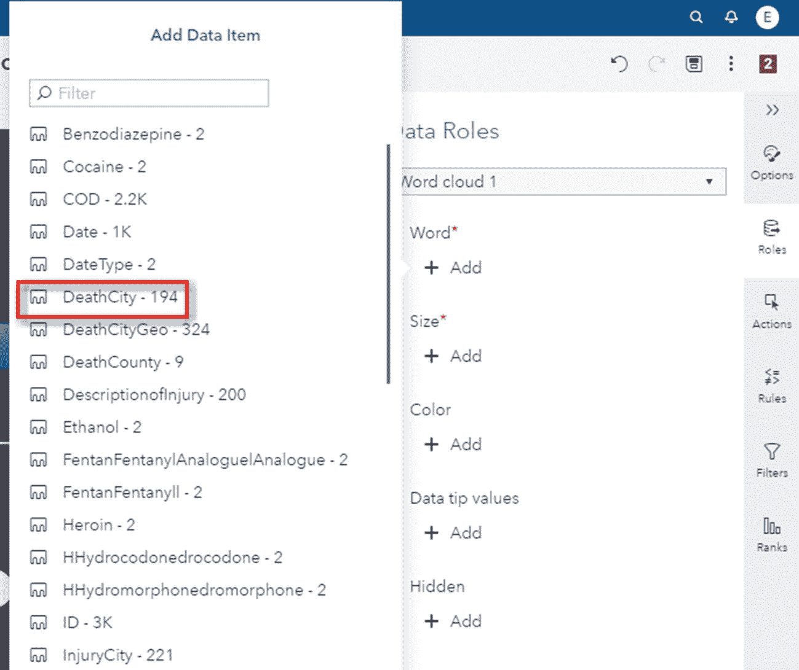

图 8-17：从数据集中选择 `DeathCity` 列

词云如下图 8-18 所示，显示哈特福德是这些致命药物相关死亡事件最常发生的城市，其次是纽黑文、布里奇波特和沃特伯里。该词云可以帮助执法部门加强这些城市的监控。此外，你可以添加最常发生日期和时间的图表，以检查某些节假日或时间与这些事件之间是否存在关系。你可以通过追踪街道来深入挖掘，以识别这些城市中是否存在某些地点出售毒品。

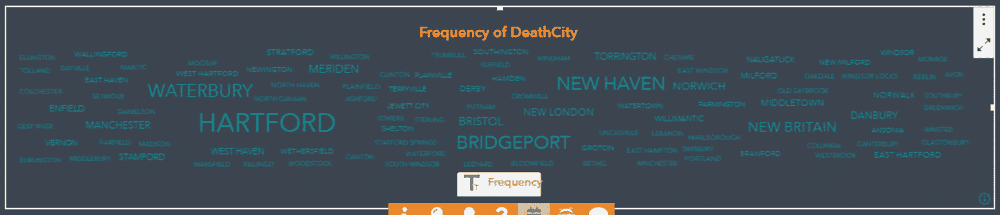

图 8-18：药物相关死亡率较高的城市名称字号大于其他城市

> **注意：** 要查看彩色版图 8-18，请访问本书的源代码。

### 条形图

另一个要展示的图表是条形图。同样，从左侧窗格中选择 `Objects ➤ Graphs ➤ Bar Chart`，如图 8-19 所示。用鼠标将条形图拖拽到内容窗格中。

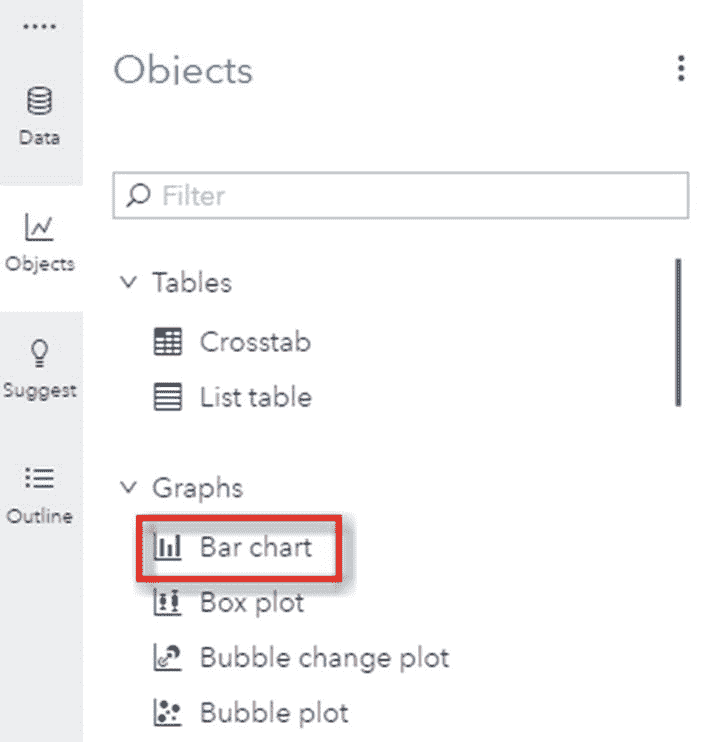

图 8-19 条形图

拖拽后，系统会提示您尚未分配角色。从右侧窗格中选择 `Roles`。对于 `Category`，选择 `Race`，如图 8-20 所示。

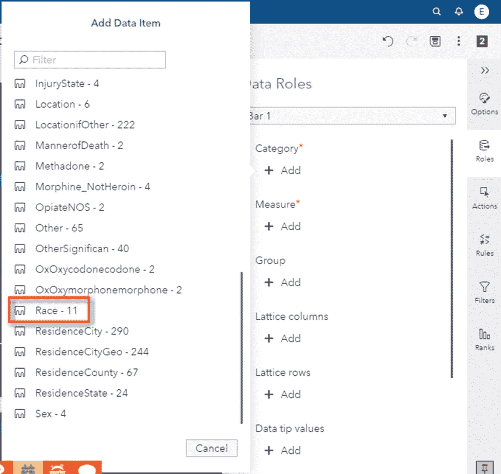

图 8-20 从数据集中选择种族

默认情况下，SAS Visual Statistics 中的条形图是水平方向的。在右侧窗格中，点击 `Options ➤ Bar`。点击 `Vertical direction`，如图 8-21 所示。

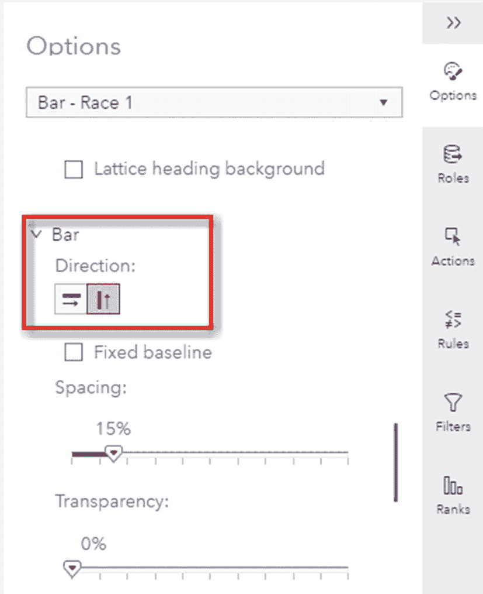

图 8-21 将条形图方向更改为垂直

调整图表及其标题的大小和外观，使其更加清晰，如图 8-22 所示。该图显示，白人因药物过量死亡的人数比其他任何种族都多。

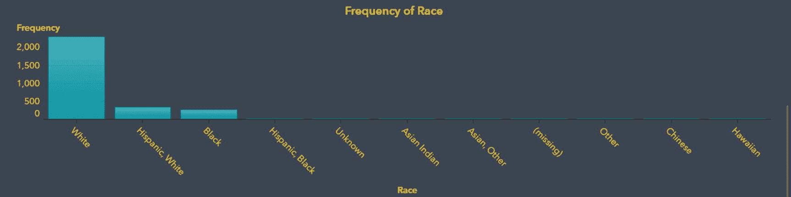

图 8-22 药物过量死亡的种族分布

**注意**

要查看图 8-22 的彩色版本，请访问本书的源代码。

### 蝴蝶图

蝴蝶图显示两个共享类别轴的条形图，以便在它们之间进行比较。这两个条形图的基线位于图表的中心。点击 `Objects ➤ Graphs ➤ Butterfly Chart`，如图 8-23 所示。将其拖拽到报告中，放在之前图表的下方或任意图表旁边。

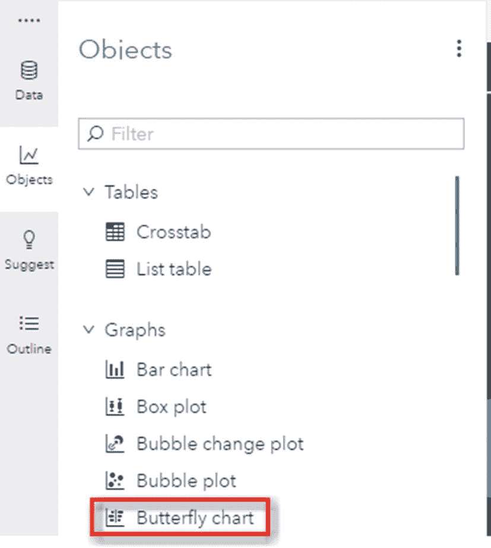

图 8-23 蝴蝶图

在右侧窗格中，选择 `Roles`，然后在 `Category` 中选择 `Sex`，如图 8-24 所示。在 `Measure (bar)` 中选择 `Age`，在 `(bar2)` 中选择 `Frequency`，如图 8-24 所示。

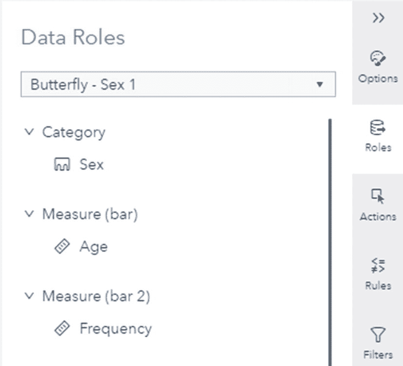

图 8-24 蝴蝶图将显示哪个性别的药物过量情况更严重

图 8-25 显示，男性因致命药物过量致死的情况比女性更严重。

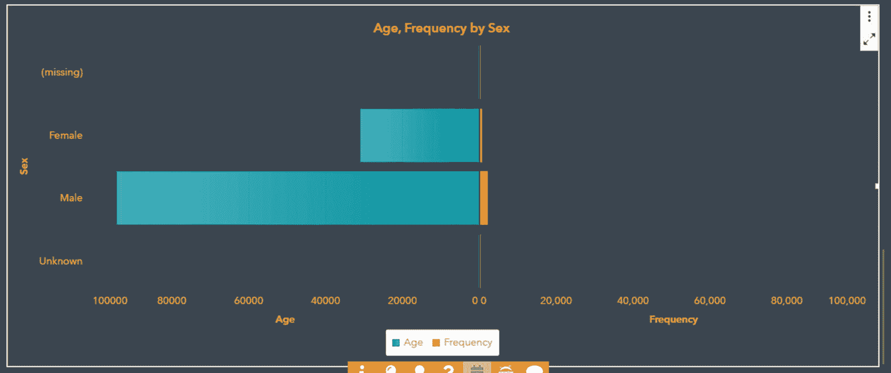

图 8-25 男性药物过量致死人数远超女性

## 总结

本章介绍了 SAS Viya，这是一款一体化产品。它其中也包含了 SAS Studio。我们讨论了分级统计地图，这些在 SAS Studio 的免费版本中无法使用。此外，我们创建了一个报告，其中包含了一个工作表中的多个信息图。它有一些有趣的功能，例如词云。在下一章中，我们将讨论阅读本书后下一步该做什么，以及如何继续学习使用 SAS 进行数据科学，并如何为自己寻找数据科学的工作。

# 9. 下一步是什么？

正如我们在第 1 章中讨论的，数据科学过程始于一个问题或假设。然后，您尽可能多地收集相关原始数据，接着进行清洗和探索。第四阶段是建模和评估。最后一步是部署、可视化，并在报告中交流结果，如图 9-1 所示。

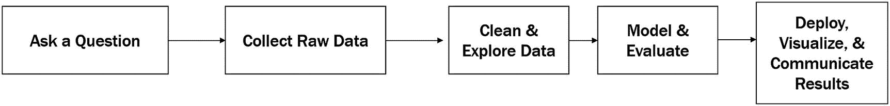

图 9-1 数据科学过程

值得一提的是，数据科学过程的前三个阶段被称为数据分析，而建模和评估阶段则是数据科学。结果的可视化和报告是数据科学和数据分析的共同点。

因此，数据分析更侧重于分析我们已经拥有的真实历史数据，而数据科学的范围是预测未来。在本书中，我们在第 7 章和第 8 章中介绍了建模和评估阶段。此外，我们在第 3 章中讨论了监督式算法与非监督式算法之间的区别。

然而，作为一名数据科学家，您还应该了解许多其他数据科学算法；例如，决策树、支持向量机和神经网络。如果您对图像分析感兴趣，请继续学习深度学习和 TensorFlow。

## 报告：如何呈现你的结果？

在整本书中，我们在多个章节中讨论了报告。在本节中，我们将这些散落的拼图碎片组合起来，以了解在 SAS Studio 中编写报告相比其他语言是多么容易。

在 SAS Studio 中，编译报告比其他数据科学语言容易得多。例如，在 R 中，要编译一个收集所有图表、统计分析和推断的报告，您需要使用 Markdown 最终生成一个 HTML 文档。如果新接触数据科学的人不熟悉 HTML 代码，那么添加公司徽标并遵循报告模板可能会很麻烦。而在 SAS Studio 中，正如我们在第 2 章的图 2-7 中所提到的，报告输出可以是 RTF、PDF 或 HTML 格式。在任何文字处理应用程序中编辑 RTF 文件，都比编辑嵌入在代码中的内容容易得多；例如，添加公司徽标、任何额外文本和推断。

要制作一个包含多个部分的完整分析报告，您可以使用 SAS Studio 图形用户界面将每个部分作为一个独立的程序来执行。例如，在一个程序中，您可以使用单变量频数创建统计分析。在另一个程序中，您可以制作直方图。在第三个程序中，您可以使用地图进行可视化，依此类推。最后，您需要将所有程序合并到一个程序中，以仅生成一个报告。您可以通过点击 `Edit` 选项卡来实现，如图 3-39 所示。在我们提到的每个程序中，复制自动生成的代码，并将其逐一粘贴到一个程序中。运行这个新的、大型的程序，并从中编译您的报告。我们在清单 7-1 中做了这件事，我们探索了石油、黄金和股票。我们复制了这三个程序，并将它们编译成一个包含所有三个图表的报告；然后，我们进行了回归分析。

总之，通过复制多个程序中的散落代码，您可以生成一个报告。然后，点击 `Print`，将报告保存为 RTF 格式，并在任何文字处理应用程序中编辑它。在 SAS Studio 中，无需编写特殊代码来生成报告。

### 如何根据读者需求撰写结果报告？

在完成从 `SAS Studio` 生成报告的技术细节后，我们需要考虑阅读报告的受众。我们的受众群体多样，包括数据科学家同事、团队领导、公司董事会、营销团队以及公司客户。

例如，客户雇佣我们是为了判断某只股票是买入还是卖出。他们不会关心直方图或地图。他们需要的是通俗易懂的说明，来了解我们决策的依据。而另一方面，我们的经理和团队成员则需要了解每一个细节，甚至需要能够阅读和理解代码。

了解每个相关方所需交付的成果至关重要，并且要针对受众需求量身定制报告内容。对可视化的解释比可视化本身更为重要。

以下是数据分析报告示例的更多链接：

*   [`https://www.datapine.com/blog/analytical-report-example-and-template/`](https://www.datapine.com/blog/analytical-report-example-and-template/)
*   [`http://www.stat.cmu.edu/~brian/701/notes/paper-structure.pdf`](http://www.stat.cmu.edu/%257Ebrian/701/notes/paper-structure.pdf)
*   [`https://www.examples.com/business/data-analysis-report-examples.html`](https://www.examples.com/business/data-analysis-report-examples.html)
*   [`https://bizfluent.com/how-5822409-write-good-data-analysis-report.html`](https://bizfluent.com/how-5822409-write-good-data-analysis-report.html)

以下是数据科学报告结构的相关链接：

*   [`https://www.kaggle.com/WinningModelDocumentationGuidelines`](https://www.kaggle.com/WinningModelDocumentationGuidelines)
*   [`https://github.com/rdpeng/courses/blob/master/05_ReproducibleResearch/Checklist/Reproducible%20Research%20Checklist.pdf`](https://github.com/rdpeng/courses/blob/master/05_ReproducibleResearch/Checklist/Reproducible%2520Research%2520Checklist.pdf)

## 如何通过数据科学在线赚钱？

你可以找到大量关于如何通过数据科学在线赚钱的文章。在本节中，我将分享自己的一部分经验以及实际所做的工作。我是一名自由讲师、顾问、记者和作者。

### 在线教学

我一生都在教授计算机和技术课程。我的第一堂课是在开罗大学工程学院读大二时教授的。在埃及，工程专业需要五年而不是四年才能毕业。我在大四时成为了微软认证专家。毕业后，我通过了微软的多项认证，成为 .NET 领域的特许专家和微软认证讲师。

是的，获得认证可以促进你的职业发展并证明你的专业能力。其他人则更倾向于通过制作在线教程、撰写博客以及在技术社区回答他人问题来展示技能。我经常读到或听到有人通过 YouTube 赚取数千美元。但我不认识任何真正以此为生的人。

无论如何，另一种方式对我并不适用，因为在认证中心教授技术课程，你必须获得认证。然而，这样做的弊端是你必须不断追逐最新技术，通过获得认证来始终保持顶尖水平。否则你就会失去优势。如果你在某个时刻感到疲惫，可以转向在大学里教授基础科学和技术学术课程。在我人生的某些阶段，我也这样做过，但很快我就怀念那种激情，于是从学术界转回了技术领域。当然，教授技术课程在经济上的回报远高于在任何大学任教。目前，我作为自由讲师，在 ONLC 培训中心、微软合作伙伴以及其他认证中心教授 SAS、Docker 和 Kubernetes 课程。

我以类似的方式开始了数据科学的探索。我在该领域迈出的第一步是考取哈佛研究生专业证书。那是一次令人振奋的经历。我稍后会详细向你介绍，因为我不愿将其仅简化为本节中的一段话。

### 在线写作

我以自由职业者和志愿者的身份为多个平台在线撰稿。志愿服务通常会为我带来工作或项目机会。这是展示你经验的另一种方式。但是，你必须真诚地做志愿服务。我从未将志愿服务视为展示经验的机会，但在很多情况下，正是因为它而收到了工作邀请。

有一次，在与某个媒体的编辑产生分歧后，我免费在 *Medium* 上写了一篇文章，仅仅是为了分享我的知识和经验。令我惊讶的是，我收到了 *Medium* 的邀请，加入其合作伙伴计划。在该计划下发表文章后，我开始获得收入，并收到了另一份为 *Medium* 杂志撰稿的邀请。该计划的优点是，你不必被迫撰写特定主题，也不会有编辑可能拒绝你的文章。你可以在有时间的时候写任何你喜欢的内容，只要有人阅读并喜欢你的文章，你就能赚钱。以下是加入 *Medium* 合作伙伴计划的链接：

[`https://medium.com/creators`](https://medium.com/creators)

尽管我以高于 *Medium* 的稿费为多个平台撰稿，但我最钟爱的还是 *Medium*。我极力推荐它作为你只要有空就应去撰稿的最佳平台。定期写作是获得稳定现金流和粉丝的最佳实践。不幸的是，我目前还做不到这一点，因为我大部分时间都在忙于教学。我认为写作是另一种教学方式。然而，我更喜欢教学中的人际互动。我的其他一些朋友则更喜欢写作而非教学，因为文章的生命力更持久。

### Kaggle-Zillow 竞赛

`Kaggle` 是第三种在线赚钱的方式。我知道有些人辞去公司职务，通过参加`Kaggle`竞赛谋生。这是一个数据科学中心，大学和公司会在上面发布带有数据集的项目作为挑战，并提供现金奖励。我曾尝试过一次，那是一次很棒的经历；我从中收获良多。

我参加的那场比赛总奖金为 120 万美元，分两轮进行。参赛者将角逐大约一年半的时间。第一轮结束后，只有分数最准确的 100 名参赛者才能进入第二轮。第一轮之后有一些小奖项，总奖金为 5 万美元。第二轮结束后，一等奖是一百万美元。比赛的目标是预测未来两年的房价。这场比赛由`Zillow`呈现。

竞赛的数据集通常有两种类型：一种用于训练，另一种用于测试。此外，有些竞赛对内核提交次数没有限制，而另一些则限制提交次数。所以，请仔细阅读规则，以免浪费你的机会。

你可以通过这个链接查看比赛的档案、奖金和时间线：[`https://www.kaggle.com/c/zillow-prize-1`](https://www.kaggle.com/c/zillow-prize-1)。

我参加的那场比赛的时间线从 2017 年 5 月开始，到 2019 年 1 月结束。因此，赢得比赛并不容易。就个人而言，我不建议你辞去工作，靠参加`Kaggle`竞赛谋生，除非你真的尝试过并掌握了获胜的方法。

在`Kaggle`上，参赛者可以互相合作，如果他们愿意，也可以发布他们的代码或结果。这种分享会提升内核的排名和参赛者的讨论排名。一些 Kaggle 会员会因此出名，他们的贡献会获得大量点赞。雇主和研究中心经常会雇佣这些受欢迎的 Kaggle 会员，即使他们没有赢得比赛。因此，`Kaggle`在展示数据科学家的技能和编程风格方面等同于`GitHub`。

再次提醒，提交内核时要注意它是公开的还是私密的。有些竞赛禁止你首次设置内核隐私后再次更改。有些竞赛允许你一次分享你的内核，另一次改为私密。

对于这次比赛，我使用了`XGBoost`算法来预测价格。我是从`Kaggle`上了解到`XGBoost`算法的。所以，它对于初学者来说也是一个教育平台。最近，`Kaggle`开始提供免费的在线数据科学课程和免费数据集供尝试。这是链接：[`https://www.kaggle.com/learn/overview`](https://www.kaggle.com/learn/overview)。

如果你有问题或疑问，随时可以在讨论板上发帖。`Kaggle`的支持团队和社区非常活跃、支持且乐于合作。一段时间后，你可以认识其他 Kaggle 会员，与他们组队，一起竞争。

在`Zillow`比赛中，我的排名是 3131 个团队中的第 231 名。我的算法运行良好，通过改变一些数值，结果有了巨大提升。我在几周内从排行榜的第 1000 名跃升至第 231 名。不幸的是，我无法继续参加比赛，因为我必须前往波士顿参加校园内的几门课程。你可能不同意我的决定；每个人优先考虑的事情不同。对我来说，我在哈佛大学的硕士学位是我的最高优先事项，其价值超过一百万美元。

## 哈佛大学扩展学院：数据科学研究生专业证书

该证书课程包含四门课程，你可以选择在线或在校内参加。所有的讲座和实验课都会进行直播并录像。毕业后，你也可以根据需要随时观看，次数不限。如果你正在考虑通过它来推进你的职业生涯，我强烈建议你立即开始。课程价格每学期都会上涨，所以越快报名越便宜。无需申请或深厚的先前经验。据我所知，对许多人来说，入学很容易，但完成学业太难。该证书需要大量的努力和实践。你不能指望轻松通过。你必须在所有课程中至少获得 B，并在三年内完成。推荐的时间是十八个月。其中一门课程必须是统计课程，另一门必修课是数据科学课程。另外两门课程是选修课。

我在大约一年内完成了该证书的学习，所有成绩都是 A 和 A-。其中两门课程，我不仅获得了满分，还获得了额外加分。顺便说一下，哈佛大学没有 A+！我从哈佛大学暑期学校的一门暑期强化统计课程开始。课程讲师是迈克尔·帕森教授。他是有史以来最好的教授之一，并被评选为大学里最受欢迎的教授。2016 年秋季，我一个学期选修了两门课程。我在这本书中记录的那门课是拉里·亚当斯教授的。另一门课是奥列格·皮亚内赫教授的《医疗保健中的大数据》。我从那门课中也学到了很多。春季学期，我选修了由安德烈·西瓦琴科教授和维克托·法鲁丁教授讲授的必修数据科学课程。这门课非常出色，确实是一次很棒的经历。

我建议你从统计课程开始，然后是必修的数据科学课程，最后再选修其他课程。你并不总能自由选择，因为并非所有课程每个学期都会开设。最好事先咨询你的学校顾问。哈佛大学的顾问们都很棒——非常友好且知识渊博。请注意，在你注册大学任何项目后，规则或课程有时可能会发生变化。因此，最好向你的顾问汇报你的学习进度，并在注册前与他们讨论你感兴趣的课程。顾问会检查你是否能满足证书或学位的要求，并指导你做出最佳选择。我的顾问阿莉森·K·博格斯和我的入学教练克里斯汀·凯勒给了我巨大的帮助。如果没有他们的帮助以及我的毕业设计项目主任萨莉·夏普教授的指导，我肯定无法完成我的学位。

这个证书费用昂贵，但大约一年内你就能赚回这笔钱。在你的简历和`LinkedIn`账户上印上哈佛大学的标志，会大大提升你的工作机会。除了工作和金钱，哈佛的经历会永远改变你的生活和思维方式。是的，它很艰难；你会连续数日不眠不休地工作和学习。但是，相信我，你会爱上它的！

数据科学方向，无论是学术型还是技术型，如今都无处不在。你也可以尝试一下。除了哈佛大学，许多其他大学也开始提供数据科学的学位和证书课程。

# SAS 认证

学完本书，您将基本覆盖以下两项认证所要求的全部主题：

1.  [SAS 认证专家：使用 SAS 进行基础编程](https://www.sas.com/en_us/certification/credentials/foundation-tools/base-programming-credentials.html)
2.  [SAS 9 高级程序员认证](https://www.sas.com/en_us/certification/credentials/foundation-tools/advanced-programmer.html)

基础编程考试要求掌握的主题：

*   读取和创建数据文件。
*   处理和转换数据。
*   使用 Base SAS 过程创建基本明细报表和汇总报表。
*   识别并纠正语法错误和程序逻辑错误。

高级程序员考试要求掌握的主题：

*   使用高级数据步编程语句和效率技术解决复杂问题。
*   编写和解读 SAS SQL 代码。
*   创建和使用 SAS 宏工具。（这是本书中唯一未涉及的主题。）

SAS 认证证书是全球公认的验证您 SAS 知识并获取更高薪工作机会的首要途径。在雇主考虑的所有技能中，SAS 在薪资方面是最有价值的技能之一。请同时查看此链接：[`https://www.sas.com/en_us/careers.html`](https://www.sas.com/en_us/careers.html)。

我在微软、甲骨文和 Docker 等公司的数十项技术领域都获得了认证。获得认证最安全、最快速的方法是通过学习题库。你可以在线购买。题库包含了实际考试题目及其正确答案的集合。不要死记硬背答案，因为你可能不会遇到相同的问题。相反，应该研究你不懂的问题，并努力理解它们的答案。请记住，最终在工作中，考验的是你的知识，而不是你的记忆力。

## 保持联系

请保持联系。如果有任何我可以帮忙的地方，请告诉我。我很乐意随时提供帮助。

我的邮箱：efoda@ieee.org。
我的网站：[`www.engyfoda.com`](http://www.engyfoda.com)。
我的领英：[`https://www.linkedin.com/in/engyfouda/`](https://www.linkedin.com/in/engyfouda/)。

## 总结

在本章中，我们讨论了如何以受众为中心来撰写报告。接着，我们探讨了数据科学职业生涯的下一步。你可以继续攻读学术证书或技术证书，以证明你的经验，并在导师指导下进行实际项目。此外，我们还讨论了如何利用你的数据科学经验在线赚钱。祝你一切顺利！

# 索引

## A

`方差分析（ANOVA）`
`算术运算符`
`计算缺失值约定`

## B

`条形图`
`升序排序`
`创建数据集`
`降序水平条形图`
`直方图创建`
`反转刻度值`
`汇总统计表选择`
`标题`
`气泡图`
`编辑代码`
`最终版本`
`初始输出`
`图表标签`
`标签`
`SASHELP.CLASS`
`库 sgplot 函数`
`气泡地图`
`创建`
`数据——纽约市开放数据数据集`
`犯罪数量数据集文件夹`
`增强外观`
`Esri 地图`
`犯罪数量`
`NYC_crime_dim`

## C

`聚类分析`
`凝聚算法`
`树状图`
`分裂方法`
`分割`
`无监督学习算法`
`用户界面`
`注释语句`
`比较运算符`
`相关分析`
`变量数据选项卡`
`GDP 与选民投票率`
`马力与重量`
`选项选项卡`
`皮尔逊`
`统计过程`
`选民投票率与 GDP`

## D, E

`数据科学分析报告`
`证书`
`编译报告`
`建模/评估阶段`
`蒙特卡洛算法过程`
`问题/假设`
`数据集变量`
`数据可视化 参见直方图；散点图`
`DO 循环`
`DO UNTIL`
`DO WHILE`
`输出覆盖 SET 语法`
`DROP 语句`

## F

`FORMAT 语句`

## G

`图形用户界面（GUI）`

## H

`直方图`
`分析变量`
`外观选项卡`
`正态/核密度`
`箱数设置`
`刻度标记`
`X 轴最大值`
`夏洛特市雇员 CSV 文件`
`频率分布`
`水平条形图（HBar）`

## I, J

`IF（条件） 不带 THEN 语句`
`IF-THEN-ELSE 语句`
`IF-THEN 语句`
`INFILE 语句`
`数据集文件夹文件位置`
`INPUT`
`输出属性`
`语法`
`集成开发环境（IDE）`

## K

`Kaggle-Zillow 竞赛`

## L

`LABEL 语句`
`库`
`访问本地文件`
`创建`
`INFILE 语句`
`命名约定`
`新数据集/表`
`永久 SAS 数据`
`访问语法`
`临时`
`逻辑回归`
`因变量`
`模型选项卡`
`零假设`
`输出`

## M

`蒙特卡洛算法`
`多元线性回归`
`因变量`
`金融危机`
`拟合诊断`
`线性方程`
`模型选项卡`
`零假设`
`R 方值`
`标普指数`
`垂直柱状图`

## N

`创建新变量`
`N 元方差分析`
`类别水平信息`
`连续因变量`
`数据选项卡`
`交互作用图`
`模型效应生成器`
`选项选项卡`
`源*类型`
`Tukey-Kramer 图`

## O

`单因素方差分析`
`类别水平信息/p 值`
`数据选项卡`
`Levene/Welch 检验`
`最小二乘均值`
`单个分类变量`
`气味分布`
`Tukey-Kramer 图`
`在线教学`

## P, Q

`缅因州总统选举`
`年龄`
`经济面临问题`
`性别`
`收入因素`
`收入中位数`
`人口可预测结果`
`种族`
`失业率`
`选民信息`
`选民投票率`
`获胜候选人`
`PROC SQL 语句`

## R

`R 方值`

## S

`SAS 认证`
`SAS 可视化分析`
`SAS Viya`
`内容窗格`
`县地图`
`开发 SAS 代码`
`散点图`
`代码`
`CSV 文件`
`数据集`
`数据集名称`
`筛选代码`
`线性关系/曲线变量`
`SELECT 语句`
`SELECT-WHEN 语句`
`IF-THEN`
`无选择表达式`
`输出`
`序列图`
`按股票分组的代码`
`单因素频率输出`
`SET 语句`
`简单线性回归`
`数据`
`因变量`
`拟合诊断`
`线性方程`
`模型效应生成器`
`模型选项卡`
`零假设`
`R 方值`
`散点图`
`代码片段`
`代码选项卡`
`水平条形图`
`SAS 代码`
`标准分析系统（SAS）`
`自动完成功能`
`组件`
`当前表`
`数据步`
`图形`
`安装`
`库选项卡`
`导航窗格`
`偏好设置`
`Proc Print`
`过程类型`
`报告片段`
`Studio`
`任务/实用程序选项卡`
`变量类型`
`统计分析 相关性 参见相关性`
`Maine_Past_Elections.xlsx`
`单因素频率汇总`
`T 检验 参见 T 检验`

## T, U

`T 检验`
`零假设`
`配对样本`
`双样本`

## V

`可视化统计`
`条形图`
`蝶形图`
`数据集`
`首个交互式报告`
`直方图`
`管理数据`
`报告背景`
`词云`

## W, X, Y, Z

`WHERE 子句`
`在线写作`