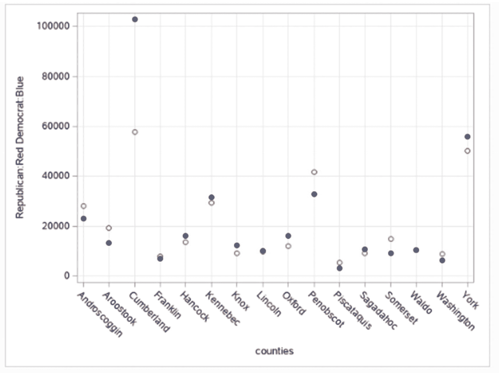
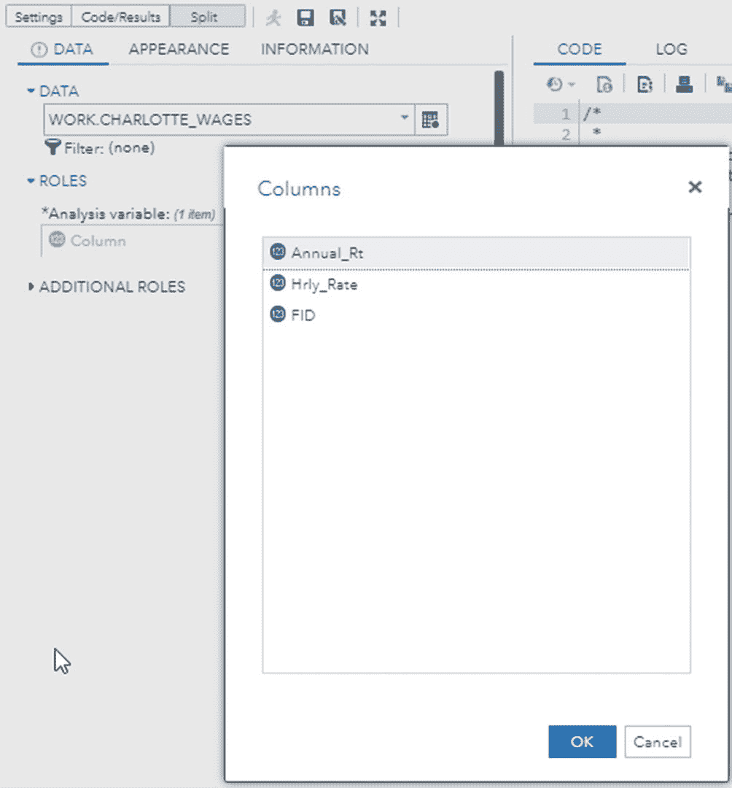
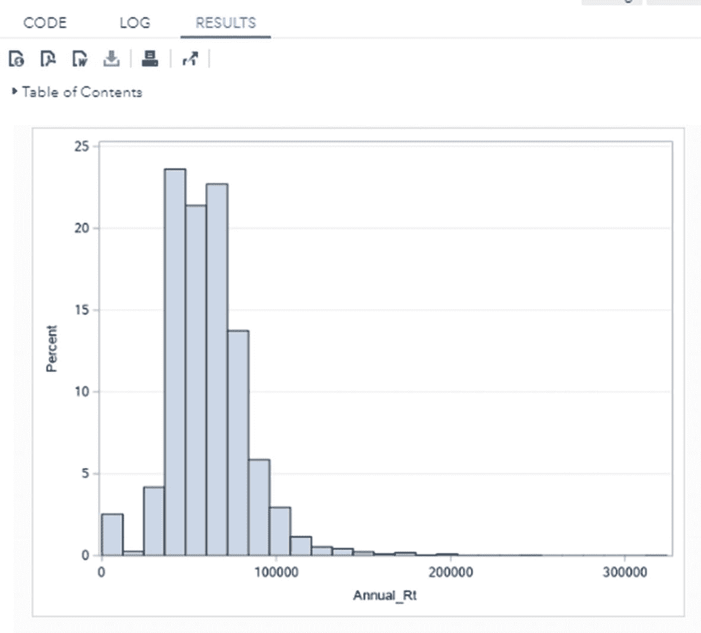
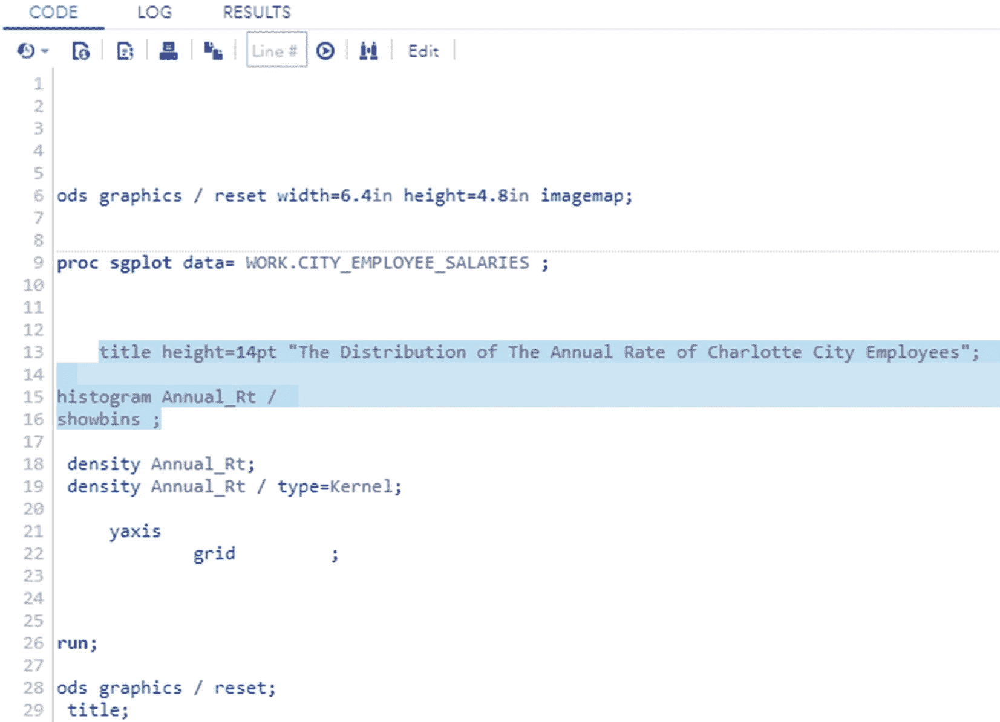

# 在同一图像中绘制多个散点图

我们可以在同一张图像中绘制多个散点图来比较数值。在本例中，我们使用每个政党的登记选民人数，绘制图表来比较缅因州各县中哪个政党的登记选民更多。此程序无法通过图形用户界面完成，必须使用代码实现。

“Dataset”文件夹中的数据集 `MAINECOUNTIESPARTIES.xlsx` 包含三列：各县名称以及共和党和民主党的登记选民人数（表 3-1）。

**表 3-1** `MAINECOUNTIESPARTIES.xlsx`

| 县 | 共和党 | 民主党 |
| --- | --- | --- |
| Androscoggin | 28189 | 22975 |
| Aroostook | 19419 | 13377 |
| Cumberland | 57697 | 102935 |
| Franklin | 7900 | 7001 |
| Hancock | 13682 | 16107 |
| Kennebec | 29296 | 31753 |
| Knox | 9148 | 12440 |
| Lincoln | 9727 | 10241 |
| Oxford | 12172 | 16214 |
| Penobscot | 41601 | 32832 |
| Piscataquis | 5403 | 3098 |
| Sagadahoc | 9304 | 10679 |
| Somerset | 14998 | 9092 |
| Waldo | 10378 | 10442 |
| Washington | 9037 | 6358 |
| York | 50388 | 55828 |

按照第二章中的方法，将 Excel 文件上传至 SAS Studio 并导入 Work 库后，我们运行清单 3-2 中的代码。

```sas
ods graphics / reset width=6.4in height=4.8in  imagemap;
proc sgplot data= WORK.MAINECOUNTIESPARTIES NOAUTOLEGEND;
scatter x=counties y=Republican markerattrs=(color=red);
scatter x=counties y=Democratic markerattrs=(color=Blue symbol=circlefilled);
xaxis grid;
yaxis grid  label="Republican:Red Democrat:Blue";
run;
ods graphics / reset;
```

*清单 3-2 比较缅因州各县共和党与民主党登记选民人数*

该代码绘制了两个重叠的散点图，每个图的 x 轴均为县名。第一个散点图的 y 轴是共和党人数，第二个散点图的 y 轴是民主党人数。为了区分它们，我们使用了 `markerattrs` 选项改变颜色。此外，我们仅为民主党数据点添加了 `symbol=circlefilled`，以便即使在灰度显示下也能区分各点。我们为 x 轴和 y 轴都添加了网格。最后，我们将 y 轴的标签改为 `Republican:Red Democrat:Blue` 以替代图例，因为在 `PROC SGPLOT` 选项中添加了 `NOAUTOLEGEND`，移除了自动生成的图例。

上述代码的输出结果如图 3-9 所示。



*图 3-9 缅因州各县与政党散点图*

从图 3-9 中我们可以看出，坎伯兰县的民主党选民人数最多，总体登记选民人数也最高。这可能也意味着它的人口最多，但我们无法确定，需要进一步验证。不过，我们可以肯定的是，该县民主党与共和党之间的差距巨大。除该县外，在其余十五个县中，有八个县的民主党人数略多于共和党。因此，民主党需要更加关注缅因州，以免其重新变红。

同样地，你也可以对自己所在的州进行同样的分析，并凭借自己的分析和预测为下一届总统选举做好准备。

## 直方图

直方图任务用于创建显示数值变量频率分布的图表。在本例中，我们将了解 2018 年 3 月北卡罗来纳州夏洛特市雇员的年薪分布情况。

你可以在“Datasets”文件夹中找到名为 `City_Employee_Salaries_March_2018.csv` 的数据文件。或者，你也可以通过以下网址从 Data.Gov 项目下载该 CSV 文件：[`https://catalog.data.gov/dataset/city-employee-salaries-march-2018`](https://catalog.data.gov/dataset/city-employee-salaries-march-2018)

将 CSV 文件复制到“myfolders”文件夹。在 SAS Studio 中，点击刷新，然后按照第二章中的说明导入该文件。将数据集名称从 `IMPORT` 更改为 `Charlotte_wages`。

点击**任务和实用程序** ➤ **图形** ➤ **直方图**。在**数据**中，选择 `WORK.CHARLOTTE_WAGES`。为此，如图 3-3 所示，点击数据集名称旁的小表格。接下来，点击**分析变量**旁的 `+` 号，选择 `Annual_Rt`，如图 3-10 所示；然后点击**确定**。



*图 3-10 选择要绘制直方图的分析变量*

请注意，SAS Studio 在右侧窗格的**代码**选项卡中自动生成了代码。它同样使用了 `SG Plot`，但这次使用了 `histogram` 关键字。现在，点击**运行**。SAS Studio 将在**结果**选项卡中绘制直方图，如图 3-11 所示。



*图 3-11 夏洛特市雇员直方图*

### 外观选项卡

让我们通过将直方图与正态分布和核密度估计进行比较来优化其外观。点击**外观**选项卡。选择**正态**和**核密度**。重新运行代码。输出结果类似于图 3-12。


*图 3-12 正态分布与核密度*

如图 3-13 所示，将标题更改为“夏洛特市雇员年薪分布”。然后，点击**X 轴**，并勾选“在区间中点处显示刻度标记”。


*图 3-13 显示刻度标记*

点击**代码**选项卡。观察 SAS Studio 如何根据你的选择更改代码，如图 3-14 所示。



*图 3-14 更改区间中点和标题设置后的直方图代码*

现在，返回**外观**选项卡。将区间数量改为 20，如图 3-15 所示。重新运行代码。


*图 3-15 区间数量*

现在，在**X 轴**部分，将最大值改为 140000，如图 3-16 所示。重新运行。


*图 3-16 更改 X 轴最大值*

现在，我们得到了一条比以前更接近正态分布的曲线，之前它是右偏的。


