# 序列图

序列图显示数值随时间的变化。在本例中，我们将绘制股票价格随时间变化的趋势。

依次点击 `Tasks and Utilities` ➤ `Tasks` ➤ `Graph` ➤ `Series Plot`。在 `Data` 中选择 `SASHELP.STOCKS`，X 轴选择 `Date`，Y 轴选择 `Close`，如图 3-17 所示。

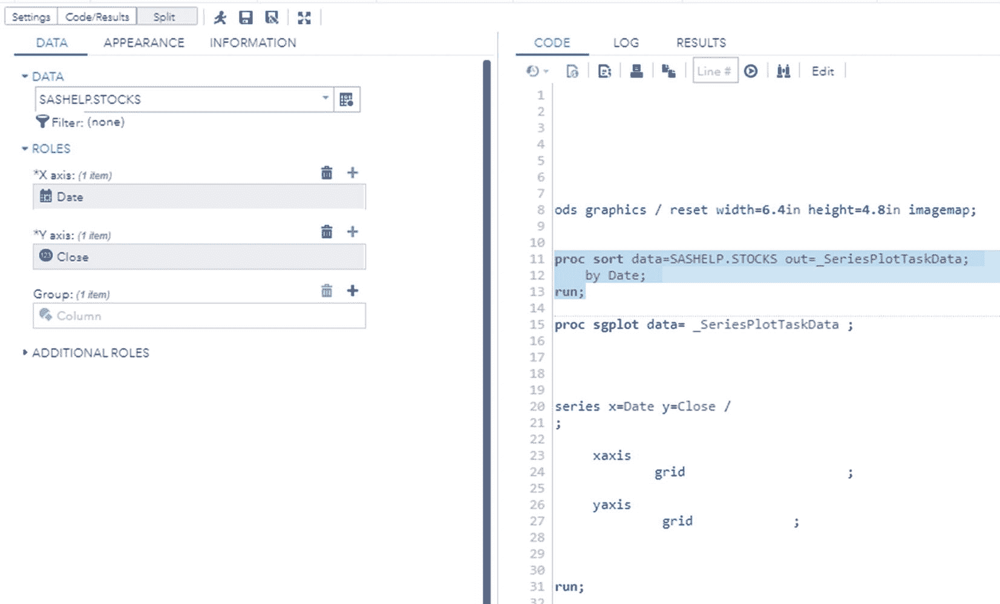

## 序列图代码

运行该图。输出结果类似于图 3-18。

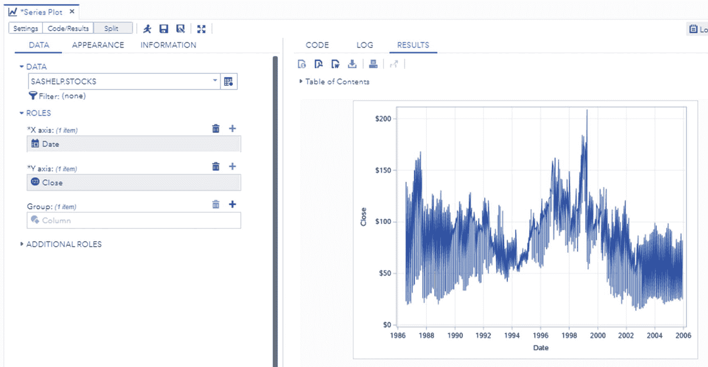

### 序列图输出

让我们探究股票的频率并获取股票的唯一值。依次点击 `Tasks and Utilities` ➤ `Tasks` ➤ `Statistics` ➤ `One-Way Frequency`。在 `Analysis Variable` 中，点击 `+` 号并选择 `Stock`，如图 3-19 所示。

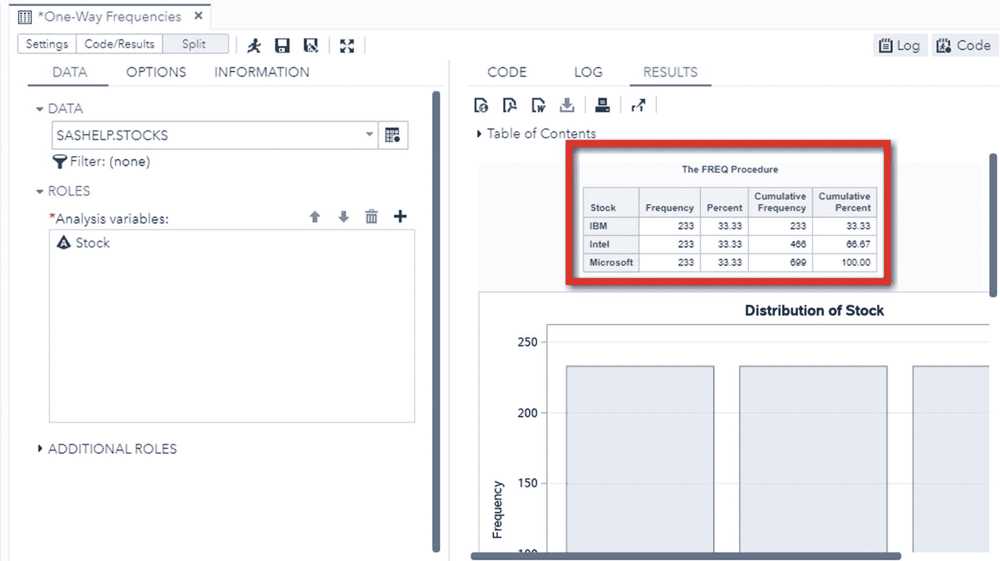

使用单因子频率分析股票。你会发现这些是三家公司的股票：IBM、Intel 和 Microsoft，如图 3-19 所示。

再次回到序列图，让我们基于此信息来增强图形。由于我们只有三只股票，选择 `Group By Stock`，如图 3-20 所示。

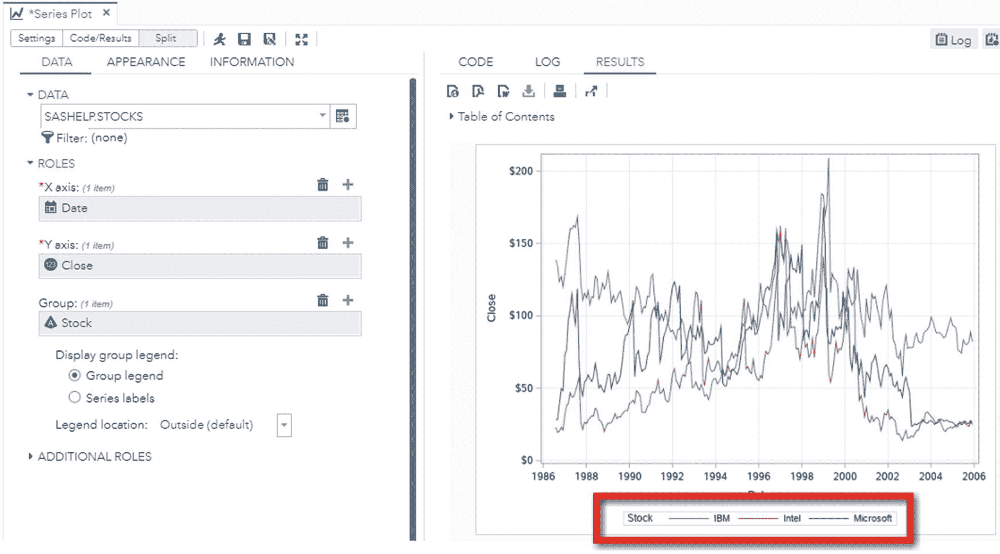

通过按股票分组来增强序列图。Y 轴显示收盘价，X 轴显示年份。图 3-21 显示了 IBM、Intel 和 Microsoft 从 1986 年到 2006 年的收盘价。

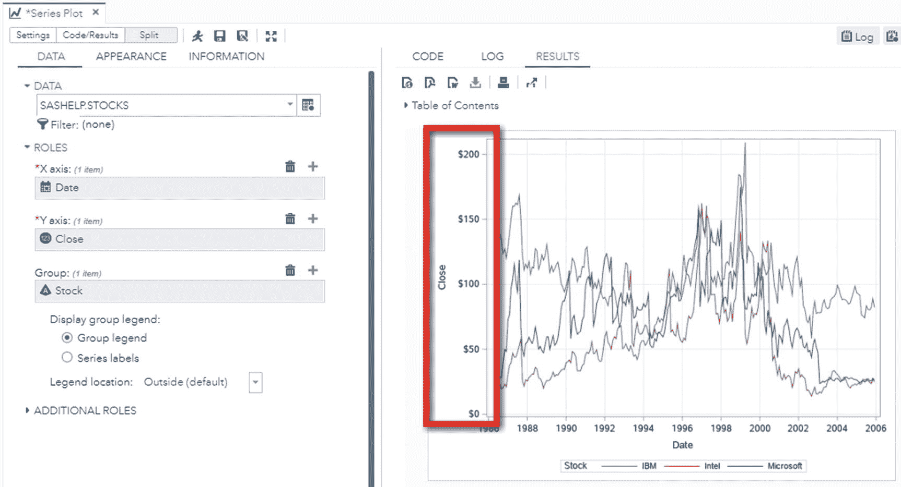

### 二十年的收盘价

从图 3-21 中，我们发现 Intel 多年来大部分时间的收盘价最低，而 IBM 的收盘价最高。有史以来的最高收盘价超过 200 美元，是 IBM 的股票。从 2004 年到 2006 年，IBM 与其他公司之间的差异显著，IBM 的股票价格接近 100 美元，而 Intel 和 Microsoft 大约为 25 美元。那时，这些信息和数据分析本可以帮助股票经纪人决定是卖出还是买入哪只股票。

在 `Appearance` 选项卡中，选择 `Title and Footnote` 并将标题编辑为“按年份的股票收盘价”，如图 3-22 所示。观察 `Code` 选项卡中的代码变化，然后重新运行程序。

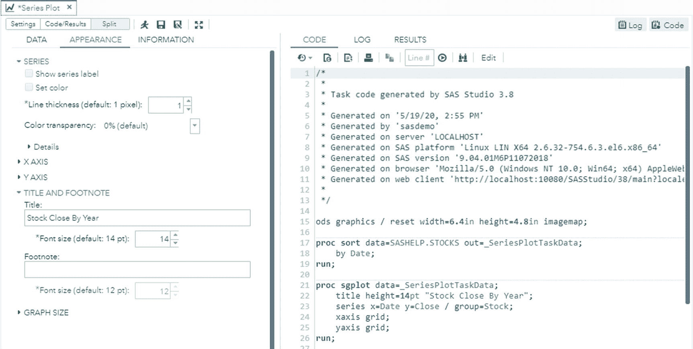

### 序列图代码

## 条形图

您可以使用条形图来比较组别或跟踪变量随时间的变化。在下面的程序中，您将比较棒球队的平均薪资。我们还希望回答哪个球队的平均薪资最高，哪个最低的问题。

让我们创建一个程序，为棒球队的平均薪资制作一个水平条形图 (`HBar`)。

选择 `Tasks` ➤ `Graph` ➤ `Bar Chart`。

如图 3-23 所示，使用库中的 `Baseball` 数据集 (`SASHELP.BASEBALL`)。对于 `Chart Orientation`，选择 `Horizontal`。在 `Roles` 中，为 `Category` 选择 `Team`，为 `Variable` 选择 `Salary`，为 `Statistic` 选择 `Mean`。

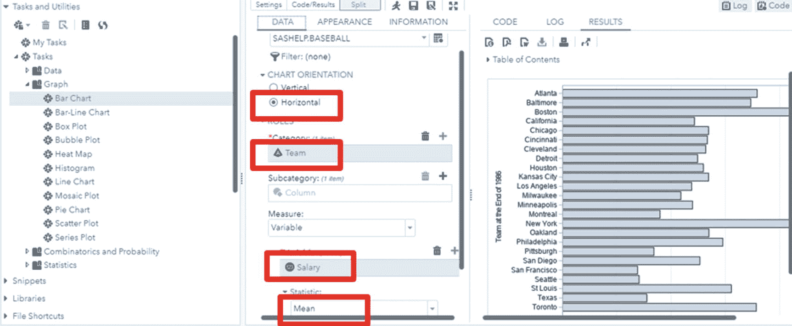

创建条形图。在 `Appearance` 选项卡中，添加报告标题“各队平均薪资”，如图 3-24 所示。然后，点击 `Run`。

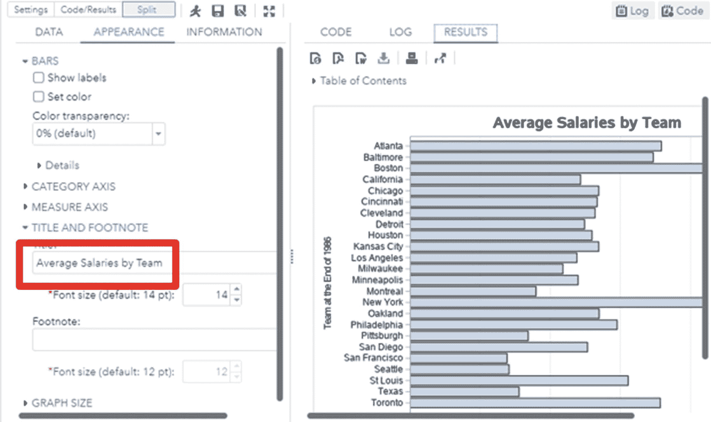

添加标题。

### 如何对条形图排序？

图 3-24 显示了各队的平均薪资。然而，从图中找出薪资第二和第三高的球队可能会令人困惑。为避免混淆，最好对图形进行升序或降序排序。我们将通过四个步骤对条形图进行排序。

**步骤 1：** 创建一个仅包含球队名称和平均薪资的新数据集。依次点击 `Tasks and Utilities` ➤ `Tasks` ➤ `Statistics` ➤ `Summary Statistics`。为 `Data` 选择 `SASHELP.BASEBALL`，为 `Analysis Variables` 选择 `Salary`，为 `Classification Variables` 选择 `Team`，如图 3-25 所示。

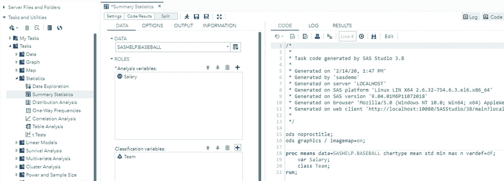

点击 Summary Statistics。

**步骤 2：** 在 `Options` 选项卡中，仅勾选 `Mean`，并取消选择其他默认选项，如图 3-26 所示。

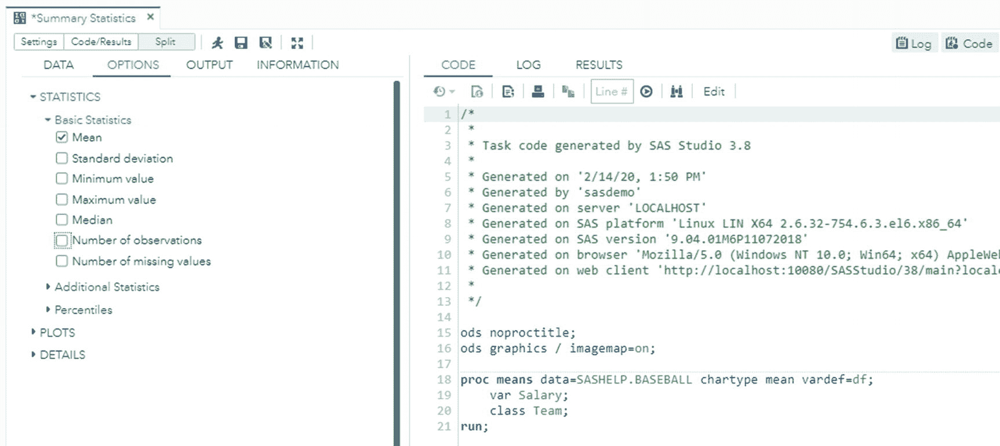

在 Options 选项卡中勾选“Mean”。

**步骤 3：** 在 `Output` 选项卡中，勾选 `Create output data set` 将数据的平均值保存到新数据集，如图 3-27 所示。

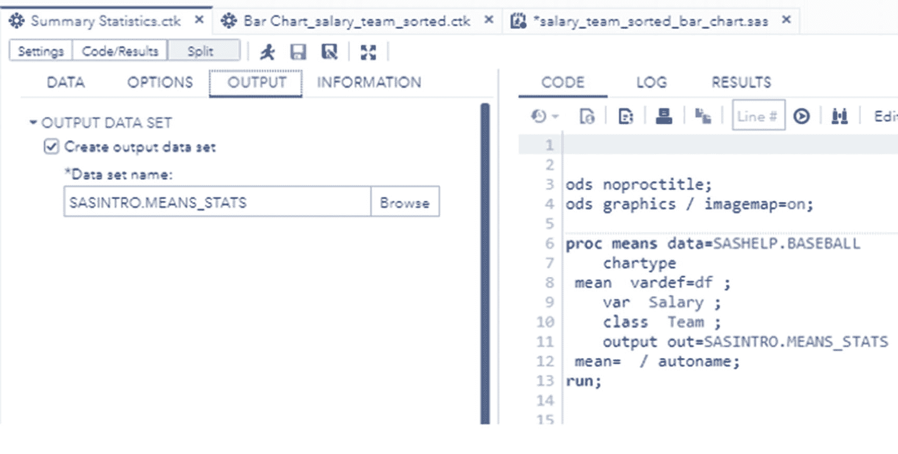

将结果保存到新数据集。

**步骤 4：** 创建一个按平均薪资排序的条形图，而不是按球队排序。选择上一步生成的数据集作为新条形图的输入数据。为 `Category` 选择 `Salary_Mean`，为 `Subcategory` 选择 `Team`，为 `Measure Variable` 选择 `Salary_Mean`，如图 3-28 所示。

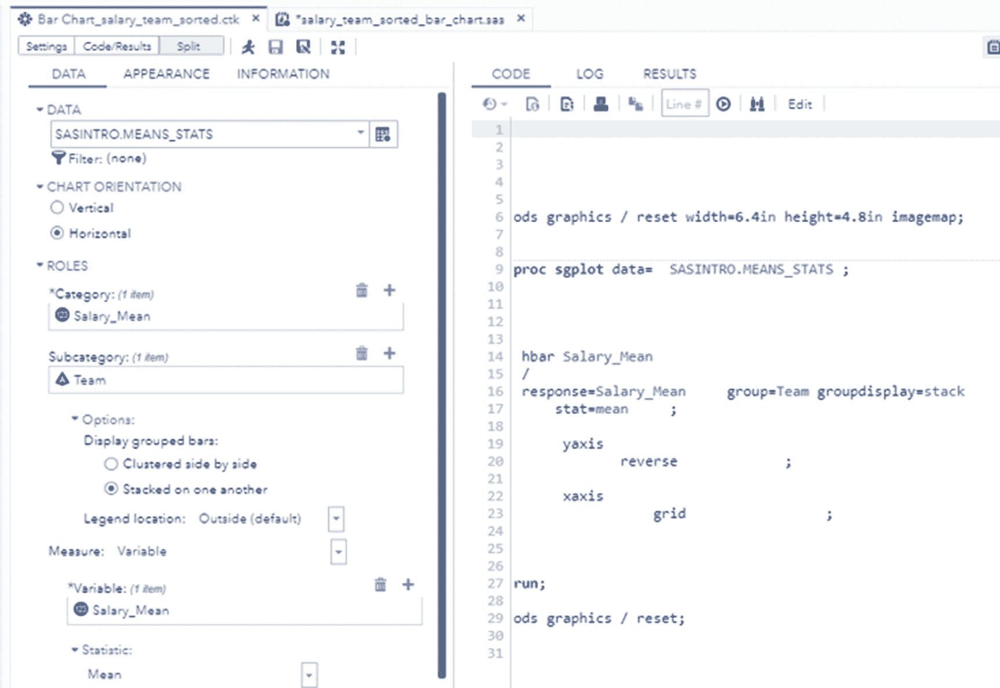

选择您的表格作为数据。运行图表以获得新的排序图形，如图 3-29 所示。

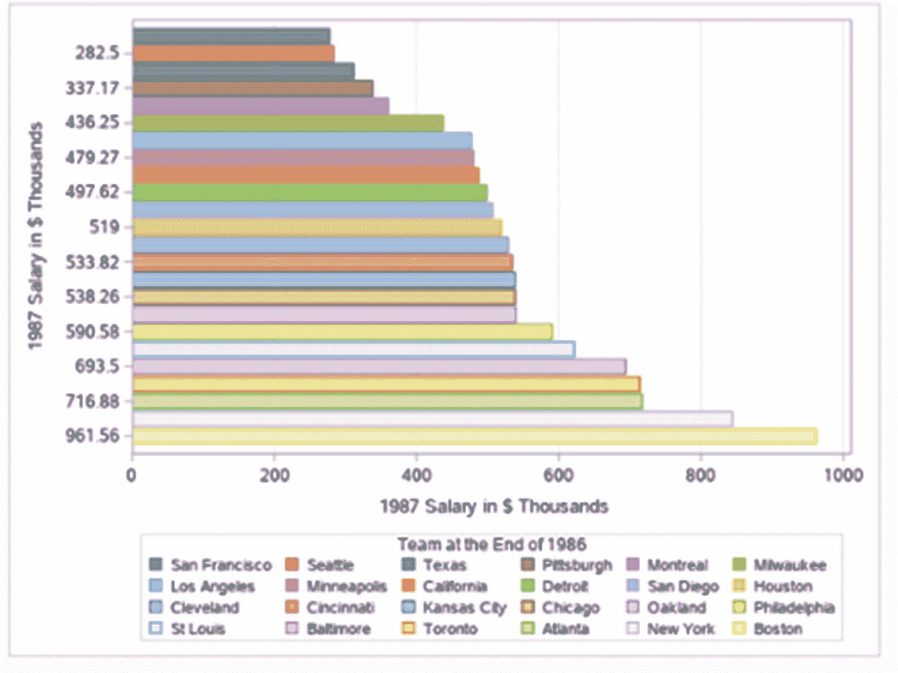

升序排序的条形图。要反转输出，请在 `Appearance` 选项卡中的 `Category Axis` 中勾选 `Reverse tick values`，如图 3-30 所示。

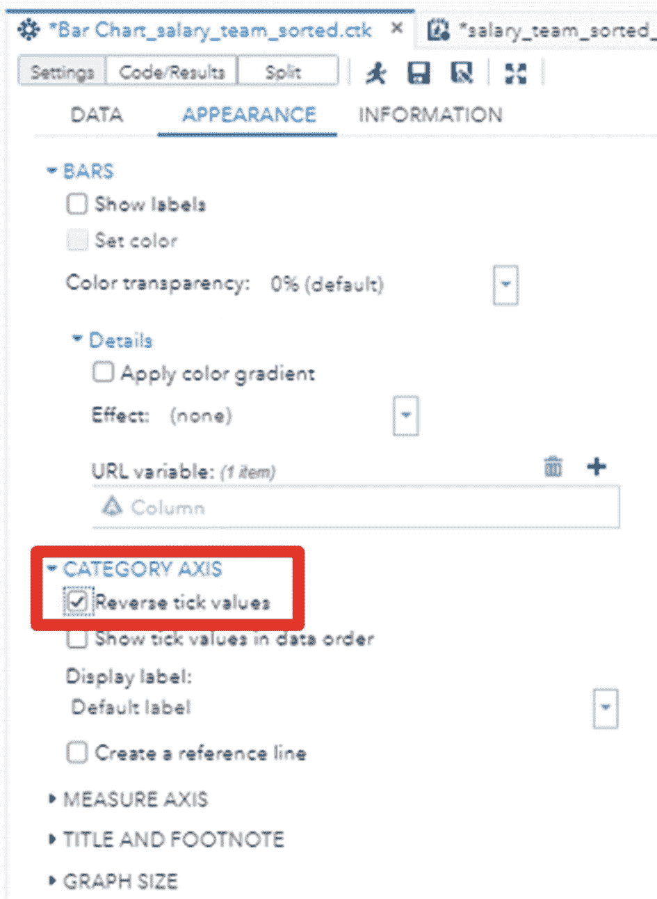

勾选“Reverse Tick Values”。重新运行条形图。输出结果类似于图 3-31。

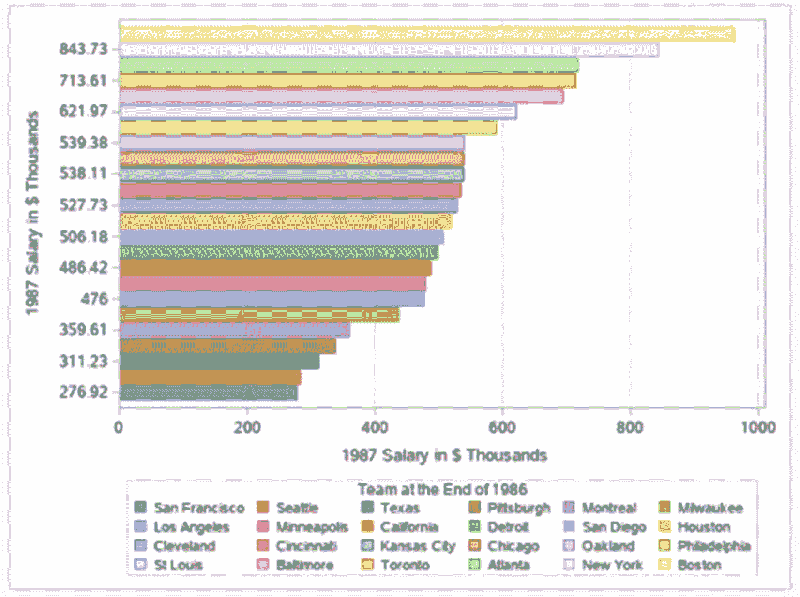

降序条形图。最后，1987 年平均薪资最高的球队是波士顿队，平均薪资最低的是旧金山队。

### 使用条形图创建直方图

条形图也可用于创建直方图。在此示例中，您将学习如何创建一张关于 2012 年缅因州总统候选人及其得票率的图表，该图表先前在第一章的图 1-9 中提及过。缅因州的结果如表 3-2 所示。

**表 3-2** 2012 年缅因州候选人及其得票率结果

```
| 候选人   | 得票率 |
```


### 条形图与直方图

| --- | --- |
| 奥巴马 | 56.27 |
| 罗姆尼 | 40.98 |
| 约翰逊 | 1.31 |
| 斯泰因 | 1.14 |
| 保罗 | 0.29 |
| 安德森 | 0.01 |
| 里德 | 0 |

您将在`Dataset`文件夹中找到为呈现这些百分比而创建的数据集；文件名为`Maine_Candidates and their winning percentages in 2012.csv`。

将 CSV 文件复制到您的`myfolders`文件夹中。从 SAS Studio 中，点击`Refresh`，然后按照第二章中的说明导入它。将数据集的名称从`IMPORT`更改为`CANDIDATES2012`，如图 3-32 所示。点击`Run`。

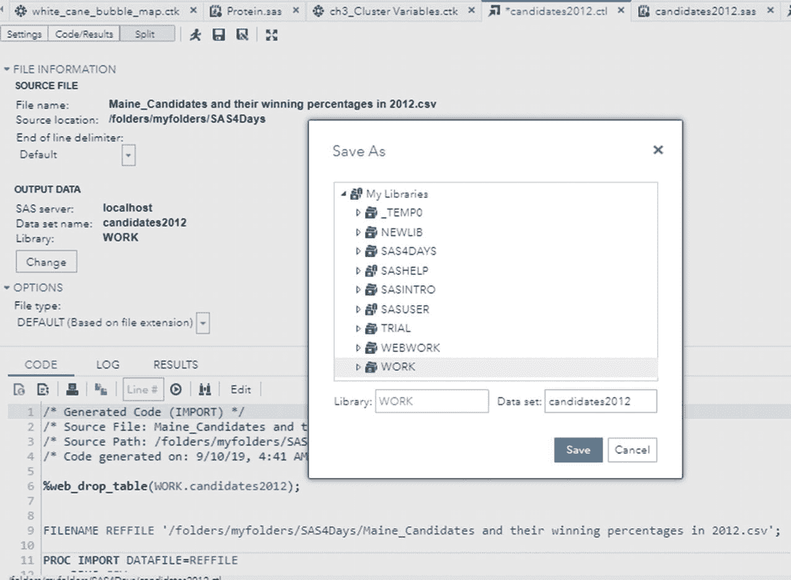

**图 3-32** 导入数据集

要使用条形图创建直方图，请点击 Tasks and Utilities ➤ Tasks ➤ Graph ➤ Bar Chart。如图 3-33 所示，在 Data 部分，选择`WORK`库和`CANDIDATES2012`表。在 Roles ➤ Category 中，选择列`x`。然后运行程序。

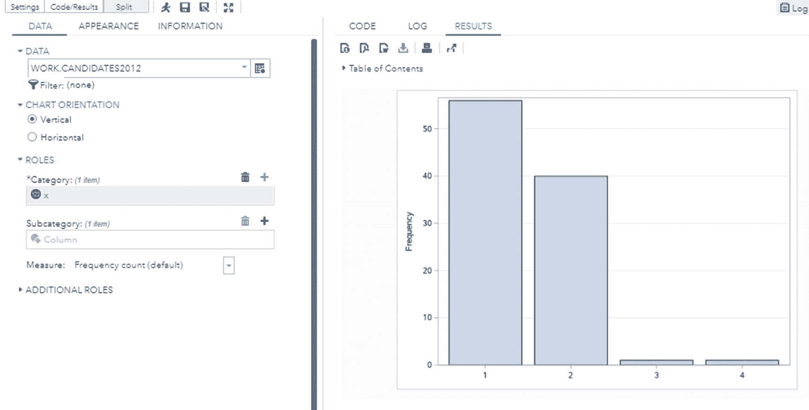

**图 3-33** 使用条形图生成的初始直方图

现在，我们需要执行三项任务来完善图表：
*   用对应的政党颜色为条形着色。
*   修改脚注以附加候选人姓名。
*   移除 x 轴标签。

要完成这三项任务，我们需要编辑代码，而不是通过图形界面进行操作。在 Code 选项卡中，点击`Edit`。代码将在新的程序窗口中打开。按照代码清单 3-2 编辑代码，或者直接复制粘贴本书源代码中的该代码清单。

```
ods graphics / reset width=6.4in height=4.8in imagemap ;
proc sgplot data=  WORK.CANDIDATES2012 noautolegend;
footnote2 "候选人：1:奥巴马 2:罗姆尼 3:约翰逊, 4:斯泰因 5:保罗 6:安德森 7:里德";
vbar x / colorresponse=x colorstat=mean colormodel=(blue red silver green) ;
xaxis display=(nolabel);
yaxis grid;
run;
ods graphics / reset;
footnote2;
```

**代码清单 3-3** 使用政党颜色绘制的直方图

运行代码。输出结果将如图 3-34 所示。

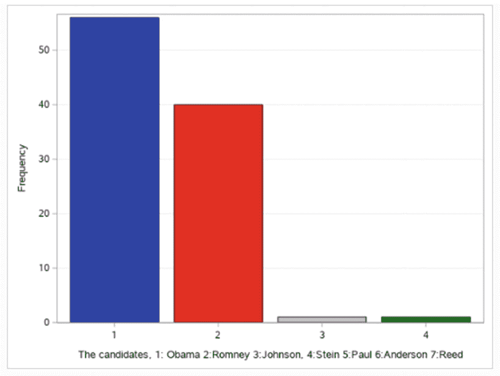

**图 3-34** 具有对应政党颜色的条形图

请随意修改代码进行尝试。例如，删除代码第二行的`noautolegend`，重新运行并观察图表的更改；或者移除 X 轴选项中的`display=(nolabel)`，亦或修改`colormodel`选项中的颜色。

有关条形图选项的更多示例和说明，请查看以下链接：
1.  SAS 文档——在 OVERLAY 布局中管理坐标轴：[`https://documentation.sas.com/?docsetId=grstatug&docsetTarget=p1pqfzgbuzbpkzn1mrbzhgggvhkz.htm&docsetVersion=9.4&locale=en#p18of8gjhjfti1n15y1w0iqtp4nr`](https://documentation.sas.com/%253FdocsetId%253Dgrstatug%2526docsetTarget%253Dp1pqfzgbuzbpkzn1mrbzhgggvhkz.htm%2526docsetVersion%253D9.4%2526locale%253Den%2523p18of8gjhjfti1n15y1w0iqtp4nr)
2. SAS 博客——响应颜色与厚度：[`https://blogs.sas.com/content/graphicallyspeaking/2015/09/21/response-colors-and-thickness/`](https://blogs.sas.com/content/graphicallyspeaking/2015/09/21/response-colors-and-thickness/)
3. Data Flair——SAS 中的条形图类型：[`https://data-flair.training/blogs/sas-bar-chart/`](https://data-flair.training/blogs/sas-bar-chart/)

### 气泡图

散点图适用于展示两个变量之间的关系。若要展示三个变量之间的关系，则需使用气泡图。在本示例中，我们将创建一个气泡图来显示某班级学生的身高、体重和年龄。

点击 `Tasks and Utilities` ➤ `Tasks` ➤ `Graph` ➤ `Bubble Chart`。在`Data`中，选择`SASHELP.CLASS`库。接着在`Roles`中，为图形的 X 轴选择`Height`；为 Y 轴选择`Weight`；为气泡大小选择`Age`，如图 3-35 所示。

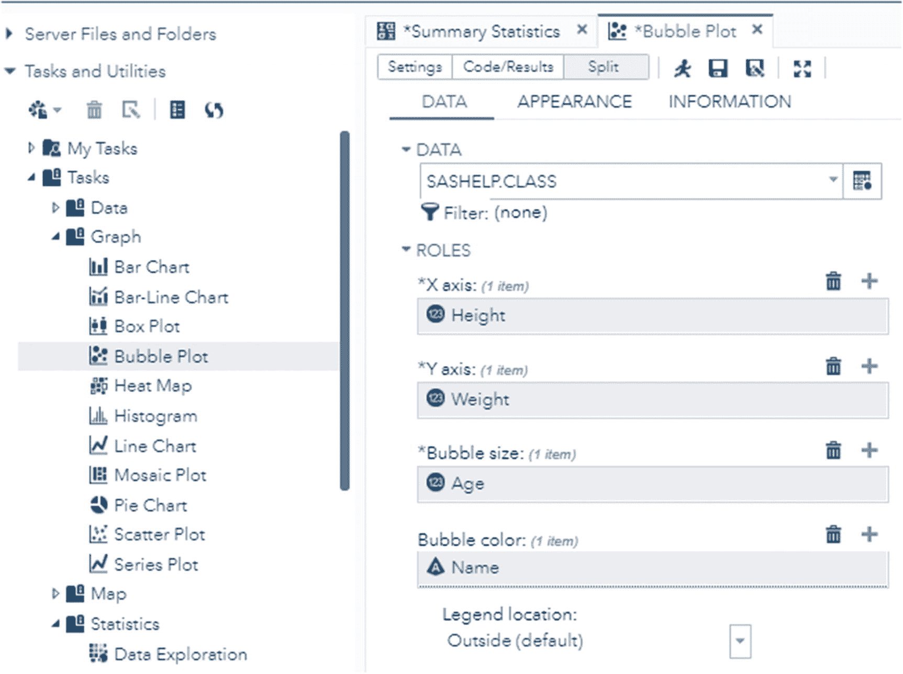

**图 3-35** 气泡图

点击 `Run`。初始输出的图形将如图 3-36 所示。

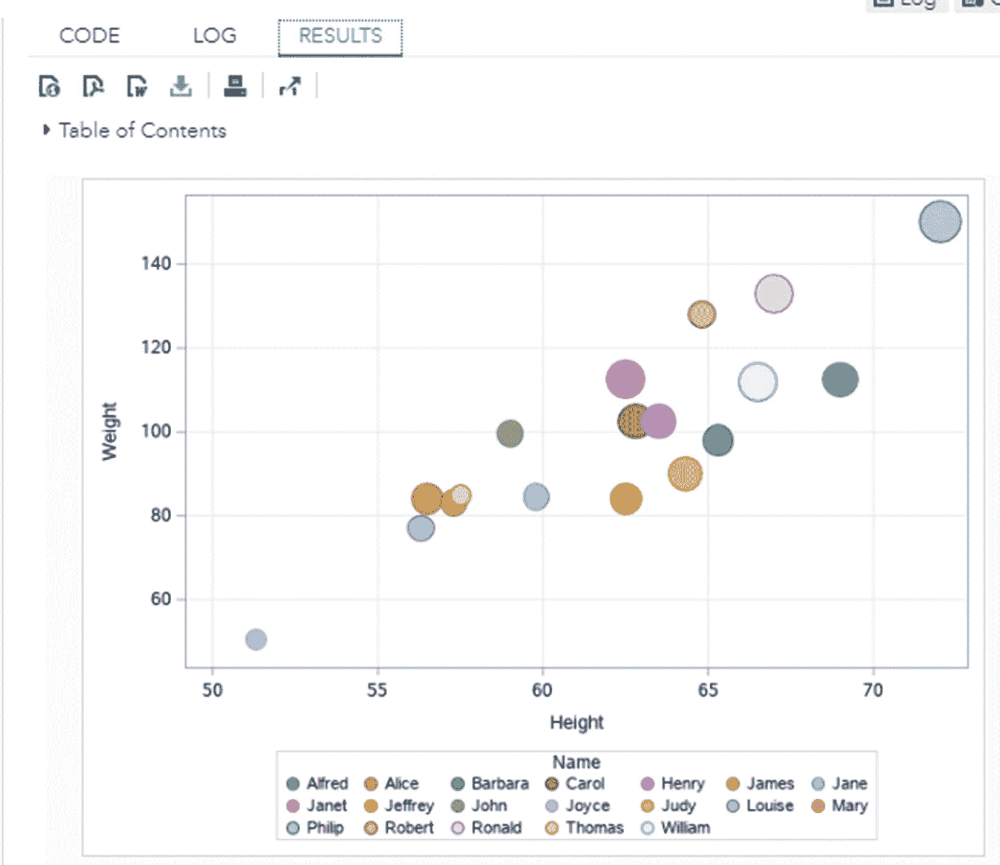

**图 3-36** 初始输出图表

现在，让我们美化一下外观。点击 `Appearance` 选项卡。如图 3-37 所示，在 `Bubble Labels` 中，为 `Bubble Label` 选择 `Name`。同样如图 3-37 所示，点击 `Title and Footnote`，在标题栏输入“Age by Height and Weight”，在脚注栏输入“Bubble size represents age”。

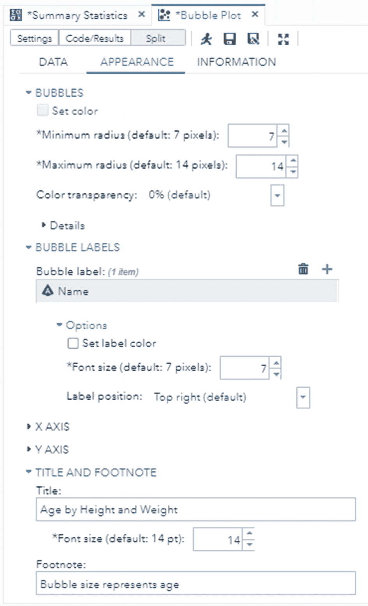

**图 3-37** 添加气泡标签

重新运行程序。输出结果将如图 3-38 所示。

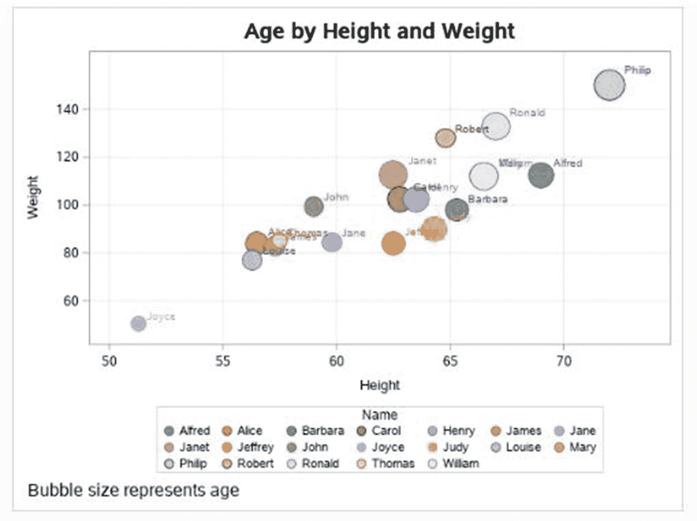

**图 3-38** 带有气泡标签的图表

图表应简洁明了，不应包含任何重复数据。图 3-38 中的图表将学生姓名重复显示了两次：一次作为气泡标签，另一次显示在图表底部的图例中。要修正此问题，我们需要编辑代码。如图 3-39 所示，点击 `Edit`。

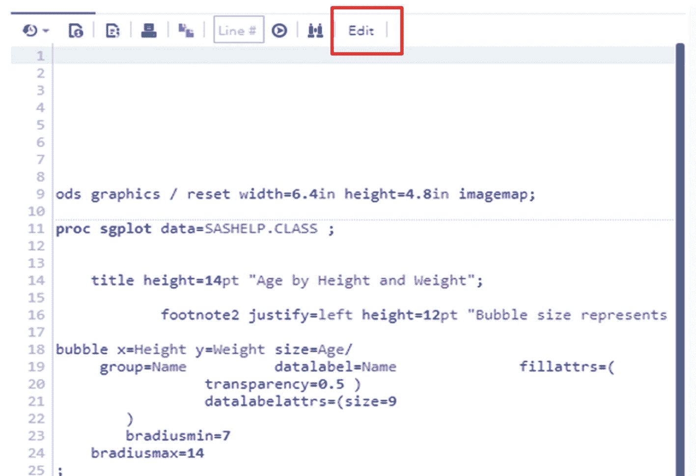

**图 3-39** 点击编辑

如图 3-40 所示，通过向 `sgplot` 函数添加 `noautolegend` 选项来编辑代码，以移除图形下方自动生成的图例。为了美化脚注的外观，我们将其位置调整到图形内部，并缩进到右下角，以避免与任何结果重叠。为此，请添加以下代码行：

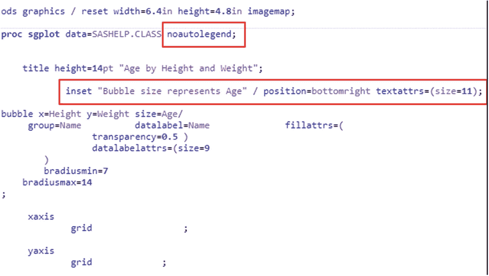

**图 3-40** 编辑代码

```
inset"Bubble size represents Age" / position=bottomright textattrs=(size=11);
```

现在，重新运行代码。输出结果得到优化，如图 3-41 所示。

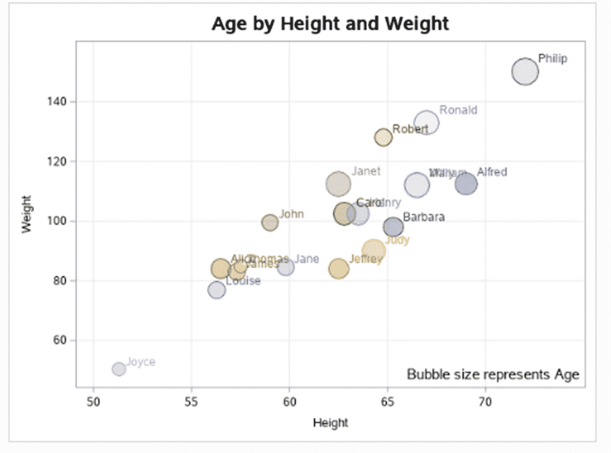

**图 3-41** 气泡图的最终版本

从该图中，我们可以看到 Joyce 是班上最轻、最矮的学生。同时，她也是班上两名最年轻的学生之一。Joyce 和 Thomas 的气泡最小。如果通过点击 `Libraries` ➤ `SASHELP` ➤ `CLASS` 返回表格，并点击 `Age` 列对年龄数据进行排序，你会发现他们俩都是十一岁。另一方面，Philip 是班上最高、最重且年龄最大的学生。他是唯一一个十六岁的学生，班上其他人都比他年轻。这就是为什么他的气泡是最大的。Joyce 和 Philip 可以被视为异常值。然而，这个班只有十九名学生，样本量非常小。样本量越大，分析效果越好。