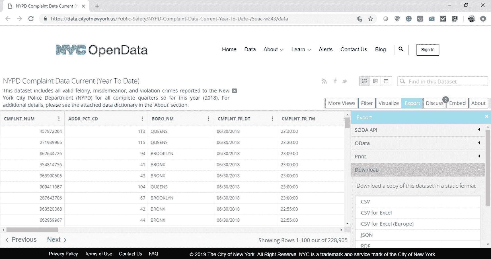
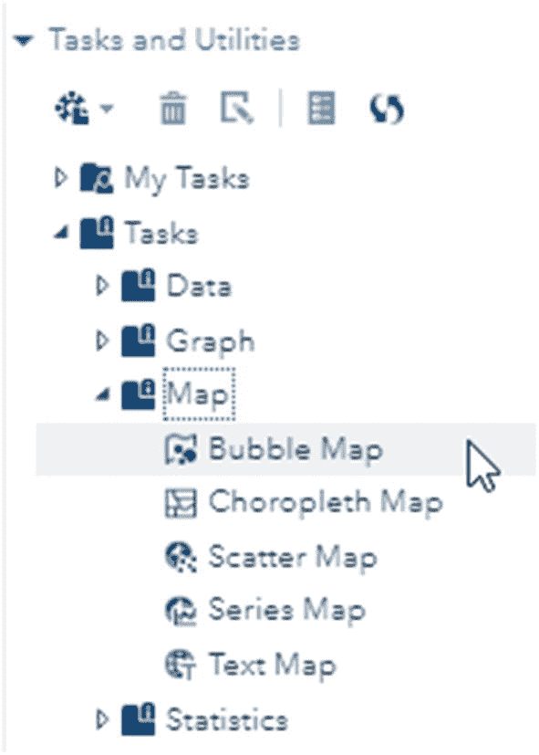
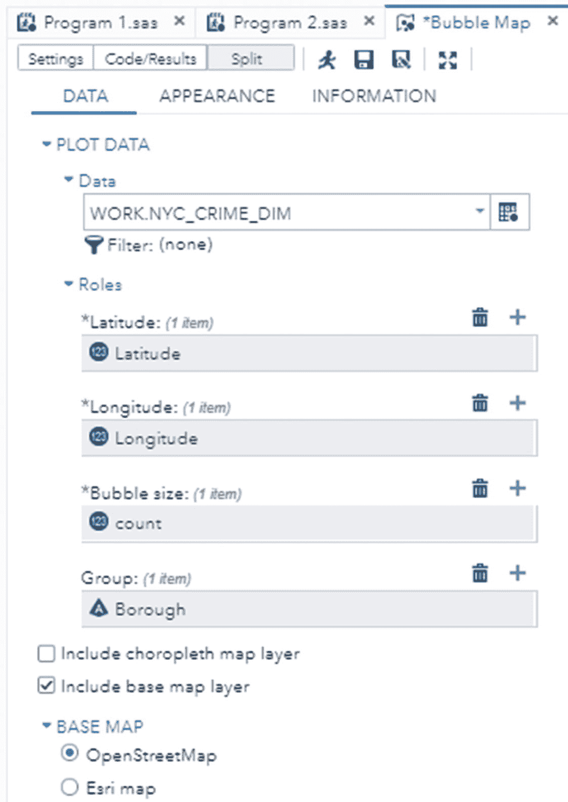
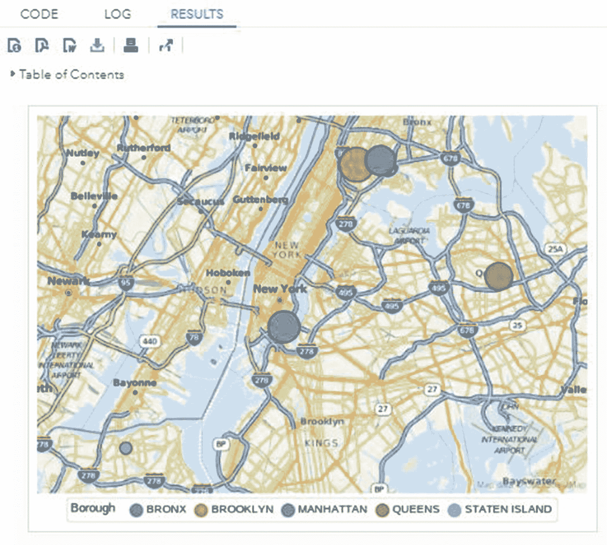
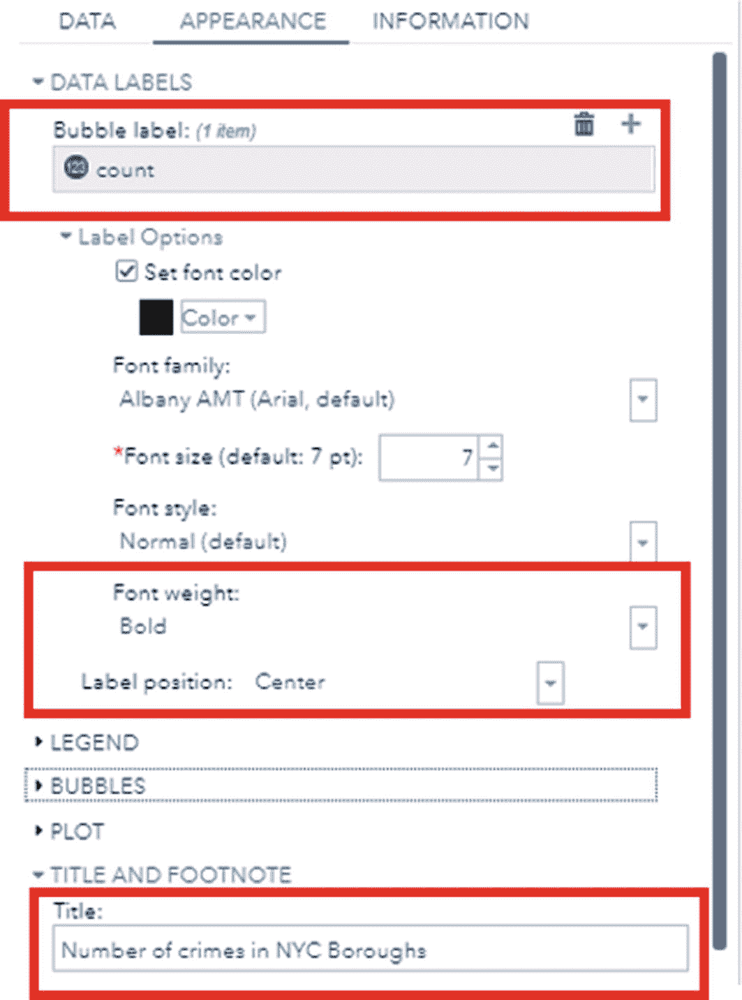
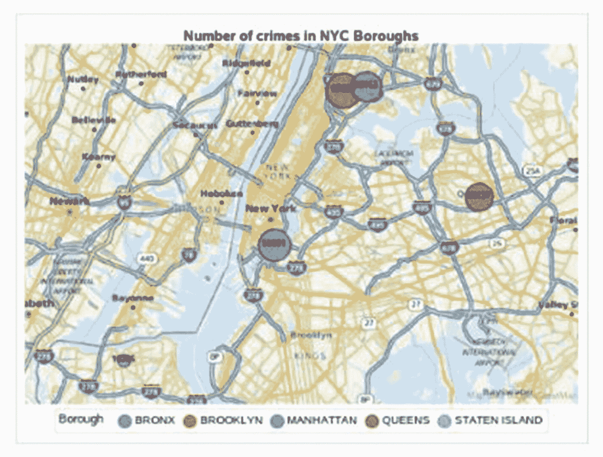
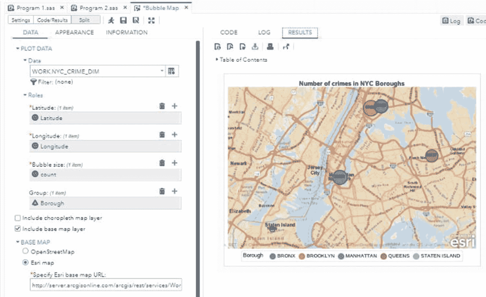
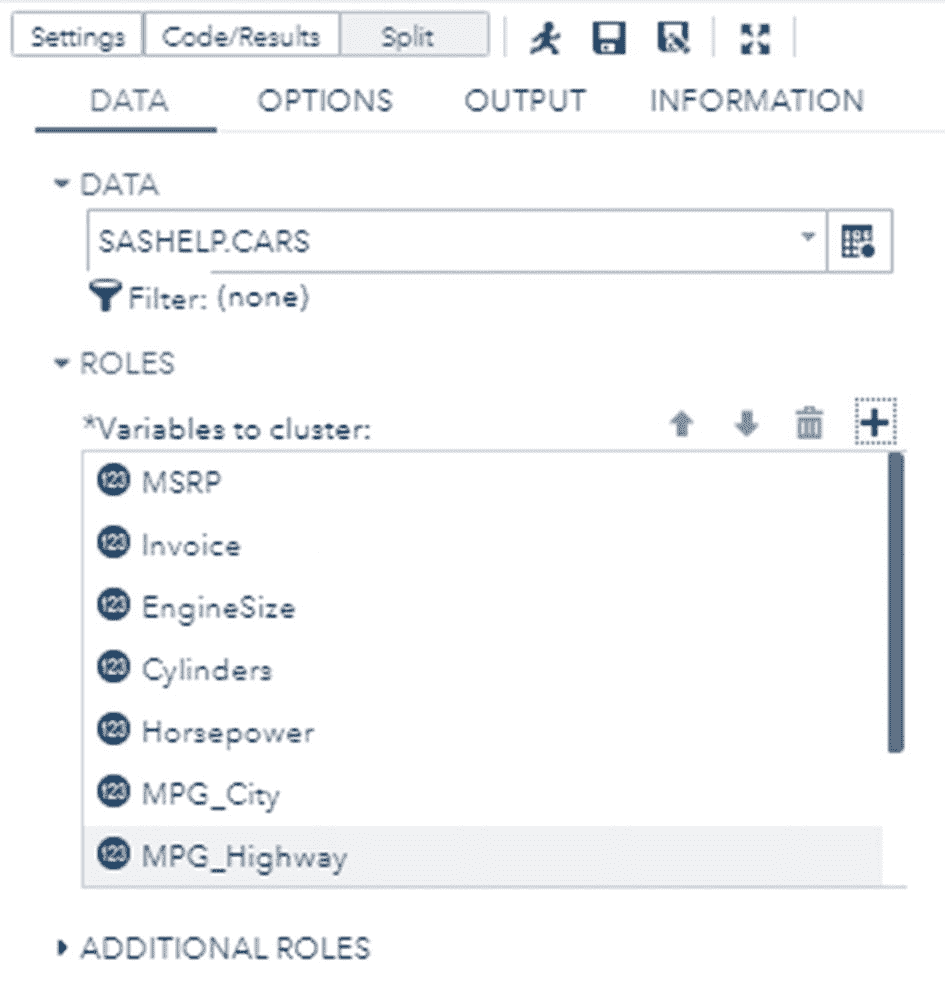
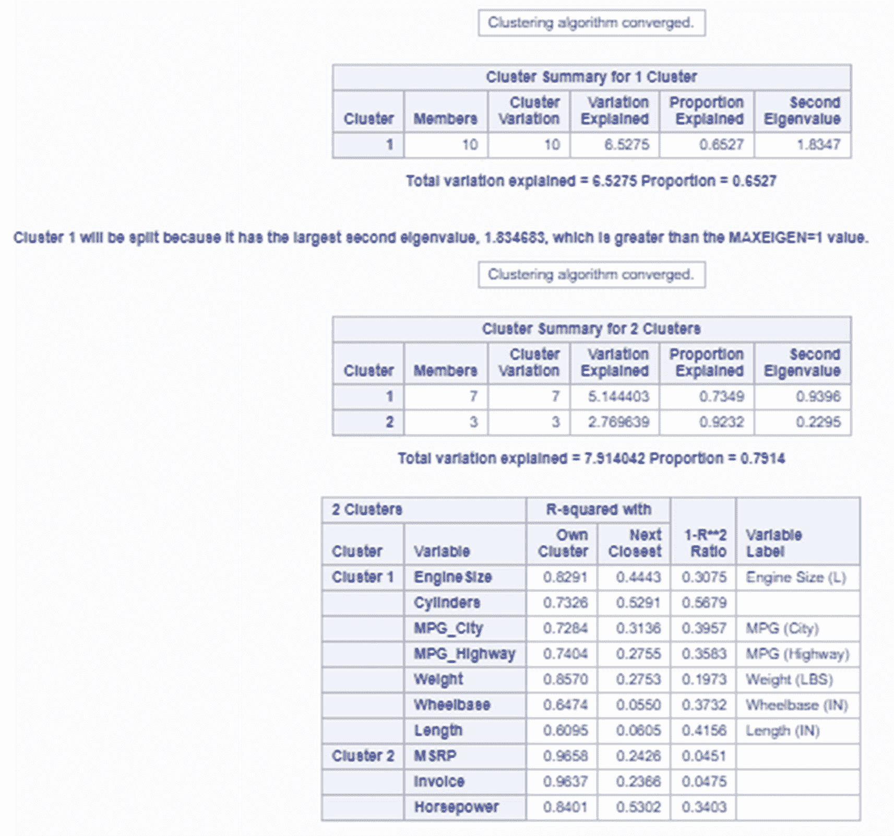
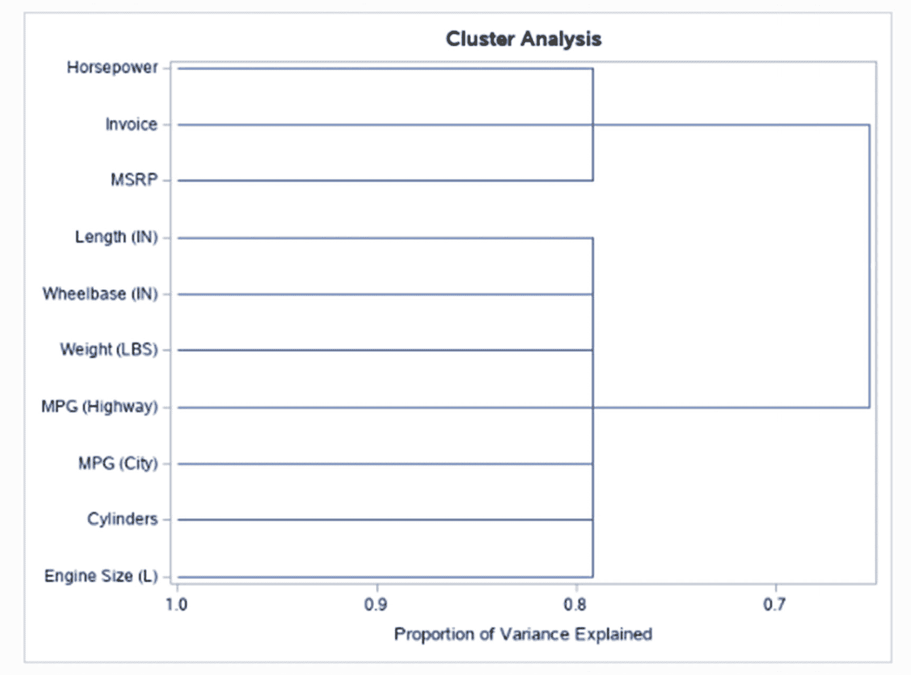

# 地图

在地图上显示数据能提供新的视角。它本身就能讲述一个完整的故事。SAS Studio 使在地图上显示数据变得容易。此外，使用颜色和气泡自定义地图为你的数据增添了新的维度。本节将使用真实数据引导你完成整个过程。它将逐步向你展示如何下载数据并将其准备好以显示在地图上。

## 气泡图

气泡图任务会创建一张叠加了气泡图的底图。在此示例中，我们将使用纽约市的犯罪数据来创建一张气泡图，展示 2018 年纽约市不同行政区的犯罪率。该数据可通过纽约市开放数据项目网站获取。

你可以在 `Datasets` 文件夹中找到数据文件，文件名为 `NYPD_Complaint_Data_Current__Year_To_Date.csv`。或者，你也可以从这个网址下载数据集：[`https://data.cityofnewyork.us/Public-Safety/NYPD-Complaint-Data-Current-Year-To-Date-/5uac-w243/data`](https://data.cityofnewyork.us/Public-Safety/NYPD-Complaint-Data-Current-Year-To-Date-/5uac-w243/data)

要从该链接下载数据集，如图 3-42 所示，请点击“导出”，然后选择“CSV”。



图 3-42 – 纽约警察局投诉数据——纽约市开放数据

该数据集包含海量信息。我们可以利用这些数据进行大量的调查和分析。例如，每个行政区最常见的犯罪类型是什么？犯罪最可能发生在什么时间段？一周中的哪一天犯罪率最高？

对于本例，我们只关心回答一个问题：哪个行政区的犯罪率最高，哪个最低？

要回答这个问题，我们需要以下三列：`Borough`（行政区）、`Longitude`（经度）和 `Latitude`（纬度）。因此，我们删除所有其他列。然后，我们统计每个行政区的犯罪数量，以便在地图上用气泡表示。

在数据清洗和准备完成后，我们得到了表 3-3 所示的数据集。

表 3-3 – 各行政区犯罪数量

| 行政区 | 犯罪数量 | 纬度 | 经度 |
| --- | --- | --- | --- |
| 布朗克斯 | 50153 | 40.82452 | -73.8978 |
| 布鲁克林 | 67489 | 40.82166 | -73.9189 |
| 曼哈顿 | 56691 | 40.71332 | -73.9829 |
| 皇后区 | 44137 | 40.74701 | -73.7936 |
| 史泰登岛 | 10285 | 40.63204 | -74.1222 |

为了加载数据，我们在 SAS Studio 中编写了代码清单 3-4。你可以从 `Example Code` 文件夹加载 `Listing 3-4.sas`。点击运行。

```
data NYC_crime;
input Borough $13.;
datalines;
BRONX
BROOKLYN
MANHATTAN
QUEENS
STATEN ISLAND
;
run;
data NYC_crime_dim;
set nyc_crime;
input count Latitude Longitude;
datalines;
50153 40.82451851 -73.897849
67489 40.82166423 -73.91885603
56691 40.71332365 -73.98288902
44137 40.74701026 -73.79358825
10285 40.63203653 -74.1222402
;
run;
```

代码清单 3-4 – 创建各行政区犯罪数量的数据集

在此程序中，我们并未导入原始数据文件。我们使用数据步中的 `DATALINES` 关键字将表格的值直接插入到代码中。在代码清单 3-4 中，我们有两个数据步。第一个数据步名为 `NYC_crime`。第二行使用 `INPUT` 语句指定列的名称和类型。在此表中，我们只定义了一列作为行政区名称，其类型为字符型，因为我们使用了 `$`。最大字符数为 13。然后，我们使用 `DATALINES` 语句插入实际值，并以分号结束。

第二个数据步创建另一个名为 `NYC_crime_dim` 的表，用于插入行政区的尺寸数据和每个行政区的犯罪数量。该表通过 `SET` 语句从前一个表 `nyc_crime` 初始化。同样，我们使用 `INPUT` 语句来指定我们将为行政区添加三列。我们添加了 `count`、`latitude` 和 `longitude` 列。记住列名之间要留一个空格，不要使用逗号。再次使用 `DATALINES` 插入实际值，并以分号结束。

运行代码清单 3-4 后，将在 `Work` 库中创建两个新表，名为 `NYC_crime` 和 `NYC_crime_dim`。要检查输出表，请点击 `Libraries` ➤ `Work`；在其下，你会找到 `NYC_crime` 和 `NYC_crime_dim`。如果没有，请按照我们在第 2 章中介绍的方法刷新你的库。

现在，点击 `Tasks and Utilities` ➤ `Tasks` ➤ `Map` ➤ `Bubble Map`，如图 3-43 所示。



图 3-43 – 创建气泡图

如图 3-44 所示，在数据字段中选择数据集 `WORK.NYC_CRIME_DIM`。在角色中，选择 `Latitude` 和 `Longitude`。在气泡大小中，选择 `count`，即犯罪数量。最后，在分组中，选择 `Borough` 列。



图 3-44 – 各行政区犯罪数量

对于底图，选择 `OpenStreetMap`。在本章后面，我们将尝试 Esri 地图，以查看输出结果的差异。保留其余默认设置，然后点击运行。将显示图 3-45 所示的气泡图。



图 3-45 – 各行政区犯罪数量

从气泡大小可以清楚地看出，布鲁克林的犯罪率最高，而史泰登岛的犯罪率最低。SAS Studio 会自动调整气泡的位置、大小和颜色。此外，它还会在地图底部为行政区的颜色代码添加图例。

现在，让我们增强气泡图的外观。我们可以为气泡添加犯罪数量的标签，并为地图添加标题。如图 3-46 所示，在“外观”选项卡的“数据标签”中，对于“气泡标签”，从数据集中选择 `count` 列。然后，在“标签选项”中，对于“字体粗细”，选择“粗体”。在“标签位置”中，选择“居中”。最后，在“标题和脚注”中，为“标题”输入“纽约市行政区的犯罪数量”。



图 3-46 – 增强外观

点击运行以查看新的更改。输出结果将如图 3-47 所示。



图 3-47 – 纽约市行政区的犯罪数量

代码清单 3-5 显示了 SAS Studio 通过用户界面根据我们的选项自动生成的代码。

```
ods graphics / reset width=6.4in height=4.8in;
proc sgmap plotdata=WORK.NYC_CRIME_DIM;
openstreetmap;
title 'Number of crimes in NYC Boroughs';
bubble x=Longitude y=Latitude size=count/    group=Borough datalabel=count
datalabelpos=center
datalabelattrs = (color=CX0f0e0e  size=7pt  weight=bold)
name="bubblePlot";
keylegend "bubblePlot" / title =  'Borough' ;
run;
ods graphics / reset;
title;
```

代码清单 3-5 – 创建各行政区犯罪数量的数据集

SAS Studio 的强大之处在于它提供了两种类型的底图：`OpenStreetMap` 和 `Esri` 地图。现在，让我们尝试另一种底图类型。如图 3-48 所示，返回“`数据`”选项卡，选择 `Esri` 地图，然后点击运行。输出的地图将如图 3-48 所示。



对于此 `Esri` 地图选项，SAS Studio 将生成代码清单 3-6 中的代码。

```
ods graphics / reset width=6.4in height=4.8in;
proc sgmap plotdata=WORK.NYC_CRIME_DIM;
esrimap url= 'http://server.arcgisonline.com/arcgis/rest/services/World_Street_Map/MapServer';
title '纽约市各区犯罪数量';
bubble x=Longitude y=Latitude size=count / group=Borough
datalabel=count datalabelpos=center
datalabelattrs=(color=CX0f0e0e size=7pt weight=bold)
name="bubblePlot";
keylegend "bubblePlot" / title ='行政区';
run;
ods graphics / reset;
title;
```

`清单 3-6` 使用 `Esri` 地图生成地图

## 聚类分析

聚类分析是一种无监督学习算法。监督学习用于预测，具有特定的输出/因变量，而无监督学习则用于数据探索。

聚类在市场细分、基因和癌症研究中很受欢迎。例如，在在线商店中，你通常会发现自己正在查看的产品经常与其他列出的产品一起被购买。另一个例子是它在基因研究中的应用，用于发现基因之间的相似性。

执行聚类分析最流行的方法是主成分分析、`K` 均值和层次分析。

在 SAS Studio 中，你可以轻松完成所有这些操作。在本例中，你将学习如何进行层次分析。这主要包含两个步骤：上传干净的数据集，并将所有变量添加到聚类中，然后 SAS Studio 会为你处理其余部分。

点击 `Tasks and Utilities` ➤ `Tasks` ➤ `Cluster Analysis` ➤ `Cluster Variables`。`Cluster Variables` 任务的用户界面会打开。如图 3-49 所示，在 `Data` 选项卡上，选择 `SASHELP.CARS` 数据集。最后，在 `Variables to cluster` 部分选择你想要的所有变量。然后，点击 `Run`。



层次聚类有两种类型：凝聚型（自下而上）和分裂型（自上而下）。

凝聚算法将每个点视为一个聚类，然后重复合并两个最近的聚类。分裂型从一个聚类开始，然后递归地将其拆分成更多分支。

SAS Studio 使用分裂方法。输出结果清晰地解释了树的结构，以及每个分支如何被细分为更多分支。在本例中，如图 3-50 所示的输出结果显示，聚类被分成两个分支，在第二层级，每个分支又被分成更多分支。



此外，SAS Studio 还会生成树状图，如图 3-51 所示。要按聚类形成的顺序来解读树状图，请从右向左阅读。



然而，要了解相似性，请从左向右阅读树状图。`马力`、`发票价格`和`厂商建议零售价`的聚类最相似，因为它的分支最短。同样，`长度`、`轴距`、`重量`、`MPG (高速公路)`、`MPG (城市)`、`气缸数`和`发动机排量`的聚类也具有相似性，并且其分支长度与前一聚类相同。第一个聚类具有最长分支。

## 本章小结

本章深入研究了数据可视化。从最基础的图表（如散点图和直方图）开始，然后深入到更高级的图表（如地图）。此外，还展示了如何通过改变颜色和图案来叠加图表，以便于比较分析结果。SAS Studio 中的数据可视化是其最强大的功能之一，因为许多图表都可以通过集成开发环境完成，而无需编写任何代码。

本章最后解释了数据科学中的一些关键概念，即监督学习和无监督学习。同时，也讨论了如何进行聚类分析。在下一章中，我们将阐述最重要的统计任务和线性模型。