# 4. 统计分析与线性模型

在第 3 章中，我们探索了图形和地图任务。在本章中，我们将探讨统计和线性模型。

## 统计分析

在`Tasks` ➤ `Statistics`选项卡中，你会发现一些应包含在报告中的统计任务。在本章中，我们将讨论`单变量频率`、`汇总统计`、`相关分析`和`T 检验`。

### 单变量频率

`单变量频率`任务通常是探索任何数据集时的第一步。它会根据你的数据生成频率表，显示每个变量的唯一水平。你还可以使用此任务执行二项检验和卡方检验。你也可以使用此任务来识别异常值。

在此示例中，我们探索`SASHELP.HEART`数据集，以查看有多少人胆固醇水平偏高。点击`Tasks and Utilities` ➤ `Tasks` ➤ `Statistics` ➤ `One-Way Frequencies`。在`Data`中，选择`SASHELP.HEART`，在`Analysis Variables`中，选择`CHOL_STATUS`，如图 4-1 所示。

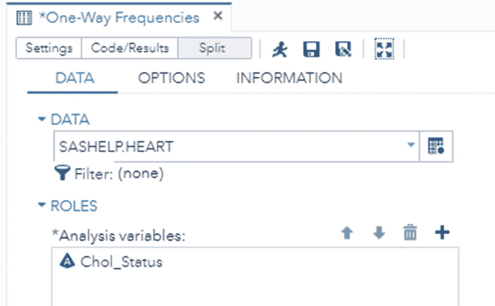
图 4-1 选择数据集和分析变量

在`Options`选项卡中，选择`Frequencies and Percentages`，然后勾选“Frequency table”和“Include percentages”，并在`Row value order`中选择`Descending frequency`，如图 4-2 所示。

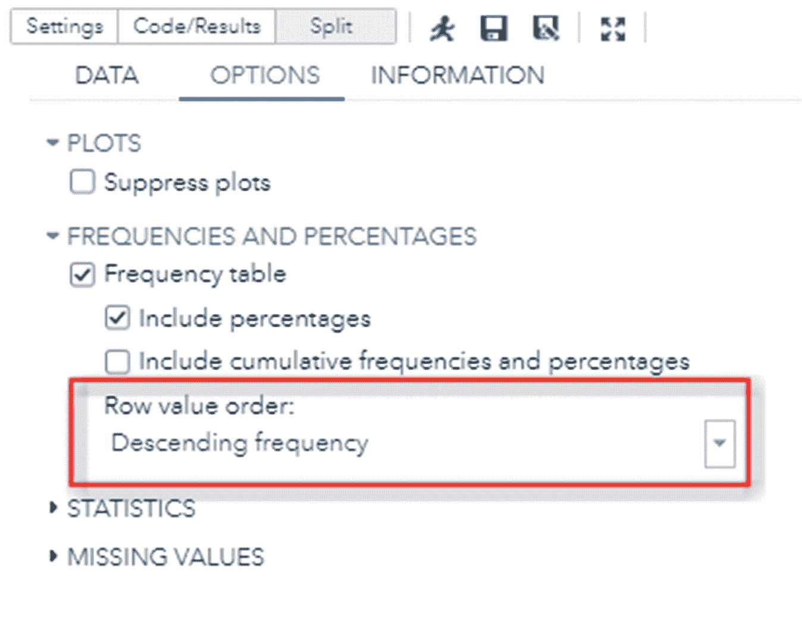
图 4-2 更改选项

然后，点击`Run`。输出结果是一个频率表，如图 4-3 所示，以及一个图表，如图 4-4 所示。

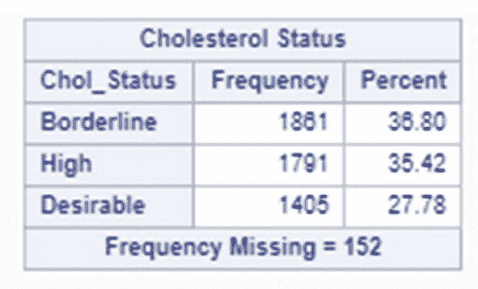
图 4-3 频率表

图 4-3 中的表格显示`Chol_Status`只有三个唯一水平：`边缘升高`、`高`和`理想`。它显示了每个水平的频率及其在数据集中的出现百分比。

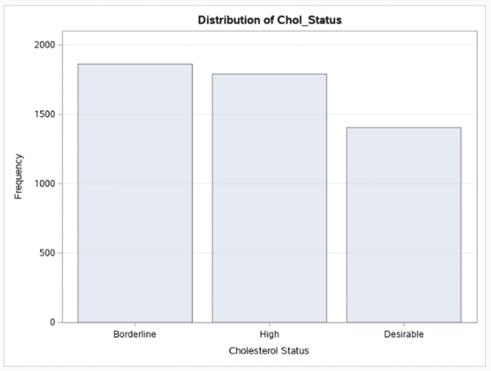
图 4-4 `Chol_Status` 的分布

图 4-4 以降序显示了`Chol_Status`的分布，其中`边缘升高`在该数据集中占比最高，其次是`高`，频率最低的是`理想`。

### 汇总统计

汇总统计任务可对所有观测值及观测值组内的变量提供描述性统计。您还可以通过直方图或箱线图等图形化显示来汇总数据。

在本示例中，我们回顾缅因州过去的选举情况，以探寻是否存在可预测的结果（模式）。数据集位于`Dataset`文件夹中，文件名为`Maine_Past_Elections.xlsx`。从 SAS Studio 上传该文件，点击`Refresh`，然后按照第 2 章所述的方法导入。将数据集名称从`IMPORT`更改为`PAST_ELECTIONS`。Excel 文件的内容如表 4-1 所示。

表 4-1

`Maine_Past_Elections.xlsx`

| 年份 | 民主党 | % | 共和党 | % |
|---|---|---|---|---|
| 2016 | **357,735** | **47.80%** | 335,593 | 44.90% |
| 2012 | **401,306** | **56.27%** | 292,276 | 40.98% |
| 2008 | **421,923** | **57.71%** | 295,273 | 40.38% |
| 2004 | **396,842** | **53.57%** | 330,201 | 44.58% |
| 2000 | **319,951** | **49.10%** | 286,616 | 44.00% |
| 1996 | **312,788** | **51.60%** | 186,378 | 30.80% |
| 1992 | **263,420** | **38.80%** | 206,820 | 30.40% |
| 1988 | 243,569 | 43.90% | **307,131** | **55.30%** |
| 1984 | 214,515 | 38.80% | **336,500** | **60.80%** |
| 1980 | 220,974 | 42.30% | **238,522** | **45.60%** |
| 1976 | 232,279 | 48.07% | **236,320** | **48.91%** |
| 1972 | 160,584 | 38.50% | **256,458** | **61.50%** |
| 1968 | **217,312** | **55.30%** | 169,254 | 43.10% |
| 1964 | **62,264** | **68.84%** | 118,701 | 31.16% |
| 1960 | **181,159** | **42.95%** | 240,608 | 57.05% |

点击`Tasks and Utilities` ➤ `Tasks` ➤ `Statistics` ➤ `Summary Statistics`。在`Data`中，选择`WORK.PAST_ELECTIONS`表，在`Roles`中，选择`D`和`R`作为分析变量，如图 4-5 所示。

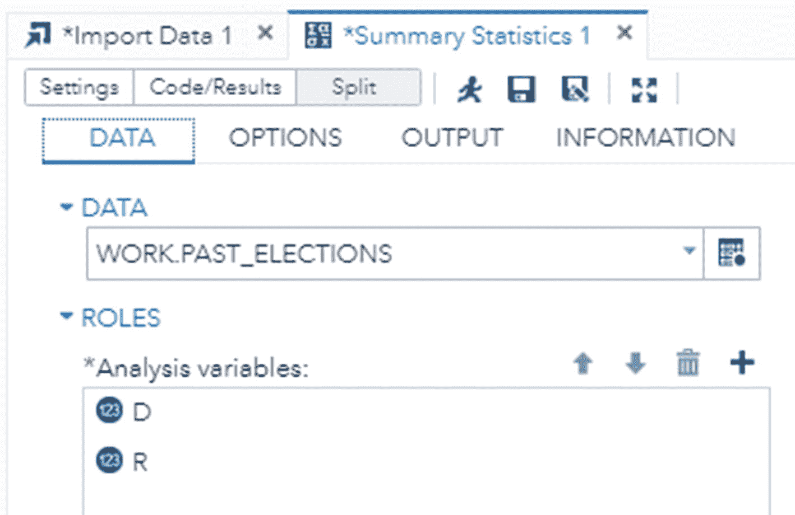
图 4-5 汇总统计的数据选项卡

点击`Run`。输出结果将如图 4-6 所示。

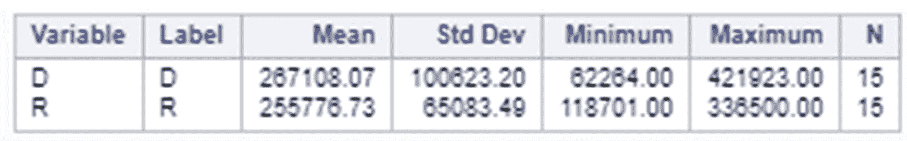
图 4-6 缅因州民主党和共和党的汇总统计

民主党和共和党的均值差异并不显著。因此，缅因州属于“倾向民主党”，因为民主党在 15 次选举中（从 1960 年到 2016 年）赢得了 7 次。自 1992 年以来，民主党一直在缅因州的选举中获胜。

### 相关分析

相关性是一种描述数值变量之间关系的统计方法。该关系通过计算变量间的相关系数来描述。相关系数的取值范围为 –1 到 1。相关分析任务提供了用于研究变量间关联的图表和统计量。

我们将检查几个示例。要执行此示例，请点击`Tasks and Utilities` ➤ `Tasks` ➤ `Statistics` ➤ `Correlation Analysis`。在`Data`中，从`SASHELP`库中选择数据集`CARS`。在`Analysis variables`中，选择`Weight`和`Length`。在`Correlate with`中，选择`Horsepower`，如图 4-7 所示。

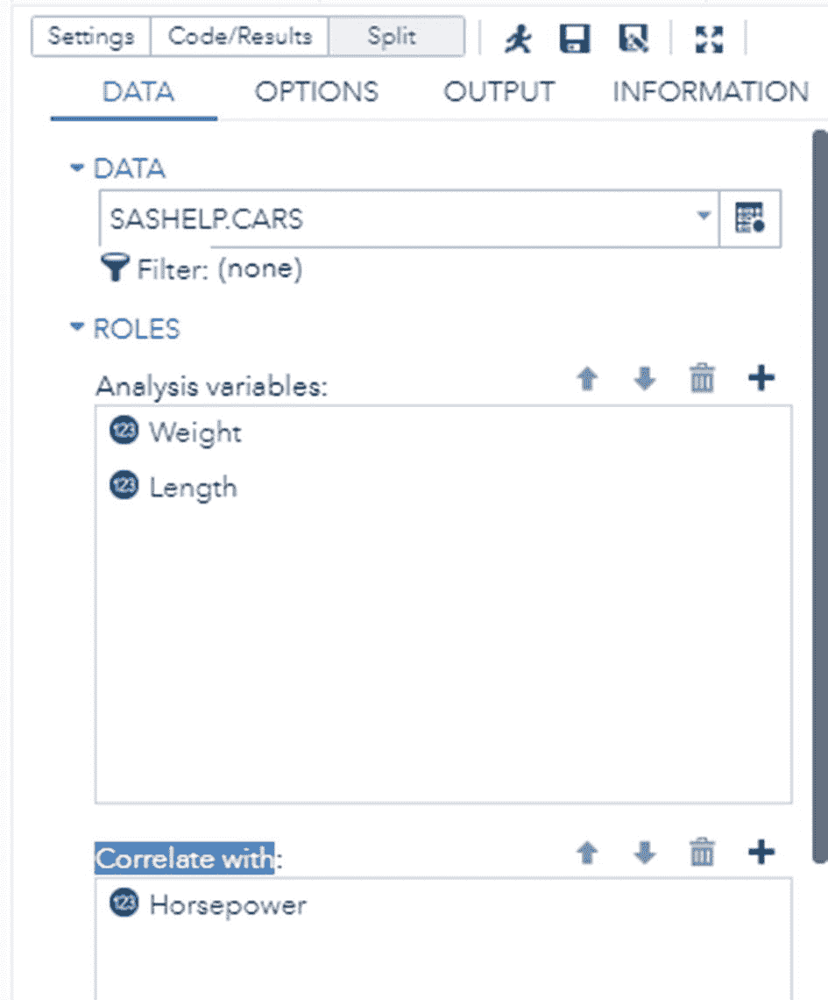
图 4-7 相关分析的数据选项卡

在`Options` ➤ `Plots`中，选择`Individual Scatter Plots`，如图 4-8 所示。

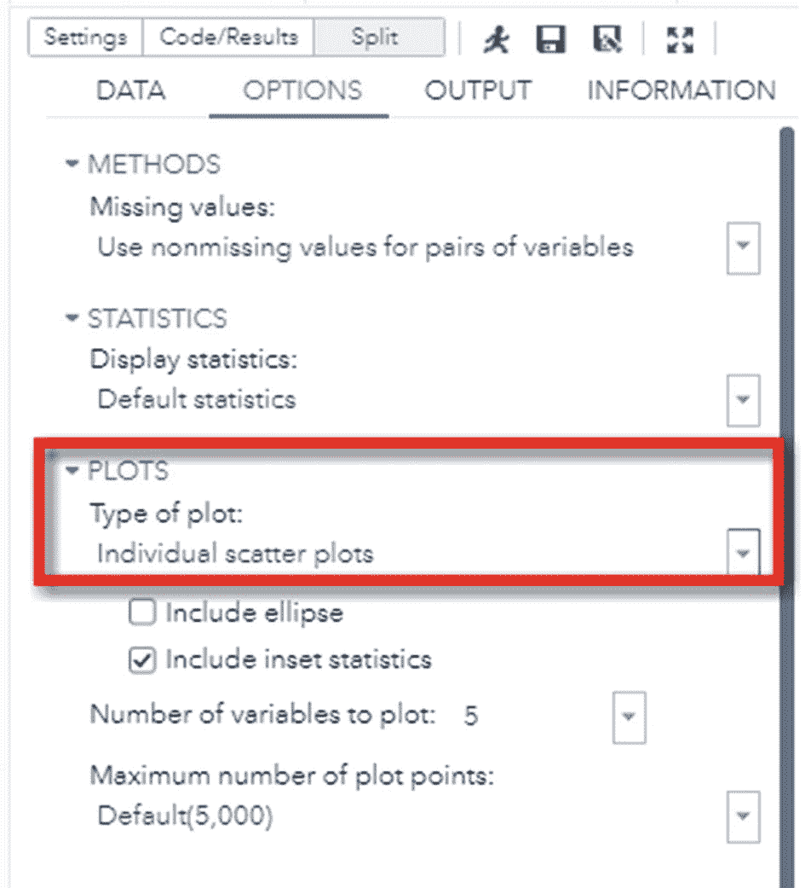
图 4-8 相关分析的选项选项卡

然后，点击`Run`。输出结果将如图 4-9 所示。

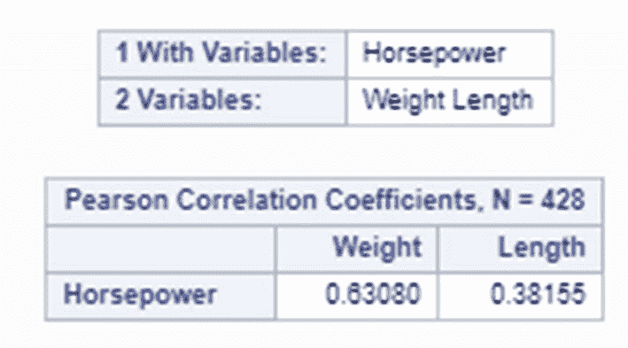
图 4-9 皮尔逊相关系数

输出结果显示，马力与重量的相关性高于与长度的相关性。同样，这些相关性在下面的图 4-10 和图 4-11 中得到了确认。

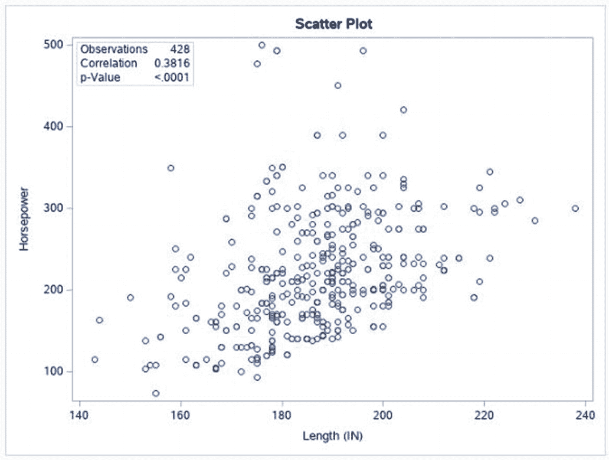
图 4-11 马力与长度之间的相关性

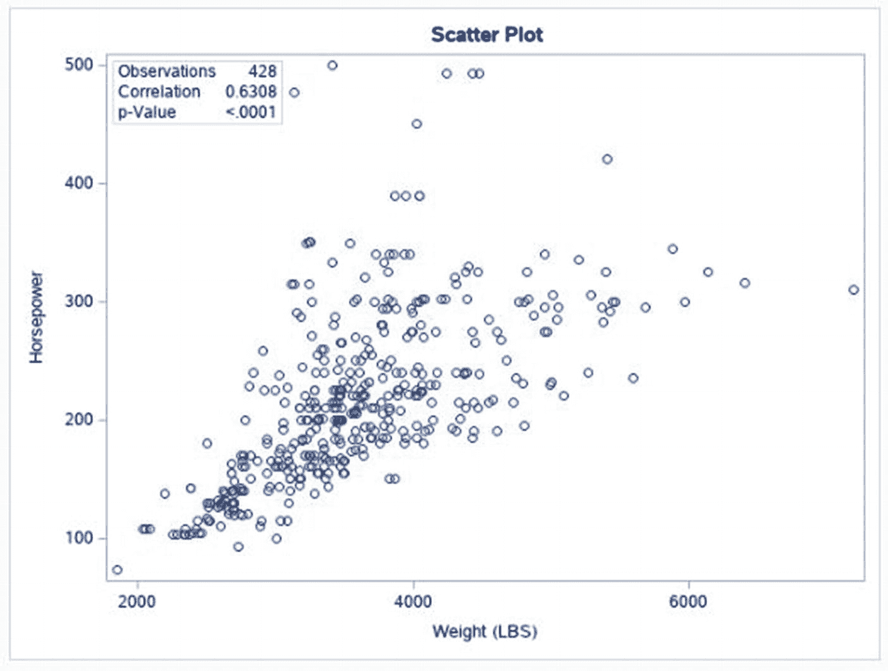

图 4-10 马力与重量之间的相关性

现在，让我们看看如何将相关性分析应用于缅因州的总统选举。问题是：国内生产总值（`GDP`）会影响缅因州的选民投票率吗？

数据集名为`correlation.xlsx`，位于`Datasets`文件夹中。我在构建此数据集时遇到了挑战。各种媒体和政府网站对缅因州选民投票率的数据不尽相同。我使用了 2016 年重复次数最多的数字。如果在本次练习之外使用这些数字，则需要进一步验证。

以下是我研究过的一些参考来源：

- `https://en.wikipedia.org/wiki/United_States_presidential_election_in_Maine,_2000`
- `http://www.270towin.com/states/Maine`
- `http://www.pressherald.com/2016/11/08/mainers-head-to-polls-in-historic-election/`
- `http://mainepublic.org/post/maine-voter-turnout-extremely-heavy#stream/0`
- `http://www.csmonitor.com/USA/Elections/2012/1106/Voter-turnout-the-6-states-that-rank-highest-and-why/Maine`
- `http://www.nonprofitvote.org/documents/2010/10/maine-voter-turnout-2008-pdf.pdf`
- `http://cdn.bipartisanpolicy.org/wp-content/uploads/sites/default/files/2012%20Voter%20Turnout%20Full%20Report.pdf`
- `https://www.census.gov/prod/2006pubs/p20-556.pdf`
- `https://www.census.gov/prod/2010pubs/p20-562.pdf`
- `https://www.census.gov/prod/2011pubs/12statab/election.pdf`
- `https://www.deptofnumbers.com/gdp/maine/`

现在，上传数据集。从 SAS Studio 中，点击`Refresh`，然后导入数据集，正如我们在第 2 章中解释的那样。将数据集的名称从`IMPORT`更改为`CORRELATION`。

点击`Tasks and Utilities ➤ Tasks ➤ Statistics ➤ Correlation Analysis`。在`Data`中选择数据集`CORRELATION`。在`Analysis variables`（分析变量）中，选择`GDP`。在`Correlate with`（与之相关）中，选择`voterturnout`，如图 4-12 所示。

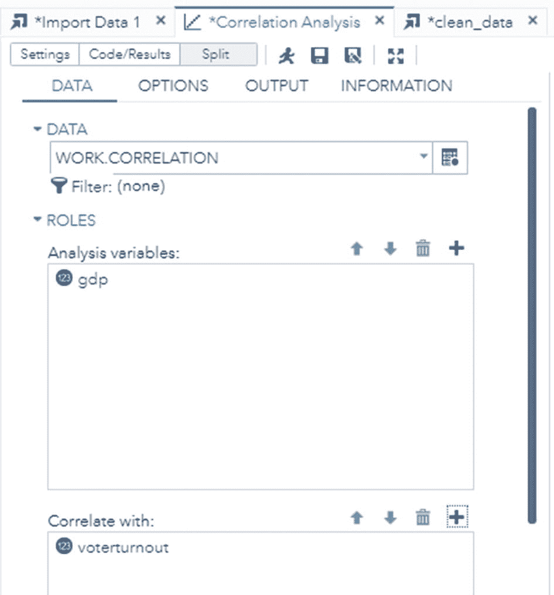

图 4-12 缅因州 GDP 与选民投票率的相关性分析

在`Options ➤ Plots`中，选择`Individual Scatter Plots`（单个散点图），如图 4-13 所示。

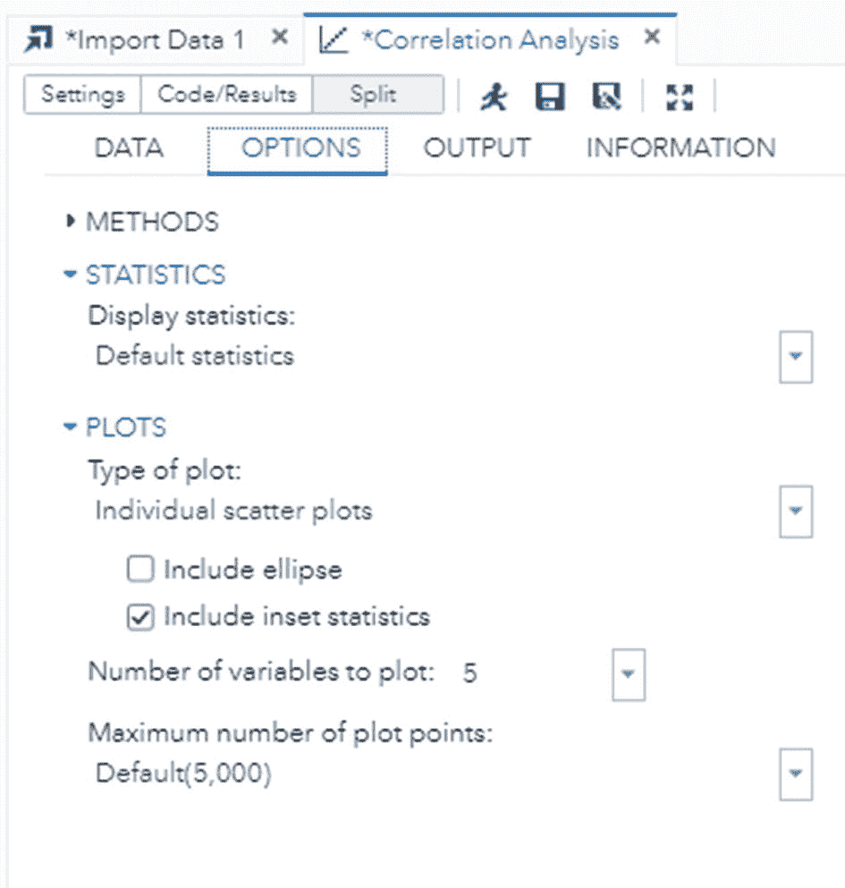

图 4-13 “选项”选项卡

然后，点击`Run`。输出结果将如图 4-14 所示。

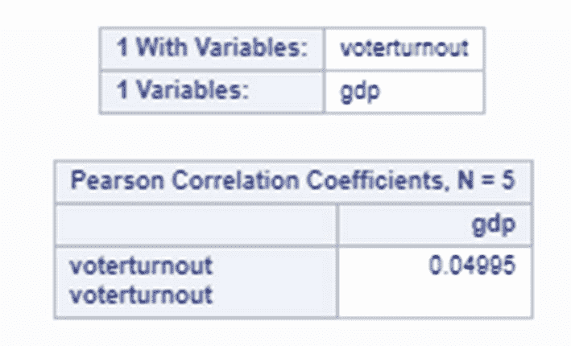

图 4-14 皮尔逊相关系数

相关系数为 0.05，这表明在缅因州，GDP 与选民投票率之间几乎没有关系。

在图上，你会发现点分布得很散，如图 4-15 所示。

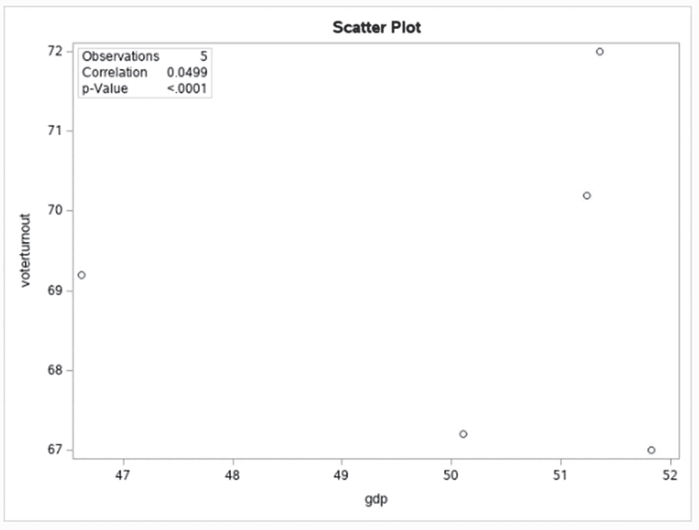

图 4-15 选民投票率与 GDP 之间的相关性

请注意，这并非普遍规律。在你的州，相关性可能会有所不同。缅因州历史上一直是选民投票率最高的州之一。我认为天气的影响可能比 GDP 更大。不过，这只是一个理论，需要进一步研究。作为练习，你可以建立一个缅因州温度和选民投票率的数据集，并验证天气与选民投票率之间是否存在高度相关性。此外，你也可以研究一下你所在的州，看看有哪些因素会影响当地的选民投票率。

## T 检验

通常，我们想知道两个独立组的均值是否真的不同，还是观察到的差异仅仅是偶然发生的。

T 检验用于确定两组数据之间差异的概率。简单来说，它比较了两个样本之间的平均值。

请注意，T 检验适用于小样本，因为它们不遵循正态分布。

### 单样本 T 检验

在这个例子中，我收集了历届缅因州总统选举中两党候选人的所有选票。我使用这个数据集来预测 2016 年和 2020 年缅因州的选举结果。

数据集的名称是`MaineVotesDR.xlsx`。它有四列：`选举年份`、`民主党选民`、`共和党选民`和`结果`。`结果`列的值是 0 或 1。如果是 0，表示共和党候选人获胜。如果是 1，表示民主党候选人获胜。

现在，导入数据集，让我们看看如何使用 T 检验来查看 2020 年的结果。在`Tasks`中，点击`Statistics`，然后点击`T Tests`。在`Data`中，选择数据集。在`Analysis variable`（分析变量）中，选择`Result`，如图 4-16 所示。

我们的假设是共和党候选人将在 2020 年缅因州总统选举中获胜，而备择假设将是民主党候选人获胜。

```
H0: Result=0
Ha: Result=1
```

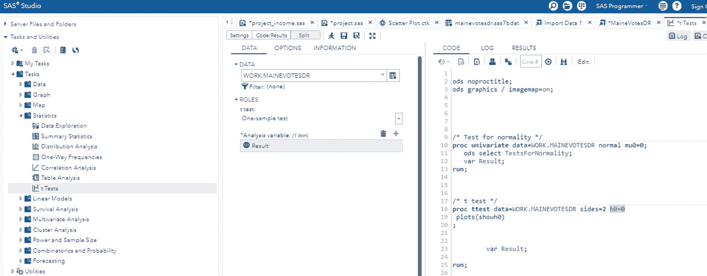

图 4-16 T 检验

在代码中，原假设的默认值是 0。你会在`Code`选项卡中看到`h0=0`。不要更改默认值，因为它就是我们的假设。现在，点击`Run`并检查 SAS Studio 在报告中生成的 p 值，如图 4-17 所示。

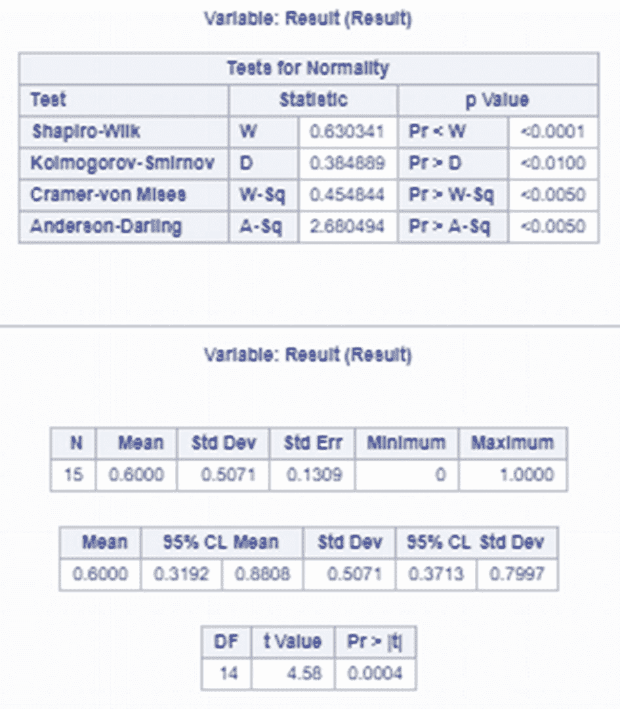

图 4-17 T 检验结果：2020 年缅因州总统选举预测

p 值 = 0.0004。由于 p 值小于 0.05，我们可以拒绝原假设。因此，我们可以得出结论：共和党候选人将在 2020 年缅因州选举中失利。

### 配对样本 T 检验

现在，我们将检验价格与成本之间的差异是否显著不同于 30。换句话说，原假设是价格与成本之间的差值等于 30，而备择假设是该差值不等于 30。

```
H0: Difference=30.
Ha: Difference ^= 30 或者在其它语言中的语法是： Ha: Difference !=30.
```

要执行此示例，请点击`Tasks and Utilities ➤ Tasks ➤ Statistics ➤ T Tests`。在`Data`中选择`SASHELP`中的数据集`PRICEDDATA`。在`T-test type`（T 检验类型）中，选择`Paired test`（配对检验）。在`Group 1 Variable`（组 1 变量）中，选择`price`，在`Group 2 Variable`（组 2 变量）中，选择`cost`，如图 4-18 所示。

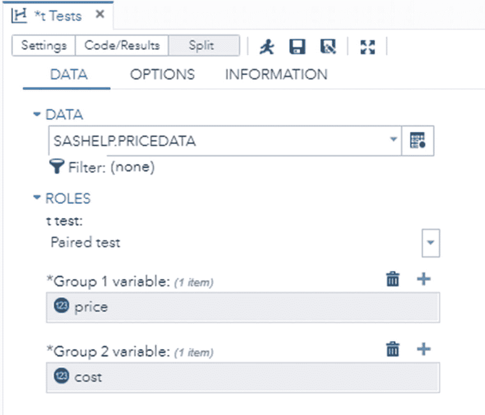

图 4-18 配对 T 检验“数据”选项卡

# 配对 T 检验

现在，点击 `Options` 选项卡。在 `Tests` -> `Tails` 中，选择 `Two-tailed test`（双尾检验）。在 `Alternative hypothesis`（备择假设）中，输入 `mu1-mu2 ^=30`，如图 4-19 所示。你可以选择是否包含正态性检验和默认图形。通常，最好包含它们并在报告中呈现。但是，在本例中，我们主要关注结果中 p 值的数值。

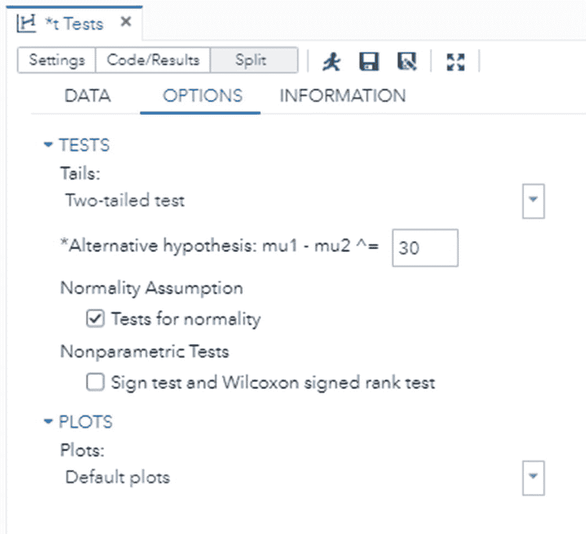
图 4-19 “选项”选项卡

在结果中，p 值小于 0.0001，如图 4-20 所示。因此，我们有足够的证据拒绝原假设，因为 p 值小于 0.05。

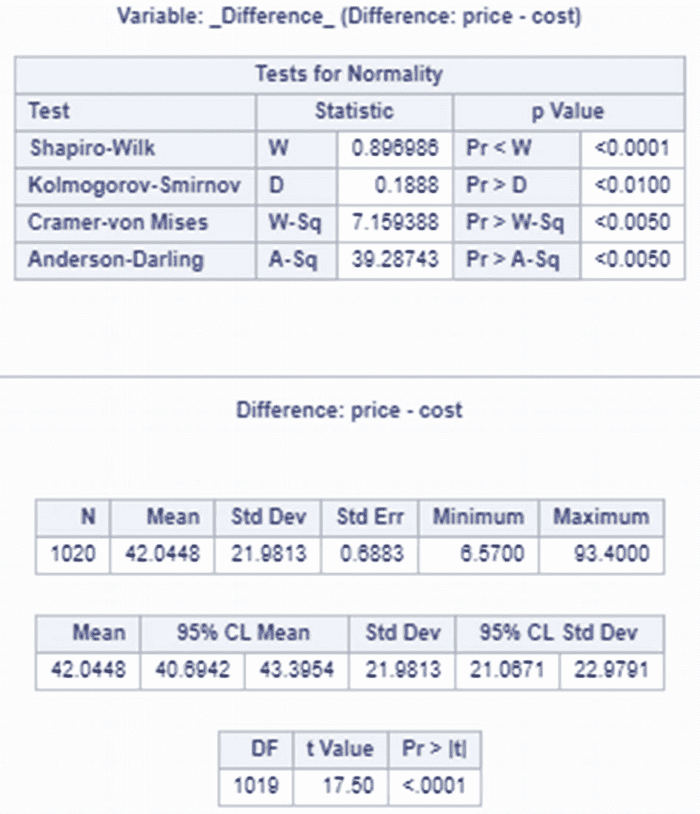
图 4-20 P 值

值得一提的是，配对 T 检验的执行方式与单样本 T 检验相同。在前面的示例中，配对 T 检验首先计算价格与成本之间的差值，然后对该差值执行单样本 T 检验，就像上一节中那样。

## 两样本 T 检验

在这个例子中，问题是：两个性别之间的身高是否存在显著差异？

原假设是身高没有差异。备择假设是根据性别存在身高差异。

在这个例子中，从 `SASHELP` 中选择 `CLASS` 数据集。在 T 检验中选择 `Two-sample test`（两样本检验）。最后，选择 `Height` 作为 `Analysis variable`（分析变量），选择 `Sex` 作为 `Groups variable`（分组变量），如图 4-21 所示。

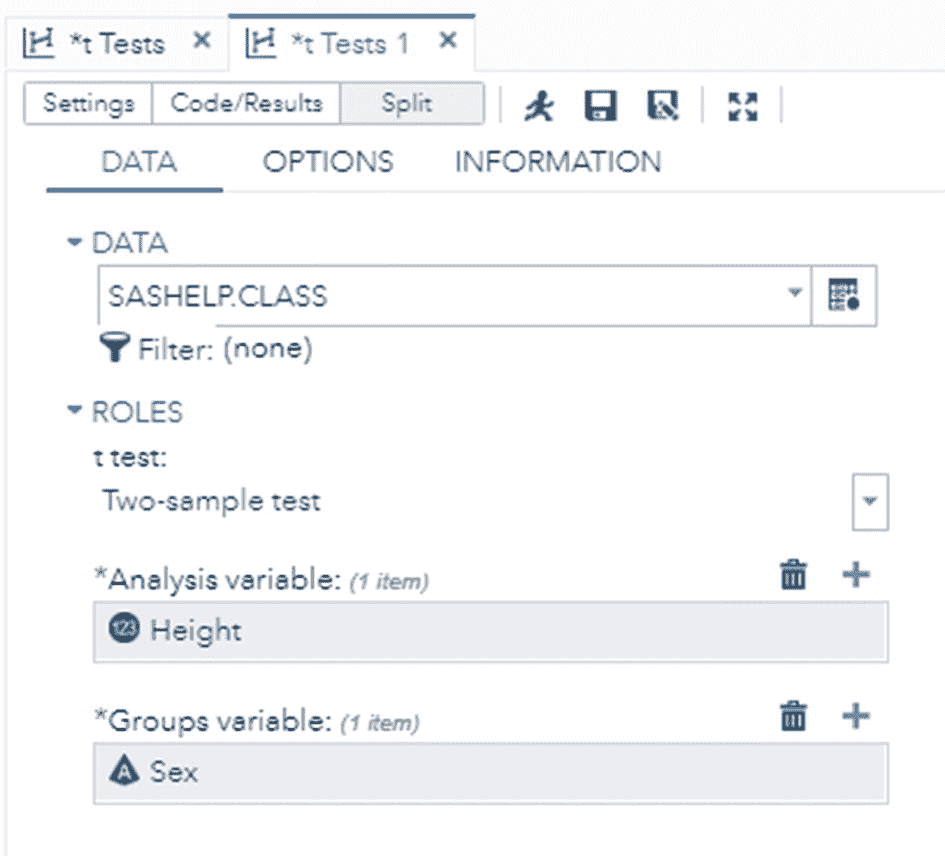
图 4-21 T 检验“数据”选项卡

点击 `Run` 并检查输出中的 p 值，如图 4-22 所示。

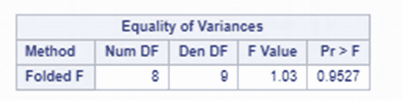
图 4-22 P 值

我们不能拒绝原假设，因为没有足够的证据支持拒绝；p 值大于 0.05。我们可以得出结论：两个性别之间的身高没有差异。但是，我们必须注意样本量很小。`SASHELP.CLASS` 数据集仅包含 19 行。