# 线性模型

ANOVA 是方差分析（Analysis Of Variance）的缩写。单因素方差分析用于检验两个组在单个变量上的均值差异。T 检验也能实现此功能，且使用频率高于 ANOVA。然而，有些客户坚持要求同时执行 ANOVA 检验和 T 检验，以对比两种输出结果进行额外验证。

## 单因素方差分析

单因素方差分析任务用于检验单个分类变量或单个连续因变量的均值差异，并提供相关图形。

在以下示例中，我们检验嗅觉是否随年龄变化。数据集位于 `Dataset` 文件夹中，文件名为 `UPSIT.csv`。你也可以运行以下代码，从以下网址创建数据集：[`http://support.sas.com/documentation/cdl/en/statug/66859/HTML/default/viewer.htm#statug_glm_examples10.htm`](http://support.sas.com/documentation/cdl/en/statug/66859/HTML/default/viewer.htm%2523statug_glm_examples10.htm)。

在 SAS Studio 中，上传文件并点击 `Refresh`，然后按照第 2 章所述方法将其导入。将数据集的名称从 `IMPORT` 改为 `UPSIT`。

依次点击 `Tasks and Utilities` ➤ `Tasks` ➤ `Linear Models` ➤ `One-Way ANOVA`。在 `Data` 中，选择 `WORK.UPSIT` 表；在 `Roles` 中，选择 `smell` 作为因变量；在 `Categorical variable` 中，选择 `agegroup`，如图 4-23 所示。

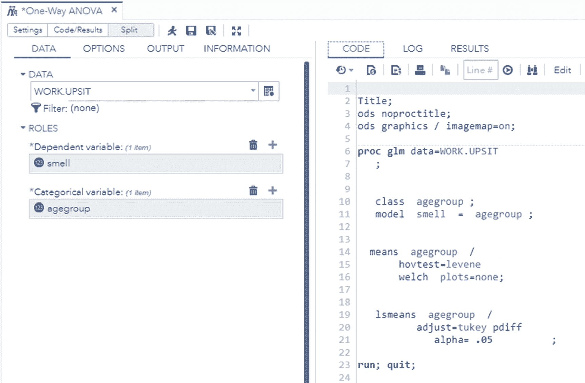

图 4-23

单因素方差分析数据选项卡

点击 `Run`，输出结果如图 4-24 至 4-28 所示。这些图表明，不同年龄组的嗅觉存在显著差异。图 4-24 显示该样本包含五个年龄组，共 180 个观测值。通常，原假设为嗅觉与年龄之间不存在关系；备择假设为这两个变量之间存在关系。图 4-24 中的所有 p 值均小于 0.05，表明嗅觉与年龄之间存在关系。

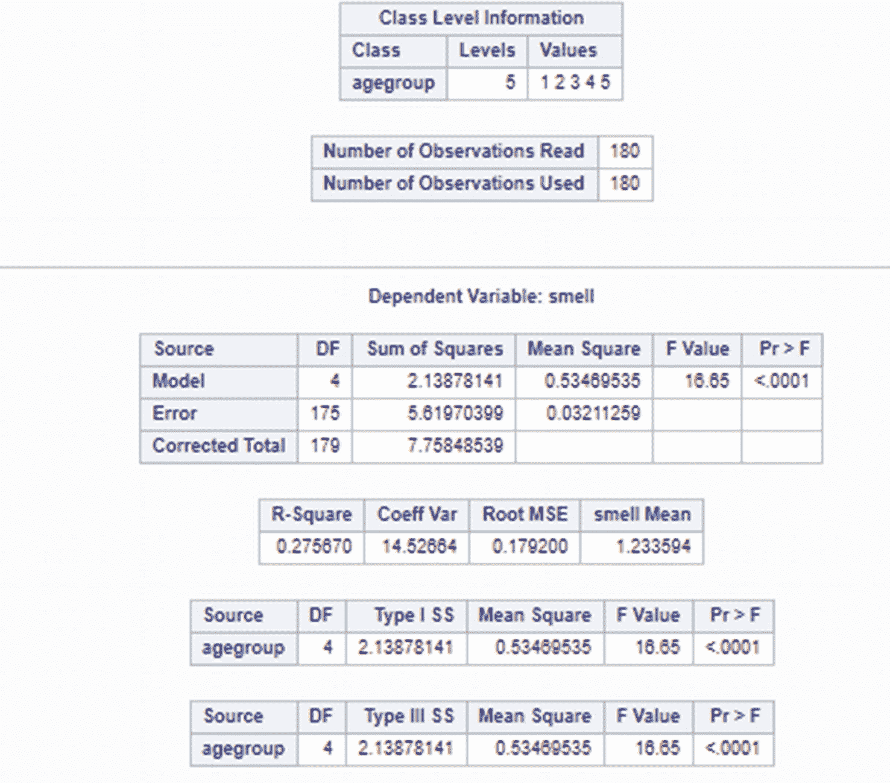

图 4-24

类别级别信息与 p 值

图 4-25 清晰地显示了不同年龄组内嗅觉指数的变异程度差异，且变异程度通常随年龄增长而上升。嗅觉随年龄增大而减弱、下降。

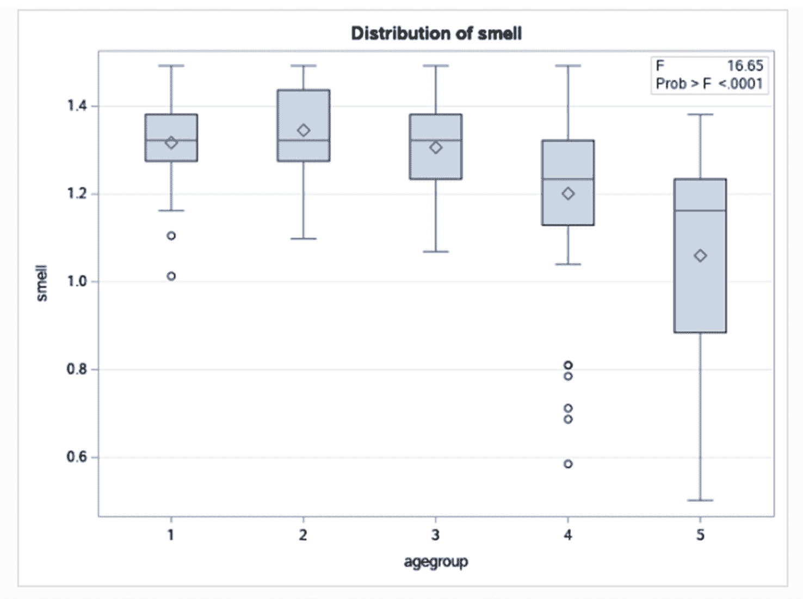

图 4-25

嗅觉分布箱线图

Levene 检验用于检验年龄组的方差齐性，Welch 检验用于检验年龄组的均值齐性。如图 4-26 所示，这两项检验的结果均确认了年龄对嗅觉指数均值和方差影响的假设，因为两项检验的 p 值均小于 0.0001。

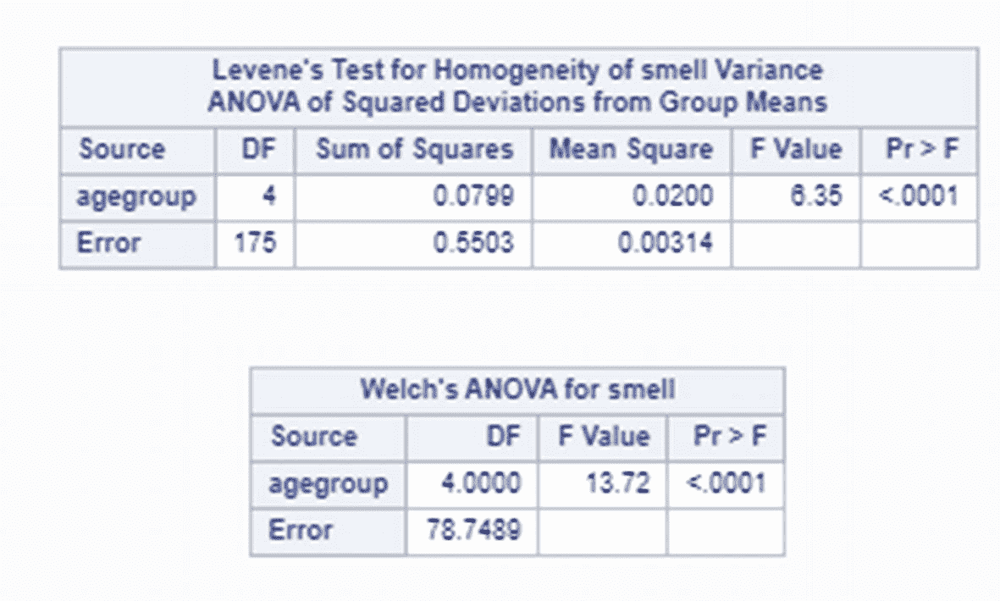

图 4-26

Levene 检验与 Welch 检验

图 4-27 显示前三个组的均值之间没有显著差异，而第四组和第五组之间的差异则逐渐增大。

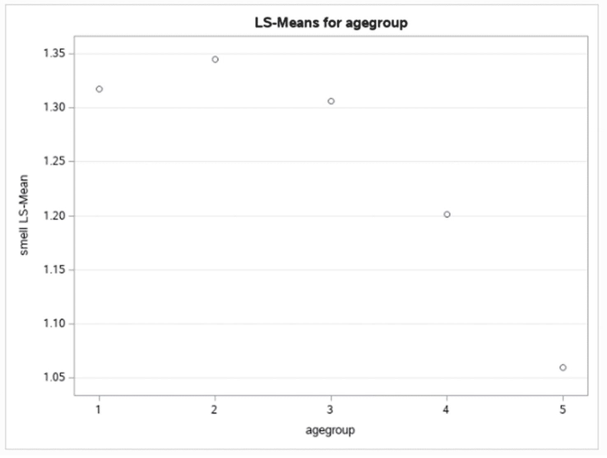

图 4-27

年龄组的最小二乘均值

图 4-28 中的 Tukey 图展示了各组之间的均值差异。前三个组之间无显著差异，图中以红色线条表示。然而，前三个组与第四组、第五组之间存在显著差异，图中以蓝色线条表示。Tukey 输出在 SAS Studio 中是交互式的；将鼠标悬停在每条线上，SAS Studio 会显示它所比较的是哪两个组。

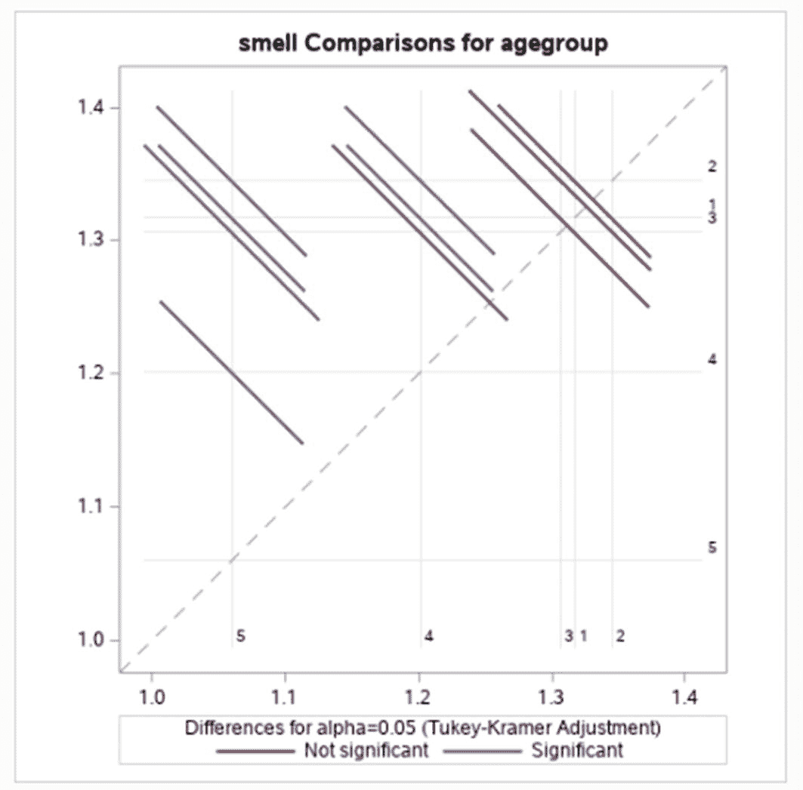

图 4-28

Tukey-Kramer 图

### N 路方差分析

N 路方差分析任务提供了关于一个或多个因子对单个连续因变量均值影响的图表。

本例假设一家航空公司希望开展广告活动。它需要确定目标客户群以增加收入。因此，我们研究收入类型和收入来源是否会导致收入存在显著差异。

选择 `任务和实用程序 ➤ 任务 ➤ 线性模型 ➤ N 路方差分析`。在数据中，选择 `SASHELP.REVHUB2` 表。在角色中，选择 `Revenue` 作为因变量，选择 `Source` 和 `Type` 作为因子，如图 4-29 所示。

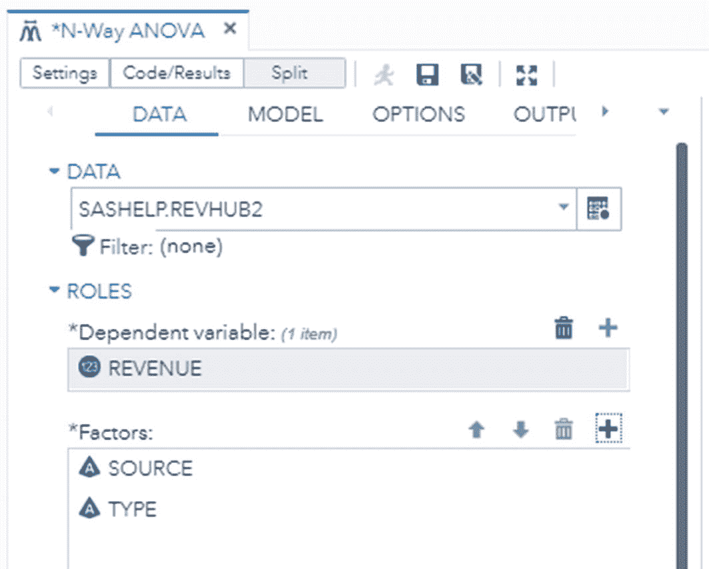

图 4-29  N 路方差分析数据选项卡

点击模型选项卡。点击截距旁边的编辑。添加 `Source` 和 `Type`。要添加它们的乘积，请使用 `CTRL + A` 或鼠标选中它们。然后，点击 `完全析因`，如图 4-30 所示。

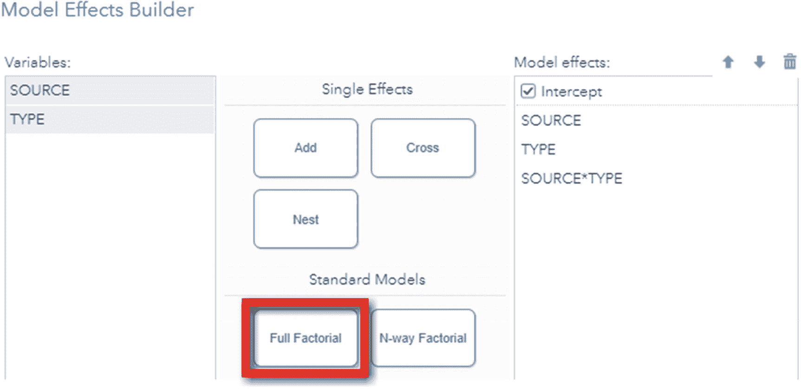

图 4-30 模型效应生成器

向下滚动并点击 `确定`。

在选项选项卡的统计量中，进行以下选择，如图 4-31 所示：

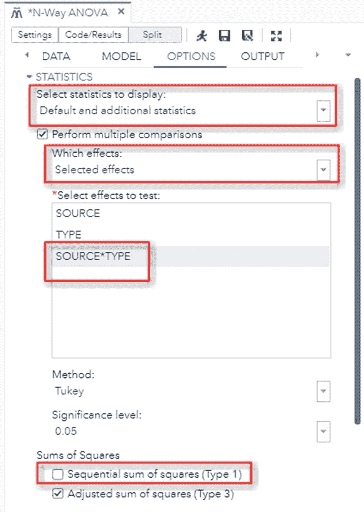

图 4-31  N 路方差分析选项

*   选择要显示的统计量 ➤ 默认和附加统计量
*   哪个效应 ➤ 选定的效应
*   选择 `Source` 和 `Type` 的乘积：`"Source * Type"`
*   在平方和中，取消勾选“顺序平方和（类型 1）”

然后，点击 `运行`。

输出结果（如图 4-32 所示）显示该公司有四个收入来源，分别是货运、其他、客运和服务。收入有三种类型，分别是直接、间接和其他。

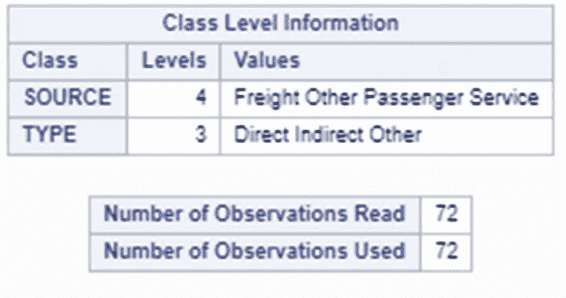

图 4-32 类别水平信息

收入的交互作用图（如图 4-33 所示）显示，收入最高的是客运-直接，其次是货运-直接，然后是客运-间接，最后是其余的 `Source*Type` 组合。将鼠标悬停在每个点上；SAS Studio 将显示来源、类型和收入值。

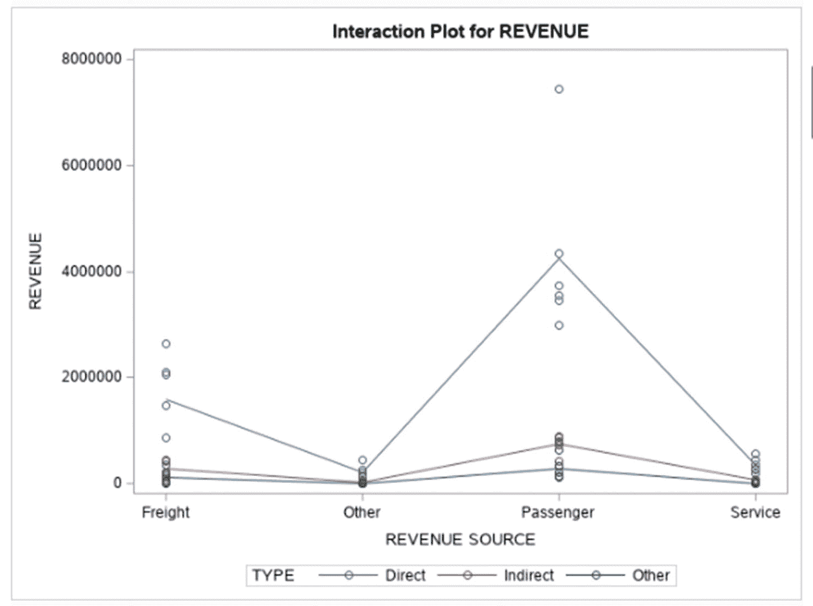

图 4-33 收入的交互作用图

同样，在图 4-34 中，`Source*Type` 的最小二乘均值也显示客运-直接远高于其他来源。其价值超过 400 万美元，其次是货运-直接，价值约 160 万美元，以及客运-间接，价值低于 100 万美元。

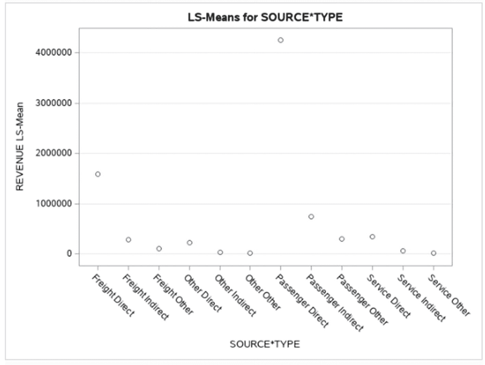

图 4-34 `Source*Type` 的最小二乘均值

图 4-35 中的 Tukey 图显示，客运-直接与货运-直接之间的比较显著（蓝线），而忽略所有其他比较，并将其标记为不显著（红线）。

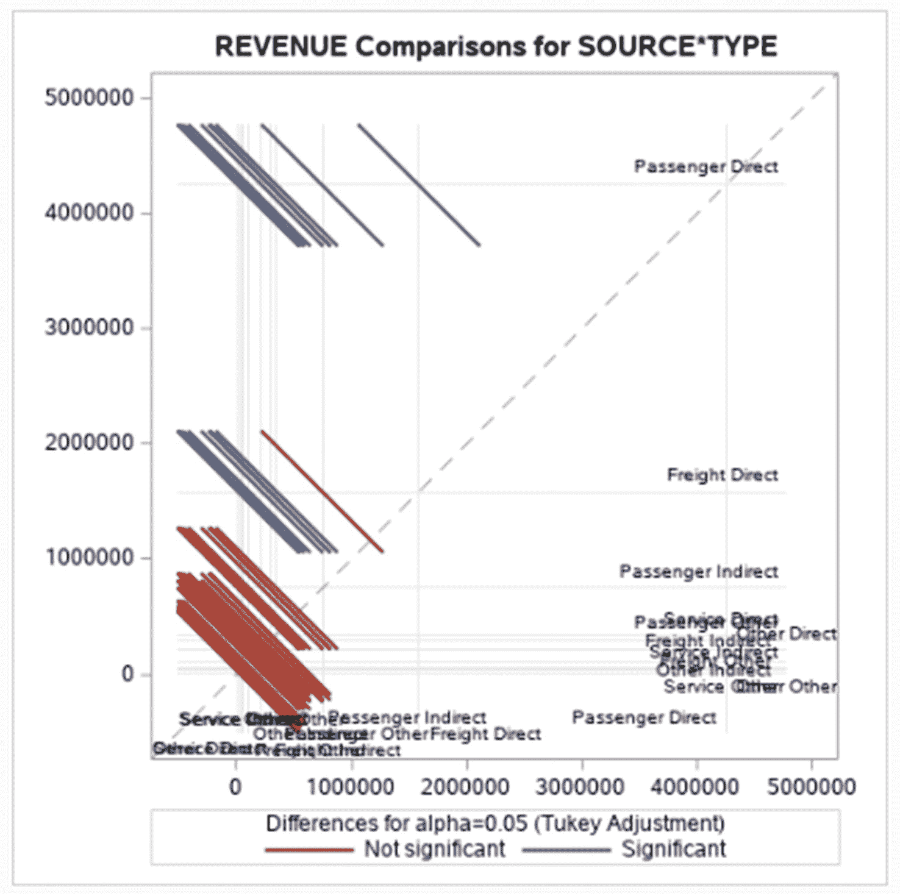

图 4-35 `Source*Type` 收入比较的 Tukey-Kramer 图

## 本章小结

本章解释了几乎所有分析和数据科学报告中最重要的五个统计概念。这五个概念是单因子频数分析、概要统计量、相关性分析、T 检验和方差分析。此外，本章还介绍了大量高级可视化和表格，例如 Levene 和 Welch 表以及 Tukey 和最小二乘均值图。

同样，我们在主要依靠集成开发环境完成所有这些任务的同时，也解释了代码。现在，是时候更深入地学习代码了。在下一章中，我们将更深入地学习 SAS 编程，了解运算符、循环和 `SELECT` 语句，并初步接触 `PROC SQL`。

