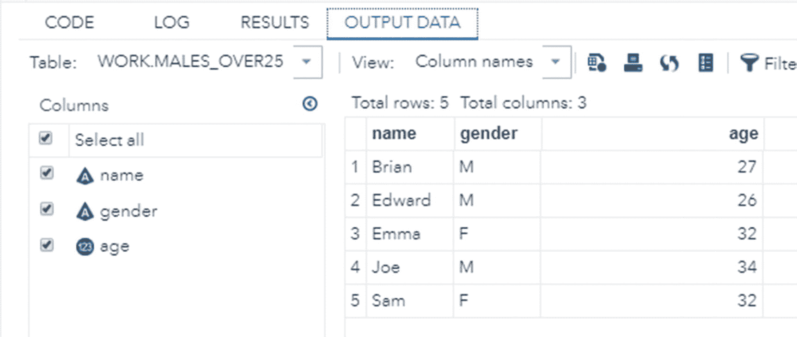
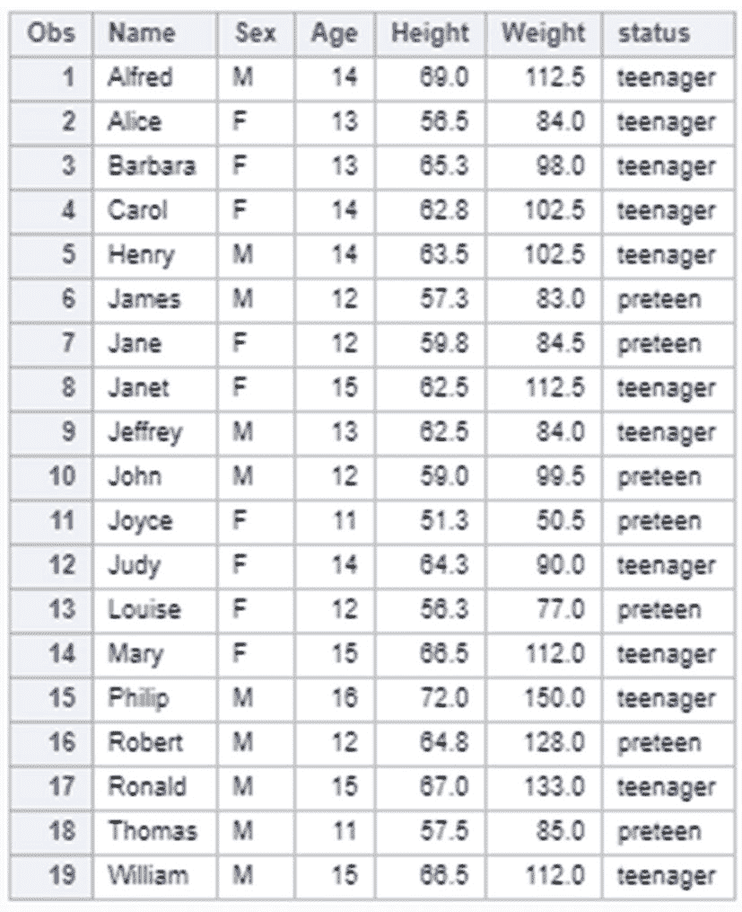
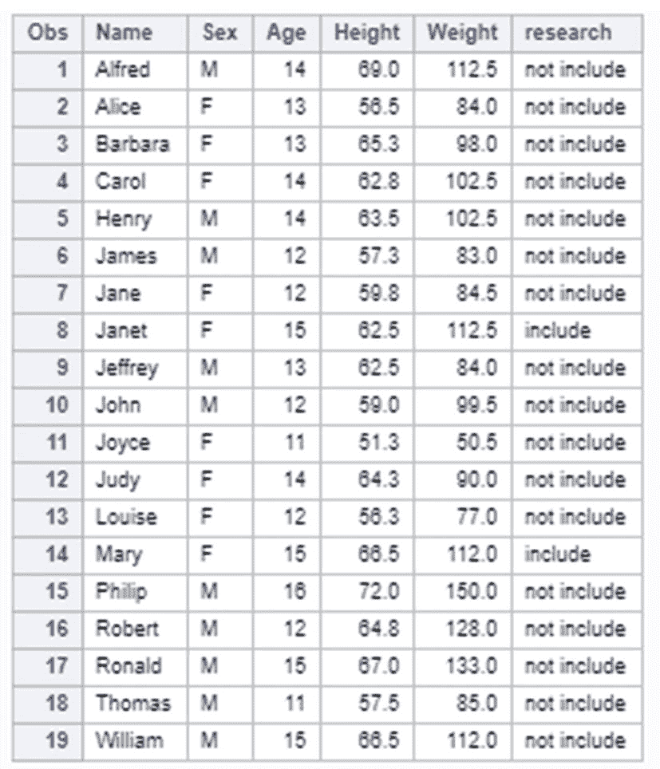

# 比较运算符

比较运算符用于对两个变量、常量或表达式建立比较、运算或计算关系。若比较结果为真，则返回 1；若为假，则返回 0。

比较运算符可以用符号表示，也可以用其助记符表示，如表 5-3 所示。`SAS Studio` 可以处理符号或助记符。助记符可以是大写、小写或大小写混合形式。

表 5-3 比较运算符

| 符号 | 助记符等效 | 定义 | 示例 |
|---|---|---|---|
| `=` | `EQ` | 等于 | `a=3` |
| `^=` | `NE` | 不等于 | `a ne 3` |
| `¬=` | `NE` | 不等于 | |
| `~=` | `NE` | 不等于 | |
| `>` | `GT` | 大于 | `num>5` |
| `<` | `LT` | 小于 | `num<8` |
| `>=` | `GE` | 大于或等于 | `sales>=300` |
| `<=` | `LE` | 小于或等于 | `sales<=100` |
| | `IN` | 等于列表中的某一个值 | `num in (3, 4, 5)` |

再次说明，你可以使用助记符或符号。例如：

```sas
if grade >= 50 then status = pass;
else status = fail;
```

等价于：

```sas
if grade GE 50 then status EQ pass;
else status EQ fail;
```

要了解有关表达式中 `SAS` 运算符的更多信息，请访问此网址查看 `SAS` 文档：[`http://bit.ly/36UGEnk`](http://bit.ly/36UGEnk)。

## `PROC SQL` 语句

编写 `SQL` 语句对于数据库开发人员至关重要。`SAS Studio` 使数据库开发人员能够使用 `PROC SQL` 语句，像以往一样创建表、查询表、从表中选择、删除或更新任何数据，以及合并或子集化表。在本书中，我们展示了大量示例，说明如何使用其他 `SAS` 语句实现这些任务。在本节中，你将学习如何使用 `PROC SQL`。

`PROC SQL` 语句的顺序如下：

```sql
PROC SQL;
select
from
group by
having
order by
;
quit;
```

要记住这个顺序，你可以使用这个助记口诀：“So Few Workers Go Home On Time。” 该口诀的来源是 [`https://blogs.sas.com/content/sastraining/2012/04/24/go-home-on-time-with-these-5-proc-sql-tips/`](https://blogs.sas.com/content/sastraining/2012/04/24/go-home-on-time-with-these-5-proc-sql-tips/)。

在第 2 章的清单 2-5 中，我们通过过滤掉欧洲制造的汽车，在 `newlib` 逻辑库中创建了一个新表。在清单 5-1 中，我们使用 `PROC SQL` 完成了相同的任务。

```sql
proc sql;
create table newlib.europeancars as
select * from sashelp.cars where origin = "Europe" ;
quit;
```

清单 5-1 `PROC SQL` 示例

在此示例（清单 5-1）中，我们从 `PROC SQL` 开始。然后，我们创建一个表，并使用 `AS` 关键字定义表的内容。我们使用 `SELECT *` 从 `SASHELP.CARS` 中选择所有列。为了过滤出仅欧洲汽车的条件，我们使用了 `WHERE` 子句并检查 `origin` 变量的值。如果 `origin = Europe`，则将该行添加到表中，否则排除该行。

## `SELECT-WHERE` 语句

`SELECT` 语句是 `PROC SQL` 的主要工具。你可以用它来识别、检索和操作表中的数据列。

以下简单的 `SELECT` 语句足以生成有用的结果：

```sql
select party
from maine.voters;
```

上述语句包含一个 `SELECT` 子句（列出了 `party` 列）和一个 `FROM` 子句（列出了包含 `party` 列的表）。

### `WHERE` 子句

`WHERE` 子句通过添加条件，为 `SELECT` 语句列表增加了更多说明。它类似于我们将在下一章讨论的 `IF-THEN-ELSE` 语句。

例如，如果我们想检查缅因州老年人的党派分布，我们应该向 `SELECT` 语句添加一个 `WHERE` 子句，如下所示：

```sql
select Party
from maine.voters;
where age >= 65;
```

另一个例子是清单 5-2，它来自 `SAS` 基础编程认证免费备考指南的样题。

```sas
data class;
input name $ gender $ age;
datalines;
Anna F 23
Ben M 25
Bob M 21
Brian M 27
Edward M 26
Emma F 32
Joe M 34
Sam F 32
Tom M 24
;
data WORK.MALES_OVER25;
set WORK.CLASS;
where Gender="M";
where age>25;
run;
```

清单 5-2 `WHERE` 子句示例

数据集 `WORK.MALES_OVER25` 中有多少个观测值？

输出将有五个观测值。输出结果如图 5-1 所示。该表包含了所有年龄大于 25 岁的男性和女性，因为只有最后一个 `WHERE` 子句生效。



图 5-1 `WHERE` 子句示例的输出

如果你想修改代码，使其生成一个包含年龄大于 25 岁的男性的表，你应该使用 `AND` 运算符将两个条件组合起来。

而不是使用两个 `WHERE` 语句：

```sas
where Gender="M";
where age>25;
```

应该是：

```sas
where Gender="M" and age>25;
```

或者使用 `WHERE` 和 `WHERE ALSO` 语句，如下所示：

```sas
where Gender=”M”;
where also age>25;
```

在清单 5-2 中，`WHERE` 语句用于对数据集进行子集化。还有一种对数据集进行子集化的方法，即使用不带 `THEN` 的 `IF` 语句；我们将在下一章中介绍一个相关示例。

此外，该清单还表明，如果我们有多个连续的 `WHERE` 语句（而非 `WHERE ALSO`），只有最后一个语句会生效。

## `SELECT-WHEN-OTHERWISE` 语句

`SELECT-WHEN` 语句是一个条件语句，类似于 `IF-THEN` 语句。

其语法如下：

```sql
SELECT ;
WHEN-1 (when-expression-1 ) statement;
```

`select-expression` 是可选的。让我们看几个例子，一个带有 `select-expression`，另一个没有。

```sas
DATA MYDATA;
SET sashelp.class;
SELECT(age);
when (10) status="child";
WHEN (11,12) status="preteen";
OTHERWISE status="teenager";
END;
PROC PRINT DATA=MYDATA;
RUN;
```

清单 5-3 `select-expression` 存在的示例

如果存在 `select-expression`，`SAS` 会评估 `select-expression` 和 `when-expression`。`SAS` 会比较两者是否相等，并返回真或假值。如果比较结果为真，则执行语句。如果为假，则继续执行下一个 `when-expression`。如果不再有 `WHEN` 语句，则执行 `OTHERWISE` 语句。参见图 5-2。



图 5-2 `Select-Expression` 子句示例的输出

如果没有 `select-expression`，则评估 `when-expression` 以产生一个布尔结果。如果结果为真，则执行语句。如果为假，SAS 会继续执行下一个 `when-expression` 或 `OTHERWISE` 语句。如果所有 `when-expressions` 的结果都为假，并且没有 `OTHERWISE` 语句，SAS 会发出错误消息。如果多个 `WHEN` 语句的 `when-expression` 都为真，则仅使用第一个 `WHEN` 语句。参见图 5-3。



`图 5-3` 缺少 `Select-Expression` 子句示例的输出

```
DATA MYDATA;
SET sashelp.class;
SELECT;
WHEN (age=15 and sex="F") research="include";
OTHERWISE research="not include";
END;
PROC PRINT DATA=MYDATA;
RUN;
```

### 清单 5-4
无 select-expression 的示例