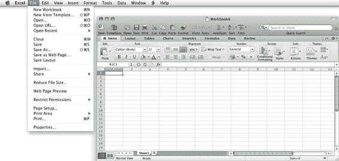
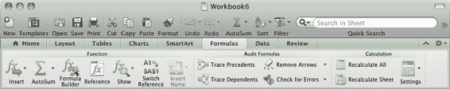
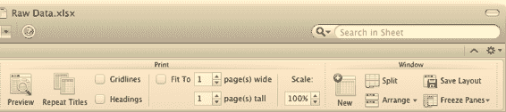
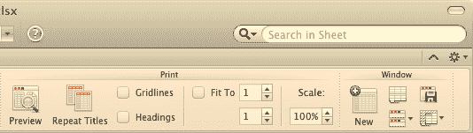
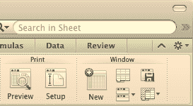
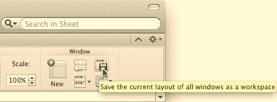
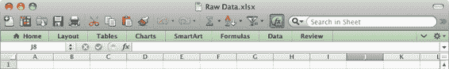
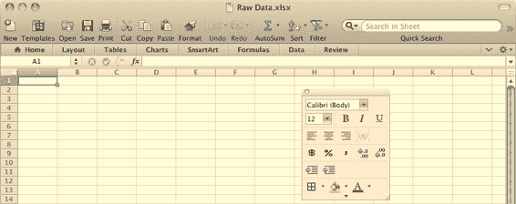
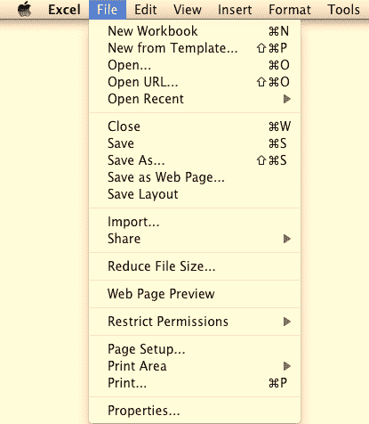
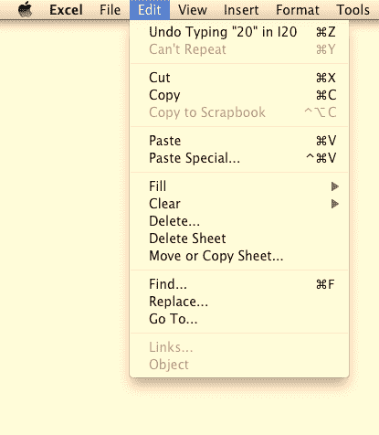

# 第 1 章：探索 Excel for Mac 界面的奥秘

在第 2 章中，我们将介绍如何通过设置最重要的偏好设置，以及自定义键盘快捷键、工具栏、菜单、菜单栏和功能区，让 Excel 按您期望的方式工作。您还将学习如何在启动 Excel 时自动打开工作簿，以及如何将多个打开的工作簿的布局保存为一个工作区，以便随时恢复。

在第 3 章中，您将学习如何创建工作簿，以快速高效地输入、编辑和操作数据。您将了解应使用哪些文件格式保存工作簿，如何添加属性信息以帮助在搜索时识别工作簿，以及如何充分利用模板——包括创建自己的模板。您还将学习如何管理工作表、有效布局数据、定义命名区域以简化导航，以及创建可折叠的工作表。

在第 4 章中，我们将讲解如何利用 Excel 提供的各种工具快速高效地设置工作表格式。我们从格式化行和列开始——包括更改列宽和行高、插入和删除行与列、以及隐藏敏感数据等所有操作。接着，我们将了解如何应用直接格式化、如何应用条件格式以快速标记需要注意的数值，以及如何使用数据验证来检查无效条目。最后，我们将介绍如何通过使用表格格式和 Excel 样式来节省时间，以及如何为工作表添加页眉和页脚。

[www.it-ebooks.info](http://www.it-ebooks.info/)

## 第 1 章：探索 Excel for Mac 界面的奥秘

在本章中，您将了解 Excel for Mac 界面的方方面面及其蕴含的众多奥秘。

我们将首先探讨控制 Excel 的四种主要方式：功能区、工具栏、菜单栏上的菜单以及键盘快捷键。这些方式为您控制 Excel 提供了极大的灵活性，尤其是在您按照自己的偏好进行设置之后。

接着，我们将讨论如何在工作表和工作簿之间导航。然后，我们将介绍将数据导入 Excel 工作簿的各种方法——从导入现有数据到使用自动更正、自动填充和剪贴簿功能更快速地输入数据。

在本章末尾，我将向您展示查看工作簿的智能方法，以便您能够快速高效地工作。这些方法包括拆分窗口以同时显示工作表的不同部分、打开额外的窗口，以及冻结关键行和列，以便在滚动到工作表其他部分时它们能保持在屏幕上。您甚至可以创建自定义视图，让数据完全按照您需要的方式排列。

### 准备开始探索 Excel 的奥秘

在阅读本章时，您可能希望同时运行 Excel，以便尝试您感兴趣的修改和技巧。因此，如果 Excel 尚未运行，请启动它：单击 Dock 上的 Excel 图标，或者（如果没有图标）单击桌面激活 Finder，选择“前往”>“应用程序”，然后双击 Microsoft Office 2011 文件夹中的 Excel 图标。

此时，Excel 可能会显示“Excel 工作簿库”对话框。如果是这样，请单击“所有”类别中的“Excel 工作簿”图标，然后单击“选择”按钮。这将使 Excel 创建一个空白工作簿，而不是基于内容模板的工作簿。我们将在第 3 章中介绍如何使用“Excel 工作簿库”创建工作簿。

[www.it-ebooks.info](http://www.it-ebooks.info/)

### 控制 Excel 的四种方式

要控制 Excel，您需要发出命令。例如，当您需要一个新工作簿时，您会发出创建新工作簿的命令。

在 Excel 2011 中（见图 1-1），您可以通过我们提到的四种主要方式发出命令：

- **菜单。** 与大多数 Mac 应用程序一样，当 Excel 是活动应用程序时，Excel 会提供一组显示在 Mac OS X 菜单栏上的菜单。要发出命令，您需要单击菜单，然后单击命令。
- **功能区。** 功能区是 Excel 2011 中引入的新控制条。要发出命令，您需要单击其按钮或控件。
- **工具栏。** Excel 包括标准工具栏和格式工具栏。默认情况下，标准工具栏会横跨在 Excel 窗口顶部显示，如图 1.1 所示。要发出命令，您需要单击其按钮或控件。
- **键盘快捷键。** 要发出命令，您需要按下相应的组合键。

**图 1-1.** *您可以使用功能区、工具栏、菜单栏上的菜单或键盘快捷键来控制 Excel。*

让我们依次深入了解每一种方式，先从功能区开始。

[www.it-ebooks.info](http://www.it-ebooks.info/)

### 功能区的奥秘

功能区是横跨 Excel 窗口顶部、位于窗口标题栏以及您选择显示的任何工具栏下方的控制条。功能区是一个包含多个选项卡的控制栏，每个选项卡又包含几个控件组。在任何时候，功能区只显示一个选项卡的内容；要切换到另一个选项卡的内容，您需要单击该选项卡。如图 1-2 所示，活动选项卡的颜色与其他选项卡不同，因此您可以轻松地将其识别出来。

**注意：** 为了清晰说明控件的位置，我会按照“选项卡-组-控件”的顺序给出功能区的操作说明。例如，“选择`公式` `审核公式` `追踪引用单元格`”表示您需要单击`公式`选项卡以显示其内容，进入`审核公式`组（无需单击），然后单击`追踪引用单元格`按钮。

**图 1-2.** *功能区的活动选项卡显示为与其他选项卡不同的颜色。每个选项卡包含控件组，例如按钮和弹出式菜单。*

#### 理解功能区的选项卡如何工作

在大多数情况下，功能区会显示八个选项卡，这些选项卡包含了 Excel 中大部分常规操作的控件：

- **开始。** 此选项卡包含用于剪切、复制和粘贴；字体、对齐方式和数字格式；条件格式和样式；插入和删除行、列和单元格；以及应用主题的控件。
- **页面布局。** 此选项卡包含用于操纵页面设置、更改视图、选择要打印的项目以及排列工作簿窗口的控件。
- **表格。** 此选项卡包含用于处理数据表的控件，这些数据表可用于在 Excel 中创建数据库。
- **图表。** 此选项卡包含用于插入图表和迷你图（适合单个单元格的微型图表）、选择图表和迷你图的布局以及为图表应用布局和样式的控件。
- **SmartArt。** 此选项卡包含用于插入和格式化 SmartArt 图形的控件。
- **公式。** 此选项卡包含用于插入函数、审核公式以及控制 Excel 执行计算方式的控件。
- **数据。** 此选项卡包含用于排序和筛选数据、创建数据透视表和执行假设分析、连接到外部数据源、验证数据以及对工作表进行分组和分级显示的控件。（第 3 章将讨论分组和分级显示。）
- **审阅。** 此选项卡包含用于检查拼写、处理批注、对工作表或工作簿应用保护以及共享工作簿的控件。

除了这些标准选项卡之外，功能区还包含其他仅在需要时才显示的选项卡。这些选项卡有时被称为*上下文相关选项卡*。例如，当您选择一个图表时，Excel 会自动显示“图表布局”选项卡和“格式”选项卡（见图 1-3）。

**图 1-3.** *当您选择了可用选项卡的对象时，功能区会显示上下文相关选项卡。此处，由于图表处于活动状态，因此功能区上出现了“图表布局”选项卡和“格式”选项卡。*

[www.it-ebooks.info](http://www.it-ebooks.info/)

**注意：** 与 Office for Windows 相比，Office:Mac 的 Ribbon 来得较晚，但在许多方面，Office:Mac 却更幸运——它的 Ribbon 是两者中更好用的。在 Office for Windows 中，Ribbon 取代了菜单栏和工具栏，因此除非你设置了无数快捷键，否则你必须使用它。而在 Office:Mac 中，Ribbon 是对菜单栏和工具栏的补充，你可以自主选择使用它的程度。通常，你会希望保持 Ribbon 开启，以便访问它提供的额外功能；但如果你发现菜单和工具栏已包含所有需要的命令，你也可以关闭 Ribbon。

[www.it-ebooks.info](http://www.it-ebooks.info/)

#### 理解 Ribbon 中的组和控件如何工作

你可能在你第一次使用 Excel 时就已经掌握了使用 Ribbon 选项卡的技巧。

组和控件则稍微有点棘手，因为它们会随着 Excel 窗口是否足够宽以显示整个 Ribbon 而变化。

当 Excel 窗口*足够*宽时，所有组都会显示，并且它们会以最宽敞的布局显示其控件——例如按钮、弹出菜单、复选框等。例如，图 1-4 的上半部分显示了 Ribbon 的“布局”选项卡的最右侧部分。“打印”组和“窗口”组中的所有控件都带有标签，因此你可以轻松识别每个控件。

但是当空间不足时，Excel 会逐渐折叠 Ribbon 的某些部分，以便在可用空间内显示尽可能多的内容。例如，图 1-4 的中间部分再次显示了“布局”选项卡的最右侧部分，但这次，`拆分`按钮、`排列`弹出菜单、`保存布局`按钮和`冻结窗格`弹出菜单上的标签都消失了。在“打印”组中，`调整为`标签仍然可见，但 Excel 已移除“页宽”和“页高”标签以节省空间。

当窗口变得更窄时，Excel 会进一步折叠组和控件。在图 1-4 的下半部分，你可以看到“打印”组现在只包含`预览`按钮和`设置`按钮。但你可以单击`设置`按钮以显示“打印设置”对话框，在该对话框中，你可以配置 Ribbon 隐藏的所有“打印”组设置，更不用说其他设置了。

# 图 1-4. 随着 Excel 窗口变窄，Excel 会先隐藏次要控件的标签，然后隐藏控件本身

[www.it-ebooks.info](http://www.it-ebooks.info/)

通过自动更改 Ribbon 以适应窗口宽度，Excel 尽可能让更多控件触手可及。但由于标签可能不显示，你有时需要显示屏幕提示来识别控件；要显示屏幕提示，请将鼠标指针悬停在控件上片刻（见图 1-5）。

# 图 1-5. 当控件的标签未显示在 Ribbon 上时

此外，由于当 Ribbon 的完整宽度未显示时，某些控件可能出现在不同位置，因此你有时可能需要寻找所需的控件。本书假定窗口显示足够宽，以便你看到 Ribbon 上的所有控件，但也会指出一些可能导致混淆的会消失的控件。

如果你无法看到本应存在的命令，请在组内的剩余控件中四处探查，以找到 Excel 隐藏该控件的位置，或者查看某个控件是否会打开包含这些控件的对话框。（或者，如果有菜单替代方案，则使用菜单。）

## 折叠 Ribbon

当你需要更多空间来处理工作表时，可以通过以下方式之一将 Ribbon 折叠为仅显示其选项卡栏（见图 1-6）：

- 单击当前活动的选项卡。

- 单击 Ribbon 右端的 `折叠功能区` 按钮（`^` 按钮）。

- 从菜单栏中选择 `视图 > 功能区`（移除功能区项旁边的复选标记）。

- 按 `Cmd+Option+I`。

[www.it-ebooks.info](http://www.it-ebooks.info/)

# 图 1-6. 单击“折叠功能区”按钮可将功能区折叠为仅显示其选项卡

你猜得没错，再次显示 Ribbon 几乎使用相同的操作：

- 单击你想要查看的选项卡。

- 单击 Ribbon 右端的 `展开功能区` 按钮（`∨` 按钮）。

- 从菜单栏中选择 `视图 > 功能区`。

- 按 `Cmd+Option+I`。

**提示：** 如果你不想使用 Ribbon，可以将其完全关闭。如果你确实想使用它，则可以选择显示哪些选项卡以及它们的显示顺序。详情请参阅第 2 章的“自定义功能区”部分。

## 工具栏的秘密

Excel 带有两个内置工具栏——标准工具栏和格式工具栏——但你可以根据需要创建任意多的其他工具栏。你可以选择显示哪些工具栏以及如何显示它们。并且你可以自定义内置工具栏和你自己的工具栏，这将在第 2 章中介绍。

### 选择要显示的工具栏

首先，决定要显示哪些工具栏。最简单的方法是 `Ctrl+单击` 或右键单击一个已显示的工具栏，单击或高亮显示上下文菜单上的“工具栏”项，然后单击你要显示或隐藏的工具栏。Excel 会在“工具栏”子菜单中已显示的工具栏旁放置一个复选标记。如果该工具栏正在显示，你单击它可移除复选标记并隐藏该工具栏。

如果没有显示任何工具栏，请选择 `视图 > 工具栏` 以显示“视图”菜单上的“工具栏”子菜单，然后单击你要显示的工具栏。

[www.it-ebooks.info](http://www.it-ebooks.info/)

### 在图标加文本与仅图标之间切换标准工具栏

接下来，选择是将标准工具栏上的按钮显示为带文本标签的图标，还是仅显示图标。如果你发现文本标签使图标更易于识别，那么它们占用少量额外空间是值得的。

要在图标加标签和仅图标之间切换，请 `Ctrl+单击` 或右键单击标准工具栏，然后酌情单击上下文菜单上的“图标和文本”项或“仅图标”项。

**注意：** 格式工具栏仅显示图标——你无法选择为其按钮显示文本标签。

### 取消停靠和停靠格式工具栏

最初，Excel 将标准工具栏显示在窗口顶部，标题栏和 Ribbon 之间（除非你已关闭 Ribbon）。如果你显示格式工具栏，它也是如此。

标准工具栏始终保持停靠状态，但如果你更希望格式工具栏浮动，则可以将其取消停靠，以便在桌面上自由定位。

要取消停靠格式工具栏，请 `Ctrl+单击` 或右键单击该工具栏，然后单击上下文菜单中的 `在窗口中停靠工具栏` 以移除复选标记。Excel 会将工具栏取消停靠，并将其显示为浮动工具栏，你可以根据需要重新定位它（见图 1-7）。

# 图 1-7. 你可以取消停靠格式工具栏，将其放置在屏幕上的任意位置

[www.it-ebooks.info](http://www.it-ebooks.info/)

**提示：** 你可以通过点击标题栏右端的果冻豆按钮（灰色圆角矩形按钮）来切换停靠工具栏的显示与隐藏。

## 菜单栏的奥秘

如果你使用过其他 Mac 应用程序，你可能已经知道如何使用菜单栏：

1. 如果要为某个应用程序发出命令而该应用未处于活动状态，请点击该应用的某个窗口使其变为活动状态。Mac OS X 随后会在菜单栏上显示该应用程序的菜单。例如，当 Excel 处于活动状态时，你会看到它的菜单，其中 Excel 自己的菜单会出现在菜单栏的最左端。

2. 点击你想要打开的菜单。

3. 点击你要执行的命令。或者，如果该命令位于子菜单中，则点击或高亮子菜单项以显示子菜单，然后点击该项。

**注意：** 菜单命令名称末尾的省略号（…）通常表示该命令会显示一个对话框，而不是直接执行操作。例如，`文件` 菜单中的 `关闭` 命令会关闭活动文档，而 `另存为…` 命令则会显示 `另存为` 对话框。（`保存` 命令也会显示 `另存为` 对话框——但仅限于你之前从未保存过此工作簿的情况。）但是，随着功能区（Ribbon）的引入，某些带有省略号的菜单命令会显示包含完成操作所需命令的功能区选项卡。

通过菜单栏发出命令可谓再简单不过。但菜单栏还有两个秘密。你可以：

- **一次性关闭所有打开的工作簿**。按住 `Shift` 键并点击 `文件` 菜单，然后点击代替常规 `关闭` 命令出现的 `全部关闭` 命令。如果任何工作簿包含未保存的更改，Excel 会提示你保存它们，就像关闭单个工作簿时一样。

- **自定义菜单和菜单栏**。你可以自定义菜单和菜单栏，将你需要的命令放置在最方便的位置。有关详细信息，请参阅第 2 章的“自定义菜单和菜单栏”一节。

[www.it-ebooks.info](http://www.it-ebooks.info/)

