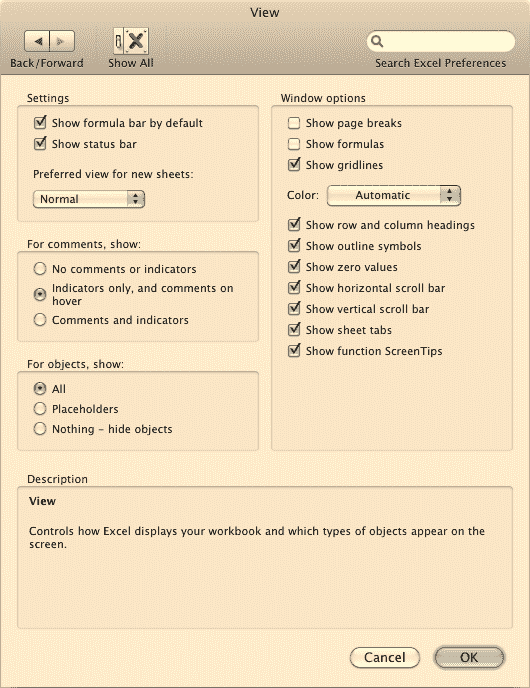
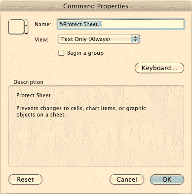
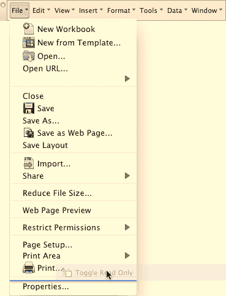
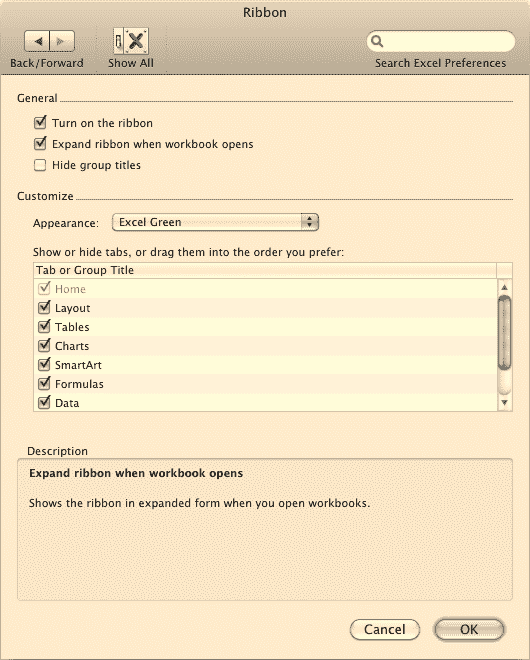
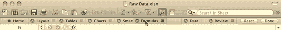

# 第 2 章：配置 Excel:Mac 以适应您的工作方式

在下一章中，我将向您展示如何自定义 Excel 以适合您的工作方式。

在本章中，我们将探讨如何配置 Excel:Mac 以适应您的工作方式。您可以通过多种方式更改 Excel 的外观和行为，根据个人偏好进行设置，从而节省大量时间和精力。

配置 Excel 的主要方式是在`Excel 偏好设置`对话框中设置其偏好。该对话框包含的设置项繁多，无法一一详述，因此我们重点介绍那些最影响您日常使用体验的选项——通用、视图、编辑、保存和兼容性。本书其他章节将在涉及相关主题时介绍其他偏好设置。例如，第 1 章介绍了自动更正和自定义列表偏好；第 7 章介绍了图表偏好；第 10 章介绍了表格偏好和筛选偏好；第 13 章介绍了安全偏好。

首先，我们需要打开`Excel 偏好设置`对话框。接下来，我们将了解如何控制 Excel 窗口的显示方式，然后继续选择编辑选项和保存工作簿的默认设置。

除了设置偏好，您还可以更改 Excel 的用户界面。在本章的后半部分，我将向您展示如何创建自定义键盘快捷键；如何自定义工具栏、菜单和菜单栏；以及如何在 Excel 允许的范围内对功能区进行有限修改。

最后，您将学习如何在启动 Excel 时自动打开一个或多个工作簿，以及如何将多个打开的工作簿的布局保存为工作区，以便在需要时立即恢复。

## 打开 Excel 偏好设置对话框

要完成本章内容，请通过菜单栏选择`Excel` → `偏好设置`，或按下`Cmd+,`（Command 键和逗号键）来打开`Excel 偏好设置`对话框。

如图 2-1 所示，`Excel 偏好设置`对话框包含三大类偏好设置——编写、公式和列表、共享和隐私。每个类别包含五到六个图标，单击这些图标即可显示相应的偏好设置面板。

**图 2-1.** *在`Excel 偏好设置`对话框的概览屏幕上，单击您想要显示的偏好设置面板的图标。*

导航`Excel 偏好设置`对话框的方式与 Mac OS X 的`系统偏好设置`窗口类似：

- 单击您想要显示的偏好设置面板的图标。例如，单击`通用`图标即可显示通用偏好设置面板。
- 单击`全部显示`图标可返回概览屏幕，以便显示其他类别的偏好设置。
- 单击`返回`按钮可返回上一屏幕。上一屏幕几乎总是概览屏幕，因此单击`返回`按钮的效果与单击`全部显示`按钮大致相同。
- 不要单击`前进`按钮——在撰写本文时，该按钮始终处于不可用状态，因此没有任何作用。
- 要搜索某个偏好设置，请单击`搜索`框，然后输入关键字。在 Excel 显示的匹配偏好设置列表中，单击您需要的项目。Excel 会短暂高亮显示相关图标以便您识别，然后显示对应的偏好设置面板。

## 控制 Excel 窗口的显示方式

在本节中，我将向您展示如何找到控制 Excel 窗口显示方式的选项。

首先显示通用偏好设置（见图 2-2），然后设置以下偏好：

### 使用 R1C1 引用样式

确保此复选框未选中，除非您希望使用 R1C1 引用（即列和行都通过数字标识）。例如，单元格 A1 的引用为`R1C1`（第 1 行第 1 列），而单元格 E2 的引用为`R2C5`。

**图 2-2.** *在“通用”偏好设置面板中，您可以选择基本设置，包括“文件”菜单中显示的最近文档数量、工作簿中的工作表数量、标准字体和字号，以及首选的文件位置。*

[www.it-ebooks.info](http://www.it-ebooks.info/)

**56** **第 2 章：配置 Excel:Mac 以符合您的工作方式**

### 标准字体

在此弹出菜单中，选择您希望用作默认字体的字体，即 Excel 在您应用其他字体之前使用的字体。如果您选择“正文字体”项，Excel 会使用工作簿主题中设置为正文字体的字体。

### 字号

在此弹出菜单中，选择默认字号。

### 用户名

使用此框确保 Excel 按您希望的方式显示您的姓名。

### 打开应用程序时显示“Excel 工作簿库”

如果您希望 Excel 在启动时显示“Excel 工作簿库”对话框，请选中此复选框。如果您不需要一开始就显示“Excel 工作簿库”，请清除此复选框。

现在，单击“全部显示”按钮返回概览屏幕，然后单击“视图”图标显示“视图”偏好设置面板（见图 2-3）。

**图 2-3.** *“视图”偏好设置面板中的设置允许您控制公式栏和状态栏的显示、选择首选视图、控制批注和对象的显示方式，并决定在窗口中显示哪些选项。*

[www.it-ebooks.info](http://www.it-ebooks.info/)

**57** **第 2 章：配置 Excel:Mac 以符合您的工作方式**

现在，您可以按照以下小节所述选择设置。

### 在“视图偏好设置”的“设置”区域中选择选项

“视图”偏好设置面板的“设置”区域包含三个偏好设置，您需要确保它们按照您喜欢的方式进行设置：

* 默认显示公式栏。* 选中此复选框可使 Excel 显示公式栏，这通常很有用。
* 显示状态栏。* 选中此复选框可使 Excel 显示状态栏。这通常也很有帮助。
* 新工作表的首选视图。* 在此弹出菜单中，如果您希望添加到工作簿的每个新工作表都使用普通视图，请单击“普通”。如果您希望 Excel 对新工作表使用页面布局视图，请单击“页面布局”。

### 选择如何显示批注

在“视图”偏好设置面板的“对于批注，显示”区域中，选择描述您希望如何显示附加到单元格的批注的选项按钮：

* 不显示批注或标识符。* 当您需要通过隐藏批注来简化工作表外观时，请选择此选项按钮。
* 仅显示标识符，悬停时显示批注。* 选择此选项按钮可为每个批注显示一个批注标识符（单元格右上角的红色三角形），并在用户将鼠标指针悬停（停留）在单元格上时，在气球中显示批注。这是默认设置，通常是常规工作的最佳选择。
* 批注和标识符。* 选择此选项按钮可始终同时显示批注标识符和批注气球。当您想确保看到工作表中的所有批注时，请使用此设置。

### 选择如何显示对象

在“视图”偏好设置面板的“对于对象，显示”区域中，选择适当的选项按钮，以控制图片和命令按钮等对象在工作表中的显示方式：

* 全部。* 选择此选项按钮可显示工作簿中的所有图形对象。此设置让您能看到工作簿中所有内容的位置，但可能会导致 Excel 显示或滚动包含许多图形对象的工作表时速度变慢。

[www.it-ebooks.info](http://www.it-ebooks.info/)

**58** **第 2 章：配置 Excel:Mac 以符合您的工作方式**

* 占位符。* 选择此选项按钮可显示空矩形占位符代替图片，但会显示命令按钮。
* 无 – 隐藏对象。* 选择此选项按钮可隐藏所有对象，以便您不受干扰地查看数据。

**注意：** “针对对象，显示”设置仅适用于当前活动工作簿，而非所有工作簿。

### 选择窗口选项

在“视图”偏好设置面板的“窗口选项”区域中，选择要显示或隐藏的窗口选项。具体如下：

- **显示分页符。** 选中此复选框可使 Excel 显示分页符的位置。通常，您只需在打印前查看分页符，因此您可能希望清除此复选框。
- **显示公式。** 选中此复选框可使 Excel 显示公式本身，而非其计算结果。在排查计算问题时，显示公式会很有帮助，但第 4 章将介绍一种更简便的方法来显示它们。通常情况下，您希望保持此复选框为清除状态。
- **显示网格线。** 选中此复选框可使 Excel 显示单元格周围的网格线。网格线通常很有帮助，但有时您可能希望关闭它们以获得特殊效果。
- **颜色。** 在此弹出式调色板中，单击您希望用于网格线的颜色（在显示网格线时）。除非您需要特定颜色（例如红色或蓝色），否则“自动”设置通常是最佳选择。
- **显示行号列标。** 选中此复选框可显示行号和列标。您几乎总是希望显示它们，除非您正在共享一个工作表，其中隐藏了某些行和列，但您不希望缺失的行号或列标引起观众对隐藏内容的注意。
- **显示分级显示符号。** 选中此复选框可显示表明您已在工作表中创建分级显示的符号（如第 3 章所述）。通常，您希望显示这些符号，以便用户可以根据需要展开或折叠分级显示——但有时您可能需要隐藏该分级显示。
- **显示零值。** 选中此复选框可在每个值为零的单元格中显示一个`0`（零）。显示零值通常很有帮助；如果您需要隐藏零值，请清除此复选框。
- **显示水平滚动条。** 选中此复选框可显示水平滚动条。这通常也很有帮助。
- **显示垂直滚动条。** 选中此复选框可显示垂直滚动条。通常您需要此界面功能。
- **显示工作表标签。** 选中此复选框可在窗口底部显示工作表标签栏，以便您和同事能轻松地在不同工作表之间导航。
- **显示函数屏幕提示。** 选中此复选框可让 Excel 显示屏幕提示，其中包含您正在输入到单元格中的函数的参数。这些屏幕提示通常很有帮助，但如果它们困扰到您，可以清除此复选框。

### 选择编辑选项

要控制编辑工作表时 Excel 的行为，请显示“编辑”偏好设置面板（见图 2-4），并选择如下选项：

- **双击允许直接在单元格中编辑。** 如果您希望双击某个单元格即可打开它进行编辑，请选中此复选框。这通常很有帮助——但如果您清除此复选框，双击某个单元格将使 `Excel` 选中该单元格中公式引用的第一个单元格。在检查公式时，此功能非常有用，因此您需要判断这两种双击行为中哪一种对您最有帮助。

- **启用填充柄和单元格拖放。** 如果您希望使用自动填充功能（在第 1 章中说明）来输入自定义列表和文本序列，并且能够使用拖放功能将一个单元格的内容移动到另一个单元格，请选中此复选框。

- 选中此复选框，您可以选择“覆盖单元格前发出警告”复选框，以便在自动填充或拖放操作将覆盖单元格现有内容时，让 `Excel` 显示警告对话框。

- **按 `RETURN` 后移动所选内容。** 选中此复选框，如果您希望在按 `Return` 键输入活动单元格内容后，让 `Excel` 自动选择另一个单元格。这种移动通常很有帮助。在“方向”弹出菜单中，选择方向：向下、向上、向右或向左。默认方向是向下。

- **扩展数据区域格式和公式。** 选中此复选框，以便当您到达当前数据区域末尾并添加另一行或列时，让 `Excel` 自动扩展格式和公式。此行为通常可以节省时间和精力。

[www.it-ebooks.info](http://www.it-ebooks.info/)

## 第 2 章：配置 Excel：Mac 以适合您的工作方式

- **显示此小数位数。** 如果您希望 `Excel` 在您输入到单元格的数字中自动插入小数点，请选中此复选框，并使用微调按钮设置小数位数。例如，如果您的数字标准格式使用两位小数，请选中此复选框，然后在框中输入 `2`。然后，当您在单元格中键入 `123` 时，`Excel` 会自动将其转换为 `1.23`，而您无需键入小数点。如果您希望 `Excel` 将该数字乘以该 10 的幂，您可以设置一个负数——例如，如果您设置 `-3`，`Excel` 会将每个数字乘以 `1000`，因此如果您输入 `9`，您将得到 `9000`。（您可以设置从 `-300` 到 `300` 的任何值，但您很少需要接近这些极限值。）

- **保留以四位数字年份输入的日期的显示。** 选中此复选框，如果您希望 `Excel` 保留您在工作表中键入的四位数字年份（例如 `2011` 或 `2012`），而不是将日期转换为两位数字年份（例如，对于您输入的日期 `10/2/2011`，显示为 `10/2/11`）。

- **使用动画提供反馈。** 选中此复选框，如果您希望 `Excel` 在插入或删除工作表中的单元格、行或列时使用动画效果。动画使每次更改更容易看到，但在性能较弱的 `Mac` 上可能会使 `Excel` 运行缓慢；如果是这种情况，请清除此复选框。

- **询问是否更新自动链接。** 选中此复选框，如果您希望 `Excel` 显示一个对话框，询问您是否允许更新自动链接。如果您需要维护对自动链接的控制，而不是让 `Excel` 在未咨询您的情况下更新它们，那么拥有此确认是好的。

- **剪切、复制和排序对象与单元格一起操作。** 选中此复选框，如果您希望 `Excel` 在剪切、复制或排序单元格时，将对象（如图形和按钮）与单元格一起包含在内。这是正常行为。

- **自动转换日期系统。** 选中此复选框，如果您希望 `Excel` 在 `Excel for Windows` 和当前版本的 `Excel:Mac` 使用的 `1900` 日期系统与大多数早期版本的 `Excel:Mac` 使用的 `1904` 日期系统之间自动转换日期。

> **注意：** `1900` 日期系统使用序列号 `1` 表示 `1900 年 1 月 1 日`；`1904` 日期系统使用序列号 `1` 表示 `1904 年 1 月 1 日`。除非您有令人信服的理由使用 `1904` 日期系统，否则为了清晰起见，请坚持使用 `1900` 日期系统。`Excel` 将日期和时间存储为序列号，以便它可以轻松地对它们执行数学运算。

[www.it-ebooks.info](http://www.it-ebooks.info/)

- **显示粘贴选项智能按钮。** 选中此复选框，如果您希望 `Excel` 在您粘贴项目后显示一个“粘贴选项”操作按钮。您可以单击“粘贴选项”操作按钮，以显示一个包含其他粘贴数据方式的弹出菜单。这通常很有帮助。

- **显示插入选项智能按钮。** 选中此复选框，如果您希望 `Excel` 在您插入单元格、行或列时显示一个“插入选项”操作按钮。您可以单击“插入选项”操作按钮，以显示用于格式化您已插入项目的选项。这也很有帮助。

# 设置创建工作簿和保存工作簿的偏好

在 Excel 中，有一项操作几乎是必然会遇到的，那就是创建工作簿并保存。因此，花一两分钟时间，将 Excel 设置为按照你偏好的文件夹和工作簿格式来创建工作簿（并包含合适数量的工作表），是很值得的。你还需要选择保存工作簿的位置，以及决定是否在工作时保留自动备份。你也可以让 Excel 提示你输入工作簿的属性信息，以便更轻松地识别它们。

## 创建工作簿时指定所需的工作表数量

当你创建一个新的工作簿时，Excel 默认只提供一个工作表。你可以通过点击`插入工作表`按钮来添加任意多个您需要的工作表，但如果你通常需要在每个工作簿中使用多个工作表，你可以让 Excel 自动为你添加。

要控制 Excel 为每个工作簿提供的工作表数量，请在`通用`偏好设置窗格中的`新工作簿包含的工作表数`框中设置该数字。

## 选择用于打开和保存工作簿的默认文件夹

接下来，设置保存工作簿的默认文件夹。这是 Excel 每次打开`打开`对话框时显示，以及在一次 Excel 会话中首次打开`另存为`对话框时显示的文件夹。（之后，如果你已经保存过一个工作簿，`另存为`对话框会显示该工作簿所在的文件夹。）

要设置默认文件夹，请转到`通用`偏好设置窗格，点击`首选文件位置`框右侧的`选择`按钮。在打开的`选择一个文件夹：Microsoft Excel`对话框中，点击所需的文件夹，然后点击`选择`按钮。该文件夹名称便会出现在`首选文件位置`框中。

## 选择保存工作簿的默认格式

接下来，确保 Excel 已设置为以你偏好的格式保存工作簿。为此，请转到`兼容性`偏好设置窗格（参见图 2–5），打开`以此格式保存文件`弹出菜单，然后点击所需的格式。

**图 2–5.** 在`兼容性`窗格中，选中`检查文档兼容性`复选框，以确保 Excel 在出现兼容性问题时向你发出警报。在`以此格式保存文件`弹出菜单中，选择你保存工作簿的默认格式。

Excel 通常提供超过二十种格式，但你可能会将以下四种格式之一作为标准格式：

- `Excel 工作簿`。这是 Excel 的默认格式。如果你将是这些工作簿的唯一使用者，或者你的同事使用的是 Office 2011、Office 2008 for Mac、Office 2010 for Windows 或 Office 2007 for Windows，则使用此格式。使用 Office 2004 for Mac 或 Office 2003 for Windows 的用户需要安装筛选器（文件转换器）才能打开这些工作簿。

- `Excel 启用宏的工作簿`。如果你需要在工作簿中包含宏以执行自定义操作，请使用此格式。同样，你的同事需要拥有 Office 2011、Office 2008、Office 2010、Office 2007，或者安装了筛选器的 Office 2004 或 Office 2003 才能打开这些工作簿。

> **注意：** Office 2008 for Mac 不包含 VBA。因此，虽然你可以在`Excel 启用宏的工作簿`文件中包含宏，但 Excel 2008 用户将无法运行它们。

- `Excel 二进制工作簿`。如果你创建的是大型复杂工作簿并且需要提升性能，请使用此格式。同样，你的同事需要拥有 Office 2011、Office 2008、Office 2010、Office 2007，或者安装了筛选器的 Office 2004 或 Office 2003 才能处理这些工作簿。

- `Excel 97–2003 工作簿`。如果你的同事使用的是 Office 2004 for Mac、Office 2003 for Windows 或更早版本的 Office，请使用此格式。你还可以使用此格式以获得与其他电子表格应用程序（例如较旧版本的 OpenOffice.org）更好的兼容性。

# Calc

Calc（最新版本可处理 Excel 工作簿格式）。

## 配置兼容性检查

当您在“兼容性”偏好设置窗格中时，请确保选中窗格顶部的“检查文档的兼容性”复选框。此设置可确保当您将工作簿保存为 Excel 97–2003 或其他功能少于 Excel 工作簿格式的格式时，Excel 会警告您可能无法在该格式中正常显示的信息。

**注意：** 在“兼容性”偏好设置窗格顶部的“兼容性报告”区域中，您可以单击“重置忽略的问题”按钮，以重置您在执行兼容性检查时忽略的任何兼容性问题的警告。如果您希望强制 Excel 重新检查工作簿所有方面的兼容性，可以单击“重置所有问题”按钮。

### 设置自动恢复以安全地保留工作簿备份

接下来，决定是否保留工作簿的自动恢复文件。自动恢复是一个安全网，每几分钟自动保存每个打开的工作簿副本，以防 Excel 或您的 Mac 崩溃并丢失您所做的更改。发生此类崩溃后，当 Excel 自动重启或您手动重启时，它会为您打开最新的自动恢复文件，以便您选择要保留的版本。如果您保存工作簿后正常退出 Excel（例如，选择“Excel”>“退出”），Excel 会删除已保存的自动恢复文件。

**警告：** 切勿依赖自动恢复作为防止灾难的保护。当自动恢复正常工作时，它可以拯救您，但有时它并不能保存所有内容，尤其是在 Excel 或您的 Mac 在自动恢复保存即将进行前不久崩溃时。因此，您应在处理工作簿时经常保存它们，并且仅在灾难发生时使用自动恢复。您可以通过按 `Cmd+S`、单击标准工具栏上的“保存”按钮或从菜单栏中选择“文件”>“保存”来随时保存工作簿。

要选择自动恢复设置，请按照以下步骤操作：

1.  显示“保存”偏好设置窗格。
2.  选中或清除“保存自动恢复信息，时间间隔”复选框。
3.  如果选中了该复选框，请在文本框中输入分钟数。

您可以将间隔设置为 1 分钟到 120 分钟之间的任何值。大约 3 分钟的间隔通常效果很好，因为它足够频繁地保存信息以避免灾难，但不会因持续保存而过度中断您的工作。

如果您编辑包含许多工作表和大量数据的工作簿，保存自动恢复文件可能需要足够长的时间来中断您的工作。在这种情况下，要么增加自动恢复间隔以减少中断频率，要么关闭自动恢复并在方便时手动保存工作簿。

### 让 Excel 提示您输入工作簿属性

在您保存的每个工作簿中，您可以存储额外的信息，以帮助您自己和您的同事识别工作簿、其用途和状态。Excel 提供了称为属性的槽来包含此类信息。

Excel 会为您填写一些属性——例如，它在“作者”属性中输入您的用户名，在“创建”属性中填入您首次保存工作簿的时间，并在您每次保存文档时更新“修改”属性。但是，其余属性的填写取决于您。开始填写属性的最佳时间是您首次保存工作簿时。

要让 Excel 在您首次保存工作簿时自动显示“属性”对话框，请选中“常规”偏好设置窗格顶部的“提示输入工作簿属性”复选框。

**注意：** 您可以通过选择“文件”>“属性”随时打开“属性”对话框。我们将在第 3 章中介绍“属性”对话框。

## 创建自定义键盘快捷键

当您发现需要从键盘运行的命令没有预定义的键盘快捷键时，您可以创建自定义键盘快捷键。您也可以创建一个来替换或补充现有的键盘快捷键，或者运行您创建的宏（第 14 章介绍了创建宏）。

要创建自定义键盘快捷键，请按照以下步骤操作：

1.  选择“工具”>“自定义键盘”以显示“自定义键盘”对话框（如图 2-6 所示，其中已选择用于创建快捷键的设置）。
2.  在“类别”列表框中，单击您要为其创建键盘快捷键的命令的类别。
    *   顶部的“所有命令”项目按字母顺序为您提供对所有命令的访问。当您寻找一个不在菜单上的命令（或您忘记了其菜单的命令）时，请使用此类别。
    *   单击常规菜单项之一——“文件”菜单、“编辑”菜单、“视图”菜单等——以显示该菜单上的项目以及相关但未出现在菜单上的命令。
    *   单击“图表”类别以显示图表命令。
    *   **提示：** 如果您发现经常使用相同的图表命令，请使用“自定义键盘”对话框中的“图表”类别为它们创建键盘快捷键。这样，您就可以从键盘快速发出基本命令，而无需使用功能区。
3.  在“命令”列表框中，单击您要为其创建键盘快捷键的命令。Excel 会显示有关该命令的信息：
    *   *当前键盘快捷键*。“当前快捷键”列表框显示当前分配给该命令的任何键盘快捷键（某些命令有多个快捷键）。如果此命令有任何快捷键，请检查您是否知道它们，并决定是否需要创建另一个。
    *   *描述*。此区域显示命令的描述。阅读它以确保您选择了预期的命令。有些命令名称很清晰，但其他的可能会令人困惑（如有疑问，请关闭“自定义键盘”对话框，然后从功能区或菜单中尝试该命令，以确保它执行您认为的功能）。
4.  单击“请按新快捷键”文本框。
5.  按下您要分配的键盘快捷键：
    您可以创建以 `Cmd` 和 `Ctrl` 键开头的键盘快捷键：`Cmd`、`Cmd+Option`、`Cmd+Ctrl`、`Cmd+Option+Shift`、`Cmd+Option+Ctrl`、`Cmd+Option+Ctrl+Shift`、`Cmd+Ctrl+Shift`、`Ctrl`、`Ctrl+Option`、`Ctrl+Shift`、`Ctrl+Option+Shift` 都是可能的。您几乎可以使用键盘上的任何键——字母、数字、功能键等。
6.  检查“当前分配对象”读数，以查看该键盘快捷键是否已在使用。如果是，如果您不想覆盖它，请按另一个键盘快捷键。
7.  单击“分配”按钮。Excel 将该键盘快捷键分配给命令。
8.  完成分配键盘快捷键后，单击“关闭”按钮关闭“自定义键盘”对话框。

## 使用您需要的命令自定义工具栏

要使工具栏按您喜欢的方式工作，您可以自定义它们。您可以更改标准工具栏和格式工具栏上显示的按钮，或者创建自己的自定义工具栏，并只为其提供所需的按钮。

**注意：** 你也可以自定义菜单和菜单栏，本章稍后会介绍。例如，你可以向菜单添加额外命令、删除不用的命令，或创建自己的自定义菜单。自定义菜单和菜单栏时，使用的方法与工具栏相同，因为从技术上讲，菜单栏与工具栏属于同一类对象（即“命令栏”），尽管其外观和操作方式有所不同。

### 准备工作：自定义工具栏

要准备自定义工具栏，请打开“自定义工具栏和菜单”对话框，并显示要自定义的工具栏。请按以下步骤操作：

1.  打开 Excel，如果 Excel 已在运行，则将其激活。
2.  右键点击“标准”工具栏或“格式”工具栏，然后在上下文菜单中点击“自定义工具栏和菜单”项以显示该对话框。你也可以选择“视图”>“工具栏”>“自定义工具栏和菜单”。
3.  如果“工具栏和菜单”选项卡不在最前面，请点击它使其显示在最前面。图 2-7 显示了“自定义工具栏和菜单”对话框，其中“工具栏和菜单”选项卡位于最前面。“格式”工具栏处于取消停靠状态，显示在对话框上方。
4.  在“显示”列中，选中每个要自定义的工具栏或菜单栏对应的复选框。例如，如果要自定义“格式”工具栏，请选中“格式”行中的“显示”复选框，使“格式”工具栏显示出来。
5.  在“停靠”列中，如果希望停靠工具栏，请选中“停靠”复选框；如果希望工具栏浮动，则清除此复选框。“停靠”复选框仅出现在“标准”工具栏和“格式”工具栏中，不会出现在你创建的自定义工具栏中。但由于“标准”工具栏的“停靠”复选框处于选中且不可用状态，因此“格式”工具栏是唯一可以使用此设置的工具栏。

现在，你可以按照后续章节中的讨论创建新工具栏或自定义工具栏了。

### 创建新工具栏

要创建新工具栏，请点击“自定义工具栏和菜单”对话框的“工具栏和菜单”选项卡中的“新建”按钮。在打开的“添加工具栏”对话框中，键入你希望为工具栏指定的名称，然后点击“确定”按钮。

新工具栏会显示为一个小的浮动窗口（其尺寸较小，因为其中尚未包含任何按钮或其他控件）。然后，你可以按照下一节所述，向新工具栏添加命令。

### 查找要添加到工具栏或菜单的命令

要查找要添加到工具栏或菜单的命令，请按以下步骤操作：

1.  点击“自定义工具栏和菜单”对话框的“命令”选项卡以显示其内容（参见图 2-8）。
2.  在“类别”列表框中，点击你需要的命令类别。例如，点击“文件”类别以查看与应用程序“文件”菜单关联的命令。

# 第 2 章：配置 Excel:Mac 以适应你的工作方式

**注意：** 每个类别包含的命令比相应菜单中显示的命令更多。例如，如果在“类别”列表框中点击“文件”类别，你不仅会看到“文件”菜单上实际显示的命令，还会看到那些未显示但执行与文件相关操作的命令。

3.  在“命令”框中，找到要添加到工具栏或菜单的命令。

现在，你可以按照后续章节所述，将命令添加到工具栏了。

### 向工具栏添加项目

要向工具栏添加命令，请将命令从“自定义工具栏和菜单”对话框的“命令”选项卡上的“命令”列表框拖动到工具栏。`Excel` 会显示一条浅蓝色线条，指示按钮将出现的位置。如果工具栏是水平放置的，蓝色线条是垂直的；如果工具栏是垂直放置的，蓝色线条是水平的。

### 从工具栏移除项目

要从工具栏移除项目，请将该项目拖离工具栏，拖到窗口的文档区域或“自定义工具栏和菜单”对话框上方。该项目会从工具栏上消失。

### 重新定位工具栏上的项目

要重新定位工具栏上的项目，请将其从当前位置拖拽到希望其出现的位置。如果需要，你也可以将一个项目从一个工具栏拖拽到另一个工具栏。例如，你可以将一个按钮从“标准”工具栏拖拽到“格式”工具栏，将其从一个移动到另一个，或者将其拖拽到你创建的自定义工具栏上。

### 更改工具栏按钮的外观

当你向工具栏添加按钮时，`Excel` 会使用该项目的常规图标、文本或两者兼用。为了使按钮更易于识别，你可以更改图标和文本。请按以下步骤操作：

1.  按住 `Ctrl` 键并点击或右键点击工具栏按钮，然后在上下文菜单中点击“属性”。`Excel` 会显示“命令属性”对话框（参见图 2-9）。

**图 2-9。** 当你想更改工具栏按钮显示的图标、文本或两者时，请使用“命令属性”对话框。“名称”框左侧的图标显示了该命令的当前图标（如果有的话）。

2.  在“名称”文本框中，键入你希望为工具栏按钮显示的名称。

**注意：** 某些命令的“名称”文本框中会显示一个 `&` 符——例如，在图 2-9 中，“保护工作表”命令显示为“`&Protect Sheet`”。该字符在 Windows 中用于控制用作命令访问键的字母——例如，当你按下 `Alt+F` 显示“文件”菜单时，`F` 就是访问键。`&` 符在 Mac 上不起作用，因此你在键入的名称中无需包含它。命令名称末尾的省略号（`…`）表示该命令会显示一个对话框，就像菜单上一样。

3.  在“视图”弹出菜单中，选择你希望工具栏按钮或菜单项显示的方式：

-   **默认样式。** 选择此项可使工具栏按钮使用你为工具栏设置的默认样式显示。（如果你选择显示图标和文本，按钮会显示为带文本的图标；如果你选择仅显示图标，则只显示图标。）如果命令有关联图标，菜单项会显示为带文本和图标。
-   **仅文本（始终）。** 选择此项可使工具栏按钮或菜单项显示为不带图标的文本。
-   **仅文本（在菜单中）。** 选择此项可使菜单项仅显示为文本。
-   **图像和文本。** 选择此项可使工具栏按钮或菜单项显示为带文本的图标。

4.  如果你想更改图标，请点击“名称”框左侧的箭头按钮，然后在弹出菜单中点击你想要的图标。

**提示：** 如果你想使用另一个工具栏按钮或菜单项中的图标，请点击 `取消` 按钮关闭 `命令属性` 对话框。`Ctrl+单击` 或右键单击带图标的项目，然后从上下文菜单中点击 `属性`，打开该命令的 `命令属性` 对话框。点击 `名称` 按钮关闭 `命令属性` 对话框。点击 `名称` 框左侧的箭头按钮，然后在弹出菜单中点击 `粘贴按钮图像`。这段描述略显啰嗦，但一旦你知道怎么做，就能在几秒内完成操作。

5.  如果要在项目前添加分隔线，请选中 `开始一个组` 复选框。当你想要将不同的项目组放在菜单或工具栏的不同区域时，这非常有用。

6.  点击 `确定` 按钮关闭 `命令属性` 对话框。

### 将内置菜单添加到工具栏

一项非常实用的自定义操作是将一个或多个内置菜单添加到工具栏。如果你喜欢通过菜单来下达命令，但觉得将鼠标一路向上移动到菜单栏浪费时间——例如，在使用大显示器或多显示器设置时——你会发现这个功能很方便。

要将内置菜单添加到工具栏，请按以下步骤操作：

1.  在 `自定义工具栏和菜单` 对话框的 `命令` 选项卡中，向下滚动到 `类别` 列表框的底部。
2.  点击 `内置菜单` 项目，以在 `命令` 框中显示菜单列表。
3.  将菜单拖到工具栏上，并放置在你希望它出现的位置。

### 自定义菜单和菜单栏

`Ribbon` 是 `Excel 2011` 一个简洁的新增功能，但你会发现菜单仍然是下达许多命令最便捷的方式。如果是这样，你可能希望自定义菜单，将最常用的命令放在触手可及之处，添加你觉得有用的专用命令，并删除你很少或从不使用的命令。

要自定义菜单和菜单栏，请打开 `自定义工具栏和菜单` 对话框，并按如下方法为标准菜单栏显示工具栏：

1.  右键点击 `标准` 工具栏或 `格式` 工具栏，然后在上下文菜单中点击 `自定义工具栏和菜单` 项目，以显示 `自定义工具栏和菜单` 对话框。你也可以选择 `视图` > `工具栏` > `自定义工具栏和菜单`。
2.  如果 `工具栏和菜单` 选项卡不在最前面，请点击它将其前置。
3.  选中 `工作表菜单栏` 复选框（如果尚未选中）。`Excel` 会在屏幕上显示标准菜单栏的工具栏（即处理工作表而非图表时看到的工具栏）。

现在，你可以按照下文的说明向菜单或菜单栏添加命令。

#### 自定义菜单

要自定义菜单，请在 `自定义工具栏和菜单` 对话框打开且 `工作表菜单栏` 工具栏显示的情况下，按以下步骤操作：

1.  点击 `命令` 选项卡，将其前置到 `自定义工具栏和菜单` 对话框的最前面。
2.  使用本章前面介绍的技术，找到你想要添加到菜单的命令。
3.  点击该命令，然后将其拖到 `工作表菜单栏` 工具栏上对应的菜单中。`Excel` 会显示该菜单。
4.  在按住鼠标按钮的同时，将命令拖到菜单上你希望其出现的位置。图 2‑10 显示了将一个命令拖到菜单上的示例。

**图 2–10。** 要向菜单添加命令，请将该命令拖到代表菜单栏的工具栏上，然后将其拖到菜单上你希望的位置。

5.  当你拖放该命令时，它会出现在菜单上。随后你可以通过按住 `Ctrl` 键并单击或右键单击该命令，然后在“命令属性”对话框中进行操作来定制菜单项，具体方法与本章前面讨论的定制工具栏相同。

#### 定制菜单栏

要定制菜单栏，请打开“自定义工具栏和菜单”对话框，并显示“工作表菜单栏”工具栏。然后你可以通过以下方式定制菜单栏：

**添加新菜单**。操作步骤如下：

1.  在“类别”列表框的底部向下滚动，并单击“新菜单”项。“命令”列表框中会显示一个单项：“新菜单”。
2.  在“命令”列表框中，单击“新菜单”项，然后将其拖放到菜单栏上。当 `Excel` 在你希望放置新菜单位置的菜单之间显示一条垂直蓝线时，松开鼠标按钮。`Excel` 会在菜单栏上添加一个名为“新菜单”的新菜单。

**注意：** 如果你想将新菜单作为现有菜单上的子菜单添加，请将“新菜单”项拖到该现有菜单上。在按住鼠标按钮的同时，等待菜单打开，然后将其拖到所需位置，再松开鼠标按钮。

3.  按住 `Ctrl` 键并单击或右键单击“新菜单”项，然后单击“命令属性”以显示“命令属性”对话框。
4.  在“名称”框中，为新菜单键入一个名称。
5.  如果你希望在菜单名称前放置一条垂直分隔线，请选中“开始一个分组”复选框。分隔线在菜单栏上的作用通常不如在工具栏上明显，但你可能会喜欢这种外观。
6.  单击“确定”按钮关闭“命令属性”对话框。
7.  按照上一节所述的方法，将命令添加到新菜单。图 2-11 显示了一个已就位的自定义菜单，并正在添加一条新命令。

**图 2–11。** 添加新菜单并命名后，从“自定义工具栏和菜单”对话框中将命令拖放到该菜单上。

### 更改或删除菜单
*   **更改现有菜单**。按住`Ctrl`键并单击或右键单击`“工作表菜单栏”`工具栏上的菜单，然后单击`“命令属性”`以显示`“命令属性”`对话框。然后你可以更改菜单的名称，或选中`“开始一个分组”`复选框以在菜单前添加一条分隔线。单击`“确定”`按钮。
*   **删除现有菜单**。按住`Ctrl`键并单击或右键单击`“工作表菜单栏”`工具栏上的菜单，然后在弹出菜单上单击`“删除命令”`。
*   **移动现有菜单**。单击`“工作表菜单栏”`工具栏上的菜单，然后将菜单拖到你希望它出现的位置。
完成菜单和菜单栏的定制后，单击`“确定”`按钮关闭`“自定义工具栏和菜单”`对话框。你的更改随后会出现在`Excel`的主菜单栏中。

> **注意：** `“工作簿菜单栏”`工具栏代表标准的`Excel`菜单栏，它在你处理除图表之外的任何内容时显示。当选中一个图表或图表元素时，`Excel`会显示图表菜单栏。要定制图表菜单栏，请在`“自定义工具栏和菜单”`对话框的`“工具栏和菜单”`选项卡上选中`“图表菜单栏”`复选框，然后操作出现的命令栏。

### 关闭或定制功能区
正如你在第 1 章中学到的，你也可以定制功能区——与你可以对工具栏和菜单栏进行彻底更改相比，仅能进行少量更改——但这仍然足以有所帮助。你可以控制功能区的外观和行为，并且可以选择显示哪些选项卡及其顺序。你也可以完全关闭功能区。我们从这一主题开始。

> **注意：** 在使用本书作为参考时，你可能会发现让功能区保持显示并显示其所有标准选项卡是最容易的。如果你隐藏或定制了功能区，找到所需的命令将更加困难。

### 关闭功能区使其不显示
（原文结束）

# 折叠与自定义功能区

折叠功能区可以为你腾出更多屏幕空间，但你或许想尝试完全关闭功能区，看看能否不用它。若要操作，请按以下步骤进行：

1. 单击功能区右端的**设置功能区首选项或标签页顺序**按钮（齿轮按钮），然后单击**功能区首选项**。Excel 将显示功能区首选项窗格（见图 2–12）。
   

   **图 2–12.** *在功能区首选项窗格中，你可以完全关闭功能区、隐藏功能区组名称，或自定义始终显示在功能区中的标签页。*

2. 在**通用**区域中，取消选中**启用功能区**复选框。

3. 单击**确定**按钮关闭**Excel 偏好设置**对话框。

**注意：** 当你想再次启用功能区时，请选择**Excel 偏好设置**或按 `Cmd+,`（Cmd 和逗号键）以显示**Excel 偏好设置**对话框，然后单击**共享与隐私**类别中的**功能区**图标。接着选中**启用功能区**复选框，再单击**确定**按钮。

## 自定义功能区

你可以通过选择要显示的标签页及其显示顺序来自定义功能区。你无法移除“开始”标签页或更改其位置，但可以隐藏或移动其他任何标签页。

### 快速自定义功能区

快速自定义功能区的方法是：单击功能区右端的**设置功能区首选项或标签页顺序**按钮（齿轮按钮），然后在弹出菜单中单击**自定义功能区标签页顺序**。除“开始”标签页外，Excel 会在每个标签页上显示一个 × 按钮和一个手柄（三条竖线）（见图 2–13）。

**图 2–13.** *你可以通过将功能区标签页拖拽到偏好的顺序，或移除不需要的标签页来自定义功能区。完成后单击**完成**按钮。*

接着你可以单击某个标签页并将其拖拽到所需位置，或单击标签页的 × 按钮将其移除。自定义完成后，单击**完成**按钮。如果操作失误，单击**重置**按钮即可将标签页恢复为默认设置。

### 使用功能区首选项窗格自定义功能区

自定义功能区的另一种方法是使用功能区首选项窗格。当你希望控制 Excel 在打开工作簿时是否自动展开功能区、想要隐藏功能区组名称，或想重新显示已隐藏的标签页（无需重置整个功能区）时，请使用此方法。

若要使用功能区首选项窗格自定义功能区，请按以下步骤操作：

1. 单击功能区右端的**设置功能区首选项或标签页顺序**按钮（齿轮按钮），然后单击**功能区首选项**。Excel 将显示功能区首选项窗格（如图 2–12 所示）。

2. 在顶部的**通用**区域中，如果你不希望 Excel 在打开每个工作簿时自动展开功能区，请取消选中**打开工作簿时展开功能区**复选框。

3. 同样在**通用**区域中，如果你希望阻止显示组名称，请选中**隐藏组标题**复选框。隐藏组标题会使功能区略浅一些，因此如果空间紧张，不妨尝试一下。

4. 在**外观**弹出菜单中，如果你希望将功能区标签页设为灰色而非默认的 Excel 绿色，请选择**石墨色**。

5. 在**“显示或隐藏标签页，或将其拖拽至偏好的顺序”**列表框中，按你需要的方式设置标签页：
   - 清除不想显示的任何选项卡的复选框。
   - 将选项卡拖拽至你希望的顺序。

6. 单击**确定**按钮关闭**Excel 偏好设置**对话框。

**注意：** 在列表框底部，你可以找到**开发工具**选项卡。此选项卡包含用于处理 Visual Basic for Applications（`VBA`，Office 应用程序内置的编程语言）、运行加载项以及构建带有复选框、列表框和命令按钮等控件的表单的控件。

## 随 Excel 自动打开工作簿

如果您愿意，可以让 Excel 在启动应用程序时自动打开一个或多个工作簿。当您通常需要在每次使用 Excel 时处理相同的工作簿时，这非常方便。

要让 Excel 自动打开一个或多个工作簿，请创建一个仅包含这些工作簿的文件夹。然后转到**常规**偏好设置面板，点击**启动时打开所有文件**框右侧的**选择**按钮，在**选择文件夹: Microsoft Excel**对话框中选择该文件夹，然后点击**选择**按钮。

**提示：** 如果您希望在登录时自动启动 Excel，请按住 `Ctrl` 键并点击或右键点击 Dock 上的 Excel 图标。点击或高亮**选项**以显示**选项**子菜单，然后点击**登录时打开**项，在其旁边放置一个复选标记。

您也可以通过将工作簿放入 `/Applications/Microsoft Office 2011/Office/Startup/Excel/` 文件夹，使其在启动时打开。但这会影响您 Mac 上 Excel 的所有用户，而不仅仅是创建工作簿的用户。

## 保存工作簿布局为工作区

如果您需要同时处理多个工作簿，可以利用 Excel 的工作区功能。*工作区*是一种保存打开工作簿布局的方式，以便下次能以相同方式打开它们。

要保存工作区，请按照以下步骤操作：

1. 打开工作簿并按您希望的方式排列它们。
2. 选择**文件** > **保存布局**以显示**保存: Microsoft Excel**对话框。
3. 为工作区输入一个名称。
4. 点击**保存**按钮。

要使用已保存的工作区，请像打开任何其他文件一样打开它。通常，从**Excel 工作簿库**对话框的**最近的工作簿**列表或**文件** > **最近的文件**子菜单中打开是最快途径。

**提示：** 您可以将工作区布局文件保存在 Excel 启动文件夹中，以自动打开工作区中的所有工作簿，并按您保存的布局排列它们。

如果您最近未使用该工作区，请点击**打开**按钮（或按 `Cmd+O` 或从菜单栏选择**文件** > **打开**），然后使用**打开**对话框打开工作区。

您也可以在 Finder 中双击工作区文件以打开工作区，如果 Excel 尚未运行，则会启动它。例如，您可以将经常使用的工作区放在 Dock 上，以便于访问。

## 总结

在本章中，您学习了如何通过设置基本偏好设置（包括**常规**、**视图**、**编辑**、**保存**和**兼容性**偏好设置）来配置 Excel:Mac 以适应您的工作方式。您现在还知道如何自定义键盘快捷键、菜单、菜单栏和工具栏；如何更改功能区的外观和工作方式；以及如何在启动 Excel 时自动打开工作簿，或将多个工作簿恢复到您偏好的布局。

将 Excel 设置成您想要的样子后，您就可以开始工作了。我们将在下一章从如何创建有效的工作簿和模板开始。

