# 第 3 章：创建高效的工作簿与模板

在本章中，我将向你展示如何创建工作簿，以便快速有效地输入、编辑和处理数据。你将学习如何保存工作簿、何时使用何种文件格式，以及如何添加属性信息，以便在搜索时快速识别工作簿。

你可能需要从零开始创建某些工作簿，但通过基于模板创建其他工作簿，可以节省时间和精力。Excel 自带多种模板，你也可以从 Office 网站下载其他模板；但为了最大程度节省时间，你很可能希望创建自己的模板，本章末尾将对此进行讨论。

在了解如何创建和保存工作簿后，你将学习如何组织工作簿中的工作表、如何高效布局数据，以及如何同时在多个工作表中快速输入数据。接着，我们将转向创建命名范围以轻松识别工作表的各个部分，并利用 Excel 的大纲功能创建可折叠的工作表。

## 从零开始或基于模板创建工作簿

启动 Excel 时，它会自动显示`Excel 工作簿库`对话框（见图 3–1），以便你创建新工作簿或打开最近使用过的工作簿。在本节中，我们将探讨如何从零开始或基于模板创建新工作簿；如何以合适的格式保存工作簿；以及如何在属性中输入信息以便更轻松地识别工作簿。

**注意：** 如果你不希望启动 Excel 时打开`Excel 工作簿库`对话框，请选中该对话框底部的`打开 Excel 时不再显示`复选框，然后点击`取消`按钮。如需在启动时重新显示`Excel 工作簿库`对话框，请选择`Excel 偏好设置`或按下`Cmd+,`（`Cmd`键和逗号键）以显示`Excel 偏好设置`对话框。在`创作`区域，点击`通用`图标以显示通用面板。选中`应用程序打开时显示 Excel 工作簿库`复选框，然后点击`确定`按钮。

图 3–1。 在 Excel 工作簿库中，你可以创建空白工作簿、基于 Mac 上模板的工作簿或基于在线模板的工作簿。你也可以打开最近使用过的工作簿。

### 创建新的空白工作簿

当你需要不含任何内容或格式的新工作簿时，可通过以下方式之一创建：

- `Excel 工作簿库`：点击`Excel 工作簿`项，然后点击`选取`按钮。
- `键盘`：按下`Cmd+N`。
- `菜单栏`：选择`文件`→`新建工作簿`。

### 基于模板创建新工作簿

要基于模板创建新工作簿，请使用`Excel 工作簿库`对话框（见图 3–1）。默认情况下，该对话框在启动 Excel 时打开，但你也可以随时通过菜单栏选择`文件`→`从模板新建`或按下`Cmd+Shift+P`来显示它。

在此对话框中，你可以选择所需模板：

- `Mac上的模板`：要基于存储在 Mac 上的模板创建新工作簿，请按以下步骤操作：
    1. 在左侧窗格的模板列表中点击相应类别——如果你想查看所有模板，请点击`全部`类别。
    2. 在中间窗格中，点击你想要的模板。右侧窗格会显示预览。如果工作簿包含多个工作表，你可以通过点击右侧窗格中的`上一个 (<)`按钮和`下一个 (>)`按钮来预览它们。如需更快速但更小的预览，请将鼠标悬停在中间窗格的模板图像上。

**注意：** 模板列表中显示的第一个`Excel 工作簿`项用于生成空白工作簿。

3. 点击`选取`按钮以基于该模板创建工作簿。

# 在线模板

若要基于 Microsoft `Office.com` 网站上的模板创建工作簿，请按以下步骤操作：

1.  在左侧窗格中，点击 `Online Templates` 项左侧的展开三角形以展开它。
2.  单击你想要的模板类别——例如 `Budgets`。中间窗格将显示可用的模板。
3.  在中间窗格中，单击你想要的模板。右侧窗格会显示该模板的详细信息。
4.  点击 `Choose` 按钮以下载模板并基于它创建工作簿。

## 基于现有工作簿创建新工作簿

如果设置得当，模板可以节省大量时间，但创建新工作簿的最简单方法通常是基于现有工作簿。为此，请按以下步骤操作：

1.  选择 `File > Open` 以显示 `Open: Microsoft Excel` 对话框。
2.  导航到现有工作簿，然后单击它。
3.  点击 `Open` 弹出菜单，然后单击 `Copy`。
4.  点击 `Open` 按钮。Excel 将关闭对话框并打开一个包含与现有工作簿相同内容的新工作簿。
5.  选择 `File > Save` 以显示 `Save As` 对话框，然后像创建新工作簿时一样，将工作簿保存为你指定的名称。

**说明：** 如果在 `Open: Microsoft Excel` 对话框的 `Open` 弹出菜单中未选择 `Copy`，则将打开原始工作簿。之后你可以使用 `File > Save As` 命令将其保存为其他名称或存放到其他文件夹——但很容易因分心而忘记使用 `Save As`，从而错误地将更改保存到原始文件。

## 保存工作簿

若要首次保存工作簿，请通过任一常用方式给出 `Save` 命令——单击标准工具栏上的 `Save` 按钮、从菜单栏选择 `File > Save`，或按 `Cmd+S`。在 `Save As` 对话框中，选择用于保存工作簿的文件夹，输入工作簿名称，然后单击 `Save` 按钮。

保存工作簿时，Excel 会选择“兼容性偏好设置”窗格中设置的文件类型。如果你已选择了所需的格式（如第 2 章“选择保存工作簿的默认格式”部分所述），则一切准备就绪。如果你尚未选择其他格式，Excel 将使用名为 `Excel Workbook` 的格式。该格式适用于 Excel 的四个最新版本——Excel 2011 和 Excel 2008 for Mac，以及 Excel 2010 和 Excel 2007 for Windows——但可能会在更早的版本中引发问题。

**提示：** 如果开始录制或编写宏以自动执行 Excel 中的工作，则需要使用可以包含宏的工作簿格式，因为 `Excel Workbook` 格式无法包含宏。如果工作簿用于 Excel 2011、Excel 2010 for Windows 或 Excel 2007 for Windows，请使用 `Excel Macro-Enabled Workbook` 格式；如果工作簿用于 Excel 2004、Excel 2003 或更早版本，请使用 `Excel 97–2004` 格式。Excel 2008 for Mac 无法运行宏。

如果需要将工作簿保存为与默认格式不同的格式，请打开 `Format` 弹出菜单并单击要使用的格式。例如，如果您将与使用 Excel 2004 for Mac 或 Excel 2003 for Windows 的用户共享工作簿，请选择 `Excel 97–2004 Workbook` 格式。

**说明：** 最新的 Excel 文件格式（简称为 `Excel Workbook`）在技术上优于早期文件格式（`Excel 97–2004 Workbook` 或 `Excel 97–2003 Workbook`）。使用 `Excel Workbook` 格式，你可以创建包含更多工作表的工作簿，且每个工作表可以拥有更多行和列。这种文件格式对数据损坏的抵抗能力也更强。但对于大多数商业用户和家庭用户创建的普通尺寸电子表格而言，早期文件格式也同样适用。


# 通过自动备份保护工作簿


# 密码

对于任何包含珍贵数据、不容有失的工作簿，最好设置 Excel 创建自动备份。

`提示：`设置 Excel 创建自动备份是一项很好的安全措施，但你仍应将重要工作簿备份到 Mac 之外的介质上，以防 Mac 硬盘崩溃。例如，将工作簿副本保存到 U 盘或在线存储服务（如 Apple 的 MobileMe 服务）。

同样，你可能需要用密码保护重要或机密的工作簿。

Excel 允许你使用两种不同类型的密码：

- `打开密码`。任何想要打开该工作簿的人都必须提供此密码。没有正确的密码，Excel 将不会打开该工作簿。当你希望确保只有授权人员才能打开工作簿时，请使用`打开密码`。

- `修改密码`。任何想要打开工作簿原始副本的人都必须提供此密码。没有正确的密码，Excel 允许你打开工作簿的副本，但无法打开原始文件。当你需要保护特定工作簿免遭修改，但又希望允许自由访问工作簿中的信息时，请使用`修改密码`。

设置这些安全措施的最佳时机是在首次保存工作簿时。

请按照以下步骤操作：

1. 在`另存为`对话框中，单击`选项`按钮以显示`保存选项`对话框（见图 3-2）。
   [www.it-ebooks.info](http://www.it-ebooks.info/)
   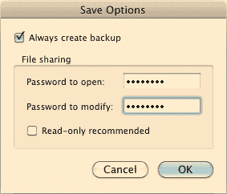
   **第 3 章：创建高效工作簿和模板**
   `图 3-2.`在`保存选项`对话框中，可以应用`打开密码`、`修改密码`或两者。还可以设置 Excel 自动备份工作簿，或建议他人以只读方式打开。

2. 如果希望 Excel 在每次保存时自动创建此工作簿的备份，请选中`始终创建备份`复选框。
   `注意：`Excel 创建自动备份的方法是将现有已保存的工作簿版本重命名为“Backup of”加上原始文件名（例如“Backup of Office Performance.xlsx”），然后将当前版本的工作簿保存为一个新文件。这意味着备份的是工作簿的上一个保存版本，而非最新版本，但只要频繁保存，你几乎可以恢复所有工作成果。
   Excel 会将备份文件保存在与原始文件相同的文件夹中。

3. 要应用`打开密码`，请在`打开密码`文本框中输入密码。

4. 要应用`修改密码`，请在`修改密码`文本框中输入密码。

5. 如果你想建议他人以只读状态打开工作簿，使其无法保存更改，请选中`建议只读`复选框。
   `警告：`请避免使用`建议只读`功能。除非你的同事格外配合，否则它无法阻止他们编辑工作簿。要想强制他们以只读方式打开工作簿，请为工作簿设置`修改密码`，并且不要与同事共享。

6. 单击`确定`按钮。如果你设置了任一类型的密码，Excel 会显示`确认密码`对话框（见图 3-3），提示你再次输入密码（以确保输入正确）。输入密码，然后单击`确定`按钮。
   [www.it-ebooks.info](http://www.it-ebooks.info/)
   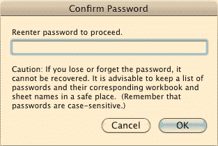
   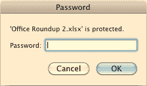
   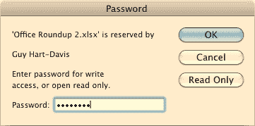
   **第 3 章：创建高效工作簿和模板**
   `图 3-3.`在`确认密码`对话框中再次输入密码。如果你同时设置了`打开密码`和`修改密码`，`确认密码`对话框会打开两次——第一次用于`打开密码`（此处称为“继续密码”），第二次用于`修改密码`。

7. 当 Excel 返回`另存为`对话框后，像往常一样完成工作簿的保存。

当你打开一个受密码保护的工作簿时，Excel 会显示`密码`对话框。
对话框。图 3-4 左侧屏幕显示了"打开密码"的"密码"对话框；要么提供密码，要么无法打开工作簿。图 3-4 右侧屏幕显示了"修改权限密码"的"密码"对话框；这里，你可以提供密码并单击"确定"按钮以打开工作簿进行编辑，或者不提供密码直接单击"只读"按钮以打开工作簿，但无法保存对其所做的更改。
`图 3-4.`当你尝试打开一个受"打开密码"保护的工作簿时，"密码"对话框会要求输入密码（左图）。如果工作簿设置了"修改权限密码"，"密码"对话框会包含"只读"按钮（右图），允许你在不提供密码的情况下打开工作簿。

要从工作簿中删除密码，请执行以下步骤：

1. 打开工作簿，当`Excel`要求时提供密码。
2. 选择"文件" -> "另存为"以显示"另存为"对话框。
3. 单击"选项"按钮以显示"保存选项"对话框。
4. 根据需要，删除"打开权限密码"文本框或"修改权限密码"文本框中的密码。
   [www.it-ebooks.info](http://www.it-ebooks.info/)
   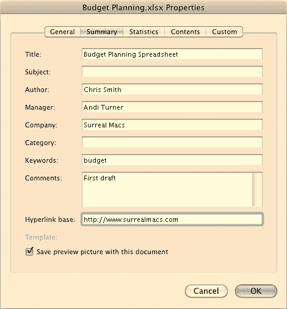
   **第 90 页**
   **第 3 章：创建有效的工作簿和模板**

5. 单击"确定"按钮关闭"保存选项"对话框。`Excel`会返回"另存为"对话框。
6. 单击"保存"按钮，使用原始名称和位置保存工作簿。
   `Excel`会显示一个对话框，确认你要覆盖该文件。
7. 单击"替换"按钮。`Excel`会保存没有密码的工作簿。

# 输入工作簿属性

如果你在"常规"偏好设置窗格中选中了"提示输入工作簿属性"复选框，则当你首次保存工作簿时，`Excel`会自动显示"属性"对话框。如图 3-5 所示，"属性"对话框包含五个选项卡："常规"、"摘要"、"统计"、"内容"和"自定义"。你只能在"摘要"选项卡和"自定义"选项卡中输入数据，因此首先单击"摘要"选项卡将其置于前端。

`图 3-5.`在"属性"对话框的"摘要"选项卡的字段中输入工作簿的详细信息。
[www.it-ebooks.info](http://www.it-ebooks.info/)
**第 3 章：创建有效的工作簿和模板**
**第 91 页**

`注意：`"属性"对话框的"常规"选项卡包含文件名称、类型（例如，`Microsoft Excel`工作簿）、位置（包含工作簿的文件夹）、创建日期（首次保存工作簿的日期）和上次修改日期（上次保存工作簿的日期）的只读信息。`Excel`在你首次保存工作簿之前不会编译这些信息，因此当你在首次保存文件时`Excel`自动显示"属性"对话框，这些字段将是空白的。"常规"选项卡还包含一个"只读"复选框和一个"隐藏"复选框。"统计"选项卡包含文件创建时间、上次修改时间、上次打印时间、上次保存文件的用户名、修订号以及总编辑时间的只读信息。
"内容"选项卡包含文档的工作表、图表工作表、宏工作表以及对话框工作表的列表。

## 在"摘要"选项卡上输入标准属性

在"摘要"选项卡的字段中输入相关详细信息——工作簿的标题和主题、你的姓名、经理的姓名等。`Excel`会将你的用户名填入"作者"框中，但其他字段需要你自己填写。即使`Excel`正确地输入了你的姓名（而不是像"授权用户"这样的内容，这可能被设置为你的用户名），你可能也希望更改"作者"字段以包含同事或业务团队——或者将责任推给你的经理。

`注意：`在"超链接基础"框中，你可以输入构成工作簿中超链接基础的`URL`。例如，如果所有`URL`都以`http://www.surrealmacs.com`开头，请输入该地址`http://www.surrealmacs.com`。

# 超链接基础框中的 URL

随后，你只需在工作表中输入每个 URL 的剩余部分。（对于不使用超链接基础的 URL，在工作表中输入完整的 URL。）如果你希望 Excel 在工作簿中包含预览，请选中 `使用此文档保存预览图片` 复选框。保存预览可以让工作簿在“快速查看”中更易识别，而且只会让工作簿文件略微变大，因此通常是个好主意。

**提示：** 你可以使用“聚焦”搜索，通过 `标题`、`主题`、`作者`、`关键词` 和 `批注` 字段进行查找——因此，你可能希望在工作簿中填写这些字段。

## 在“自定义”选项卡上输入额外数据

“摘要”选项卡上的字段足以存储基本的元数据，但如果你需要严格管理工作簿，则希望在其中存储更多属性信息。为此，请点击 `自定义` 选项卡以将其显示出来（参见图 3–6）。在此你将看到一系列内置属性，包括 `客户`、`部门`、`完成日期` 和 `项目`。你也可以创建自己的属性。

**图 3–6.** 在“属性”对话框的“自定义”选项卡上，你可以为多种内置属性输入数据，或创建你自己的额外属性。你还可以将属性链接到工作簿中的内容。

若要创建自定义属性，请在 `名称` 文本框中输入其名称。你也可以将工作簿中命名区域第一个单元格的内容分配给一个属性。这一功能使你能够自动将特定单元格的内容存储到属性中，从而使其与其他属性信息一起被建立索引。

若要添加属性信息，请遵循以下步骤：

1.  **选择属性：**
    -   如果属性是内置的，请在 `名称` 列表框中点击其名称。
    -   若要创建自定义属性，请在 `名称` 框中输入一个新名称。

2.  **在“类型”弹出菜单列表中**，为属性选择适当的类型：`文本`、`日期`、`数字` 或 `是或否`。如果你正在将属性链接到工作簿中的某个区域，则此选择不相关。

3.  **视情况输入属性数据：**
    -   文本、日期或数字值。在 `值` 文本框中输入该值。
    -   是或否。选择 `是` 选项按钮或 `否` 选项按钮。
    -   工作表中命名区域包含的信息。选中 `链接到内容` 复选框。Excel 会显示一个 `源` 弹出菜单，其中包含工作簿中的命名区域。从此列表中选择区域。

4.  **点击 `添加` 按钮。** Excel 会将属性和数据添加到 `属性` 列表框中。

若要删除某个字段，请在 `属性` 列表框中将其选中，然后点击 `删除` 按钮。

## 使用属性查找工作簿

当你在工作簿中输入了属性后，你可以使用属性信息在使用“聚焦”搜索时更轻松地识别工作簿。当你有很多工作簿并且需要快速找到正确的那一个时，这非常有用。

若要使用“聚焦”中的属性信息进行搜索，请遵循以下步骤：

1.  `Ctrl+单击` 或右键点击程序坞上的 `访达` 图标，然后在上下文菜单中点击 `新建访达窗口`，以打开一个新的访达窗口。如果你没有打开任何其他访达窗口，也可以直接点击程序坞上的 `访达` 图标来打开一个新窗口。

2.  导航至你想开始搜索的文件夹。例如，如果你将所有工作簿都存放在同一个文件夹中，则选择该文件夹，而不是搜索整个 Mac 及其连接的驱动器。

3.  选择 `文件` > `查找` 或按 `Cmd+F` 切换到搜索模式。

4.  在窗口顶部的搜索栏中，点击你在步骤 2 中选择的文件夹。

5.  点击搜索栏右端的 `+` 按钮，显示一行用于设置搜索的控件。图 3–7 显示了一个带有搜索条件的搜索窗口……

**图 3–7.** 将属性信息添加到工作簿后，您可以使用其属性来定位工作簿。

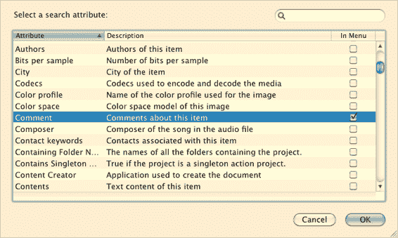

**94**

**第 3 章：创建高效的工作簿和模板**

6.  在搜索控件所在行，打开 `任意` 弹出菜单，然后点击 `其他`。

7.  在弹出菜单中选择 `其他` 后，在 Finder 显示的文本框中输入 `Microsoft Excel 工作簿`。

8.  点击第一行搜索控件末尾的 `+` 按钮，以显示另一行。

9.  打开左侧弹出菜单，然后点击 `其他` 以显示 `选择搜索属性` 对话框（参见图 3–8）。

**图 3–8.** 在 `选择搜索属性` 对话框中，点击您要搜索的属性。如果您希望该属性在搜索中更易于使用，请选中 `在菜单中` 复选框。

10. 点击您要用于搜索的属性（即，特性）。

使用 `标题`、`主题`、`作者`、`关键词` 或 `备注` 属性通常是查找已设置属性的 Excel 工作簿的最佳方式。

**提示：** 如果您需要频繁地按某个特定属性进行搜索，请在该属性所在行选中 `在菜单中` 复选框，以便 Mac OS X 将该属性包含在弹出菜单中。这样，您就无需打开 `选择搜索属性` 对话框来访问该属性了。

11. 点击 `确定` 按钮关闭 `选择搜索属性` 对话框。您选择的属性将出现在弹出菜单中。

12. 使用该行上的其余控件来指定比较条件。例如，使用 `标题 包含 budget` 来搜索其 `标题` 属性包含单词 `budget` 的工作簿。

**第 3 章：创建高效的工作簿和模板**

**95**

13. 添加所需的任何其他搜索条件。例如，您可能只想查找过去两周内修改过的工作簿，或者其 `作者` 属性包含您上司名字的工作簿。

每完成一个条件，Finder 窗口就会显示匹配工作簿的列表。一旦找到您想要的工作簿，您可以通过双击将其打开。或者，如果您需要在不打开的情况下快速查看其内容，请按 `空格键` 或点击工具栏上的 `快速查看` 按钮。

**提示：** 当您创建了这样的搜索后，可以点击搜索窗口右上角的 `存储` 按钮，将其保存为智能文件夹。智能文件夹是 Mac OS X 对已保存搜索的称呼。在打开的 `存储为` 对话框中，为智能文件夹键入名称，并选择存储该文件夹的位置；除非有更好的位置，否则默认的 `已存储的搜索` 文件夹就很合适。如果您希望将智能文件夹添加到边栏中的 `搜索范围` 列表中以便随时访问，请选中 `添加到边栏` 复选框。

## 保存工作簿以供旧版 Excel 使用

多年来，微软为 Excel 添加了许多功能，并多次更改了其文件格式。因此，出现了两个问题：

-   旧版 Excel 可能无法打开您在 Excel 2011 中创建的工作簿。如果旧版能够打开该工作簿，也可能无法正确显示。

-   旧版 Excel 无法支持后续版本中添加的功能。例如，微软在 Excel 2011 中添加了迷你图（单元格内图表）；早期版本（如 Excel 2008 和 Excel 2004）则没有迷你图。

与旧版 Excel 共享工作簿的首要条件是选择合适的文件格式：

-   **Excel 工作簿格式。** 使用此格式与 Excel 2011、Mac 版 Excel 2008、Windows 版 Excel 2010 或 Windows 版 Excel 2007 共享。只要计算机安装了能够读取此文件格式（微软在 Excel 2007 中引入）的筛选器，也可以与 Mac 版 Excel 2004 或 Windows 版 Excel 2003 共享。此格式使用 `.xlsx` 文件扩展名。

**注意：** 你可以从 Microsoft 网站（`www.microsoft.com/downloads/`）免费下载这些筛选器。对于 Windows，请查找 `Microsoft Office Compatibility Pack for Word, Excel, and PowerPoint File Formats` 的下载。对于 Mac，请查找 `Open XML File Format Converter for Mac` 的下载。

-   `Excel 97–2004 Workbook 格式`。此格式用于与 `Excel 2004 for Mac`、`Excel 2003 for Windows` 或更旧版本的 `Excel` 共享。此格式使用 `.xls` 文件扩展名，也适用于与其他电子表格应用程序共享。

要将工作簿文件保存为与当前格式不同的格式，请按以下步骤操作：

1.  从菜单栏中选择 `File > Save As`，或按下 `Cmd+Option+S` 以显示 `Save As` 对话框。

2.  在 `Format` 弹出菜单中，选择你希望使用的格式。

3.  （可选）在 `Save As` 文本框中更改文件名，或选择不同的文件夹。由于 `Excel Workbook` 格式和 `Excel 97–2004 Workbook` 格式使用不同的文件扩展名，你通常无需更改名称——但拥有两个名称几乎相同的工作簿可能会造成混淆。

4.  点击 `Save` 按钮。`Excel` 会关闭 `Save As` 对话框并保存工作簿。

第二个要点是确保保存的文件尽可能与早期版本的 `Excel` 兼容。为了帮助你识别潜在问题并（如果需要的话）排除它们，`Excel` 的工具箱中包含了 `Compatibility Report` 面板。你可以这样使用它：

1.  打开工作簿（如果尚未打开）。

## 使用兼容性检查器

2. 选择 `View > Compatibility Report`，打开工具箱，并将 `Compatibility Report` 面板置于前端。

3. 打开 `Check compatibility with` 弹出菜单，然后点击你希望确保工作簿兼容的应用程序版本。`Results` 框中会显示一系列可能存在的问题（参见图 3–9）。

[www.it-ebooks.info](http://www.it-ebooks.info/)

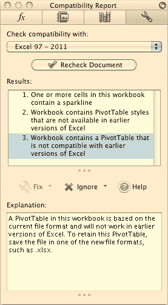

图 3–9. 在 `Compatibility Report` 面板中，选择用于检查工作簿兼容性的 `Excel` 版本。然后你可以选择修复哪些问题以及忽略哪些问题。

4. 要查看某个问题的详细信息，请在 `Results` 框中点击它。`Explanation` 框会显示该问题的描述。

5. 要修复某个问题，请在 `Results` 框中点击它。如果 `Fix` 按钮可用，请点击它来修复此问题的当前实例。要修复所有实例，请点击 `Fix` 下拉按钮，然后点击菜单中的 `Fix All`。

6. 要忽略某个问题，请在 `Results` 框中点击它，然后点击 `Ignore` 按钮。要忽略所有实例，请点击 `Ignore` 下拉按钮，然后点击菜单中的 `Ignore All`。要指示应用程序不再用此问题打扰你，请点击 `Ignore` 下拉按钮，然后点击菜单中的 `Don’t Show Again`。

### 组织工作簿中的工作表

当你创建一个空白工作簿时，`Excel` 会为其分配在 `General` 偏好设置面板的 `Sheets in new workbook` 框中设置的工作表数量——默认情况下，是一个单独的工作表。如果你需要更多工作表，可以轻松插入它们。并且你可以删除任何不再需要的工作表。

[www.it-ebooks.info](http://www.it-ebooks.info/)

`Excel` 最初会为每个工作表指定一个默认名称——`Sheet1`、`Sheet2`，以此类推。通常，你会希望给工作表起一些描述性名称，以便轻松识别它们。你可能还需要以不同的顺序重新排列工作表。

#### 插入新工作表

要插入一个新工作表，请执行以下任一操作：

- *在最后一个现有工作表之后插入一个新工作表。* 点击最后一个工作表标签后出现在标签栏上的 `Insert Sheet` 按钮。

# 插入、命名和管理工作表

## 插入新工作表

`Ctrl+单击`或右键单击现有工作表，然后在上下文菜单中单击`插入工作表`。

**提示：** Excel 在活动工作表后插入新工作表的默认键盘快捷键是`Shift+F11`。只有当 Mac OS X 未将`F11`用于其他目的（例如 Exposé 中的“显示桌面”功能）时，此快捷键才有效。如果 Mac OS X 已在使用`F11`，则需要使用第 2 章“创建自定义键盘快捷键”一节中介绍的方法，将`插入工作表`命令映射到其他快捷键。或者，你也可以更改使用`F11`的 Mac OS X 功能。

## 命名工作表

为了让工作表更易于识别，请为其指定一个描述性名称。双击工作表的标签以选中默认名称，输入所需名称，然后按`Return`键应用该名称。名称最多可使用 31 个字符——足以容纳几个单词。

## 更改工作表的标签颜色

如果你想让工作表的标签更醒目，可以`Ctrl+单击`或右键单击该标签，单击`标签颜色`以显示`标签颜色`窗口，然后单击标签的颜色。单击`关闭`按钮（标题栏左端的按钮）关闭`标签颜色`窗口。

**注意：** 如果复制工作表，副本将获得与原工作表相同的标签颜色——因此你可能需要更改颜色以使副本更容易区分。

[www.it-ebooks.info](http://www.it-ebooks.info/)

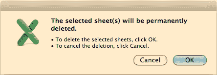

## 删除工作表

要删除工作表，请`Ctrl+单击`或右键单击其标签，然后在上下文菜单中单击`删除`。Excel 将显示一个对话框（见图 3-10）以再次确认你已准备好将其删除；单击`删除`按钮继续。

**图 3-10.** *单击“确定”按钮以确认要删除该工作表。*

## 重新排列工作簿中的工作表

要使工作簿中的工作表按你需要的顺序排列，你可以重新排列它们。移动工作表的快捷方式是单击其标签，将其向左或向右拖动，直到 Excel 在你想要放置的位置的工作表之间显示一个向下箭头，然后释放鼠标。

**提示：** 要移动两个或多个工作表，请先选择它们。要选择相邻显示的一系列工作表，请单击第一个工作表的标签，然后`Shift+单击`该系列另一端的工作表标签。要选择不相邻的工作表，请单击第一个工作表的标签，然后依次`Cmd+单击`其他每个工作表的标签。

拖动工作表标签对于短距离移动很方便，但当需要将工作表移动更远距离时，请改用`移动或复制`对话框。你还可以使用`移动或复制`对话框将工作表移动或复制到不同的工作簿。请按照以下步骤操作：

**1.** 如果要将工作表移动或复制到其他工作簿，请打开该工作簿。

**2.** 在源工作簿中，`Ctrl+单击`或右键单击工作表标签以显示上下文菜单。要移动多个工作表，请先选中它们，然后`Ctrl+单击`或右键单击其中一个选中的标签。

**3.** 在上下文菜单中，单击`移动或复制`项目以显示`移动或复制`对话框（见图 3-11）。

[www.it-ebooks.info](http://www.it-ebooks.info/)

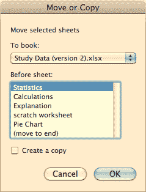

**图 3-11.** *使用“移动或复制”对话框，将单个或多个工作表移动到在单个工作簿内拖动不便的更远位置，或者将工作表移动或复制到另一个打开的工作簿。*

**4.** 在`工作簿`弹出菜单中，确保选中当前工作簿，除非你要将工作表移动到另一个工作簿——这种情况下，请选择该工作簿。

**5.** 在`工作表之前`列表框中，单击你想要放置所移动工作表之前的那张工作表。如果想将工作表放在工作簿的末尾，请选择`(移至最后)`项。

**6.** 如果要复制工作表到目标位置而非移动，请选中`建立副本`复选框。当目标位置是另一个工作簿时，复制最为有用，但你也可以在同一工作簿内复制。

**7.** 单击`确定`按钮关闭对话框。Excel 会将工作表移动或复制到你选择的目标位置。

## 工作表布局的四条简单规则

Excel 为你布局工作表提供了极大的灵活性。每个工作表包含超过 160 亿个单元格，并且你可以在一个工作簿中放置几乎任意数量的工作表。

**注意：** 如果你在一个工作簿中塞入大量工作表并为其填充全部数据，你可能会发现 Excel 拖慢了你的 Mac。如果出现这种情况，请将一些工作表移到另一个工作簿以提高性能。

以下是布局工作表时应遵循的四条规则，以使它们尽可能易于使用。

[www.it-ebooks.info](http://www.it-ebooks.info/)

**将不同主题放在不同工作表上。** 鉴于 Excel 的工作表可以包含大量信息，你可能倾向于将所有数据放在一个工作表中。但通常最好是将数据拆分，将不同的主题放在不同的工作表中。

**提示：** 为工作表标签赋予描述性标签，以便轻松选择所需的工作表。如果工作簿中的工作表太多，导致使用工作表标签导航不便，可以在前面创建一个摘要工作表，其中包含其他工作表及其内容的列表——以及可直接单击跳转到每个工作表的超链接。

**按列划分数据。** 布局数据时，应确保任何给定列中的单元格包含相同类型的数据。这样做可以让你按行对区域进行排序和筛选。

**将重要数据放在区域上方而不是旁边。** 当需要包含注释或其他解释性数据时，请将这些数据放在其相关区域的上方。不要将数据放在区域的左侧或右侧，因为如果你筛选区域仅显示某些值，Excel 可能会隐藏这些数据。

**将数据区域相互分隔开。** 如果在同一工作表中包含几种不同类型的数据，请将每种类型放在一个单独的区域中，并在各区域之间留出一个或多个空白列以及一个或多个空白行。这种额外的空间有助于 Excel 和你更容易地分别识别和选择各个区域。

## 同时在多个工作表上输入数据

有时，同时在多个工作表上输入数据可以节省时间。例如，如果某个工作簿需要为每个月的销售额创建一个单独的工作表，你可能需要创建 12 个结构相似的工作表。

输入数据，请按以下步骤操作：

**1.** 选择每个要接收数据的工作表的标签。例如，单击第一个标签，然后`Shift+单击`最后一个标签。选中的标签显示为白色而非灰色，如图 3-12 所示。Excel 会在标题栏中工作簿名称后显示`[工作组]`作为提醒。

[www.it-ebooks.info](http://www.it-ebooks.info/)

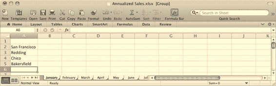

**图 3-12.** *要同时在多个工作表上输入数据，请选择每个工作表的标签，以便 Excel 在标题栏中添加 [工作组]。然后，你可以像往常一样在显示的工作表中输入数据。*

**2.** 现在，你可以在显示的工作表的单元格中输入数据。Excel 会将相同的数据输入到其他每个选中的工作表中。

**3.** 完成工作组操作后，单击一个未选中的标签以取消分组。

## 使用命名区域标识部分

在设置工作簿中的公式时，你通常需要引用

# 创建高效的工作簿和模板

特定单元格和区域。你可以始终使用地址引用单元格和区域，但这可能难以记忆——尤其是当你通过添加单元格、行或列来更改其位置时。

为了使引用更易于输入和识别，你可以为任何单元格或区域指定一个名称。之后，你可以通过该名称引用该单元格或区域。Excel 会跟踪每个名称的当前位置，因此即使你添加或删除单元格（或行或列），你也可以使用该名称，而无需担心其确切位置。

你还可以使用已命名区域来轻松导航工作表：要转到已命名区域，请打开引用区域中的弹出菜单，然后点击该区域的名称。

### 为单元格或区域指定名称

你可以快速使用引用区域或更正式地使用“定义名称”对话框为单元格或区域指定名称。使用“定义名称”对话框的优势在于，你也可以从此处管理现有的区域名称。

以下是创建名称的规则：
- 名称必须以字母或下划线开头。
- 名称只能包含字母、数字和下划线。不能包含空格或符号。
- 名称在工作簿中必须是唯一的。

### 快速为单元格或区域指定名称

要使用引用区域快速为单元格或区域指定名称，请执行以下步骤：
1. 选择要命名的单元格或区域。
2. 点击引用区域。Excel 会选择其当前内容，即活动单元格的引用（例如，`B5`）。
3. 键入单元格或区域的名称，然后按 `Return` 键应用它。

**注意**：如果你在引用区域中键入现有名称，Excel 会在你按 `Return` 键时选择该单元格或区域——就像你打开引用区域中的弹出菜单并点击了该名称一样。

### 使用“定义名称”对话框为单元格或区域指定名称

要使用“定义名称”对话框为单元格或区域指定名称，请执行以下步骤：
1. 选择要命名的单元格或区域。
2. 从菜单栏选择 `“插入”` > `“名称”` > `“定义”`，以显示“定义名称”对话框（如图 3–13 所示，已包含设置选择）。
3. 在“名称”文本框中，键入你要分配给单元格或区域的名称，以便于引用。
4. 确保“引用位置”框显示正确的单元格或区域。如果不是，请点击“折叠对话框”按钮，在工作表中选择正确的单元格或区域，然后再次点击“折叠对话框”按钮以恢复对话框。
5. 如果只想创建这一个名称，请点击“确定”按钮将名称应用于区域并关闭“定义名称”对话框。如果你想在关闭“定义名称”对话框之前创建更多名称，请点击“添加”按钮。

### 自动创建区域名称

如果你的工作表在某个区域的第一列或最后一列，或第一行或最后一行包含标题，你可以让 Excel 自动为你创建区域名称。此功能可以节省你的时间和精力。

当 Excel 创建已命名区域时，它会将你选择的区域分成大小相等的部分。例如，如果你使用图 3–14 所示的选择区域（`A1:F5`）的顶行创建已命名区域，Excel 会为单元格 `B2:B5` 创建一个名为 `Stockton` 的区域，为单元格 `C2:C5` 创建一个名为 `Modesto` 的区域，依此类推。Excel 会将标题中不允许出现在名称中的空格、标点、符号和其他字符替换为下划线——例如，标题 `City of Industry` 会生成名称 `City_of_Industry`。

> **图 3–14.** *利用所选区域中的标题创建命名区域，会生成名称为 `Stockton`（对应区域 `B2:B5`）、`Modesto`（对应区域 `C2:C5`）以及 `City_of_Industry`（对应区域 `F2:F5`）的命名区域。*

要自动创建名称，请按照以下步骤操作：
1.  在工作表中输入标题。为了创建名称，每个标题必须以字母开头，而不是数字。因此，如果你需要为包含（例如）年份的单元格创建名称，则需要在数字前添加一个或多个字母——例如使用 `Year 2011` 而不是单纯的 `2011`。
2.  选择包含标题的区域。标题必须位于所选区域的顶行、底行、最左列或最右列。
3.  选择 `“插入”` > `“名称”` > `“创建”` 以显示 `“创建名称”` 对话框（参见图 3–15）。

> **图 3–15.** *在 `“创建名称”` 对话框中，为你想要转换为区域名称的每个包含标题的行和列选中相应的复选框。*

4.  在 `“创建名称位于”` 框中，根据需要选中 `“顶行”` 复选框、`“最左列”` 复选框、`“底行”` 复选框和 `“最右列”` 复选框。
5.  单击 `“确定”` 按钮。Excel 会关闭 `“创建名称”` 对话框并创建名称。

Excel 不会显示对话框或以其他方式确认它已创建名称。如果你想检查名称是否存在，请打开 `“引用”` 区域上的弹出菜单，你会看到它们按字母顺序排列。

**注意：** 选择用于创建标签的区域时，你必须选择多行（如果标题在行中）或多列（如果标题在列中）。否则，Excel 会显示 `“所选区域无效”` 对话框。如果出现这种情况，请单击 `“确定”` 按钮并更改你的选择。

### 在公式中使用区域名称

命名区域后，你可以在公式中使用该名称，而不是单元格引用或区域引用。命名区域可以极大地节省时间，因为名称比单元格引用或区域引用更容易记忆和输入。

例如，如果你给某个单元格命名为 `Interest_Rate`，你可以像这样在公式中使用它：
```
=B1*Interest_Rate
```

当你的区域名称像这样直截了当时，你可能只想直接输入它们。

在其他时候，你可能会发现像这样粘贴名称会更方便：
1.  将活动单元格移动到你想放置公式的位置。
2.  像往常一样开始输入公式。例如，输入 `=`。
3.  当你输入到公式中需要该名称的部分时，选择 `“插入”` > `“名称”` > `“粘贴”` 以显示 `“粘贴名称”` 对话框（参见图 3–16）。

> **图 3–16.** *使用 `“粘贴名称”` 对话框将区域名称粘贴到公式中。你也可以粘贴所有区域名称及其位置的完整列表以供参考。*

4.  在 `“粘贴名称”` 列表框中，单击你想要粘贴的区域名称。
5.  单击 `“确定”` 按钮。Excel 会关闭 `“粘贴名称”` 对话框并粘贴该名称。

**提示：** 如果你想创建工作表中所有区域名称及其位置的列表，请将活动单元格定位到你想让列表开始的位置，选择 `“插入”` > `“名称”` > `“粘贴”` 以显示 `“粘贴名称”` 对话框，然后单击 `“粘贴列表”` 按钮。

### 删除区域名称

要删除区域名称，请按照以下步骤操作：
1.  从菜单栏中选择 `“插入”` > `“名称”` > `“定义”` 以显示 `“定义名称”` 对话框。
2.  在 `“工作簿中的名称”` 列表框中单击区域名称。
3.  单击 `“删除”` 按钮。
4.  根据需要删除其他区域名称，然后单击 `“关闭”` 按钮关闭 `“定义名称”` 对话框。

### 更改名称引用的单元格或区域

如果你需要更改名称引用的单元格或区域，请按照以下步骤操作：
1.  从菜单栏中选择 `“插入”` > `“名称”` > `“定义”` 以显示 `“定义名称”` 对话框。
2.  单击 `工作簿中的名称` 列表框中的现有名称。
3.  在 `引用位置` 框中三击以选中当前引用。
4.  在工作表中，单击单元格或选择新区域。（如果需要缩小 `定义名称` 对话框，可以先单击 `折叠对话框` 按钮，但通常直接操作更简便。）
5.  若要进行更改并关闭 `定义名称` 对话框，请单击 `确定` 按钮。若要进行更改但保持 `定义名称` 对话框打开，请单击 `添加` 按钮。

## 通过分级显示创建可折叠工作表

包含许多列或行数据的工作表，即使你按照第 1 章学到的方法冻结了屏幕上的标题，也难以导航。为了让导航更便捷，你可以使用 Excel 的分级显示功能创建一个可折叠的工作表，然后只展开任何特定时刻需要查看的部分。图 3-17 显示了一个包含分级显示的工作表，其中某些行和列已展开，其他行和列已折叠。

> **图 3-17.** *利用 Excel 的分级显示功能，可以创建可折叠和展开的工作表，只显示所需部分。*

分级显示功能最适用于数据按结构或层次排列的工作表。你可以为行创建最多八个层级，为列创建最多八个层级，从而精细控制分级显示。

你可以让 Excel 根据在使用公式布局的工作表中检测到的结构自动创建分级显示。这通常是最好的起点。如果发现自动分级显示不符合需求，你也可以手动创建分级显示，将层级精确放在所需位置。

### 让 Excel 自动创建分级显示

要让 Excel 自动创建分级显示，必须将工作表的结构用公式设置好。Excel 会利用这些公式来确定分级显示的层次，因此如果没有公式，分级显示就无法工作。你无需输入所有行和列的数据——只需输入包含公式的行和列，以及公式所引用的足够的数据行和列即可。

图 3-18 左侧的屏幕显示了一个用公式构建结构的工作表开头部分，这些公式将生成分级显示。以下是你能看到的内容：

- 最左侧的列（A 列）包含一个庞大而邪恶的组织（我们姑且隐去其名）的部门、州和城市办事处。你可以看到西部部门（包含加利福尼亚、俄勒冈、华盛顿、爱达荷、内华达、犹他和亚利桑那州）和中部部门（包括新墨西哥、蒙大拿、科罗拉多以及一些看不到的州）。

- 每个州仅包含几个办事处以构建正确的结构。结构就绪后，你可以添加额外所需的行。

- 每个州的行都包含一个 `SUM()` 公式，用于汇总各城市办事处的结果。例如，加利福尼亚州的行在单元格 `B3` 中包含公式 `=SUM(B4:B5)`，汇总了贝克尔斯菲尔德和奇科两地的丰富收益。

- 每个部门的行都包含一个 `SUM()` 公式，用于汇总该部门各州的结果。例如，西部部门的行在单元格 `B2` 中包含公式 `=SUM(B3,B6,B9,B12,B15,B18,B22)`，汇总了加利福尼亚州、俄勒冈州等地的结果。

[www.it-ebooks.info](http://www.it-ebooks.info/)

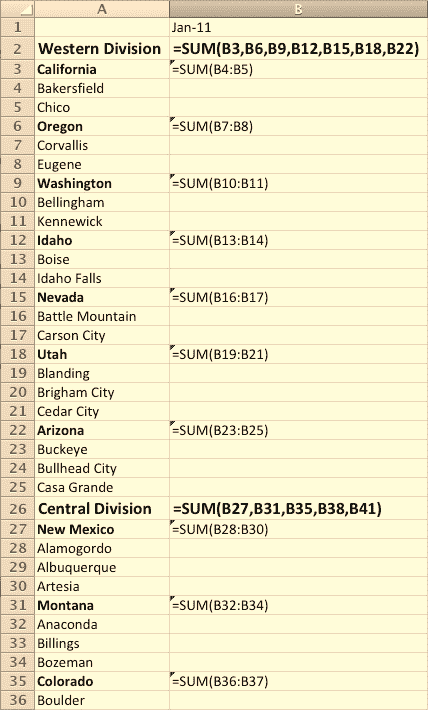

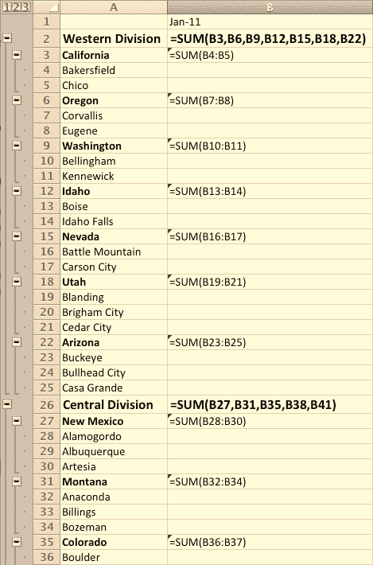

**109**

## 第 3 章：创建高效工作簿和模板

**图 3-18.** *通过设置包含公式层次结构的工作表（左图），你可以利用 Excel 的自动分级显示功能，基于这些公式创建分级显示（右图）。*

当公式就位后，从功能区选择 `数据` → `分组和分级显示` → `自动建立分级显示`，或从菜单栏选择 `数据` → `分组和分级显示` → `自动建立分级显示`，即可自动创建分级显示。图 3-18 右侧的屏幕显示了同一数据范围被转换为包含三个层级的分级显示。你可以单击左侧分级显示栏中的 `–` 号来折叠某个部分，并单击替换 `–` 号的 `+` 号再次展开该部分。

如果分级显示结果符合预期，你可以输入剩余公式和数据。在许多情况下，你可以使用 `自动填充` 功能（在第 1 章中讨论过）基于现有公式自动插入行或列中的公式。

如果自动分级显示不适合你，请尝试更改自动分级显示的设置，如下所述。或者，通过从功能区选择 `数据` → `分组和分级显示` → `取消组合` → `清除分级显示`，或从菜单栏选择 `数据` → `分组和分级显示` → `清除分级显示` 来清除分级显示。然后，你可以手动创建分级显示，详见下一节。

[www.it-ebooks.info](http://www.it-ebooks.info/)

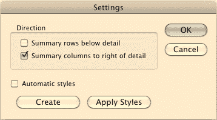

**110**

## 第 3 章：创建高效工作簿和模板

### 更改分级显示设置

要更改 Excel 用于分级显示的设置，请按以下步骤操作：

1. 选择数据范围：
    - 要更改现有分级显示，请单击分级显示中的任意单元格。
    - 要创建新分级显示，请选择数据范围。

2. 从菜单栏选择 `数据` → `分组和分级显示` → `设置`，以显示 `设置` 对话框（见图 3-19）。

**图 3-19.** *使用“设置”对话框控制 Excel 从工作表中创建自动分级显示的方式。*

3. 在 `方向` 框中，如果汇总行位于明细行下方，请选中 `明细数据的下方` 复选框。如果工作表使用了位于被汇总列右侧的汇总列，请选中 `明细数据的右侧` 复选框。

4. 如果希望 Excel 自动将样式应用于分级显示以区分不同层级，请选中 `自动设置样式` 复选框。Excel 会将 `RowLevel_1` 样式应用于第一级行，`RowLevel_2` 样式应用于第二级行，依此类推。对于列，Excel 使用名为 `ColLevel_1`、`ColLevel_2` 等的样式。

5. 单击命令按钮关闭 `设置` 对话框并执行所需操作：
    - *创建。* 单击此按钮创建新的分级显示。
    - *应用样式。* 单击此按钮将样式应用于现有分级显示。你需要先选中 `自动设置样式` 复选框。
    - *确定。* 单击此按钮将你所选的 `方向` 设置应用于现有分级显示。

[www.it-ebooks.info](http://www.it-ebooks.info/)

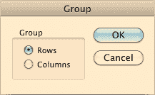

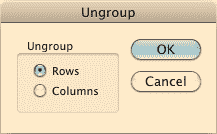

**111**

## 第 3 章：创建高效工作簿和模板

### 手动创建分级显示

很多时候，将工作表结构完整构建好以便 Excel 自动进行分级显示并不方便。在这些情况下，可以使用 `组合` 命令手动创建分级显示。你也可以使用 `组合` 命令（及其对应的 `取消组合` 命令）来调整 Excel 已为你创建的分级显示。

#### 对行或列进行分组

要对行或列进行分组，请按以下步骤操作：

1. 选择要分组的行或列中的单元格。例如：
    - 要将第 4 行和第 5 行分组到第 3 行下，请选择第 4 行和第 5 行中的单元格。
    - 要将 B 列、C 列和 D 列分组到 E 列下，请选择 B 列、C 列和 D 列中的单元格。

**提示：** 你可以通过选择整行或整列（而非仅其中的单元格）来加速对行或列进行分组或取消分组的过程。这样做时，Excel 不会显示 `组合` 对话框或 `取消组合` 对话框，因为它能根据选择判断你希望对行还是列进行分组或取消分组。

2. 从功能区选择 **数据组与大纲组**（点击组按钮的主体部分，而非弹出按钮），或从菜单栏选择 **数据组与大纲组**，以显示 **分组** 对话框（如图 3–20 左图所示）。

**图 3–20.** *在分组对话框（左图）或取消分组对话框（右图）中，根据需要选中 `行` 选项按钮或 `列` 选项按钮。*

3. 如果要按行分组，请选中 `行` 选项按钮。如果要按列分组，请选中 `列` 选项按钮。

4. 单击 `确定` 按钮关闭 **分组** 对话框。`Excel` 会应用分组。

根据需要重复此过程以创建更多组。例如，在我之前展示的工作表中，你首先应将城市分组到其所属的州下，然后将州分组到其所属的区域下。

[www.it-ebooks.info](http://www.it-ebooks.info/)


**112**

## 第 3 章：创建高效的工作簿和模板

#### 取消行或列的分组

要取消行或列的分组，请按以下步骤操作：

1. 选中要取消分组的范围。

2. 从功能区选择 **数据组与大纲组 取消分组**（点击取消分组按钮的主体部分，而非弹出按钮），或从菜单栏选择 **数据组与大纲组 取消分组**，以显示 **取消分组** 对话框（如图 3–20 右图所示）。

3. 根据需要选中 `行` 选项按钮或 `列` 选项按钮。

4. 单击 `确定` 按钮关闭 **取消分组** 对话框并移除分组。

#### 展开和折叠大纲

创建大纲后，你可以展开或折叠它，以便仅显示所需内容。

点击要查看的列级别的 **列级别** 按钮。例如，点击 **列级别 2** 按钮以显示所有第二级列。

点击要查看的行级别的 **行级别** 按钮。例如，点击 **行级别 3** 按钮以显示所有第三级行。

点击 `+` 按钮展开已折叠的行或列部分，或点击 `–` 按钮折叠已展开的部分。

#### 添加或删除行或列后更新大纲

在工作表大纲区域内添加或删除行或列后，你需要更新大纲。请按以下步骤操作：

1. 将活动单元格放置在大纲区域内的任意位置。

2. 从功能区选择 **数据组与大纲组 组 自动建立分级显示**，或从菜单栏选择 **数据组与大纲组 自动建立分级显示**。`Excel` 会显示如图 3–21 所示的无标题对话框。

**图 3–21.** *单击此对话框中的 `确定` 按钮，以使用你所添加或删除的行或列的详细信息来更新大纲。*

[www.it-ebooks.info](http://www.it-ebooks.info/)

**第 3 章：创建高效的工作簿和模板**

**113**

3. 单击 `确定` 按钮。`Excel` 会更新大纲。

#### 移除大纲

要从工作表中移除大纲，请选择 **数据组与大纲组 取消分组 清除分级显示**。

### 充分利用模板

如你所知，你在 `Excel` 中创建的每个工作簿都基于一个模板。如果你创建一个空白工作簿，`Excel` 会使用一个骨架工作簿模板，该模板给予你完全的自由度，但不会为你节省任何时间。相比之下，如果你使用一个附带完整内容和格式的模板，你可能只需填写少量信息即可生成一个完整的工作簿。

正如你在本章前面所见，`Excel` 带有多种多样的模板，并且你可以通过打开 **Excel 工作簿库** 对话框中的 **在线模板** 类别，在网络上访问更多模板。但要最大程度地节省时间，你几乎肯定需要创建自己的模板，无论是从零开始创建，还是通过自定义现有模板。

为充分利用模板，请遵循以下建议：

第 3 章：创建高效的工作簿和模板

## 仔细评估你的需求

检查你和同事最常创建的工作簿——销售分析、项目规划、预算、发票、考勤表或其他任何类型。弄清楚哪些是。

在这些工作簿中，您和同事可以使用模板更快速、更轻松地创建。

## 将模板基于现有工作簿或模板

如果您有现有工作簿，其中包含模板所需的大部分（甚至部分）信息，请打开该工作簿的副本，然后将其另存为模板。（您将在本节后面学习这两个操作。）通过从其他现有工作簿或模板中复制并粘贴项目到新模板中，您可以节省更多时间和精力。

## 使模板尽可能完整

需求会有所不同，但通常需要执行以下操作：

- 插入基于模板的大多数工作簿所需的工作表数量。
- 为工作表命名。如果这有助于快速识别关键选项卡，则对工作表选项卡进行着色。
- 使用标准文本和公式设置每个工作表。
- 使用验证格式化单元格，以确保用户输入合适的值。
- 应用条件格式使极值突出显示。
- 向单元格添加批注，说明哪些信息是必需的，哪些是可选的。

## 使用宏自动执行模板

为了帮助用户快速准确地输入和操作数据，您可能需要向模板添加宏。有关创建和使用宏的信息，请参见第 14 章。

## 基于现有工作簿创建模板

要根据现有工作簿创建模板，请执行以下步骤：

1. 如果 Excel 尚未运行，请打开它。
2. 单击标准工具栏上的“打开”按钮（或按 `Cmd+O`）以显示“打开：Microsoft Excel”对话框。
3. 导航到包含现有工作簿的文件夹，然后单击该工作簿。
4. 单击“打开”弹出菜单，然后选择“副本”，而不是默认选择“原始”。

> **注意：** 打开现有工作簿的副本有助于避免在忘记使用“另存为”命令以不同名称保存时意外覆盖它。使用“另存为”命令几乎不能再简单了——但在执行该命令之前，您也很容易分心。

5. 单击“打开”按钮以打开该工作簿的副本。
   您现在可以按照下一节所述保存模板。

## 保存模板

要保存模板，请照常使用“保存”命令，但您需要选择最适合您需求的模板格式，并选择正确的文件夹来保存模板。

要将活动工作簿另存为模板，请执行以下步骤：

1. 选择“文件”>“保存”或按 `Cmd+S` 以显示“另存为”对话框。
2. 打开“格式”弹出菜单，然后选择“Excel 模板 (.xltx)”。

> **注意：** 如果需要在模板中存储宏，请选择“Excel 启用宏的模板 (.xltm)”。如果使用 Excel 2004（Mac）或 Excel 2003（Windows）及更早版本的同事需要使用该模板，请在“格式”弹出菜单中选择“Excel 97–2004 (.xlt)”；此模板格式在必要时可以包含宏。

3. 选择存储模板的文件夹：
   - 当您在“格式”弹出菜单中选择一种模板格式时，Excel 会自动将文件夹更改为您的“我的模板”文件夹。
   - 如果您打算与同事共享模板，您可能希望将其存储在网络上的文件夹中。
4. 单击“保存”按钮。

> **注意：** 要基于存储在 Excel 检查的模板文件夹之外的其他文件夹中的模板创建工作簿，请显示“打开”对话框并导航到该文件夹。单击该模板，在“打开”弹出菜单中选择“副本”，然后单击“打开”按钮。然后您可以使用“保存”命令保存新的工作簿。

## 总结

在本章中，您学习了如何创建可以流畅高效地工作的工作簿和模板。您现在知道如何基于模板创建工作簿，如何选择保存它们的最佳文件格式，以及如何添加属性信息以使工作簿更易于识别。您还可以创建自己的模板——如有需要，可基于现有工作簿或模板创建。

我们还研究了如何组织工作簿中的工作表，如何逻辑地布局数据，以及如何同时在多个工作表上快速输入数据。您了解了如何通过创建命名范围来快速识别工作表的各个部分，以及如何通过创建大纲使大型工作表易于管理。

在下一章中，我将向您展示如何快速有效地格式化工作簿。


