# 第 4 章：快速高效地格式化工作表

要使工作表显示所需信息并以易于理解的方式呈现，您需要对其进行格式化。本章介绍如何使用 Excel 提供的各种工具快速有效地格式化工作表。

首先必须格式化工作表的行和列。您可能需要插入或删除行、列或单元格块；经常需要隐藏某些行或列以将其移开或使其免受窥视；并且几乎肯定需要更改某些列宽和行高。我们将首先介绍这些内容。

之后，我将向您展示如何格式化单元格和区域，如何应用条件格式以快速标记需要关注的值，以及如何使用数据验证来检查无效条目。

在本章末尾，我们将了解如何使用表格格式或 Excel 样式快速格式化工作表，以及如何向工作表添加页眉和页脚，以便轻松识别它们及其内容。

## 处理行和列

在本节中，您将学习如何插入和删除行、列和单元格；更改列宽和行高；以及在不需要查看行或列时隐藏它们。

### 插入和删除行、列和单元格

在布置工作表时，您通常需要插入或删除整个列或行。有时您可能还需要删除一个单元格块，而无需删除整个列或行。

#### 插入列和行

插入列或行最简单的方法是按住 `Ctrl` 键单击或右键单击要在其前插入新列的现有列或行的标题，然后在上下文菜单中单击“插入”。

要插入多列或多行，请先选择相同数量的列或行。例如，要在 F 列之前插入三列，请拖动以选择 F、G 和 H 列的标题；然后按住 `Ctrl` 键单击或右键单击所选标题中的任意位置，并在上下文菜单中单击“插入”。

您也可以通过选择要在其前添加新列的列中的单元格，然后执行以下任一命令来插入列：

- **功能区：** 选择 `开始` > `单元格` > `插入` > `插入工作表列`。
- **菜单栏：** 选择 `插入` > `列`。

> **注意：** 如果 Excel 窗口宽度不足以使“插入”按钮、“删除”按钮和“格式”按钮出现在“单元格”组中，则会显示一个“操作”弹出按钮。单击此按钮可显示一个弹出菜单，其中包含“插入”子菜单、“删除”子菜单和“格式”子菜单。单击相应的菜单，然后从中做出选择。

类似地，您可以通过选择要在其前添加新行的行中的单元格，然后执行以下任一命令来插入行：

- **功能区：** 选择 `开始` > `单元格` > `插入` > `插入工作表行`。
- **菜单栏：** 选择 `插入` > `行`。

如前所述，如果要插入多列或多行，请先选择相应数量的列或行中的单元格。

> **注意：** 功能区 `开始` 选项卡上 `单元格` 组中 `插入` 按钮的具体插入内容取决于您所选定的对象。选择一列或多列可使 `插入` 按钮插入列；选择一行或多行可使 `插入` 按钮插入行；或者选择一个或多个单元格可使 `插入` 按钮插入单元格。如果您尚未选择合适的项目，请单击 `插入` 弹出按钮（而非主 `插入` 按钮），然后从弹出菜单中选择所需项目。

### 插入部分单元格

若要仅插入部分单元格，请遵循以下步骤：

1. 选择要在其之前插入单元格的区域。
2. 选择 `开始` > `单元格` > `插入` > `插入单元格` 以显示 `插入` 对话框（见图 4–1）。
   > **图 4–1.** *插入单元格块时，点击 `插入` 对话框中的 `活动单元格右移` 或 `活动单元格下移` 选项按钮，告知 Excel 现有单元格的移动方向。*
3. 选择 `活动单元格右移` 选项按钮将现有单元格向右移动。选择 `活动单元格下移` 选项按钮将现有单元格在工作表中向下移动。您也可以选择 `整行` 选项按钮来插入整行，或选择 `整列` 选项按钮来插入整列，但通常使用前述方法插入行或列更为简便。
4. 点击 `确定` 按钮关闭 `插入` 对话框。Excel 将插入单元格。

### 删除列或行

删除列或行最简单的方法是按住 `Ctrl` 键单击或右键单击其列标或行号，然后在上下文菜单中点击 `删除`。或者，您也可以选中行或列，然后从菜单栏中选择 `编辑` > `删除`，或从功能区选择 `开始` > `单元格` > `删除`（点击 `删除` 按钮的主体部分）。

您无需选中整列或整行，只需点击其中的一个单元格，选择 `开始` > `单元格` > `删除`（点击 `删除` 弹出按钮），然后根据需求点击 `删除列` 或 `删除行`。通常，先选中行或列会更方便。

#### 删除部分单元格

若要仅删除部分单元格，请选中它们，然后选择 `开始` > `单元格` > `删除` > `删除单元格`。在 Excel 显示的 `删除` 对话框（见图 4–2）中，根据需要选择 `活动单元格左移` 或 `活动单元格上移` 选项按钮，然后点击 `确定` 按钮。

**图 4–2.** `删除单元格块时，点击`删除`对话框中的`活动单元格左移`或`活动单元格上移`选项按钮，告知 Excel 如何填补工作表中的空缺。`

**注意：** 在`删除`对话框中，您可以选择`整行`选项按钮以删除所选单元格所在的行，或选择`整列`选项按钮以删除所在的列。当您意识到需要删除整行或整列，而不仅仅是单元格块时，此功能非常有用。否则，您无需打开`删除`对话框即可删除行或列。

### 设置行高

Excel 通常会根据行中最高的字符或对象自动设置行高。例如，如果您在单元格中输入内容，选中该单元格，然后在`开始`选项卡的`字体`组中多次点击`增大字号`按钮，Excel 会自动增加行高，以便为最高的字符留出足够空间。

如果 Excel 未能自动设置行高，请选择`开始`>`单元格`>`格式`>`自动调整行高`以强制执行自动匹配。

对于许多工作表来说，自动行高效果不错，但有时您可能需要手动设置行高。请使用以下任一方法：

- 拖动行号的下边框。将鼠标指针移至行号的下边框，待指针变为上下双向箭头后，点击并拖动边框。
- `up`（使行变浅）或 `down`（使行变深）。
- 使用“行高”对话框。`Ctrl+click` 或右键单击行标题，然后在上下文菜单中单击“行高”，以显示“行高”对话框（见图 4-3）。键入所需的行高，然后单击“确定”按钮。

[www.it-ebooks.info](http://www.it-ebooks.info/)
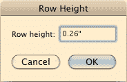

## 第 4 章：快速高效地格式化工作表

**图 4-3.** *当需要精确设置行高时，请使用“行高”对话框。*

**注意：** 你也可以通过从功能区选择“开始” → “单元格” → “格式” → “行高”，或从菜单栏选择“格式” → “行” → “行高”，来显示“行高”对话框。

### 设置列宽

与行高不同，当你向工作表中输入数据时，Excel 不会自动调整列宽。这是因为许多工作表需要单元格中有较长的条目，因此自动调整会妨碍工作。

你可以通过以下任一方式快速设置列宽：

- 自动调整列宽。双击列标题的右边框。Excel 会自动更改列的宽度，使其足以容纳该列中最宽的条目。
- 自动调整多列宽度。选择所有你要调整的列中的单元格，然后双击任意一个选定列标题的右边框。Excel 会自动调整每列的宽度以适合其内容。你也可以选择这些单元格，然后从功能区选择“开始” → “单元格” → “格式” → “自动调整列宽”，或从菜单栏选择“格式” → “列” → “自动调整列宽”。

**提示：** 自动调整列宽通常是调整工作表列宽的最佳方法。但如果某些单元格的内容过长，导致自动调整会产生巨大的列宽，请手动设置列宽并隐藏最长内容的部分。你也可以在单元格内自动换行，使其占用所需的多行；稍后将在本章的“设置对齐方式”部分学习如何操作。

- 手动调整列宽。将列标题的右边框拖到所需宽度。
- 精确调整列宽。`Ctrl+click` 或右键单击列标题，然后在上下文菜单中单击“列宽”，以显示“列宽”对话框（见图 4-4）。键入单元格宽度，然后单击“确定”按钮。

[www.it-ebooks.info](http://www.it-ebooks.info/)
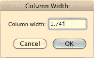

**图 4-4.** *当需要精确设置列宽时，请使用“列宽”对话框。*

- 将多个列精确调整为相同宽度。通过拖动列标题或选择每列中的单元格来选中这些列。`Ctrl+click` 或右键单击选定的列标题，然后在上下文菜单中单击“列宽”，以显示“列宽”对话框。键入列宽，然后单击“确定”按钮。

### 隐藏行和列

有时，隐藏特定的列和行，使其在工作表中不可见，会很有帮助。你可能想这样做，以防止敏感数据显示出来，或者只是为了让你实际使用的部分工作表能一次性完整显示在屏幕上。

要隐藏某列或某行，请 `Ctrl+click` 或右键单击其列标题或行标题，然后在上下文菜单中单击“隐藏”。你也可以单击行或列中的一个单元格，然后从功能区选择“开始” → “单元格” → “格式” → “隐藏行”或“隐藏列”，或从菜单栏选择“格式” → “行” → “隐藏”或“格式” → “列” → “隐藏”。

**提示：** 要快速隐藏活动行或选定的行，请按 `Ctrl+9`。要隐藏活动列或选定的列，请按 `Ctrl+0`。

要取消隐藏某行或某列，请选中其上下方的行或左右两侧的列。然后 `Ctrl+click` 或右键单击选定的行标题或列标题，并在上下文菜单中单击“取消隐藏”。

**注意：** 你也可以通过从功能区选择“开始” → “单元格” → “格式” → “取消隐藏行”或“取消隐藏列”，或从菜单栏选择“格式” → “行” → “取消隐藏”或“格式” → “列” → “取消隐藏”，来隐藏和取消隐藏项目。

### 格式化单元格和区域

在 Excel 中，你可以以多种方式格式化单元格——从选择如何显示边框和背景，到控制 Excel 如何表示你在单元格中输入的文本。本节将向你展示最实用的格式化类型及其应用方法。

[www.it-ebooks.info](http://www.it-ebooks.info/)
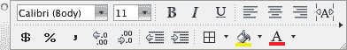

每个单元格都应用了基本格式——使用的字体和字号，以及通常的“常规”数字格式（稍后会介绍）。因此，当你创建新工作簿并开始输入数据时，Excel 会以正常大小的字体显示数据。

**提示：** 要控制新工作簿使用的字体和字号，请选择“Excel” → “偏好设置”或按 `Cmd+,`（`Cmd` 键和逗号键）。在“Excel 偏好设置”对话框的“创作”区域中单击“常规”图标，以显示“常规”面板。打开“标准字体”菜单，然后单击你想要的字体；列表顶部的“正文字体”选项会为你提供工作簿模板中设置的正文字体；如果你更改此字体，则会更改除“标题”样式（使用“标题字体”）之外的所有样式中使用的字体。然后，在“字号”弹出菜单中选择字号。单击“确定”按钮关闭“Excel 偏好设置”对话框。

#### 了解应用格式化的三种主要工具

Excel 提供了三种主要工具来对单元格和区域应用格式：

- “格式”工具栏。如果你显示此工具栏（从菜单栏选择“视图” → “工具栏” → “格式”），可以快速应用一些最常用的格式。图 4-5 显示了带有标签控件的“格式”工具栏（以浮动形式显示，以便更容易查看）。

**注意：** 功能区的“开始”选项卡也提供了你在“格式”工具栏上找到的格式化命令，因此你可以使用更方便的那个。

**图 4-5.** *“格式”工具栏通常是应用常用格式的最简单方法。*

[www.it-ebooks.info](http://www.it-ebooks.info/)
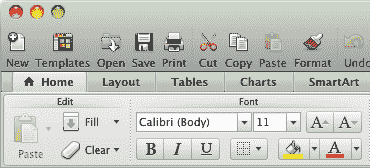

- 功能区的“开始”选项卡。“字体”组提供了广泛使用的字体格式；“对齐”组提供了水平与垂直对齐、方向、缩进、自动换行和合并；“数字”组则为你提供了一种快速应用基本数字格式的方法。图 4-6 显示了带有标签控件的“字体”组。图 4-7 显示了带有标签控件的“对齐”组和“数字”组。

**图 4-6.** *你可以从功能区“开始”选项卡上的“字体”组中快速应用基本的字体格式、边框和填充。*

**注意：** “增大字号”按钮、“减小字号”按钮和“边框”弹出菜单仅当 Excel 窗口足够宽以容纳它们时，才会出现在功能区“开始”选项卡上的“字体”组中。

[www.it-ebooks.info](http://www.it-ebooks.info/)
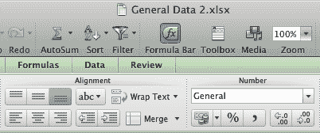

**图 4-7.** *从功能区“开始”选项卡上的“对齐”组中，你可以设置水平和垂直对齐、方向以及自动换行。从“数字”组中，你可以应用数字格式。*

- “设置单元格格式”对话框。当你需要应用“标准”工具栏或功能区“开始”选项卡上未出现的格式化类型时，请打开“设置单元格格式”对话框，并操作其六个选项卡（本章稍后会介绍）。显示“设置单元格格式”对话框的最简单方法是 `Ctrl+click` 或右键单击某个单元格或选定区域，然后在上下文菜单中单击“设置单元格格式”。你也可以通过按 `Cmd+1` 或从菜单栏选择“格式” → “单元格”来打开“设置单元格格式”对话框。

#### 通过应用数字格式控制数据的外观

当你在单元格中输入数字时，Excel 会根据应用于该单元格的数字格式进行显示。例如，如果你在格式为“常规”的单元格中输入 `39250`，Excel 会将其显示为 39250。如果该单元格采用“货币”格式，Excel 会显示类似 `$39,250.00` 这样的值（具体取决于格式的细节）。如果该单元格采用“日期”格式，Excel 会显示类似“2011 年 6 月 18 日”这样的日期（同样取决于格式的细节）。无论哪种情况，单元格中存储的数字保持不变——因此，如果你将单元格的格式更改为不同类型，Excel 显示数据的方式也会随之改变。

表 4-1 解释了 Excel 的数字格式，并说明了应用这些格式的键盘快捷键。你还可以通过使用标准工具栏上的按钮、功能区“开始”选项卡“数字”组中的“数字格式”下拉菜单和按钮，以及“设置单元格格式”对话框的“数字”选项卡（参见图 4-8）来应用数字格式。

**图 4-8.** 当你需要访问完整的数字格式选项时，请使用“设置单元格格式”对话框的“数字”选项卡。

**表 4-1.** Excel 的数字格式

| 数字格式 | 键盘快捷键 | 说明 | 示例 |
| :--- | :--- | :--- | :--- |
| `常规` | `Ctrl+Shift+~` (波浪号) | Excel 对新工作表中所有单元格的默认格式。无特定格式，但每个单元格最多显示 11 位数字，且不使用千位分隔符。对于超过 11 位的任何输入，“常规”格式会使用科学记数法（参见本表后面的“科学记数”条目）。 | `1234567` |
| `数值` | `Ctrl+Shift+!` | 显示您选择的小数位数。您可以选择是否使用千位分隔符以及如何显示负数。 | `1000`, `1,000`, `1,000.00` |
| `货币` | `Ctrl+Shift+$` | 显示您选择的小数位数，并使用千位分隔符。您可以选择显示哪种货币符号（例如 $）以及如何显示负数。 | `$2,345.67`, `–$2,345.67` |
| `会计专用` | — | 显示您选择的小数位数，并使用千位分隔符。您可以选择使用哪种货币符号。符号在单元格的左边缘对齐。负数用括号括起来显示。 | `$ 1,000,000`, `$ (99.999.00)` |
| `日期` | `Ctrl+Shift+#` | 显示多种日期格式中的任何一种。 | `6/24/2011`, `2011 年 6 月 24 日星期四` |
| `时间` | `Ctrl+Shift+@` | 显示多种时间格式中的任何一种。 | `11:59:59 PM`, `23:59:59` |
| `百分比` | `Ctrl+Shift+%` | 显示百分号以及您选择的小数位数。 | `78.79%`, `200%` |
| `分数` | — | 将数字显示为分数。分数在视觉上容易造成混淆，因此仅在必要时使用——例如，用于投注图表。 | `1/2`, `1 1/4` |
| `科学记数` | `Ctrl+Shift+^` | 以指数形式显示数字，带有 `E` 和要乘的幂次。您可以选择使用几位小数。 | `1.2346E+08`, `–9.8765E+07` |
| `文本` | — | 即使数据看起来是其他类型（例如数字或日期），也将其显示并视为文本。 | `产品列表 18` |
| `特殊` | — | 以您选择的格式显示数据：`邮政编码`、`邮政编码+4`、`电话号码`或`社会保险号码`。 | `10013-8295`, `(212) 555-9753`, `722-86-8261` |
| `自定义` | — | 以您选择的自定义格式显示数据。Excel 提供了数十种自定义格式，但您也可以创建自己的格式。 | `[各种]` |

## 理解 Excel 如何存储日期和时间

Excel 将日期存储为从 `1`（1900 年 1 月 1 日，星期日）开始并延续到未来的序列号。作为几个参考点：`40544` 代表 2011 年 1 月 1 日星期六，而 `40909` 代表 2012 年 1 月 1 日星期日。

您可以通过输入序列号（如果您知道或愿意计算）来输入日期，但更简单的方法是使用常规格式输入日期，因为 Excel 能识别大部分格式。例如，如果您输入 `1/1/2011`，Excel 会将其转换为 `40544`，并以您选择的任何格式显示该日期。

Excel 将时间存储为一天的小数部分。例如，`40544.25` 表示 2011 年 1 月 1 日早上 6 点（一天的四分之一处）。

旧版 Excel 默认使用 1904 年 1 月 2 日作为工作簿的起始日期。Excel 2011 不会自动执行此操作，但如有必要（例如，您正在使用一个基于 1904 日期系统的旧工作簿），您可以手动设置 1904 起始日期。要切换到基于 1904 的日期，请选择 `Excel Preferences` 或按 `Cmd+,`（`Cmd` 和逗号键）。在 `Excel Preferences` 对话框中，点击 `Formulas and Lists` 区域中的 `Calculation` 图标以显示 `Calculation` 窗格。在 `Workbook options` 框中，选中 `Use the 1904 date system` 复选框，然后点击 `OK` 按钮。

## 要创建自己的自定义数字格式

请按照以下步骤操作：

1.  选择一个包含正确数据类型单元格。例如，如果您想创建自定义日期格式，请选择一个应用了 `Date formatting` 并已输入日期的单元格。

2.  按 `Cmd+1` 打开 `Format Cells` 对话框。

3.  如果初始未显示，请单击 `Number` 选项卡。

4.  在 `Category` 列表框中，单击 `Custom` 项。Excel 将显示用于创建自定义格式的控件（参见图 4-9）。您的示例数据会显示在顶部的 `Sample` 框中。

    [www.it-ebooks.info](http://www.it-ebooks.info/)
    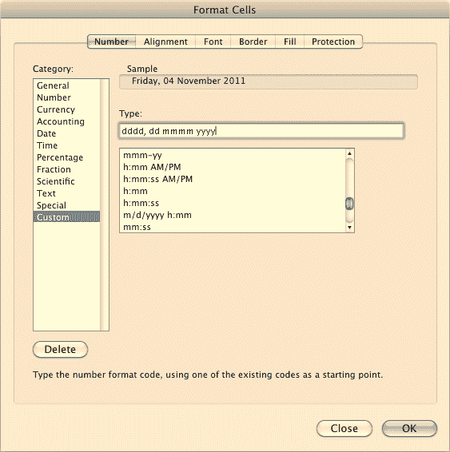
    **第 4 章：快速高效地格式化工作表**
    **129**
    **图 4-9.** *您可以通过在“格式单元格”对话框的“数字”选项卡上的“类型”文本框中输入代码来创建自定义数字格式。在列表框中点击最接近您想创建格式的格式，可为您提供一个起点。*

5.  向下滚动列表框，找到最接近您想要创建格式的格式，然后点击该格式。Excel 会将该格式的代码添加到 `Type` 文本框中，并以该格式显示示例数据。

6.  编辑格式，使示例数据按照您想要的方式显示（请参阅此列表后的说明）。

7.  点击 `OK` 按钮关闭 `Format Cells` 对话框。

要创建自定义格式，您需要输入格式代码来指示 Excel 如何显示信息。自定义格式可以包含单个格式，如图 4-9 中所示的日期格式，但您最多可以包含四种不同的格式，用分号隔开：*第一种格式。* 如何显示正数。*第二种格式。* 如何显示负数。*第三种格式。* 如何显示零值。*第四种格式。* 如何显示文本。

[www.it-ebooks.info](http://www.it-ebooks.info/)
**130**
**第 4 章：快速高效地格式化工作表**

表 4-2 解释了创建自定义数字格式的代码。

**表 4-2.** *创建自定义数字格式的代码*

| 代码 | 效果 | 示例 |
| :--- | :--- | :--- |
| `[color name]` | 显示指定的颜色。将相应颜色放在方括号中，作为该部分的第一项：`[Black]`、`[Red]`、`[Blue]`、`[Green]`、`[White]`、`[Cyan]`、`[Magenta]` 或 `[Yellow]`。例如，`#,##0_);Red` 以红色显示负数。 | |
| `#` | 显示一个有效数字。 | `###.#` 在小数点前显示三位有效数字，小数点后显示一位有效数字。（有效数字是指非零的数字。） |
| `0` | 如果此位置没有其他数字，则显示零。 | `000` 显示三位数字，必要时用前导零填充。例如，如果您输入 `7`，Excel 显示 `007`。 |
| `%` | 显示百分比。 | `#%` 将数字乘以 100 并显示百分号。例如，`8` 显示为 `800%`。 |
| `?` | 显示为分数。 | `# ???/???` 显示一个数字和三位数字的分数——例如，`9 107/112`。 |
| `.` | 显示小数点。 | `###.##` 在小数点前显示三位有效数字 |

# 数字格式代码

小数点后保留一位和两位有效数字。

## 千位分隔符

**千位分隔符**：`$#,###,###` 显示美元符号、七个有效数字和千位分隔符，并将数字缩小 1000 倍。

**按 1000 缩放**：`#.##,,, " million"` 显示欧元符号、小数点前一位有效数字和小数点后两位，数字缩小一百万倍，并在后面显示单词 `million`（带一个空格）。例如，如果输入 `12345689`，Excel 会显示 `1.23 million`。

## 日期和时间格式代码

| 代码 | 效果 | 示例 |
|------|------|------|
| `d` | 以数字格式显示日 | `d-mmm-yyyy` 将 `6/1/11` 显示为 `1-Jun-2011`。 |
| `dd` | 以数字格式显示日，并加前导零 | `dd/mmm/yy` 将 `6/1/11` 显示为 `01/Jun/11`。前导零有助于标准化两位数的日期和对齐日期条目。 |
| `ddd` | 以三个字母的缩写显示日 | `ddd dd/mm/yyyy` 将 `6/1/11` 显示为 `Wed 01/06/2011`。 |
| `dddd` | 以全称显示日 | `dddd, dd/mm/yyyy` 将 `6/1/11` 显示为 `Wednesday, 01/06/2011`。 |
| `m` | 以数字格式显示月 | `d/m/yy` 将 `6/1/11` 显示为 `6/1/11`。 |
| `mm` | 以数字格式显示月，并加前导零 | `mm/dd/yy` 将 `6/1/11` 显示为 `06/01/11`。 |
| `mmm` | 以三个字母的缩写显示月 | `dd-mmm-yy` 将 `6/1/11` 显示为 `01-Jun-2011`。 |
| `mmmm` | 以全称显示月 | `dd mmmm, yyyy` 将 `6/1/11` 显示为 `01 June, 2011`。 |
| `mmmmm` | 以单个字母的缩写显示月 | 一月、六月和七月显示为 `J`；四月和八月显示为 `A`；依此类推。此代码在空间不足且包含所有月份的序列时有效；如果只使用部分月份，则会产生混淆。 |
| `yy` | 以两位数显示年 | `m/d/yy` 将 `6/1/11` 显示为 `6/1/11`。 |
| `yyyy` | 以四位数显示年 | `dd-mmm-yyyy` 将 `6/1/11` 显示为 `01-Jun-2011`。 |
| `h` | 显示小时 | `h:m` 将 `2:22` 显示为 `2:22`。 |
| `hh` | 显示小时，并加前导零 | `hh:mm` 将 `2:22` 显示为 `02:22`。 |
| `m` | 显示分钟 | `h:m` 将 `2:01` 显示为 `2:1`。 |
| `mm` | 显示分钟，并加前导零 | `hh:mm` 将 `2:22` 显示为 `02:22`。要将 `mm` 与月份代码（也是 `mm`）区分开来，请将其紧跟在 `hh` 之后或紧接在 `ss` 之前使用。 |
| `s` | 显示秒 | `h:m:s` 将 `2:22:01` 显示为 `2:22:1`。 |
| `ss` | 显示秒，并加前导零 | `hh:mm:ss` 将 `2:22:01` 显示为 `02:22:01`。 |
| `.0`, `.00`, `.000` | 显示秒的十分位、百分位或千分位 | `h:mm:ss.000` 将 `2:22:01.11` 显示为 `2:22:01.110`。 |
| `A/P` | 显示 `A` 表示上午，`P` 表示下午 | `h:mm A/P` 将 `2:22` 显示为 `2:22 A`。可以使用大写 `A/P` 或小写 `a/p` 来指定显示的大小写。 |
| `AM/PM` | 显示 `AM` 表示上午，`PM` 表示下午 | `h:mm am/pm` 将 `14:22` 显示为 `2:22 PM`。Excel 会使用大写，无论你使用哪种大小写。 |
| `[]` | 以指定单位显示经过的时间 | `[h]:mm:ss` 以小时、分钟和秒显示经过的时间——例如，`55:38:43`。 |

## 文本格式代码

| 代码 | 效果 | 示例 |
|------|------|------|
| `_` | 显示一个指定字符宽度的空格 | `_)` 让 Excel 输入一个与右括号宽度相同的空格。你可以用它来对齐正数和用括号括起来的负数。 |
| `*` | 重复指定字符以填充单元格 | `*0` 让 Excel 用 `0`（零）字符填充单元格。此格式较为特殊，但当你需要吸引查看者对特定单元格的注意时可能会用到。 |
| `\` | 显示后面的字符 | `[Blue]$#,###.00 \*;[Green]$#,###.00 \D` 正数以蓝色显示，后跟一个星号；负数以绿色显示，后跟一个 `D`。 |
| `"string"` | 显示字符串文本 | `$#,##0.00" Net"` 在条目后显示单词 `Net`。注意引号和单词之间的前导空格。 |
| `@` | 将指定字符串与用户输入的文本连接起来 | `"Value: "@` 在用户输入的文本前输入 `Value:` 和一个空格。此代码仅能在自定义格式的第四部分（文本部分）中使用。 |
| `N/A` | 显示指定的内容 | — |

`$` `-` `+` `=` `/` `(` `)` `{` `}` `:` `!` `^` `&` `'` `'` `~` `<` `>` `[空格]`

`字符`。

[www.it-ebooks.info](http://www.it-ebooks.info/)

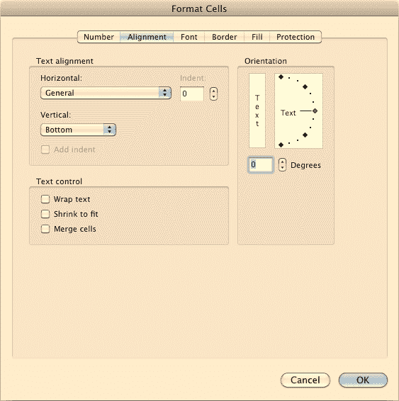

### 第 4 章：快速高效地设置工作表格式

**133**

#### 通过应用主题设置工作簿的整体外观

若要控制工作簿的整体外观，请为其应用合适的主题：选择“开始”>“主题”>“主题”，然后在“主题”面板中单击所需的主题。

该主题会为工作簿应用一组颜色和一对字体。应用主题后，你可以通过使用功能区“开始”选项卡上“主题”组中的“颜色”弹出菜单或“字体”弹出菜单来更改颜色或字体。

#### 选择如何对齐单元格内容

你可以通过使用功能区“开始”选项卡上“对齐方式”组中的按钮，或“设置单元格格式”对话框的“对齐”选项卡（见图 4-10）中的控件，快速对齐单元格内容：

- **水平对齐。** 你可以将文本左对齐、居中、右对齐或两端对齐；应用 `常规` 对齐方式（这取决于数据类型，文本靠左，数字靠右）；选择 `跨列居中` 以跨多列居中文本；或选择 `分散对齐（缩进）` 以在单元格内分散文本（增加字间距）。

**注释：** `填充` 水平对齐方式会用你指定的字符填满单元格。

**图 4-10。** *“设置单元格格式”对话框的“对齐”选项卡允许你在需要时将文本旋转到精确角度。*

[www.it-ebooks.info](http://www.it-ebooks.info/)

**134**

**第 4 章：快速高效地设置工作表格式**

- **垂直对齐。** 你可以将文本 `顶端对齐`、`垂直居中`、`底端对齐` 或 `两端对齐`。你还可以选择 `分散对齐` 以垂直分散文本，这在旋转文本使其垂直排列时非常有用。

- **旋转文本。** 使用“设置单元格格式”对话框“对齐”选项卡上的“方向”框，或“对齐方式”组中的“方向”弹出菜单。

- **缩进。** 你可以根据需要对文本进行缩进。

- **自动换行。** 你可以对文本进行 `自动换行`，使较长的条目在单元格中显示为多行，而不是在下一个单元格内容开始处消失。当 `自动换行` 文本时，Excel 会自动增加行高以适应换行后的文本。（如果你设置了小于显示所有换行文本所需高度的特定行高，则单元格中只会显示能容纳下的文本。）

- **缩小字体填充。** 在“设置单元格格式”对话框的“对齐”选项卡中选中此复选框，可 `缩小字体填充` 以使其适应单元格。当文本仅比单元格稍大时，缩小效果良好。如果文本过大，缩小后的文本会变得太小而无法阅读。

- **合并单元格。** 使用“对齐方式”组中的 `合并后居中` 弹出菜单，可将选中的多个单元格合并为一个单元格。你也可以在合并后的单元格中将条目居中。在“设置单元格格式”对话框中，你可以通过选中“对齐”选项卡上的 `合并单元格` 复选框来合并单元格。

[www.it-ebooks.info](http://www.it-ebooks.info/)

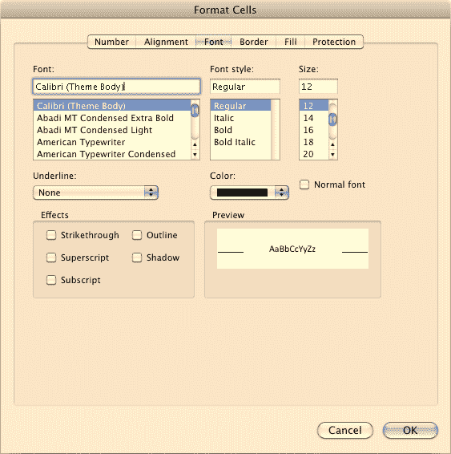

**第 4 章：快速高效地设置工作表格式**

**135**

#### 选择字体格式

你可以通过使用“标准”工具栏上的控件、功能区“开始”选项卡上“字体”组中的控件，或“设置单元格格式”对话框的“字体”选项卡（见图 4-11），快速设置单元格内容（或单元格内容中的选定部分）的格式。

**图 4-11。** *当你需要比“标准”工具栏和功能区“字体”组提供的更全面的字体格式时，请使用“设置单元格格式”对话框的“字体”选项卡。*

[www.it-ebooks.info](http://www.it-ebooks.info/)

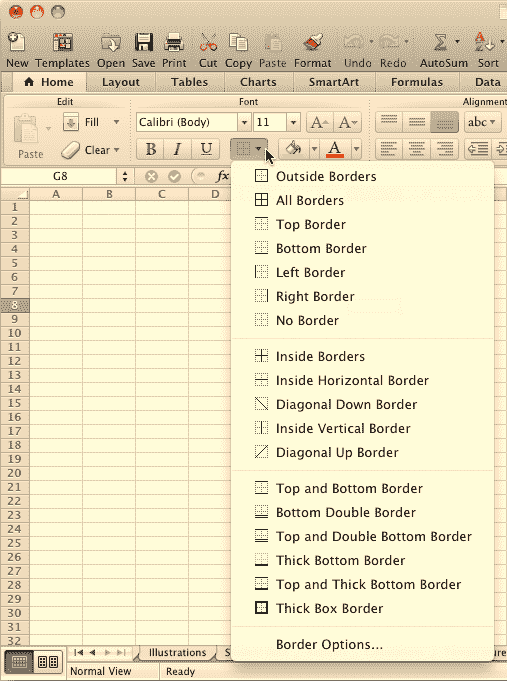

# 第 4 章：快速高效地设置工作表格式

## 应用边框和填充

若要为单元格应用边框，请打开功能区“开始”选项卡上“字体”组中的“边框”弹出菜单，然后单击所需的边框类型（见图 4-12）。

**图 4-12。** `你可以从“开始”选项卡“字体”组中的“边框”弹出菜单快速应用边框。`

**提示：** 如果你已显示“格式”工具栏，可以通过单击其“边框”弹出按钮，然后在面板上单击边框类型来应用边框。按此方式选择边框类型后，你可以通过单击“边框”按钮的主体部分（而非弹出按钮）快速将其应用到另一个单元格。你也可以拖出“边框”调色板使其保持可见，这样就不必反复打开它。单击“边框”弹出按钮，然后单击调色板顶部的双线并将其拖离工具栏。使用完拖出的调色板后，单击其标题栏左端的“关闭”按钮将其关闭。

[www.it-ebooks.info](http://www.it-ebooks.info/)

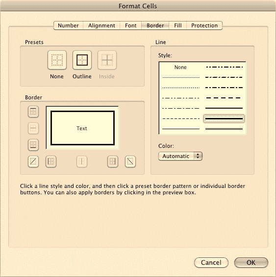

如需更多边框选项，请单击“边框”弹出菜单底部的“边框选项”项，以显示“设置单元格格式”对话框的“边框”选项卡（见图 4-13）。

你也可以从菜单栏中选择“设置单元格格式”（或按 `Cmd+1`），然后单击“边框”选项卡。使用“边框”选项卡上的控件来设置你想要的边框。例如，要应用粗底边框，请在“样式”框中单击一条深色线条，然后在“边框”框中单击“下边框”按钮，最后单击“确定”按钮。

**图 4-13.** `当需要更改边框的线条样式或颜色时，请使用“设置单元格格式”对话框的“边框”选项卡。`

要应用填充，请使用功能区“开始”选项卡“字体”组中的“填充颜色”弹出菜单，或“格式”工具栏上的“填充颜色”弹出菜单，也可以在“设置单元格格式”对话框的“填充”选项卡上进行操作。

## 为单元格应用保护

“设置单元格格式”对话框的“保护”选项卡仅包含两个控件：

`Locked`（锁定）。选中此复选框可锁定单元格以防止更改。

`Hidden`（隐藏）。选中此复选框可隐藏单元格中的公式（公式的结果仍然可见）。

[www.it-ebooks.info](http://www.it-ebooks.info/)

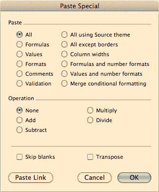

选中这两个复选框中的任意一个后，你必须先保护工作表，锁定或隐藏才会生效。你将在第 13 章的“保护工作表或工作簿”一节中了解如何保护工作表。

## 使用“选择性粘贴”来粘贴格式和执行操作

如果工作表的某一部分包含你需要应用到另一部分的格式类型，那么使用“选择性粘贴”命令并在“选择性粘贴”对话框中选择选项通常可以节省时间。例如，你可以仅粘贴格式或列宽，而不是粘贴已复制单元格中的所有数据和格式。“选择性粘贴”命令还允许你转置数据，并对粘贴到的单元格执行数学运算。

你可以从功能区“开始”选项卡“编辑”组中的“粘贴”弹出菜单或“粘贴选项”弹出菜单访问大多数“选择性粘贴”选项，但在大多数情况下，使用“选择性粘贴”对话框最为清晰。

要显示“选择性粘贴”对话框（见图 4-14），请使用以下命令之一：

*功能区。* 选择“开始”>“编辑”>“粘贴”>“选择性粘贴”。

*菜单栏。* 选择“编辑”>“选择性粘贴”。

*上下文菜单。* `Ctrl+单击`或右键单击目标单元格，然后单击“选择性粘贴”。

*键盘。* 按 `Cmd+Shift+V`。

**图 4-14.** `当你需要仅粘贴部分数据、需要对数据执行操作或需要转置其行列时，请使用“选择性粘贴”对话框。`

[www.it-ebooks.info](http://www.it-ebooks.info/)

然后在“粘贴”区域选择你想要的选项按钮：

`All`（全部）。选择此选项按钮可粘贴所有数据及其所有格式。通常，仅当你使用“跳过空单元”复选框、“转置”复选框或“粘贴链接”按钮时才需要这样做——否则，使用“粘贴”命令更简单。

*公式。* 选中此单选按钮可粘贴所有公式和常量，而不带格式。

*数值。* 选中此单选按钮可粘贴公式计算出的值，而不是公式本身。Excel 会移除数值中的格式。

*格式。* 选中此单选按钮可仅粘贴格式，不粘贴数据。此选项非常适合用于使一个工作表的格式与另一个工作表相似。

*批注。* 选中此单选按钮可仅粘贴批注。当您需要整合不同同事对同一工作表的意见时，此选项非常方便。

*数据验证。* 选中此单选按钮可粘贴数据验证条件。

*使用源主题。* 选中此单选按钮可使用数据来源工作簿的主题粘贴所有数据。

*边框除外。* 选中此单选按钮可粘贴所有数据和格式，但会移除单元格边框。

*列宽。* 选中此单选按钮可仅粘贴列宽——不粘贴数据或其他任何格式。当您需要将一个工作表的布局设置为与另一个现有工作表相同，但放入完全不同的数据时，此选项非常有用。

*公式和数字格式。* 选中此单选按钮可粘贴公式和数字格式，但不粘贴其他格式。

*值和数字格式。* 选中此单选按钮可粘贴数值（而非公式）和数字格式。

*合并条件格式。* 选中此单选按钮可复制所有数据和格式，并合并任何条件格式。有关条件格式的详细信息，请参阅下一节。

如果您需要对粘贴的数据执行数学运算，请转到`选择性粘贴`对话框的`运算`区域，并根据需要选择`加`、`减`、`乘`或`除`单选按钮。例如，如果要将单元格中的当前值乘以您粘贴的值，请选择`乘`单选按钮。否则，保持选中`无`单选按钮以在不进行数学运算的情况下粘贴数据。

在`选择性粘贴`对话框的底部区域，您可以根据需要选中或清除这两个复选框：

*跳过空单元。* 选中此复选框可防止 Excel 粘贴空白单元格。

*转置。* 选中此复选框可将列转置为行，将行转置为列。此选项比重新输入布局错误的数据要快得多。

选择好所需选项后，单击`确定`按钮。Excel 会关闭`选择性粘贴`对话框并粘贴您选择的数据或格式。

**注意：** 如果您需要将粘贴的数据链接回其源数据，请单击`选择性粘贴`对话框中的`粘贴链接`按钮，而不是`确定`按钮。这将使 Excel 创建一个指向源数据的链接，以便当源数据更改时，链接的数据也随之更改。如果源数据位于同一工作簿中，Excel 会自动更新链接。如果源数据位于另一个工作簿中，Excel 会在您打开包含该链接的工作簿时更新数据。

## 使用条件格式标识异常值

在许多工作表中，能够监视单元格中的值并挑出以特定方式突出的值是非常有用的。例如，您可能希望查看哪十种产品带来了最高的收入，或者可能需要一种简单的方法让异常高或异常低的值在其它值中突出显示。

要监视一个单元格或区域中的值，您可以应用*条件格式*——即仅当满足条件时，Excel 才会显示的格式。例如，如果您正在监测华氏温度，可以应用条件格式来突出显示低温（例如，低于 20°F）和高温（例如，高于 100°F）。正常范围内的温度不会获得任何条件格式，因此低温和高温会在工作表中一目了然。

### 了解 Excel 的预设条件格式类型

Excel 提供了五种预设的条件格式，您可以从功能区`开始`选项卡的`样式`组中的`条件格式`面板应用它们。图 4-15 显示了显示了`图标集`面板的`条件格式`面板。

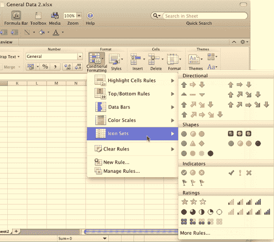

**图 4-15.** `条件格式`面板包含可用于指示数据趋势的图标集。

*突出显示单元格规则。* 此面板为您提供了一种简单的方法，使用`大于`、`小于`、`介于`、`等于`、`文本包含`、`发生日期`或`重复值`条件来设置条件格式。

*最前/最后规则。* 此面板允许您为`前 10 项`、`前 10%`、`后 10 项`、`后 10%`、`高于平均值`和`低于平均值`条件应用条件格式。

*数据条。* 此面板允许您应用不同的渐变填充和实心填充。

*色阶。* 此面板允许您使用两种或三种颜色设置色阶——例如，使用绿色、琥珀色和红色来指示与活动相关的不同风险级别。

*图标集。* 此面板提供不同的图标集，例如方向箭头（向上、平行、向下）或对勾-感叹号-叉号集，用于指示数据趋势。

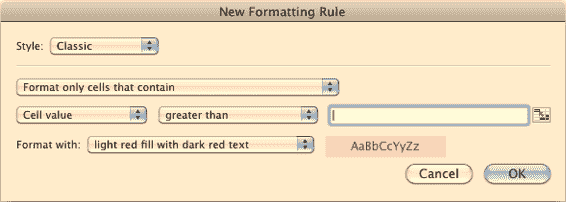

### 应用预设的条件格式

要应用预设的条件格式之一，请打开`条件格式`面板，从中显示相应的子面板，单击格式类型，然后指定详细信息。例如：

1. 选择要影响的单元格或区域。

2. 选择`开始` > `样式` > `条件格式` > `突出显示单元格规则` > `大于`，以显示`新建格式规则`对话框（参见图 4-16）。

**图 4-16.** `Excel 的预设条件格式类型使您可以轻松地将条件格式快速应用于单元格。`

3. 在`样式`弹出菜单中，您可以根据需要为条件格式选择不同的样式。Excel 会自动选择适合您选择的条件格式类型的样式——在此示例中，为`经典`。

4. `样式`弹出菜单下方的`比较`弹出菜单显示了条件格式类型的比较方式——在此示例中，为`仅对包含以下内容的单元格设置格式`。如有必要，您可以选择不同的比较方式，但通常不需要这样做。

5. 在下一行控件中，设置比较条件。在此示例中，第一个弹出菜单设置为`单元格值`，第二个弹出菜单设置为`大于`，因为这是一个`大于`规则。在第三个框中，您输入比较值。您可以手动输入值，也可以折叠对话框，单击包含该值的单元格，然后恢复对话框。

6. 在`设置为`弹出菜单中，选择您想要的格式。Excel 提供了各种预设选项，但您也可以通过单击列表底部的“自定义格式”项，并在打开的`设置单元格格式`对话框中进行设置，来创建自定义格式。（这是您在本章前面遇到的`设置单元格格式`对话框的简化版本——它只有`字体`、`边框`和`填充`选项卡。）

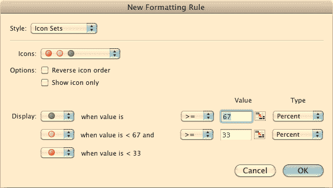

7. 单击`确定`按钮关闭`新建格式规则`对话框。Excel 将应用条件格式。

##### 创建自定义条件格式

# 快速高效地设置工作表格式

如果预设的条件格式规则都不符合你的需求，你可以自定义条件格式规则。请按照以下步骤操作：

1. 选中要设置格式的单元格或区域。
2. 依次选择`开始` > `格式` > `条件格式` > `新建规则`，打开“新建格式规则”对话框。
3. 在`样式`弹出菜单中选择条件格式类型：双色刻度、三色刻度、数据条、图标集或经典。此时“新建格式规则”对话框会显示用于创建该类型条件格式的控件。图 4–17 展示了用于创建图标集的“新建格式规则”对话框及其控件。

   **图 4–17.** *当现有条件格式规则都不适用时，可使用“新建格式规则”对话框创建自定义规则。*

4. 使用控件指定规则要应用的条件格式。例如，对于图 4–17 所示的图标集样式，你可以执行以下操作：
   - 打开`图标`弹出菜单，点击选择想要作为格式基础的图标集。
   - 在`选项`区域，如果要反转图标顺序（例如使用绿-黄-红替代红-黄-绿），请选中`反转图标次序`复选框。如果希望只显示图标而不显示生成图标的数值，请选中`仅显示图标`复选框；这有助于简化复杂工作表，但可能因数值缺失引发过多疑问，需谨慎使用。
   - 在`显示`区域，打开每个弹出菜单选择要使用的符号（或直接接受默认符号），然后使用控件设置条件、数值和类型。
5. 创建完规则后，点击`确定`按钮关闭“新建格式规则”对话框。

## 更改 Excel 应用条件格式规则的顺序

许多单元格和区域只需要应用一种条件格式——但有些可能需要两种或更多类型。当应用多种条件格式时，你可能需要更改 Excel 应用这些规则的顺序。或者，你仅需一种简便方式查看已应用于特定单元格或区域的条件格式规则。

若要查看已应用于单元格的条件格式规则，并更改其顺序，请执行以下步骤：

1. 选中你感兴趣的单元格或区域。
2. 依次选择`开始` > `格式` > `条件格式` > `管理规则`，打开“管理规则”对话框（见图 4–18）。

   **图 4–18.** *使用“管理规则”对话框检查已应用于单元格或区域的条件格式规则，并更改 Excel 使用规则的顺序。*

3. 确认`显示其格式规则`弹出菜单中显示的是`当前选择`而非其他区域。如果不是，请选择`当前选择`。
4. 在“管理规则”对话框中央的列表框中浏览规则列表。根据需要更改规则或其顺序。
   - *更改规则顺序。* 点击要移动的规则，进入`更改规则顺序`区域，然后根据需要点击`上移`按钮（向上箭头）或`下移`按钮（向下箭头）。
   - *删除规则。* 点击该规则，然后点击`删除`（–）按钮。
   - *编辑规则。* 点击规则，点击`编辑规则`按钮，然后在“编辑格式规则”对话框中进行操作。此对话框与“新建格式规则”对话框具有相同的控件。
   - *新建规则。* 点击`添加`（+）按钮，然后在“新建格式规则”对话框中进行操作（如上一节所述）。创建完规则后，将其在列表中上移至合适位置。
   - *将规则应用于不同区域。* 在规则的`应用于`字段中编辑区域范围。

# 快速高效地设置工作表格式

## 清除单元格、区域或工作表中的条件格式

如果单元格、区域、工作表、表格或`PivotTable`不再需要条件格式，可按以下步骤将其清除：

1.  选择对象：
    -   选择单元格或区域
    -   点击表格或`PivotTable`内部
    -   激活工作表

2.  选择`开始` → `格式` → `条件格式` → `清除规则`，然后从子菜单中点击相应的项目：`清除所选单元格的规则`、`清除整个工作表的规则`、`清除此表格的规则`或`清除此数据透视表的规则`。

> **注意：** 若要折叠`管理规则`对话框，请单击`折叠对话框`按钮。选择相应的区域，然后再次单击`折叠对话框`按钮以恢复`管理规则`对话框。
>
> 在`如果为真则停止`列中，如果你希望在某个规则为`true`时停止评估其他规则，请选中该规则的复选框。
>
> 单击`确定`按钮关闭`管理规则`对话框。Excel 会将你的选择应用到所选内容上。

## 使用数据验证检查输入

当输入大量数据时，很容易误键入不正确的值。为了帮助避免数据中的错误，你可以使用 Excel 的`数据验证`功能自动检查条目并标记可能有误的条目。例如，如果某个单元格区域中的每个条目都应在 250 到 1000（含）之间，则可以验证数据以标记任何不在此范围内的条目。

> **警告：** 数据验证仅在用户键入值时有效。如果用户粘贴一个值，Excel 不会对其进行验证。

要将验证应用于单元格，请遵循以下步骤：

1.  单击要验证的单元格或选择要验证的区域。

2.  从功能区中选择`数据` → `工具` → `验证`（单击`验证`按钮的主要部分），或从菜单栏中选择`数据验证`，以显示`数据验证`对话框。

3.  单击`设置`选项卡（如图 4–19 所示，已选择设置）以将其置于对话框的前端（如果尚未显示）。

    **图 4–19.** *在“数据验证”对话框的“设置”选项卡上设置验证条件。显示的控件取决于你在“允许”弹出菜单中选择的数据类型。*

4.  在`允许`弹出菜单中，选择要验证的数据类型，然后使用出现的控件设置详细信息。
    -   **任何值。** 当你想关闭单元格或区域的验证时选择此项。即使使用此设置，你也可以使用`输入信息`选项卡（稍后在本列表中提到）来显示关于单元格或区域的消息。
    -   **整数。** 选择此项可为整数（不带小数位的数字）设置条件。例如，在`数据`弹出菜单中，点击`介于`项，然后在`最小值`框中设置最小值，在`最大值`框中设置最大值。
    -   **小数。** 选择此项可为带小数位的数字设置条件。例如，在`数据`弹出菜单中，点击`大于或等于`项，然后在`最小值`框中设置最小值。
    -   **序列。** 当需要将单元格限制为你指定的有效条目列表时选择此项。你可以通过两种方式输入此列表：在`来源`框中键入，用逗号分隔每个条目；或单击`来源`框右端的`折叠对话框`按钮，选择包含数据的工作表区域，然后再次单击`折叠对话框`按钮恢复对话框。选中`提供下拉箭头`复选框，使 Excel 在单元格中显示一个包含有效条目的弹出菜单。

> **提示：** 在设置数据验证条件时，你可以键入一个值，也可以单击`折叠对话框`按钮，然后单击包含该值的单元格。使用单元格中的值可以让你无需编辑数据验证即可轻松更改该值。

---

[www.it-ebooks.info](http://www.it-ebooks.info/)

以便用户能够轻松输入。

-   **日期。** 选择此项可设置日期的条件。例如，在`数据`弹出菜单中单击“大于”项，然后在`开始日期`框中输入起始日期。
-   **时间。** 选择此项可设置时间的条件。例如，在`数据`弹出菜单中单击“介于”项，然后在`开始时间`框中输入起始时间，在`结束时间`框中输入结束时间。
-   **文本长度。** 选择此项可设置文本条目或公式的条件。例如，在`数据`弹出菜单中单击“小于或等于”项，然后在`最大值`框中输入最大长度。
-   **自定义。** 当您需要输入一个返回逻辑值为`TRUE`或`FALSE`的公式时，选择此项。

[www.it-ebooks.info](http://www.it-ebooks.info/)

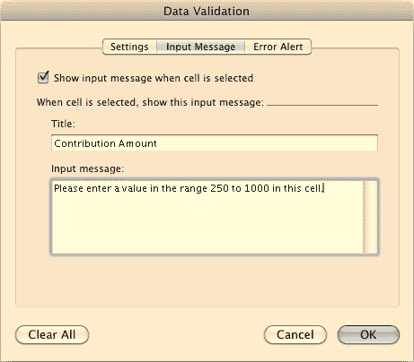
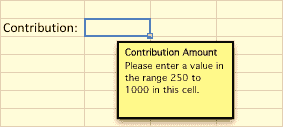

**148** **第 4 章：快速高效地格式化工作表**

5.  如果您希望允许用户将单元格留空，请选中`忽略空值`复选框。清除此复选框可强制用户使用有效数据填充单元格。
6.  单击`输入信息`选项卡以将其显示出来。图 4–20 左侧屏幕显示了已设置选项的`输入信息`选项卡。

**图 4–20.** *在“数据验证”对话框的“输入信息”选项卡上（左图），输入当单元格被激活时希望用户看到的信息（右图）。*

7.  若要在用户激活单元格时显示一条信息，请选中`选定单元格时显示输入信息`复选框。在`标题`框中键入标题，在`输入信息`框中键入信息。图 4–20 右侧屏幕显示了信息的显示效果。
8.  单击`出错警告`选项卡将其置于前端。图 4–21 左侧屏幕显示了已设置选项的`出错警告`选项卡；图 4–21 右侧屏幕显示了错误信息的显示效果。

[www.it-ebooks.info](http://www.it-ebooks.info/)

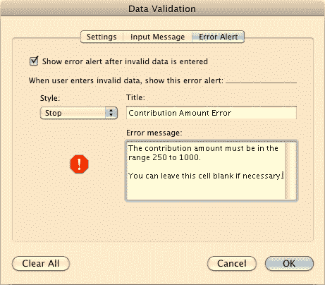
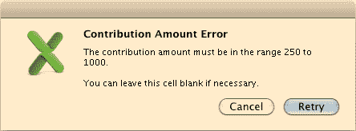

**第 4 章：快速高效地格式化工作表** **149**

**图 4–21.** *在“数据验证”对话框的“出错警告”选项卡上（左图），设置在用户向单元格输入无效数据时显示的错误提示（右图）。*

9.  如果您希望在用户输入无效数据时 Excel 显示一个错误消息框，请选中`输入无效数据时显示出错警告`复选框。通常，这会很有帮助。
10. 在`样式`弹出菜单中，为您想要的行为选择图标类型：
    -   **停止。** 错误对话框包含一个`重试`按钮和一个`取消`按钮。如果用户单击`重试`按钮，Excel 将选中未通过验证的条目，以便用户进行更改。如果用户单击`取消`按钮，Excel 将恢复单元格之前输入的内容。
    -   **警告。** 错误对话框在您的信息末尾显示一个“是否继续？”提示，并包含`是`按钮、`否`按钮和`取消`按钮。如果用户单击`是`按钮，即使未通过验证，Excel 也会接受该值。如果用户单击`否`按钮，Excel 将选中未通过验证的条目，以便用户进行更改。如果用户单击`取消`按钮，Excel 将恢复单元格之前输入的内容。
    -   **信息。** 错误对话框包含一个`确定`按钮和一个`取消`按钮。如果用户单击`确定`按钮，即使未通过验证，Excel 也会接受该值。如果用户单击`取消`按钮，Excel 将恢复单元格之前输入的内容。

> **注意：** 在 Windows 上，`样式`弹出菜单中的`停止`、`警告`和`信息`设置会使错误消息框显示不同的图标，这些图标与您在`样式`弹出菜单中做出选择时其下方显示的图标一致。例如，`停止`样式会显示一个带有白色感叹号的红色八边形，如图 4–21 左侧所示。在 Mac OS X 上，对于每种样式，错误消息框都会显示相同的 Excel 图标（如图 4–21 右侧所示），但带有不同的命令按钮和行为。
>
> **提示：** 要强制用户输入有效数据，请在“数据验证”对话框的“出错警告”选项卡中，从“样式”弹出菜单中选择`Stop`项。`Warning`样式和`Information`样式在您需要对工作表的使用提供更温和的指导，且数据不必严格符合要求时非常有用。

[www.it-ebooks.info](http://www.it-ebooks.info/)

**150** **第 4 章：快速高效地格式化工作表**

11. 输入消息框的标题和错误信息。
12. 点击`OK`按钮关闭“数据验证”对话框。Excel 将应用该验证。

## 使用表格格式和样式快速设置格式

为了节省您设置格式的时间，Excel 提供了预设格式，您可以将其应用于表格以赋予其整体外观。并且，为了省去您反复对不同单元格应用多种不同类型格式的麻烦，Excel 包含了样式——即可一次性应用的格式化集合。

### 使用表格格式进行格式化

当您需要快速设置表格格式时，请查看 Excel 的预设表格格式是否能满足需求。选择表格，选择`表格` -> `表格样式` -> `表格样式`，然后点击您想要的样式。

> **注意：** 有关创建和使用 Excel 表格的说明，请参阅第 10 章。

### 使用样式进行格式化

正如您在本章前面所见，您可以通过使用功能区“开始”选项卡中的“字体”组、“对齐方式”组和“数字”组中的控件，使用“格式”工具栏上的控件，或打开“设置单元格格式”对话框并操作其六个选项卡，来为任何单元格设置精确所需的格式。但是一次只设置一个方面的格式（字体、字号、对齐方式等）效率很低，并且很容易导致格式应用不一致。

为了节省时间并确保格式一致，您可以使用 Excel 的样式。每个样式都是可以应用于一个或多个单元格的格式集合。该样式包含六种类型的格式，分别对应“设置单元格格式”对话框的每个选项卡：

- **数字。** 例如，`常规`、`货币` 或 `百分比`。
- **对齐。** 水平对齐（例如，`常规`、`居中` 或 `两端对齐`）、垂直对齐（例如，`靠上`、`居中` 或 `靠下`）以及任何修饰（例如文本自动换行）。
- **字体。** 字体、字号、字体颜色等。
- **边框。** 已应用于该样式的任何边框，如果没有边框则为`无边框`。
- **填充。** 已应用于该样式的任何填充，如果是纯色则为`无颜色`。
- **保护。** `锁定`、`隐藏`、两者都选或`不保护`。

大多数 Excel 模板都包含大量样式供您入门，但如果需要，您也可以创建自己的自定义样式。

### 了解 Excel 的样式

要查看工作簿中可用的样式，请选择`开始` -> `格式` -> `样式`，然后查看“单元格样式”面板（见图 4–22）。该面板按以下类别列出样式：

- **自定义。** 仅当您在工作簿中创建了一个或多个自定义样式时，此类别才会出现。
- **好、差和一般。** 此类别包含`好`、`差`和`一般`样式，您可以用它们对单元格应用颜色编码。此处还可以找到应用于未使用其他样式单元格的`常规`样式。
- **数据和模型。** 此类别包含`计算`、`检查单元格`、`解释性`、`后续超链接`、`超链接`、`输入`、`链接单元格`、`注释`、`输出`和`警告文本`样式。这些样式大多用于数据建模。Excel 会自动将`超链接`样式应用于包含尚未点击的超链接的单元格，一旦您点击它们，其样式将更改为`后续超链接`。
  注意：仅当工作簿包含超链接时，`超链接`样式才会出现在“样式”面板的“数据和模型”类别中。同样，仅当工作簿包含您点击过的超链接时，`后续超链接`样式才会出现。
- **标题和表头。** 此类别包含四种用于递减标题级别的样式（`标题 1`、`标题 2`、`标题 3` 和 `标题 4`），用于为工作表添加标题的`标题`样式，以及用于轻松设置包含总计单元格格式的`汇总`样式。
- **主题单元格样式。** 此类别包含六种`强调`样式（`强调 1` 到 `强调 6`），以六种主题色为特色，每种颜色有四个色度级别。仅当工作簿的模板包含主题单元格样式时，此类别才会出现。

### 应用样式

要应用样式，请选择`开始` -> `格式` -> `样式`，然后在“样式”面板上点击该样式。您也可以从功能区“开始”选项卡的“数字”组中应用各种`数字`样式（例如`货币`样式、`百分比`样式和`千位分隔`样式）。

### 创建自定义样式

如果 Excel 的样式都不符合您的需求，您可以自行创建。要创建样式，请按照以下步骤操作：

1.  设置单元格格式，使其具有您希望样式包含的格式。
    提示：要快速开始设置格式，请先应用最接近您所需外观和格式的现有样式。然后更改格式，使其符合您的要求。
2.  选择已设置格式的单元格。
3.  选择`开始` -> `格式` -> `样式` -> `新建单元格样式`，以显示“新建单元格样式”对话框（图 4–23 显示了已选择设置的对话框）。
4.  在`样式名`框中，键入您想给该样式命名的名称。
5.  在`所选样式包含以下属性的格式`区域中，清除您想从样式中排除的单元格格式的复选框。例如，清除`保护`复选框以排除`锁定`或`隐藏`格式。
    注意：如果需要更改格式，请点击`格式`按钮以显示“设置单元格格式”对话框。进行所需的更改，然后点击`确定`按钮返回“新建单元格样式”对话框。
6.  点击`确定`按钮关闭“新建单元格样式”对话框并创建该样式。Excel 会将此样式添加到“样式”面板顶部的`自定义`区域。

提示：除了创建新样式，您还可以修改内置样式。选择`开始` -> `格式` -> `样式`以显示“样式”面板，按住 `Ctrl` 键并点击或右键点击要更改的样式，然后点击上下文菜单中的`修改`项。在“修改单元格样式”对话框中，选中或清除`所选样式包含以下属性的格式`区域中的复选框，或者点击`格式`按钮显示“设置单元格格式”对话框并进行所需更改。完成后，点击`确定`按钮返回“修改单元格样式”对话框，然后点击`确定`按钮。

### 将样式从一个工作簿复制到另一个工作簿

如果您在一个工作簿中有想用于另一个工作簿的样式，您可以复制这些样式。Excel 将此称为导入样式。导入样式时，目标工作簿会接收源工作簿中的所有样式——您无法挑选（但请参阅附近的提示）。

要导入样式，请按照以下步骤操作：

1.  打开源工作簿（包含样式的工作簿）和目标工作簿。
2.  通过点击目标工作簿切换到该工作簿。
3.  选择 `开始` -> `格式` -> `样式` -> `导入单元格样式`，打开 `导入单元格样式` 对话框（参见图 4–24）。
    图 4–24. 使用 `导入单元格样式` 对话框可将一个工作簿中的所有样式复制到另一个工作簿中。
4.  在 `从打开的工作簿中复制单元格样式` 列表框里，单击源工作簿。
5.  单击 `确定` 按钮关闭 `导入单元格样式` 对话框。Excel 会将样式复制到目标工作簿中，之后你就可以开始使用这些样式了。

提示：如果只需将一个样式从某个工作簿复制到另一个工作簿，请先在源工作簿中将该样式应用于某个单元格。然后复制该单元格，切换回目标工作簿。`Ctrl`+单击或右键单击一个你愿意修改的单元格，再单击 `选择性粘贴`，打开 `选择性粘贴` 对话框。在 `粘贴` 区域中选择 `格式` 选项按钮，然后单击 `确定` 按钮。Excel 会将样式粘贴到该单元格上，之后你就可以在该工作簿中使用这个样式了。

### 删除不需要的样式

如果你不再需要某个样式，可以将其删除。选择 `开始` -> `格式` -> `样式`，`Ctrl`+单击或右键单击 `单元格样式` 面板中的样式，然后在上下文菜单中单击 `删除`。
注意：Excel 会阻止你删除 `普通` 样式，因为对于未应用其他样式的任何单元格，Excel 都会使用该样式。

## 为工作表添加页眉和页脚

在通过屏幕、纸张或 PDF 文件分发工作表供他人查看之前，你很可能需要添加页眉、页脚或两者，以便标识页面。Excel 为每个工作表提供了独立的页眉和页脚，你可以用预设文本或自定义文本填充。每个页眉和页脚区域都包含左侧部分、中间部分和右侧部分，因此你可以轻松添加若干条不同的信息。

你可以通过使用 `页面设置` 对话框中的 `页眉/页脚` 选项卡，或切换到 `页面布局` 视图并直接在页眉和页脚区域中操作，来向页眉和页脚添加信息。我们先介绍 `页面设置` 对话框，这是添加预设文本最简单的方法。

### 使用“页面设置”对话框添加页眉和页脚

要通过 `页面设置` 对话框为活动工作表添加页眉和页脚，请按照以下步骤操作：

1.  从功能区选择 `布局` -> `页面设置` -> `页眉和页脚`，或从菜单栏选择 `视图` -> `页眉和页脚`，以显示 `页面设置` 对话框中的 `页眉/页脚` 选项卡。图 4–25 显示了 `页面设置` 对话框的 `页眉/页脚` 选项卡，其中已选择了一个预设页眉。

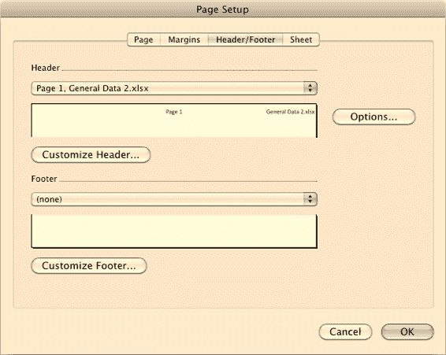

图 4–25. 通过“页面设置”对话框的“页眉/页脚”选项卡，你可以快速为活动工作表添加预设或自定义的页眉和页脚。

2.  如果要添加预设的页眉或页脚，请打开 `页眉` 弹出菜单或 `页脚` 弹出菜单，然后单击所需的预设项。每个弹出菜单都有多种选项，范围从仅显示页码到显示你的姓名、页码和日期。你选择的预设项将显示在预览框中。
3.  如果要创建自定义页眉或页脚，请单击 `自定义页眉` 按钮以显示 `页眉` 对话框（参见图 4–26），或单击 `自定义页脚` 按钮以显示 `页脚` 对话框（两者除名称外完全相同）。

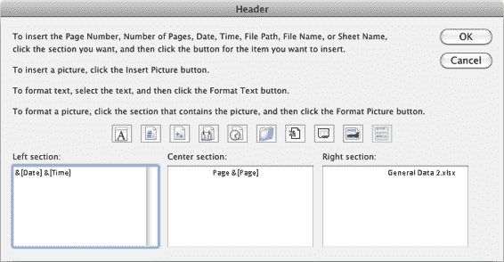

图 4–26. 使用“页眉”对话框或“页脚”对话框，在页眉或页脚的左侧部分、中间部分和右侧部分中输入所需的文本、域代码或图片。

**4.** 单击 `左侧部分` 框，然后设置所需的页眉或页脚：单击 `页眉` 对话框或 `页脚` 对话框工具栏上的按钮。

# 页眉与页脚的插入

一个用于插入域代码（例如表示日期的`&[Date]`）、信息片段（例如工作表名称）或图片的对话框。

输入所需的任何文本（如果你知道域代码，也可以直接输入，但使用按钮通常更简单）。

通过选中文本、点击`格式化文本`按钮，然后在`字体`对话框中进行操作，来按需设置文本格式。

5. 点击`中间框`，然后使用第 4 步中相同的技巧输入所需信息。
6. 点击`右侧框`，然后输入所需信息。
7. 点击`确定`按钮关闭`页眉`对话框或`页脚`对话框。Excel 会返回`页面设置`对话框，其中`页眉预览框`或`页脚预览框`会显示你刚刚创建的页眉或页脚。

**158** 第 4 章：快速高效地格式化工作表

8. 如果您需要更改纸张大小或方向，请点击`选项`按钮，以显示图 4-27 所示的不同`页面设置`对话框。在`纸张大小`弹出菜单中选择纸张大小（例如`US Letter`），然后在`方向`区域点击相应的按钮（左侧按钮为纵向，右侧按钮为横向）。然后点击`确定`按钮。

图 4–27. 在这个较小的页面设置对话框中，您可以为工作表选择纸张大小和方向。

9. 完成页眉和页脚的创建后，点击`确定`按钮关闭`页面设置`对话框。

## 在工作表上直接添加页眉和页脚

除了使用上一节所述的`页面设置`对话框外，您也可以直接在工作表上添加或编辑页眉和页脚。请按以下步骤操作：

1. 如果工作表处于`普通`视图，请点击状态栏左端的`页面布局视图`按钮，或从菜单栏选择`视图` > `页面布局`，切换到`页面布局`视图。
2. 滚动页面，以便看到您要编辑的页眉区域或页脚区域。
3. 将鼠标指针移到页眉区域或页脚区域，Excel 会显示一个灰色框，并出现提示“`双击以添加页眉`”（如图 4-28 所示）或“`双击以添加页脚`。”

**159** 第 4 章：快速高效地格式化工作表

图 4–28. 在页面布局视图中，将鼠标指针移到页眉区域或页脚区域，然后双击以打开该区域进行编辑。

4. 双击以打开页眉区域或页脚区域进行编辑。图 4-29 显示了页眉区域已打开并正在编辑。

图 4–29. 当您打开页眉区域或页脚区域进行编辑时，Excel 会显示用于创建页眉和页脚的命令工具栏。

5. 点击您要更改的区域，然后通过以下技巧添加页眉或页脚：
   - 点击工具栏上的按钮，插入一个域代码（例如表示日期的`&[Date]`）、一个信息片段（例如工作表名称）或一张图片。
   - 输入所需的任何文本。
   - 通过选中文本、点击`格式化文本`按钮，然后在`字体`对话框中进行操作，来按需设置文本格式。

**160** 第 4 章：快速高效地格式化工作表

6. 完成页眉或页脚的创建或编辑后，点击工具栏上的`关闭`按钮关闭页眉或页脚。Excel 会返回工作表。

## 本章小结

在本章中，您学习了如何将 Excel 中最有用的几种格式类型应用到工作表中。您了解了如何操作工作表的行和列以适应数据，如何格式化单元格和区域，以及如何通过使用条件格式和数据验证来节省时间并避免担忧。

您还了解了如何使用表格格式和样式进行快速格式化，并学会了如何为工作表添加页眉和页脚，以便轻松识别工作表及其内容。

这是本书第一部分的结尾。在第二部分中，我将向您展示如何执行计算并呈现数据。

---

