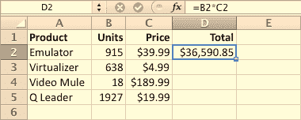
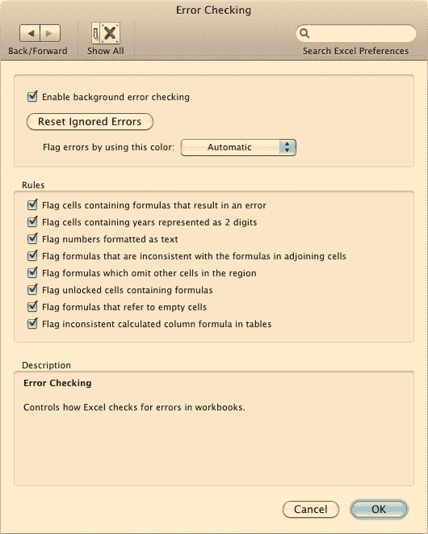
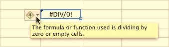
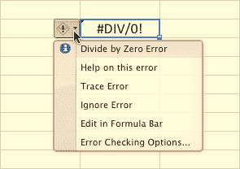
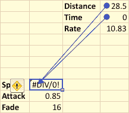
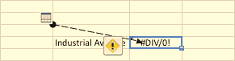
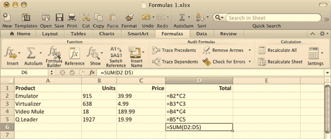
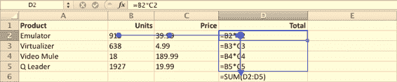
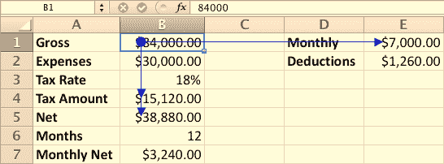
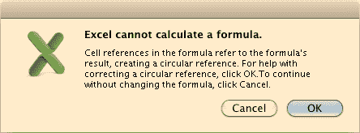

# 第 5 章：使用公式执行自定义计算

为了使您的工作表提供所需的信息，您可能需要使用数据执行计算。要执行计算，您需要在单元格中输入公式和函数。您将在本章学习如何使用公式，并在第 6 章学习函数。

我们将首先讨论函数和公式是什么，以便您清楚它们的区别，然后确保您了解如何在 Excel 中引用单元格和区域。之后，我将向您展示如何使用 Excel 的计算运算符创建自己的公式。我们将从使用单个计算运算符的简单公式开始，然后过渡到使用多个计算运算符的更复杂公式。

# 在公式中使用多个计算运算符时，你需要确保 Excel 以正确的顺序对其进行求值——否则，得出的结果不仅可能偏离正确的范围，甚至可能谬以千里。因此，你需要了解 Excel 求值运算符的默认顺序，以及如何在必要时更改顺序。掌握了这些知识，你就能构建复杂的公式——但你可能更想走捷径，将它们一步步构建出来，这样就能轻松发现并解决问题。

在本章末尾，我将向你介绍公式中常见的问题，并讲解如何排除这些故障。

## 理解公式与函数的区别

在 Excel 中，你可以通过两种主要方式进行计算，两者均以等号开头：

*   **使用函数**。函数是一种预设的计算方式，用于执行标准计算。例如，当你需要将多个数值相加时，可以使用`SUM()`函数——例如`=SUM(1,2,3,4,5,6)`，它比`=1+2+3+4+5+6`更简洁，但效果相同。

*   **使用公式**。公式是一种自定义计算，当你发现 Excel 的现有函数无法满足需求时创建。公式这个词听起来可能有些吓人，但公式也可以很简单；例如，要从 100 中减去 50，你可以在单元格中输入`=100-50`（等号告诉 Excel 你正在开始一个公式）。公式也可能更复杂。例如，假设你需要将`A1:A6`区域中单元格的内容相加，然后除以`B1`单元格的内容。Excel 没有内置的函数来完成此操作，因为它不是标准计算。因此，你可以创建这样一个公式：`=SUM(A1:A6)/B1`。（在此示例中，`/`是键盘上对应 ÷ 符号的键。）

我将在本章中介绍如何使用公式，并在下一章介绍如何使用函数。但在开始讨论公式之前，我们先来回顾一下在公式和函数中引用单元格和区域的方法。

## 在公式和函数中引用单元格和区域

要使你的公式和函数正常工作，你需要正确引用所需的单元格和区域。本节将确保你了解如何引用单元格和区域，无论它们与公式位于同一工作表，还是位于不同的工作表。你甚至可以引用另一个工作簿中的单元格和区域——只要该工作簿在你 Mac 文件系统中的位置保持不变。

### 引用单个单元格

要引用同一工作表中的单元格，只需使用其列字母和行号即可。例如，使用`=A10`来引用单元格`A10`。

要引用不同工作表中的单元格，请输入工作表名称，后跟感叹号和单元格引用。例如，使用`=Supplies!A10`来引用名为`Supplies`的工作表中的单元格`A10`。设置此类引用的最简单方法如下：

1.  开始创建公式。例如，在单元格中输入`=`。

2.  单击包含你要引用单元格的工作表标签。

3.  点击该单元格。

4.  单击公式栏上的“输入”按钮以输入引用。Excel 会将你返回到你正在创建公式的工作表。

> **注意：** 在步骤 4 中，除了单击公式栏上的“输入”按钮外，你也可以按 Return 键来输入单元格引用。此时，Excel 会将活动单元格移动到公式所在单元格下方的工作表位置。然后你需要在执行步骤 5 之前按向上箭头键。

5.  按`Ctrl+U`继续编辑该单元格。或者，点击公式栏，然后在那里继续编辑。

6.  像往常一样完成公式的创建。

> **注意：** 如果工作表名称包含空格，则必须将名称放在单引号内；例如，应使用`='Sales Results'!A10`而非`=Sales Results!A10`。如果你觉得保持一致更容易，也可以在名称不含空格的工作表上使用单引号。如果在需要时省略了单引号，Excel 会显示错误消息。

要引用另一个工作簿中的单元格，请输入工作簿的路径，然后是方括号中的文件名，接着是工作表名称，最后是单元格引用。例如，引用`='Shared:Spreads:[Results.xlsx]Sales!'AB12`指的是`Shared:Spreads`文件夹中`Results.xlsx`工作簿的`Sales`工作表中的单元格`AB12`。

除非你碰巧知道路径、文件名、工作表名称和单元格，否则通常最简单的方法是使用鼠标设置引用。请按照以下步骤操作：

1.  打开你要引用的工作簿。

2.  在将要包含引用的工作簿中，开始创建公式。例如，在单元格中输入`=`。

3.  切换到另一个工作簿。如果你能看到另一个工作簿，请点击它。如果看不到，请打开菜单栏上的“窗口”菜单，然后点击相应的窗口。

4.  导航到包含该单元格的工作表，然后点击该单元格。

5.  切换回你正在创建引用的工作簿，然后完成公式。

当你创建对另一个工作簿中单元格的引用时，Excel 会保持引用单元格的值更新。如果你移动或删除了另一个工作簿，Excel 会显示一个对话框，警告你无法找到该工作簿，并询问你是否要手动定位它。

### 引用区域

要引用由一块单元格组成的区域，请给出第一个单元格和最后一个单元格的地址，并用冒号分隔。例如，要引用从单元格`P10`到单元格`Q12`的区域，请使用`=P10:Q12`。

要引用由单独单元格组成的区域，请给出每个单元格的地址，并用逗号分隔地址。例如，要引用单元格`J14`、单元格`K18`和单元格`Z20`，请使用`=J14,K18,Z20`。

要引用不同工作表或不同工作簿中的区域，请使用上一节中介绍的技术。例如，如果需要引用名为`Stock Listing`的工作表中的`P10`到`Q12`区域，请使用`='Stock Listing'!P10:Q12`。

### 使某一行或列引用另一行或列

有时你可能需要使某一行或列的内容引用另一行或列。例如，假设你需要使第 25 行中的每个单元格引用第 4 行中的相应单元格，以便单元格`A25`引用单元格`A4`，单元格`B25`引用单元格`B4`，依此类推。

为此，请点击第 25 行的行标题以选择该行。然后输入`=4:4`以创建对第 4 行的引用，并按`Cmd+Return`将其输入到选定区域的所有单元格中。

同样，你可以通过输入其字母标识、一个冒号、然后再输入该字母标识来引用整列；例如，`E:E`。

### 理解绝对引用、相对引用和混合引用

使用单元格地址或区域地址相当直接，但当你开始使用公式时，会出现一个复杂情况。当你复制公式并粘贴时，你需要告诉 Excel，粘贴的公式是应该引用它最初引用的单元格，还是引用与公式当前位置相对位置相同的单元格，或者是两者的混合。（如果你通过拖放或剪切和粘贴将公式移动到另一个单元格，Excel 会保持公式不变。）

为了明确引用，Excel 使用三种类型的引用：

*   *绝对引用*。无论复制到何处，始终指向同一个单元格的引用。Excel 使用美元符号（`$`）表示引用的每个部分是绝对的。例如，`$B$3`是对单元格`B3`的绝对引用。

*   *相对引用*。根据相对于包含该引用的单元格的位置来引用单元格的引用。例如，如果你选中单元格`A3`并输入`=B5`，则该引用意味着“向右一列、向下两行的单元格”。因此，如果你将公式复制到单元格`C4`，Excel 会将单元格引用更改为单元格`D6`，即从单元格`C4`向右一列、向下两行。要表示相对引用，Excel 使用不带任何美元符号的普通引用；例如，`B5`。

*   *混合引用*。引用中列或行是绝对的，而另一部分是相对的。例如，`$B4`对于列（`B`）是绝对的，对于行（`4`）是相对的；而`B$4`对于列是相对的，对于行是绝对的。当你复制并粘贴混合引用时，绝对部分保持不变，但相对部分会改变以反映新位置。

如果你正在输入引用，可以在引用中输入`$`符号使其成为绝对引用或混合引用。如果你通过选择单元格来输入引用，请在你正在编辑的单元格或编辑栏中单击引用，然后从功能区中选择**公式** > **函数** > **切换引用**。重复单击**切换引用**按钮，可在引用的绝对、相对、列绝对和行绝对版本之间循环切换。如果公式引用了多个单元格，你需要分别更改每个单元格的引用——无法一次性全部更改。

### 引用命名单元格和区域

为了使引用更易于输入和识别，你可以为任何单元格或区域指定名称，如第 3 章“使用命名区域标识部分”一节所述。然后，你可以按名称引用该单元格或区域，即使它位于你已忘记名称的其他工作表上。

## 理解公式的组成部分

当需要在单元格中执行自定义计算时，请使用公式而非函数。你只需使用适当的计算运算符（例如，加法的`+`号和减法的`–`号）输入一个简单的公式即可。在本节中，你将了解计算运算符，尝试在工作表中使用它们，并学习 Excel 应用它们的顺序——以及如何更改该顺序。

### 了解 Excel 的计算运算符

要在 Excel 中执行计算，你需要了解不同运算（加法、除法、比较等）的运算符。表 5–1 解释了可在 Excel 公式中使用的全套计算运算符。

**表 5–1.** *可在 Excel 中使用的计算运算符*

| **计算运算符** | **运算**       | **说明或示例**                                                                 |
| --- | --- | --- |
| `:` | 区域运算符，产生对两个引用之间所有单元格的引用。 | `A1:A6` |
| `,` | 联合运算符，将多个引用合并为一个引用。 | `A1,A3,A5` |
| ` ` (空格) | 交叉运算符，产生对两个引用共同单元格的引用。 | `A1:A5 C3:C5` (结果为 C3:C5) |
| `-` | 负数运算符，例如：`-1` | |
| `%` | 百分比运算符。 | `50%` |
| `^` | 幂运算符。 | `5^2` |
| `*` 和 `/` | 乘法和除法运算符。 | `5*3`，`10/5` |
| `+` 和 `-` | 加法和减法运算符。 | `5+3`，`10-5` |
| `&` | 连接运算符，连接两个文本字符串。 | `"Hello" & "World"` |
| `=`, `<>` | 比较运算符。 | `5=5`，`5<>4` |
| `<`, `>` | | `5<10`，`10>5` |
| `<=`, `>=` | | `5<=5`，`10>=10` |

如果你正在编辑公式，输入`=`后使用比较运算符，Excel 会将结果计算为逻辑值`TRUE`或`FALSE`。例如，输入`=5>10`会返回`FALSE`，而`=5<10`会返回`TRUE`。

## Excel 运算符说明

### 算术运算符

| 运算符 | 名称 | 示例与说明 |
| :---: | :--- | :--- |
| `+` | 加法 | `=1+2` 将 `2` 加到 `1`。 |
| `–` | 减法 | `=1–2` 从 `1` 中减去 `2`。 |
| `*` | 乘法 | `=2*2` 将 `2` 乘以 `2`。 |
| `/` | 除法 | `=A1/4` 将单元格 `A1` 中的值除以 `4`。 |
| `%` | 百分比 | `=B1%` 返回单元格 `B1` 中的值，以百分比表示。除非你使用百分比样式设置该单元格的格式，否则 Excel 会将该值显示为小数。 |
| `^` | 乘幂 | `=B1^2` 将单元格 `B1` 中的值提高到 `2` 次幂。 |

### 比较运算符

| 运算符 | 名称 | 示例与说明 |
| :---: | :--- | :--- |
| `=` | 等于 | `=B2=15000` 如果单元格 `B2` 包含值 `15000`，则返回 `TRUE`。否则，返回 `FALSE`。 |
| `<>` | 不等于 | `=B2<>15000` 如果单元格 `B2` 不包含值 `15000`，则返回 `TRUE`。否则，返回 `FALSE`。 |
| `>` | 大于 | `=B2>15000` 如果单元格 `B2` 包含大于 `15000` 的值，则返回 `TRUE`。否则，返回 `FALSE`。 |
| `>=` | 大于或等于 | `=B2>=15000` 如果单元格 `B2` 包含大于或等于 `15000` 的值，则返回 `TRUE`。否则，返回 `FALSE`。 |

# 值大于或等于 15000。

否则，返回 `FALSE`。

## `<` - 小于

`=B2<15000` 如果单元格 `B2` 包含一个小于 15000 的值，则返回 `TRUE`。否则，返回 `FALSE`。

## `<=` - 小于或等于

`=B2<=15000` 如果单元格 `B2` 包含一个小于或等于 15000 的值，则返回 `TRUE`。否则，返回 `FALSE`。

## 引用运算符

| 运算符 | 运算 | 说明或示例 |
|---|---|---|
| `[单元格引用]:[单元格引用]` | 两个单元格引用之间的单元格区域 | `A1:G5` 返回左上角为单元格 `A1`、右下角为单元格 `G5` 的单元格区域。 |
| `[单元格引用],[单元格引用]` | 列出的单元格区域 | `A1,C3,E5` 返回三个单元格：`A1`、`C3` 和 `E5`。 |
| `[单元格或区域引用] [空格][单元格或区域引用]` | 出现在两个给定单元格或区域中的区域（或单元格） | `=A7:G10 B10:B12` 返回单元格 `B10`，因为这是唯一出现在两个给定区域中的单元格。如果该区域中出现多个单元格，则返回 `#VALUE!` 错误。 |

## 文本运算符

| 运算符 | 运算 | 说明或示例 |
|---|---|---|
| `&` | 连接（将值作为文本拼接） | `=A1&B1` 将单元格 `A1` 和 `B1` 中的值连接成一个文本字符串并返回。例如，如果 `A1` 包含“New York ”（含尾随空格），`B1` 包含“Sales”，则此公式返回“New York Sales”。如果 `A1` 包含 100，`B1` 包含 50，则此公式返回 10050。 |

## 创建直观的公式

既然您已经了解了计算运算符，请尝试以下示例，创建一个包含使用四种最直观运算符（加法、减法、乘法和除法）的直观公式的工作表（见图 5-1）。

**图 5-1.** *创建此简单工作表，尝试使用 Excel 的加法、减法、乘法和除法运算符。*

要创建工作表，请按以下步骤操作：

1.  **创建新的工作簿。** 最快的方法是按 `Cmd+N`。

2.  **在单元格 A1 到 A7 中键入以下文本：**
    - `A1`. 总收入
    - `A2`. 支出
    - `A3`. 税率
    - `A4`. 税额
    - `A5`. 净收入
    - `A6`. 月份数
    - `A7`. 月均净收入

3.  **对 A 列应用加粗**，方法是单击列标，然后选择 `开始 > 字体 > 加粗`。

4.  **对 B 列应用货币格式**，方法是单击列标，然后选择 `开始 > 数字 > 数字格式 > 货币`。

5.  **在单元格 B1 到 B3 中键入以下文本：**
    - `B1`. 84000
    - `B2`. 30000
    - `B3`. 0.18

6.  **对单元格 B3 应用百分比样式**，方法是单击该单元格，然后选择 `开始 > 数字 > 数字样式 > 百分比样式`。

    **注意：** 您也可以在步骤 6 中通过键入 `18%` 并按回车键来输入百分比。Excel 会自动将数字格式更改为百分比。

7.  **现在在单元格 B4 中输入公式 `=B1*B3`**，具体操作如下：
    - **a.** 单击单元格 `B4` 将其选中。
    - **b.** 键入 `=` 开始在单元格中创建公式。
    - **c.** 单击单元格 `B1` 将其输入到公式中。Excel 会在该单元格周围显示一个闪烁的蓝色虚线轮廓，并将其添加到单元格和编辑栏的公式中（见图 5-2）。
      **图 5-2.** *单击单元格 B1 时，Excel 会将其添加到单元格和编辑栏的公式中，并显示一个蓝色的虚线轮廓。*
    - **d.** 键入 `*` 告知 Excel 您想要将单元格 `B1` 中的值相乘。Excel 在公式中输入星号，并将单元格 `B1` 周围的轮廓更改为实线蓝色。
    - **e.** 单击单元格 `B3` 将其输入到公式中。Excel 会在此单元格周围显示一个闪烁的虚线轮廓（这次是绿色），并将其添加到单元格和编辑栏的公式中（见图 5-3）。
      **图 5-3.** *单击单元格 B3 将其添加到公式中。*
    - **f.** 按 `Return` 键或单击 `输入` 按钮（编辑栏中的复选标记按钮）。

在公式栏中完成输入后，按下回车键即可在单元格 `B4` 中输入公式。

8.  **在单元格 B5 中输入公式 `=B1-(B2+B4)`**。请按照以下步骤操作：
    - **a.** 点击单元格 `B5` 将其选中。如果您按下回车键输入了上一步的公式，Excel 可能已经自动选中了此单元格。
    - **b.** 输入 `=` 开始在该单元格中创建公式。
    - **c.** 点击单元格 `B1` 将其添加到公式中。
    - **d.** 输入 `-` 以输入减法运算符。
    - **e.** 输入 `(` 开始一个嵌套表达式。（关于此内容稍后详述。）
    - **f.** 点击单元格 `B2` 将其添加到公式中。
    - **g.** 输入 `+` 以输入加法运算符。
    - **h.** 点击单元格 `B4` 将其添加到公式中。
    - **i.** 输入 `)` 以结束嵌套表达式。
    - **j.** 点击“输入”按钮完成公式的输入。

9.  **在单元格 B6 中输入 `12` 并对其应用常规格式**。请按照以下步骤操作：
    - **a.** 点击单元格 `B6`。
    - **b.** 选择“开始” > “数字” > “数字格式” > “常规”。
    - **c.** 输入 `12`。
    - **d.** 按下向下箭头键以输入该值并将活动单元格移动到 `B7`。

10. **在单元格 B7 中输入公式 `=B5/B6`**。这次，直接在单元格中键入公式（使用小写字母即可），然后按下回车键。您会注意到，当您输入 `B5` 时，Excel 会高亮选中单元格 `B5`，以便您直观地检查所选单元格是否正确。

现在您已经创建了工作表，尝试更改单元格 `B1`、`B2` 和 `B3` 中的数值。您会看到单元格 `B4`、`B5` 和 `B7` 中的公式结果随之发生变化。每次更改单元格中的值时，Excel 都会重新计算公式，因此公式结果始终保持最新。

### 为大型工作簿关闭自动重新计算

如果您创建了包含大量数据的工作簿，自动重新计算可能会使 Excel 运行缓慢，尤其是当一个重新计算的值导致许多其他值也需要重新计算时。

如果您发现 Excel 在重新计算工作簿时运行吃力，可以通过选择“公式” > “计算选项” > “手动”来关闭自动计算。如果问题是由重新计算引起的，您会立即感受到差异。

当需要时，您可以通过选择“公式” > “计算工作表”来手动重新计算当前活动工作表，或选择“公式” > “重新计算所有”来重新计算整个工作簿。

### 创建复杂公式

正如您在上一节中所见，您可以快速创建包含单一运算符的简单公式。但通常您需要创建使用多个运算符的公式，就像您在上节中所做的那样。此时，您必须理解 Excel 评估运算符的顺序，以确保计算正确。您还需要知道如何指示 Excel 以不同的顺序评估运算符。此外，您可能希望将一个复杂公式分解为多个步骤，以便清楚地了解每一步的操作。

#### 理解 Excel 评估运算符的顺序

在之前的示例中，您在单元格 `B5` 中输入了公式 `=B1-(B2+B4)`。括号是必需的，因为该计算包含两个独立的阶段——一个是减法阶段，一个是加法阶段——因此您需要控制它们的执行顺序。

尝试将单元格 `B5` 中的公式改为 `=B1-B2+B4`，看看会发生什么。请按照以下步骤操作：

1.  点击单元格 `B5`。
2.  点击公式栏开始在其中编辑公式。（您也可以通过双击单元格或按 `Ctrl+U` 在单元格内进行编辑，但在公式栏中编辑提供了更大的空间，因此通常更简单。）
3.  删除左括号和右括号。
4.  点击公式栏上的“输入”按钮。

您会注意到“净额”（单元格 `B5`）大幅增加。这是因为您更改了公式的含义：

` =B1-(B2+B4)`。这个公式的意思是“将单元格 `B2` 中的值与 `B4` 中的值相加，然后从 `B1` 单元格的值中减去该结果。”

` =B1-B2+B4`。此公式的意思是“从 `B1` 单元格的值中减去 `B2` 单元格的值，然后将 `B4` 单元格的值加到结果上。”

单击单元格 `B5`，按 `Ctrl+U` 打开单元格进行编辑。将插入点定位到 `B2` 之前，输入 `(`；然后将插入点定位到 `B4` 之后，输入 `)`。然后按回车键在单元格中输入公式。

**注意：** 在公式中输入右括号时，你会看到左括号会短暂变暗，以便清晰地显示配对关系。当单元格内容复杂且包含其他嵌套项时，相应括号像这样变暗有助于您识别它们。

## 运算符优先级

Excel 评估运算符的顺序称为*运算符优先级*，它对公式的结果影响巨大——因此，了解其工作方式以及如何覆盖它至关重要。表 5-2 显示了 Excel 评估公式中运算符的顺序。

**表 5-2.** *Excel 运算符优先级（降序排列）*

| 优先级 | 运算符 | 说明 |
|--------|----------------------------------|-------------------|
| 1 | `-` | 取反 |
| 2 | `%` | 百分比 |
| 3 | `^` | 乘幂 |
| 4 | `*` 和 `/` | 乘法和除法 |
| 5 | `+` 和 `-` | 加法和减法 |
| 6 | `&` | 连接 |
| 7 | `=`, `<>`, `<`, `<=`, `>`, `>=` | 比较运算符 |

当两个运算符处于同一优先级时，Excel 会先计算公式中出现在前面的运算符。

### 嵌套公式部分以控制运算符优先级

您可以通过将公式的一个或多个部分嵌套在括号中来控制任何公式中的运算符优先级。例如，正如您刚才所见，使用`=B1-(B2+B4)` 会让 Excel 在减法之前先计算 `B2+B4`。

如果需要，您可以将公式部分嵌套多层。例如，以下公式使用了三层嵌套，并返回 180：

```
=10*(5*(4/(1+1))+8)
```

### 将复杂公式分解为多个步骤

单元格可以接受几乎任意复杂的公式——有些人喜欢创建复杂到需要专家才能理解的公式。

除非您喜欢这种工作方式，否则在需要创建复杂公式时，可以考虑将其分解为多个步骤，将每一步放在单独的单元格或行中。例如，你可以将公式`=10*(5*(4/(1+1))+8)` 分解如下：

- 单元格 `B1`：`=1+1`
- 单元格 `B2`：`=4/B1`
- 单元格 `B3`：`=5*B2`
- 单元格 `B4`：`=B3+8`
- 单元格 `B5`：`=10*B4`

像这样分解后，每个公式都易于阅读，并且您可以轻松查看是否有任何步骤给出了错误结果。您可以在下一个单元格中为每个步骤输入文本说明以供参考，或者（更隐蔽地）插入一条注释来描述该步骤。

检查公式无误后，您可以选择创建一个新的、归入单个单元格的公式版本。但如果您希望保持工作表易于阅读和审计，请将公式保留在其分步形式中。

### 通过复制和使用自动填充快速输入公式

在许多工作表中，您需要将相关公式输入到多个单元格中。例如，假设您有如图 5-4 所示的工作表，其中列出了多种产品及其价格和销量。D 列需要显示通过将“数量”乘以“价格”值得到的总收入。



**图 5-4.** *当工作表的列或行中需要相似的公式时，您可以手动输入一个公式，然后使用自动填充或复制粘贴功能将其快速输入到其他单元格中。*

D 列中的每个单元格都需要不同的公式：单元格 `D2` 需要 `=B2*C2`，单元格 `D3` 需要 `=B3*C3`，依此类推。由于除了行号外公式相同，您可以使用自动填充或复制粘贴功能将单元格 `D2` 中的公式输入到其他单元格中。

要使用自动填充输入公式，请单击包含公式的单元格（此处为单元格 `D2`），然后将自动填充手柄（活动单元格右下角的蓝色方块）向下拖过单元格 `D5`。Excel 会自动填充公式，并根据行的变化调整每个公式。

要使用复制和粘贴输入公式，请单击包含公式的单元格，然后执行复制命令（例如按 `Cmd+C`）。选择目标单元格，然后执行粘贴命令（例如按 `Cmd+V`）。

**注意：** 如果需要将公式复制到不同的行或列，但希望它引用原始列或行，请使用混合引用创建公式。如果需要保持列不变，请将列设为绝对引用（例如 `=$B2`）；如果需要保持行不变，请将行设为绝对引用（例如 `=B$2`）。如果需要公式始终引用同一个单元格或区域，请将其创建为绝对引用。

### 选择错误检查首选项

Excel 可以自动识别公式中的各种错误。要选择 Excel 标记哪些错误，您可以设置错误检查首选项。选择“Excel 首选项”或按 `Cmd+,`（Cmd 和逗号键）以显示“Excel 首选项”对话框，然后在“公式和列表”区域中单击“错误检查”图标，即可显示“错误检查”窗格（参见图 5-5）。

[www.it-ebooks.info](http://www.it-ebooks.info/)



**176**

**第 5 章：使用公式执行自定义计算**

**图 5-5.** *在“Excel 首选项”对话框的“错误检查”窗格中，选择是否启用后台错误检查，并决定使用哪些规则。*

然后，您可以在上方框中选择以下设置：

- **启用后台错误检查。** 选中此复选框可开启后台错误检查。对于中小型工作簿，后台错误检查是一个好主意，但对于大型工作簿，您可能希望关闭它，因为它会拖慢 Excel 的速度。如果关闭了后台错误检查，请务必手动检查错误（选择“公式”>“审核公式”>“检查错误”，单击 `检查错误` 按钮的主要部分）。

- **重置忽略的错误。** 单击此按钮可重置活动工作簿中您已告知 Excel 忽略的所有错误。在构建工作表且因数据未就位而出现错误时，忽略错误可能会有所帮助。工作表完成后，您可以单击 `重置忽略的错误` 按钮来查看任何剩余的错误。

[www.it-ebooks.info](http://www.it-ebooks.info/)

**第 5 章：使用公式执行自定义计算**

**177**

- **使用此颜色标记错误。** 在此弹出菜单中，选择用于标记错误的颜色。默认设置为“自动”，由 Excel 选择颜色。

在“规则”框中，您可以选中或清除以下复选框，以控制 Excel 通过在单元格左上角放置绿色三角形来标记哪些错误（或看似错误）：

- **标记包含导致错误的公式的单元格。** 选中此复选框可使 Excel 标记其公式产生错误的单元格。这通常很有帮助。
- **标记表示为 2 位数的年份的单元格。** 选中此复选框可使 Excel 标记包含用两位数而非四位数表示的年份的单元格（例如 `11` 而不是 `2011`）。使用四位数年份有助于避免电子表格中的混淆。
- **标记格式化为文本的数字。** 选中此复选框可使 Excel 标记具有文本格式而非数字格式的数字，或者您在前面加了撇号以强制 Excel 将其视为文本的数字。此选项可能有所帮助，但它很容易标记您故意格式化为文本的单元格。
- **标记与相邻单元格中的公式不一致的公式。** 选中此复选框可使 Excel 标记那些因与相邻单元格中的公式不同而看似错误的公式。例如，如果你有一行包含八个单元格，其中六个包含`SUM()`公式（对上方单元格求和），而另外两个包含`SUM()`公式（对左侧三个单元格求和），此设置会使 Excel 标记那两个单元格，因为它们所包含的公式与相邻单元格不同。这可能会有所帮助，但如果那两个异常单元格是对财年季度进行汇总，你或许希望公式保持差异。
- **标记公式中遗漏区域其他单元格的公式。** 选中此复选框可使 Excel 标记那些本意是覆盖工作表整个区域但遗漏了特定单元格的公式。如果这些遗漏是有意的，你可以禁止显示这些标记。
- **标记包含公式的未锁定单元格。** 选中此复选框可使 Excel 标记包含公式的未锁定单元格。此设置有助于你追踪那些需要锁定以防止同事随意修改计算的单元格。
- **标记引用空单元格的公式。** 选中此复选框可使 Excel 标记尝试使用空单元格的公式。空单元格会在公式中引发许多问题，包括除零错误，因此让 Excel 识别使用了空单元格的公式通常是个好主意。
- *标记表中不一致的计算列公式。* 选中此复选框可使 Excel 标记表中与列内其他公式不一致的公式。（第 10 章将介绍如何创建表格。）

完成选择错误检查偏好设置后，单击“确定”按钮关闭“偏好设置”对话框。

### 排查公式常见问题

公式在正常工作时非常强大，但一个字母的拼写错误或错误的引用可能导致公式无法正确运行。本节将展示如何处理公式的常见问题，首先从你最可能遇到的错误信息的解决方案开始。

**注意：** 本节展示如何排查 Excel 能够识别的问题，因为它们会阻止计算运行。但更危险的是那些*不*导致错误却给出错误结果的公式错误；因为公式能正常运行，Excel 无法检测到错误，因此不会提出异议，但你得到的数值并非你所预期。如果计算结果的正确性对你很重要（通常如此），请让一位有能力的同事检查你的工作表。

你也可以参考类似《Spreadsheet Check and Control》（O’Beirne, Systems Publishing）这样的书籍，该书教您如何审计 Excel 工作表。

## 理解常见错误——并解决它们

Excel 包含一系列令人印象深刻的错误信息，但其中一些出现的频率远高于其他。表 5–3 展示了八种你可能会遇到的错误，解释它们的含义，并告诉你如何解决。

[www.it-ebooks.info](http://www.it-ebooks.info/)

### 第 5 章：使用公式执行自定义计算

**179**

**表 5–3.** *如何解决 Excel 八种最常出现的错误*

| 错误 | 问题是什么 | 如何解决 |
| :--- | :--- | :--- |
| `######` | 公式结果太宽而无法在单元格中显示。 | 加宽列——例如，双击列标题的右边界以自动调整列宽。 |
| `#NAME?` | 函数名称拼写错误，或公式引用了不存在的区域。 | 检查所有函数的拼写；修正任何错误。如果公式使用了命名区域，请检查名称是否正确，并且尚未删除该区域。 |
| `#NUM!` | 函数尝试使用对其无效的值——例如，返回负数的平方根。 | 为函数提供一个合适的值。 |
| `#VALUE!` | 函数使用了无效的参数——例如，使用`=FACT()`返回文本的阶乘而非数字。 | 为函数提供正确的数据类型。 |
| `#N/A` | 函数没有有效值。 | 确保函数参数可用。提供正确类型的值。 |
| `#DIV/0` | 函数尝试除以零，这在数学上是不可能的。 | 请将除数从零改为其他值。通常，你会发现函数使用了空白单元格（其值为零）作为除数参数；在这种情况下，请在单元格中输入一个值。 |
| `#REF!` | 公式使用了无效的单元格引用或范围——例如，因为你删除了一个工作表。 | 请编辑公式并提供有效的引用。 |
| `#NULL!` | 指定的两个范围之间没有交集。 | 请更改范围以产生交集。 |

**警告：** `=SUM()` 函数足够智能，会忽略你提供给它的文本值。例如，如果单元格 `A1` 包含数值 `1`，而单元格 `A2` 包含文本 `Dog`，那么函数 `=SUM(A1:A2)` 会返回 `1`，即使公式 `=A1+A2` 会返回一个 `#VALUE!` 错误。`=SUM()` 函数在此处的智能性可谓利弊参半：你得到了一个可用的结果，这大概是你想要的——但这却隐藏了你试图将文本而非数值相加所犯的错误。

[www.it-ebooks.info](http://www.it-ebooks.info/)

   

**180 第 5 章：使用公式执行自定义计算**

#### 查看公式中的错误详情

当 Excel 识别出公式中的错误时，它会在包含该公式的单元格左上角显示一个绿色三角形。点击该单元格会显示一个操作按钮，你可以将鼠标悬停在其上以显示解释该问题的屏幕提示（如图 5-6 左侧所示），或点击以显示一个操作菜单，供你选择解决问题的措施（如图 5-6 右侧所示）。

**图 5-6.** *将鼠标指针悬停在错误单元格的操作按钮上，以显示解释错误原因的屏幕提示。*

#### 回溯错误源

要查看是哪个单元格导致了错误，请点击错误单元格，然后选择 `公式` -> `审核公式` -> `检查错误` -> `追踪错误`。Excel 会从导致错误的单元格或单元格区域显示一个箭头指向错误单元格。图 5-7 的左侧屏幕显示了一个追踪错误的简单示例；工作表越复杂，此功能就越有用。

如果单元格引用位于另一个工作表或另一个工作簿中，Excel 会显示一个工作表符号（见图 5-7 右侧屏幕）。

**图 5-7.** *使用 `公式` -> `审核公式` -> `检查错误` -> `追踪错误` 命令来确定导致错误的单元格。如果单元格引用在另一个工作表或另一个工作簿中，Excel 会显示一个工作表符号，如右侧所示。*

**注意：** 如果你已在错误检查首选项窗格中关闭了后台错误检查，可以从功能区选择 `公式` -> `审核公式` -> `检查错误`（点击 `检查错误` 按钮的主要部分）或从菜单栏选择 `工具` -> `错误检查` 来检查错误。

[www.it-ebooks.info](http://www.it-ebooks.info/)

 

**第 5 章：使用公式执行自定义计算**

**181**

#### 显示工作表中的所有公式

当需要审查或检查工作表中的所有公式时，请选择 `公式` -> `函数` -> `显示` -> `显示公式`，在 `显示` 弹出菜单中的 `显示公式` 项旁边打上勾。Excel 会显示所有公式并自动加宽工作表列以提供更多空间（见图 5-8）。

**图 5-8.** *当需要查看工作表中的所有公式时，请选择 `公式` -> `函数` -> `显示` -> `显示公式`。*

查看完公式后，再次选择 `公式` -> `函数` -> `显示` -> `显示公式`，取消勾选 `显示公式` 菜单项。Excel 会自动将列宽恢复为原先的宽度。

#### 查看公式使用了哪些单元格

要查看公式使用了哪些单元格，或要追踪错误，请点击包含该公式的单元格，然后选择 `公式` -> `审核公式` -> `追踪引用单元格`。Excel 会显示一个箭头，将公式追溯至其源头。如果公式使用的某个单元格本身也包含公式，你可以点击该单元格并再次点击 `追踪引用单元格` 按钮，依次显示其引用单元格。图 5-9 显示了单元格 `D6` 的引用单元格，以及它所使用的其中一个单元格 `D2`。

**图 5-9.** *使用 `追踪引用单元格` 命令查看你在生成公式结果时使用了哪些单元格。在此示例中，单元格 `B2` 和 `C2` 构成了单元格 `D2` 中的公式，而该公式又出现在单元格 `D6` 的 `=SUM(D2:D5)` 公式中。*

[www.it-ebooks.info](http://www.it-ebooks.info/)



**182 第 5 章：使用公式执行自定义计算**

当你需要反过来查看问题，即哪些公式使用了特定单元格时，请点击该单元格，然后选择 `公式` -> `审核公式` -> `追踪从属单元格`。再次地，Excel 会显示箭头，这次是从该单元格指向使用它的每个公式。图 5-10 显示了一个追踪从属单元格的示例。

**图 5-10.** *使用 `追踪从属单元格` 命令查看哪些公式使用了特定单元格的值来生成结果。*

**注意：** 无论公式是显示出来还是显示结果，你都可以使用 `追踪引用单元格` 命令和 `追踪从属单元格` 命令，选择你认为最方便的一种方式。

完成追踪引用单元格、从属单元格（或错误）后，请选择 `公式` -> `审核公式` -> `移去箭头`（点击 `移去箭头` 按钮的主要部分）以从屏幕上移除箭头。如果你只想移除引用单元格箭头或从属单元格箭头，请点击 `移去箭头` 弹出按钮，然后点击弹出菜单中的 `移去引用单元格箭头` 项或 `移去从属单元格箭头` 项。

#### 消除循环引用

即使你很小心，也容易创建出*循环引用*——即引用自身的引用。当你输入的公式引用了一个单元格，而该单元格本身又引用了你正在输入公式的单元格时，通常会产生循环引用。例如，假设单元格 `A1` 包含公式 `=B1`。如果你在单元格 `B1` 中输入公式 `=A1`，你就创建了一个循环引用：单元格 `B1` 从单元格 `A1` 获取值，而单元格 `A1` 又从单元格 `B1` 获取值，依此类推。

你也可以通过让单元格引用自身来创建循环引用。例如，如果你在单元格 `A1` 中输入 `=A1/B1`，那么你就创建了一个该单元格的循环引用，因为单元格 `A1` 引用了自身。这种类型的循环引用通常比前一种更容易避免。

循环引用在某些特定情况下可能很有用，例如当你需要对计算进行迭代时，但通常你不希望它们出现在工作表中，因此 Excel 会帮你消除它们。

当你创建了一个 Excel 无法计算的循环引用时，Excel 会显示如图 5-11 所示的“Excel 无法计算公式”对话框。如果你想打开一个帮助窗口，其中包含有关如何处理循环引用的信息，请点击 `确定` 按钮；如果你想继续在单元格中输入循环引用（例如，因为你能判断出问题所在并能轻松修复它），请点击 `取消` 按钮。

[www.it-ebooks.info](http://www.it-ebooks.info/)



# 第 5 章：使用公式执行自定义计算

**183**

**图 5-11.** 循环引用可能导致工作表中的问题，因此当你输入循环引用时，Excel 会发出警告。如果你确定要创建该循环引用，可以点击 `取消` 按钮。

**注意：** 如果在工作表中留有循环引用，可以使用状态栏上的“循环引用”读数来识别它们。该读数会显示 Excel 已识别的最新循环引用的位置。处理完该循环引用后，“循环引用”读数会显示下一个，依此类推，直到没有剩余循环引用为止。

**摘要**

在本章中，你学习了如何使用公式在工作表中执行计算。你知道了公式是计算的配方，并了解了如何由各种组成部分（等号、单元格或区域引用、运算符等）来构建它。你学会了如何创建所需的公式，以及当公式出错时如何排错。

在下一章中，我将介绍如何使用 Excel 的内置函数，无论是单独使用还是在公式中使用。

[www.it-ebooks.info](http://www.it-ebooks.info/)


