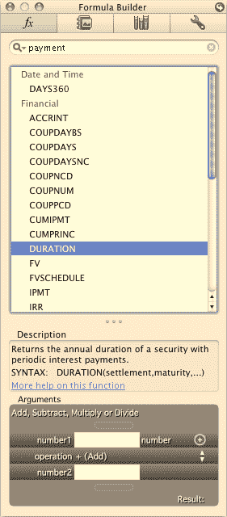
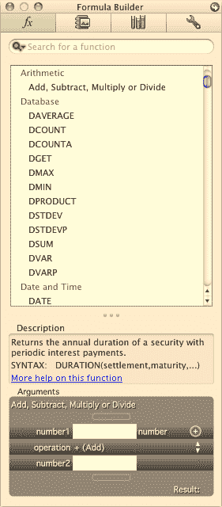
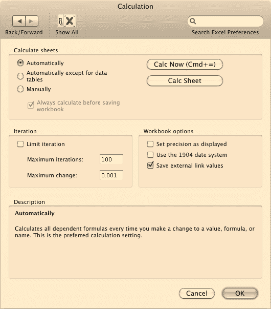

# 第 6 章：使用 Excel 的内置函数

正如你在前一章所见，函数是用于执行标准计算的预定义公式。Excel 包含数百个内置函数，你可以直接将其插入单元格，并提供它们所需的数据来得出答案。

函数省去了你从头创建复杂公式以及公式出错的麻烦，因此当需要执行标准计算时，请先检查 Excel 是否有对应的函数。没必要重复造轮子，尤其当造出的轮子还不圆时。

在本章中，你将学习如何使用 Excel 提供的各种工具将函数插入工作表，如何找到所需的函数，以及如何为函数指向计算所需的数据。

当你熟悉了函数的工作原理后，我们将回顾 Excel 提供的不同函数类别，例如数据库函数、逻辑函数以及数学和三角函数。我将解释你最可能用到的函数，并在有帮助的地方给出示例。

## 了解函数的组成部分

在 Excel 中，函数有一个用大写字母书写的名称，后跟一对括号，括号内包含函数所需的数据片段（如果有的话）。以下是三个示例：

- `SUM()`。这个广泛使用的函数将你指定的两个或多个数值相加。

- `COUNT()`。此函数计算指定区域中包含数字（而非文本、空白或其他数据类型）的单元格数量。

- `TODAY()`。此函数在单元格中输入当前日期。

大多数函数都带有*参数*，这些信息告诉函数你想要它处理什么。Excel 会提示你提供每个函数所需的参数。例如，当你在单元格中输入函数时，Excel 会显示一个“屏幕提示”，显示所需的参数。图 6-1 展示了使用 `SUM()` 函数的示例。

**图 6-1。** 在单元格中输入函数时，Excel 会提示你提供所需的参数。

屏幕提示显示 `SUM()` 函数有一个必需参数和一个可选参数，并且你可以根据需要添加更多参数：

- **必需参数。** 每个必需参数不带方括号，例如屏幕提示中的 `number1` 参数。参数之间用逗号分隔，如下一段示例所示。例如，你可以使用 `SUM()` 将某个区域内的单元格值相加：`SUM(C1:C10)`。这里，`C1:C10` 是一个单独的参数，即必需参数。

- **可选参数。** 每个可选参数都出现在方括号中，例如屏幕提示中的 `[number2]` 参数。例如，你可以使用 `SUM()` 将两个单元格的值相加：`SUM(C1,C3)`。这里，`C1` 是必需参数，`C3` 是第一个可选参数。

- **额外参数。** 省略号 (...) 表示你可以输入更多相同类型的参数。例如，你可以使用 `SUM()` 将多个单元格的值相加：`SUM(C1,C3,D4,D8,E1,XF202)`。这里，`C1` 是必需参数，所有其他单元格引用都是可选参数。

**注意：** 少数函数不带任何参数。例如，你不需要告诉 `TODAY()` 函数今天是哪一天。同样，`NOW()` 函数无需任何参数即可返回当前日期和时间，而 `NA()` 函数仅在单元格中输入 `#(N/A)` 以指示信息不可用。即使函数不带参数，你仍然需要包含括号以便 Excel 识别该函数。

## 在工作表中输入函数

Excel 将最常用的功能放在你的指尖，即使是最高度专业化的函数，你也能快速轻松地输入。

以下是插入函数的四种方法：

- **使用“自动求和”按钮或“自动求和”弹出菜单。** “自动求和”按钮位于标准工具栏和功能区“公式”选项卡的“函数”组中，可快速访问五个常用函数。

- **使用“插入”弹出菜单和“公式生成器”。** “插入”弹出菜单位于功能区“公式”选项卡的“函数”组中。当你从“插入”弹出菜单及其子菜单中选择所需的功能时，Excel 会在工具箱中显示“公式生成器”窗格，引导你完成函数插入。

- **使用工具箱中的“公式生成器”窗格。** 你也可以不先使用“插入”弹出菜单，直接开始在工具箱中的“公式生成器”窗格中操作。打开“公式生成器”窗格最简单的方法是单击编辑栏中的 `fx` 按钮。

- **手动输入函数。** 当你知道需要哪个函数时，可以直接在单元格中键入它。

我们将在以下各节详细讨论。

### 使用“自动求和”弹出菜单插入函数

在工作表中输入五个常用函数（`SUM()`、`AVERAGE()`、`COUNT()`、`MAX()` 或 `MIN()`）中的任何一个，最快、最简单的方法是使用标准工具栏上的“自动求和”弹出菜单。请遵循以下步骤：

1. 单击要输入函数的单元格。

2. 如果你想为所选单元格上方或左侧的单元格创建 `SUM()` 函数，请直接单击“自动求和”按钮本身。否则，单击“自动求和”弹出按钮，然后单击该函数（参见图 6-2）。

**注意：** 你也可以使用标准工具栏上的“自动求和”弹出菜单打开工具箱中的“公式生成器”窗格。只需单击弹出菜单底部的“其他函数”项即可。

**图 6-2。** 当需要快速插入 `SUM()`、`AVERAGE()`、`COUNT()`、`MAX()` 或 `MIN()` 函数时，请使用标准工具栏上的“自动求和”弹出菜单。

3. Excel 将函数插入你选择的单元格，并选择它认为你可能想用作参数的区域。图 6-3 展示了使用 `AVERAGE()` 函数的示例。

**图 6-3。** 当你从“自动求和”弹出菜单插入函数时，Excel 会选择一个它认为可能合适的数据区域。

4. 如果需要更改区域，请使用以下方法之一：

   - 单击并拖动以选择正确的区域。

   - 在括号内，将区域覆盖为键入的新区域。

5. 如有必要，向公式添加另一个参数。例如，键入一个逗号，然后单击并拖动以选择另一个区域。

6. 当公式符合要求时，按 Return 键将其输入到单元格中。Excel 会显示公式的结果。

### 使用公式生成器插入函数

当您需要查找合适的函数插入，或需要了解某个函数的参数时，请使用 `公式生成器` 插入函数。`公式生成器` 是一个显示在工具箱中的窗格，它提供 Excel 函数的完整列表，并附有相关描述以及它们所用参数的详细信息。

若要使用 `公式生成器` 插入函数，请按照以下步骤操作：

**1.** 选择您要在其中输入函数的单元格。

[www.it-ebooks.info](http://www.it-ebooks.info/)





**第 6 章：使用 Excel 的内置函数**

**189**

**2.** 通过以下任一方式打开 `公式生成器`：

- *编辑栏。* 单击 `fx` 按钮。

- *常用工具栏。* 单击 `自动求和` 弹出按钮，然后在弹出菜单中单击 `其他函数` 项。

- *菜单栏。* 选择 `视图` > `公式生成器`。

- *功能区。* 选择 `公式` > `函数` > `公式生成器`。

- *工具箱。* 如果工具箱已打开，请单击 `公式生成器` 选项卡。

**3.** 如果您想搜索函数，请单击顶部的搜索框，输入要搜索的关键词，然后按 `Return` 键。`公式生成器` 会显示结果列表，如图 6-4 左侧所示。

**图 6-4.** 要查找函数，请在“公式生成器”的搜索窗格中输入搜索词并按 `Return` 键；“公式生成器”会显示结果列表（左侧）。或者，浏览完整的函数列表，并单击您想查看其信息的函数（右侧）。

[www.it-ebooks.info](http://www.it-ebooks.info/)

**190**

**第 6 章：使用 Excel 的内置函数**

**4.** 否则，浏览函数列表以找到您需要的函数，如图 6-4 右侧所示。`公式生成器` 将函数分为以下几类，本章后面将深入介绍其中的大部分类别：

- **最近使用。** 此类别可让您快速访问最近使用过的函数——因此，如果您正在寻找以前用过的函数，请先从这儿开始。

**提示：** 您可以通过向上或向下拖动大小调整手柄（列表下方由三个点组成的线条）来使 `公式生成器` 窗口中的公式列表更高或更矮。`公式生成器` 窗口会随之增大或缩小以适应列表。

- **算术。** 此类别实际上不显示函数，只有一个名为“加、减、乘或除”的条目。当您双击此项时，`公式生成器` 底部的 `参数` 窗格（参见图 6-4 右侧屏幕）会显示帮助您设置算术公式的控件。

# 第 6 章：使用 Excel 的内置函数

此类别包含用于处理数据库的函数——例如，返回列或列表中值的平均值，或者返回一个字段中包含数字的单元格的计数。

- **数据库。** 此类别包含用于处理数据库的函数——例如，返回列或列表中值的平均值，或者返回一个字段中包含数字的单元格的计数。

- **日期和时间。** 此类别包含各种函数，从使用 `TODAY()` 函数返回当前日期，到使用 `WEEKDAY()` 函数返回特定日期是星期几。

- **工程。** 此类别包含函数，包括 `DEC2HEX()` 函数（用于将十进制数转换为十六进制数，基数为 16）和 `HEX2OCT()` 函数（用于将十六进制数转换为八进制数，基数为 8）。

- **财务。** 此类别包含用于财务计算的函数——例如，计算抵押贷款的还款额或资产的折旧。

- **信息。** 此类别包含用于返回数据信息（例如数据是文本还是数字）的函数。

- **逻辑。** 此类别包含用于执行逻辑测试的函数——例如，测试特定单元格是否包含错误。

- **查找和引用。** 此类别包含用于从工作表其他部分查找数据或引用其中其他单元格的函数。

- **数学和三角函数。** 此类别包含数学函数，例如用于返回平方根的 `SQRT()` 函数，以及三角函数，例如用于计算余弦的 `COS()` 函数。

- **统计类**。此类别包含用于执行统计计算的函数，例如基于总体或样本计算标准差。

- **文本类**。此类别包含用于操作文本的函数，例如`TRIM()`函数（用于修剪前导和尾随空格）以及返回值最左侧部分的`LEFT()`函数。

- **兼容性类**。此类别包含用于与 Excel 2008 (Mac)、Excel 2007 (Windows) 及更早版本兼容的函数。最好仅在与这些旧版本兼容时才使用这些函数；如果您正在为 Excel 2011 或 Excel 2010 (Windows) 开发工作表，请使用这些版本支持的较新函数——例如，使用新的 `POISSON.DIST()` 函数而不是旧的 `POISSON()` 函数。

## 5. 使用公式生成器
要了解有关某个函数的更多信息，请单击它。公式生成器会在窗口底部显示其详细信息，如左侧的图 6–5 所示。在这里，您可以单击“此功能的更多帮助”链接，打开一个帮助窗口，其中显示有关该函数及其参数的详细信息。

**图 6–5。** *使用公式生成器底部的“说明”区域来识别您需要的函数（左侧）。当您双击该函数以插入它时，公式生成器会显示“参数”窗格（右侧）。*

## 6. 插入函数
当您找到要插入的函数后，双击它。公式生成器会显示该函数的“参数”窗格，如右侧的图 6–5 所示（已输入一个参数）。

## 7. 输入第一个参数
单击第一个参数的框，然后输入数据。您可以键入一个值或区域名称，键入单元格引用或区域，或使用鼠标在工作表（或另一个工作表或工作簿）中选择一个单元格引用或区域。

## 8. 填写其他参数并查看结果
填写函数的每个其他参数。当您输入完所有必需参数后，函数生成器窗口右下角的“结果”读数会显示该函数的结果。

## 9. 输入函数
按 `Return` 键在工作表中输入函数。

如果您已完成使用函数生成器，请通过单击其“关闭”按钮（其标题栏左端的按钮）、从菜单栏选择“查看”>“公式生成器”，或单击标准工具栏上的“工具箱”按钮来关闭它。

### 使用“插入”弹出菜单插入函数
当您知道要插入哪个函数时，最简单的插入方法（除非它是“自动求和”弹出菜单上的五个函数之一）是使用“插入”弹出菜单。“插入”弹出菜单帮助您按类别选择函数，并将其直接插入单元格。

要使用“插入”弹出菜单插入函数，请按照以下步骤操作：

**1.** 选择要输入函数的单元格。

**2.** 选择“公式”>“函数”>“插入”以显示“插入”弹出菜单。此弹出菜单将函数分为十个类别：数据库、日期和时间、工程、财务、信息、逻辑、查找与引用、数学与三角函数、统计和文本。这些类别与公式生成器中显示的类别相似，如本章前面所述。每个类别都有一个子菜单。

**3.** 单击要插入的函数类别。Excel 会显示一个包含这些函数的子菜单。图 6–6 显示了打开的“日期和时间”子菜单。

**图 6–6。** *当您希望按类别插入函数时，请使用“Ribbon”上“公式”选项卡的“函数”组中的“插入”弹出菜单。*

**4.** 单击要插入的函数。Excel 会将其插入到单元格中。

**5.** 照常输入函数的参数。

**提示：** 如果需要帮助提供函数的参数，请单击编辑栏上的 `fx` 按钮，或从功能区选择 `公式 > 函数 > 公式生成器` 以显示公式生成器。公式生成器会显示刚插入函数的详细信息。

**6.** 按 `Return` 键或单击编辑栏上的“输入”按钮，将公式输入到单元格中。

### 通过在工作表中键入函数来插入函数
你也可以通过直接在单元格中键入函数来将其输入工作表。当你熟悉所需函数并知道其参数时，可能更倾向于使用这种方法。请遵循以下一般步骤：

**1.** 单击单元格将其选中。

**2.** 键入 `=` 告诉 Excel 你正在创建公式。

**3.** 开始键入函数名称。Excel 会显示匹配的函数列表（参见图 6-7）。

**图 6-7。** *当你开始在单元格中键入函数名称时，Excel 会列出匹配的函数。单击要插入的函数，或按下箭头键（必要时按上箭头键）选择函数，然后按* `Return`。

**注意：** 你也可以继续键入，直到输入足够字符以唯一标识函数——或者如果愿意，也可以直接键入完整的函数名称。

**4.** 要输入函数，请双击它，或通过按向下箭头或向上箭头将高亮移动到该函数，然后按 `Return`。

**5.** 指定函数的参数。你可以键入一个值或引用，也可以使用鼠标选择单元格或区域。

**注意：** 在单元格中输入函数后，可以通过双击该单元格，或使单元格处于活动状态并按 `Ctrl+U` 来打开函数进行编辑。你可以直接在单元格中或编辑栏中编辑函数。

### 将一个函数嵌套在另一个函数内部
刚开始使用函数时，你可能只会在单元格中使用单个函数。但随着对函数的使用经验逐渐丰富，你会发现有时需要使用多个函数来执行所需的计算。

当需要同时使用两个或更多函数时，你可以将一个函数嵌套在另一个函数内部。例如，如果需要返回当前小时数，可以将 `NOW()` 函数（返回当前日期和时间）嵌套在 `HOUR()` 函数（以 24 小时格式返回给定时间的小时数；如果需要以 AM/PM 格式显示小时，请更改单元格格式）中：

```
=HOUR(NOW())
```

与公式类似，如果需要，你可以将函数嵌套很多层。这是一个三层嵌套的示例：

```
=INT(AVERAGE(ROUND(SUM(C1:C6),2),ROUND(SUM(D1:D6),2)))
```

具体运算过程如下：

- `SUM(C1:C6)`：此 `SUM` 函数将范围 `C1:C6` 中的值相加。类似地，`SUM(D1:D6)` 将范围 `D1:D6` 中的值相加。

- `ROUND(SUM(C1:C6),2)`：此 `ROUND` 函数将 `SUM(C1:C6)` 公式的结果四舍五入到两位小数。类似地，`ROUND(SUM(D1:D6),2)` 将 `SUM(D1:D6)` 公式的结果四舍五入到两位小数。

- `AVERAGE`：此函数返回两个 `ROUND` 函数返回结果的平均值。

- `INT`：此函数返回 `AVERAGE` 函数结果的整数部分。

**提示：** 嵌套函数可以使电子表格更紧凑，并给同事留下深刻印象。但在确定使用哪些函数时，你可能发现将每个函数放在单独的单元格中更容易，这样可以看到每个函数返回的结果——也许还可以添加注释说明每个步骤的作用。一旦各函数在单独单元格中正常工作，再在单个单元格中创建嵌套版本，并确保其给出与逐步版本相同的结果。同样，你可能希望添加注释解释嵌套公式的工作原理。

## 了解 Excel 的内置函数

# 本节内容

在本节中，我将向你介绍 Excel 的十大内置函数类别：`数据库`、`日期与时间`、`工程`、`财务`、`逻辑`、`信息`、`查找与引用`、`数学与三角函数`、`统计`以及`文本`。我们将关注最常用的函数，并通过示例说明其应用场景。

## 数据库函数

Excel 包含 12 个数据库函数，用于在工作表表格中查找符合指定条件的值。（`表格`是在工作表中创建的平面数据库；第 10 章会讲解如何创建表格，并给出使用数据库函数的示例。）

**表 6–1.** `Excel 的数据库函数`

| 数据库函数 | 返回结果 |
| --- | --- |
| `DAVERAGE` | 返回列中符合指定条件的值的平均值。 |
| `DCOUNT` | 返回数据库字段中符合指定条件的单元格计数。 |
| `DCOUNTA` | 返回数据库字段中符合指定条件的非空单元格计数。 |
| `DGET` | 返回与指定字段条件匹配的数据库记录。 |
| `DMAX` | 返回数据库字段中符合指定条件的最大值。 |
| `DMIN` | 返回数据库字段中符合指定条件的最小值。 |
| `DPRODUCT` | 返回符合指定条件的记录值的乘积结果。 |
| `DSTDEV` | 基于样本的选定数据库条目的标准偏差。 |
| `DSTDEVP` | 基于全体选定数据库条目的标准偏差。 |
| `DSUM` | 返回符合指定条件的字段值的总和。 |
| `DVAR` | 基于样本的数据库条目的方差。 |
| `DVARP` | 基于全体数据库条目的方差。 |

## 日期与时间函数

表 6–2 解释了 Excel 的日期与时间函数，这些函数在许多工作表中都很有用。

**表 6–2.** `Excel 的日期与时间函数`

| 日期与时间函数 | 返回结果 |
| --- | --- |
| `DATE` | 返回指定日期的序列号。例如，`=DATE(2011,11,18)` 返回 40865，即 2011 年 11 月 18 日的序列日期。除非将单元格格式设置为`常规`，否则 Excel 会以日期格式显示此值。 |
| `TIME` | 返回指定时间的序列号。例如，`=TIME(11,59,59)` 返回 0.499988426，即上午 11:59:59 的序列号。除非将单元格格式设置为`常规`，否则 Excel 会以时间格式显示此值。 |
| `DATEVALUE` | 返回以文本格式指定的日期的序列号。例如，`=DATEVALUE("2011 年 12 月 12 日")` 返回 40889，即 2011 年 12 月 12 日的序列日期。 |
| `TIMEVALUE` | 返回以文本格式指定的时间的序列号。例如，`=TIMEVALUE("下午 3:25:00")` 返回 0.502372685，即下午 3:25 的序列号。 |
| `DAY` | 返回介于 1 到 31 之间的序列号，代表指定序列日期所在的月份中的第几天。例如，`=DAY(40789)` 返回 3，表示该日期是该月的第三天。 |
| `MONTH` | 返回介于 1 到 12 之间的序列号，代表指定序列日期所在的月份。例如，`=MONTH(40789)` 返回 9，表示该日期在九月。 |
| `YEAR` | 返回指定序列日期的四位数字年份。例如，`=YEAR(40789)` 返回 2011，表示该日期在 2011 年。 |
| `YEARFRAC` | 返回一个数字，表示指定开始日期与结束日期之间的年数。例如，`=YEARFRAC(DATE(2011,1,1),DATE(2012,3,1))` 返回 1.166666667，即 2011 年 1 月 1 日到 2012 年 3 月 1 日之间的年数。 |
| `DAYS360` | 返回一个数字，表示指定开始日期与结束日期之间的天数，假设一年有 360 天（这是一种会计技巧，并非直接否定传统计时法）。例如，`=DAYS360(DATE(2011,1,1),DATE(2012,3,1))` 返回 420，这是基于 360 天的一年计算方式下，2011 年 1 月 1 日至 2012 年 3 月 1 日之间的天数。 |
| `HOUR` | 一个介于 0 到 23 之间的序列号，表示给定时间的小时数。例如，`=HOUR(0.25)` 返回 6，代表早上 6 点，因为一天 24 小时的四分之一是 6 小时。 |
| `MINUTE` | 一个介于 0 到 59 之间的序列号，表示给定时间的分钟数。例如，`=MINUTE(0.55)` 返回 12，代表下午 1:12 的分钟数，此时刻是一天时间进度到 55% 的时刻。 |
| `SECOND` | 一个介于 0 到 59 之间的序列号，表示给定时间的秒数。例如，`=SECOND(0.61)` 返回 24，代表下午 2:38.24 的秒数，此时刻是一天时间进度到 61% 的时刻。 |
| `TODAY` | 以日期格式返回当前日期。例如，在 2011 年 6 月 12 日，`=TODAY()` 返回 6/12/2011。 |
| `NOW` | 以日期和时间格式返回当前日期和时间。例如，`=NOW()` 返回类似 6/2/2011 03:15 的日期和时间。 |
| `WEEKNUM` | 一个介于 1 到 52 之间的序列号，指示指定日期在当年中是第几周。例如，`=WEEKNUM(40789)` 返回 36，表示该日期位于当年第 36 周。 |
| `WEEKDAY` | 一个介于 1（星期日）到 7（星期六）之间的序列号，指示指定日期是星期几。例如，`=WEEKDAY(40789)` 返回 7，表示该日是星期六。 |
| `WORKDAY` | 返回一个序列号，给出在指定起始日期之前或之后指定工作天数（包含指定的节假日数量）的日期。例如，`=WORKDAY(DATE(2011,6,12),40,2)` 返回 40760，即 2011 年 8 月 5 日的序列号，这是假设有两个节假日的情况下，2011 年 6 月 12 日后第 40 个工作日。 |
| `NETWORKDAYS` | 返回一个数字，给出指定起始日期和指定结束日期之间的净工作日数（减去指定的节假日数量）。例如，`=NETWORKDAYS(DATE(2011,6,12),DATE(2011,10,20),2)` 返回 94，这是 2011 年 6 月 12 日至 2011 年 10 月 20 日之间的净工作日数，假设在此期间有两个节假日。 |
| `EDATE` | 返回一个序列号，给出在给定起始日期之前或之后指定月份数的日期。例如，`=EDATE(40789,4)` 返回 40911，即序列日期 40789 之后四个月的序列日期。 |
| `EOMONTH` | 返回一个序列号，给出在给定起始日期之前或之后指定月份数的那个月份的最后一天。例如，`=EOMONTH(DATE(2011,7,14),6)` 返回 40939，即 2012 年 1 月 31 日的序列号，这是 2011 年 7 月 14 日之后六个月的那个月份的最后一天。 |

## 工程函数

表 6-3 解释了 Excel 的工程函数，其范围从计算贝塞尔函数到将数字与二进制、八进制和十六进制进行相互转换。

**表 6-3.** `Excel 的工程函数`

| 函数 | 返回结果 |
| --- | --- |
| `BESSELI` | 修正的贝塞尔函数 `In( x)`，即围道积分。例如，`=BESSELI(1.8,1)` 返回 1.31716723。 |
| `BESSELJ` | 贝塞尔函数 `Jn( x)`，也称为柱谐函数。例如，`=BESSELJ(1.5,2)` 返回 0.232087679。 |
| `BESSELK` | 修正的贝塞尔函数 `Kn( x)`，也称为巴塞特函数或麦克唐纳函数。例如，`=BESSELK(1.8,3)` 返回 0.95783635。 |
| `BESSELY` | 贝塞尔函数 `Yn( x)`，也称为诺伊曼函数或韦伯函数。例如，`=BESSELY(3.5,1)` 返回 0.410188417。 |
| `BIN2DEC` | 指定二进制数的十进制等效值。例如，`=BIN2DEC(1001101)` 返回 77。二进制数最多可包含 10 个字符；更长的数字会导致 `#NUM!` 错误。 |
| `BIN2HEX` | 指定二进制数的十六进制等效值，可选择指定要使用的字符数。例如，`=BIN2HEX(111011111)` 返回 1DF，而 `=BIN2HEX(111011111,4)` 返回 01DF。二进制数最多可包含 10 个字符；超过此长度的数字会导致 `#NUM!` 错误。 |

```python
if (condVar > someVal) {console.log("xxx")}
```

## BIN2OCT

指定二进制（基数为 2）数的八进制（基数为 8）等效值，可选择指定返回的字符数。例如，`=BIN2OCT(1011,4)` 返回 0013。

## COMPLEX

由实部和虚部系数生成的复数。例如，`=COMPLEX(4,5)` 返回 4+5i。

## CONVERT

将指定源测量系统中的值转换为指定目标测量系统中的等效值。您可以转换重量和质量、距离、压强、力、能量、功率、磁力、温度、液体和公制测量单位；详细信息请参阅帮助文件。例如，`=CONVERT(200,"kg","lbm")` 将 200 公斤转换为其以磅为单位的等效重量（440.9245244）。

## DEC2BIN

指定十进制（基数为 10）数的二进制（基数为 2）等效值，可选择指定返回的字符数。例如，`=DEC2BIN(100)` 返回 1100100，而 `=DEC2BIN(100,10)` 返回 0001100100。

[www.it-ebooks.info](http://www.it-ebooks.info/)

**200**

**第 6 章：使用 Excel 的内置函数**

**工程**

**返回值**

**函数**

## DEC2HEX

指定十进制（基数为 10）数的十六进制（基数为 16）等效值，可选择指定返回的字符数。例如，`=DEC2HEX(-90)` 返回 FFFFFFA6。

## DEC2OCT

指定十进制（基数为 10）数的八进制（基数为 8）等效值，可选择指定返回的字符数。例如，`=DEC2OCT(100,6)` 返回 000144。

## DELTA

如果两个数相等，则返回 1；如果不相等，则返回 0。例如，`=DELTA(B1,B2)` 如果单元格 `B1` 和 `B2` 中的值相等，则返回 1；否则返回 0。

## ERF

在指定的下限和指定上限之间积分的误差函数。如果省略上限，则返回零与指定下限之间的误差函数值。例如，`=ERF(0.5,2)` 返回 0.474822387，这是在 0.5 和 2 之间积分的误差函数值。

## ERFC

在指定的下限和正无穷之间积分的互补误差函数。例如，`=ERFC(2)` 返回 0.004677735。

## GESTEP

如果指定数字大于或等于指定阈值，则返回 1；否则返回 0。例如，`=GESTEP(5,D1)` 如果 5 大于或等于单元格 `D1` 中的值，则返回 1；否则返回 0。

## HEX2BIN

指定十六进制（基数为 16）数的二进制（基数为 2）等效值，可选择指定返回的字符数。例如，`=HEX2DEC("AF",8)` 返回 10101111。

## HEX2DEC

指定十六进制（基数为 16）数的十进制（基数为 10）等效值。例如，`=HEX2DEC("FFFF0000")` 返回 4294901760。

## HEX2OCT

指定十六进制（基数为 16）数的八进制（基数为 8）等效值，可选择指定返回的字符数。例如，`=DEX2OCT("AF00")` 返回 127400。

## IMABS

复数的模（绝对值）。例如，`=IMABS("6+2i")` 返回 6.708203932。

## IMAGINARY

复数的虚部系数。例如，`=IMAGINARY("8+3i")` 返回 3。

## IMARGUMENT

指定复数的 θ 参数（以弧度表示的角度）。例如，`=IMARGUMENT("4+5i")` 返回 0.896055385。

## IMCONJUGATE

指定复数的共轭复数。例如，`=IMCONJUGATE("4+5i")` 返回 4-5i。

[www.it-ebooks.info](http://www.it-ebooks.info/)

**第 6 章：使用 Excel 的内置函数**

**201**

**工程**

**返回值**

**函数**

## IMCOS

指定复数的余弦值。例如，`=IMCOS(A22)` 返回单元格 `A22` 中值的余弦值。

## IMDIV

指定两个复数的商。例如，`=IMDIV("10+25i","-240+280i")` 计算给定两个数的商。

## IMEXP

指定复数的指数值。例如，`=IMEXP("2+i")` 返回 3.99232404844127+6.21767631236797i。

## IMLN

`IMLN`

指定复数的自然对数。例如，`=IMLN("8+10i")` 返回 `2.5499332139121+0.896055384571344i`。

`IMLOG10`

指定复数的以 10 为底的对数。例如，`=IMLOG10("8+10i")` 返回 `1.10742192402385+0.389151908999031i`。

`IMLOG2`

指定复数的以 2 为底的对数。例如，`=IMLOG2("8+10i")` 返回 `3.67877600230904+1.29273465968293i`。

`IMPOWER`

指定复数的指定次幂。例如，`=IMPOWER("4+2i",3)` 返回 `16+88i`。

`IMPRODUCT`

指定复数之积。例如，`=IMPRODUCT("3+4i","2+3i")` 返回 `-6+17i`。

`IMREAL`

指定复数的实部系数。例如，`=IMREAL("3+4i")` 返回 `3`。

`IMSIN`

指定复数的正弦值。例如，`=IMSIN("3+4i")` 返回 `3.85373803791938-27.0168132580039i`。

`IMSQRT`

指定复数的平方根。例如，`=IMSQRT("3+4i")` 返回 `2+i`。

`IMSUB`

两个指定复数的差。例如，`=IMSUB("3+4i","4+5i")` 返回 `-1-i`。

`IMSUM`

指定复数之和。例如，`=IMSUM("3+4i","4+5i")` 返回 `7+9i`。

`OCT2BIN`

指定八进制数的二进制（以 2 为底）等效值，并可选择指定结果位数。例如，`=OCT2BIN(45,8)` 返回 `00100101`。

`OCT2DEC`

指定八进制数的十进制（以 10 为底）等效值。例如，`=OCT2DEC(45)` 返回 `37`。

[www.it-ebooks.info](http://www.it-ebooks.info/)

**202**

**第 6 章：使用 Excel 的内置函数**

### 工程函数

| 函数 | 返回内容 |
| :--- | :--- |
| `OCT2HEX` | 指定八进制数的十六进制（以 16 为底）等效值。例如，`=OCT2HEX(45,8)` 返回 `00000025`。 |

### 财务函数

表 6-4 向您介绍 Excel 的财务函数，这些函数涵盖了大多数常见的财务计算以及各种更专业的计算。

**表 6-4.** *Excel 的财务函数*

| 函数 | 返回内容 |
| :--- | :--- |
| `ACCRINT` | 定期支付利息的证券的应计利息。例如，`=ACCRINT(DATE(2010,8,1),DATE(2010,9,1),DATE(2010,8,15),10%,5000,4)` 计算一张发行日为 2010 年 8 月 1 日、首次付息日为 2010 年 9 月 1 日、结算日为 2010 年 8 月 15 日、利率为 10%（我知道，做做梦吧）、面值为 $5000、每年付息四次（即每季度付息一次）的证券的应计利息。 |
| `ACCRINTM` | 到期一次性支付利息（而非定期支付）的证券的应计利息。例如，`=ACCRINTM(DATE(2011,1,15),DATE(2012,2,15),10%,10000)` 计算一张发行日为 2011 年 1 月 15 日、到期日为 2012 年 2 月 15 日、利率为 10%、面值为 $10,000 的证券的应计利息。 |
| `AMORDEGRC` | 每个会计期间资产的按比例线性折旧（法语会计系统）。例如，`=AMORDEGRC(5000,DATE(2010,12,3),DATE(2011,3,30),2000,2,12.5%)` 计算于 2010 年 12 月 3 日以 $5000 购入的资产、首期结束日为 2011 年 3 月 30 日、残值 $2000、两个期间、折旧率 12.5% 情况下的按比例线性折旧。 |
| `AMORLINC` | 每个会计期间资产的按比例线性折旧（法语会计系统）。例如，`=AMORLINC(4000,DATE(2010,12,3),DATE(2011,6,30),1500,1,18%)` 计算于 2010 年 12 月 3 日以 $4000 购入的资产、首期（也是唯一一期）结束日为 2011 年 6 月 30 日、残值 $1500、折旧率 18% 情况下的按比例线性折旧。 |
| `COUPDAYBS` | 从付息期开始到结算日的天数。例如，`=COUPDAYBS(DATE(2011,2,19),DATE(2013,2,19),4)` 返回一张结算日为 2011 年 2 月 19 日、到期日为 2013 年 2 月 19 日、按季度付息的债券对应的天数。 |

# 第 6 章：使用 Excel 内置函数

## 财务函数

### 函数列表与描述

| 函数 | 返回内容 |
| --- | --- |
| `COUPDAYS` | 包含结算日的付息期天数。例如，`=COUPDAYS(DATE(2011,3,1),DATE(2011,12,1),2)` 返回债券从付息期开始日到结算日的天数，该债券的结算日为 2011 年 3 月 1 日，到期日为 2011 年 12 月 1 日，付息方式为半年付息。 |
| `COUPDAYSNC` | 从结算日到下一个付息日的天数。例如，`=COUPDAYSNC(DATE(2011,7,4),DATE(2012,4,8),2)` 计算债券的天数，该债券的结算日为 2011 年 7 月 4 日，到期日为 2012 年 4 月 8 日，付息方式为半年付息。 |
| `COUPNCD` | 结算日之后的下一个付息日。例如，`=COUPNCD(DATE(2011,11,12), DATE(2012,12,13),4)` 返回债券在结算日（2011 年 11 月 12 日）之后的下一个付息日，该债券的到期日为 2012 年 12 月 13 日，付息方式为季度付息。 |
| `COUPNUM` | 在结算日与到期日之间应付的付息次数。例如，`=COUPNUM(DATE(2011,1,5),DATE(2013,5,8),2)` 返回债券在结算日（2011 年 1 月 5 日）与到期日（2013 年 5 月 8 日）之间应付的付息次数，该债券的付息方式为半年付息。 |
| `COUPPCD` | 结算日之前的上一个付息日。例如，`=COUPPCD(DATE(2011,1,8),DATE(2014,1,8),4)` 返回债券在结算日（2011 年 1 月 8 日）之前的上一付息日，该债券的到期日为 2014 年 1 月 8 日，付息方式为季度付息。 |
| `CUMIPMT` | 在两个指定期间内累计支付的利息。例如，`=CUMIPMT(1%,60,10000,1,12,1)` 计算月利率为 1%（年利率为 12%），分 60 期（五年）偿还，本金为 10,000 美元的贷款，在第 1 至第 12 期（第一年）内累计支付的利息。该计算假设还款发生在月初（最后一个参数为 1），而非月末（若为月末则用 0 表示）。 |
| `CUMPRINC` | 在两个指定期间内偿还的贷款累计本金。例如，`=CUMPRINC(0.5%,24,1500,1,6,0)` 计算一笔 1500 美元的贷款，在 24 个月期限的前 6 个月内累计偿还的本金。该贷款月利率为 0.5%，还款发生在月末（最后一个参数为 0），而非月初（若为月初则用 1 表示）。 |
| `DB` | 采用固定余额递减法计算的折旧值。例如，`=DB(1000,250,6,2)` 计算一项资产的第二年折旧，该资产原值为 1000 美元，残值为 250 美元，折旧年限为六年。 |
| `DDB` | 采用双倍余额递减法或其他方法计算的折旧值。例如，`=DDB(2000,500,8,4,2)` 计算一项资产的第四年折旧，该资产原值为 2000 美元，残值为 500 美元，折旧年限为八年，采用双倍余额递减法（由末尾参数 2 表示）。 |
| `DISC` | 证券的贴现率。例如，`=DISC(DATE(2011,1,11),DATE(2012,2,20),96.5,100,3)` 计算一种证券的贴现率，该证券的结算日为 2011 年 1 月 11 日，到期日为 2012 年 1 月 20 日，价格为每 100 美元面值 96.50 美元，赎回价格为每 100 美元面值 100 美元，使用实际/365 天计数基准。 |
| `DOLLARDE` | 将分数表示的美元价格转换为十进制表示的美元价格。例如，`=DOLLARDE(1.08,32)` 将 1 美元又 8/32 的价格转换为十进制表示，结果为 1.25。 |
| `DOLLARFR` | 将十进制表示的美元价格转换为分数表示的美元价格。例如，`=DOLLARFR(1.25,32)` 将 1.25 美元转换为以 32 为分母的分数表示，结果为 1.08。 |
| `DURATION` | 定期支付利息的证券的年化久期。例如，`=DURATION(DATE(2011,1,20),DATE(2012,6,12),7%,10%,2)` 计算一只证券的年化久期，该证券的结算日为 2011 年 1 月 20 日，到期日为 2011 年 6 月 12 日，年票息率为 7%，年收益率为 10%。 |
| `EFFECT` | 有效年利率。例如，`=EFFECT(6%,4)` 计算的是 6%利率、每年复利 4 次的有效年利率。 |
| `FV` | 一项投资的未来值。例如，`=FV(8%/12,60,-500)` 计算的是每月投入 500 美元、持续 60 个月、年利率 8%（按月计息）的投资未来值。 |
| `FVSCHEDULE` | 应用复利后的投资未来值。例如，`=FVSCHEDULE(100,{0.09,0.1,0.11,0.12})` 计算的是 100 美元投资，第一年利率 9%、第二年 10%、第三年 11%、第四年 12%的未来值。 |
| `INTRATE` | 完全归属证券的利率。例如，`=INTRATE(DATE(2011,1,20),DATE(2012,6,15),10000,11000)` 返回的是面值 10000 美元、结算日 2011 年 1 月 20 日、到期日 2012 年 6 月 15 日、赎回价 11000 美元的证券利率。 |
| `IPMT` | 投资在指定期间的利息支付额。例如，`=IPMT(4%/12,1,24,-1000)` 计算的是 24 个月期、价值 1000 美元、年利率 4%（按月计息）的投资在第一个月的利息支付额。 |
| `IRR` | 现金流的内部收益率。例如，`=IRR({-50000,10000,12000,19000,28000})` 计算的是初始投入 50000 美元，第一年收入 10000 美元，第二年 12000 美元，第三年 19000 美元，第四年 28000 美元项目的内部收益率。 |
| `ISPMT` | 投资在指定期间的已付利息。例如，`=ISPMT(7%/12,6,5*12,5000)` 计算的是五年期（5*12 个月）、本金 5000 美元、年利率 7%（按月计息）的投资在第六个月的利息支付。 |
| `MDURATION` | 假设面值为 100 美元的证券的麦考利修正久期。例如，`=MDURATION(DATE(2011,2,18), DATE(2014,2,28),7%,9%,2)` 计算的是结算日为 2011 年 2 月 18 日、到期日为 2014 年 2 月 28 日、年票息率 7%、年收益率 9%、半年付息一次的证券的麦考利修正久期。 |
| `MIRR` | 现金流的修正内部收益率。例如，`=MIRR({-50000,10000,12000,19000,28000},3.5%,9%)` 计算的是购入成本 50000 美元，第一年收入 10000 美元，第二年 12000 美元，第三年 19000 美元，第四年 28000 美元的业务的修正内部收益率。资金年借款利率为 3.5%，现金流再投资收益率为 9%。 |
| `NOMINAL` | 年名义利率。例如，`=NOMINAL(4.6%,4)` 计算的是有效年利率为 4.6%、每年复利 4 次时的年名义利率。 |
| `NPER` | 使用等额付款和固定利率的投资期数。例如，`=NPER(6.5%/12,-250,5000)` 计算的是在年利率 6.5%（按月计息）条件下，每月偿还 250 美元还清 5000 美元贷款所需的期数。 |
| `NPV` | 一项投资的净现值。例如，`=NPV(8%/12,{500,750,1000})` 计算的是第一期收入 500 美元、第二期 750 美元、第三期 1000 美元，使用年贴现率 8%（按月计息）的投资的净现值。 |

[www.it-ebooks.info](http://www.it-ebooks.info/)

# 财务函数

## ODDFPRICE

首期不完整的证券每 100 元面值的价格。例如，`=ODDFPRICE(DATE(2009,11,9),DATE(2016,4,1),DATE(2009,9,1),DATE(2010,2,1),0.08,0.065,100,2)` 计算一只结算日为 2009 年 11 月 9 日、到期日为 2016 年 4 月 1 日、发行日为 2009 年 9 月 1 日、首次付息日为 2010 年 2 月 1 日的证券，每 100 元面值的价格。该证券的利率为 8%，年收益率为 0.065，赎回值为每 100 元面值 100 元，每年付息 2 次。

## ODDFYIELD

首期不完整的证券的收益率。例如，`=ODDFYIELD(DATE(2010,10,1),DATE(2021,3,1),DATE(2010,9,15),DATE(2011,3,1),6%,86,100,2,0)` 计算一只结算日为 2010 年 10 月 1 日、到期日为 2021 年 3 月 1 日、发行日为 2010 年 9 月 15 日、首次付息日为 2011 年 3 月 1 日的证券的收益率。该证券的利率为 6%，价格为 86 美元，赎回值为 100 美元。付息方式为每半年一次，计算基于美国 30/360 天计数基准。

## ODDLPRICE

末期不完整的证券每 100 元面值的价格。例如，`=ODDLPRICE(DATE(2011,6,6),DATE(2012,8,4),DATE(2011,5,16),7%,7.25%,100,4,0)` 计算一只结算日为 2011 年 6 月 6 日、到期日为 2012 年 8 月 4 日、最后一次付息日为 2011 年 5 月 16 日的证券，每 100 元面值的价格。该证券的利率为 7%，年收益率为 7.25%，赎回值为 100 美元。付息频率为每季度一次，按 30/360 基准计算。

## ODDLYIELD

末期不完整的证券的收益率。例如，`=ODDLYIELD(DATE(2011,7,11),DATE(2012,11,11),DATE(2011,5,4),4.25%,97.5,100,2)` 计算一只结算日为 2011 年 7 月 11 日、到期日为 2011 年 11 月 11 日、最后一次付息日为 2011 年 5 月 4 日的证券的收益率。该证券的利率为 4.25%，价格为 97.50 美元，赎回值为 100 美元，每年付息两次。

## PMT

基于固定利率及等额分期付款方式的贷款的每期付款额。例如，`=PMT(8%/12,36,-5000)` 计算在 36 个月内以 8%的年利率每月分期偿还 5000 美元贷款所需的月还款额。

## PPMT

基于固定利率及等额分期付款方式，投资在某一给定期间内的本金偿还额。例如，`=PPMT(7.5%/12,1,24,-2000)` 计算在 24 个月的计划中，以 7.5%年利率运行的 2000 美元投资第一个月的本金偿还额。

## PRICE

定期付息证券每 100 元面值的价格。例如，`=PRICE(DATE(2011,3,4),DATE(2012,6,5),6.5%,7.4%,100,4)` 计算一只结算日为 2011 年 3 月 4 日、到期日为 2012 年 6 月 5 日的证券，每 100 元面值的价格。该证券的利率为 6.5%，收益率为 7.4%，赎回值为 100 美元，付息频率为每季度一次。

## PRICEDISC

折价证券每 100 元面值的价格。例如，`=PRICEDISC(DATE(2011,8,4),DATE(2012,9,17),5%,100)` 计算一只结算日为 2011 年 8 月 4 日、到期日为 2012 年 9 月 17 日的证券，每 100 元面值的价格。该证券的贴现率为 5%，赎回值为 100 美元。

## PRICEMAT

到期付息证券每 100 元面值的价格。例如，`=PRICEMAT(DATE(2011,8,14),DATE(2013,5,5),DATE(2011,6,15),8.5%,8%)` 计算一只结算日为 2011 年 8 月 14 日、到期日为 2013 年 5 月 5 日、发行日为 2011 年 6 月 15 日的证券，每 100 元面值的价格。该证券的利率为 8.5%，年收益率为 8%。

## PV

投资的现值——即一系列未来付款当前所值的金额。

`=PV(10%/12,36,-250)` 计算的是在年利率 10%的条件下，每月支付 250 美元、共 36 个月的年金现值。

## RATE

投资的每期利率。例如，`=RATE(60,-380,14000)` 计算的是每月支付 380 美元、共 60 个月，初始投资额为 14000 美元的月利率。

## RECEIVED

全额投资证券的到期价值。例如，`=RECEIVED(DATE(2011,7,17),DATE(2013,8,4),10000,4%)` 计算的是交割日为 2011 年 7 月 17 日、到期日为 2013 年 8 月 4 日、面值 10000 美元、贴现率 4%的证券到期价值。

## SLN

资产在一个周期内的直线折旧额。例如，`=SLN(3000,300,3)` 计算的是购买成本为 3000 美元、3 年后残值为 300 美元的资产每期折旧额。（没错，这是一台高端电脑。）

## SYD

资产在指定周期内的年数总和法折旧额。例如，`=SYD(3000,300,3,1)` 显示的是上述价值 3000 美元的电脑（3 年后残值 300 美元）在第一年的折旧金额。

## TBILLEQ

显示国库券债券等价收益率的百分比。例如，`=TBILLEQ(DATE(2011,12,1),DATE(2012,8,1),8.2%)` 计算的是交割日为 2011 年 12 月 1 日、到期日为 2012 年 8 月 1 日、贴现率为 8.2%的国库券的债券等价收益率。到期日必须在交割日后一年以内（含一年）。

## TBILLPRICE

每 100 美元面值的国库券价格。例如，`=TBILLPRICE(DATE(2011,9,10),DATE(2012,7,12),7.2%)` 计算的是交割日为 2011 年 9 月 10 日、到期日为 2012 年 7 月 12 日、贴现率为 7.2%的国库券每 100 美元面值的价格。到期日必须在交割日后一年以内（含一年）。

## TBILLYIELD

显示国库券收益率的百分比。例如，`=TBILLYIELD(DATE(2011,8,20),DATE(2012,8,19),94.25)` 计算的是交割日为 2011 年 8 月 20 日、到期日为 2012 年 8 月 19 日、每 100 美元面值价格为 94.25 美元的国库券的收益率。

## VDB

使用双倍余额递减法或可变余额递减法计算的资产折旧额。例如，`=VDB(8000,2000,10,2,3,3)` 计算的是初始成本为 8000 美元、10 年后残值为 2000 美元的资产，在资产寿命的第 2 年至第 3 年期间、使用折旧因子为 3 时的折旧额。

## XIRR

针对具有非定期日期（而非固定日期）的现金流量表计算的内部收益率 (IRR)。例如，`=XIRR(E43:E46,F43:F46)` 计算的是范围 `E43:E46` 内的现金流量与范围 `F43:F46` 内对应日期的内部收益率。

## XNPV

使用可变时间表（或定期时间表——但对于定期现金流，通常 `NPV` 是更优选择）的现金流量的净现值 (NPV)。例如，`=XNPV(10%,{1000,900},F43:F44)` 计算的是现金流量 1000 美元和 900 美元及其在范围 `F43:F44` 中的对应日期，使用 10%贴现率的净现值。

## YIELD

具有定期利息支付的证券（如债券）的收益率。例如，`=YIELD(DATE(2011,8,10),DATE(2014,7,12),7.25%,94.75,100,4)` 计算的是交割日为 2011 年 8 月 10 日、到期日为 2014 年 7 月 12 日、利率为 7.25%的证券的收益率。该证券价格为 94.75 美元，赎回价值为 100 美元，付息频率为每季度一次。

## YIELDDISC

贴现证券的年收益率。例如，`=YIELDDISC(DATE(2011,3,15),DATE(2012,9,14),94.5,100)` 计算的是交割日为 2011 年 3 月 15 日、到期日为 2012 年 9 月 14 日、价格为 94.50 美元、赎回价值为 100 美元的证券的年收益率。

## YIELDMAT

到期付息证券的年收益率。例如，

```
=YIELDMAT(DATE(2011,5,10),DATE(2013,4,30),DATE(2011,3,31),8%,93.2)
```

# 第 6 章：使用 Excel 的内置函数

计算结算日为 2011 年 5 月 10 日、到期日为 2013 年 4 月 30 日、发行日为 2011 年 3 月 31 日、利率为 8%、每 100 美元面值价格为 93.2 美元的证券的年收益率。

[www.it-ebooks.info](http://www.it-ebooks.info/)

**209**

**注意：** 对于证券或投资，*发行日期*是卖方提供该工具的日期。*结算日期*是买方购买该金融工具息票的日期。*到期日期*是该工具到期且息票失效的日期。

## 逻辑函数

当您需要评估逻辑条件时，请使用 Excel 的逻辑函数，表 6-5 对其进行了说明。对于许多工作表，在使用逻辑函数确定情况后，您可能希望使用其他函数让 Excel 执行相应操作。

**表 6-5.** `Excel 的逻辑函数`

| 逻辑函数 | 返回值 |
| :--- | :--- |
| `AND` | 如果所有指定的参数均为 `TRUE`，则返回 `TRUE`；否则返回 `FALSE`。例如，如果单元格 `C1` 包含文本“Minneapolis”且 `D1` 包含值 `2012`，则 `=AND(C1="Minneapolis",D1=2012)` 返回 `TRUE`。 |
| `FALSE` | 返回 `FALSE`。您可以使用此函数生成 `FALSE` 值，例如用于测试。只需在需要提供 `FALSE` 值的单元格中输入 `=FALSE()`。 |
| `IF` | 如果条件为 `TRUE`，则返回指定的第一个值；如果条件为 `FALSE`，则返回指定的第二个值。例如，`=IF(HOUR(NOW())<12,"AM","PM")` 如果当前小时数小于 12，则显示“AM”，否则显示“PM”。 |
| `IFERROR` | 如果表达式导致错误，则返回指定的错误值；否则返回表达式本身。例如，如果单元格 `E4` 包含错误，则 `=IFERROR(E4,"Enter a value in cell E3.")` 会显示消息“Enter a value in cell E3”。 |
| `NOT` | 从 `TRUE` 值返回 `FALSE`，或从 `FALSE` 值返回 `TRUE`。例如，`=NOT(TRUE)` 返回 `FALSE`。 |
| `OR` | 如果任何指定条件为 `TRUE`，则返回 `TRUE`；如果所有条件均为 `FALSE`，则返回 `FALSE`。例如，如果三个城市名称之一出现在单元格 `F6` 中，则 `=OR(F6="Minneapolis",F6="Little Rock",F6="Sioux Falls")` 返回 `TRUE`；否则返回 `FALSE`。 |
| `TRUE` | 返回 `TRUE`。您可以使用此函数生成 `TRUE` 值，例如用于测试。只需在需要提供 `TRUE` 值的单元格中输入 `=TRUE()`。 |

[www.it-ebooks.info](http://www.it-ebooks.info/)

**210**

## 信息函数

当您需要返回有关特定单元格或区域的内容或格式的信息时，请使用表 6-6 中说明的信息函数。

**表 6-6.** `Excel 的信息函数`

| 信息函数 | 返回值 |
| :--- | :--- |
| `CELL` | 返回您指定区域中第一个单元格的内容、位置或格式的详细信息。您可以返回各种信息。例如，`=CELL("address",Tax_Rate)` 返回定义了名称 `Tax_Rate` 的单元格的地址。 |
| `ERROR.TYPE` | 返回一个数字，表示单元格中包含的错误类型：`1` 代表 `#NULL!`，`2` 代表 `#DIV/0!`，`3` 代表 `#VALUE!`，`4` 代表 `#REF!`，`5` 代表 `#NAME?`，`6` 代表 `#NUM!`，`7` 代表 `#N/A`。例如，如果单元格 `F3` 包含除零错误，则 `=IF(ERROR.TYPE(F3)=2,"Enter a number other than zero in cell F2.")` 会在单元格 `F3` 中显示一条消息。 |
| `INFO` | 返回有关 Excel、操作系统或计算机的信息。例如，如果 Excel 在 Mac 上运行，则 `=INFO("system")` 返回“mac”；如果在 PC 上运行，则返回“pcdos”。`=INFO("release")` 返回 Excel 的版本——例如，Excel 2011 返回 `14.0`。 |
| `ISBLANK` | 如果单元格为空，则返回 `TRUE`；如果包含内容，则返回 `FALSE`。例如，如果单元格 `A24` 为空，则 `=ISBLANK(A24)` 返回 `TRUE`。 |
| `ISERR` | 如果单元格包含除 `#N/A` 之外的任何错误，则返回 `TRUE`；否则返回 `FALSE`。例如，如果单元格 `B3` 包含除 `#N/A` 之外的任何错误，则 `=ISERR(B3)` 返回 `TRUE`。 |
| `ISERROR` | 如果单元格包含任何错误（包括 `#N/A`），则返回 `TRUE`；否则返回 `FALSE`。例如，如果单元格 `B3` 包含任何错误，`=ISERROR(B3)` 会返回 `TRUE`。 |
| `ISEVEN` | 如果单元格包含偶数（忽略小数位数），则返回 `TRUE`；否则返回 `FALSE`。例如，`=ISEVEN(4.7)` 会返回 `TRUE`。 |
| `ISLOGICAL` | 如果单元格包含逻辑值，则返回 `TRUE`；否则返回 `FALSE`。例如，如果单元格 `B10` 包含值 `TRUE` 或 `FALSE`，`=ISLOGICAL(B10)` 会返回 `TRUE`。 |
| `ISNA` | 如果单元格包含 `#N/A`，则返回 `TRUE`；否则返回 `FALSE`。例如，如果单元格 `C8` 包含 `#N/A`，`=ISNA(C8)` 会返回 `TRUE`。 |
| `ISNONTEXT` | 如果单元格为空或包含除文本之外的任何内容，则返回 `TRUE`；如果单元格包含文本，则返回 `FALSE`。例如，如果单元格 `B1` 包含文本，`=ISNONTEXT(B1)` 会返回 `FALSE`。 |
| `ISNUMBER` | 如果单元格包含数字，则返回 `TRUE`；否则返回 `FALSE`。例如，如果单元格 `B1` 包含数字，`=ISNUMBER(B1)` 会返回 `TRUE`。 |
| `ISODD` | 如果单元格包含奇数，则返回 `TRUE`；否则返回 `FALSE`。例如，如果单元格 `A14` 包含奇数，`=ISODD(A14)` 会返回 `TRUE`。 |
| `ISREF` | 如果值是对单元格、区域或已定义名称的有效引用，则返回 `TRUE`；否则返回 `FALSE`。例如，如果工作簿包含一个名为 `Gross_Income` 的区域，`=ISREF("Gross_Income")` 会返回 `TRUE`。 |
| `ISTEXT` | 如果单元格包含文本，则返回 `TRUE`；否则返回 `FALSE`。例如，如果单元格 `A1` 包含文本，`=ISTEXT(A1)` 会返回 `TRUE`。 |
| `N` | 根据指定值转换得到的数字。具体而言，数字返回其本身；日期返回对应的序列号；`TRUE` 返回 `1`，`FALSE` 返回 `0`；错误值返回其错误值（详见本表前面 `ERROR.TYPE` 条目中的说明）；其他所有情况均返回 `0`。由于 Excel 会自动转换值，因此你很少需要使用此函数；Excel 提供它主要是为了与其他电子表格应用程序兼容。 |
| `NA` | 返回 `#N/A`。你可以使用此函数在单元格中故意输入错误值。例如，在单元格 `A1` 中输入 `=NA()` 会使其显示错误值 `#N/A`。 |
| `TYPE` | 一个数字，表示单元格包含的数据类型：`1` 代表数字，`2` 代表文本，`4` 代表逻辑值，`16` 代表错误值，`64` 代表数组。例如，如果单元格 `B2` 包含文本，`=TYPE(B2)` 会返回 `2`。 |

[www.it-ebooks.info](http://www.it-ebooks.info/)

## 查找与引用函数

为了从列表和表格（平面文件数据库）中返回信息，Excel 提供了表 6-7 中说明的查找与引用函数。

**表 6-7.** `Excel 的查找与引用函数`

| 函数 | 返回值说明 |
| :--- | :--- |
| `ADDRESS` | 由行号和列号表示的单元格引用。 |
| `AREAS` | 引用中包含的不同区域数量。一个区域可以是单个单元格，也可以是连续的单元格区域（而非不连续的单元格区域）。 |
| `CHOOSE` | 根据索引编号从一组值中指定的值。 |
| `COLUMN` | 所提供引用的列号。 |
| `COLUMNS` | 引用或数组中的列数。 |
| `GETPIVOTDATA` | 数据透视表中的数据。 |
| `HLOOKUP` | 数据表中指定行的值。水平查找会匹配表顶行的字段，然后返回同一列中更靠下指定行的值。 |
| `HYPERLINK` | 包含一个超链接。 |
| `INDEX` | 表格中的某个值，或对某个值的引用。 |

# Excel 函数

`INDIRECT` | 由单元格中文本字符串指定的引用。你可以使用 `INDIRECT` 更改单元格中的引用，而无需更改公式。
`LOOKUP` | 来自单列、单行区域或数组中的值。
`MATCH` | 数组中匹配项的位置（而非该项的内容）。
`OFFSET` | 相对于指定单元格或区域偏移指定行数和列数后的区域引用。
`ROW` | 指定引用的行号。
`ROWS` | 指定引用或数组中的行数。
`TRANSPOSE` | 从垂直范围转置为水平范围（或反之）的单元格。必须将 `TRANSPOSE` 用作数组公式。
`VLOOKUP` | 数据表中指定列的值。垂直查找将匹配表第一列中的字段，然后返回同一行中更远的指定列的值。

## 第 6 章：使用 Excel 的内置函数

### 数学与三角函数

表 6–8 解释了 Excel 提供的数学与三角函数，仅对不太直观的函数给出了示例。

**表 6–8.** Excel 的数学与三角函数

| 数学与三角函数 | 返回结果 |
| --- | --- |
| `ABS` | 指定数字的绝对值。 |
| `ACOS` | 指定数字的反余弦值。 |
| `ACOSH` | 指定数字的反双曲余弦值。 |
| `AGGREGATE` | 指定列表或数据库中的聚合值。 |
| `ASIN` | 指定数字的反正弦值。 |
| `ASINH` | 指定数字的反双曲正弦值。 |
| `ATAN` | 指定数字的反正切值。 |
| `ATAN2` | 根据指定的 x 和 y 坐标计算的反正切值。 |
| `CEILING` | 将指定数字向上舍入到最接近的整数或最接近的显著倍数。 |
| `CEILINGPRECISE` | 将指定数字向上舍入到最接近的整数或最接近的显著倍数。 |
| `COMBIN` | 指定数量项目的组合数。 |
| `COS` | 指定角度的余弦值。 |
| `COSH` | 指定数字的双曲余弦值。 |
| `DEGREES` | 将指定弧度数转换为角度数。 |
| `EVEN` | 对于指定正数，返回向上舍入的下一个整数；对于指定负数，返回向下舍入的下一个整数。 |
| `EXP` | e 的指定次幂。 |
| `FACT` | 指定数字的阶乘（例如，如果指定 4，则返回 1x2x3x4 的结果）。 |
| `FACTDOUBLE` | 指定数字的双阶乘。 |
| `FLOOR` | 将指定数字向下舍入到下一个显著倍数。 |
| `FLOOR.PRECISE` | 将指定数字向下舍入到最接近的整数或最接近的显著倍数。 |
| `GCD` | 指定数字的最大公约数。例如，`=GCD(240,100)` 返回 20。 |
| `INT` | 将指定数字向下舍入到最接近的整数。 |
| `LCM` | 指定数字的最小公倍数。例如，`=LCM(3,4)` 返回 12。 |
| `LN` | 指定数字的自然对数。 |
| `LOG` | 按指定底数计算指定数字的对数。例如，`=LOG(12,2)` 返回以 2 为底 12 的对数。 |
| `LOG10` | 指定数字的以 10 为底的对数。 |
| `MDETERM` | 指定数组的矩阵行列式值。 |
| `MINVERSE` | 指定数组的逆矩阵。 |
| `MMULT` | 两个指定数组的矩阵乘积。每个数组必须具有相同的行数和列数。 |
| `MOD` | 指定数字除以指定除数后的余数（模数）。例如，`=MOD(7,2)` 返回 1。 |
| `MROUND` | 将指定数字舍入到指定的倍数。例如，`=MROUND(7,3)` 返回 6。 |
| `MULTINOMIAL` | 指定数字集合的多项式系数。 |
| `ODD` | 对于指定正数，返回向上舍入的下一个奇数；对于指定负数，返回向下舍入的下一个奇数。 |
| `PI` | 圆周率 π 的值，精确到 15 位数字（3.14159265358979）。 |
| `POWER` | 指定数字的指定次幂。例如，`=POWER(10,5)` 返回 100000。 |
| `PRODUCT` | 指定数字的乘积。例如，`=PRODUCT(2,3,4)` 返回 24。 |
| `QUOTIENT` | 商，即除法运算的整数部分。例如，`=QUOTIENT(25,3)` 返回 8。 |
| `RADIANS` | 将指定角度数转换为弧度数。 |
| `RAND` | 介于 0 和 1 之间（包含边界）的随机数。每次计算时该数字都会改变。 |
| `RANDBETWEEN` | 一个介于指定下界值和上界值之间的随机数。例如，`=RANDBETWEEN(1,10)` 返回一个介于 1 到 10（包含）之间的随机数。每次重新计算工作表时，该数字都会发生变化。（从技术上讲，该数字是伪随机数而非真随机数；出于某些目的，这种区别很重要。） |
| `ROMAN` | 将指定的阿拉伯数字转换为罗马数字。例如，`=ROMAN(2011)` 返回 `MMXI`。 |
| `ROUND` | 将指定数字四舍五入到指定的小数位数。例如，`=ROUND(3.33333,2)` 返回 `3.33`。 |
| `ROUNDDOWN` | 将指定数字向下舍入到指定的小数位数。例如，`=ROUNDDOWN(18.57321,2)` 返回 `18.57`。 |
| `ROUNDUP` | 将指定数字向上舍入到指定的小数位数。例如，`=ROUNDUP(18.57321,2)` 返回 `18.58`。 |
| `SERIESSUM` | 幂级数之和。 |
| `SIGN` | 如果指定数字为正数则返回 1，为零则返回 0，为负数则返回 -1。 |
| `SIN` | 指定角度的正弦值。 |
| `SINH` | 指定数字的双曲正弦值。 |
| `SQRT` | 指定数字的平方根。 |
| `SQRTPI` | 指定数字乘以 Pi 后的平方根。 |
| `SUBTOTAL` | 数据库中指定区域的小计。 |
| `SUM` | 指定数字之和。例如，`=SUM(1,2,3)` 返回 6。 |
| `SUMIF` | 按条件指定的单元格之和。 |
| `SUMIFS` | 按多个条件指定的单元格之和。 |
| `SUMPRODUCT` | 指定区域或数组中对应元素乘积之和。 |
| `SUMSQ` | 指定数字的平方和。例如，`=SUMSQ(3,4)` 返回 25。 |
| `SUMX2MY2` | 两个指定区域中对应数值的平方差之和。 |
| `SUMX2PY2` | 两个指定区域中对应数值的平方和之和。 |
| `SUMXMY2` | 两个指定区域中对应数值的差的平方和。 |
| `TAN` | 指定角度的正切值。 |
| `TANH` | 指定数字的双曲正切值。 |
| `TRUNC` | 将指定数字截断到指定的小数位数。例如，`=TRUNC(24.567,1)` 返回 `24.5`。 |

### 统计函数

Excel 包含许多统计函数，用于执行以下统计计算：
- **偏差**：这些函数包括 `AVEDEV`、`STDEVA`、`STDEV` 和 `STDEVP`。
- **分布**：这些函数包括 `BETADIST`、`CHIDIST`、`BINOMDIST`、`EXPONDIST`、`KURT`、`POISSON` 和 `WEIBULL`。
- **变换**：这些函数包括 `FISHER` 和 `FISHERINV`。

许多统计函数过于专业，此处不再一一详述。表 6–9 列出了用于更广泛的商务和研究目的的统计函数。如果您从事统计工作，请浏览公式构建器列表中的“统计”部分，查找您需要的其他函数。

**表 6–9.** Excel 最常用的统计函数

| 统计函数 | 返回结果 |
| --- | --- |
| `AVERAGE` | 指定数值、单元格、区域或数组的平均值。例如，`=AVERAGE(1,2,3)` 返回 2，`=AVERAGE(B1:B6)` 返回区域 `B1:B6` 的平均值。 |
| `MEDIAN` | 指定数字或单元格中的中位数（给定集合中间的数字）。例如，`=MEDIAN(1,2,2,3,4,4,6)` 返回 3。 |

# 第 6 章：使用 Excel 内置函数

## 统计函数

`MODE` | 众数，即指定数值或单元格区域中出现频率最高的值。例如，`=MODE(1,1,2,2,2,3,3,4,18)` 返回 2。

`COUNT` | 指定区域中包含数字或在其参数列表中包含数字的单元格数量。例如，`=COUNT(C1:C8)` 返回范围`C1:C8`中包含数字或包含数值的单元格数量。

`COUNTBLANK` | 指定区域中空单元格的数量。例如，`=COUNTBLANK(C1:C8)` 返回区域`C1:C8`中空白单元格的数量。

`COUNTIF` | 返回指定区域中满足设定条件的单元格数量。例如，`=COUNTIF(C1:C10,">2")` 用于统计区域`C1:C10`中数值大于 2 的单元格数量。

`MAX` | 返回指定区域中的最大值。例如，`=MAX(C1:C6)` 返回区域`C1:C6`中的最大值。

`MIN` | 返回指定区域中的最小值。例如，`=MIN(C1:C6)` 返回区域`C1:C6`中的最小值。

[www.it-ebooks.info](http://www.it-ebooks.info/)

## 文本函数

当需要在工作表中处理文本时，请使用表 6-10 中解释的文本函数。例如，你可能需要仅返回文本字符串中的特定部分、在另一个字符串中查找某个字符串，或者更改文本的大小写。

**表 6-10.** *Excel 的文本函数*

| **文本函数** | **返回结果** |
| :--- | :--- |
| `BAHTTEXT` | 将数字转换为泰语文本并追加 *泰铢* 后缀。 |
| `CHAR` | 返回指定字符代码所代表的字符。例如，`=CHAR(66)` 返回字母 B。通常情况下，直接输入所需字母即可，但在处理使用不同字符集创建的工作簿时，此函数会很有用。 |
| `CLEAN` | 删除指定文本字符串中的所有非打印字符。例如，`=CLEAN(A1)` 会剔除单元格 A1 中文本字符串的所有非打印字符。在导入其他电子表格格式创建的文件时，此函数有时会派上用场。 |
| `CODE` | 返回指定字符串中第一个字符的字符代码。例如，`=CODE("$")` 返回 36，即美元符号的字符代码。 |
| `CONCATENATE` | 返回由指定文本字符串连接而成的文本字符串。例如，`=CONCATENATE("San Francisco ","Depot")` 返回文本字符串“San Francisco Depot。”请注意，必须包含所需的任何空格——否则 Excel 会将文本直接拼接在一起。除了使用此函数，你也可以直接使用连接运算符（`&` 符号）。 |
| `DOLLAR` | 将指定数字转换为货币格式的文本。例如，`=DOLLAR(9)` 返回 $9.00。 |
| `EXACT` | 如果两个文本字符串完全相同（包括字符及大小写），则返回 TRUE；否则返回 FALSE。例如，`=EXACT("Oakland","OAKLAND")` 返回 FALSE，因为两个字符串的大小写不同。 |
| `FIND` | 返回一个文本字符串在另一个文本字符串中的起始位置。此函数区分大小写。例如，`=FIND("juve","Bovine Rejuvenation Ointment")` 返回 10，因为字母 *j* 是第 10 个字符（包含空格）。 |
| `FIXED` | 将指定数字舍入到指定小数位数，并可选择是否包含逗号。例如，`=FIXED("10.8726",2)` 返回 10.87。 |
| `LEFT` | 返回文本字符串开头指定数量的字符。例如，`=LEFT("Product Ratings",7)` 返回“Product。” |
| `LEN` | 返回指定文本字符串中的字符数（包括空格）。例如，`=LEN("Product Ratings")` 返回 15。 |
| `LOWER` | 将文本字符串转换为小写。例如，`=LOWER("OAKLAND WAREHOUSE")` 返回“oakland warehouse。” |
| `MID` | 从指定文本字符串的给定起始位置之后，返回指定数量的字符。例如，`=MID("Human Heart-Rate Monitor",7,10)` 返回“Heart-Rate。” |
| `PROPER` | 将文本字符串转换为“首字母大写”（每个单词的首字母大写，其余字母小写）。例如，`=PROPER("OAKLAND WAREHOUSE")` 返回“Oakland Warehouse。” |
| `REPLACE` | 在指定位置用给定的替换字符串替换原文本字符串中的内容。例如，`=REPLACE("Human Heart-Rate Monitor",7,10,"Pulse")` 返回“Human Pulse Monitor。” |
| `REPT` | 将指定文本字符串重复指定次数。例如，`=REPT("IMPROVED! ",4)` 返回“IMPROVED! IMPROVED! IMPROVED! IMPROVED!” |
| `RIGHT` | 从指定文本字符串末尾开始计数的指定字符数。例如，`=RIGHT("Product Ratings",7)` 返回“Ratings”。 |
| `SEARCH` | 指定字符在指定字符串中的位置。例如，`=SEARCH("P","Human Pulse Monitor")` 返回 7，即字母`P`在字符串“Human Pulse Monitor”中的位置。 |
| `SUBSTITUTE` | 将指定文本字符串中的指定旧文本替换为指定新文本。例如，`=SUBSTITUTE("Make the Most of Excel 2008","Excel 2008","Excel 2011")` 将文本字符串“Make the Most of Excel 2008”中的“Excel 2008”替换为“Excel 2011”。 |
| `T` | 返回文本值的文本字符串，或返回非文本值的双引号（空字符串）。例如，`=T(A19)` 返回单元格`A19`内容的文本字符串或空字符串。通常您不需要使用`T`函数，因为 Excel 会自动根据需要将值转换为文本。 |
| `TEXT` | 将指定值按所选格式转换后得到的文本字符串。例如，`="Results for " &TEXT("4 August 2011","mmmm yyyy")` 返回“Results for August 2011”，这是因为函数中指定的格式所致。 |
| `TRIM` | 删除指定文本字符串开头和末尾的空格，并删除单词之间多余的空格，仅保留单词之间的一个空格。例如，`=TRIM(" 4512 Christy Blvd. ")` 会去除多余空格，返回“4512 Christy Blvd.” |
| `UPPER` | 将文本字符串转换为大写。例如，`=UPPER("don’t walk")` 返回“DON'T WALK”。 |
| `VALUE` | 指定文本字符串中包含的值。例如，`=VALUE("5")` 返回 5。通常，您很少需要使用此函数，因为 Excel 会自动根据需要转换值。 |

## 根据需求选择正确的计算首选项

如果您创建了复杂的工作表，可能需要更改 Excel 使用的计算设置——例如，从自动重算切换到手动重算，限制 Excel 执行的迭代次数，或将值从完全精度改为单元格中实际显示的小数位数。

要更改计算设置，请按如下方式打开“计算”首选项窗格（见图 6-8）：

1.  选择`Excel 偏好设置`或按`Cmd+,`（`Cmd`键和逗号键）以显示“Excel 偏好设置”对话框。
2.  在“公式与列表”区域中，单击`计算`图标。

**警告：** 在“计算”首选项窗格中，“计算工作表”选项和“迭代”选项将影响您的所有工作簿，而不仅仅是活动工作簿。“工作簿选项”仅影响活动工作簿。



**图 6-8.** *在“Excel 偏好设置”对话框的“计算”首选项窗格中，您可以选择何时计算工作表、限制迭代次数以及更改特定于工作簿的选项。*

### 选择何时计算公式

在`计算工作表`框中，首先通过选择相应的选项按钮来决定如何重新计算工作表：

-   **自动。** 选择此选项按钮，每当您更改值时，Excel 都会重新计算所有依赖公式。这是默认设置，可确保工作表始终是最新的。除非您的工作表非常复杂且重新计算变得缓慢，否则请使用此设置。
-   **除模拟运算表外，自动重算。** 选择此选项按钮，每次更改值时，除模拟运算表中的单元格外，所有依赖单元格都会重新计算。当模拟运算表自动重算变得过于缓慢时，请使用此设置。之后，您可以根据需要手动重新计算模拟运算表。

选择`手动`选项按钮可彻底关闭自动重新计算。对于大型复杂的工作表（自动重算变得缓慢以至于影响操作时），请使用此设置。如果选择了`手动`选项按钮，请选中`保存工作簿前始终重新计算`复选框，这样 Excel 会在保存时重新计算每个工作簿。这样做的好处是确保保存的工作簿版本显示正确的值，下次打开工作簿时这一点尤为重要。缺点是保存工作簿所需时间会大大增加。

您可以通过单击“计算”偏好设置面板中“计算工作表”框内的`立即计算`按钮来强制重新计算整个工作簿，或单击`计算工作表`按钮强制重新计算当前工作表。但通常情况下，您会发现通过以下方式重新计算更为便捷：从功能区选择`公式` > `计算` > `全部重新计算`（或按`Cmd+=`），或选择`公式` > `计算` > `重新计算工作表`。

提示：您可以通过从功能区选择`公式` > `计算` > `手动计算`或`公式` > `计算` > `自动计算`，快速在自动重算和手动重算之间切换。若要从功能区打开“计算”偏好设置面板，请选择`公式` > `计算` > `计算选项`。

## 控制计算迭代

当 Excel 遇到循环引用时，它会在执行 100 次计算迭代后自动停止，或者当所有数值的变化小于 0.001 时停止。这些设置适用于一般用途——尤其是当您的工作表不需要循环引用时（许多工作表都是如此）。如果您的工作表确实需要循环引用，可以通过调整“计算”偏好设置面板中“迭代”框内的设置来控制计算迭代。选中`限制迭代`复选框，然后根据需要调整`最大迭代次数`文本框和`最大误差`文本框中的值。

## 选择工作簿选项

在“计算”偏好设置面板的“工作簿选项”框中，您可以选择三项仅影响当前工作簿的设置：

**以显示精度为准。** 如果您希望 Excel 更改工作簿单元格中的数值以匹配单元格中显示的值，请选中此复选框。Excel 使用 15 位数字存储数值，这称为完整精度。您可以设置单元格格式，使其仅显示所需的小数位数。例如，您可能需要查看具有两位小数的货币金额（如 `$110.28`），尽管 Excel 存储的数字还有更多位数（如 `110.2769821`）。如果选中`以显示精度为准`复选框，Excel 会将底层数值更改为与显示值一致——例如，将 `110.2769821` 更改为 `110.28`。

警告：仅当您非常确定需要更改值时，才选中`以显示精度为准`复选框——例如，当您执行需要将数值四舍五入或截断，然后使用该舍入或截断值而非底层数值的财务操作时。通常情况下，即使您将单元格格式设置为仅显示少量小数位（或不显示），也应保留底层精确值。

**使用 1904 日期系统。** 选中此复选框可使用从 1904 年 1 月 2 日开始的序列日期，而非标准起始日期 1901 年 1 月 1 日。通常，仅当您处理在早期版本的 Excel for Mac 或 Excel for Mac 中开发的工作簿中的日期时，才需要执行此操作。

**保存外部链接值。** 如果希望 Excel 将来自外部数据源的值保存到工作簿中，请选中此复选框。这通常是一个好主意，但如果您从外部源导入大量数据，则可能需要清除此复选框，因为在 Excel 中保存数据可能会花费很长时间或导致工作簿过大。

完成“计算”偏好设置后，单击“确定”按钮关闭“Excel 偏好设置”对话框。

### 总结

在本章中，您学习了如何使用函数在工作簿中进行计算。您了解到函数是 Excel 内置的预设公式，掌握了如何使用 Excel 提供的各种工具插入函数，以及如何为函数提供其运行所需的参数。您还认识了 Excel 的主要函数类别，并了解了其中包含的最常用的通用函数。

在下一章中，我将向您展示如何创建清晰且有说服力的图表。


