# 第 7 章：创建清晰且有说服力的图表

在本章中，您将学习如何创建强大的图表，以清晰且有说服力地呈现您的数据。

我们将首先介绍图表的基本知识，例如将图表放置在工作簿中的不同方式、图表的组成要素以及您可以创建的图表类型。然后，本章的大部分内容将详细探讨如何根据您的数据创建图表，按照您的需求进行布局，并赋予其所需的视觉效果——从显示或隐藏组件到格式化组件以增强影响力。

一旦您创建了满意的图表，您可以通过将其粘贴到现有图表上，或从中创建自定义图表模板来复用您的自定义图表格式。

在本章结尾，您将学习如何在 Word 文档或 PowerPoint 演示文稿中使用您的 Excel 图表。

### 学习 Excel 图表基础知识

在开始创建图表之前，我们先来看一下将图表放置在工作簿中的两种方式，了解一下图表各个组件的名称及其显示内容，并概览 Excel 为您提供的多种图表类型。

#### 理解嵌入式图表和图表工作表

在 Excel 中，您可以将图表放置在工作表上（例如，与其数据一起），也可以放置在单独的工作表上：

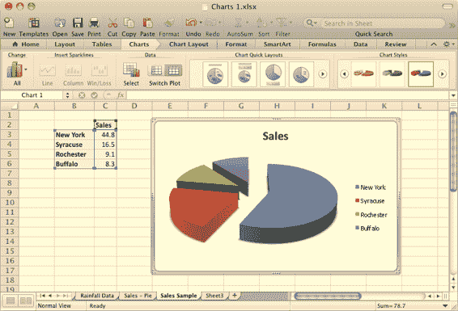

*工作表上的图表。* Excel 将工作表上的图表称为*嵌入式图表*——图表对象嵌入在工作表中。通常，工作表中也包含图表的数据，但必要时您也可以将图表嵌入到不同的工作表中。当您希望将图表与其数据或其他信息一起查看时，可创建嵌入式图表。图 7-1 展示了一个嵌入式图表。

**图 7-1.** *当您希望处理图表或将其与数据一起查看时，可在工作表上创建嵌入式图表。*

*图表工作表上的图表。* 除了创建嵌入式图表，您还可以在*图表工作表*上创建图表——这是工作簿中仅包含图表的一个独立工作表。使用图表工作表可以为您提供更多空间来布局和查看图表。图表工作表不包含源数据，但如果您不介意牺牲图表工作表的空间，可以添加一个显示源数据的数据表。图 7-2 显示了一个不带数据表的图表工作表。

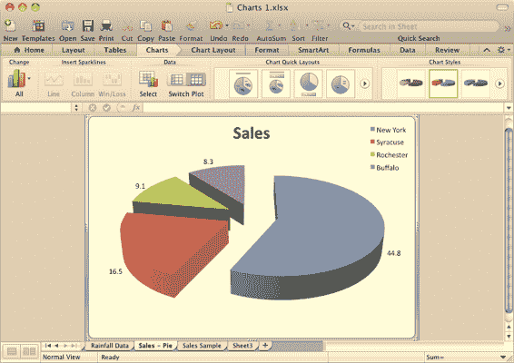

**图 7-2.** *当您希望为图表提供充足的空间时，可将其放置在自己的图表工作表中。*

注意：您可以根据需要将嵌入式图表更改为其自己的图表工作表上的图表，反之亦然。稍后我将在本章中向您展示具体操作方法。

#### 理解图表的组成部分

Excel 的图表在外观和用途上千差万别，但大多数图表都使用相同的组件集。图 7-3 展示了一个典型图表类型——3-D 柱形图——显示了七个气象站六个月的降雨量数据，并标注了图表的主要部分。

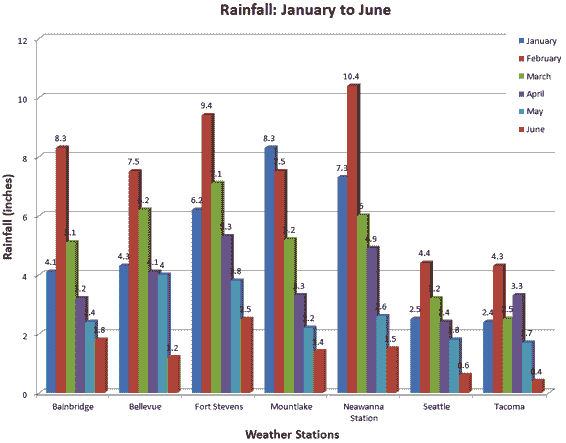

# 第七章：创建清晰且有说服力的图表

**注意：** 如果你已有样本数据并准备将其制成图表，请选中数据，然后依次选择`图表` `插入图表` `柱形图`，接着在`柱形图`面板中单击图表类型。这样便会快速生成一个柱形图，你可以一边阅读本章中有关图表组件的讲解，一边用它进行实践。如果想制作本章多数示例所使用的降雨数据图表，请访问 Apress 网站（`www.apress.com`），找到本书的支持页面，下载名为`35217 chart.xlsx`的工作簿。

以下各节将讨论图表的各个组成部分。

**图 7–3.** *此柱形图包含了 Excel 图表的大多数典型元素。图表区是图表所占据的整个区域，绘图区则是绘制数据系列的区域。*

## 图表区与绘图区

*图表区*是图表所占据的整个区域。如果图表有白色背景，查看图表区范围最简单的方法是单击图表，使 Excel 在图表周围显示一个边框。

*绘图区*是图表中包含绘制数据的区域——换句话说，即图表区的主要部分，不包括图表标题、坐标轴标题和图例（若显示在绘图区外部）所占据的区域。

## 图表坐标轴

大多数图表都包含一个、两个或三个坐标轴：

- **水平坐标轴。** 该轴用于排列数据类别——例如样本图表中的气象站。此坐标轴也称为*类别轴*或*x 轴*。

- **垂直坐标轴。** 该轴用于排列数据系列。此坐标轴也称为*y 轴*。

- **深度坐标轴。** 在三维图表中，该轴提供第三维度。此坐标轴也称为*z 轴*。

每个坐标轴都有刻度线，用于标示数值在轴上的位置。

## 类别与数据系列

*类别*是显示在水平坐标轴上的数据细分项。例如，在样本图表中，每个气象站就是一个类别。

*数据系列*是用于创建图表的数据集。例如，在样本图表中，数据系列包含降雨量测量值。

## 图表标题与坐标轴标题

*图表标题*是标识图表整体的文本。通常，你将图表标题放在图表顶部，以便读者能立即看到，但如有需要，也可将其置于别处。例如，你可以将图表标题放在图表区的空白处，以便放大图表本身。

*水平坐标轴标题*是解释水平坐标轴显示内容的文本；例如，样本图表中的气象站。

*垂直坐标轴标题*是解释垂直坐标轴显示内容的文本；例如，样本图表中的降雨量。

三维图表还可以有*深度坐标轴标题*，用于解释深度坐标轴显示的内容。

**注意：** 图表标题和坐标轴标题是可选项，因此你只需包含图表所需的标题。通常情况下，清晰的图表标题和坐标轴标题有助于查看图表的人理解内容。但也不必为图表添加任何可能使之复杂的元素。请记住这句格言：“若有疑虑，宁可省略。”

## 数据标记、网格线与数据标签

*数据标记*是图表中显示每个数据点位置的点。每个系列通常包含多个数据标记。根据图表类型的不同，数据标记可能显示为独立的点，也可能相互连接。

为了便于查看数据标记与坐标轴之间的关系，你可以向图表添加*网格线*——即从数据标记延伸出的横向或纵向线条。

# 数据标签

数据标签是显示数据点精确值的文本项。当查看者需要看到每个数据点的确切数字而非仅从图表中估算数值时，你可以显示数据标签。

## 为数据选择最佳图表类型

Excel 能让你创建种类繁多且令人印象深刻的不同图表。有些图表用途广泛，而有些则高度专业化。表 7-1 描述了 Excel 提供的图表类型，并给出了它们的典型用途。

表格按照 Excel 图表面板中的相同顺序列出图表，稍后我将对此进行说明，该面板将最常用的图表类型排在最前面。

### 表 7-1. Excel 的图表类型及建议用途

| **图表类别** | **说明** | **建议用途** |
| --- | --- | --- |
| 柱形图 | 以垂直条形显示数据。 | 比较同等项目（如销售业绩）或随时间变化的数据集（如降雨量）。 |
| 折线图 | 以线条形式显示每个系列。 | 显示随时间变化的等间隔数值，例如温度。 |
| 饼图 | 将单个数据系列显示为一个饼图，并按每个数据点的贡献进行分割。 | 显示每个项目对整体的贡献程度；例如，按部门细分支出。 |
| 条形图 | 以水平条形显示数据。 | 比较相似项目或指示进度。 |
| 面积图 | 以线条形式显示数据，但线条之间的区域带有阴影。 | 显示数值随时间的变化情况，尤其是系列中不同数据点的贡献。 |
| 散点图 | 将每个数据点显示为绘图区域上的一个点（或十字形、类似标记）。也称为 `XY` 图。 | 显示在不同时间采样或彼此无直接关联的数值。 |
| 股价图 | 将每个数据系列显示为一条垂直线或条形，指示三个或更多价格或度量值（例如，最高价、最低价和收盘价）。 | 显示股票每日价格。也适用于某些科学数据。 |
| 曲面图 | 将数据点显示为三维曲面。 | 比较两组数据以找到它们之间的合适组合。 |
| 圆环图 | 将数据系列显示为一系列同心圆环。 | 显示每个项目对整体的贡献程度——类似于饼图，但适用于两个或多个数据系列。 |
| 气泡图 | 将数据点显示为大小取决于其数值的气泡。 | 显示每个数据点的相对重要性。 |
| 雷达图 | 显示不同数据系列的组合值。 | 显示不同数据系列组合值之间的比较（例如，多个产品在多个时间段内的销售贡献）。 |

## 创建、布局和格式化图表

在本节中，我们将探讨如何根据数据创建图表，按照你想要的组件和排列方式进行布局，并应用最有用的格式化类型。

### 创建图表

要创建图表，请使用功能区“图表”选项卡上的命令。请按照以下步骤操作：

1. 选择要绘制图表的数据，包括所需的任何行或列标题。例如，单击数据区域中的第一个单元格，然后 `Shift`+单击最后一个单元格。如果你已下载示例工作簿，请选择降雨数据工作表上的单元格 `A1:G8`。

    **提示：** 你可以基于连续区域或一组不连续的单元格创建图表。要使用不连续的单元格，请像往常一样选中它们——例如，单击第一个单元格，然后 `Cmd`+单击其余每个单元格。确保这些单元格包含可比较的数据，否则生成的图表会显得奇怪甚至可能具有误导性。

2. 单击功能区的`图表`选项卡以显示其内容，然后在`插入图表`组中单击相应的按钮：柱形图、折线图、饼图、条形图、面积图、散点图或其他（其中包含股价图、曲面图、圆环图）。气泡图和雷达图等类型）。对于示例图表，请单击 `Column` 按钮。

    **注意：** 如果 Excel 窗口宽度不足以显示`插入图表`组中的多个按钮，则会显示一个名为`所有图表`的单个弹出按钮。单击此按钮即可显示包含所有图表类型的面板。您需要向下滚动面板才能看到大部分图表类型。当 Excel 窗口宽度足以显示部分图表类型按钮，但不足以显示全部时，您将在`其他图表`弹出菜单中找到缺失的按钮。

3. 在打开的面板上，单击您想要的图表类型。图 7-4 显示了`柱形图`面板，这是最常用的面板之一。对于示例图表，请单击 `三维簇状柱形图` 图表类型。

    Excel 会将图表创建为当前工作表中的嵌入图表，如图 7-1 所示。然后您可以重新定位、调整其大小，或将其移动到图表工作表中，具体操作如下：

    *重新定位图表。* 如果您希望将图表保留为嵌入图表，请将鼠标指针移动到图表边框上，待其变为四向箭头后，将图表拖动到所需位置。

    *调整图表大小。* 单击以选中图表，然后拖动显示出来的某个控点。拖动角部控点可同时调整图表的宽度和高度；您也可以 `Shift`+拖动以等比例调整图表大小。拖动侧边控点可仅在该维度上调整图表大小；例如，拖动底部控点仅垂直调整图表大小。

    *将图表移动到图表工作表。* 如果您想将图表移动到图表工作表，请按照下一节的说明操作。

**图 7-4.** *要插入图表，请在`功能区`的`插入`选项卡上的`图表`组中单击相应的弹出按钮，然后单击所需的图表类型。*

### 将图表从嵌入图表更改为图表工作表

您可以按照以下步骤，将图表从嵌入在工作表中的状态更改为位于其独立的图表工作表上：

1. 单击图表所在的工作表上的该图表。

2. 从菜单栏中选择`图表` > `移动图表`，以显示`移动图表`对话框（见图 7-5）。

    **提示：** 您也可以通过 `Ctrl`+单击或右键单击图表，然后在上下文菜单中单击 `移动图表` 来显示`移动图表`对话框。

    **图 7-5.** *使用`移动图表`对话框将图表从嵌入状态更改为位于其独立的图表工作表上。*

3. 选中`新工作表`选项按钮。

4. 在`新工作表`文本框中键入新图表工作表的名称。

5. 单击`确定`按钮。Excel 会创建新的图表工作表并将图表移至其中。该图表仍与其源数据相关联，因此如果您更改数据，Excel 也会相应地更新图表。

**注意：** 您还可以使用`移动图表`对话框将图表从图表工作表移动到工作表中的嵌入图表，或将嵌入图表从一个工作表移动到另一个工作表。

### 更改图表类型

如果您发现所选图表类型不适用于您的数据，可以轻松更改图表类型，而无需从头重新创建图表。请按照以下步骤操作：

1. 单击图表以将其选中。

2. 单击`功能区`的`图表`选项卡以显示其内容。

3. 在`更改图表类型`组中，打开相应图表类别的面板，然后单击所需的图表类型。例如，单击`饼图`弹出按钮以显示`饼图`面板，然后从中选择您喜欢的饼图类型。

### 切换图表中的行与列

当 Excel 显示图表时，您可能会意识到数据系列的位置有误；例如，图表是按月份显示降雨量，而不是按降雨量显示月份。

**快速修复：切换行列**

如果出现这种情况，有一个快速修复方法：在功能区中选择`图表 > 数据 > 切换行/列`来切换行和列。`Excel`会按相反的方式显示图表系列。

### 更改图表的数据源

有时您可能会发现图表与所选的数据源配合不佳。例如，您可能选择了太多数据，导致图表拥挤，或者遗漏了一行或一列关键数据。遇到这种情况时，您无需删除图表并从头开始。请按照以下步骤操作：

1. 从功能区中选择`图表 > 数据 > 选择`，或者从菜单栏中选择`图表 > 源数据`，打开`选择数据源`对话框（参见图 7-6）。

    **图 7-6.** 使用`选择数据源`对话框更改图表使用的数据源。

    [www.it-ebooks.info](http://www.it-ebooks.info/)

    **236**

    **第 7 章：创建清晰且有说服力的图表**

2. 在`图表数据范围`框中，输入您想要使用的数据范围：

    通常，最简单的做法是单击`折叠对话框`按钮以折叠对话框，在工作表上拖动以选择正确的数据范围，然后再次单击`折叠对话框`按钮以恢复对话框。（如果您愿意，也可以直接在`选择数据源`对话框中进行操作。）

    您也可以直接在`图表数据范围`框中输入数据范围。当您只需要更改列字母或行号以修正数据范围时，这非常方便。

3. 如果您还需要切换行列，请单击`切换行/列`按钮。

4. 如果您的图表数据包含空单元格，请打开`将空单元格显示为`弹出菜单，并选择如何表示它们。您的选项包括`空值`（大多数图表的默认设置）或`零`。

5. 仅在您希望图表包含源区域内隐藏的行和列中的数据时，才选中`显示隐藏行和列中的数据`复选框。通常，您会希望保持这些数据的隐藏状态，但有时显示它们也很有用。

6. 单击`确定`按钮关闭`选择数据源`对话框。`Excel`会将更改应用到图表中。

### 选择图表布局

当您确定了图表类型和数据源后，就该选择图表布局了。对于每种图表类型，`Excel`都提供了多种预设布局，用于控制标题、图例和其他元素的位置。应用布局后，您可以进一步根据需要进行自定义。

要应用布局，请单击图表，然后单击功能区的`图表`选项卡。如果`图表快速布局`组中的`布局`框显示了合适的布局，请直接单击它。要查看所有可用的布局，请将鼠标指针悬停在`图表快速布局`组中的`布局`框上，直到显示面板按钮，然后单击该按钮。在`Excel`显示的快速布局面板（参见图 7-7）上，单击您想要应用到图表上的布局。

[www.it-ebooks.info](http://www.it-ebooks.info/)

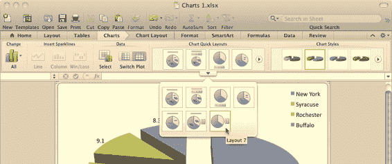

**第 7 章：创建清晰且有说服力的图表**

**237**

# 创建清晰且有说服力的图表

## 布局图表元素
**图 7-7.** *要设置图表元素（如图表标题和图例）的整体布局，请打开`布局`面板，然后单击您想要的布局。*

## 向图表添加单独的数据系列

有时您可能需要向图表添加一个未包含在图表数据源中的数据系列——例如，将未来成功的预测数据添加到您当前的数据中。

要添加数据系列，请从`选择数据源`对话框开始操作。请按照以下步骤操作：

1.  单击图表将其选中。
2.  从功能区中选择`图表 > 数据 > 选择`，或者从菜单栏中选择`图表 > 源数据`，打开`选择数据源`对话框。您也可以`Ctrl+单击`或右键单击图表，然后在上下文菜单中单击`选择数据`。
3.  单击`系列`列表框下方的`添加`按钮。`Excel`会向系列框添加一个新项目，并赋予一个默认名称，例如`Series3`或`Series4`。
4.  在`名称`文本框中单击，然后输入您希望赋予该系列的名称。如果该名称出现在工作表的某个单元格中，您可以单击该单元格。当焦点移出`名称`文本框时，Excel会将默认名称更改为你输入的名称。
5.  在`Y 值`文本框中，在大括号内输入序列的值，值之间用逗号分隔；例如，`{4.5,8.3,6.2,5.1,4.8,10.2}`。如果这些值已出现在工作表的单元格中，你可以通过选中区域来输入它们。

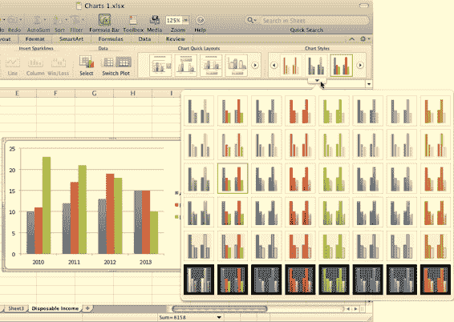

> **注意：**添加新数据序列时，通常不需要更改`水平（分类）轴标签`文本框的内容。该文本框包含为水平轴提供标签的单元格区域。

6.  点击`确定`按钮关闭`选择数据源`对话框。

## 为图表应用样式

若要控制图表的整体图形外观，可从功能区`图表`选项卡上`图表样式`组中的`样式`框或`样式`面板中为图表应用一种Excel样式。

点击图表以将其选中，然后点击功能区的`图表`选项卡以显示其控件。在`样式`框中点击一种样式，或者将鼠标指针悬停在`样式`框上直至面板按钮出现，点击面板按钮以显示`样式`面板（参见图 7-8），然后点击该样式。

**图 7-8.** *要为图表赋予整体图形外观，请从功能区`图表`选项卡的`图表样式`组中的`样式`框或`样式`面板中应用一种样式。*

## 为图表添加标题

为了让查看者了解图表的内容，通常需要为其添加标题。请按以下步骤操作：
1.  点击图表以将其选中。
2.  从功能区中选择`图表布局` > `标签` > `图表标题`，然后选择你想要的标题类型：
    * `无图表标题`。选择此项可移除现有标题。你也可以点击标题并按`Delete`键将其删除。
    * `图表上方`。选择此项可将标题置于图表上方，同时缩小图表以为标题腾出空间。当你希望标题与图表明确分开时（例如，当图表内容较密集时），可使用此位置。
    * `居中覆盖`。选择此项可将标题置于图表顶部并居中。将标题放在图表上可使图表尽可能保持最大尺寸。如果标题覆盖了数据，你可以点击它并将其拖动到其他位置。
3.  三击以选中 Excel 为你添加的`图表标题`占位符中的内容。
4.  在默认文本上输入图表的标题。
5.  如有必要，将图表标题占位符拖动到其他位置。
6.  点击其他位置以取消选中图表标题。

> **提示：**如果你需要设置图表标题的格式，双击图表标题以显示`设置标题格式`对话框。

## 为图表添加坐标轴标题

为了明确图表所展示的内容，通常需要为坐标轴添加标题。请按以下步骤操作：
1.  点击图表以将其选中。
2.  从功能区中选择`图表布局` > `标签` > `坐标轴标题` > `主要横坐标轴标题` > `坐标轴下方标题`，为水平轴插入一个标题占位符。
3.  三击以选中占位符中的内容。
4.  输入坐标轴标题的文本。
5.  如有必要，将占位符拖动到其他位置。
6.  从功能区中选择`图表布局` > `主要纵坐标轴标题`，然后点击你想要的放置方式：
    * `竖排标题`。点击此项可使 Excel 将坐标轴标题逆时针旋转 90 度，使其沿坐标轴向上排列。
    * `垂直标题`。点击此项可使坐标轴标题垂直显示，字母上下水平排列。
    * `水平标题`。点击此项可使坐标轴标题水平显示。这种放置方式最易于阅读，但会占用更多图表空间。
7.  三击选择占位符的内容。
8.  键入坐标轴标题的文本。
9.  如有必要，将占位符拖到其他位置。

> **注意：** 如果图表包含`z`轴，可以通过选择“图表布局”→“标签”→“坐标轴标题”→“深度坐标轴标题”，然后根据需要单击“旋转标题”、“垂直标题”或“水平标题”来添加坐标轴标题。

## 更改坐标轴的刻度或编号

插入图表时，`Excel`会自动根据数据范围为垂直轴编号。如果需要更改刻度或编号，请执行以下步骤：
1.  双击垂直轴，或按住`Ctrl`键单击（或在垂直轴标题区域右键单击），然后从上下文菜单中选择“设置坐标轴格式”，以打开“设置坐标轴格式”对话框。“刻度”类别将显示在最前面（见图 7–9）。

    > **注意：** 你也可以通过功能区打开“设置坐标轴格式”对话框。单击“格式”选项卡，转到“当前所选内容”框，打开下拉菜单并单击“垂直（值）轴”。然后点击下方的“设置所选内容格式”按钮。你也可以单击垂直轴并选择菜单栏中的“设置坐标轴格式”，或按`Cmd+1`组合键。

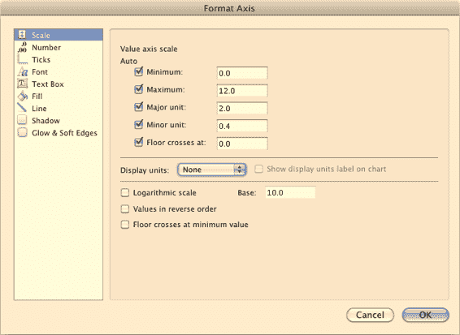

**图 7–9.** *你可以设置坐标轴格式，以控制其值、主要刻度单位和次要刻度单位，以及图表是否显示单位（例如千）。当你在“设置坐标轴格式”对话框的“坐标轴选项”中操作时，Excel 会应用更改。*

2.  使用“值轴刻度”区域中的控件设置轴上的值：
    * **最小值：** 如果希望`Excel`自动设置轴上的最小值，请选中“最小值”复选框。若要自行设置，请单击文本框并键入数值，`Excel`会自动为你清除复选框。
    * **最大值：** 如果希望`Excel`自动设置轴上显示的最大值，请选中“最大值”复选框。若要自行设置，请单击文本框并键入数值，`Excel`会自动为你清除复选框。
    * **主要刻度单位：** 如果希望`Excel`决定轴上主要刻度单位之间的间隔，请选中“主要刻度单位”复选框。若要自行设置，请单击文本框并键入数值，`Excel`会自动为你清除复选框。根据图表的大小，你通常希望在设定的最小值与最大值之间包含五到十个主要刻度单位。
    * **次要刻度单位：** 如果希望`Excel`决定轴上次要刻度单位之间的间隔，请选中“次要刻度单位”复选框。若要自行设置，请单击文本框并键入数值，`Excel`会自动为你清除复选框。根据图表显示的内容，每个主要刻度单位下通常需要四到十个次要刻度单位。
3.  在“刻度”窗格的中间部分，选择是否显示图表使用的单位。例如，在“显示单位”下拉菜单中，选择“百”、“千”或“百万”等项。如果选择显示单位，请确保选中“在图表上显示显示单位标签”复选框，这样`Excel`将显示一个标签来指明单位。如果不想显示单位，请在“显示单位”下拉菜单中选择“无”。
4.  在“刻度”窗格的下半部分，根据需要选择选项：
    * **对数刻度：** 如果图表需要使用对数刻度而非算术刻度，请选中“对数刻度”复选框，然后在“底数”框中输入对数的底数。例如，输入`10`表示刻度将按等间距使用值`1`、`10`、`100`、`1000`、`10000`等。
    * **数值反转：** 对于某些图表，将数值按倒序排列（例如，最小值在上方而非最大值）会很有帮助。当需要此设置时，请选中此复选框。
    * **横坐标轴交叉于最小值：** 如果希望图表的基底在最小值处（而非零值处）与垂直轴交叉，请选中此复选框。
    * **显示单位：** 如果你希望图表显示单位（百、千、百万等），请在此下拉菜单中选择单位。`Excel`会相应地缩减显示的数值；例如，`1000000`将显示为`1`，并在刻度旁边显示“百万”。这有助于使坐标轴更易于阅读。
5.  在左窗格中，单击“刻度线”项以显示“刻度线”窗格（见图 7–10），然后设置刻度线的位置：
    * **主要刻度线类型：** 在此框中，选择“内部”单选按钮可使主要刻度线显示在图表内部，选择“外部”单选按钮使其显示在外部（坐标轴一侧），或选择“交叉”单选按钮使其显示在两侧。如果不想要主要刻度线，请选择“无”单选按钮。

# 第 7 章：创建清晰且具有说服力的图表

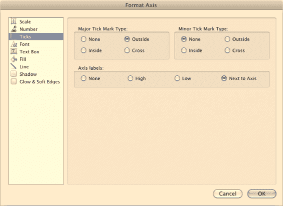

**图 7–10.** *使用“设置坐标轴格式”对话框“刻度线”窗格中的控件来控制坐标轴上刻度线的显示方式。*

- **次要刻度线类型：** 在此框中，选择“内部”单选按钮可使次要刻度线显示在图表内部，选择“外部”单选按钮使其显示在外部（坐标轴一侧），或选择“交叉”单选按钮使其显示在两侧。如果不想要次要刻度线，请选择“无”单选按钮。
- **坐标轴标签：** 在此框中，选择“轴旁”单选按钮可使标签显示在坐标轴旁边。选择“高”单选按钮可使标签显示在图表的高侧，选择“低”单选按钮可使标签显示在低侧。选择“无”单选按钮可隐藏标签。

**6.** 对坐标轴设置满意后，单击“关闭”按钮关闭“设置坐标轴格式”对话框。

## 向图表添加图例

许多图表受益于添加图例，以汇总不同数据系列使用的颜色。可以通过选择图表，依次选择“图表布局”→“标签”→“图例”，然后选择所需的放置位置：图例在右侧显示、图例在顶部显示、图例在左侧显示、图例在底部显示、靠右覆盖图例或靠左覆盖图例来添加图例。

每个非“覆盖”项都会缩小图表区域以为图例腾出空间。两个“覆盖”项则将图例放置在图表上而不减小图表尺寸，因此它们非常适合保持图表尽可能大。

无论你使用哪种图例放置方式，都可以根据需要将其拖到更合适的位置。你也可以通过单击图例然后拖动其周围显示的手柄来调整图例的大小。

如果需要从图表中删除图例，可以单击图例然后按`Delete`键，或者依次选择“图表布局”→“标签”→“图例”→“无”。

## 从与图表数据分离的区域添加坐标轴标签

根据包含源数据的工作表布局方式，你可能需要添加与图表数据位于不同单元格中的坐标轴标签。为此，请执行以下步骤：

**1.** 单击图表将其选中。
**2.** 从功能区选择“图表工具”→“设计”下的“选择数据”，以显示“选择数据源”对话框。
**3.** 单击“水平（分类）轴标签”文本框右侧的“折叠对话框”按钮以折叠对话框。
**4.** 在工作表中拖动以选择包含坐标轴标签的单元格。`Excel`会将这些标签填入“水平（分类）轴标签”文本框中。
**5.** 再次单击“折叠对话框”按钮以恢复“选择数据源”对话框。
**6.** 单击“确定”按钮关闭“选择数据源”对话框。`Excel`会将标签应用到坐标轴上。

## 向图表添加数据标签

如果观众需要查看数据点的精确值，而不仅仅是了解其大致数值，请向图表添加数据标签。为此，请单击图表，然后选择“图表布局”→“标签”→“数据标签”→“值”。`Data Labels`弹出菜单会根据图表类型提供不同的选项。例如，对于饼图，您可以选择`系列名称`项、`类别名称`项、`百分比`项或`类别名称和百分比`项。

**警告：** 请谨慎使用数据标签。只有部分图表能从数据标签中受益——其他图表可能会变得过于杂乱，或者细节可能会分散观众对图表整体重点的注意力。

向图表添加数据标签时，Excel 会为每个数据标记显示一个数据标签。如果只想显示部分数据标签，请删除不需要的标签。要删除一个数据标签，请单击它一次以选中所有数据标签，然后再次单击它以仅选中该标签。然后按`Delete`键，或按住`Ctrl`键单击（或右键单击）所选内容，然后点击上下文菜单中的“删除”。

## 选择要显示的网格线

在许多类型的图表上，您可以选择是否显示水平网格线和垂直网格线，以帮助观众判断数据点之间的关系以及与坐标轴的关系。

要控制显示的网格线，请执行以下步骤：

**1.** 选择图表。
**2.** 选择“图表布局”→“坐标轴”→“网格线”，然后点击“水平网格线”、“垂直网格线”或“深度网格线”以显示相应的子菜单。
**3.** 点击要显示的网格线类型的菜单项：
   *   **无网格线。** 点击此项可取消网格线的显示。
   *   **主要网格线。** 点击此项仅显示数据系列中主要刻度的网格线。例如，如果您的数据范围是 0-25，主要网格线通常出现在 5、10、15、20 和 25 处。

**提示：** 当观众需要清晰地看到每个值的位置时，请使用数据标签或主要和次要网格线。如果使用次要网格线（无论是否带有主要网格线）使图表显得杂乱，请仅使用主要网格线。通常，最好不要同时使用水平次要网格线和垂直次要网格线，因为这往往会使图表看起来混乱——但有时您的图表可能需要它们。

*   **次要网格线。** 点击此项可显示数据系列中次要刻度的网格线。例如，如果您的数据范围是 0-25，次要网格线通常出现在每个整数处——1、2、3，依此类推直至 25。

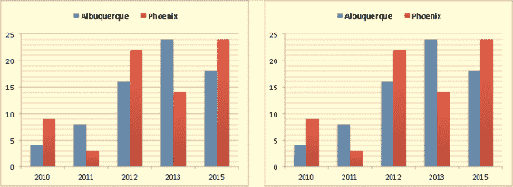

*   **主要和次要网格线。** 点击此项可同时显示主要网格线和次要网格线。主要网格线的颜色比次要网格线深，以便您看出区别。如图 7-11 所示，同时拥有主要和次要网格线通常比仅拥有次要网格线更清晰。

**图 7-11.** *同时使用主要和次要网格线（左图）通常比仅使用次要网格线（右图）使图表更易于阅读。*

**4.** 针对图表所需的每组网格线重复步骤 2 和 3。

**注意：** 要更改网格线显示的值，请格式化坐标轴，如本章前面“更改坐标轴的刻度或编号”部分所述。

## 设置图表背景墙和基底格式

某些图表使用纯色背景看起来效果不错，但对于三维图表，您可能希望装饰图表背景墙（图表后面和侧面的区域）和图表基底（图表底部的区域）。您可以为背景墙、基底或两者添加纯色、渐变、图片或纹理。图 7-12 显示了一个使用图片作为背景墙的图表。

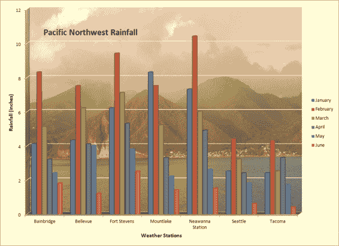

### 图 7–12. *你可以通过向图表背景墙应用图片来赋予图表主题外观。*

**提示：** 通常，图表背景墙和基底是应用自定义填充（例如图片）效果最佳的元素。但你也可以对许多其他图表元素应用自定义填充。操作方法是：显示该元素的格式对话框，在左窗格中点击`填充`类别，然后进行选择。

若要格式化图表背景墙或图表基底，请按照以下步骤操作：

**1.** 点击图表以将其选中。
**2.** 选择`图表布局` > `当前所选内容` > `图表元素`，然后点击要格式化的项：`背景墙`、`基底`、`侧墙`或`墙壁`（用于同时格式化背景墙和侧墙）。
**3.** 点击`当前所选内容`组中的`设置所选内容格式`按钮，以显示所选项目的格式对话框。图 7–13 显示了`设置墙壁格式`对话框，其中包含用于插入图片填充的控件。

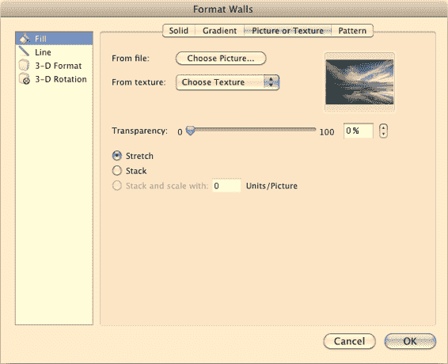

### 图 7–13. *使用格式对话框中的“填充”窗格将图片填充应用于图表背景墙或基底等对象。*

**4.** 确保左窗格中已选中`填充`项。
**5.** 在`填充`窗格中，设置你想要的填充方式：

```
无填充。
  点击`纯色`选项卡以显示其内容。打开`颜色`弹出菜单，若希望该项透明，则选择`无填充`项。
纯色填充。
  点击`纯色`选项卡以显示其内容。打开`颜色`弹出菜单，然后点击你想要的颜色。若想使用默认颜色，则选择`自动`项。拖动`透明度`滑块，或在文本框中输入数值，以选择填充的透明度。
渐变填充。
  点击`渐变`选项卡以显示其内容。打开`样式`弹出菜单，然后选择你想要的渐变样式：`无`、`线性`、`径向`、`矩形`或`路径`。如果适用，使用`角度`旋钮和`方向`弹出菜单设置渐变的角度和方向。然后，在`渐变`选项卡的`颜色`和`透明度`区域中，选择渐变色、颜色和透明度。
```


## 图片或纹理填充

点击`图片或纹理`选项卡以显示其内容。要使用图片，请点击`选择图片`按钮，在`选择图片`对话框中点击图片，然后点击`插入`按钮。要使用纹理，请从`纹理`弹出调色板中选择它。通过拖动`透明度`滑块或在文本框中输入百分比来设置透明度。然后，若想拉伸图片或纹理以填充空间，选择`拉伸`选项按钮；若想平铺图片或纹理以在不扭曲的情况下占据空间，选择`堆叠`选项按钮；或者选择`与 N 单位/图片堆叠并缩放`选项按钮，以按你在文本框中输入的单位数平铺图片。

## 图案填充

点击`图案`选项卡以显示其内容。在`图案`框中，点击你想要的图案。然后在`前景色`弹出菜单中选择前景色，在`背景色`弹出菜单中选择背景色。

## 关闭格式对话框

点击`关闭`按钮以关闭格式对话框。

## 格式化单个图表元素

你可以通过选中元素并使用其格式对话框来格式化图表中的任何单个元素——例如，图例、网格线或数据标签。此对话框包含其所影响元素的名称：`设置数据标签格式`对话框、`设置绘图区格式`对话框等。

你可以通过以下任一方式显示格式对话框：
*   按住 `Ctrl` 键点击或右键点击元素，然后点击上下文菜单中的`设置格式`项。这通常是打开格式对话框的最简单方法。
*   在`图表元素`弹出菜单中选择元素，然后点击`设置所选内容格式`按钮。如果难以按住 `Ctrl` 键点击或右键点击。

如果图表中的元素难以选取（例如图表过于拥挤），可以选择`图表布局` `当前所选内容` `图表元素`或`设置当前所选内容格式`，然后在下拉菜单中点击所需元素。接着可点击`设置所选内容格式`按钮（同样位于`当前所选内容`组中），打开该元素的`格式`对话框。

`格式`对话框的内容会因所选对象的不同而变化，但大多数对象都包含以下类别：

*   **填充。** 你可以用纯色、颜色渐变、图片或纹理填充形状。关于创建填充的详细说明，请参阅本章前面的“设置图表墙和图表基底格式”一节。
*   **线条。** 你可以为形状添加彩色边框、渐变边框，或设置为无线条。此外还可以选择不同的边框样式、调整边框宽度以及选择合适的线条类型。
*   **阴影。** 你可以为形状添加阴影，设置其颜色，并调整透明度、宽度及其他属性。
*   **发光和柔化边缘。** 通过为对象添加发光效果、选择与对象周围环境形成对比的颜色，并设定发光范围，可使对象更加突出。你也可以为形状应用柔化边缘效果。
*   **三维格式。** 你可以为形状的不同部分应用三维格式——例如，为形状的顶部和底部设置不同的棱台效果。
*   **三维旋转。** 你可以为对象应用三维旋转效果。
*   **字体。** 对于包含文字的对象，你可以控制文字的显示方式。

**提示：** 如果图表元素包含文字，你也可以通过功能区`开始`选项卡上的控件或键盘快捷键进行格式设置。例如，要为数据标签加粗，可点击数据标签，然后选择`开始` `字体` `加粗`（或按`Ctrl+B`）。这通常比使用该元素的`格式`对话框中的`字体`窗格更简便。

### 将图表的格式复制到另一图表

当你设置好一个图表的全部格式后，可以通过`复制`和`粘贴`将该格式应用到另一个图表。请按以下步骤操作：
1.  点击已设置格式的图表，选中其图表区。
2.  右键单击图表边框，然后在上下文菜单中点击`复制`，将图表及其格式复制到剪贴板。
3.  转到包含目标图（需要粘贴格式的图表）的工作表。
4.  选择`开始` `剪贴板` `粘贴` `选择性粘贴`，显示如图 7–14 所示的`选择性粘贴`对话框。
5.  选中`格式`选项按钮。
6.  点击`确定`按钮关闭`选择性粘贴`对话框。Excel 会将格式应用到图表。

### 通过创建自定义图表类型来重复使用自己的设计

如果你想能够重复使用自己创建的图表设计，可以将其保存为自定义图表类型。请按以下步骤操作：
1.  在图表工作表或工作表中选中已设置格式的图表。
2.  从功能区选择`图表` `更改图表类型` `其他` `另存为模板`，或从菜单栏选择`图表` `另存为模板`，打开`保存图表模板`对话框。这是一个标准的`另存为`对话框。
3.  如有需要，可更改保存图表类型的文件夹。Excel 建议使用`~/Library/Application Support/Microsoft/Office/Chart Templates/`文件夹（其中`~`代表你的个人文件夹）。如果你只想自己使用该模板，此路径合适；但如果同事也需要使用该模板，则将其存储在网络共享文件夹中。
4.  在`保存名称`文本框中为模板输入一个描述性名称。
5.  点击`保存`按钮关闭`保存图表模板`对话框。Excel 会将模板保存到你选择的文件夹中。


# 创建清晰且有说服力的图表

要基于模板创建图表，请按以下步骤操作：

1. 选择图表的源数据。

2. 选择`图表` > `插入图表` > `其他`以显示“其他”窗格，然后向下滚动到窗格底部的“模板”区域。

3. 点击该模板。

## 选择图表偏好设置

要使图表按您期望的方式显示，可能需要更改“Excel 偏好设置”对话框“图表”窗格中的设置。“图表”窗格包含一些仅影响所选图表的设置，以及其他影响所有图表的设置。

要打开“图表”窗格，请按以下步骤操作：

1. 点击要更改其特定图表设置的图表。

2. 选择`Excel` > `偏好设置`或按`Cmd+,`（Cmd 键和逗号键）以显示“Excel 偏好设置”对话框。

3. 点击“创作”区域中的“图表”图标。Excel 将显示图表偏好设置窗格（见图 7-15）。

**图 7-15.** 在“Excel 偏好设置”对话框的“图表”窗格中，您可以为当前图表和所有图表选择设置。

在“所选图表”区域内的“将空单元格绘制为”框中，选择如何表示图表中的空单元格：

- `不绘制（留空）。` 选中此选项按钮可使图表在每个空单元格处显示空白。这是常规用途的最佳选择。

- `零值。` 选中此选项按钮可使图表将空单元格显示为零值。在某些图表类型中，这有助于您关注需要补充的缺失值。在其他图表类型中，显示这些零值在视觉上会造成混乱。

- `插值。` 如果您希望 Excel 基于周围可用值自动填充缺失值，请选中此选项按钮。此选项按钮仅适用于某些图表类型。

`注意：` 在处理可识别的趋势时，对图表缺失值进行插值非常有用。例如，如果缺少某一小时的温度测量值，而前一小时温度较高、后一小时温度也较高，则插值会出现在这两个值之间。另一方面，如果缺少某一天的降雨量数据，插值就不合理，因为一天的降雨量与下一天之间通常不存在线性关系。

如果您希望从图表中忽略图表数据源中的任何隐藏行或列，请选中`仅绘制可见单元格`复选框。这通常是您希望做的。清除此复选框可使所有数据显示出来，即使数据源中已将其隐藏。

在“图表屏幕提示”区域中，选中您想要查看的屏幕提示复选框：

- `悬停时显示图表名称。` 选中此复选框可使 Excel 在您将鼠标指针悬停在某个项目上时显示包含该项目名称的屏幕提示。例如，当您将鼠标指针悬停在数据系列上时，屏幕提示会显示该数据系列的名称和详细信息。

- `悬停时显示数据标记值。` 选中此复选框可使 Excel 在您将鼠标指针悬停在数据标记上时显示该数据标记的值。

完成选择图表偏好设置后，点击`确定`按钮关闭“Excel 偏好设置”对话框。

## 在 Word 文档和 PowerPoint 演示文稿中使用图表

Excel 是 Office 中用于创建图表的应用程序，但您可能也希望使用图表来为 Word 文档和 PowerPoint 演示文稿做说明。您可以重复使用已在 Excel 中创建的图表，也可以专门为该文档或演示文稿创建新图表。

### 了解如何将图表添加到文档或幻灯片

图表可以极好地以一目了然的方式在文档或幻灯片中呈现复杂或详细的信息。您可以通过以下任一方式将图表添加到 Word 文档或 PowerPoint 演示文稿中：

- `在嵌入式工作表上创建图表。` 单击功能区中的`图表`选项卡，然后使用`插入图表`组中的弹出按钮和面板选择图表类型。Word 或 PowerPoint 随后会为您打开`Excel`并创建一个新工作簿，以便您输入图表数据并创建图表。该工作簿将嵌入到 Word 文档或 PowerPoint 演示文稿中，从而成为该文件的一部分。

    `注意：` 在 PowerPoint 中，您也可以单击内容占位符中的`插入图表`图标，开始在嵌入式工作表上创建图表。

- `从 Excel 工作簿复制图表。` 使用本章前面介绍的技术在`Excel`中创建图表，然后复制完成的图表并将其粘贴到 Word 文档或 PowerPoint 幻灯片中。您可以选择将图表数据嵌入到 Word 文档或 PowerPoint 演示文稿中，或者仅将图表作为图片或 PDF 文件插入。

以下是选择何时创建新的嵌入式工作簿、嵌入现有工作簿、链接回工作簿或插入图片的方法：

- `创建新的嵌入式工作簿。` 当您尚未在`Excel`中准备好图表数据，并且需要将图表数据随 Word 文档或 PowerPoint 演示文稿一起保存时，请执行此操作。例如，您将把演示文稿发送给也需要处理图表数据的其他人。

- `嵌入现有图表及其数据。` 当您在`Excel`工作簿中已有图表数据或图表本身，并且需要在 Word 文档或 PowerPoint 演示文稿中保留图表数据时，请执行此操作。嵌入图表及其数据后，您可以从`Word`中打开图表并在`Excel`中进行编辑。

- `链接回工作簿。` 当您希望能够更改`Excel`中的图表或其源数据，然后通过更新图表自动将这些更改带入`Word`或`PowerPoint`时，请执行此操作。链接要求工作簿相对于文档或演示文稿在计算机文件系统中保持相同的相对位置，以便`Word`或`PowerPoint`能够找到更新的数据。将文档或演示文稿移动到另一台计算机会中断链接。

    `警告：` 链接图表在正常工作时可能非常有用，但链接可能会在最尴尬的时候失效。在提供包含链接图表的演示文稿之前，请仔细检查链接是否正常工作。这样，您将有机会修复任何问题，而不是在观众看到它们时才发现问题。

- `插入图片。` 当您不需要保持图表与其源数据之间的连接，并且不需要在文档或演示文稿中编辑图表时，请执行此操作。

### 在新的嵌入式工作簿中创建图表

要在一个嵌入到 Word 文档或 PowerPoint 演示文稿的新工作簿中的工作表上创建图表，请按照以下步骤操作：

1. 在 Word 中打开文档，或在 PowerPoint 中打开演示文稿。

2. 在您要创建图表的文档页面或幻灯片上，单击功能区中的`图表`选项卡。Word 或 PowerPoint 会显示功能区中的`图表`选项卡。

3. 在`插入图表`组中，单击您要创建的图表类别的弹出按钮。例如，单击`柱形图`弹出按钮以显示`柱形图`面板。

4. 在弹出面板上，单击图表类型。Word 或 PowerPoint 会在幻灯片上创建该类型的图表，并启动`Excel`，后者会创建一个新工作簿，将其嵌入到文档或演示文稿中，并为其命名，例如`Microsoft Office Word 中的图表`或`Microsoft Office PowerPoint 中的图表`。

5. 更改图表范围和示例数据（图 7-16 显示了一个以`PowerPoint`为例）将示例数据替换为图表所需的数据。`Word`或`PowerPoint`会自动更新图表，使其与`Excel`工作表中的数据保持一致。

**图 7–16.** *Excel 在嵌入工作簿的第一个工作表中输入示例数据。修改这些数据以创建你的图表。*

**6.** 完成数据修改后，关闭`Excel`。例如，点击`关闭`按钮（标题栏左端的红色按钮）或选择`Excel` > `退出 Excel`。

`注意：` `Excel`会自动将数据保存在嵌入的工作簿中，因此你在`Excel`窗口中工作时无需另行保存。

**7.** 使用功能区上`图表`选项卡和`图表布局`选项卡中的控件，按你希望的方式设置图表格式。图 7–17 展示了一个正在格式化的图表所在的`PowerPoint`幻灯片。

[www.it-ebooks.info](http://www.it-ebooks.info/)

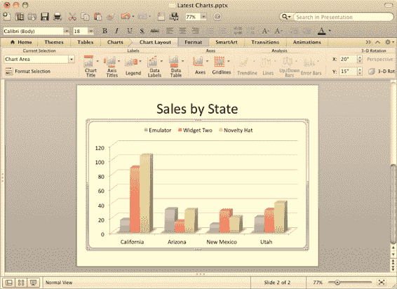

**第 7 章：创建清晰且有说服力的图表** **257**

**图 7–17.** *使用嵌入工作簿插入图表后，在`Word`或`PowerPoint`（此处所示）中，利用功能区上`图表`选项卡和`图表布局`选项卡中的控件来设置图表格式。*

**8.** 保存你的`Word`文档或`PowerPoint`演示文稿。

`注意：` 如需再次编辑图表数据，请从功能区中选择`图表` > `数据` > `编辑`，点击`编辑`按钮的主体部分。`Word`或`PowerPoint`将打开`Excel`，并显示嵌入的工作表。

### 将图表从 Excel 粘贴到 Word 文档或 PowerPoint 幻灯片

如果你已在`Excel`中创建了图表，或者已有一个包含将用于创建图表的数据的工作簿，则可以将该图表粘贴到`Word`或`PowerPoint`中。请遵循以下一般步骤：

**1.** 使用本章前面介绍的技术创建图表。

**2.** 点击图表以将其选中。

[www.it-ebooks.info](http://www.it-ebooks.info/)

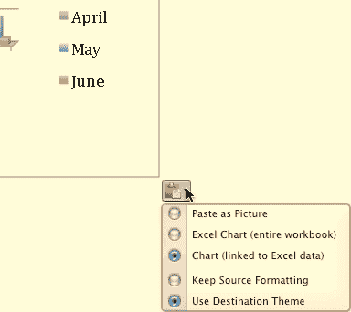

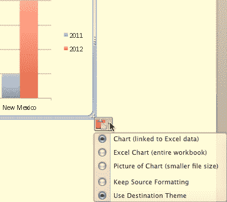

**258** **第 7 章：创建清晰且有说服力的图表**

**3.** 将图表复制到剪贴板。例如，点击标准工具栏上的`复制`按钮，或按`Cmd+C`。

**4.** 切换到`Word`或`PowerPoint`，然后导航到要插入图表的文档或幻灯片。

**5.** 从剪贴板粘贴图表。例如，点击标准工具栏上的 `粘贴` 按钮，或按 `Cmd+V`。

**6.** 点击图表右下角的 `粘贴选项` 按钮，然后在 `粘贴选项` 弹出菜单的上方组中点击相应的选项按钮（见图 7–18）：
- **图表（链接到 `Excel` 数据）。** 选择此选项按钮可将图表链接回其来源的 `Excel` 工作簿。

**图 7–18.** 将图表从 `Excel` 粘贴到 `Word` 文档（左）或 `PowerPoint` 幻灯片（右）时，点击 `粘贴选项` 按钮，并使用弹出菜单中的选项按钮选择粘贴图表的方式。
- **`Excel` 图表（整个工作簿）。** 选择此选项按钮可将整个 `Excel` 工作簿嵌入到 `PowerPoint` 演示文稿中。
- **粘贴为图片（`Word`）或图表图片（文件大小更小）（`PowerPoint`）。** 选择此选项按钮可插入图表的图片。正如 `PowerPoint` 名称所示，插入图片有助于减小演示文稿文件大小，但无法编辑该图片。

**7.** 如果你希望幻灯片或文档中的图表使用你在 `Excel` 中设置的原始格式，请再次点击 `粘贴选项` 按钮，然后选择 `保留源格式` 选项按钮。否则，保持选中 `使用目标主题` 选项按钮，图表将采用文档或演示文稿的格式。

[www.it-ebooks.info](http://www.it-ebooks.info/)

# **第 7 章：创建清晰且有说服力的图表** **259**

**8.** 使用功能区上 `图表` 选项卡或 `图表布局` 选项卡中的控件，按你希望的方式设置图表格式。（如果你将图表以图片形式插入，请使用功能区上 `格式图片` 选项卡中的控件。）

**9.** 保存文档或演示文稿。

要编辑嵌入式图表或链接图表中的数据，请选择 `图表数据编辑`，并点击 `编辑` 按钮的主要部分。

## 本章小结

在本章中，你学习了如何从数据中创建强大且具有说服力的图表。你了解了图表的各个组成部分叫什么、如何创建图表，以及如何将图表放置在工作表上或独立的图表工作表中。你还可以让 Excel 显示你需要的图表组件，并按需设置其格式。

为了节省时间和精力，你还学会了通过将自定义图表格式粘贴到现有图表上，或据此创建自定义图表模板来重复使用这些格式。

现在，你还了解了在 Word 文档或 PowerPoint 演示文稿中使用 Excel 图表的不同方式；你知道在哪种情况下哪种方式效果最佳；你也知道了如何插入、格式化和编辑图表。

在下一章中，我将向你展示如何使用数据条、色阶、图标集和迷你图来增强工作表的效果。准备好后，请翻到下一页开始学习。

[www.it-ebooks.info](http://www.it-ebooks.info/)

****261****

