# 第 8 章：使用数据条、色阶、图标集和迷你图

在本章中，我们将探讨如何使用四种图形元素，在不使用完整图表的情况下，为你的工作表增添更多视觉吸引力和冲击力。这四种元素分别是数据条、色阶、图标集和迷你图。每一种都是出现在单个单元格中的图形元素。

数据条、色阶和图标集属于 Excel 的条件格式功能，你在第 4 章中已经学过。数据条类似于单单元格条形图，用于比较一系列单元格中的值。色阶提供了一种简单的方法来调整单元格的背景颜色以反映其值——例如，红色代表表现不佳，绿色代表表现良好。图标集使你能够快速添加一个图标，用来表示某个值与其同组其他值的比较情况；例如，你可以为良好的结果添加上升箭头。

迷你图是适合放在单个单元格中的微型图表。你可以像使用微型图表那样使用迷你图——用来展示一系列数据。例如，你可以创建一个显示某只股票几天内价格走势的迷你图。

## 使用数据条

`数据条` 是出现在单元格中的水平条，用于以图形方式表示相应单元格中的值。通常，你会使用数据条来表示多个单元格的值，以便观察这些单元格值之间的关系。

例如，图 8–1 中的工作表使用数据条显示了五名销售人员在四月、五月、六月以及整个第二季度的销售额。每个包含数据条的单元格与其左侧单元格的值相同，因此单元格 `C2` 中的数据条表示单元格 `B2` 中显示的值。查看这些数据条，你

[www.it-ebooks.info](http://www.it-ebooks.info/)

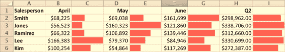

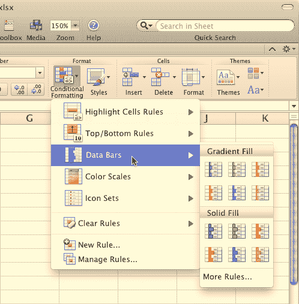

可以很容易地看出，尽管销售员史密斯四月表现不佳，五月也很差劲，但她六月的强劲销售使她在整个季度的整体结果上达到了一个不错的水平。

**图 8–1.** `数据条可以快速以图形方式表示单元格中的值。此处，每个显示数据条的单元格都包含与其左侧单元格相同的值。`

### 创建数据条

默认情况下，Excel 会将数据条放置在它们所表示的数据旁边。你可以选择在单元格中仅显示数据条，或者将数据条显示在单独的单元格中，以使工作表更易于阅读。

#### 在与数据相同的单元格中创建数据条

要创建出现在与数据相同单元格中的数据条，请按以下步骤操作：

1. 输入要从中创建数据条的数据。如果数据已在工作表中，则一切就绪。

2. 选择包含数据的单元格。

**3.** 选择 `开始 格式 条件格式 数据条` 以显示 `数据条` 面板（见图 8–2）。

**图 8–2.** *使用“开始 格式 条件格式 数据条”命令在所选单元格中创建数据条。您可以选择渐变填充或实心填充。*

**4.** 在 `数据条` 面板的 `渐变填充` 部分或 `实心填充` 部分中，单击所需的颜色和填充类型。Excel 将在单元格中创建数据条。图 8–3 的左侧屏幕显示了一个示例。

**提示：** 对于与数据在同一单元格中显示的数据条，渐变填充效果最佳，因为渐变的浅色端使文本保持可读性。对于在单独单元格中显示的数据条，您可能更倾向于实心填充。

**图 8–3.** *创建数据条后（左侧），您可能需要加宽列以增强其视觉效果（右侧）。*

**5.** 如有必要，更改列宽。例如，将单元格列标题的右边框向右拖动以加宽列，从而增强数据条的视觉效果，如图 8–3 右侧所示。

#### 在不同单元格中创建数据条（数据与数据条分离）

为了便于阅读数据条，您可能希望它们出现在单独的单元格中，要么将底层数据显示在旁边的单元格中（或根据需要显示在其他位置），要么完全不显示数据。您可以通过设置 Excel 仅显示数据条，使数据条单独出现在单元格中。如果希望数据条的数据可见，则需要将数据放在不同的单元格中。

要使数据条不显示其数据，请按照以下步骤操作：

**1.** 按照上一节所述创建数据条，使数据条与数据出现在同一单元格中。

**2.** 保持单元格处于选中状态，选择 `开始 格式 条件格式 管理规则` 以显示 `管理规则` 对话框（见图 8–4）。

**图 8–4.** *在“管理规则”对话框中，选择数据条的规则，然后单击“编辑规则”按钮。*

**3.** 确保选中正确的规则。如果您只对单元格应用了一个条件格式规则，则该规则会被选中；如果应用了多个规则，您可能需要选择正确的规则。

**4.** 单击 `编辑规则` 按钮以显示 `编辑格式规则` 对话框（见图 8–5）。

**图 8–5.** *在“编辑格式规则”对话框中，如果您想仅显示数据条而不显示生成它们的值，请选中“仅显示数据条”复选框。*

**5.** 选中 `仅显示数据条` 复选框。

**6.** 单击 `确定` 按钮关闭 `编辑格式规则` 对话框。

**7.** 单击 `确定` 按钮关闭 `管理规则` 对话框。

**提示：** 在打开 `编辑格式规则` 对话框的情况下，您可以快速在数据条、图标集和色阶之间切换。只需打开 `样式` 弹出菜单，然后根据情况选择 `双色刻度`、`三色刻度`、`数据条` 或 `图标集`。

要创建与生成它们的值位于不同单元格中的数据条，请设置包含数据条的单元格，使其使用引用包含值的单元格的公式。例如，图 8–6 所示的工作表使用诸如 `=B2` 的简单公式，使 C 列中的单元格与 B 列中的单元格具有相同的值。

然后，您可以按照本章前面的说明，在目标单元格（本例中为 C 列）中设置数据条。

**图 8–6.** *当需要在与数据分离的单元格中生成数据条时，请使用公式使数据条单元格与提供数据的单元格具有相同的值。例如，此处的单元格 C2 包含公式 =B2，并将显示单元格 B2 中值的数据条。*

#### 使用色阶

色阶是一种便捷的方式，通过设置每个单元格的背景颜色来表示其值，从而显示一组单元格中值的相互比较关系。Excel 允许您使用双色刻度或三色刻度。例如，为了说明温度范围，您可以使用双色刻度，蓝色表示低温，红色表示高温；或者使用三色刻度，蓝色表示令人不适的低温，绿色表示舒适，红色表示令人不适的高温。图 8–7 展示了这种上半年每日温度图表的示例。

**图 8–7.** *通过对单元格应用色阶格式，可以为温度等普通数据增添视觉效果和清晰度。在此工作表中，一月、二月和三月的大部分区域为蓝色阴影，表示温度较低。四月、五月和六月为红色阴影，表示温度较高。*

要创建色阶，请按照以下步骤操作：

**1.** 输入将用于创建色阶的数据。

**2.** 选中包含数据的单元格。

**3.** 选择 `开始 格式 条件格式 色阶` 以显示 `色阶` 面板（见图 8–8）。

**图 8–8.** *在“色阶”面板上，单击您想要的刻度类型。如果需要，您可以稍后更改颜色。*

**4.** 单击所需的色阶类型。Excel 会将其应用到单元格中。

有时，色阶的默认设置可能满足您的需求，但通常您需要调整色阶以更改每种颜色的使用点，或更改颜色本身。要调整色阶，请按照以下步骤操作：

**1.** 保持单元格处于选中状态，选择 `开始 格式 条件格式 管理规则` 以显示 `管理规则` 对话框（如本章前面图 8–4 所示）。

**2.** 确保选中正确的规则。如果您只对单元格应用了一个条件格式规则，则该规则会被选中；如果应用了多个规则，您可能需要单击正确的规则。

**3.** 单击 `编辑规则` 按钮以显示 `编辑格式规则` 对话框（见图 8–9）。

**图 8–9.** *使用“编辑格式规则”对话框设置刻度的“最小值”、“中间值”和“最大值”。您还可以通过三个“颜色”弹出菜单更改颜色。*

**4.** 如果需要从三色刻度更改为双色刻度，或反之，请打开 `样式` 弹出菜单，然后根据情况单击 `三色刻度` 或 `双色刻度`。

**5.** 在 `最小值` 列中，打开 `类型` 弹出菜单，根据需要选择 `最低值`、`数字`、`百分比`、`公式` 或 `百分位`。接下来，在 `值` 框中输入合适的值，可以直接键入，或单击 `折叠对话框` 按钮，在工作表中单击相应的单元格，然后再次单击 `折叠对话框` 按钮。如有必要，打开 `颜色` 弹出菜单并选择不同的颜色。

**6.** 对于三色刻度，转到 `中间值` 列，然后设置类型、值和颜色。

**7.** 在 `最大值` 列中，设置类型、值和颜色。

**8.** 单击 `确定` 按钮关闭 `编辑格式规则` 对话框。Excel 会返回 `管理规则` 对话框。

**9.** 单击`确定`按钮关闭`管理规则`对话框。Excel 会将更改应用到工作表。

## 使用图标集以图形方式表示数据

另一种实用的数据图形化表示方式是使用图标集来指示一组数值之间的相互关系。例如，你可以应用一组方向箭头，让 Excel 在高数值上显示绿色向上箭头，在中间数值上显示黄色向右箭头，在低数值上显示红色向下箭头。图 8–10 展示了这种图标集的应用，用于追踪本章前面介绍的五位销售员每月及整个季度的业绩表现。

[www.it-ebooks.info](http://www.it-ebooks.info/)

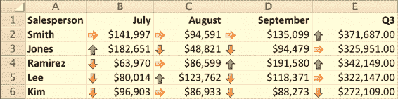

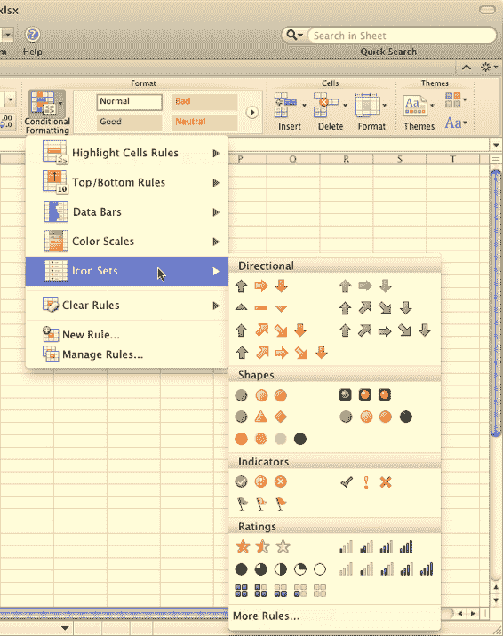

**268** **第 8 章：使用数据条、色阶、图标集和迷你图**

**图 8–10.** *将图标集应用于单元格区域，可快速直观地反映其相互关系。此工作表使用了四个图标集——分别应用于 B 列、C 列、D 列和 E 列——而非单个图标集（单个图标集会比较 B2:E6 范围内的所有数值，从而显示 E 列的第三季度合计值让月度数值显得相当惨淡）。*

要将图标集应用于单元格，请按以下步骤操作：

1. 输入将生成图标集的数据。
2. 选择包含数据的单元格。
3. 选择`开始` > `格式` > `条件格式` > `图标集`，以显示图标集面板（见图 8–11）。

**图 8–11.** *在图标集面板上，单击要应用于所选单元格的图标集。*

[www.it-ebooks.info](http://www.it-ebooks.info/)

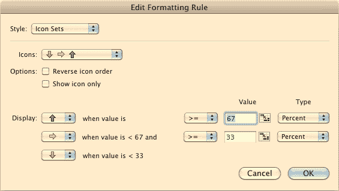

**269** **第 8 章：使用数据条、色阶、图标集和迷你图**

4. 单击要应用的图标集。

许多图标集可直接开箱即用，但你可能需要按如下方式调整其他图标集：

1. 在仍选中单元格的情况下，选择`开始` > `格式` > `条件格式` > `管理规则`，以显示管理规则对话框（如图 8–4 所示，本节前面）。
2. 确保选择了正确的规则。如果你只对该单元格应用了一个条件格式规则，则默认即为该规则；如果应用了多个规则，则可能需要单击选择正确的规则。
3. 单击`编辑规则`按钮，显示编辑格式规则对话框（见图 8–12）。

**图 8–12.** *在编辑格式规则对话框中，你可以更改图标、反转顺序、仅显示图标以及更改阈值。*

4. 要更改所使用的图标，请打开`图标样式`弹出菜单，然后单击所需的图标集。
5. 如果希望按相反顺序显示图标，请选中`反转图标次序`复选框。
6. 如果希望仅显示图标而不显示生成图标的数值，请选中`仅显示图标`复选框。

**提示：** 若想将一个单元格中的数值及其图标分别显示在不同单元格中，请在图标单元格中使用引用数值单元格的公式来设置。例如，在单元格 `C2` 中输入`=B2`，然后对图标单元格应用图标集，打开编辑格式规则对话框，并选中`仅显示图标`复选框。

[www.it-ebooks.info](http://www.it-ebooks.info/)

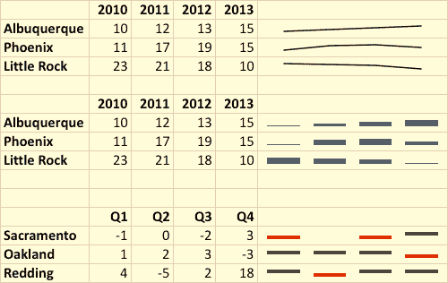

**270** **第 8 章：使用数据条、色阶、图标集和迷你图**

7. 在“显示当前图标”区域中，选择要使用的图标及其对应的阈值。
8. 单击`确定`按钮关闭编辑格式规则对话框。Excel 将返回管理规则对话框。
9. 单击`确定`按钮关闭管理规则对话框并返回工作表，此时工作表将显示你所做的更改。

## 使用迷你图显示数据趋势

正如你在第 7 章中所见，图表非常适合展示中等到大量的信息，但有时你可能需要更小的展示形式——一种能容纳在单个单元格内的图表，以便快速直观地指示趋势。Excel 将此类图表称为*迷你图*。

Excel 提供三种类型的迷你图：

- **折线图。** 折线迷你图是一种直接穿过数据点的简单线条，如图 8–13 的上半部分所示。折线迷你图适合

### 迷你图类型

- **折线图。** 折线迷你图以线条形式显示数据，适用于展示从一个数据点流向下一个数据点的数据，例如温度变化。
- **柱状图。** 柱状迷你图以一系列柱形显示数据，类似于柱形图。图 8-13 的中间部分展示了一个示例。柱状迷你图适用于比较彼此分离的数据点，例如各月的销售业绩。
- **盈亏图。** 盈亏迷你图将结果显示为盈利（正结果）或亏损（负结果）。图 8-13 的下方部分展示了盈亏迷你图的示例。当你希望对结果采取非黑即白的看法时——例如，你的投资在特定月份是上涨还是下跌——盈亏迷你图非常有用。在盈亏迷你图中，零值显示为空白。

**图 8-13.** *迷你图是单个单元格的图表，可用于直观地指示趋势或结果。*

[www.it-ebooks.info](http://www.it-ebooks.info/)

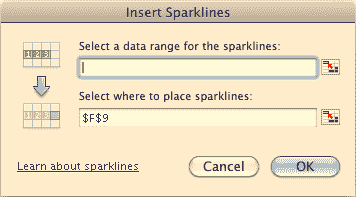

**第 8 章：使用数据条、色阶、图标集和迷你图** **271**

### 插入迷你图

要在工作表中插入一个或多个迷你图，请按照以下步骤操作：

1. 单击要放置迷你图的单元格或选择相应的区域。
2. 单击`图表`选项卡以显示其内容，转到`插入迷你图`组，然后根据需要单击`折线图`按钮、`柱状图`按钮或`盈亏图`按钮。无论单击哪个按钮，Excel 都会显示`插入迷你图`对话框（见图 8-14）。

**图 8-14.** *在“插入迷你图”对话框中，选择迷你图的数据范围以及放置它们的单元格。*

3. 焦点位于`选择迷你图的数据范围`文本框（Excel 显示`插入迷你图`对话框时会将焦点置于此处）时，在工作表中单击并拖动，以输入包含迷你图数据的区域。
4. 确保`选择要放置迷你图的位置`文本框包含要放置迷你图的区域。如果您在显示`插入迷你图`对话框之前选择了区域，则此处将是正确的。否则，请单击此文本框，然后在工作表中拖动以选择区域。
5. 单击`确定`按钮关闭`插入迷你图`对话框。Excel 将在单元格中插入迷你图。

### 设置迷你图格式

插入迷你图后，您可以使用功能区`迷你图`选项卡上的控件来设置其格式。单击迷你图中的一个单元格以选择该组迷你图，并让 Excel 将`迷你图`选项卡添加到功能区。如果 Excel 未自动显示`迷你图`选项卡，请单击该选项卡以将其显示出来（见图 8-15）。

[www.it-ebooks.info](http://www.it-ebooks.info/)

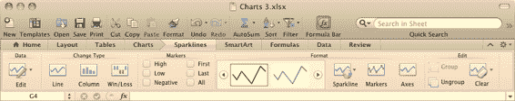

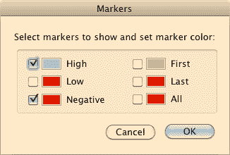

**272** **第 8 章：使用数据条、色阶、图标集和迷你图**

**图 8-15.** *使用功能区“迷你图”选项卡上的控件来格式化迷你图，使其达到您想要的外观。*

以下是格式化迷你图的主要操作：

-   **更改一组迷你图的源数据。** 单击该组迷你图中的一个单元格，然后从功能区选择`迷你图 数据 编辑`（单击`编辑`按钮的主要部分）。Excel 将显示`编辑迷你图`对话框，该对话框具有与`插入迷你图`对话框相同的控件。
-   **更改单个迷你图的源数据。** 单击迷你图单元格，然后选择`迷你图 数据 编辑 > 编辑单个迷你图`。Excel 将显示`编辑迷你图`对话框，其操作方式类似于`插入迷你图`对话框，但仅影响您选择的单元格。
-   **将迷你图更改为不同类型。** 单击迷你图单元格，然后在功能区`迷你图`选项卡上的`更改类型`组中单击`折线图`按钮、`柱状图`按钮或`盈亏图`按钮。
-   **向迷你图添加标记。** 在功能区`迷你图`选项卡上的`标记`组中，根据需要选中`高点`复选框、`低点`复选框、`负值`复选框、`首个`复选框或`最后一个`复选框——或者选中`全部`复选框以选中所有其他复选框。要更改标记颜色，请选择`迷你图 格式 > 标记`，然后在`标记`对话框中进行操作（见图 8-16）。

**图 8-16.** *使用“标记”对话框更改标记的颜色，并选择哪些标记出现在迷你图上。*

[www.it-ebooks.info](http://www.it-ebooks.info/)

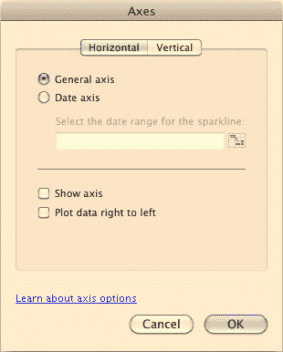

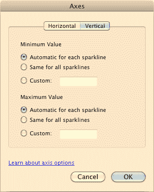

**第 8 章：使用数据条、色阶、图标集和迷你图** **273**

**提示：** 对于多种类型的数据，`高点`标记和`低点`标记最为有用。盈亏迷你图默认使用`负值`标记，而折线迷你图和柱状迷你图默认不使用任何标记。

-   **为迷你图应用样式。** 在功能区`迷你图`选项卡上的`格式`组中，单击`样式`框中的某个样式，或者将鼠标指针悬停在`样式`框上以显示面板按钮。接下来，单击面板按钮以显示`样式`面板，然后单击您想要的样式。
-   **更改迷你图的颜色。** 选择`迷你图 格式 > 迷你图`以显示`迷你图`面板，然后单击您想要的颜色。
-   **更改迷你图的粗细。** 选择`迷你图 格式 > 迷你图粗细`，然后单击所需的线条粗细。
-   **更改迷你图的坐标轴。** 选择`迷你图 格式 > 坐标轴`以显示`坐标轴`对话框（见图 8-17），然后在此对话框中进行选择。

# 第 8 章：使用数据条、色阶、图标集和迷你图

**图 8-17.** 您可以使用“坐标轴”对话框为迷你图的水平轴和垂直轴选择设置。

-   **将迷你图组合在一起。** 如果您需要快速格式化多组独立的迷你图，可以将它们组合在一起。选择每组迷你图，然后从功能区选择`迷你图 编辑 > 组合`以将它们组合。

[www.it-ebooks.info](http://www.it-ebooks.info/)

**274**

-   **清除迷你图。** 当您不再需要迷你图时，请将其从单元格中清除。选择要清除的迷你图单元格，然后选择`迷你图 编辑 > 清除`，单击`清除`按钮的主要部分。您也可以单击单个单元格，然后选择`迷你图 编辑 > 清除 > 清除所选迷你图组`以清除组中的所有单元格。

## 总结

在本章中，您学习了如何通过将数据条、色阶和图标集附加到条件格式来插图您的工作表。您还学习了如何使用迷你图显示数据趋势。

在下一章中，我将向您展示如何使用图片、剪贴画、SmartArt 图表和形状进一步插图您的工作表。

[www.it-ebooks.info](http://www.it-ebooks.info/)

**275**

