# 索引 ............................................................................................................... 429

IV

[www.it-ebooks.info](http://www.it-ebooks.info/)

### 引言

你是否需要顺利、自信且尽可能快速地用 Excel 完成工作？

如果是这样，你选对了书。

#### 本书的读者对象？

本书旨在帮助初中级用户快速掌握 Mac 版 Excel 2011，并立即高效投入使用。

无论你是在工作还是在家中，需要学习使用 Excel 完成日常任务，本书专注的方法和详尽的建议都将使你受益匪浅。你可以从头开始，按章节顺序阅读，也可以利用目录或索引直接跳转到你需要的主题。

#### 本书涵盖哪些内容？

本书包含三个部分，涵盖了有效使用 Excel 2011 所需掌握的全部知识。

##### 第一部分：“熟练使用 Excel：Mac 版”，确保你掌握 Excel 的核心操作：

- **第 1 章“掌握 Excel：Mac 版界面的秘诀”，** 教你四种主要控制 Excel 方式的来龙去脉：功能区、工具栏、菜单和键盘快捷键。你将掌握如何在工作表和 workbook 中导航；学习在工作簿中快速输入文本的方法；并利用拆分、冻结和自定义视图来精确显示所需内容。

- **第 2 章“按你的工作方式配置 Excel：Mac 版”，** 演示如何通过设置最重要的偏好设置以及自定义键盘快捷键、工具栏、菜单、菜单栏和功能区，让 Excel 按你的方式工作。你还将学习如何在启动 Excel 时自动打开工作簿，以及如何将多个打开的工作簿布局保存为一个可即时恢复的工作区。

XVI

[www.it-ebooks.info](http://www.it-ebooks.info/)

### 引言

- **第 3 章“创建高效的工作簿和模板”，** 讲解如何创建能够快速有效输入、编辑和操作数据的工作簿。你将了解应保存为哪种文件格式、如何添加属性信息以便在搜索时识别工作簿，以及如何充分利用模板——包括创建自己的模板。此外，你还将学习如何组织工作表、有效布局数据、定义命名范围以简化导航，以及创建可折叠的工作表。

- **第 4 章“快速高效地格式化工作表”，** 展示如何利用 Excel 提供的各种工具快速高效地格式化工作表。我们从格式化行和列开始——涵盖从更改列宽和行高到插入及

删除行和列，以及隐藏敏感数据。接着，我们讨论如何应用简单的格式、如何使用条件格式快速标记需要关注的值，以及如何使用数据验证来检查无效条目。最后，我们介绍如何通过使用表格格式或 Excel 的样式来节省时间，以及如何为工作表添加页眉和页脚。

第二部分“执行计算与呈现数据”将帮助您掌握公式、函数、图表以及图片和迷你图等图形元素：

-   **第 5 章“使用公式执行自定义计算”** 确保您了解公式和函数是什么，以及两者之间的区别。然后，本章将教您如何使用 Excel 的计算运算符创建自己的公式，从使用单个计算运算符的简单公式开始，逐步过渡到使用多个计算运算符的更复杂公式。您还将学习如何覆盖 Excel 评估运算符的默认顺序，以及如何排查公式中常见的错误。
-   **第 6 章“使用 Excel 的内置函数”** 解释了如何利用 Excel 提供的各种工具在工作表中插入函数、找到所需函数，并将函数指向计算所需的数据。本章的第二部分回顾了 Excel 中不同类型的函数，例如数据库函数、逻辑函数以及数学和三角函数，并给出了如何使用常用函数的示例。
-   **第 7 章“创建清晰且有说服力的图表”** 教您如何使用 Excel 种类繁多的图表清晰且有说服力地呈现数据。您将学习在工作表中放置图表的不同方法、图表的组成部分以及可以使用的图表类型。然后，我们将深入探讨如何根据数据创建图表，按照您想要的布局进行设计，并赋予其所需的外观。我们还将讨论重用自定义图表的方法，以及在 Word 文档或 PowerPoint 演示文稿中使用 Excel 图表的方法。
-   **第 8 章“使用数据条、色阶、图标集和迷你图”** 向您展示如何使用这四种单单元格图形元素为工作表增添视觉吸引力。您将快速掌握使用数据条比较单元格区域中的值、添加色阶以调整单元格的背景颜色从而提供其数值的视觉参考，以及使用图标集提供快速的性能视觉参考。您还将学习使用迷你图创建单单元格图表。
-   **第 9 章“使用图片、SmartArt 等美化工作表”** 解释了如何通过添加图形、形状、SmartArt 图表和艺术字项目来增加工作簿的视觉趣味。您将学习如何让图片呈现您想要的效果，如何将图形对象放置在任何需要的位置，如何将图形项相对于单元格进行定位，以及如何排列图形对象以控制哪些对象可见。

第三部分“分析数据以及共享和自动化工作簿”展示了如何分析、操作和共享您创建的工作簿：

-   **第 10 章“使用表格创建数据库”** 涵盖了如何使用 Excel 的表格创建数据库来存储信息、排序以及筛选以找到所需的记录。您还将学习如何将 Excel 的数据库函数与表格结合使用。
-   **第 11 章“使用模拟分析、单变量求解和规划求解解决业务问题”** 教您如何使用四个强大的工具来分析数据。您将学习如何使用数据表评估一个或两个变量对计算的影响，以及如何使用方案来试验不同的值集而无需更改核心数据。您还将学习使用`Goal Seek`（单变量求解）解决单变量问题，以及使用`Solver`（规划求解）解决多变量问题。
-   **第 12 章“使用数据透视表分析数据”** 解释了什么是数据透视表，以及如何使用它们来检查工作表中的数据并发现其中隐藏的秘密。您将学习如何使用 Excel 的自动化工具或手动将字段放置在需要的位置来创建数据透视表，如何在创建后更改数据透视表，以及如何对其包含的数据进行排序和筛选。
-   **第 13 章“在 Mac 和 Windows PC 上协作与共享”** 将带您了解与他人共享工作簿的各种方式。我们从如何打印工作表、从中创建 PDF 文件以及将数据导出为逗号分隔值文件开始。然后，我们继续讨论共享工作簿，以便多人可以同时处理它们，并在必要时跟踪更改以便您进行审阅。最后，我们探讨如何将同一工作簿不同副本中的更改合并到一个工作簿中，以及如何将多个工作表合并到一个工作表中。
-   **第 14 章“使用宏和 VBA 自动执行任务”** 向您展示如何录制宏以消除重复执行相同任务的繁琐工作。您将学习如何使用菜单或工具栏、键盘快捷键，甚至通过将宏分配给命令按钮等工作表对象来运行宏。我还将向您介绍 Visual Basic 编辑器，并向您展示如何编辑宏以更改其功能。

**本书使用的约定**

本书使用一些约定来清晰表达其含义，而不浪费文字：

-   **功能区命令。** `~TRA` 箭头表示从功能区选择项目的顺序。例如，“选择 `Layout ~TRA Print ~TRA Preview`”意味着您单击功能区的 `Layout` 选项卡（显示选项卡内容），转到 `Print` 组，然后单击 `Preview` 按钮。
-   **菜单命令。** `~TRA` 箭头表示从菜单栏中选择项目的命令顺序。例如，“选择 `Data ~TRA Data Table`”意味着您打开 `Data` 菜单，然后点击其上的 `Data Table` 项。
-   **特殊段落。** 特殊段落呈现您可能需要特别关注的信息。`Note` 段落包含您可能想知道的信息；`Tip` 段落介绍您可能受益于使用的技巧；`Caution` 段落则警告您潜在的问题。
-   **复选框。** Excel 使用许多复选框——可以带有选中标记（表示选项已开启）或没有（表示选项已关闭）的方框。本书告诉您在需要勾选复选框时“选中”它，在需要取消勾选时“清除”它。如果复选框已处于选中或清除状态，则无需更改它——只需确保其设置正确即可。
-   **键盘快捷键。** 在 Excel 中，使用键盘快捷键通常比使用功能区命令或菜单命令更省时省力。本书使用 `+` 号表示键盘快捷键。例如，“按 `Cmd+S`”意味着您按住 `Cmd` 键，按下 `S` 键，然后松开 `Cmd` 键。“按 `Cmd+Option+T`”意味着您按住 `Cmd` 键和 `Option` 键，按下 `T` 键，然后松开 `Cmd` 键和 `Option` 键。

**第一部分**

**精通 Excel:Mac**

在本部分中，您将精通 Excel:Mac 的精髓。

在第 1 章中，您将了解控制 Excel 的四种主要方式（功能区、工具栏、菜单和键盘快捷键）的细节。您将掌握如何浏览工作簿和工作表；了解在工作簿中快速输入文本的方法；并学会使用拆分、冻结和自定义视图来准确显示您需要的项目。

### 第 1 章：探索 Excel for Mac 界面的奥秘

在第 2 章中，我们将介绍如何通过设置最重要的偏好设置，以及自定义键盘快捷键、工具栏、菜单、菜单栏和功能区，让 Excel 按您期望的方式工作。您还将学习如何在启动 Excel 时自动打开工作簿，以及如何将多个打开的工作簿的布局保存为一个工作区，以便随时恢复。

在第 3 章中，您将学习如何创建工作簿，以快速高效地输入、编辑和操作数据。您将了解应使用哪些文件格式保存工作簿，如何添加属性信息以帮助在搜索时识别工作簿，以及如何充分利用模板——包括创建自己的模板。您还将学习如何管理工作表、有效布局数据、定义命名区域以简化导航，以及创建可折叠的工作表。

在第 4 章中，我们将讲解如何利用 Excel 提供的各种工具快速高效地设置工作表格式。我们从格式化行和列开始——包括更改列宽和行高、插入和删除行与列、以及隐藏敏感数据等所有操作。接着，我们将了解如何应用直接格式化、如何应用条件格式以快速标记需要注意的数值，以及如何使用数据验证来检查无效条目。最后，我们将介绍如何通过使用表格格式和 Excel 样式来节省时间，以及如何为工作表添加页眉和页脚。

[www.it-ebooks.info](http://www.it-ebooks.info/)

### 第 1 章：探索 Excel for Mac 界面的奥秘

在本章中，您将了解 Excel for Mac 界面的方方面面及其蕴含的众多奥秘。

我们将首先探讨控制 Excel 的四种主要方式：功能区、工具栏、菜单栏上的菜单以及键盘快捷键。这些方式为您控制 Excel 提供了极大的灵活性，尤其是在您按照自己的偏好进行设置之后。

接着，我们将讨论如何在工作表和工作簿之间导航。然后，我们将介绍将数据导入 Excel 工作簿的各种方法——从导入现有数据到使用自动更正、自动填充和剪贴簿功能更快速地输入数据。

在本章末尾，我将向您展示查看工作簿的智能方法，以便您能够快速高效地工作。这些方法包括拆分窗口以同时显示工作表的不同部分、打开额外的窗口，以及冻结关键行和列，以便在滚动到工作表其他部分时它们能保持在屏幕上。您甚至可以创建自定义视图，让数据完全按照您需要的方式排列。

#### 准备开始探索 Excel 的奥秘

在阅读本章时，您可能希望同时运行 Excel，以便尝试您感兴趣的修改和技巧。因此，如果 Excel 尚未运行，请启动它：单击 Dock 上的 Excel 图标，或者（如果没有图标）单击桌面激活 Finder，选择“前往”>“应用程序”，然后双击 Microsoft Office 2011 文件夹中的 Excel 图标。

此时，Excel 可能会显示“Excel 工作簿库”对话框。如果是这样，请单击“所有”类别中的“Excel 工作簿”图标，然后单击“选择”按钮。这将使 Excel 创建一个空白工作簿，而不是基于内容模板的工作簿。我们将在第 3 章中介绍如何使用“Excel 工作簿库”创建工作簿。

[www.it-ebooks.info](http://www.it-ebooks.info/)

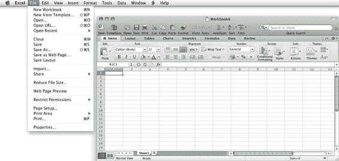

#### 控制 Excel 的四种方式

要控制 Excel，您需要发出命令。例如，当您需要一个新工作簿时，您会发出创建新工作簿的命令。

在 Excel 2011 中（见图 1-1），您可以通过我们提到的四种主要方式发出命令：

- **菜单。** 与大多数 Mac 应用程序一样，当 Excel 是活动应用程序时，Excel 会提供一组显示在 Mac OS X 菜单栏上的菜单。要发出命令，您需要单击菜单，然后单击命令。
- **功能区。** 功能区是 Excel 2011 中引入的新控制条。要发出命令，您需要单击其按钮或控件。
- **工具栏。** Excel 包括标准工具栏和格式工具栏。默认情况下，标准工具栏会横跨在 Excel 窗口顶部显示，如图 1.1 所示。要发出命令，您需要单击其按钮或控件。
- **键盘快捷键。** 要发出命令，您需要按下相应的组合键。

**图 1-1.** *您可以使用功能区、工具栏、菜单栏上的菜单或键盘快捷键来控制 Excel。*

让我们依次深入了解每一种方式，先从功能区开始。

[www.it-ebooks.info](http://www.it-ebooks.info/)

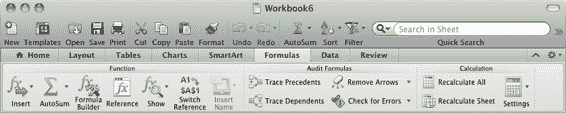

#### 功能区的奥秘

功能区是横跨 Excel 窗口顶部、位于窗口标题栏以及您选择显示的任何工具栏下方的控制条。功能区是一个包含多个选项卡的控制栏，每个选项卡又包含几个控件组。在任何时候，功能区只显示一个选项卡的内容；要切换到另一个选项卡的内容，您需要单击该选项卡。如图 1-2 所示，活动选项卡的颜色与其他选项卡不同，因此您可以轻松地将其识别出来。

**注意：** 为了清晰说明控件的位置，我会按照“选项卡-组-控件”的顺序给出功能区的操作说明。例如，“选择`公式` `审核公式` `追踪引用单元格`”表示您需要单击`公式`选项卡以显示其内容，进入`审核公式`组（无需单击），然后单击`追踪引用单元格`按钮。

**图 1-2.** *功能区的活动选项卡显示为与其他选项卡不同的颜色。每个选项卡包含控件组，例如按钮和弹出式菜单。*

##### 理解功能区的选项卡如何工作

在大多数情况下，功能区会显示八个选项卡，这些选项卡包含了 Excel 中大部分常规操作的控件：

- **开始。** 此选项卡包含用于剪切、复制和粘贴；字体、对齐方式和数字格式；条件格式和样式；插入和删除行、列和单元格；以及应用主题的控件。
- **页面布局。** 此选项卡包含用于操纵页面设置、更改视图、选择要打印的项目以及排列工作簿窗口的控件。
- **表格。** 此选项卡包含用于处理数据表的控件，这些数据表可用于在 Excel 中创建数据库。
- **图表。** 此选项卡包含用于插入图表和迷你图（适合单个单元格的微型图表）、选择图表和迷你图的布局以及为图表应用布局和样式的控件。
- **SmartArt。** 此选项卡包含用于插入和格式化 SmartArt 图形的控件。
- **公式。** 此选项卡包含用于插入函数、审核公式以及控制 Excel 执行计算方式的控件。
- **数据。** 此选项卡包含用于排序和筛选数据、创建数据透视表和执行假设分析、连接到外部数据源、验证数据以及对工作表进行分组和分级显示的控件。（第 3 章将讨论分组和分级显示。）
- **审阅。** 此选项卡包含用于检查拼写、处理批注、对工作表或工作簿应用保护以及共享工作簿的控件。

除了这些标准选项卡之外，功能区还包含其他仅在需要时才显示的选项卡。这些选项卡有时被称为*上下文相关选项卡*。例如，当您选择一个图表时，Excel 会自动显示“图表布局”选项卡和“格式”选项卡（见图 1-3）。

**图 1-3.** *当您选择了可用选项卡的对象时，功能区会显示上下文相关选项卡。此处，由于图表处于活动状态，因此功能区上出现了“图表布局”选项卡和“格式”选项卡。*

[www.it-ebooks.info](http://www.it-ebooks.info/)

**注意：** 与 Office for Windows 相比，Office:Mac 的 Ribbon 来得较晚，但在许多方面，Office:Mac 却更幸运——它的 Ribbon 是两者中更好用的。在 Office for Windows 中，Ribbon 取代了菜单栏和工具栏，因此除非你设置了无数快捷键，否则你必须使用它。而在 Office:Mac 中，Ribbon 是对菜单栏和工具栏的补充，你可以自主选择使用它的程度。通常，你会希望保持 Ribbon 开启，以便访问它提供的额外功能；但如果你发现菜单和工具栏已包含所有需要的命令，你也可以关闭 Ribbon。

[www.it-ebooks.info](http://www.it-ebooks.info/)

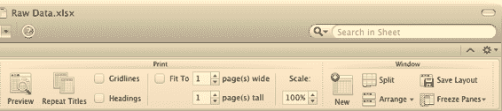

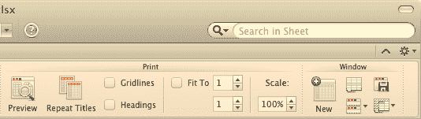

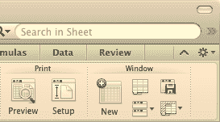

## 第 1 章：学习 Excel:Mac 界面的秘密

##### 理解 Ribbon 中的组和控件如何工作

你可能在你第一次使用 Excel 时就已经掌握了使用 Ribbon 选项卡的技巧。

组和控件则稍微有点棘手，因为它们会随着 Excel 窗口是否足够宽以显示整个 Ribbon 而变化。

当 Excel 窗口*足够*宽时，所有组都会显示，并且它们会以最宽敞的布局显示其控件——例如按钮、弹出菜单、复选框等。例如，图 1-4 的上半部分显示了 Ribbon 的“布局”选项卡的最右侧部分。“打印”组和“窗口”组中的所有控件都带有标签，因此你可以轻松识别每个控件。

但是当空间不足时，Excel 会逐渐折叠 Ribbon 的某些部分，以便在可用空间内显示尽可能多的内容。例如，图 1-4 的中间部分再次显示了“布局”选项卡的最右侧部分，但这次，`拆分`按钮、`排列`弹出菜单、`保存布局`按钮和`冻结窗格`弹出菜单上的标签都消失了。在“打印”组中，`调整为`标签仍然可见，但 Excel 已移除“页宽”和“页高”标签以节省空间。

当窗口变得更窄时，Excel 会进一步折叠组和控件。在图 1-4 的下半部分，你可以看到“打印”组现在只包含`预览`按钮和`设置`按钮。但你可以单击`设置`按钮以显示“打印设置”对话框，在该对话框中，你可以配置 Ribbon 隐藏的所有“打印”组设置，更不用说其他设置了。

**图 1-4.** *随着 Excel 窗口变窄，Excel 会先隐藏次要控件的标签，然后隐藏控件本身，正如你在“布局”选项卡的“打印”组和“窗口”组中看到的控件那样。*

[www.it-ebooks.info](http://www.it-ebooks.info/)

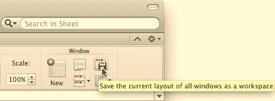

通过自动更改 Ribbon 以适应窗口宽度，Excel 尽可能让更多控件触手可及。但由于标签可能不显示，你有时需要显示屏幕提示来识别控件；要显示屏幕提示，请将鼠标指针悬停在控件上片刻（见图 1-5）。

**图 1-5.** *当控件的标签未显示在 Ribbon 上时，请将鼠标指针悬停在控件上以显示屏幕提示，说明其功能。*

此外，由于当 Ribbon 的完整宽度未显示时，某些控件可能出现在不同位置，因此你有时可能需要寻找所需的控件。本书假定窗口显示足够宽，以便你看到 Ribbon 上的所有控件，但也会指出一些可能导致混淆的会消失的控件。

如果你无法看到本应存在的命令，请在组内的剩余控件中四处探查，以找到 Excel 隐藏该控件的位置，或者查看某个控件是否会打开包含这些控件的对话框。（或者，如果有菜单替代方案，则使用菜单。）

##### 折叠 Ribbon

当你需要更多空间来处理工作表时，可以通过以下方式之一将 Ribbon 折叠为仅显示其选项卡栏（见图 1-6）：

-   单击当前活动的选项卡。
-   单击 Ribbon 右端的`折叠功能区`按钮（`^` 按钮）。
-   从菜单栏中选择`视图 > 功能区`（移除功能区项旁边的复选标记）。
-   按 `Cmd+Option+I`。

[www.it-ebooks.info](http://www.it-ebooks.info/)

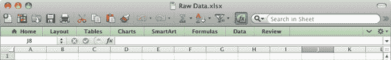

**图 1-6.** *单击“折叠功能区”按钮可将功能区折叠为仅显示其选项卡。单击“展开功能区”按钮（该按钮会替换“折叠功能区”按钮）可再次展开功能区。*

你猜得没错，再次显示 Ribbon 几乎使用相同的操作：

-   单击你想要查看的选项卡。
-   单击 Ribbon 右端的`展开功能区`按钮（`∨` 按钮）。
-   从菜单栏中选择`视图 > 功能区`。
-   按 `Cmd+Option+I`。

**提示：** 如果你不想使用 Ribbon，可以将其完全关闭。如果你确实想使用它，则可以选择显示哪些选项卡以及它们的显示顺序。详情请参阅第 2 章的“自定义功能区”部分。

#### 工具栏的秘密

Excel 带有两个内置工具栏——标准工具栏和格式工具栏——但你可以根据需要创建任意多的其他工具栏。你可以选择显示哪些工具栏以及如何显示它们。并且你可以自定义内置工具栏和你自己的工具栏，这将在第 2 章中介绍。

##### 选择要显示的工具栏

首先，决定要显示哪些工具栏。最简单的方法是 `Ctrl+单击`或右键单击一个已显示的工具栏，单击或高亮显示上下文菜单上的“工具栏”项，然后单击你要显示或隐藏的工具栏。Excel 会在“工具栏”子菜单中已显示的工具栏旁放置一个复选标记。如果该工具栏正在显示，你单击它可移除复选标记并隐藏该工具栏。

如果没有显示任何工具栏，请选择`视图 > 工具栏`以显示“视图”菜单上的“工具栏”子菜单，然后单击你要显示的工具栏。

[www.it-ebooks.info](http://www.it-ebooks.info/)

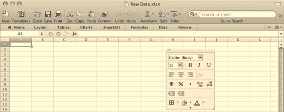

##### 在图标加文本与仅图标之间切换标准工具栏

接下来，选择是将标准工具栏上的按钮显示为带文本标签的图标，还是仅显示图标。如果你发现文本标签使图标更易于识别，那么它们占用少量额外空间是值得的。

要在图标加标签和仅图标之间切换，请 `Ctrl+单击`或右键单击标准工具栏，然后酌情单击上下文菜单上的“图标和文本”项或“仅图标”项。

**注意：** 格式工具栏仅显示图标——你无法选择为其按钮显示文本标签。

##### 取消停靠和停靠格式工具栏

最初，Excel 将标准工具栏显示在窗口顶部，标题栏和 Ribbon 之间（除非你已关闭 Ribbon）。如果你显示格式工具栏，它也是如此。

标准工具栏始终保持停靠状态，但如果你更希望格式工具栏浮动，则可以将其取消停靠，以便在桌面上自由定位。

要取消停靠格式工具栏，请 `Ctrl+单击`或右键单击该工具栏，然后单击上下文菜单中的`在窗口中停靠工具栏`以移除复选标记。Excel 会将工具栏取消停靠，并将其显示为浮动工具栏，你可以根据需要重新定位它（见图 1-7）。

**图 1-7.** *你可以取消停靠格式工具栏，将其放置在屏幕上的任意位置。为释放 Excel 窗口空间，请将工具栏定位在窗口外部。当你需要格式控件靠近数据时，请将工具栏像这样放置在 Excel 窗口上方。*

[www.it-ebooks.info](http://www.it-ebooks.info/)

**提示：** 你可以通过点击标题栏右端的果冻豆按钮（灰色圆角矩形按钮）来切换停靠工具栏的显示与隐藏。

#### 菜单栏的奥秘

如果你使用过其他 Mac 应用程序，你可能已经知道如何使用菜单栏：**1.** 如果要为某个应用程序发出命令而该应用未处于活动状态，请点击该应用的某个窗口使其变为活动状态。Mac OS X 随后会在菜单栏上显示该应用程序的菜单。例如，当 Excel 处于活动状态时，你会看到它的菜单，其中 Excel 自己的菜单会出现在菜单栏的最左端。

**2.** 点击你想要打开的菜单。

**3.** 点击你要执行的命令。或者，如果该命令位于子菜单中，则点击或高亮子菜单项以显示子菜单，然后点击该项。

**注意：** 菜单命令名称末尾的省略号（…）通常表示该命令会显示一个对话框，而不是直接执行操作。例如，`文件` 菜单中的 `关闭` 命令会关闭活动文档，而 `另存为…` 命令则会显示 `另存为` 对话框。（`保存` 命令也会显示 `另存为` 对话框——但仅限于你之前从未保存过此工作簿的情况。）但是，随着功能区（Ribbon）的引入，某些带有省略号的菜单命令会显示包含完成操作所需命令的功能区选项卡。

通过菜单栏发出命令可谓再简单不过。但菜单栏还有两个秘密。你可以：

- **一次性关闭所有打开的工作簿**。按住 `Shift` 键并点击 `文件` 菜单，然后点击代替常规 `关闭` 命令出现的 `全部关闭` 命令。如果任何工作簿包含未保存的更改，Excel 会提示你保存它们，就像关闭单个工作簿时一样。
- **自定义菜单和菜单栏**。你可以自定义菜单和菜单栏，将你需要的命令放置在最方便的位置。有关详细信息，请参阅第 2 章的“自定义菜单和菜单栏”一节。

[www.it-ebooks.info](http://www.it-ebooks.info/)

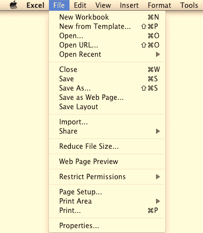

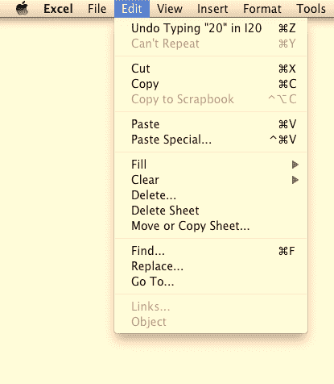

**12**

**第 1 章：探索 Excel:Mac 界面的奥秘**

#### 使用键盘快捷键驾驭 Excel

如果你喜欢使用键盘操作，不妨花些时间学习 Excel 内置的键盘快捷键，并为你想要通过键盘执行的其他命令创建自定义快捷键。

对于你经常在菜单栏上使用的命令，你可以通过打开菜单并查看命令右侧显示的快捷键来快速学习这些键盘快捷键。`文件`菜单（如图 1–8 左侧所示）和 `编辑`菜单（如图 1–8 右侧所示）最初分配了最多的键盘快捷键。

**图 1–8.** *通过查看菜单，你可以快速学习重要的键盘快捷键。*

要查找其他键盘快捷键，请点击菜单栏上的 `帮助` 菜单将其打开，在搜索框中输入 `excel keyboard shortcuts`，然后点击 Excel 提供的 `Excel 键盘快捷键` 主题。

**注意：** 在本书中，我会结合功能区、工具栏和菜单的命令执行方法，教会你最常用的键盘快捷键。

如果你发现 Excel 没有为某个命令提供键盘快捷键，或者现有的快捷键难以按击或记忆，你可以自己创建。请参阅第 2 章的“创建自定义键盘快捷键”一节以获取说明。

[www.it-ebooks.info](http://www.it-ebooks.info/)

**第 1 章：探索 Excel:Mac 界面的奥秘**

**13**

**提示：** 你也可以使用 `自定义工具栏和菜单` 对话框来了解分配给现有命令的键盘快捷键。当你确切知道需要哪个命令，但在菜单或帮助文件中难以找到其快捷键时，这个方法非常有用。

#### 让工具箱按你的方式工作

与其他 Office 应用程序一样，Excel 有一个名为“工具箱”的工具面板。工具箱是自由浮动的，不会停靠在应用程序窗口上，因此你可以将其放置在任何你觉得最佳的位置。

在 Excel 中，工具箱包含四个面板：

- **剪贴簿**。剪贴簿是一个存储区，用于收集你想要轻松粘贴到工作簿中的项目。我们将在本章稍后介绍剪贴簿。
- **参考资料**。“参考资料”面板让你可以快速访问在线同义词库、词典、双语词典、翻译引擎和网络搜索。
- **公式生成器**。公式生成器是用于插入函数和公式的工具。我将在第 5 章向你展示如何使用公式生成器。
- **兼容性报告**。你可以使用“兼容性报告”面板来审查将 Excel 工作簿保存为较旧文件格式时可能存在的问题（例如，以便使用较旧版本 Excel 的用户可以打开它）。第 3 章将向你展示如何使用兼容性报告面板。

要显示工具箱中的面板，请从菜单栏中选择 `视图` > `公式生成器`、`视图` > `剪贴簿`、`视图` > `参考资料` 或 `视图` > `兼容性报告`。工具箱将打开，并显示你所选择的面板。你也可以点击标准工具栏上的 `工具箱` 按钮，转到工具箱顶部的标签栏，然后点击所需标签的标签按钮。

**提示：** 按 `Shift+F3` 显示 `公式生成器`，或按 `Cmd+Option+R` 显示 `参考资料` 面板。

要隐藏工具箱，你可以点击其 `关闭` 按钮（其标题栏中的红色按钮），或者再次执行 `视图` 菜单命令——例如，当 `剪贴簿` 面板显示时，选择 `视图` > `剪贴簿` 来隐藏工具箱。或者，你可能希望设置在闲置若干秒后，工具箱自动折叠、淡化或关闭。要设置执行这些操作之一，请遵循以下步骤：

[www.it-ebooks.info](http://www.it-ebooks.info/)

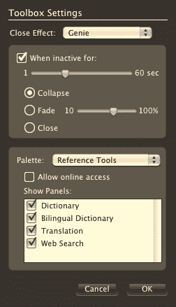

**14**

**第 1 章：探索 Excel:Mac 界面的奥秘**

1. 点击 `工具箱设置` 按钮，即工具箱右上角的卷曲箭头按钮。工具箱会翻转过来并显示 `工具箱设置` 面板（见图 1–9）。

    **图 1–9.** *工具箱背面的工具箱设置面板允许你设置在闲置一段时间后，工具箱自动折叠、淡化或关闭。*

2. 在 `关闭效果` 弹出菜单中，选择你希望用于关闭工具箱的效果：`精灵效果`、`缩放` 或 `无`。（精灵效果和缩放是将应用程序最小化到 Dock 所使用的相同效果。）

3. 选中 `闲置时间超过` 复选框。

4. 拖动滑块设置闲置的秒数——范围从 1 到 60 秒。

5. 选择合适的选项按钮：
    - **折叠。** 选择此选项按钮可使工具箱折叠为仅剩标题栏和标签栏。当你点击某个标签按钮时，工具箱会再次展开。
    - **淡化。** 选择此选项按钮可使工具箱淡出。拖动滑块设置淡出百分比——从 10%（几乎不可见）到 100%（完全可见）。当鼠标指针移过其上方时，工具箱会重新出现。
    - **关闭。** 选择此选项按钮可实际关闭工具箱。

[www.it-ebooks.info](http://www.it-ebooks.info/)

**第 1 章：探索 Excel:Mac 界面的奥秘**

**15**

**注意：** 在 `工具箱设置` 面板的下部，你可以选择 `参考资料` 面板中显示哪些项目。确保在 `面板` 弹出菜单中选择了 `参考资料`，然后根据需要选中或清除 `显示面板` 列表中的复选框。如果你希望参考资料工具能够在互联网上查找资料，请选中 `允许在线访问` 复选框。

6. 点击 `确定` 按钮关闭 `工具箱设置` 面板。工具箱会翻转过来，并显示之前显示的面板。

#### 工具箱的怪癖

