# 第 9 章：使用图片、SmartArt 等插图您的工作表

为了给工作簿增加视觉趣味，您可以向其中添加图形、形状、SmartArt 图表和艺术字项目。图形是指 Excel 可以导入的各种格式的图片和图像，而形状是指 Excel 的内置形状，包括从简单的箭头和规则形状（如圆形、方形和三角形）到您即时创建的复杂形状等各种图形。SmartArt 包含一系列图形，如组织结构图和流程图，而艺术字则是您根据偏好设计创建的图形文字。

本章向您展示如何插入剪贴画和其他图片，如何插入形状并设置其格式，以及如何将图形对象定位到所需位置。您将学习如何使图片达到您想要的外观，如何将图形对象放置在任何需要的位置，以及如何通过添加 SmartArt 图表和艺术字项目来插图您的工作簿。除此之外，我还将向您展示如何相对于单元格定位图形项目，以及如何排列图形对象以控制哪些对象可见。

在开始之前，有一件至关重要的事情你需要了解：尽管工作表看起来是平面的，但它实际上由多个独立的层组成。在向图层添加对象之前，该图层是透明的，因此你可以透过图层看到其下方的任何内容。一个图层包含工作表的单元格；其他图层则包含图形对象。拥有这些多层结构，你可以将图形对象放置在单元格的前方或后方。你还可以将一个图形对象放置在另一个图形对象的前面；例如，将一张图像叠加在另一张图像之上。

[www.it-ebooks.info](http://www.it-ebooks.info/)

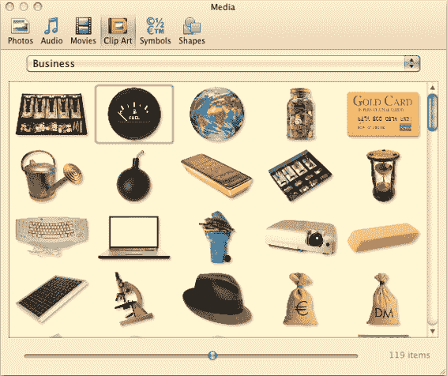

**276**

## 插入剪贴画

当你需要在工作簿中快速添加插图时，可以插入剪贴画。Office 提供了一套虽不算庞大但颇为实用的剪贴画，可供你在工作簿中使用。

你也可以从微软网站的 Office 页面下载其他剪贴画。

Excel 提供了两种插入剪贴画的工具：

-   **剪贴画浏览器。** `剪贴画浏览器`是显示在`媒体浏览器`中的一个窗格。它展示了多种剪贴画。
-   **剪贴画库应用程序。** `剪贴画库`是一个独立的应用程序，你可以用它来管理剪贴画并将其插入工作簿。

`剪贴画库`提供的剪贴画选择比`剪贴画浏览器`窗格更丰富，但部分项目是相同的。`剪贴画库`还拥有更多功能来帮助你查找图片。

我们先从`剪贴画浏览器`开始。

### 使用剪贴画浏览器插入剪贴画

当你需要剪贴画时，首先查看`剪贴画浏览器`中是否包含合适的图片。要打开`剪贴画浏览器`并插入项目，请按以下步骤操作：

1.  从菜单栏选择`插入` > `剪贴画` > `剪贴画浏览器`，在`媒体浏览器`窗口中显示`剪贴画浏览器`窗格。图 9–1 展示了`剪贴画浏览器`窗格。

    **图 9–1.** 使用`媒体浏览器`中的`剪贴画浏览器`窗格在工作簿中插入剪贴画。你可以拖动右下角的调整大小手柄来调整`媒体浏览器`的大小。

[www.it-ebooks.info](http://www.it-ebooks.info/)

**277**

2.  在顶部的弹出菜单中，如果要查看所有可用图像，请选择`所有图像`；或者选择你想要的图像类别——例如`动物`或`商业`。
3.  如果你想放大以查看更大尺寸的图片，请向右拖动底部的缩放滑块。要缩小，请向左拖动滑块。
4.  浏览`剪贴画浏览器`中显示的剪贴画项目，找到你所需的那一个。
5.  要插入一个项目，请单击它并将其拖动到工作簿中你希望出现的位置。

除了直接插入剪贴画，你还可以按住 `Ctrl` 键并单击它，或右键单击它，然后在上下文菜单中单击`复制`，将其复制到剪贴板。然后，你可以使用`粘贴`命令（例如按下 `Cmd+V`）将剪贴画粘贴到需要的位置。

### 使用剪贴画库插入剪贴画

如果`剪贴画浏览器`中没有适合你工作簿的图片，请尝试使用`剪贴画库`。请按以下步骤操作：

1.  单击你希望放置图片左上角的单元格。
2.  从菜单栏选择`插入` > `剪贴画` > `剪贴画库`，启动`剪贴画库`应用程序（见图 9–2）。
3.  在`类别`列表框中，单击你想要显示的图片类别。然后你可以滚动浏览图片。
4.  要按剪贴画名称或关键词搜索，请在`搜索`框中键入搜索词，然后单击`搜索`按钮。`剪贴画库`会将所有匹配的剪贴画添加到`类别`列表框顶部的`搜索结果`类别中，并在主框中显示该类别。
5.  单击你想要插入工作簿的剪贴画项目。

# 6. 单击“插入”按钮。Excel 会插入剪贴画项目，并自动关闭“剪辑库”。

[www.it-ebooks.info](http://www.it-ebooks.info/)

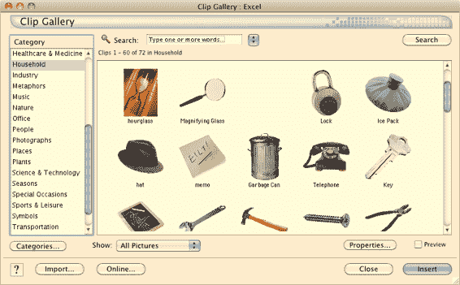

## 第 278 章：使用图片、SmartArt 等美化工作表

**图 9–2**。剪辑库是用于管理工作簿中的剪贴画并插入剪贴画项目的工具。要一次查看更多图片，请将右下角的尺寸调整手柄向下或向右拖动。

### 使用剪辑库管理剪贴画项目

为了充分利用剪辑库，您可以向其中添加自己的图片、动态剪辑和声音。您还可以从 Microsoft Office 网站下载剪贴画项目并添加到剪辑库。为了使剪辑库项目井井有条并便于查找所需项目，您可以更改剪辑库中的类别，并为项目添加关键字标签。

#### 向剪辑库添加自己的图片

要向剪辑库添加自己的图片，请按照以下步骤操作：

1. 从菜单栏中选择 `插入剪贴画 剪辑库` 以打开剪辑库。

2. 单击 `导入` 按钮以显示 `导入` 对话框（见图 9–3）。

[www.it-ebooks.info](http://www.it-ebooks.info/)

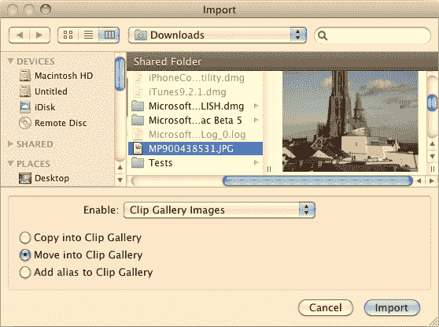

## 第 279 章：使用图片、SmartArt 等美化工作表

**图 9–3**。使用 `导入` 对话框将您自己的图片或下载的图片添加到剪辑库。

3. 在 `启用` 弹出菜单中，选择要添加的项目类型：

   - `所有剪辑`。选择此项可导入剪辑库能处理的任何类型项目。

   - `剪辑库图片`。选择此项可将图片文件添加到剪辑库。

   - `剪辑库影片`。选择此项可添加影片。

   - `剪辑库声音`。选择此项可添加声音文件。

   - `剪辑库包`。选择此项可添加您下载的库包。

   - `Microsoft Office 在线文件`。选择此项可从 Microsoft Office 网站添加以 `.cil` 文件格式下载的库包。

4. 单击要添加到库中的文件。

5. 在 `导入` 对话框的左下角，选择相应的选项按钮以确定如何将项目添加到剪辑库：

   - `复制到剪辑库`。选择此选项按钮可制作剪辑的副本并将该副本添加到剪辑库。当剪贴画项目位于可移动驱动器或网络驱动器上时，请采用此方法。

[www.it-ebooks.info](http://www.it-ebooks.info/)

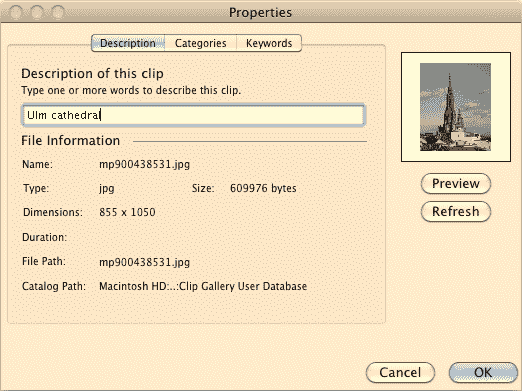

## 第 280 章：使用图片、SmartArt 等美化工作表

   - `移动到剪辑库`。选择此选项按钮可将剪辑从其当前文件夹移动到剪辑库。当您下载了文件但不想移动已整理到文件夹中的素材时，请使用此选项。

   - `添加到剪辑库别名`。选择此选项按钮可向剪辑库添加别名。别名是一个文件快捷方式；它指向文件当前所在位置。对于已整理到文件夹中但希望添加到剪辑库的素材，请使用此选项。

6. 单击 `导入` 按钮。剪辑库会关闭 `导入` 对话框，并显示该项目（如果是导入多个项目，则显示第一个项目）的 `属性` 对话框。图 9–4 显示了一张图片的 `属性` 对话框中的 `描述` 选项卡。

**图 9–4**。在剪贴画项目的 `属性` 对话框的 `描述` 选项卡上，输入有用的描述以替换文件名。

7. 在 `此剪辑的描述` 框中，键入对剪辑内容的描述。剪辑库会建议使用文件名的第一部分作为描述，但您通常需要对此进行改进。

8. 单击 `类别` 选项卡以显示其内容（见图 9–5）。

[www.it-ebooks.info](http://www.it-ebooks.info/)

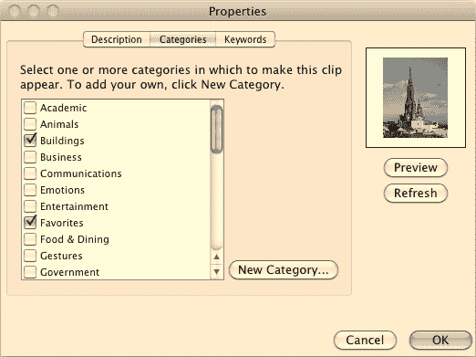

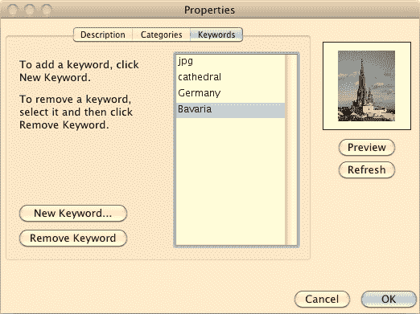

# 第 9 章：使用图片、SmartArt 等美化工作表

**图 9-5** *. 在`属性`对话框的`类别`选项卡中，为要分配项目的每个类别选中对应的复选框。要添加类别，请单击`新建类别`按钮。*

**9.** 为希望图片显示的每个类别选中复选框。如果没有合适的类别，请通过单击`新建类别`按钮，在`新建类别`对话框中键入名称，然后单击`确定`按钮来创建一个。

**10.** 单击`关键字`选项卡以显示其内容（见图 9-6）。

**图 9-6** *. 在`属性`对话框的`关键字`选项卡中，为剪贴画项目添加关键字，以便你将来能够搜索到它。*

[www.it-ebooks.info](http://www.it-ebooks.info/)

**282**

**11.** 为剪贴画项目标记所需的关键字。使用以下技巧：

*添加关键字。* 单击`新建关键字`按钮以打开`新建关键字`对话框。键入关键字，然后按下`返回`键或单击`确定`按钮。

*删除关键字。* 在列表框中单击该关键字，然后单击`删除关键字`按钮。在打开的确认对话框中，单击`确定`按钮。

**12.** 单击`确定`按钮关闭`属性`对话框。`剪贴画库`将导入图片，并将其添加到你所选的类别中。

### 从 Microsoft Office 网站下载剪贴画项目

`剪贴画库`包含足够多的项目供你入门使用，但如果你需要在工作簿中大量使用剪贴画，则可能需要从 Microsoft Office 网站下载其他项目并将其添加到库中。为此，请按以下步骤操作：

**1.** 从菜单栏中选择`插入` `剪贴画` `剪贴画库`以打开`剪贴画库`。

**2.** 单击`联机`按钮以启动或激活默认浏览器，并显示 Microsoft Office 网站上的`图像`页面。

`注意：` 首次在`剪贴画库`中单击`联机`按钮时，会弹出`启动浏览器`对话框，请求你允许其启动默认浏览器。选中`不再询问我`复选框，然后单击`是`按钮。

**3.** 浏览以查找你想要的图片。

**4.** 将鼠标指针移至图片上，等待详细信息面板弹出，然后单击其上的`添加到购物篮`链接，将每张图片添加到你的购物篮中。

**5.** 准备下载图片时，将鼠标移至右上角的`选择购物篮`链接上，然后单击`下载`链接。

**6.** 在出现的网页上，单击`下载`按钮以在存档文件中下载剪贴画项目。

**7.** 单击程序坞上的`下载`文件夹，然后点击该存档文件。其文件名以`ClipArt`开头，且文件扩展名为`.cil`，因此应易于识别。`剪贴画库`会自动导入这些文件。

[www.it-ebooks.info](http://www.it-ebooks.info/)

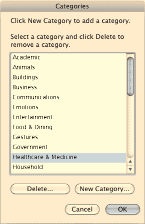

`注意：` 如果你的程序坞中没有`下载`文件夹，请打开一个 Finder 窗口，进入你用户账户下的`下载`文件夹。然后双击该存档文件。或者，单击`剪贴画库`窗口中的`导入`按钮，在`导入`对话框中点击该文件，然后单击`导入`按钮。

导入文件后，你或许希望按照上一节所述设置其属性和关键字，以便更容易找到它们。

### 使用类别整理剪贴画库

正如你在本章前面所见，在向`剪贴画库`导入项目时，你可以根据需要创建新类别。你也可以通过单击`剪贴画库`中的`类别`按钮，并在`类别`对话框（见图 9-7）中进行操作来创建或删除类别：

*创建类别。* 单击`新建类别`按钮以显示`新建类别`对话框。为类别键入名称，然后单击`确定`按钮。

`注意：` 这些类别仅出现在`剪贴画库`中，不会出现在`剪贴画浏览器`中。

*删除类别。* 在列表框中单击该类别，然后点击`Delete`按钮。在确认对话框中，点击`OK`按钮。

**图 9–7**。使用剪贴画库中的“类别”对话框删除现有类别或创建新类别。

[www.it-ebooks.info](http://www.it-ebooks.info/)

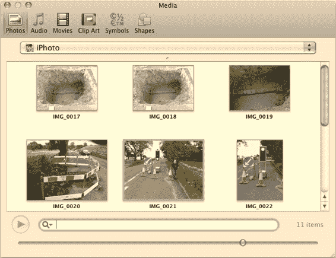

### 在工作簿中插入图片

剪贴画适合用作基础插图，但所有人都能访问到相同的图片集。为使你的工作簿独一无二，你也可以插入自己的照片和其他图片。

你可以插入已添加到 iPhoto 中的图片，也可以插入位于 Mac 文件系统中但不在 iPhoto 里的图片。由于 iPhoto 是 macOS 中用于从数码相机导入照片并对其进行编辑的标准应用程序，你大部分时间可能都会用到它。

#### 从 iPhoto 插入图片

要从 iPhoto 插入图片，请按以下步骤操作：

**1.** 点击标准工具栏上的`Media`按钮，或从菜单栏中选择`View > Media Browser`，以打开媒体浏览器。

**2.** 点击工具栏上的`Photos`按钮，显示“照片浏览”窗格（请参见图 9–8）。

**图 9–8**。使用媒体浏览器中的“照片浏览”窗格，将 iPhoto 中的图片添加到工作簿中。

**3.** 在弹出的菜单中选择图片的来源。例如，选择`iPhoto`可查看 iPhoto 中的所有图片；选择`Events`可查看在 iPhoto 中创建的事件列表；或选择`Last Import`可查看最近导入的照片。

[www.it-ebooks.info](http://www.it-ebooks.info/)

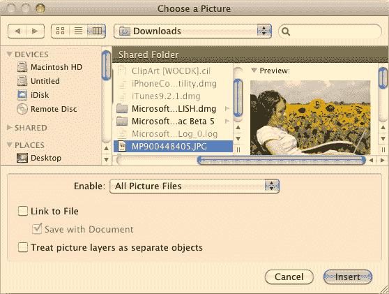

**4.** 点击所需的照片，然后将其拖到工作簿窗口中，并拖放到希望它出现的位置。

**5.** 如果你需要继续使用媒体浏览器窗口，请保持其打开状态。否则，点击`Close`按钮（窗口左上角的红色按钮）将其关闭。

#### 从 Mac 文件系统插入图片

要插入一张不在 iPhoto 中，但存储在 Mac 文件系统或网络驱动器上的图片，请按以下步骤操作：

**1.** 将插入点或选择区定位到希望图片出现的位置。

**2.** 从菜单栏中选择`Insert > Photo > Picture from File`，以显示“选取图片”对话框（请参见图 9–9）。

**图 9–9**。在“选取图片”对话框中，你可以选择是否将图片链接到工作簿。

对于某些类型的图片，你还可以选择将图片图层视为独立对象，以便对它们进行单独操作。

**3.** 导航到包含该文件的文件夹，然后点击该文件。

**4.** 如果你希望将图片文件链接到工作簿而非嵌入，请选中`Link to File`复选框。执行此操作后，你可以选中`Save with Document`复选框，以在工作簿中保存图片文件的最新版本。有关链接的建议，请参阅边栏“将图片链接到工作簿”。

[www.it-ebooks.info](http://www.it-ebooks.info/)

**5.** 如果你希望能够单独操作图片的每一层，请选中`Treat picture layers as separate objects`复选框。此功能仅适用于某些类型的图片，例如 JPEG 格式。

**6.** 点击`Insert`按钮。Excel 会关闭“选取图片”对话框，并将图片插入到工作簿中。

`提示：` 你也可以通过将图片文件从 Finder 窗口拖放到工作簿中来插入图片。

#### 将图片链接到工作簿

当你从 Mac 文件系统向工作簿添加图片时，你可以选择嵌入图片或链接图片。

嵌入图片会将图片的一个副本添加到工作簿中。Excel 会将图片保存在工作簿中，因此即使你移动工作簿，图片仍保留在其中。

如果你需要控制工作簿的文件大小，或者需要能够轻松更新图片，则可以选择链接图片。链接意味着 Excel 会在工作簿中添加一个指向图片文件的链接。当你打开工作簿时，Excel 会从该文件中加载图片的当前版本。但是，如果你将工作簿移动到另一台计算机，则该链接将不再起作用，因为 Excel 无法找到该图片文件。

为解决链接失效的问题，你可以链接图片但同时保存其最新版本。为此，请在“选取图片”对话框中选中`Link to File`复选框和`Save with Document`复选框。当你打开工作簿时，Excel 会检查链接版本是否可用。如果可用，Excel 会加载链接的图片；如果不可用，则会显示工作簿中保存的版本。

### 添加和设置形状格式

如果工作簿需要绘制图形，你可以使用形状从头开始创建。Excel 提供了多种多样的形状，从箭头和基本形状到星形、横幅和标注。

要插入形状，请按以下步骤操作：

**1.** 显示工作簿中要添加形状的区域。添加形状时，你无需定位插入点或进行选择。

`注意：` 你也可以通过从功能区选择`Home > Insert > Shape`来显示形状面板，点击形状类别（例如，线条和连接符），然后点击形状类型来插入形状。但通常，使用形状浏览器可以更方便地访问形状。

### 第 9 章：使用图片、SmartArt 图形等来美化工作表

**2.** 点击标准工具栏上的 `Media` 按钮，或从菜单栏中选择 `View > Media Browser`，以显示媒体浏览器。

[www.it-ebooks.info](http://www.it-ebooks.info/)

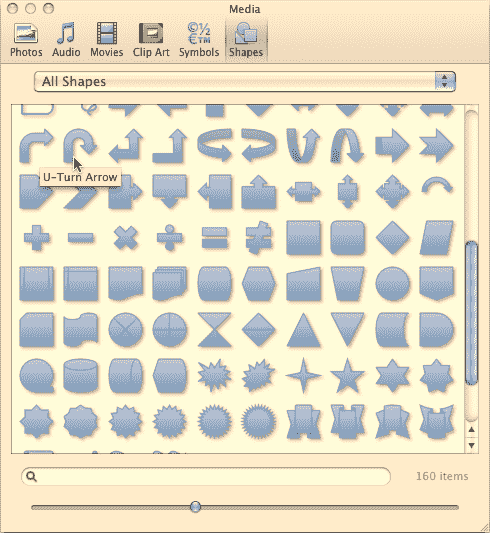

**3.** 点击工具栏上的 `Shapes` 按钮，显示“形状浏览”窗格（请参见图 9–10）。

**图 9–10.** 从媒体浏览器的“形状浏览”窗格中选择形状类型。将鼠标指针悬停在一个形状上，可以看到显示其说明的屏幕提示。

**4.** 在“形状浏览”窗口顶部的弹出菜单中，点击要查看的形状类别：所有形状、矩形、基本形状、线条和连接符、块状箭头、公式形状、流程图、星与旗帜，或标注。

**5.** 点击你想要的形状。Excel 会将鼠标指针变为十字准线。

**6.** 使用此十字准线，点击要放置形状的一个角的位置，然后拖动到对角（请参见图 9–11）。先放置哪个角无关紧要，因为你可以在任何方向上拖动，但通常先放置左上角最为容易。

[www.it-ebooks.info](http://www.it-ebooks.info/)

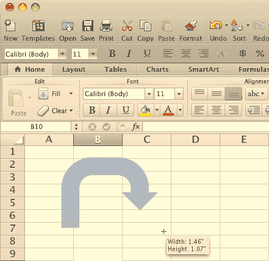

**图 9–11.** 使用十字准线点击并拖动，以放置并调整正在插入的形状的大小。

释放鼠标按钮后，形状会显示出来，周围带有选择手柄，以便你可以按照后续章节所述对其进行操作。当形状被选中时，功能区会添加 `Format` 选项卡，其中提供了用于设置形状格式的控件。

除非你需要插入更多形状或其他对象，否则请点击媒体浏览器窗口的 `Close` 按钮（左上角的红色按钮）将其关闭。

### 为形状应用样式

插入形状后，你可以从功能区 `Format` 选项卡上 `Shape Styles` 组中的“形状样式”框或面板为其应用样式。如果所需的样式显示在“形状样式”框中，直接点击即可；否则，将鼠标指针移动到“形状样式”框上方，使面板按钮出现，然后点击该按钮以显示面板（参见图 9–12）。然后，你可以点击所需的样式。

要优化形状，请打开“形状样式”组中的“填充”面板、“线条”面板或“效果”下拉面板，然后点击所需选项。例如，选择 `格式` > `形状样式` > `形状效果` > `三维旋转`，然后点击其中一个三维旋转效果（参见图 9-13）。

[www.it-ebooks.info](http://www.it-ebooks.info/)

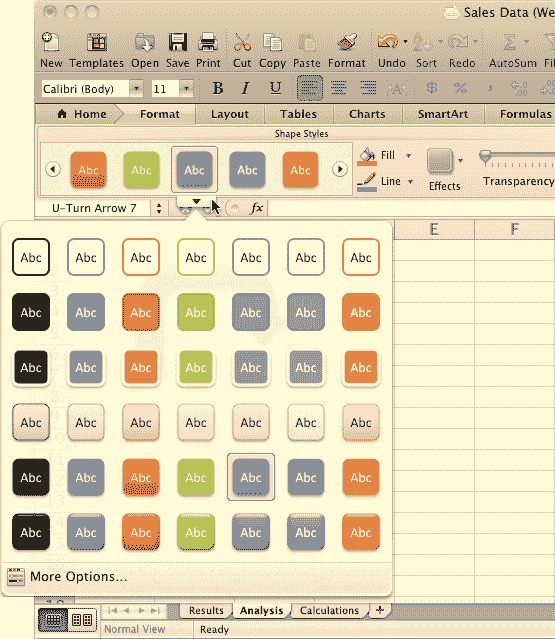

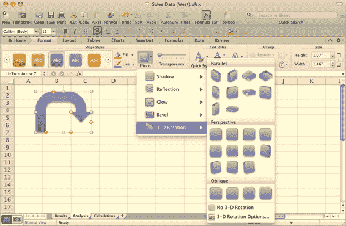

**图 9-12.** *要更改形状的样式，请打开功能区“格式”选项卡上的“形状样式”面板，然后点击所需的样式。*

**图 9-13.** *使用“填充”面板、“线条”面板或“效果”面板（此处所示）使形状达到你想要的效果。*

[www.it-ebooks.info](http://www.it-ebooks.info/)

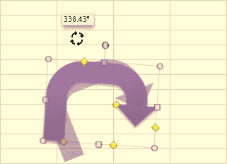

### 旋转图形对象

插入图形对象后，你可以根据需要旋转它。点击选择该对象，然后向左拖动绿色手柄进行逆时针旋转（参见图 9-14），或向右拖动进行顺时针旋转。

**图 9-14.** *向左或向右拖动绿色旋转手柄可旋转图形对象。*

### 定位图形对象

如果在插入图形对象时未能将其精确定位到正确位置，你之后可以轻松移动它。

重新定位图形对象的快速方法是点击它，然后将其拖拽到所需位置。这在大多数情况下效果良好，但如需更精确，你也可以点击选中该对象，然后按方向键（例如， `向左` 方向键）沿箭头方向微移一小段距离。

当需要精确控制对象的显示位置时，请按住 `Ctrl` 键并点击或右键点击该对象，然后点击上下文菜单中的 `格式` 命令以显示该对象的格式对话框（例如，点击 `设置图片格式` 命令以显示 `设置图片格式` 对话框）。在左侧窗格中，点击 `大小` 项以显示用于调整对象大小和控制其位置的控件。图 9-15 显示了 `设置图片格式` 对话框中的 `大小` 类别。

[www.it-ebooks.info](http://www.it-ebooks.info/)

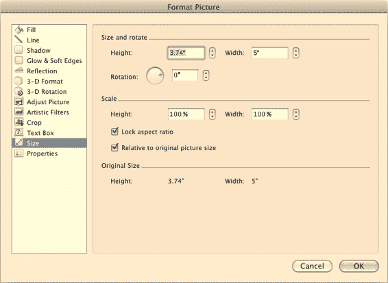

**图 9-15.** *使用对象格式对话框中“大小”类别的控件可以精确调整对象的大小和位置。*

### 让图片呈现你想要的样式

插入图片后，你可以使用功能区 `设置图片格式` 选项卡上出现的控件来使图片达到你想要的效果。你可以调整图片的颜色、为图片应用图片样式或裁剪图片，使其只显示部分内容。

#### 调整图片的清晰度、亮度、对比度和颜色

要调整图片的清晰度、亮度或对比度，请点击图片将其选中，然后选择 `格式` > `图片` > `调整` > `更正` 以打开 `更正` 面板（参见图 9-16）。点击你需要的颜色校正选项。

[www.it-ebooks.info](http://www.it-ebooks.info/)

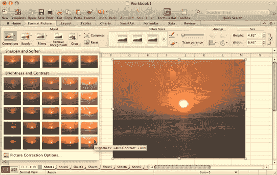

**图 9-16.** *要修复图片的清晰度、亮度或对比度问题，请打开“更正”面板并选择所需的外观。*

要更改图片中的颜色，请点击图片，选择 `格式` > `图片` > `调整` > `重新着色`，然后点击你需要的效果。`颜色` 下拉面板包含不同的部分，如 `饱和度`、`色调` 和 `重新着色`（例如，`灰度` 或 `棕褐色`）。

要应用诸如绘画笔触或柔光屏等效果到图片，请点击图片，选择 `格式` > `图片` > `调整` > `滤镜`，然后点击你需要的效果。

要将图片重置为原始外观，请选择 `格式` > `图片` > `调整` > `重设`。

#### 应用图片样式

若要为图片应用图片样式，请单击图片，然后点击功能区的 `Format Picture` 选项卡将其显示出来，再点击所需的图片样式。如果该图片样式出现在 `Picture Styles` 组的 `Quick Styles` 框中，直接点击即可；否则，将鼠标指针移至 `Quick Styles` 框上，待面板按钮出现后点击该按钮，然后在面板上点击所需的图片样式（参见图 9–17）。

[www.it-ebooks.info](http://www.it-ebooks.info/)

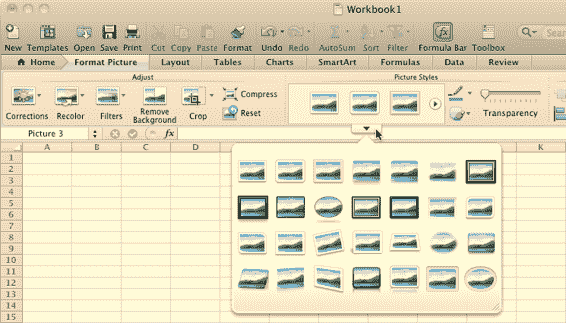

**图 9–17.** *从功能区 `Format Picture` 选项卡的 `Picture Styles` 组中的 `Quick Styles` 框或面板中选择图片样式。*

#### 裁剪图片

如果你只需要在工作表中显示图片的一部分而非整张图片，可以裁剪掉不需要的部分。

Excel 提供了多种裁剪图片的方式，但通常以下方法最为简单：

1.  单击图片以将其选中。Excel 会在功能区添加 `Format Picture` 选项卡。

2.  如果 Excel 未自动显示该选项卡，请点击 `Format Picture` 选项卡。

3.  选择 `Format Picture` > `Adjust` > `Crop`，注意点击 `Crop` 按钮的上半部分，而非下拉按钮。Excel 会在图片上显示裁剪手柄（参见图 9–18）。

[www.it-ebooks.info](http://www.it-ebooks.info/)

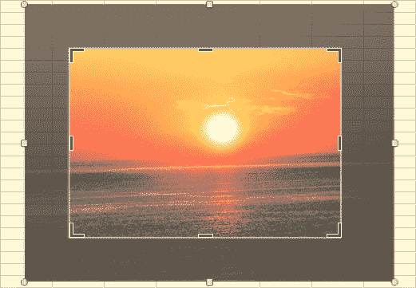

**图 9–18.** *裁剪的快捷方式是拖动裁剪手柄，使其包围住你想保留的图片部分。*

4.  拖动裁剪手柄，使裁剪区域包含你想要显示的图片部分：
    *   按住 `Shift` 并拖动，可等比例裁剪图像。
    *   按住 `Option` 并拖动，可围绕图像中心点均匀裁剪。
    *   按住 `Option`+`Shift` 并拖动，可围绕图像中心点等比例裁剪。
    *   按住 `Cmd` 并拖动，可按照工作表格线的增量进行裁剪。

**提示：** 如果你已将裁剪区域调整为所需大小，可以点击并拖动裁剪区域内的图片，使图片的不同部分显示在该区域中。你移动的是图片，而非裁剪区域——这就像你透过窗户移动风景，直到窗口显示你希望看到的部分。

5.  再次点击 `Crop` 按钮以关闭 `Crop` 工具，或点击工作表中的其他位置以取消选中图片。Excel 即会将裁剪效果应用到图片上。

**注意：** 你也可以将图片裁剪成特定形状。操作方法为：选择`Format Picture` > `Adjust` > `Crop`，点击`Crop`的弹出箭头按钮（而非按钮上半部分）。在出现的弹出菜单中，选择`Mask to Shape`，然后点击你想要的形状。

[www.it-ebooks.info](http://www.it-ebooks.info/)

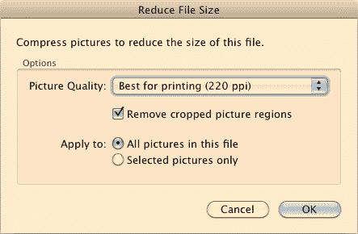

# 第 9 章：使用图片、SmartArt 等工具为工作表增添视觉效果

295

## 通过压缩图片节省空间

当你在工作表中插入图片时（而非如本章前面所述链接图片），Excel 会在工作簿中保存每张图片的副本。这可能会大幅增加工作簿的文件大小。

为了控制工作簿的文件大小，你可以压缩图片并删除其被裁剪掉的部分。具体操作步骤如下：

1. 单击一张图片，使 Excel 在功能区添加`Format Picture`选项卡。

2. 选择`Format Picture` > `Adjust` > `Compress`，打开`Reduce File Size`对话框（参见图 9–19）。

**图 9–19.** *当你需要减小一张或多张图片的文件大小，或删除图片中被裁剪掉的部分时，可以使用 Reduce File Size 对话框。*

3. 在`Picture Quality`弹出菜单中，选择所需的图片质量：

   - **最佳打印效果 (220 ppi).** 仅对图片进行少量压缩，使其保留足够高的质量以满足大多数用途。

   - **最佳屏幕显示效果 (150 ppi).** 对图片进行稍多的压缩，但仍保持适合屏幕观看的良好效果。

   - **最佳电子邮件发送效果 (96 ppi).** 将图片压缩至…

`保持当前分辨率`。保持图片的当前分辨率。当你需要在不改变分辨率的情况下移除图片裁剪部分时，可使用此设置。

4. 在`应用于`区域中，若只想影响已选中的图片，请选中`仅所选图片`选项按钮。通常情况下，你会更倾向于选中`此文件中的所有图片`选项按钮，让 Excel 压缩工作簿中的所有图片。

[www.it-ebooks.info](http://www.it-ebooks.info/)

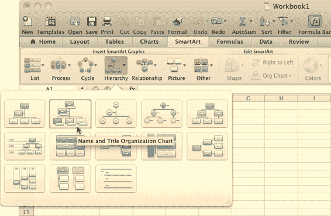

296

# 第 9 章：用图片、SmartArt 等图形美化工作表

5. 若想移除已裁剪的区域，请勾选`删除裁剪区域`复选框。当你确认不再需要调整工作簿中任何图片的裁剪以显示更多内容后，勾选此项是个好主意。

**注意：** 删除裁剪区域不仅能减小文件大小，还能防止裁剪区域包含敏感信息时造成尴尬。

6. 点击`确定`按钮。Excel 会关闭`减小文件大小`对话框，并按照你的指定更改图片质量或裁剪设置。

### 插入 SmartArt 图形

当需要创建组织结构图、流程图或维恩图等图示时，请使用 SmartArt 功能。请按以下步骤操作：

1. 将插入点或选区定位到要插入 SmartArt 对象的位置。

2. 点击功能区上的`SmartArt`选项卡以显示其内容。你也可以通过从菜单栏中选择`插入 SmartArt 图形`来显示此选项卡。

3. 在`插入 SmartArt 图形`框中，点击你想要创建的 SmartArt 图形类别按钮：`列表`、`流程`、`循环`、`层次结构`、`关系`、`图片`或`其他`。此时会打开一个面板，显示可用的类型。图 9-20 显示了`层次结构`面板，其中包含多种组织结构图。

**图 9-20.** *打开所需 SmartArt 图形类别的面板，然后单击所需的图形类型。*

[www.it-ebooks.info](http://www.it-ebooks.info/)

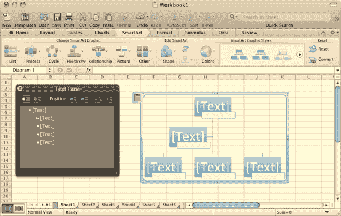

# 第 9 章：用图片、SmartArt 等图形美化工作表

4. 点击你想要的图形类型。Excel 会将其插入工作簿，并显示文本窗格（参见图 9-21）。

**图 9-21.** *插入 SmartArt 图形时，Excel 会在其旁边显示文本窗格，以便你输入文本。*

**注意：** 如果 Excel 未显示文本窗格，请点击 SmartArt 图形左上角的`文本窗格`按钮以显示它。当你不需要时，也可以点击此按钮隐藏文本窗格。

5. 在文本窗格中，为每个项目输入文本。输入时，Excel 会将文本添加到 SmartArt 图形中（参见图 9-22）。

[www.it-ebooks.info](http://www.it-ebooks.info/)

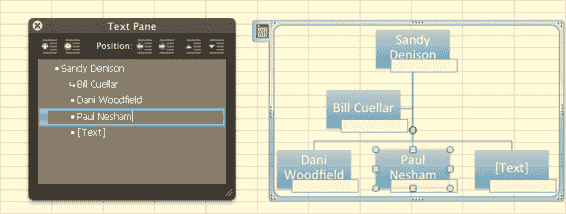

298

# 第 9 章：用图片、SmartArt 等图形美化工作表

**图 9-22.** *通过在文本窗格中输入文本来向 SmartArt 图形添加文本。*

6. 添加 SmartArt 图形所需的任何其他项目。例如，要在显示的组织结构图中添加标题，请点击每个标题占位符，然后输入标题。

7. 调整 SmartArt 图形的大小，使其最适合工作簿。例如，你可能需要将其调整为合适的尺寸，以与相关数据并排放置。

8. 如果需要更改 SmartArt 图形的布局，请从功能区`SmartArt`选项卡上的`更改 SmartArt 图形`组中选择其他布局。

9. 通过从`SmartArt`选项卡上`SmartArt 图形样式`组中的`快速样式`框或面板中选择样式，将样式应用于 SmartArt 图形。

完成 SmartArt 图形的创建后，像往常一样保存工作簿。

### 使用艺术字添加装饰性文字

如果需要为工作簿增添设计感，可以添加艺术字项目。艺术字为你提供了一种将文本转化为图形元素的便捷方式——例如，用于制作公司徽标。

要创建一个艺术字项，请按照以下步骤操作：

1. 从菜单栏选择插入艺术字以添加一个艺术字项，并将格式选项卡添加到功能区。

2. 在艺术字框中，将占位文本（“Your Text Here”）替换为你的文本（见图 9–23）。

**图 9–23.** *在艺术字容器中键入文本，然后将其拖动到工作表中的所需位置。*

3. 将艺术字项拖动到所需位置。将鼠标指针悬停在该项的边框上，然后拖动。

4. 根据需要调整艺术字项的大小。你可以拖动侧边或角部的手柄，或者在`格式`选项卡的`大小`组中的`高度`框和`宽度`框中更改数值。选中`大小`组右侧的复选框以保持艺术字项的纵横比（这样当更改高度时，Excel 会自动调整宽度，反之亦然）。

5. 格式化艺术字项，使其外观符合你的要求：

   - 将鼠标指针悬停在`形状样式`框上，单击出现的面板按钮，然后单击所需的样式。

   - 要更改艺术字项的填充，选择`格式` > `形状样式` > `填充`，然后单击所需的填充。

   - 要更改艺术字项的线条颜色、粗细或类型，选择`格式` > `形状样式` > `线条`，然后选择适当的选项。

   - 要应用效果，选择`格式` > `形状样式` > `效果`，然后选择所需的效果。例如，单击`三维旋转`子菜单，然后选择一个旋转效果。

   - 要更改文本样式，使用`格式`选项卡上`文本样式`组中的控件。

### 使图形对象相对于单元格定位

如本章前面所述，你可以将图形对象拖到工作表中需要其出现的任何位置。但你也可以将图形对象与其上方的单元格关联起来，这样当你移动单元格时，对象也会随之移动。当你需要将图形对象与特定单元格保持在一起时，此设置非常方便。你也可以让 Excel 在调整单元格大小时自动调整对象大小。

要控制图形对象是否随单元格移动和调整大小，请按照以下步骤操作：

1. 按住`Ctrl`键点击或右键点击图形对象，然后在上下文菜单中点击`属性`命令以显示`格式`对话框。例如，按住`Ctrl`键点击或右键点击一张图片，然后点击`设置图片格式`命令以显示`设置图片格式`对话框。

2. 在左侧窗格中，点击`属性`项以显示`属性`窗格（见图 9–24）。

**图 9–24.** *在`格式`对话框的`属性`窗格中，选择是否移动图形对象并随单元格调整其大小。你还可以选择是否打印该对象、锁定它或锁定其文本。*

3. 在`对象位置`框中，根据情况选择`大小和位置随单元格而变`选项按钮、`大小固定，位置随单元格而变`选项按钮，或`大小和位置均固定`选项按钮。

**注意：** 在`格式`对话框的`属性`窗格中，如果你希望避免打印图形对象，你也可以清除`打印对象`复选框。你还可以选中`锁定`复选框以锁定对象，或选中`锁定文本`复选框以锁定对象的文本；这些设置仅在你保护工作表以防止更改时才生效。

4. 点击`确定`按钮关闭`格式`对话框。Excel 会将你的选择应用于该图形对象。

## 排列图形对象以控制其可见性

当你在工作簿的同一区域放置了多个图形对象时，你可能需要安排它们在工作簿图层中的显示顺序，以控制它们彼此之间的相对外观。例如，你可能需要将某个特定对象移到图层堆栈的最前面，使其显示在其他对象之上，或者将另一个对象向后移动，使其显示在其伴随对象之一的后方。

要更改对象在图层中的位置，请按住`Ctrl`键点击或右键点击该对象，点击或高亮`排列`子菜单，然后点击相应的命令：

*   **置于顶层**：点击此命令可将项目移动到堆栈的最前面。

*   **置于底层**：点击此命令可将项目移动到堆栈的最底部。

*   **上移一层**：点击此命令可将对象向前移动一层。根据需要多次重复此命令，将对象在堆栈中向上移动到所需位置。

*   **下移一层**：点击此命令可将对象向后移动一层。与`上移一层`命令类似，你可能需要多次执行此命令才能将对象移动到所需位置。

## 总结

在本章中，你学习了如何在 Excel 中处理图形对象。你现在知道如何插入剪贴画以及如何使用 Office 的剪辑库应用程序管理剪贴画项。你了解了如何从 iPhoto 或 Mac 的文件系统中插入自己的图片，如何插入形状并设置其格式，以及如何将图形对象定位到所需位置。你还学习了如何重新着色、裁剪和压缩图片；如何创建 SmartArt 图形和艺术字项来丰富你的工作簿；以及如何使图形对象相对于单元格定位并排列图形对象以控制其可见性。

这是本书第二部分的内容。在第三部分中，我将向你展示如何分析数据、如何与同事共享工作簿以及如何实现工作簿自动化。

