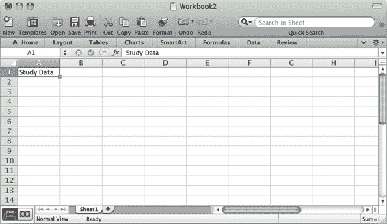
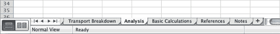

# 工具箱的设计初衷是让它看起来像另一个浮动窗口，但实际上它涉及特别棘手的编码挑战，需要在同一个框架内显示多个不同的窗口。因此，你可能会看到工具箱出现以下三种奇怪的行为：

如果你的 Mac 连接了多个显示器，你可能会发现 Excel 将在不同于当前活动工作簿窗口的显示器上显示工具箱。

如果你使用的是 Leopard（Mac OS X 10.5）而非 Snow Leopard（Mac OS X 10.6），你可能会发现当你使用 Spaces 功能从一个空间切换到另一个空间时，工具箱会移动到一个不同的空间。

当你在工具箱中切换窗格时，你可能会注意到一个延迟——尤其是在切换到 Scrapbook 时。这个延迟是因为 Excel 实际上是即时创建了一个新窗口，而不是显示一个已经存在的窗格。

所有这些奇怪的行为都是正常的，虽然有点烦人。但在撰写本文时，工具箱似乎在某些 Mac 上还会导致内存问题。如果你发现打开工具箱后 Mac 突然运行慢了很多，请关闭工具箱然后再重新打开。

## 在工作表和工作簿中快速导航

为了在 Excel 中快速轻松地工作，你需要了解在工作表和工作簿中导航的最佳方法。我们将在本节中介绍这些内容——首先确认我们使用相同的术语来指代 Excel 用户界面中的元素。

### Excel 用户界面的元素

当你创建了一个新工作簿或打开了一个现有工作簿时，Excel 会显示该工作簿的工作表。图 1-10 显示了一个打开工作簿的 Excel 窗口，并标明了用户界面的主要元素。

[www.it-ebooks.info](http://www.it-ebooks.info/)

**16**

**第 1 章：学习 Excel:Mac 界面的秘诀**

**图 1-10.** *Excel 应用程序窗口和工作簿的主要元素*

`公式栏。` 这是功能区下方的栏。此区域显示活动单元格中的数据或公式，并为你提供一个方便的位置来输入和编辑数据。

`引用区域。` 此区域出现在公式栏的左端。它显示活动单元格的地址（例如，`A1`）或你为方便引用而给该单元格指定的名称。

`行标题。` 这些是屏幕左侧标识每一行的数字。第一行是 1，第二行是 2，依此类推，直到最后一行 1048576。

`列标题。` 这些是工作表网格顶部标识列的字母。第一列是 A，第二列是 B，依此类推，直到 Z。Excel 接着使用两个字母：AA 到 AZ，BA 到 BZ，依此类推直到 ZZ。之后，Excel 使用三个字母：AAA、AAB，依此类推直到最后一列 XFD。

[www.it-ebooks.info](http://www.it-ebooks.info/)

**第 1 章：学习 Excel:Mac 界面的秘诀**

**17**

`单元格。` 这些是由行和列交叉形成的方框。每个单元格由其列字母和行号标识。例如，A 列的第一个单元格是单元格 A1，B 列的第二个单元格是单元格 B2。工作表中的最后一个单元格是 `XFD1048576`。

`活动单元格。` 这是你正在工作的单元格——接收键盘输入的单元格。Excel 会在活动单元格周围显示一个蓝色矩形。

`全选按钮。` 单击行标题和列标题相交处的这个按钮以选择工作表中的所有单元格。

`工作表标签。` 每个工作表在底部都有一个显示其名称的标签。要显示一个工作表，你可以在工作表标签区域中单击该工作表的标签。

`滚动按钮。` 单击这些按钮可以滚动工作表标签，以便你看到需要的标签。单击最左边的按钮可以一直滚回到第一个标签，或单击最右边的按钮滚动到最后一个标签。单击中间的两个按钮可以向后或向前滚动一个标签。

`视图按钮。` 单击这些按钮可以在普通视图和页面布局视图之间切换。你将在本章后面学习如何使用这些视图。

`拆分框。` 当你需要将工作表窗口拆分为两个或四个区域时，使用这些框。你将在本章后面的“拆分窗口以查看工作表的独立部分”一节中学习如何操作。

`当前公式读数。` 该读数显示应用于当前单元格或区域的六种常见公式——`AVERAGE`、`COUNT`、`COUNTNUMS`、`MIN`、`MAX` 或 `SUM`——中的任一种结果。你可以单击该读数来切换公式，或选择 `None` 项以不显示任何公式结果。例如，如果你选择单元格 `B1:B4` 并选择 `SUM` 公式，你将看到这些单元格中数值产生的总和。

### 在工作表之间导航

每个工作簿由一个或多个工作表或其他类型的表（如图表工作表或宏表）组成。你可以根据需要使用任意多个工作表，以便在单个工作簿文件中方便地分隔数据。例如，你可以为单个工作簿文件中的每个部门设置一个单独的预算规划工作表，而不是为每个部门创建一个独立的工作簿。

[www.it-ebooks.info](http://www.it-ebooks.info/)

**18**

**第 1 章：学习 Excel:Mac 界面的秘诀**

要显示你想要使用的工作表，请单击其标签（见图 1-11）。如果该工作表的标签在工作表标签栏中不可见，请单击滚动按钮将其显示出来（除非你已隐藏了该工作表）。

`提示：` 如果你想让工作表标签栏更宽以便一次看到更多标签，请将分隔条向右拖动。Excel 会相应缩小水平滚动条以进行补偿。

**图 1-11.** *使用工作表标签栏显示你想要的工作表或插入新工作表。你可以拖动分隔条来更改标签栏的长度。*

`提示：` 你可以通过按 `Cmd+Page Down` 快速移动到下一个工作表，或按 `Cmd+Page Up` 快速移动到上一个工作表。

### 更改活动单元格

在 Excel 中，你通常一次只在一个单元格中工作。该单元格被称为`活动单元格`，它接收来自键盘的输入。

你可以使用鼠标或键盘轻松移动活动单元格：

`鼠标。` 单击你想要激活的单元格。

`键盘。` 按箭头键一次将活动单元格向上或向下移动一行，或向左或向右移动一列。你还可以使用表 1-1 中显示的键盘快捷键来将活动单元格移动得更远。

`提示：` 如果你的 Mac 键盘没有 `Home` 键、`End` 键、`Page Up` 键和 `Page Down` 键，你将需要使用功能键快捷键。按 `Fn+left arrow` 作为 `Home`，`Fn+right arrow` 作为 `End`，`Fn+up arrow` 作为 `PageUp`，`Fn+down arrow` 作为 `PageDown`。根据需要使用这些键配合表 1-1 中的键盘快捷键——例如，按 `Cmd+Fn+left arrow` 移动到活动工作表中的第一个单元格。

[www.it-ebooks.info](http://www.it-ebooks.info/)

**第 1 章：学习 Excel:Mac 界面的秘诀**

**19**

**表 1-1.** *更改活动单元格的键盘快捷键*

**要更改活动单元格到** | **按下此键盘快捷键**

--- | ---

该行的第一个单元格 | `Home`

活动工作表的第一个单元格 | `Cmd+Home`

工作表中最后使用的单元格 | `Cmd+End`

向下翻一屏 | `Page Down`

向上翻一屏 | `Page Up`

向右翻一屏 | `Option+Page Down`

向左翻一屏 | `Option+Page Up`

工作表的最后一行 | `Cmd+down arrow`

工作表的最后一列 | `Cmd+right arrow`

工作表的第一行 | `Cmd+up arrow`

工作表的第一列 | `Cmd+left arrow` 或 `Home`

选定范围内按顺时针方向的下一个角单元格 | `Ctrl+.`（Ctrl 和句点键）

### 选择并操作单元格

要处理单个单元格，你只需单击它或使用键盘将其变为活动单元格。当你需要一次影响多个单元格时，你可以使用鼠标或键盘选择这些单元格。